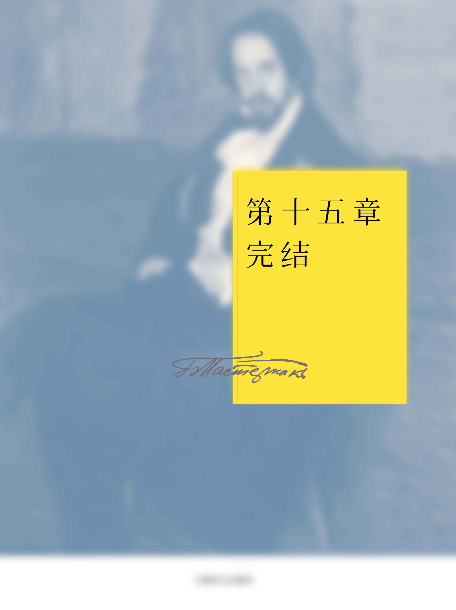

# 第十五章 完结

<h3 id="c211">一</h3>

日瓦戈的故事，要说的已经不多，只剩去世前最后八九年的光景了。这些年中，他越来越消沉颓唐，丢掉了医生的学识和习惯，也失去了写作的本领。有时摆脱了压抑颓丧的心境，振作一阵子，重又干起事来，可转眼又陷入长期的淡漠，对自己和世上的一切都感到兴味索然。几年间他早有的心脏病在加剧。这病他自己早就发现了，却没想到那么严重。

他来到莫斯科，正是新经济政策初期；那是苏维埃政权捉摸不定、充满假象的时期。他很瘦削，满脸胡茬，像个野人，样子还不如离开游击队回尤里亚京的时候。一路上他又同上次一样，渐渐把身上值钱的东西全扒下来换了面包和破烂衣服，好不至于赤身露体。就这样，他路上吃光了第二件皮大衣、一套外衣。当他出现在莫斯科街头时，戴了个灰毛皮帽子，打着裹腿，穿件磨光的军大衣。大衣扣子全掉了，变得像犯人敞怀的大褂。这身装束使他同首都广场上、公园里和车站成群结队的无数红军战士，没有什么两样。

他不是独自一人回到莫斯科的，身后一直形影不离地跟着一个漂亮的农家男孩，同他一样穿了一身军服。他俩就这副样子，到过日瓦戈童年熟识的目前莫斯科仅存的一些人家的客厅里。那里人们还记得他，接待了他和他的伙伴，不过事先都委婉地打听他俩回来是否去过澡堂，当时斑疹伤寒还十分猖獗。日瓦戈最初几次去那里时，人们对他讲了他的亲人离开莫斯科出国的情形。

两人都怕见人，由于过分胆怯就避免单独出去做客，因为一个人时就不好沉默，只能同别人谈话了。到熟人家里聚会时，通常他们两个瘦高身影总一起出现，躲在不惹人注目的角落里，默默地坐一个晚上，不参加大家的谈话。

衣着平常的大高个医生，配上他那年轻朋友，样子颇似从下层人民中来探求真理的人，而寸步不离的随从，好比一个盲目崇拜、言听计从的学生和追随者。这个年轻同伴又是何人呢？

<h3 id="c212">二</h3>

接近莫斯科的最后一段路程，日瓦戈坐上了火车；此前的一大半路，他是徒步走过来的。

他一路看到的乡村景象，比起逃出游击队林莽在西伯利亚和乌拉尔目睹的情形，丝毫没什么两样。只是那次他路过当地是在冬天，如今是夏末和干燥暖和的秋日，感觉轻松多了。

他经过的村落，一半是人去室空，好像刚遭到敌人洗劫；田里的庄稼扔着没人收。这些也的确是战争的后果，国内战争的后果。

九月底的两三天里，他走在一条大河高耸的陡岸上。河水迎面流来，从他的右边淌过。他的左边，从小路起直到云团涌起的天际，是没有收割的大片庄稼。相隔很远才有一片阔叶林，主要是橡树、榆树和槭树。一条条林带沿着深峪奔向河岸，在高崖和陡坡上横切小路，直到河边。

没收割的田野里，黑麦粒从熟透的穗中流出来。日瓦戈把一捧捧粮食塞到嘴里使劲嚼着。当没有可能用粮食煮粥的最困难时刻，他便这样充饥；这种没能嚼烂的生饲料，进到胃里很不好消化。

日瓦戈一生还从没见过这样深褐色的黑麦，像金子旧了变黑的颜色。平常按时收割，麦粒颜色要浅得多。

大地的色彩如无火之焰，它似乎在无声地狂呼救援。镶在田野边缘的，是冷漠镇定的广阔苍穹。天空好像进了冬季，绵长而多层的雪云，中间乌黑，两侧缀着白边，如黑影拂面般不停游过去。

一切都在缓慢匀称地活动。河水漂流，迎面蜿蜒着小路。路上走的是医生。云朵同他朝一个方向前进。连田地也没有静止不动，仿佛有什么东西在上面摇摆；那种轻微而无休止的蠕动，直令人作呕。

地里繁殖出无法计数的田鼠，从来没有这么多。入夜时日瓦戈还走在地里，不得不在地界旁找个地方露宿，老鼠就在医生的脸上、手上来回爬，还钻到棉裤和袖筒里。白天，一群群肥大的田鼠在道路上窜来窜去，人踩上去则成了一团滑泥，还吱吱哀叫不停。

村里那些毛茸茸的家狗变成了可怕的野狗，聚成堆尾随在医生身后，保持着相当的距离；还不时互相对望，像在开会商议何时扑上去把医生咬死。它们靠吃死了的野兽充饥，但也不反对尝尝漫野的小鼠。狗群从远处打量着医生，满有把握地跟随他朝前走，像是总在期待什么。奇怪的是它们不进林子，一靠近林带便渐渐放慢了脚步，然后转身跑走不见了。

那时林子和田地恰成鲜明的对照。田地没有人管，变得荒凉一片，好像信守离别前的誓言。森林摆脱了人，活似释放出来的囚徒，在自由的天地里洋洋得意。

通常人们，主要是乡下孩子，不等核桃成熟就打青的吃。如今，林坡上和谷地里，覆盖着原封未动的一片金叶，似乎由于秋阳的照晒变得土灰而且粗糙。枝叶中露出三四个合长在一起的一团团核桃，外皮裂开仿佛是扎了绳结。果实已经熟透，眼看要掉出来但还留在里面。医生沿途不住嘴地吃这核桃。他身上的口袋都塞满核桃，背包里也全是。整整一星期，这成了他的主要食粮。

医生觉得，他看到的田地是得了重病的田地，在发烧说胡话；森林则像大病痊愈后豁然开朗。他觉着森林里栖居着上帝，田地里却有恶魔在狞笑。

<h3 id="c213">三</h3>

就是在这几天的路途中，医生来到了一个居民逃散、房屋化成灰烬的村子。大火前只有一长排住房，盖在道路一边，靠河的另一边没有人家。

村里只有几间房幸免于难，大火后屋外也变得黑乎乎。里面同样空荡无人。其余的建筑全变成了炭堆，只有熏黑的烟囱矗立在当中。

河崖上到处是大坑，村民以前就靠从坑里挖取磨石谋生。最边上一间没烧毁的屋子对面，有三个没有做好的石磨盘扔在地上。这房子同别的一样，也无人住。

日瓦戈顺便走进了屋子。那晚上平静无风，可医生刚迈步进去，就好像有股风吹了来。干草和麻屑一起从地上卷了起来，墙上破纸也开始晃动。屋里一切都动起来，响起来。许多耗子吱吱乱叫，在地上跑散了。这一带地方，到处是老鼠横行。

医生走出了屋。背后的田野尽头，夕阳正在下沉。温和的夕照染黄了对岸，岸上一些树丛和水坑倒映在河水里，几乎贴近了江心。日瓦戈到了路那边，坐在一盘石磨上歇脚。

从崖下探出一个灰白头发的脑袋，而后是肩膀，再后是双手。从河边沿着小径走上一个人来，提着满满一桶水。那人一见医生，马上停下脚步，腰身齐着崖边。

“你要愿意，我给你喝个饱，好吗？你别碰我，我也不动你。”

“谢谢。让我喝个痛快吧。你倒是全上来呀。别害怕。我碰你干什么？”

从崖下提水来的，是个半大的男孩子，打着赤脚，破衣烂衫，蓬头垢面。

他尽管说话很客气，两眼却不安地直勾勾盯着医生。由于无法解释的原因，孩子十分激动，令人不免奇怪。他放下水桶，突然向医生扑过去，半路上又停下来，嘟嘟哝哝说：

“不可能……不可能……不是，这不可能，我看错了。对不起，请允许我问个问题，同志。我觉着你很面熟。对了！对了！医生叔叔！”

“你是谁呀？”

“没认出来？”

“没有。”

“从莫斯科和你们乘一辆车厢来的。赶我们去服劳役，还有押送的人呢。”

这原是瓦夏·布雷金。他倒在医生面前，吻着医生的手哭起来。

遭火灾的地方，正是瓦夏的家乡韦列坚尼基。他的母亲已经不在人世。村子遭劫起火的时候，瓦夏躲在一块大石底下的地洞里，母亲当他被人抓到城里去，愁得发了疯，淹死在佩尔加河里。此刻医生和瓦夏坐着交谈，就是在佩尔加河岸上。瓦夏的妹妹阿廖卡和阿丽什卡，据不确切的消息说安置在另一个县的孤儿院里。医生带着瓦夏一起去莫斯科，一路上他给日瓦戈讲了许多可怕的事。

<h3 id="c214">四</h3>

“这地里掉下的麦子，还是去年秋天种的冬麦呢。刚刚播种完，就出了倒霉的事。那是在波利娅
 <a href="21-%E7%AC%AC%E5%8D%81%E4%BA%94%E7%AB%A0%20%E5%AE%8C%E7%BB%93.md#m1">
[1]
</a>
 阿姨走了以后。这个季娅古诺娃阿姨你还记得吗？”

“不记得。再说我也不认识。那是谁呀？”

“你怎么会不认识季娅古诺娃呢？和咱们一起坐车来着。什么事都放在脸上，又白又胖。”

“是不是那个一会儿扎辫子一会儿解辫子的？”

“对，对，正是她，扎辫子的。”

“我想起来了。等等。我后来在西伯利亚看见过她，在一个城市的大街上。”

“这可能吗？你看到了波利娅阿姨？”

“你这是怎么啦，瓦夏？像发疯似的摇晃我这胳膊。小心别给我揪掉。脸也红得像个姑娘。”

“她怎么样？快告诉我，快点。”

“我见她的时候，她过得很好。还讲到你们家。好像她住在你们家，要么是来做客。也许我忘了，全搞乱了。”

“没有，没有。是在我们家来着。妈妈喜欢上她了，当她是自己的亲姊妹。人不爱说话，挺能干活，手工特别好。她在我家的时候，家里吃穿都不愁。后来硬是把她从村子里给撵走啦，编了许多闲话。

“村里有个庄稼汉叫哈拉姆，缠上了季娅古诺娃。他是个马屁精。她可不睬他。因为这件事，他对我怀恨在心，就编我们俩，我和波利娅的坏话。就这样，她离开了这里，全是那人给害的。这以后就倒霉了。

“离这不远发生了一件可怕的谋杀案。一个单身寡妇在靠近布依斯的林中田庄上，被人害死了。她一个人住在森林边上，穿了双男人皮鞋，鞋上还有提鞋环和松紧带。有条恶狗拴着链子在田庄四周沿着铁丝网跑，名字是戈尔兰。家业和土地，都是寡妇自己经管，没有帮手。那年冬天突然早到，出乎意料。很早便下了雪。寡妇还没有挖出土豆呢。她来到韦列坚尼基村说，求你们帮帮忙，我会分给你们一份土豆或者是付给你们工钱。

“我自告奋勇去刨土豆。到了她田庄一看，哈拉姆已经在那儿了，比我去得早。寡妇没告诉我。总不能为这个打架吧。两人就干了起来。那次天气最坏，雪夹着雨，又黏又脏。挖出土豆以后，拿土豆秧点起火，用烟烘干土豆。等全刨完，她同我们算了账，倒没亏待我们。她让哈拉姆先走，朝我使了个眼色，意思是：和你还有事，要么以后再来一次，要么留下别走。

“等第二次去她那里，她说，我不愿把多余的土豆交出去，让国家给征集走。你是个好青年，我知道你不会出卖我。你看我实话都对你说了。本来我可以自己挖个窖把土豆存起来，可你看外头这天气。我动手晚了，已经到了冬天。一个人干不完，你替我挖个窖，不会亏了你。咱们把坑里面烤干就埋进去。

“我给她挖了个坑，为了保密，坑底很宽，坑口很窄，像个瓦罐。窖里也点火烤干烤暖。那又是刮风下雪的日子。我们把土豆藏好，上面用土盖上。任凭谁也是找不到的。我自然是一个字也不漏。对谁都不说，妈妈和妹妹们全不知道。

“这事以后，过了才一个月，田庄上就发生了抢劫案。有从布依斯来路过那里的人，说那里房门大开，整个洗劫一空，寡妇也失踪了。戈尔兰挣脱链子跑走了。

“又过些时候，在新年将近的瓦西里节里，是入冬第一次转暖的傍晚，大雨倾盆，把高坡上的雪全冲刷下来，露出了地面。戈尔兰跑来，用爪子扒化了雪的土地，正在藏土豆的窖口。这狗扒开土，坑里就露出两只脚，穿着有松紧带的皮鞋。你想可怕不可怕！

“在韦列坚尼基村里，人们都很可怜寡妇，常纪念她。谁也没怀疑哈拉姆。怎么想得到呀。不可能嘛。要真是他干的，他哪敢留在这儿，满村子洋洋得意地转悠。那他一定得躲开我们，走得远远的。

“这下子田庄上好使坏的一些富农，见了发生的惨案可高兴了。他们想：咱们来把村子搅和一下吧！他们说：你们看看，城里人都干了些什么！这是教训你们，给你们颜色看。别藏粮食，别埋土豆啦！你们这些傻瓜可倒好，说什么是林子里强盗干的，说梦见强盗进了田庄。你们可太天真了！老老实实听城里人的话吧！他们还会整得你们更厉害，会把你们活活饿死。村里人要想过好日子，就得跟我们走。我们能教你们聪明起来。城里来人就得把你们最心爱的东西、你们的家产全抢光，可你们还交给他们什么余粮。要是有事，应该操起叉子拼命。谁想反对大众，小心脑袋。老人们这样就闹腾起来，又是夸口，又是集会。那个马屁精哈拉姆，正巴不得有这种机会。他帽子往头上一扣，就进了城。到那嘁嘁喳喳讲了一通，说村里闹得这样，你们坐在这儿干什么吃的？这得让贫农委员会行动。只要你们下命令，我马上把他们分个一清二楚。说完他倒溜之大吉，再没有露面。

“后来发生的一切，可就全是鬼使神差了。谁也没有挑唆，谁也没有过错。城里派来不少红军。还来了法院的人，来了就审我。这是哈拉姆诬告的，说我是逃跑出来的人，又逃避劳动，还鼓动村里人造反，甚至说寡妇是我害的。把我锁到了一间屋里。幸亏我想到了把地板掀起来，从屋下溜走，藏到地下的石洞里。我头上整个村子起了火，我却不知道。我头上妈妈掉进了冰窟，我也不知道。事情就这么发生了。红军战士来后，给他们腾出间空房，送酒来喝，人人灌得酩酊大醉。夜里由于用火不小心，引着了房子，邻房也就跟着起了火。起火的地方，村里人都拔腿跑掉了。谁也没去放火烧外来人，但那些人显然是全被活活烧死了。谁也没有撵我们村遭了火灾的人离开这里，离开这住惯了的火场。是他们自己害怕才逃的，担心再出别的事。那些带头的吝啬鬼又煽动说，每十个人里要枪毙一个。我可是一个人影也没见到，人们走个精光，不知在哪儿流浪呢。”

<h3 id="c215">五</h3>

医生和瓦夏来到莫斯科，是在一九二二年的春天，刚开始实行新经济政策。天气暖和晴朗。太阳照在救世寺院的金黄圆顶上，反射出无数光点，返落在方石铺成的广场上，石缝中杂草丛生。

对私人经营的禁令取消了，允许进行严格限定的自由贸易。旧物商人在商品流通范围内可以在拥挤不堪的市场上成交。这种成交的规模极小，却刺激了投机倒把，导致滥用职权。小生意人的忙碌，不能生产出任何新的东西，不能给城市的萧条增加任何一点物资。一些人通过无数次地转手倒卖发了家。

一些人家里有并不算大的藏书室，便从书柜里抽出几本带到某个地方去卖。有人向市苏维埃提出，希望开办合作性质的图书买卖，为此又要求给房子。于是拨给了自革命头几个月起已经空荡无物的存鞋仓库，或者是那时关闭了的养花房。在那里宽大的拱顶下，人们出售自己的薄而无用的书籍。

将军夫人们以前遇到困难的时候，就不顾禁令偷偷烤制白面包出售；这会儿便到一个停业几年清理账目的自行车行中，公开地做面包生意。她们改换门庭，接受了革命，从前答话说“是呀”、“很好”，如今只说“有那么回事”。

到莫斯科之后，日瓦戈说：

“得干点什么事了。”

“我想学习。”

“这个自然应该。”

“还有一个希望。我想凭回忆给妈妈画张像。”

“太好了，可是这得会画画呀。你过去试过吗？”

“在阿普拉克辛村，趁叔叔不见的时候，我用碳笔画过。”

“那好吧。愿你成功。咱们努力试试看。”

瓦夏并不具备绘画的巨大才能，但说中等水平是绰绰有余的，完全可以去搞实用绘画。日瓦戈托人把他安排到原来的斯特罗甘学校的普通教育部。他后来从那里转到印刷系。在印刷系他学习了石印技术、印刷和装订本领，以及书籍的艺术装帧。

医生和瓦夏两人搞起协作来。医生写些只有一个印张的小书，论述各种问题，由瓦夏在学校里印出来，算作他业务考试的成品。书印得不多，拿到一些同人新开办的旧书店里散发。

这些书的内容，包括了日瓦戈的哲理、他的医学观点、他对健康与不健康的界说、关于种变和进化的思考、关于人的个性是机体的生理基础，以及日瓦戈对历史和宗教的看法（很接近他舅舅和谢拉菲玛的观点）、关于普加乔夫旧地的札记（医生曾经到过那里）、日瓦戈写的诗歌和短篇小说。

书写得很好懂，采取谈话的形式，但目的同通俗作家大不一样，因为都是些有争议的见解，信笔写来，缺乏足够的检验，但总是很生动、很新颖。这些书销得快，颇得读者的好评。

那时候一切都成了专业，如写诗、文学翻译的技巧。无论什么都要研究，写出理论专著。无论哪个方面，都设立研究所。出现了形形色色的思想工作者“之家”，各种艺术的研究院。这些人员膨胀的机构中，有一半请日瓦戈去担任在编的医生。

医生和瓦夏亲密相处，同住了很长的时间。这期间他俩一次又一次，换过了许多房子或败破的屋角，都是不适于住人、极不方便的地方。

日瓦戈一到莫斯科，马上就去西夫采夫看了看原来的房子，得知他的家人路过莫斯科时没有去那里。驱逐出国一举，使一切全变了样。医生和家人住的房间，已经住进了外人，他个人和家里的东西荡然无存。人们看到日瓦戈，连忙躲避，像见了相识的危险人物。

马克尔得到高升，不住在西夫采夫了。他被调到穆奇内担任警备司令。根据职务条件，他们一家可以得到一套首长住宅，不过他宁可住在过去看院子的人的旧房子，虽是土地，却有水管，又有俄式大火炉。冬天，全城的楼房里自来水管和暖气都冻裂了，只有看院人的屋里暖暖和和，水管也不上冻。

这时，医生和瓦夏的关系趋于冷淡。瓦夏有了不同寻常的成长。如今他说的想的，比起佩尔加河岸韦列坚尼基村里那个蓬头赤脚的孩子，完全判若两人。革命所宣告的真理那么显而易见，那么具有说服力，越来越吸引了他的注意力。医生不很好懂的形象语言，在他看来倒成了谬误的声音；这语言因为受到责难而又自知无能为力，才如此闪烁其词。

医生到各种机关去奔波。他忙着两件事。一是证明自己家人政治上无辜，取得他们返国的合法权利；二是为自己申请出国护照，要求获准去巴黎接回妻儿。

令瓦夏奇怪不解的是，医生奔波时表现得颇为冷淡，无精打采。日瓦戈总是过早地匆忙断定白费了力气，过于武断而且几乎有些庆幸地宣称：再努力也徒劳无益了。

瓦夏越来越经常地责备医生。日瓦戈对他的合理责难并不生气，但两个人的关系变坏了。最后终于友情破裂，不得不分手。医生把两人同租的房间留给了瓦夏，自己搬到了斯文季茨基的楼里。在那里，神通广大的马克尔到斯文季茨基的旧宅中给日瓦戈隔出了一角。这顶头的一角，包括斯文季茨基原来的浴室，现已不能使用了；还有隔墙一间只有一扇窗子的小屋、歪歪扭扭的厨房，厨房有个后门，几乎快掉下来，并且已然下沉。日瓦戈迁到这里之后便丢掉了医术，变得邋邋遢遢，也不再见熟人，过起贫困的日子。

<h3 id="c216">六</h3>

是个冬季灰暗的星期天。炊烟不是在屋顶上形成长柱，而是从小气窗冒出来，黑乎乎一股股地缭绕不散。尽管有限制，人们还是安装临时小铁炉，从气窗口通出铁烟筒来。城市的生活，仍没有走上正轨。穆奇内市的居民，脏得总像没洗脸，爱生疖子，冻得常患感冒。

因是星期天，马克尔一家人全聚在家里。

一家人坐在一张长桌旁吃饭。凭粮食卡片定量供应面包的时期，清早天刚亮，人们就在这张桌上把全楼住户的粮食卡，用剪刀剪下一小块，分类点清，分门别类夹到包里或钱里，送到面包铺。回来以后，把面包切成小块，给居民们按份称好。这一切如今已成过去，粮食分配换了别的办法。坐在长桌上的人们，吃得津津有味，听得到咀嚼和吧嗒嘴的声音。

看院人的这间屋子，一半被中间高大的俄式火炉占据了，旁边床铺上有一床绗过的被子垂下一个角。

进门的过道里，有个泄水盆，墙上装着自来水管的龙头，有自来水供应。房间两边放着两条长凳，底下塞着装满东西的包袱和衣箱。左侧有个厨房用的小桌子。桌子上的墙壁中，钉着一个碗架。

炉里生着火。屋中很热。马克尔的妻子阿加菲娅，把衣袖挽到肘腕站在炉前，用长炉叉挪动炉里的好多罐子，看需要一会儿推成一堆，一会儿又分散开。她满脸是汗，有时被炉火照亮，有时又被烧好热汤的蒸汽遮盖住。她把罐子挪到一边，从里面拖出铁盘上的油饼，一下子把饼翻了个，又送回直到烤焦。这时日瓦戈拎着两只水桶走进来。

“招待客人哪。”

“请吧。坐下坐下，做个客吧。”

“谢谢，吃过了。”

“知道你那个‘吃过了’！坐下吃点热的。干嘛嫌弃呀。是烤土豆，有饼有汤。”

“不啦，谢谢。对不起，马克尔，左一趟右一趟来打搅，把屋子都弄凉了。我想一次多存点水。斯文季茨基家的锌浴盆我全擦干净了，把它盛满，再往大桶里装点。再来提上五趟十趟，往后许多时候就不来打扰了。请原谅我往这儿跑。除了你这儿，没处可去呀。”

“你可劲儿灌吧，没啥心疼的。别的没有，水可是管够。随便用好啦。我们又不做这个买卖。”

桌旁的人都大笑起来。

等日瓦戈第三次进屋提第五和第六桶水，马克尔口气就有点变化，话也不是那么说了。

“女婿们问我：这是谁呀？我讲了，他们不相信。你灌水吧，别多心。只是别洒到地上，马虎鬼！看你把水泼到门坎上了。冻了冰，可不是你来用铁棍敲。倒是关严门呀，懒鬼！冷气全进来了。是呀，我对女婿们讲了你是什么人，他们都不信。在你身上花了多少钱吧！学习来，学习去，工夫全白扔了。”

日瓦戈第五次还是第六次来时，马克尔的眉头就皱起来了。

“好啦，你再拎一回就得啦。老兄，总该知个好歹吧。我们那个小女儿，玛丽娜老护着你。要不我可不管你是什么好人，早把门栓插上了。你还记得玛丽娜吗？就是在头上坐着的，黑脸庞。看她脸都红了。她说：你别欺侮他，爸爸！可有谁欺侮你呀？玛丽娜在中央电报局当报务员，懂得外国话。她说你很不幸，她可怜你，说为了你下火海也去。可你没有出头，能怨得我吗？不该往西伯利亚跑呀，危险的时候把房子扔掉了。是你们自己的过错。你看我们，闹饥荒、白匪包围的时候，顶住了没走，没有动摇，也就没招灾。你怪自己吧。冬尼娅你没保护好，现在在国外流浪。和我什么相干。这是你自己的事嘛。你可别怪我，我要问一句，你拎这么多水干什么？别是有人雇你在院子里泼个冰场吧？唉，拿你有什么办法呀，讨人厌的家伙。”

桌上又是一片哄笑。玛丽娜不满地环视家人，生起气来，数落他们一通。日瓦戈听到她的声音大感惊讶，但没弄明白是怎么回事。

“要洗的太多，马克尔。得打扫房子，擦地板，还想洗点衣服。”

桌上的人都很惊奇。

“说这话你也不害臊。这不该是你干的。你是中国洗衣妇呀？真说不上你是怎么了！”

“尤拉·安德烈耶维奇，你要赞成，我让女儿去帮你。她去洗洗衣服，刷刷地板。需要的话，缝补点什么。孩子，你别怕他。你看他多有礼貌，和别人不一样，从来不会欺侮人。”

“这可使不得，阿加菲娅，没有必要。我绝不同意让玛丽娜为我弄脏了身子。她怎么能给我当小工呢？我自己对付得了。”

“你不怕脏，我倒不行？你怎么这样犟呀？干吗不让我去？要是我去你那儿做客呢？真得撵我出来吗？”

玛丽娜本可以成为一个歌手的。她那纯真的歌喉，高亢有力。说话声音并不高，可那力量却超过了说话的需要。这声音似乎独立存在，不和玛丽娜融成一体；又好像来自另一个房间，在他背后回荡。这声音是她的保护神。一个女人有这样的嗓子，有谁愿去欺侮她，惹她伤心呢？

从这次星期天打水起，医生便和玛丽娜交上了朋友。她常去医生家帮做家务。有一次她留在了他家里，从此再没有回到看院人的房间去。就这样她成了日瓦戈第三个妻子，却没有登记。他同第一个妻子还没有离婚。很快两人又生了孩子。玛丽娜的双亲，不无骄傲地叫自己女儿是医生太太。马克尔老叨叨，怨日瓦戈同玛丽娜没举行婚礼，没有登记。妻子反驳说：“你是疯了呀？冬尼娅还活着，这样怎么成？这不是重婚吗？”马克尔回答说：“你自己才是傻瓜呢。管冬尼娅干吗？冬尼娅和没有一样嘛！法律不会保护她的。”

有时日瓦戈开玩笑说，他俩的结合是二十桶水的浪漫故事，就像二十章或二十封信的浪漫故事一样。

玛丽娜能够谅解日瓦戈此时已经形成的一些莫名其妙的怪癖，谅解一个颓唐而且意识到自己颓唐的人所惯有的任性，谅解他的肮脏和凌乱。她忍耐着他的唠叨、粗鲁、恼怒。

她的自我牺牲，还更有甚者。由于他的过错，他们有时陷入自己造成的甘愿承受的贫困之中，这时玛丽娜为了不扔下他一个人呆着，连工作都辞去不干了。机关里很器重她，过了一段时间便又痛痛快快接受她回去工作。日瓦戈异想天开，她也就跟着他挨家去找活儿挣钱。两人按计件付酬的办法，给各层楼的房客们锯木头。有些人，特别是新经济政策初期发了家的投机商，还有靠近政府的科技和艺术界人士，开始盖房子做家具。有一回，玛丽娜和日瓦戈小心翼翼地穿着毡鞋走在地毯上，生怕把街上的锯末带进来，在往主人的书房里搬劈柴。那人埋头读着什么，毫不理睬，朝锯柴禾的一男一女连一眼都没看。是主妇出面同他们商谈，安排，最后算了账的。

“这小子看什么这样入神？”医生起了好奇心。“他拿铅笔勾画，干吗那样恶狠狠的？”抱着劈柴路过写字台时，他从读书人背后探头一看，上面摆着几本瓦夏以前在学校排印的日瓦戈写的小书。

<h3 id="c217">七</h3>

玛丽娜同医生住在斯皮里多夫卡。戈尔东在旁边的小布龙街上租了一间屋子。玛丽娜和医生有了两个女儿：卡普卡和克拉什卡。卡普卡已经七岁，刚降生的克拉什卡还只有六个月。

一九二九年的初夏，天气炎热。一些熟人不戴帽子，不穿上衣，跑过两三条街相互做客。

戈尔东的房间，构造很特别。过去这里曾是一个时装裁缝的店铺，分成上下两层。朝街一面有扇大玻璃橱窗，贯通上下两层。玻璃上用金字写着裁缝姓名和他的业务。橱窗后面是一个螺旋式楼梯，从下层通到上层。

如今这房子分出了三层。

店铺里靠加横板，在两层之间挤出一个小阁楼，它的窗子对住家来说颇为特别。窗户高有一米，底下与地板齐。玻璃上是金字遗迹。透过字迹空隙，可以看到室内人的双腿，直到膝盖，阁楼里住的就是戈尔东。他这里现在坐着日瓦戈、杜多罗夫、玛丽娜和孩子。孩子同大人不一样，能在窗柜子里完全站直。过不一会儿，玛丽娜就领上女儿走了。屋里只剩了三个男人。

他们在闲谈。有了多年友情的中学同学们，在夏天凑到一起懒洋洋、不慌不忙地交谈，便是这个样子。那么，这是什么样子呢？

其中会有个人，掌握了足够用的词汇；他讲起话来，思考问题，都很自然连贯。只有日瓦戈能做到。

他的两个朋友缺少需要的语汇。他们没有讲话的才能。为了补救词汇的贫乏，他俩谈话时在屋里走来走去，不断吸烟，挥动胳膊，多次重复一些词语（“老兄，这可不够真诚。”“就是嘛，不够真诚。”“是呀，是呀，不够真诚。”）。

他俩却没意识到，交际时这种过分的举动，绝不表示个性的热情和爽朗，相反倒说明不完美，有缺陷。

戈尔东和杜多罗夫属于很不错的教授圈子里的人。他们生活在什么里面呢？是好书、好的思想家、好的作曲家，昨天和今天永远美好的音乐，而且仅仅只有美好的音乐。他们不明白，自己这种平庸趣味，其害处甚于毫无趣味。

戈尔东和杜多罗夫不明白，就连他俩轮番责备日瓦戈，也并不是出于对朋友的忠诚，不是出于对他施加影响的愿望，而是因为不善于独立思索，不会按自己的意愿驾驭谈话。谈话好比飞跑起来的马车，把他俩拉向根本不愿去的地方。他们无力调转马车，结果必定撞到什么上去。于是两人在奔跑中，带着一大堆说教和劝喻，撞到了日瓦戈的身上。

对于他们唱高调的起因、同情心的脆弱、议论的陈腐，日瓦戈了如指掌。可他怎么好这样说：“亲爱的朋友！你们和你们代表的那个圈子，受到你们宠爱的那些人物、权威的光彩和艺术，其实全部平庸得不可救药。你们身上仅有的一点新鲜的活力，就在于同我生活在一个时代，在于了解我这个人。”但要把内心这种看法对朋友讲出来，那还得了吗？为了不伤他们的心，日瓦戈只好乖乖地听他们说。

杜多罗夫不久前才结束第一次流放的生活，从流放地回来。恢复了一度被剥夺的权利，也被允许重新在大学执教。

这时他对朋友讲起了流放中的感受和心情。他对朋友说得很真诚坦率。他的一些看法，不是基于胆怯或别的什么考虑。

他说，对他起诉的缘由、狱中和出狱后对他的态度，特别是检察员同他面对面的谈话，这些都给他清洗了脑子，政治上得到了改造，使他对许多事茅塞顿开，作为一个人他变得成熟了。

杜多罗夫的议论很合戈尔东的心意，正是因为这番议论属于老生常谈。他不停地点头同意。杜多罗夫的所说所想，已是人所共知的东西，可这一点恰恰感动了戈尔东。人云亦云的感情俗套，在他眼里成了人类普遍的共性。

杜多罗夫这些充满善意的言谈，很符合时代的风尚。但正是这种言谈所带有的规律性的一望可知的虚伪，引起了日瓦戈的愤怒。不自由的人，总要美化自己不自由的处境。中世纪便是如此，耶稣会员就总是利用这一点。日瓦戈忍受不了苏联知识分子的政治神秘主义，忍受不了那种所谓知识分子的最高成就，或如当时人们所说的时代的精神顶峰。这个印象，日瓦戈也瞒着朋友没说，免得争吵起来。

引起他兴趣的，完全是另一件事。杜多罗夫讲了和他同一囚室的奥尔列佐夫的故事。奥尔列佐夫是个神甫，他有个六岁的女儿赫里斯季娜。父亲的被捕和此后可悲的命运，对她是个大打击。“宗族人士”、“丧失权利者”——这类字眼在她看来是耻辱的标记。说不定她在热烈的幼小心灵中，已经发誓有朝一日要抹去慈父名字上的污点。这个早早定下的长远目标，唤起了她不可遏制的决心，使她小小年纪便成了狂热的信奉者，崇拜共产主义中一切她认为无可辩驳的东西。

“我走啦。”日瓦戈说，“别生我的气，戈尔东。屋子里气闷，外面又热。我喘不上气来。”

“你看见了吧，地板上的气孔开着呢。对不起，我们烟抽得太多了。我们老忘，有你在时不能抽烟。这屋子盖得太缺德，怨不了我。你另给我找一间吧。”

“我这就走，戈尔东。咱们谈得不少了，谢谢你们对我的关心，亲爱的同志们。我这可不是娇气，这是病，血管硬化。心肌膜耗损，有一天就要破裂。可我还不到四十岁。我不是酒鬼，不是挥霍放荡的人。”

“你给自己唱挽歌还早。尽说傻话。你可要活呢。”

“咱们这时代，微量心脏溢血的现象十分常见，不是都会致命，有些时候能活下来。这是新近时代的病症。我看发病是精神上的原因。现在要求我们之间绝大多数的人，经常地昧良心干事，几乎快形成了一个制度。日复一日违心地表现自己，不可能不给身体造成后果。你明明不喜欢，却要去张罗；分明会给你带来不幸，却要你高兴。我们的神经系统，不是徒有其名，不是杜撰的东西，是纤维组成的肉体。我们的心灵占有一定的空间，生存在我们身上，好像牙长在我们嘴里。没完没了地强制神经，不可能不受到惩罚。我听你讲到流放，讲到流放中得到了成长，讲到流放改造了你，心里很不舒服。这就好比一匹马，讲它在练马场里自己骑自己练跑。”

“我要维护杜多罗夫。你是完全忘了人类的语言。人们讲的话，你已经听不进去。”

“很可能是这样呢，戈尔东。不管怎么说，对不起，放我走吧。我喘不上气。说真的，绝不是夸张。”

“等等，这全是托辞。要我们放你走，你得先直截了当、真心实意地回答我们一个问题。你同意不同意，你该改变一下，该纠正错误了？这方面你打算怎么办？你得把你和冬尼娅和玛丽娜的事澄清一下。人家是两个活人，是有感情、懂痛苦的女人，可不是你脑子里任意组合的虚无缥缈的思想。再说，像你这么一个人，无所事事地混日子，难道不害羞吗？你不能再沉睡再懒惰了，应该振作起来，好好弄明白周围的事物，不要莫名其妙地那么孤傲，对，对，正是不要那种不可原谅的傲慢；然后该出来上班，去给人治病。”

“好，我回答你们。最近我自己也常常想这些事，所以能够毫无羞愧地对你们做些保证。我想一切都会解决好的，而且会相当快。你们看着吧。真的，不骗人。一切都会好起来。我十分强烈地向往生活，而生活就意味着不断向前冲，奔向更高级更完美的东西，并且获得它。

“我很高兴，戈尔东，因为你能替玛丽娜说话，就像从前为冬尼娅说话似的。可是要知道，我和她们并没有不和。不论她俩还是别的什么人，我都没争吵。开初你曾经责怪我，为什么我称她是‘你’，可她回答我时说‘您’，还客气地呼我的名字和父称。那种不自然的关系还更深些，但早已经消除了，改变了，做到了平等相处。

“我还可以告诉你们一个好消息。巴黎又开始给我来信了。孩子长大了，同法国伙伴在一起毫不感到拘束。舒拉快要念完那里的小学，玛尼亚也马上要入小学。不知为什么我相信他们很快会回国，尽管已经加入了法国籍；还不知用什么办法，但一切都会解决好的。

“从许多迹象看，岳父和冬尼娅知道了玛丽娜和两个女儿。我自己写信没提过。这些情况一定是辗转传过去的。岳父自然感到伤害了他做父亲的感情，他替冬尼娅难过。这就是五年没通信的原因。刚回莫斯科时，有一段时间我们是通信的。后来突然不再复信了。从此断绝了来往。

“现在，从不久之前，我重又开始接到那边的来信。所有的人，包括孩子，都写来了信。很热情，很亲切，好像情绪缓和了些。也许冬尼娅有了什么变化，结识了新朋友，上帝保佑她。我说不准。我有时也给他们写。不过说真的，我再也受不了啦。我走了，要不然会背过气去。再会。”

第二天早晨，玛丽娜慌慌张张跑来找戈尔东。家里没有人看孩子，只好把小女儿克拉什卡用被裹好，一只手搂在怀里，另一只手拉着落到后面不肯走的卡普卡。

“尤拉在你这儿吗，戈尔东？”她的声音都变了。

“他没有在家住吗？”

“没有。”

“那就是在杜多罗夫那里。”

“我去过了。杜多罗夫到大学上课去啦。不过邻居认得尤拉，说他没去那里。”

“那他上哪去了？”

玛丽娜把襁褓中的克拉什卡放到沙发上，就歇斯底里地大哭起来。

<h3 id="c218">八</h3>

两天来，戈尔东和杜多罗夫没有离开过玛丽娜。他俩轮流值班看护，不敢扔下她一个人；在间歇的时候，就出去寻找医生。他们跑遍了估计他可能去的一切地方，也到了穆奇内大院和西夫采夫楼房，问过了所有他曾经工作过的这个“之家”、那个“研究院”。凡是他俩多少知道一点的他的老熟人，只要能找到住址，无不查遍了。然而竟毫无结果。

他们没有报民警局，因为不想对当局提起医生；虽说他有户口也没受过审，但按照如今的理解反正远远不是个模范人物。他们决定只有在不得已的情况下才找民警寻查下落。

第三天上，玛丽娜、戈尔东、杜多罗夫在不同的时间里各收到日瓦戈一封信。信中非常抱歉给他们添了麻烦，让他们担惊受怕。他请求他们原谅，别再担心，还叮嘱不要再找他，反正是徒劳无益。

他说，为了尽快完全改变自己的生活，想一人独自呆一段时间，以便集中精力干点事情。等在新的工作中站住脚，肯定在变化之后不致再走老路，就离开隐蔽所，回到玛丽娜和孩子身边。

在给戈尔东的信中，他预告要用戈尔东的名字给玛丽娜寄钱来。他要求给孩子雇个保姆，好解放玛丽娜，让她有可能回去上班。他解释说不想直接寄到她的地址去，是怕通知的汇款数目使她招致抢劫。

不久钱便汇到，数目超出了医生的可能和朋友们的估计。于是给孩子请了保姆。玛丽娜又被接受回电报局工作。她许久也平静不下来，但因为已经习惯了日瓦戈过去的怪癖，终于又容忍了这次乖张的行为。尽管日瓦戈打了招呼，不让去找，朋友们和这个贴心女人还是继续寻访，而事实证明医生的估计是正确的。他们没能发现他。

<h3 id="c219">九</h3>

其实他就住在离他们几步之遥的地方，可以说在他们眼皮底下，在他们紧张搜寻的圈子里边。

失踪那天，他在黄昏前天光还亮的时候离开戈尔东，到了小布龙大街，就朝斯皮里多夫卡的家里走。没等走出一百步，迎面碰到异母兄弟叶夫格拉夫。日瓦戈有三年多没见他，也不知他的情况。原来，叶夫格拉夫出现在莫斯科纯属偶然，不久前刚到这里。和从前一样，他的出现又是突如其来，又是不容盘问。一问他，便沉默着笑一笑，开句玩笑搪塞过去。但只凭问了日瓦戈两三个问题，不打听生活细节，他便一下子理解了他的全部忧愁和麻烦，于是就在一条斜胡同里拐了几个弯，在前来后到的路人推推搡搡之下，立刻想好了一个帮助援救日瓦戈的实际计划。日瓦戈的失踪和隐居，正是叶夫格拉夫的主意，是他的发明。

他给日瓦戈在一条小巷中租了间房子。巷子那时还叫侍从街，挨着艺术剧院。他援助了钱，又开始奔走给日瓦戈到病院找个好工作，保证他能有进行学术活动的广阔天地。在生活的各个方面，他都极力支持哥哥。最后他向哥哥保证，日瓦戈家人在巴黎的不稳定处境，终于要结束了。或者日瓦戈去找他们，或者他们来日瓦戈这里。这件事，叶夫格拉夫答应亲自去张罗，一定办好。兄弟的支援使日瓦戈看到了希望。同以往多次的情形一样，兄弟哪里来的神通仍不得而知，日瓦戈也不打算去揭开这个秘密。

<h3 id="c220">十</h3>

日瓦戈住的房间朝南，两扇窗对着剧院对面的房顶。房顶后面是猎人街，那里高悬着夏日的骄阳，街道全罩在房顶的阴影里。

房间不单单是日瓦戈的工作室，也不单单是他的书房。在这个如饥似渴的工作时期，他的计划和构思犹如泉涌，不是桌上一堆堆札记所容纳得了的；脑子里构想和幻觉到的一个个形象，充塞着屋里的四角。这很像艺术家画室里，贴墙反立着许多开了头的画作。由此医生的居室成了精神的筵席，成了如醉如痴的境界，成了意外发现的贮藏室。

正巧同医院领导的谈判拖了下来，开始上班的时间变得遥遥无期。利用推迟的这段空隙，完全可以写作。

日瓦戈从整理旧作开始。这旧作，一部分是他脑子里记得的作品片断，一部分是叶夫格拉夫给他找到送来的。有的是医生的手稿，有的不知是什么人翻印出来的。由于材料过于杂乱，本来就容易分散精力的日瓦戈，被弄得更加茫无头绪。很快他便放弃了这个工作，从恢复未完成的旧作，转向创作新的东西，对刚刚写下的草稿十分着迷。

他打草稿写文章纲要，就像第一次在瓦雷基诺写作那样，同时记录下脑海里涌出的诗行片断，有的是开篇的诗句，有的是结尾，也有的是中间，全都先记下来。有时他文思敏捷，即便奋笔疾书用字头和缩语迅速记录，也赶不上文思的发展。

他加速创作。当脑子疲倦、进展缓慢的时候，他就在草稿边上配画儿，有的是林间小路，有的是城里的十字路口，还竖着广告牌：“莫罗和韦钦金。播种机、打谷机”。

文章和诗章，都围绕着一个主题——城市。

<h3 id="c221">十一</h3>

后来在他的文稿中发现了这样一段话：

 

二二年回到莫斯科的时候，我看见的是一个空旷少人、毁损过半的城市。这是它经历了革命头几年考验之后的面目，时至今日依然如此。城内居民减少，既未见营造新房，旧屋也没人修缮。

尽管这样，它仍不失为一个现代大都市，不失为一个真正现代化新艺术的唯一鼓舞者。

在象征主义者勃洛克、维尔哈伦
 <a href="21-%E7%AC%AC%E5%8D%81%E4%BA%94%E7%AB%A0%20%E5%AE%8C%E7%BB%93.md#m2">
[2]
</a>
 、惠特曼等人那里，看上去杂乱无章地罗列互不相关的事物和概念，似乎是随心所欲地摆到了一起——这完全不是修辞上的乖僻。这是见于生活而取于现实的纷杂印象的一种新型组合。

正如同他们在自己作品中推出了一系列的形象，十九世纪末繁忙的城市大街自身在浮荡，也从我们身边推过一群群人，一辆辆马车；到了后来，在二十世纪初，则是掠过一节节城市电车和地下火车。

在这种环境下，无从产生牧歌式的淳朴。倘若有这种虚假的淳朴，也不过是文学的赝品，是不自然的扭捏作态；是书本的产物，并非来自农村，而是来自科学院藏书室的书架。在现实中形成的、自然而又符合现代精神的语言，应说是大都市主义的语言。

我住在城市里一个行人摩肩接踵的十字路口。夏天阳光灿烂的莫斯科，院里沥青晒得烫人，楼房高层的窗框上映着光点，乌云和林荫道都像花朵绽开。莫斯科在我周围旋转，令我眩晕；似乎又想让我为了都市的荣誉，也促使别人兴奋得眩晕不止。正出于这种目的，莫斯科教育了我，并把艺术交到了我手中。

墙外日夜不停喧嚷的大街，紧密地同现代人的心灵联系在一起；这好比开始演奏的序曲，同舞台上的帷幕紧密地联系在一起；帷幕虽尚未拉开，还充满了昏暗和神秘感，却已被脚灯照得开始泛出红色。门外窗外不停在活动并发出沉沉轰响的城市，对我们之中每个人的生活来说，是个无比宏大的序曲。我恰恰想从这一方面写一写城市。

 

在日瓦戈留下的诗稿中，没有发现这一类诗作。也许，《哈姆雷特》这首诗属于这个类型？

<h3 id="c222">十二</h3>

八月底的一个早上，日瓦戈在报章街拐角的电车站登上电车；这条线是由大学开出，沿尼基塔大街向上去库德里大街。这是他第一次到鲍特金医院上班，那时医院叫士兵医院。他本人几乎是头一次正式来这里工作。

日瓦戈很不走运，坐上了一辆有毛病的电车，一路上尽出倒霉的事。不是马车轮子卡到电车轨道里，挡住了去路，就是电车底下或顶上绝缘失灵，暂时短路，噼噼啪啪烧坏了什么部件。

司机常常提几把老虎钳从前座下来，绕停着的电车走一遭，跪下去弯腰检修轮子和后座之间的机器箱。

这辆倒霉的电车堵塞了全线交通。街上聚起了刹住的电车，又有新的不断驰来，越来越多，队尾排到了练马场，还在延长。乘客们从后面的车厢转到前头出毛病的车厢，想弄清楚怎么回事。在这个炎热的早晨，电车里挤得满满登登，十分气闷。在穿马路奔跑的人群头上，一块黑紫色的乌云由尼基塔城门飘过来，越升越高。眼看要起暴风雨。

日瓦戈坐在左侧的单人座位上，被挤得紧贴着窗子。尼基塔大街左面的人行道，一直在他的眼帘之中，道旁就是音乐学院。他想着别的心思，可不由自主地木然望着这一侧来往的行人和车辆，没有一个人漏过他的眼。

一个头发斑白的老妇，戴顶新草帽，上面插着亚麻布做的甘菊花和矢车菊，身上是雪青色老式紧腰裙，一边喘气一边扇着手里扁平的小包，艰难地走着。她穿着紧身，热得难受，满脸是汗，用绣花手帕擦着汗湿的眉毛和嘴唇。

她走的路线，恰是电车的路线。每次电车修好开动后，就赶过了这位老妇；她几次从日瓦戈的眼前消失。等电车再出故障，她追上来，重又进入日瓦戈的视野。

日瓦戈记起中学时代演算的数学题，两列火车在不同时间开出，速度快慢不同，求解它们的行驶时间和到达先后。于是他想回忆起解题的一般公式，结果毫无所获，就从这类回忆跳到了别的更加复杂的思想上去。

他设想有几个并排前进的生命，但速度不一样，便琢磨谁的寿命能超过另一个人的寿命，谁能比别人活得长久。他的脑海里仿佛出现了一个生活竞技场上的相对论原则。但很快他的思路全乱了套，放弃了作类似的比较。

一个闪电之后，雷声轰鸣。倒霉的电车在由库德里大街下坡驶往动物园时，又一次抛了锚。过了不一会儿，淡紫裙老妇出现在窗口外，越过电车朝前走去。第一阵硕大的雨点落在人行道和马路上，落在妇人身上。一阵劲风刮到树木上，吹得树叶簌簌地响，掀动了妇人的草帽和裙摆，随即平息了下来。

医生感到一阵软瘫的晕眩。他强自镇定，从椅上站起，手抓窗枢猛然上下拉动，想打开窗子，可没有拽动。

有人对医生喊，窗子是钉死的，但他只想着怎么不犯病，心里担忧，以为这喊叫声与他无关，就没去细听。他继续试着开窗，向上向下向着自己拽了三下，突然感到胸膛里一阵从未有过的难忍的疼痛。他明白是把自己胸里的什么东西拽断了，犯了一个致命的错误，一切全完了。这时电车启动，在普列斯尼亚街没走出多远又停了下来。

他以超人的毅力，摇摇晃晃从座椅间甬道上的人群里挤到后车门旁。人们不让他通过，骂骂咧咧的。吹过一股凉气，他觉得清醒了些，心想也许不至于完全无望，会有所好转。

他又开始在车门旁的人堆里朝外挤，也招来人骂、手推、一片愤怒。他顾不得理睬别人的吼叫，挤过人群，从电车门阶迈步下到马路上，走出一步、两步、三步，猝然摔倒在石路上，从此再没有起来。

周围一片喧嚷，有人在交谈、有人争论，也有出主意的。车上下来了几个乘客围住跌倒的人。大家很快就判断出，这人已经没有呼吸，心脏停止了跳动。行人也凑上来看，有些知道不是轧了人感到放心，有些因为人死得与电车无关反觉得失望。人越聚越多。穿淡紫裙的老妇也走近站了一会儿，看看死者，听听别人议论，便又上路了。这是一个外国人，但也听出来有人主张把人抬上电车送医院，有人说应该唤民警来。没等人们做出最后决定，她就离开了。

穿淡紫裙的女人，是瑞士籍的弗列丽小姐，年纪已经很大。她十二年来一直书面请求给她返回祖国的权利。不久以前，她的申请才获得同意。她来莫斯科领出境护照。这一天她是去本国的大使馆取护照，手里摇晃着的系了绳的小包里，是各种证件。她一路朝前走，十来次超越了电车，可是一点也没意识到她是超越了日瓦戈的生命，超越了日瓦戈的寿数。

<h3 id="c223">十三</h3>

从走廊可以望见屋中的一角，那里斜摆着一张桌子，桌上放着一具棺木，上宽下窄的尾端，好像粗木凿出的小舟。这是死者放脚的一头。桌子就是日瓦戈生前写作用的那一张，此外房间里没有第二张。手稿全收到抽屉里，桌面用来停棺木。里面枕头垫得很高，尸体像躺在高坡上，形如小山。

棺木四周摆了许多花，花盆和花篮里有当季极少见的整株白丁香、樱草、千里光。花草遮住了窗外射进的光线，只有微弱的亮光照在死者蜡黄的脸上、手上，照在棺木上。桌上映出美丽的花影，好像刚刚停止了摇曳。

火葬的风气，那时已极普遍。为了争取给子女的抚恤金，出于子女将来能上学和玛丽娜能保住公职的考虑，大家商定不举行安魂祈祷，只是一般的火葬。已向有关的机构提出了申请，正等着他们派代表来。

在等待的那段时间，屋子里空空荡荡，好像旧房客搬走腾出地方，新的房客还没迁进。打破这种寂静的，唯有踮起脚尖礼貌地走动的声音，以及来向遗体告别的人不小心发出的沙沙的脚步声。告别的人不算多，但远远超过了原来的预料。他几乎是一个默默无闻的人，死讯却飞快地传遍了熟识的圈子。他一生中各个时期结交的人，他一生中各个时期失去联系和忘记的人，如今聚集起来，有了可观的数目。而他的学术思想和诗作，为他赢得了更大数量的不相识的朋友。他们从未见过内心向往的这个人，这时第一次来看他，向他投过最后告别的一瞥。

此时此刻，没有任何繁文缛节的沉默，倍加令人感到压抑，因为这个损失仿佛伸手就可以触摸到。唯有鲜花在这里代替了挽歌和仪礼。

鲜花岂止是开放，岂止是溢香。它们似乎在倾囊而出，一起散发掉自己的芬芳，也许由此加速了自己的衰败；它们把香气分赠给所有的人，这样好像就完成了某种事业。

植物国度太容易被想象成为死亡国度的近邻了。这里，在大地的绿茵里，在墓地的树木间，在土垅中萌芽的花种里，也许真隐藏着变化的奥秘，生命的奥秘，而这正是我们孜孜以求要探索的东西。耶稣从棺木里出来，马利亚第一眼没认出他来，把他当成了走在墓地上的花匠。

<h3 id="c224">十四</h3>

当死者按他最后的居住地址被送到侍从街之后，得知死讯大为震惊的朋友们，冲进大门直奔敞开的房间。被噩耗弄得精神恍惚的玛丽娜，许久不能控制自己，躺在地板上用头撞那个带有座位和靠背的长木箱。木箱摆在进门的过道里；在棺木未到、房间需要清扫的时候，尸体就先停在这个木箱上。玛丽娜泪流满面，一会儿低语一会儿尖叫。话也说不清楚，有一半是不由自主哭叫出来的。她谁也不在乎，什么也不顾，像农村里哭死人一样放声哭诉。房间打扫完毕，多余的家具已经搬出，需要把尸体抬进去擦洗然后入殓，可玛丽娜抓住尸体不放，怎么也拖不开她。这是昨天的情形。今天，她那痛苦的狂癫已经平息下去，代之而来的是木然的消沉，不过仍然无力自制，什么话都不说，也忘记了自己的存在。

昨天一整夜，她坐在这里没有离开过。人们把克拉什卡抱来让她喂奶，又把卡普卡和小保姆领了来，而后孩子又都抱走领走了。

她的周围聚着自家人，还有同她一样悲恸的杜多罗夫和戈尔东。低声啜泣和高声打喷嚏的父亲马克尔，不时来到这里，挨着她坐到长椅上。哭泣着的母亲和姊妹们，也常到她跟前去。

在来来往往的人流中，有一男一女两个人十分显眼。他们并不要表现得比前面几个人同死者更为亲密。他们没有同玛丽娜、她的女儿、死者的朋友较量内心的痛苦，宁愿让这些人占着上风。这两人没有任何企求，然而对死者却有着某种自己独有的特殊权利。对他们这种不知从何而来、既不好懂又不声张的特权，竟也没有任何人去触动，去争执。看起来从一开始就是他们两人承担起了丧葬的安排，而且指挥时那么从容镇定，好像这事给他们带来某种满足。两人这种超脱的精神，所有的人无不看在眼里，留下了奇特的印象。似乎这两个人不仅参与丧事，也同亡者的死有关；不是说他俩负有罪过或是间接的原因，而是说在出事之后赞同了这一命运，容忍了这一结局，而且认为最重要的还不在于人的故去。少数人知道这一男一女，有些猜得出他们是谁，但大部分对他俩毫无所知。

每次当这个长着一对吉尔吉斯细眼睛、目光炯炯、惹人注意的男人，同这个不需修饰而天然俊美的女人走进停放灵柩的房间时，不论站着或走动着的人，包括玛丽娜在内，都不约而同、毫无异议地离开了屋子。人们给他俩让路，从靠墙的椅子凳子上站起，拥挤着出来，到了走廊或过道上。这一男一女留在虚掩上门的房间里，仿佛两位办事的行家，在无人打搅、无所牵挂的宁静中，决定着直接关系到丧葬的事，也决定着更为重要的事。现在的情形也是如此。只剩下两人之后，他们坐到靠墙的凳子上，商议起事来。

“你有什么消息，叶夫格拉夫·安德烈耶维奇？”

“今天晚上火葬。半小时之后，医务工会来车把灵柩运到工会俱乐部去。四点钟举行追悼会。没有一份证件是合格的。劳动手册是过期的，旧式的工会证还没换新的，会费有几年没交了。这些都得去疏通，所以才拖延到现在。起灵之前，哦，起灵时间很近了，得去准备一下，起灵之前我照你的要求，留你一个在这呆一会儿。对不起，你听电话响了，我马上回来。”

叶夫格拉夫出来到了走廊上。这里挤满了脸面陌生的医生同事、他的中学同学、医院的低级职员和出版工作者。玛丽娜坐在走廊长椅的边上，搂着两个孩子，用身上披着的大衣裹着孩子们（天气很冷，风往大门里灌），在等着房间开门。这很像来探监的，在等待哨兵唤她去监狱的会客室。走廊上很挤，有一部分人没有地方立足。上楼梯的入口大开着。许多人在前室和楼梯口站着，转悠着，一边抽起烟来。在往下去的阶梯上，人们谈论着什么，越靠近大街说话越随便，声音也越高。在一片压抑着的嗡嗡声里，叶夫格拉夫不得不聚精会神听电话，一只手捂着话筒，用礼貌所要求的低沉声音，回答电话里的问题，多半讲的是葬礼的次序和医生死亡的情形。然后他回到屋里，继续说道：

“拉拉·费奥多罗夫娜，火化之后你不要走掉。我对你有个重要的请求。我不知道你住到哪儿了，希望你告诉我在哪能找到你。我想最近，明天或者后天，收拾我哥哥的遗稿。我需要你来帮忙。你了解得最多，大概超过了所有的人。你曾说过一句，好像从伊尔库什克刚来两天，在莫斯科呆不久；又说你上楼到这套住房来，是因为别的原因，出于偶然，既不知道哥哥最近几个月住在这里，也不知道刚发生的不幸。你的话有一部分我没太懂，我不想求你解释，只是你别走掉，我没有你的地址。最好整理手稿的这几天，我们能在一起，或者离不很远，比方说在这幢楼里另找两间房子。这是办得到的。我认识房管所的。”

“你说没懂我的话。这有什么不好懂的呢？我一到莫斯科，就把东西放到寄存处，在莫斯科旧城里走，有一半不认得，全忘光了。我走着走着，顺着铁匠街下坡又上坡，突然来到了非常熟悉的地方——侍从街。就在这里，被枪决的安季波夫，我的丈夫，读大学时租过一间房子，正是咱们坐着的这一间。我想，上去看看吧，说不定凑巧老房主还活着呢。他们早就不在了，这里全变了样，是我后来才知道的，也就是昨天和今天，慢慢打听出来的。你在场嘛，我还讲它干什么？我简直是五雷轰顶，朝街的门大敞着，房里尽是人，有口棺木，里面躺着死人。谁死了呢？我走进屋，到了跟前，心想别是我发了疯吧，是幻觉吧。这些你都在场看到了，不是吗？我何必再给你讲呢？”

“等等，拉拉·费奥多罗夫娜，我打断一下。我对你说过啦，我和哥哥根本没想到这间屋子会有那么多奇事，比如说安季波夫曾经住过。不过更奇怪的是你用的一个字眼。我一会儿再告诉你是哪个字，请你原谅。关于安季波夫，也就是斯特列尔尼科夫的革命军事活动，我有段时间，在国内战争初期，听到了许多情况，而且经常听说，几乎是天天听到；还亲眼见过他一两次。没想到他后来由于家庭关系竟和我密切相关。不过请你原谅，说不定是我听错了，我觉着你是那么说的，大概是说走嘴了吧。你说是‘被枪决的安季波夫’，难道你不知道他是自杀了吗？”

“有这种传说，但我不信。帕沙从来也不像个会自杀的人。”

“不过这可是千真万确呀。安季波夫自杀的地方，据我哥哥讲，就是你去尤里亚京再转道海参崴之前住的那幢房子。这事发生在你带着女儿走后不久。哥哥埋葬了死者。这个消息难道真的没传到你耳朵里？”

“没有。我听到的是另一种说法，这么说他当真是自杀身死的？许多人这样说，我都没信。是在那幢小房里？简直不可想象！你可给我讲了一个重要的细节。请问，你知不知道，他和日瓦戈见了面吗？谈过话吗？”

“据亡故的尤拉说，他俩谈过很长的话。”

“真是这样吗？谢天谢地。这样要好些（拉拉慢慢地划了个十字）。这真是天意促成的惊人巧合。你答应我回头再打听一些详细的情况吗？这里的每件小事对我都是宝贵的。不过现在我不行。不是吗？我太激动了。我要沉默一会儿，喘口气，想一想。不是吗？”

“噢，当然，当然。就这么办。”

“不是吗？”

“自然。”

“哎呀，我可差点给忘了。你要求我火化之后不要离开。好吧，我答应，我不走掉。我跟你回到这里来；你安排我在哪儿，需要多长时间，我都留下。咱们来清理一下尤拉的手稿。我会帮助你。说不定我对你会有用的。这对我是个很大的安慰！我心里的血，我的每根血管，都感觉得到尤拉写字的笔划。其次，我还有事找你呢，我也需要你的帮助，不是吗？你好像是位法学家，至少是精通从前和现行制度的人。还有，怎么说呢？什么证明该到哪个机关去开？不是所有的人都懂这些的，不是吗？我需要你给出点主意的，是一件令人苦恼的可怕的事，涉及到一个孩子。不过这个回头再说吧，等火化回来。这一生里，我总是不得不找这个找那个，不是吗？请问，如果设想一种场合，需要寻找孩子的下落，是交给别人养育的孩子，那么有没有一个总的、全苏联的孤儿院档案？对流浪儿是否做过全国的普查或是登记？不过你现在别回答我，求求你！回来，回头再说。啊，多么可怕呀，多么可怕呀！生活这东西，是多么可怕呀，不是吗？我不知道等我女儿来了，以后会怎么样。暂时我可以在这房子里住一住。卡坚卡表现出了极好的才能，一方面是演戏的才能，另一方面还有音乐才能。她很善于摹仿各种人，还可以演出自编的小戏。此外，凭听、记能唱整段的歌剧。孩子够奇特的，不是吗？我打算把她送进戏剧学校或是音乐学院的预备班，看哪儿能收了，然后去寄宿。我就是为这事来的，暂时没带她；先安排好了，我就回去。一下子说不完，不是吗？以后再说。现在我得镇定一下，静下来琢磨，克服心里的恐惧。再说，咱们把尤拉的亲人给搁在走廊上，太不近情理。我有两次感到外面在敲门。那儿有人活动、吵嚷。大概是殡仪馆来人了。我在这坐会儿想一想，你把门打开放人们进来吧。该打开了，不是吗？等等。棺木前边该摆把椅子，不然够不着尤拉。我踮起脚尖试了试，太吃力。玛丽娜和孩子们需要这个呀。再说，仪式也需要，‘给我最后的亲吻吧’。啊，我受不了，我受不了。太痛苦了，不是吗？”

“现在我让大家都进来。在这以前先谈两句话。您讲了那么多费寻思的话，提出那么多问题，看来是令您不安的问题，我简直难以回答，只想让您了解一点。我乐意，而且真心实意地在您所需要的一切方面提供帮助。请您记住：任何时候，任何情况下也不能绝望。怀着希望去行动，这是我们遇到不幸时的责任。无所作为的绝望，就是忘记和背弃责任。现在我放来告别的人们进屋。椅子的事，您说得有理。我找一把来放到这儿。”

可拉拉已经听不见他的话了。她没听见开门，走廊上的人群一拥而入；没听见他同丧礼的组织者商谈事情，同主要来宾的谈话；没听见人们走动的声响、玛丽娜的号啕、男人们的咳嗽、女人们的哭声和喊叫。

单调重复的声音，像漩涡把她卷动起来，使她发晕。她竭力坚持不昏过去。她的心碎了，头裂了。她垂下脑袋，陷入揣测、思索、回忆之中。她完全被淹没在里面，仿佛有几个小时要暂且进入未来的暮年，也不知实际上是否活得了那么长。她设想几十年之后将变为龙钟老妇。就这样，拉拉沉思默想，如同跌进了自己不幸的深渊。她心想：

“谁都不在了。一个死去了，一个自杀了。偏偏那个该杀的、她打了枪却没命中的人，却活了下来。那是个异己的多余的败类，是他把拉拉的生活变成了一串连她自己也不解的罪恶。那个平庸的怪物，如今在只有集邮者才知道的亚洲神话般的僻巷中，飘泊着，奔突着。可是亲人和需要的人，一个也没留下。

“啊，那还是在圣诞节时，她预谋去枪杀这个令人战栗的下流坯之前，就在这个房间里，昏暗中同还是个孩子的帕沙谈过一次话。现在人们前来诀别的尤拉，当时还没有进入她的生活。”

于是拉拉冥思苦想起来，很想回忆起同帕沙的圣诞节谈话，但什么也没想起来，只记得窗台上燃着的蜡烛，还有窗玻璃上的冰霜靠近烛火融化开来的一个圆圈。

她怎么想得到，此刻躺在桌上的死者，当年驶过大街时就看到了这个圆圈，对烛火发生了兴趣？她又怎么想得到，从窗外窥见这个烛火起，尤拉的生活里就注定有了新的使命？他不是常说“桌上点着一支蜡烛，蜡烛在燃烧”吗？

她的意识模糊了。她想道：不按教堂规矩给他唱《安魂曲》，总是件憾事！送葬仪式是多么庄严隆重呀！多数死人是不配这么办的。尤拉可是最理想的对象。他是配这么办的，他对“墓前的恸哭创造出哈利路亚的歌声”，是当之无愧的！

此时拉拉便感到一种骄傲和轻松的心情。过去每当她想到尤拉，当她一生中有暂短的岁月留在尤拉身边时，总处于这样的心境之中。尤拉身上总散发一种无拘无束、无忧无虑的气氛。拉拉现在又为这种气氛所笼罩。她急不可待地从木凳上站起。在她心里，发生了并不完全清楚的变化。她想靠着尤拉的帮助，哪怕一时能冲出积蓄在心中的痛苦，呼吸到新鲜的空气，像过去似的一尝自由的幸福；在她的希望和幻念中，这种幸福就是和尤拉诀别的幸福，就是自己能为他尽情恸哭一场的机会和权利。她怀着一种冲动的匆忙感，用满含悲痛、视而不见的眼睛环视人群。泪珠在打转，好似滴下的苦涩的眼药水。眼前一切都浮动起来，抽泣起来，向后退着出了屋门；终于只剩下她一个人在掩了门的房间里。她匆匆画着十字走到灵柩前，站在叶夫格拉夫摆好的椅子上，在遗体上宽宽地画了三个十字，便向冰凉的额头和双手俯下身去。她没有觉出变凉的前额已经萎缩，如同手掌缩成了拳头。她顾不上察觉这个变化，人呆住不动，几秒钟里既不讲话，也不想什么，也不哭泣；只见灵柩中部鲜花和遗体上面，俯着她的身躯，她的头、她的胸膛、她的心灵、她的如心灵一般宽阔的手臂。

<h3 id="c225">十五</h3>

她抑制着号啕，浑身还是抖动不止。忍着忍着，她突然无力自持，泪水夺眶而出，落在面颊上、衣裙上、手上，落在她紧贴着的灵柩上。

她不说话，也不想事。一串串思想、一串串共有的特点，种种领悟的道理，种种确实可信的真情，在她的心灵自由地流淌，犹如白云飘过天空；又像从前他俩夜里耳语的情形。常常正是这个给了她幸福感，自由感。这种领悟不是乞灵于大脑，而是靠一种热烈的相互感染。这是本能的直接的领悟。

此时此刻，她又充分地感到了这样一种领悟。尽管还有些模糊不清，但她领悟了死是什么，领悟了什么叫对死有所准备，什么是面对死亡而毫无畏惧。似乎她在世上已经活过二十回，多次地失去过日瓦戈，心灵在这方面积累起了完整的经验，所以她侧立灵柩时的感受和举动，无一不适当得体。

天哪！这场爱恋是何等的海阔天空，何等的不同寻常，简直无可比拟。他俩的思念，如吟唱一般美好。

他俩相爱，不是由于难解难分，不是像有人胡写的那样“为欲火熬煎”。他们相爱，是因为周围的一切希望如此，这里有他们脚下的大地，他们头上的天空、云朵和树木。他俩的爱情得到周围人们的喜欢，那程度恐怕胜过了他们自己对爱情的欣喜。为他们的爱情感到喜悦的，还有街上陌生的行人，无限伸展的远方，他们定居和幽会的房间。

对了，正是这一点最重要，正是这一点把他俩结合到一起。无论何时，甚至在最销魂的欢乐时刻，他们也没有忘却最崇高最诱人的感受：共同雕塑世界的乐趣、同整个世界画面息息相关的亲热感、融于整个画面的壮美之中和属于整个宇宙的感觉。

他俩全靠这种共同感受维系生命。因此，把人凌驾于大自然之上，颇为风行的对人的百般顺应、赞美和膜拜，这些都引不起他俩的兴趣。在他们眼里看来，把虚假的社会性视为基础，不过是可怜的杜撰，所以不好理解。

<h3 id="c226">十六</h3>

她说一些普通常见的话同他诀别。这番没有忌惮的爽快谈话，超出了现实的范围，也并没有什么意义；如同悲剧里的合唱和独白，如同诗歌的语言，如同音乐及其他的程式，没有意义，只表示激情。此时表现她的激动，使她轻松自然的话语变成哽咽的，是汹涌的泪水；质朴的日常字句仿佛淹没在泪海中，漂浮游动。

眼泪浸湿的语句，好像自动组合成温柔匆促的絮语，犹如风在暖雨中吹动了缎子般的湿叶。

“看，我们又到了一起，尤拉。好像上帝安排我们再次相逢。这是多么可怕呀！我实在受不了。天哪！我哭了又哭！怎么想得到呀！你看，咱们又是这种遭遇，这种结局！你走了，我也完了。又是大变故，又是无可挽回。生命的奥秘，死亡的奥秘，天才的魅力，袒露的魅力，这些我们俩都能理解。可是世上琐屑的争斗，像重新瓜分世界，对不起，这个不是咱们能明白的。

“永别了，我的巨人，我的亲人！永别了，我的骄傲！永别了，我的又深又急的小河！我是多么喜欢你那日夜不停的拍击，我是多么喜欢投进你那凉爽的涛间。

“你可记得咱们那次在雪地里告别？你可把我骗得好苦啊！早知你不走，我怎么会去呢？啊，我知道，我知道，你那样做是难为了自己，是想为了我好。从那可就一切全完了。天哪！我在那里忍受了多大的痛苦啊，你哪里知道呢！我干了些什么呀，尤拉！我犯了那么大的罪过，你简直无法想象！但这不能怨我。我当时在医院里躺了三个月，有一个月人事不省。从那以后我就活不下去啦，尤拉！怜悯和痛苦使我不得安宁。我还没讲出最主要的。我说不出口，我没有勇气。我活到了这步田地，不禁怕得头发都竖了起来。你知道吗？我甚至不敢担保我的精神完全正常。不过你看，我没像别人那样酗酒，没有走上这条路，因为女人一喝酒就全完了，那就不可想象了，不是吗？”

她还讲了许多，一边放声大哭，痛不欲生。忽然她惊奇地抬头四顾，屋里早有了人，大家在张罗什么，不停地走动。她从椅子上下来，摇摇晃晃离开棺柩，用手揉着眼睛，像是要把没流尽的泪水挤出来甩到地板上。

男人们走过来，用三块板条架着抬起了棺材。开始出殡了。

<h3 id="c227">十七</h3>

拉拉在侍从街住了几天。同叶夫格拉夫谈定的整理文稿的事，在她的参与下开始了，但没能完成。她求叶夫格拉夫的事，也同他谈过了。从拉拉口里，叶夫格拉夫知道了一些重要情况。

有一次拉拉出了门，再也没回来。看来是当时在街头被捕了。不清楚她是死了，还是关到什么地方被人遗忘了。也许，在北方难以数计的混合集中营或女犯集中营中，有一处在后来散失的名单里，登记过一个没有姓名的囚号。

 <a href="21-%E7%AC%AC%E5%8D%81%E4%BA%94%E7%AB%A0%20%E5%AE%8C%E7%BB%93.md#w1">[1]</a>
 波利娅是佩拉盖娅·尼洛夫娜·季娅古诺娃的小称和爱称，为同一人。

 <a href="21-%E7%AC%AC%E5%8D%81%E4%BA%94%E7%AB%A0%20%E5%AE%8C%E7%BB%93.md#w2">[2]</a>
 维尔哈伦（1855—1916），比利时象征派诗人、剧作家和艺术评论家，以法语写作。

