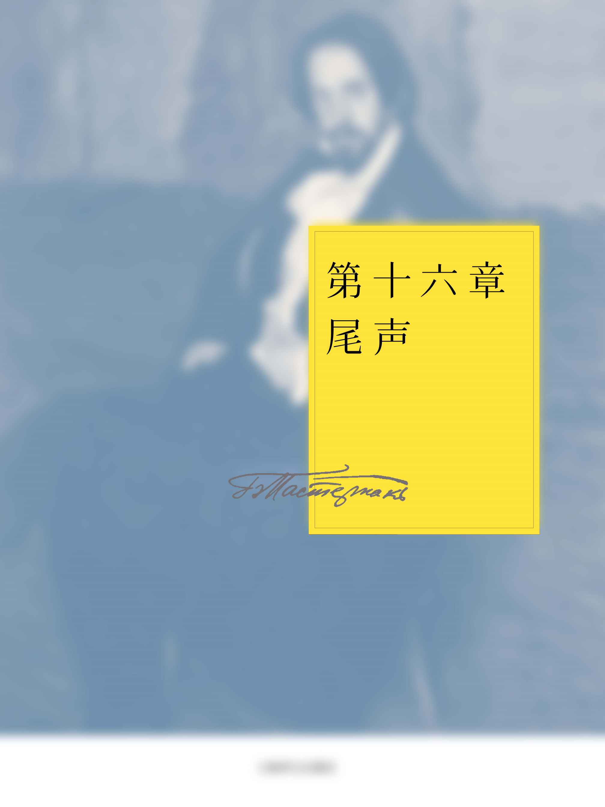

# 第十六章 尾声

<h3 id="c228">一</h3>

一九四三年夏天，在突破库尔斯克地区、解放奥勒尔之后，不久前升为少尉的戈尔东，和少校杜多罗夫分别赶回他们共同服役的部队。戈尔东是去莫斯科出差回来，杜多罗夫也从那里来，度完了三周的假期。

在返队的路上两人相遇，过宿在一个小城切尔恩。这是个虽遭破坏却没完全消灭的城市，不像这带“无人区”的大多数居民点，已被撤退的敌军一扫而光。

在这个已成一片废墟、尽是碎砖和石粉的城市里，他们却发现了一间完好的干草房。两人傍晚就住了进去。

他们不能入睡，便彻夜长谈。凌晨三点，杜多罗夫刚打起盹来，戈尔东折腾什么，把他吵醒了。原来戈尔东坐在柔软的干草堆上，像在水里，一会儿扎下去，一会儿转个身，把穿的衣服裹成小包，然后又笨手笨脚地从草垛上往房门口爬去。

“你这是去哪儿呀？还早呢。”

“去河边。想把身上的衣服洗一洗。”

“这才是发疯呢。晚上咱们就归队了。服装保管员丹尼娅会发一套内衣。忙个啥呀。”

“不想再等啦。尽出汗，太脏了。早上太阳大。我快些洗刷一下，拧得干点，太阳稍微一晒就干。好好洗个澡，换身衣裳。”

“你知道，反正不大合适。你总是个军官嘛，对吧。”

“天还早，别人都在睡觉。我躲到树后去，谁也看不见。你别说话了，睡一会儿吧。不然就把觉给耽误了。”

“我反正也睡不着了，和你一起去。”

两人在碎石堆旁朝小河走去。太阳刚出来，白色碎石就已经被炎热的阳光晒烫了。阳光直射在曾是街道的地面上，汗湿的人们还睡着，脸色通红，一片鼾声。他们大多是当地无家可归的老妇幼女，偶尔也有打散后寻找部队的红军战士。戈尔东和杜多罗夫低着头，小心翼翼地移动脚步，生怕踩上睡着的人们。

“说话小点声，要不把全城人都惊醒了，可别想洗衣服了。”

于是他俩低声接着谈起夜里的话题。

<h3 id="c229">二</h3>

“这是什么河？”

“不知道。没打听过。大概是祖沙河。”

“不对，不是祖沙河。是一条别的河。”

“那我就不知道了。”

“这事就发生在祖沙河上嘛。我是说赫里斯季娜的事迹。”

“对，不过不在这一段上。在下游。听说教堂把她列到圣像里了。”

“那里有幢石楼，得了个名字叫‘马厩’。也的确是马场的国营马厩。现如今这普通的名词成了历史名词。这建筑很古老，墙壁非常厚。德军在里面加固之后，把它变成了坚不可摧的堡垒。从楼里可以射击整个地区，所以挡住了我们的进攻。非得攻下这马厩才行。赫里斯季娜靠了勇敢机智，潜入敌营，炸毁了马厩，自己被敌人活捉吊死了。”

“赫里斯季娜的姓，为什么是奥尔列佐娃，而不是你的这个杜多罗娃？”

“我俩还没有结婚呀。四一年夏天我们约定战争结束后结婚。那以后我随部队南征北战。我们的队伍不断调动，弄得我把她的下落给丢了。此后再没见到她。她的英雄事迹和就义的情况，我也同别人一样是从报上和团部命令中知道的。据说人们想在这一带给她建个纪念碑。我听说，过世的尤拉的弟弟，叶夫格拉夫·日瓦戈将军，正在这一带地方寻访，收集有关她的材料。”

“对不起，我引得你讲起了她的事。这事一定令你非常难受。”

“问题不在这里。看，咱们扯得远了。我不想打扰你。快脱衣下水，干你的事吧。我含根草棍在岸上躺一躺。嚼着草根想想事，说不定能睡一会呢。”

几分钟之后，两人又谈了起来。

“你在哪儿学会这么洗衣服的？”

“什么都是逼出来的。我们不走运呀。我们碰上的惩罚营，是最可怕的一个。很少有活下来的。从一开始就够呛。我们一批人，从火车车厢里被人带出来，周围是大雪的荒原，远处是森林。有警戒兵，步枪的枪口冲着人群，还有警犬。那一个小时里先后又赶来几批人。让我们排成多角的横队，背靠背，互相不能看见。然后下令跪下，不准左顾右盼，要不就得枪毙。接着开始点名，用了很长的时间，方式叫人深感屈辱。我们一直得跪着。后来才叫站起来，别的部分带往各处去了，对我们这一批却宣布说：‘你们的营地就在这里。随你们怎么样，就在这儿安顿下来吧。’这是露天的雪地，中间竖了一个杆子，上面有块牌子：‘古拉格92雅恩90’，此外便一无所有了。”

“那我们要好些。运气算不错。我又服了第二次劳役。第二次服刑，是由第一次引起的。另外，我犯的是另一个条款，条件也就不相同。释放之后，又给我恢复了名誉，和第一次出狱一样。同时也再次允许我在大学教书。动员我上前线时，给了我真正的少校衔，不像你似的作为劳改犯弄去打仗。”

“是呀。除了挂着‘古拉格92雅恩90’牌子的木杆，再也没有什么了。起初就在寒风里光着手削竿子建草房。结果，你都难以相信，渐渐地我们盖起了房屋。我们给自己建了住房，用木桩修起围墙，还盖了禁闭室、瞭望台，全是自己建的。后来便开始伐木，砍树。八个人拉一只雪橇，自己运圆木，摔到坑里雪一直没到腰。有很长时间我们不知道发生了战争。有意瞒着我们。突然给我们提出了一个建议。谁要愿意，可用劳改犯名义上战场；如果身经百战能保全不死，每个人都可获得自由。那以后，就是没完没了的进攻，通过几里长的带电铁丝网，对付地雷、迫击炮，整月整月的猛烈的战火。难怪人家把我们这种连队叫成敢死队。有时死得一个不剩。亏我能活下来，亏我能活下来。可是你要知道，和集中营的可怕生活比起来，这个流血的地狱简直可算是一种幸福；这绝不是指集中营的条件难以忍受，这完全是指别的方面。”

“是呀，老弟。你可尝到苦头了。”

“在那儿别说洗衣服，什么都可以学会。”

“说来令人惊奇。不仅是对你的劳役生活来说，就是对整个三十年代的生活来说，就算是有自由，能顺利地在大学任教，有书看，有钱用，有舒适的条件，即使如此，这场战争也像一阵清洗冲刷的暴风雨，一股新鲜的空气，一种解放的潮流。

“我觉得，集体化是一个错误的不成功的措施，可又不能承认这个错误。为了掩盖失败，就得用种种恐吓办法不让人们判断思考，要强迫他们看到并不存在的东西，证明同事实相反的东西。由此就产生了前所未有的严厉的专制手段，因此才宣布了不准备实行的宪法，由此才实施了没有选举基础的选举。

“战争一爆发，它的现实的恐怖、现实的危险、现实的死的威胁，比起严酷统治人们的臆想，应该说更为有益，使人们松了口气，因为约束了僵化文字的魔力。

“不仅是你这种服劳役的人，后方和前线所有的人，都能比较自由地呼吸了。他们并且兴高采烈地怀着一种真正的幸福感，投入严酷斗争的洪炉；这既是致命的又是救命的洪炉。

“这场战争在几十年间革命的整个链条中，是一个特殊的环节。它使体现变革本质的那些直接原因，现在已经不再发生作用了。

“逐渐地产生了间接的结果，是果实的果实，后果的后果。在苦难中锻炼出来的性格，不再娇惯的耐力，英勇精神，准备承受前所未有的重大的殊死的斗争——这些都是神话般令人惊叹的品格，构成了一代人道德的精髓。

“这一发现使我充满了幸福感，尽管赫里斯季娜惨死，尽管我受过伤，尽管我们受了损失，尽管战争中付出了昂贵的血的代价。赫里斯季娜的献身精神，以及我们每个人的生活，帮助我经受住了赫里斯季娜牺牲的痛苦。

“在你这个可怜人遭受无数折磨的时候，我获释得到了自由。赫里斯季娜当时考入历史系，由于科研兴趣接近，分给我指导。早在这之前，第一次从集中营回来，她当时还是个小孩子，我就注意到了这个出色的姑娘。你记得吗？尤拉在世的时候，我就讲到过她。这时她成了听我讲课的学生。

“那个时期，学生批判教员的做法刚刚流行起来。赫里斯季娜干得最来劲。只有老天爷知道，她为啥那么凶狠地整我。她的批评最顽强，气势汹汹，却很不公正，以致班上其他同学有时表示异议，站出来维护我。赫里斯季娜是个出色的幽默家。在墙报上，她尽情地嘲笑一个人，给那人起了假名，所有的人一下子全猜出是我。一次完全偶然的机会，使真相突然大白，这种根深蒂固的仇视，原来是一个伪装，掩盖着由来已久的牢固的青春的爱情。而我一向也对她抱有同样的倾心。

“四一年我俩度过了一个奇妙的夏季，正是战争第一年，在它爆发的前夕和刚宣战的日子里。有几个年轻的大学生，其中包括她，那会儿住到了莫斯科郊外的别墅区里，也是我们部队后来驻扎的地方。他们是搞军训，组织市郊民兵队伍，赫里斯季娜练习跳伞，夜间在市区房顶反击德寇最初的轰炸。就是在这种环境中，我们两人建立起感情。我已说过，那时我俩举行了订婚礼。但不久因我开始调动，便分开了。后来再没见到她。

“等我们的战事出现了有利的转折，德军开始成百上千地投降，我在两次负伤两次住院之后，从高射炮部队调到司令部第七处；那里需要懂外语的人。我好不容易找到你之后，坚持要求把你也调去。

“管理员丹尼娅十分了解赫里斯季娜。她俩在前线相识，成了好朋友。她讲了许多赫里斯季娜的情况。这个丹尼娅微笑的样子，是整个脸都在笑，就像尤拉似的，你注意到了吗？那时翘鼻子、高颧骨全看不出了，面庞变得俊俏可爱。这两人是一个类型，在我们这儿常常可以看到。”

“我知道你说的哪种人。恐怕是这样。我倒没注意。”

“丹尼娅的姓太难听了，叫什么乌夫列杰娃。这起码不像姓氏，是编造出来的。你说呢？”

“她自己解释过嘛。她是没人管的孩子，不知爹妈是谁。大概在俄罗斯中部某个地方，语言还比较干净地道，就叫她无父娃，意思是没有父亲。街上居民不懂这意思，又全凭耳朵记音，往往把人的姓名篡改了，于是叫成现在这个样子。”

<h3 id="c230">三</h3>

戈尔东和杜多罗夫夜宿切尔恩长谈之后不久，来到遭受严重破坏的卡拉切夫市。他俩追赶自己的军部，在这里遇上了这个军的一些后续部队，主力部队已经过去。

炎热的秋季里，已有一个多月一直是晴朗平和的天气。奥勒尔和勃良斯克之间的布雷恩地区，是个美好的地方。无云的蓝天下，肥沃的黑土在阳光下闪烁着咖啡的颜色。

一条笔直的中心大街穿过城市，同乡间大道联接起来。大街的一侧，屋倒房塌，被手雷炸成一堆堆瓦砾；果园也夷为平地，树木被掀起、炸裂、烧焦。另一侧则是一片荒地，也许从前城市未被毁坏时，盖的房屋就很少；这一侧火灾不重，弹痕也少，因为可烧可炸的东西屈指可数。

原来建筑较多的一侧，无家可归的居民在灰烬中转悠，翻掘，然后把从各处搜寻出的东西集中到一起。另一些人匆匆给自家挖地屋，削下一层层土皮，准备用草土盖屋顶。

对面房屋稀少的一侧，搭起了白色帐篷，摆着卡车和骑兵的带篷车，这是第二梯队的各种机关。还有脱离了师司令部的野战医院，各类车库、军需部门、粮库下属的各部分；它们走迷了路，乱成一团，正在互相寻找。从补充连来的瘦弱的半大孩子，戴着船形帽，背着沉重的灰色大衣卷；脸庞枯瘦，一片土色，闹痢疾拉得贫血。他们在这儿出恭，又在这儿凑合着坐下吃饭，然后睡一觉又继续西行。

这个一半被夷平的城市，远处埋有定时炸弹的地方，还在起火，还在爆炸。在果园里挖土的人们，不时停下活儿，因为感到了脚下大地的颤抖。他们直起腰，手撑着铁锹把，转过头去望那发生爆炸的地方；一看就停工休息很久。

在那里，掀到空中的乱七八糟的东西，像灰色的、黑色的、红砖色的、烟火缭绕的云彩，奔向高空，开始很似烟柱和喷泉，后来混成懒洋洋的沉重的一片。这些东西渐渐散开来，似乎成了帽缨，然后沉落到地面。挖土的人们重又干起活来。

在房屋稀少的一侧，有一块地方四周围了一圈树丛，中间几株老树把这片土地遮得严严实实。这块绿地和四周区别得一清二楚，像上了顶的一个独院，矗立在凉爽的暮色里。

就在这个地方，管理员丹尼娅同两三个战友，几个凑上来的同路人，还有戈尔东和杜多罗夫，从清早就等一辆卡车。它是来接丹尼娅和连队托她带的物品的。东西分装在几个口袋里，在地上堆起一个小山。丹尼娅守护着口袋，一步也不离开。别人同样站在附近，害怕车来时错过了离开这里的机会。

他们已经等了五个多小时。人们无事可做，就听这个爱说话、见识广的姑娘滔滔不绝地讲话。她刚刚讲完自己见到日瓦戈少将的情形。

“当然喽。就是昨天。把我带到了将军那里。那是日瓦戈少将。他路过这里，了解赫里斯季娜的情况，问这问那的。要找亲眼见过她的证人。人们就提起我，说是她的朋友。他让人唤我去，我就去了，到了他那儿。这人一点都不可怕，和平常人一样，没什么特别的地方。吊眼角，黑脸膛。我把知道的全说了。他听完说谢谢你。又问我是哪里人，姓什么。我当然只能支支吾吾。有啥好显摆的？是个孤儿嘛。反正没啥好说的，你们想一想，除了教养院，就是到处流浪。他可不干，对我说，你全讲出来，别不好意思，有什么可难为情的。我开始害怕，只是三言两语，后来越讲越多。他总是点头，我的胆也壮了。要说讲，我是有东西好讲的。你们要是听了不会相信的，非说我瞎编不成。他也是这样。我一讲完，他站起来，在屋里走来走去。他说，你看，这真是奇迹。这样吧，我现在没有时间。我没想到会听见这些情况。我不会扔下你不管的。这里还有些事要打听明白，还有些细节。说不定我还要当你的叔叔呢，收你做将军的侄女。还得送你去大学读书，随便上哪个学校，看你的愿望了。这都是真的。你们看这是多有趣的玩笑呀。”

这时来了一辆马车，空车身长长的，车帮高高的，很像波兰和俄罗斯西部运干草的大车。车上套了两匹马，由一名骑兵车队的战士赶着。他赶车进了这块绿地，从车沿跳下，就去卸马套。除了丹尼娅和几个士兵，其余的人都围了上去，求驭手别卸车，把他们送到要去的地方，当然不会让他白跑。战士不肯答应，因为他无权支配这车马，只能按拿到的单据办事。他卸车后把马牵走，再也没回来。坐在地上的人都站起来，挪到空车板上坐下。马车一来，人人同战士交涉，打断了丹尼娅的故事，这时她又继续讲起来。

“你对将军讲了些啥呀？”戈尔东问。“要是能说，再讲给我们听听。”

“这有啥，可以嘛。”

于是她讲了一个可怕的故事。

<h3 id="c231">四</h3>

“我真有好讲的呢。人家说我不是普通人家的孩子。许是别人说的，也许是我自己心里记得的。我尽听人说，我妈妈拉拉·科马罗娃是一个逃到白色蒙古的俄国部长科马罗夫同志的妻子。不是我父亲，肯定不是我亲生的父亲。自然了，我是个没念过书的姑娘，没爹没妈长大的，你们也许觉得我讲的可笑，可我是有啥说啥。你们应该替我想一想。

“就是这样。下边我要讲的事，发生在克鲁申以南，西伯利亚的另一头，哥萨克那边，靠近中国边境。咱们的人，就是我们的红军，快打到白军主要城市的时候，这个科马罗夫把妈妈和他们一家人送上专车，下令开车。要知道妈妈吓得离开他们一步也不敢动。

“可是科马罗夫根本不知道我，不知道世上有我这么个人。妈妈离家很久生下了我，生怕有谁把这事告诉了他。他特别不喜欢有孩子，又喊又跳，说一有孩子家里又脏又吵，我可受不了。

“就这么着，等红军快到了，妈妈派人叫守卫的老婆玛尔法到纳戈尔错车站去。那离城里有三站路。我这就解释一下。最先是尼卓站，下一个是纳戈尔错车站，最后是萨姆松山口。我现在这么想，妈妈怎么会认识玛尔法呢？大概玛尔法在城里卖过青菜，送过牛奶。就是这样。

“我往下说。看来，这一段有些事我不知道。我想当时妈妈是受了骗，对她说了瞎话。许是对她说只寄放一段时间，等上两天，混乱局面一过就好了。当时不会说永远把孩子交给别人抚养。妈妈绝不会同意把亲生的孩子交出去。

“当然，孩子总是孩子嘛。当时对我说，来，到婶婶跟前来，婶婶给你点心吃，婶婶可好啦，别怕她。可后来我大哭大闹，孩子心里那份难过，现在真是不敢回想。我曾经想上吊，还差一点发了疯。那时我还小嘛，确实，玛尔法得到了抚养我的钱，挺多的钱。

“铁路线上守卫的家是很富裕的。有牛有马，各种家禽不用说了；菜园外面没人种的地，要多少有多少。自然还有白住的房子。路线旁边有一个公家的守卫室。火车从家乡那边来，要慢慢地上坡，使劲才上得来。可要从我们拉谢雅开出，就飞快地滑下去，非得拉闸不可。秋天树林秃了，下面的纳戈尔错车站看得一清二楚。

“瓦西里叔叔嘛，我照乡下习惯叫他爹，倒是个快活善良的好人，就是太爱相信别人，一喝醉了就把自家的什么事全说出来。不论遇到谁，非把心都掏出来不可。

“可对玛尔法，我从来都叫不出妈妈来。是因为我忘不了亲生妈妈呢还是为别的，我说不上来；只是这个玛尔法婶婶非常吓人。就这样，我一直叫她玛尔法婶婶。

“时间过得很快，一转眼就是几年。到底几年，我可记不清了。那时我也开始打着小旗去接火车。卸马套呀，牵个牛呀，这对我一点不新鲜。玛尔法婶婶还教我纺线。屋里活计更不用说了。扫地，收拾屋子，做饭，和面，这都不算啥，我全会。啊，我忘了说，我还照看别嘉。我们那个别嘉是细腿，三周岁还躺着不能走路，由我照管着。过了这么多年了，一想到玛尔法婶婶斜眼看我的好腿，身上就吓得起鸡皮疙瘩。她好像要说，为什么我的腿没毛病，最好我是细腿，别让别嘉细腿，好像是我把别嘉弄成这样子的。你们想想，世上就有这样的狠毒心肠。

“你们再往下听。这还是小意思。我往下一讲，你们准要吓得叫起来。

“那是新经济政策时期，一千卢布也顶不了什么用。瓦西里在下面把奶牛卖了，得了两布袋钱。他喝了酒，就到纳戈尔错车站上到处吹他这笔财富。

“我记得那是秋天一个刮风的日子。大风掀起房顶，刮倒了人；机车爬不了坡，因为是顶风。我见一个流浪的老太婆从上面走来，风吹得裙子和头巾直响。

“流浪人一边走一边哀叫，手捂着肚子，到门上来求宿。把她扶到长椅上，她哎哟哎哟地叫唤，说肚子疼得受不了，这回可要死了。说着就央求把她送医院去，她会给钱的，不怕破费。我爹套上了叫乌达的马，把老太婆放到车上，就往县医院送，从我们那条铁路旁一直走，得有十五里路。

“过了不知多少时候，我们和玛尔法婶婶躺下睡了，忽听乌达在窗下嘶叫，马车进了院子。这趟回来得也太早了。玛尔法婶婶点着灯，披上衣服，没等我爹敲门就拉开了门栓。

“拉开门栓一看，根本不是我爹，门坎上站了一个生人，又黑又可怕。他说：‘卖牛的钱在哪儿，指给我看。我在林子里把你丈夫宰了，你这妇人要是说出钱放在哪儿，我就饶你一命。要是不说，你自己也明白，可别怪我。最好别和我蘑菇。我可没工夫陪你。’”

“我的上帝哟！亲爱的同志们，当时我们可吓坏了，你们设想一下吧。我们一个劲儿发抖，舌头不听使唤了，真可怕呀。头一件，他把瓦西里杀了，他自己说是用斧头砍死的。第二件，只有我们和强盗在守卫室，强盗进了家。这人明摆着是强盗嘛。

“看得出玛尔法婶婶一下子发了懵，为丈夫心简直要碎了。可还得忍着，不能给这人看出来。

“玛尔法婶婶先是给他跪下，求他发个慈悲，别杀了她，她没听说也没看见什么钱，还是第一次听他说有这笔钱。可是，那个亡命徒哪会那么简单，光靠央求打发不走他。忽然她产生了一个念头，应该骗他上当。她就说：‘好吧，照你说的办。钱在地板下面。我现在打开地窖门，你去取吧。’他这魔鬼把她的骗局看得清清楚楚，就说：‘不，你这主妇身体灵便多了，你自己下去吧。不管你上房还是入地，反正把钱给我。你可记住，和我耍滑头绝没什么好处。’”

“她对他说：‘我的上帝呀，你还有啥不放心的。我倒愿意去取，可没这本事呀。我从上面给你举着灯照亮吧。你别怕，要不放心我让女儿一起跟你下去。’这就是说让我下去。

“我的上帝哟！亲爱的同志们，你们想一想，我听了这话是什么滋味。我心想这下子完了。眼前一阵发黑，觉着身子要倒，腿站不直了。

“恶棍不是傻瓜，又朝我们斜眼一瞟，咧嘴笑了，说你别哄人，骗不了我。他看出来她不心疼我，一定不是亲骨肉，是别人的骨血，就一把抓起别嘉，一只手拉开铁环，掀开窖盖，口里说‘给我照亮’，就带着别嘉下了地窖。

“我想，玛尔法婶婶那时就疯了，什么都不明白了，失去了理智。那恶棍抓着别嘉刚下到窖里，她就把盖子啪的一声合严实上了锁，随后把一只挺重的木箱往窖盖上推，还冲我点头，意思是来帮我一把，我自己不行，太沉了。等把箱子挪过去，她自己往上一坐，傻呵呵地得意起来。她刚坐下，强盗就从里面说起话来，一边当当地敲地板，意思是说你趁早放我出去，要不我马上杀了你的别嘉。隔着厚木板，他的话也听不清，再说问题不在说什么。他厉声尖叫，比林子里野兽还可怕，想吓唬人。他嚷叫说你的别嘉马上就没命了。可她什么也不明白，坐在那里笑着冲我挤眼，像是说，管你怎么样，反正我坐在箱子上，钥匙在我手里。我对玛尔法婶婶这么说那么说，对着耳朵喊，从箱子上往下拽她，想把她推开。得把窖盖打开救出别嘉呀。可哪能办得到！我斗不过她呀！

“强盗一个劲儿敲地板，时间一点点过去，她坐在箱上转眼珠，全不理睬。

“这些年来我在生活里见识多了，受的罪也多了，可是上帝呀，从没那次的恐怖。今生今世，我永远忘不了别嘉可怜的叫声。他喊起来，在地窖里哀叫。那个恶魔把他活活掐死了。

“我想现在怎么办，我该怎么办？一个是疯老婆子，一个是杀人的强盗。时间不停地过去。我刚想到这儿，就听窗外乌达叫起来，它还一直没卸套呢。是的，是马嘶的声音，乌达像是说，丹尼娅，咱们快去找好人来援助吧。我一看，天快亮了。我就想，谢谢你提醒，乌达！就这么办。你想得对，咱们就去。才这么一想，又听林子里像有人唤我：‘等等，别忙，丹尼娅。咱们再想个别的办法。’这么说在林子里我又不是一个人啦。一辆我熟悉的机车，从下面朝我拉了一次汽笛，好像是家里公鸡打了次鸣。我凭笛声能听出这辆机车来。它在纳戈尔错车站上总是点着火，人们叫它牵引车，是拖着货车上坡的。这趟列车却是混合编组，每夜都在这时通过。我一听，是这辆熟识的机车在唤我。听着心怦怦跳起来。我想，是不是我也像玛尔法婶婶一样发了疯，怎么各种活物各种车辆全和我用俄语讲话？

“自然，这会儿没工夫细琢磨了，列车已经接近，没时间再考虑。我抓起提灯，因为外面还没大亮，拼命往铁路跑，到了两条铁轨中间，举灯前后摇动。

“这就没什么说的了。我求火车停下来，幸亏它在风天开得慢。车停了，一个认识的司机从窗口探出头来问话，问的什么听不清，风太大了。我对司机喊叫，有人攻击铁路岗哨，杀人抢劫，强盗到了我家，叔叔同志，救救人吧，需要紧急的救援。我正说着，货车厢里下来一个又一个红军战士。原来这是辆军车。红军下来问：‘出了什么事？’他们感到奇怪，为啥夜里在林中上坡的地方让火车停下来不走。

“他们知道了全部情况，从窖里把强盗拉了出来。强盗的声音变得比别嘉更细，说，饶我的命吧，大慈大悲的人们，别毙了我，以后不再干了。人们把他拖到枕木上，手脚捆在铁轨上，火车一过活活地轧死了，这叫民众判决。

“我没敢回屋里去取衣服，太可怕了。我求他们：叔叔们呀，带我上火车走吧。他们让我上了火车，就开车走了。我不想撒谎，后来和无家可归的孩子们一起，走遍了家乡的土地和别的地方。童年遭受苦难之后，这时我可得到了自由，尝到了幸福。当然，也倒过不少霉，也有罪过。这些都是后来发生的事了，下一次再给你们讲吧。当时一个铁路员工，下了火车进到守卫室里，收拾起公家的财物，安排了玛尔法婶婶的去处。据说她后来在疯人院里疯死了，另有人说她治好了病。”

听完这些，戈尔东和杜多罗夫在水坑旁久久地踱步，一声不响。过一会儿，卡车开到了，笨拙地从大路上拐进绿地。人们开始往车上装口袋。戈尔东说道：

“你明白了吗？这个管理员丹尼娅是谁？”

“啊，当然！”

“叶夫格拉夫·日瓦戈会关心她的。”戈尔东稍一停顿又说，“历史上已经有几次是这样。理想的崇高的构思，结果成了粗糙的实在的东西。希腊这样变成了罗马，俄国启蒙主义这样变成了俄国革命。你读一读勃洛克写的诗《我们是俄国可怕年代的产儿》，立刻会看出两个时代的差异。勃洛克说这话的时候，应该作为转义、象征意义来理解。产儿并非儿童，而是子孙、后代、知识分子。可怕也不是指恐怖，是指天命、默示的意思；这两者是不同的东西。如今呢？所有象征意义都变成了字面意义：产儿就是孩子，可怕就是恐怖。区别就在这里。”

<h3 id="c232">五</h3>

一晃过了五年或十年。在一个平静的夏季傍晚，戈尔东和杜多罗夫两人又坐到一起。那是在一个高处，窗子大开，临窗可以俯瞰一望无边的莫斯科晚景。他俩翻着叶夫格拉夫编辑的日瓦戈创作集。他们读过不止一次，有一半作品能够背诵了。两人读着，交换几句看法，就陷入了沉思。读过一半时，天全黑下来，字迹已难辨认，只好点着电灯。

莫斯科展现在眼下和远处，这是作者日瓦戈出生长大的城市，他的一半生命同莫斯科联系在一起。现在他们两人觉得，莫斯科已不是这些事件的发生地，而是这部作品集里的主人公。他俩在这个晚上捧读这部创作集，并且读到了作品的尾声。

尽管战后人们期望的清醒和解放，并未如人们想象地与胜利同来，但战后这些年间，自由的预兆却总是清晰可辨，构成了这些年唯一的历史内涵。

日见苍老的一对好友，临窗眺望，感到这种心灵的自由已经来临；就在这天傍晚，未来似乎实实在在地出现在下面的大街上；他俩自己也迈入了这个未来，从此将处于这个未来之中。面对这个神圣的城市，面对整个大地，面对直到今晚参与了这一历史的人们及其子女，不由得产生出一种幸福动人的宁静感。这种宁静感渗透到一切之中，生发一种无声的幸福的音乐，在周围广为散播。握在他俩手中的这本书，仿佛洞悉这一切，并对他们的这种感情给予支持和肯定。

