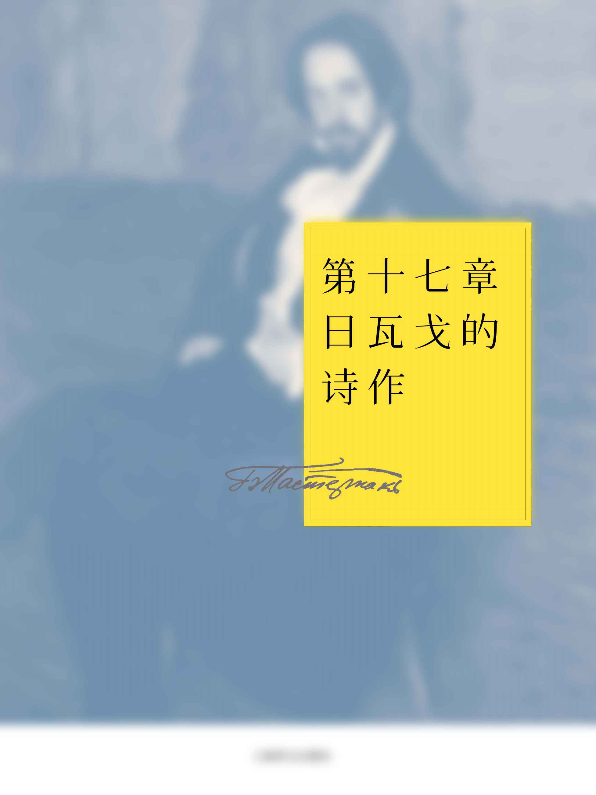

# 第十七章 日瓦戈的诗作

<h3 id="c233">一 哈姆雷特</h3>

喧腾一落，我出了台。

倚门而待，

我倾听遥远的回声：

是什么发生在我这一代。

 

暗夜从四面向我压下，

像千百望远镜聚来。

上帝啊，但能放过，

莫让我尝这苦艾。

 

我喜欢你执拗的构想，

我也愿扮这个角色。

可如今演的另一出悲剧，

但求此番能别用我。

 

可场次全已排好，

结局也无可逃脱。

我孤单，一切在伪善中沉沦，

人生啊，真非同小可。

<h3 id="c234">二 三月</h3>

太阳晒得汗流浃背，

谷地昏沉沉传来喧响。

好像壮妇忙着喂圈，

春天使出了浑身的力量。

 

雪残了，一片片苍白

挂在青枝瘦条之间。

牛棚里却充满生机，

长杈木耙挥舞正欢。

 

美好的夜啊，美好的白昼！

时近中午，雪水滴答；

眼见瘦去，檐底冰溜，

无眠的溪水在娓娓闲话！

 

一切洞开，马厩和牛棚。

鸽子落下雪地啄食。

生趣何来？气味何来？

阵阵清风自粪池。

<h3 id="c235">三 复活节前一周</h3>

周遭还迷漫着昏夜。

世间时光尚早，

天上挂着无数的星，

颗颗像白日皎皎。

大地倘有可能，

恨不得把复活节睡掉，

伴着赞美诗的诵祷。

 

周遭还迷漫着昏夜。

大地时光尚早，

广场像一卧不醒，

从十字街躺到拐角。

离破晓，离回暖，

不啻千年之遥。

 

大地还赤身露体，

夜里又怎能去得，

击响那悠长的钟声，

同唱诗班遥相应和。

 

从复活节前的周四，

到复活节前的周六，

河水冲打着堤岸，

旋起一股股静的回流。

 

光秃的森林一无遮掩，

在基督受难的日子，

一群松树擎着枝干，

俨然民众祷告的仪式。

 

可城里却似有场集会，

在不大一块地方，

几株赤裸的树木，

探头向教堂栅栏里张望。

 

那目光里充满了惊惧，

倒也不足为奇。

是果园越过了栅栏，

地面发生了摇晃：

原来在埋葬上帝。

 

在圣障中门的旁边，

它们看到了光亮，

还有黑巾和一排烛火，

个个泪人儿般的面庞。

突然，迎面捧着十字架的行列，

扯起方布动身出丧。

门前两棵白桦，

需得暂且退让。

 

队伍走在人行道边，

绕了院落一环，

由街上带进门内

一派春意、春的絮语，

夹杂着圣饼的香甜，

还有春日的炊烟。

 

三月把细雪撒落在

教堂阶前一群残疾者的身上。

仿佛走出个人来，

搬过只柜子打开，

把东西分赠个精光。

 

圣歌一直唱到黎明。

是赞美诗或是圣徒曲，

在一场哀哭之后，

复又轻轻地从里面

传向灯下的荒街暗隅。

 

可到午夜，万籁俱寂，

因为传来了春的信息：

天上已然放晴，

死亡当可战胜，

靠着复活节的神力。

<h3 id="c236">四 白夜</h3>

我依稀返回了遥远的旧时，

彼得堡那间房屋。

你，草原上小地主的女儿，

你是库尔斯克生人，你在读书。

 

你可爱，很有人追求。

咱俩浴着这白夜之光，

并排坐在你的窗台，

从你的摩天楼向下眺望。

 

街灯像煤油燃着的蝴蝶。

晨曦开始了颤动。

我悄声诉说给你的心曲，

好似沉睡的远空般朦胧。

 

咱俩都怯生生的，

充满对隐秘的忠贞，

好像在无尽的涅瓦河畔，

彼得堡一展无际的延伸。

 

远听苍茫的林莽，

在这初春的白夜，

有夜莺美妙的啼啭，

响彻森林四野。

 

亢奋的啼啭一阵阵飘过，

瘦弱小鸟的歌喉，

唤起喜悦，唤起惶惑，

直到着了迷的幽林尽头。

 

夜神来到这幽深之处，

如赤脚浪人通过了木栅；

身后飘着袅袅余音，

那是偷听到的窗台情话。

 

这捕捉到的情话余音，

缭绕在薄板围起的果园；

苹果和樱桃树的枝杈，

罩了一身灰白的衣衫。

 

巨树如苍白的怪影，

朝着大道纷纷拥来，

仿佛向广见多识的白夜，

招手作告别的姿态。

<h3 id="c237">五 春日的泥路</h3>

夕阳还留着余晖，

僻静密林的泥路上，

一个人乘马慢步前行，

要去乌拉尔遥远的田庄。

 

乘骑摇摇晃晃地移步；

和着马掌咕唧的声响，

一路上只听得

泉眼里漩涡的激荡。

 

当骑手松开了缰绳，

任由马儿信步一程，

附近泛滥的春水，

送过来轰然的涛声。

 

仿佛有笑语，仿佛有啼哭，

石块与石块翻滚撞击，

有连根拔起的大树，

倒在春汛的漩涡里。

 

火红的晚照中，

在远处昏黑的树丛，

一只夜莺无端狂叫，

活似报警的钟声。

 

那里长着棵孤柳，

把自己的头巾垂向崖边。

犹如古时的夜莺强盗，

鸟儿就在七株橡树间啼啭。

 

敢问这一番激动，

为的哪个心上人，招来怎样的波折？

骑手在丛林里放了一枪，

硕大的霰弹射向了什么？

 

看来他会像林妖一般，

离开逃亡劳工的藏身之处，

却又将遭遇这里的游击队——

骑兵或步兵的耳目。

 

大地和天空，森林和田野，

都听到了这砰然一击。

它掺合着同样多的

痴迷和痛苦，幸福和忧虑。

<h3 id="c238">六 心曲</h3>

生命无缘无故地复活了，

正像它当初莫名其妙地中断；

我重来这条古老的街上，

一如夏季里的那一天。

 

行人依旧，匆匆依旧，

落日依然流火；

全似那回在练马场墙外，

死人的傍晚，他无限惊愕。

 

女人们穿着平日的粗衣，

夜里依旧皮鞋蹬得乱响；

而后顶间屋里，

复又是甩鞋的叮当。

 

一个女人疲惫的脚步，

这时缓缓来到门坎；

她走出低矮的房间，

斜穿过后院。

 

我又琢磨着托词，

其实本也全无所谓。

邻人又插好门栓，

只剩下我俩伫立相对。

 

莫哭泣，莫噘嘴，

别咬这浮肿的唇吧！

会触疼它的——

这春日火旺的血痂。

 

把手从我胸上挪开，

我俩是通了电流的线。

你看，一下子，

又复要相拥相怜。

 

岁月会流逝，你要结婚，

将忘却种种不平。

成妇人身——是番壮举，

摄他人魂——该算英雄。

 

面对姣好的纤手、

玉背、柔肩和粉颈，

我怀着仆从的眷恋，

永远永远只有虔敬。

 

可无论夜是如何牵累，

笼罩我一片感伤，

世上更诱人的却是离走——

那种一刀两断的向往。

<h3 id="c239">七 城中夏天</h3>

一阵阵低声絮话，

秀发拢成了高髻，

兴奋里慌乱中，

耸起蓬松浓密。

 

一个女人戴着面罩，

高仰着头，

也仰起全部发绺，

在大梳子下转动明眸。

 

街上夜气郁闷，

送来变天的消息。

行人脚步沙沙，

各自朝家里奔去。

 

雷鸣断断续续，

轰轰然一片回声。

风吹进窗来，

把帘帷轻轻摆动。

 

出现了片刻沉寂，

仍是同样的郁闷。

电光也像刚才，

在天穹里搜寻、搜寻。

 

当霞色满天，

早上的炎热又盛，

在夜雨倾盆之后，

蒸干街头花园的水坑，

 

古老菩提，满树芬芳，

永远开不败的大柯，

此时却露出一脸阴沉，

只因夜里睡得不多。

<h3 id="c240">八 风</h3>

我完了，你还活着。

于是风儿哭着诉着，

摇晃起林子和别墅。

它晃动的不是棵棵孤松，

是连成一片的大树，

直到无涯无际的远处，

好比帆船的身躯，

摇曳在港口的平湖。

风不是出于好胜，

也不是毫无目的地狠毒；

它要在愁苦之中，

为你写出摇篮之赋。

<h3 id="c241">九 沉醉</h3>

在长毛绒包裹的爆竹柳下，

我俩躲避着雨霖。

我们肩头披了件雨衣，

我用双臂围着你的身。

 

我看错了，这柳丛裹身的，

不是长毛绒，是沉醉之苔。

那好，让咱们把这雨衣，

在身下平展着铺开。

<h3 id="c242">十 秋晴</h3>

醋栗叶长得粗糙如布。

房里笑声震响了玻璃，

又是剁，又是发酵，又是撒胡椒，

香花芽掺进了卤汁里。

 

森林像是在嘲笑，

把这喧嚷声抛下陡坡。

坡上榛树丛抹着夕阳，

仿佛被篝火烧过。

 

大路在这儿下了小谷，

可惜这儿弃着风干的木块；

可惜这儿秋实无人问津，

一股脑全吹落谷来；

 

可惜宇宙简单得多，

不似狡猾人的破解；

可惜林丛像泡到了水里；

可惜万物都有终结；

 

可惜只好眨着眼发愣，

当眼前一切全都付之一炬，

当秋空里的白絮，

像蛛网一样织进了窗里。

 

果园的栅栏已被钻通，

小径隐没在白桦的幼林。

房里是笑语和家务的喧腾，

这喧腾笑语也响在远邻。

<h3 id="c243">十一 婚礼</h3>

跨过了院门，

走进了新房，

宾客拉着手风琴，

一闹要到天亮。

 

大门是毡呢包面，

门里是喜庆人家，

午夜一点到七点，

总算歇了笑语喧哗。

 

破晓是好觉时分，

正该甜甜地一睡，

可又拉响了手风琴，

宾客里有人辞归。

 

一位歌手操琴，

重新奏起了巴扬；

掌声迭起，珠宝闪光，

一串喜庆的嘈杂喧嚷。

 

一曲复一曲，

歌谣的旋律，

冲出了筵席，

灌进床上酣眠人耳里。

 

玉洁如雪的女人，

在喧闹、口哨、碎语之间，

再一次孔雀开屏，

扭动腰身渐起翩翩。

 

她摇晃着头，

挥舞起右手，

踏着拍子上了人行道，

啊——孔雀，孔雀的遨游。

 

琴声激奋而急促，

和着环舞的踢踏。

突然间，歌舞不知去向，

一切仿佛钻到了地下。

 

院落苏醒，一片嘈杂，

在人语和喧笑中，

夹杂进几多正事，

人们都各自匆匆。

 

朝着无际的天空，

一群离窝的鸽子，

旋风般冲击，

斑斑点点像灰白的字。

 

好似人们睡梦里惊起，

派鸽子速去追踪，

给婚礼再寄上一语：

愿君长寿，情爱始终。

 

生活岂不也只一瞬。

无非是把我们自己，

融化在所有他人之中，

犹如给他们的献礼；

 

无非是从下面

冲入窗里的一阵新婚喜歌；

无非是一首曲，一场梦；

无非是一只灰白的鸽。

<h3 id="c244">十二 秋</h3>

一个家我竟任它离散，

亲人早已是各自东西，

那挥之不去的孤寂，

充塞着自然和心底。

 

可而今在僻野荒林，

我和你天涯一隅。

看纵横的路间径上，

像歌里一样艾草萋萋。

 

此刻连园木在壁间，

也愁望着一对孤雁；

我俩愿坦率地消亡，

我俩没移山的誓言。

 

一坐便无时无刻，

我捧书，你绣绢；

破晓时又哪会记清，

怎收了热吻的缠绵？

 

秋叶啊，

你再尽兴些喧响，

你再放任些纷扬，

且拿今天的伤感，

盖过昨日的愁肠。

 

恋情啊，诱惑啊，妩媚啊！

让我俩化入九月的声浪。

你就沉入秋木的簌簌，

要么屏息，要么发狂。

 

像树丛摇落金叶，

你纷纷卸去衣裙；

那是要投入拥抱，

你纱衣流苏的玉身。

 

当生活远不如卧病，

你是我赴难时的欢欣；

而美植根在勇敢，

是勇敢连缀起我你两颗心。

<h3 id="c245">十三 童话一则</h3>

在那古老的岁月，

在那童话的世界，

一个骑士纵马奔驰，

踏过芜菁的田野。

 

急匆匆赶去厮杀，

向着弥漫的尘障穿行，

迎面一片黑压压，

远方隆起了林丛。

 

心里莫名地难过，

不由得一阵惶惑；

别去前面饮水吧，

勒马且停片刻。

 

骑士没听从心声，

策马求一搏，

犹如风驰电掣，

上了密林的高坡。

 

奔到了高处，

转进了干谷，

穿越了空地，

翻过了山麓。

 

他绕进一条狭峪，

踏上林木间小坡，

尽头有兽的爪迹，

还有解渴的小河。

 

不理睬心的呼唤，

不在乎心的预感，

他执辔下了悬崖，

饮马来到河边。

 

傍水一孔山洞，

洞前漫漫浅滩；

闪烁若似硫火，

照亮入口巉岩。

 

火光漫起红雾，

溶溶遮住眼帘，

松林传过呼叫，

仿佛来自远天。

 

骑士猛然一抖，

催马下了冲沟；

大步直奔前去，

迎着声声呼吼。

 

身躯贴紧镖枪，

驭手放眼一溜，

看到了龙尾龙鳞，

也看到了龙头。

 

它嘴里喷着火，

四周漫射红光，

只见三个光环，

缠绕一位姑娘。

 

龙蛇扭动身躯，

偎在姑娘肩旁，

好似长鞭梢头，

又像脖颈晃荡。

 

这倒是当地习俗，

一旦俘获美女，

必送去林莽，

满足妖怪的贪欲。

 

面前一间间茅屋，

全靠村民的赎取，

用如许的代价，

换得龙蛇的赐予。

 

当这牺牲的贡品，

已送了来受苦，

蛇妖缠上她咽喉，

又把她的手盘住。

 

骑士仰望上苍，

暗自祷告天神；

一副格斗气势，

镖枪横握前身。

 

紧闭的双目，

高天、云霓、

汪洋、浅滩、河流、

岁月和世纪。

 

盔甲已被打歪，

骑士格杀中倒地；

一片忠心的骏马，

乱蹄踏碎蛇躯。

 

战马和死龙，

并卧在沙里。

骑士昏迷不醒，

姑娘呆若木鸡。

 

正午天光明亮，

蔚蓝是那么柔润。

她是什么人？公主？

大地的女儿？公爵的千金？

 

一个在幸福的顶峰，

泪水犹如泉涌；

一个灵魂尚未醒来，

沉于昏迷的睡梦。

 

一个在恢复生机，

一个还纹丝不动。

血流了如许，

力已是耗空。

 

但跳动着两颗心，

是他抑或是她呢，

轮番着挣扎，

将起复又昏迷。

 

紧闭的双目，

高天、云霓、

汪洋、浅滩、河流、

岁月和世纪。

<h3 id="c246">十四 八月</h3>

一如许诺，不肯食言，

太阳在黎明之天，

射进一条透红金带，

从沙发铺到窗幔。

 

仿佛是发烫的赭石颜料，

阳光染上了村舍和林坳、

我的床、湿的枕、

书架后的墙角。

 

我记起为了什么缘由，

枕上泪湿了一片：

我梦见来给我送葬，

林子里你们脚步相连。

 

你们走着，独行或结伴，

可猛然有人发觉：

旧历今天八月六，

恰是上帝变容节。

 

法沃尔山发出不流火的辉光，

通常就在这一天。

秋色清澈如洗，

吸引着人们视线。

 

你们穿过的赤杨树丛，

光秃颤抖，瘦小可怜。

你们进到的墓地赤林，

像燃烧着的花纹饼干。

 

树梢平静，毫无声息，

高接肃穆庄严的天穹。

一阵阵雄鸡啼唤，

在远方悠扬呼应。

 

好似林间的丈量员，

墓地上站着死神。

它端详我死后的面孔，

琢磨照我的身材挖坟。

 

旁边有个平静的话音，

真切得触手可及。

那是我生前天赐之声，

此刻还没有变异：

 

“永别了，变容节的蓝天。

永别了，救主节的金秋。

请给我最后一次女性的爱抚，

来减轻我死亡的哀愁。

 

“永别了，生不逢时的岁月。

再见吧，你这刚强——

向苦海挑战的女性！

我便是你搏斗的战场。

 

“永别了，舒展翩飞的双翅。

永别了，任情顽强的雄翱，

还有那化入文字的世界，

以至写作，以至奇迹的创造！”

<h3 id="c247">十五 冬夜</h3>

旋呀，旋遍整个大地，

风雪无处不钻。

烛火立在桌台，

幽光闪闪。

 

像夏日的幼蚊，

成群扑向火焰，

满院的银絮，

飞聚到窗前。

 

寒风怒雪在窗上，

织出了圈，刻出了箭。

烛火立在桌台，

幽光闪闪。

 

半明的天花板，

双影幢幢，

臂相交，腿相偎，

命运和命运相傍。

 

是地板上咚咚响，

坠下两只鞋跟；

是灯台的烛泪，

滴上委地的衣裙。

 

一切淹没在雪夜——

灰白色的昏暗。

烛火立在桌台，

幽光闪闪。

 

风来屋角向烛吹，

诱人的火焰，

仿佛天使展翅，

腾起十字架般的烟。

 

旋呀，旋满整个二月，

风雪里不时地看见：

烛火立在桌台，

幽光闪闪。

<h3 id="c248">十六 别离</h3>

一个人当门伫望，

不敢再认这幢房。

她离去犹如出逃，

到处是捣毁的迹象。

 

间间屋一样凌乱，

这零落他无力计算：

泪水模糊了眼睛，

偏头突然有如针钻。

 

从早就耳鸣嗡嗡，

是清醒还是梦幻？

为什么他的脑际，

不断有海的萦念？

 

当窗子蒙上冷霜，

透不进白日的光芒，

无法排解的哀愁，

好似大海的汪洋。

 

她贴着他的心，

是那样难解难分，

像伟岸贴着大海，

联结宏阔的潮汛。

 

仿佛风雨过后，

大水淹没了芦苇，

她的音容身影，

漫入他的心扉。

 

在痛苦的年代里，

在难以想象的生活中，

她被命运之浪卷起，

冲上他的心胸。

 

通过了无数的阻隔，

摆脱了种种凶险，

波涛簇拥着，

把她推到身边。

 

如今她远走他方，

多半是并非心愿。

生别会使人愁死，

思念叫他俩肠断。

 

这人又环视四周：

她在离去之前，

把衣柜的抽屉，

统统翻了个底朝天。

 

他茫然踱步，天色将黑，

拾起散扔的衣物，

还有剪裁的纸样，

收回抽屉和柜橱。

 

什么扎疼了手指？

是带着针线的活计。

忽地人宛然浮现眼前，

他不由得轻声啜泣。

<h3 id="c249">十七 相会</h3>

雪快埋住了道路，

屋顶快变得皑皑。

我出去活动腿脚，

你恰巧站在门外。

 

身着秋天的大衣，

没戴帽子，没穿套靴。

你极力想镇静，

嘴里嚼着雪。

 

树木和栏栅退去，

隐进远处的浑噩。

大雪纷飞里，

你独立在角落。

 

围巾滴下了雪水，

点点打在袖口；

头上荧光闪烁，

是露珠附着发绺。

 

一披金发啊，

照亮了面庞，

照亮了头巾和身姿，

照亮了这件秋裳。

 

睫毛上雪花变潮，

你眼里愁情脉脉；

整个形象浑然一体，

一切是那么合拍。

 

仿佛用一把锋刃，

在我的心灵，

沾着漆黑的墨，

刻下了你的倩影。

 

我的心底永远永远，

留下了你的姿容。

由此又何必管什么，

世人的心肠变硬。

 

由此这一天的雪夜，

似乎绵长无尽；

你我之间，

我竟分不出我你。

 

等往事只待评说，

当你我辞别人世，

世人会怎样看我俩？

我俩又从何而至？

<h3 id="c250">十八 圣诞之星</h3>

隆冬时节。

草原风过。

山坡间的窟窿里，

一个幼婴瑟缩。

 

犍牛呵气为他取暖。

一群家畜，

聚在洞穴中，

喂草架上热气股股。

 

牧人掸掸皮袄，

抖掉草屑和黍粒，

在岩石上睡眼惺忪，

远眺子夜时分的天地。

 

远方是雪中田野和墓地、

围墙、碑铭、

雪堆里的车辕、

坟上的天、满空的星。

 

附近是守院人的小窗，

窗里新亮起一盏灯，

幽光怯懦，

好似去维夫列路上的星。

 

这颗星像燃烧的草垛，

没连着天，没连着上帝，

却似火场的返光，

如田庄焚烧，谷仓一炬。

 

似一捆点燃的干草，

它升腾，升腾在

整个宇宙之间，

宇宙为之惊骇。

 

星斗上方火光通红，

红光意味着某种东西。

三个星相家

连忙去预卜星火的奇异。

 

随后是骆驼拉着赠品，

还有全身披挂的毛驴。

驴子一头比一头瘦小，

踏着碎步下了山脊。

 

此刻，宛若奇特的未来时光，

眼前浮现出后来的一切：

一代又一代的思想愿望，

画廊和博物馆的图景，种种世界，

美女的戏谑，魔法师的手段，

世间所有的枞树，孩童的梦夜。

 

还有明烛的抖动，一切桎梏，

种种艳丽多彩的服饰……

草原风来越吹越紧……

浮现出苹果累累、金黄的秋实。

 

赤杨树冠遮盖了水塘一角；

透过树杈和白嘴鸦之巢，

另一角却看得真切明了。

牧人眼底清晰可辨，

驴群驼队怎样在拦河坝上奔跑。

“随大家一起走吧，去朝拜神奇。”

他们说着掩上了皮袄。

 

踏雪沙沙，浑身燥热，

亮地里有赤足脚印一道，

像一片片云母通向破屋。

牧羊狗在星光里追了脚印吠叫，

好像对着一段蜡烛头的火苗。

 

严寒的夜如一则童话。

仿佛有人隐了身，

不时从雪堆上挤进人群。

狗儿蹒跚着，不安地四面张望，

靠到牧羊人身上还在担心。

 

就在此处，就是这条路，

人群夹着几个天使前去。

天使无形，人眼不见，

可迈步却留下了足迹。

 

巨石旁聚起人众，

天色发亮，露出雪松之身。

马利亚问：“你们是什么人？”

“我们是牧民，是上天的使臣，

来给你们两人褒奖。”

“门前等等。不能一下全进。”

 

黎明前的灰暗里，

马夫和牧人在跺脚，

行人同骑士斗气。

圆木凿成的水槽前，

骆驼嘶叫，驴子蹬踢。

 

天光破晓，朝霞像清除灰烬，

从苍穹扫去了最后几颗星。

无数的人里只有星相家，

被马利亚放进了岩缝。

 

婴儿满面红光，睡在橡木草架上，

如一弯月色，藏在树洞深角。

驴的唇吻，牛的鼻息，

代替了他身上的羊皮袄。

 

人们站在暗处，像在畜栏的暮色里，

窃窃私语，来不及斟酌字句。

昏暗中有谁推了星相家，

拉他向草架的左边去。

星相家回头，只见门楣上，

圣诞之星像位来客望着幼女。

<h3 id="c251">十九 黎明</h3>

在我的命运里，你便是一切。

随后来了战争，横遭劫难。

年复一年，年复一年，

你的音信绝断。

 

过了许多许多岁月，

你的声音重来惊扰我。

彻夜捧读你的遗言，

仿佛从昏厥中复活。

 

我渴望去人群里，

融入清晨的熙攘。

我恨不得碾碎一切，

我准备降服万邦。

 

于是我跑下楼梯，

像第一次来到

白雪覆盖的街头，

和空无人迹的便道。

 

家家晨起生着火，十分惬意。

喝完茶，纷纷朝电车走去。

几分钟的光景，

城里竟变得不可辨析。

 

门洞是风雪编织的网，

鹅毛大雪在纷扬。

人们为的不晚到误事，

吃不好喝不好地奔忙。

 

我替他们所有人承担苦乐，

仿佛自己曾是他们的化身，

我和雪一样消融，

我和黎明一样阴沉。

 

同我一道，是不知名的人们，

是大树、孩子、不出门的恋家迷。

我给他们征服了，

这也正是我的胜利。

<h3 id="c252">二十 魔力</h3>

他从维法尼亚去耶路撒冷，

早为预感而忧心忡忡。

 

峭壁上刺人灌木已燃烧尽，

近旁一间茅屋断了炊烟。

空气灼热，苇草纹丝不动，

连死海上也波浪不翻。

 

含着海水般的苦涩，

他拥了一个小小云堆，

沿着尘路走向栈房，

去赴城里学徒的集会。

 

他想着心思，聚精会神，

田野荒凉，艾草味重；

万籁俱寂，他孑孑独立，

周围陷入了沉迷之中。

一切混杂着：暖意和荒漠，

蜥蜴、冷泉和溪声。

 

一棵无花果树矗立远方，

不见结实，唯有枝叶。

他便对树说：“你为何吝啬？

你只会呆立发愣，我有何欢悦？

 

“我饥渴难耐，可你空如无物，

同你邂逅，哪来一丝安慰？

啊，你原来一无可取，令人失望。

那就如此终了吧，毫无作为。”

 

这责难使大树一阵战栗，

又像电光钻入避雷针，

把无花果树霎时焚毁无遗。

 

倘若枝叶和根干，

此时有须臾的自由，

自然界定会用自己的规律干预。

可魔力终是魔力，它便是上帝。

每当我们陷于惶惑，在紊乱中

魔力就要光顾，叫人措手不及。

<h3 id="c253">二十一 大地</h3>

春光一拥而入

莫斯科栋栋小楼；

蛾子从衣柜后飞出，

爬行在夏天的帽子上；

人们把皮衣藏进柜橱。

 

木头阁楼上，

摆着盆盆鲜花，

有紫罗兰和桂竹香。

顶间吹出来尘土气味，

房屋显得宽大舒畅。

 

街上路人不由得

和不透光的窗口狎昵；

江面上的白夜

同夕照遇到了一起。

 

走廊上听得到：

屋外如何地风云起落；

四月天同雪水对话，

无意间讲了什么？

四月天眼见了

无数的人间悲歌，

连云朵也驻足篱笆，

倾听这短说长说。

 

在自然界，在舒坦的家中，

同样是火与恐惧相混杂。

氛围无处不伤情。

又是剔透的柳枝，

又是白色花蕾的高隆，

在窗台上，在交叉路口，

在作坊里，在大街树丛。

 

为何远方在雾中哭泣？

为何厩肥散发着苦味？

我的使命啊，

不正是让人们离而不悲；

让城外的大地，

不在孤独中忧伤落泪。

 

为此在早春天里，

我邀朋友们齐聚。

我的晚会是告别，

我的宴席是寄语：

要用隐秘的苦痛，

去偎暖冰冷的生计。

<h3 id="c254">二十二 晦气</h3>

当他在最后一周，

进入耶路撒冷的时候，

迎面是震耳的祈祷声，

人们举着枝条跑在他身后。

 

但日子越来越难，

爱撼动不了人心，

个个都鄙弃地蹙眉，

结局于是临近。

 

天空变得沉重如铅，

低低压到了院庭。

人们对他狐狸般献媚，

搜寻法利赛人的罪证。

 

寺院的恶势力逞了凶，

把他交给了败类们审判。

过去颂扬他的热情，

如今变成了诅咒他的冥顽。

 

邻街的人群，

在大门里窥探，

推搡着等待结果，

又来回地乱窜。

 

附近响起了窃窃私语，

多方传开来流言。

出逃埃及和童年时光，

如梦境一般浮现。

 

他记起了荒漠中壮观的斜坡，

还有那陡峭的悬崖；

正是那崖顶的魔王，

用世界强国诱惑了他。

 

又想到坎河上的婚筵，

佳肴惊人的盛席；

想到海，他踏着潮水，

如履平地向小船走去。

 

再忆起了穷人齐集破屋，

他举着烛火下到地窖，

忽见死人复活后坐起，

吓灭了手里烛台的火苗。

<h3 id="c255">二十三 抹大拉的马利亚（之一）</h3>

夜色一降，我的魔鬼就到身旁，

同我清算往日的旧账。

勾起堕落的回忆，

啃噬着我的心房。

我是个发了狂的傻女人，

曾屈从男性的乖张，

街头便是我栖身的地方。

 

只消几分钟的时光，

便将笼罩上幽冥的寂寞。

在这瞬息流逝之前，

我要把自己行将终了的生活，

犹如阿拉瓦斯特的器皿，

在你的面前打碎说破。

 

倘若夜复一夜的桌前，

没有等待我的一种永恒信念，

一如受惑者等待我的合欢，

啊，我的老师，我的恩人，

那我今天会在何处留连？

 

可我怀着极度的哀伤，

众目下同你连成了一身，

就像叶芽连着树枝，

你且说，

罪过可还难赦难尽？

死亡、地狱、硫火又何足论？

 

耶稣啊，你可知道，

我正跪在你的脚旁，

想亲吻方木的十字架；

该准备起灵，

我却扑向你的身，如痴若傻。

<h3 id="c256">二十四 抹大拉的马利亚（之二）</h3>

节前纷纷在扫屋。

我摆脱了这繁忙，

舀着小桶里的水，

擦洗你洁净的脚掌。

 

我伸手摸鞋，却找不到，

泪水遮住了视线，

散披的发绺，

在眼前垂下一张帘。

 

我把你的足摆上衣襟，

泪水湿遍了双脚。

耶稣啊，我的项链缠上了足，

我的发像黑篷衣拂罩。

 

这时我把后事看得一清二楚，

好像你已令未来停步。

我现在能够预言一切，

就像女巫道出的神卜。

 

明天寺院里帐幕就将放下，

你我要被挤到一旁，

脚下的大地会猛然一颤，

许是怜悯我的哀肠。

 

送葬的队伍散去，

骑马的将各自东西，

这个十字架一如旋风，

会跃跃向高天腾起。

 

我便扑倒在十字架前，

如醉如痴，咬破嘴角；

你在十字架上双臂大张，

似欲和太多的人拥抱。

 

世界竟为谁如此广袤？

又那么多痛苦，那么大力量？

人间可有如许多的心灵和生命？

可有如许多的河流、树丛、村庄？

 

这样过去三个昼夜，

定又陷入难挨的空虚；

我怎敢不在这可怖的几天，

让心复活，获得灵犀？

<h3 id="c257">二十五 赫弗西曼花园</h3>

遥远的星光无精打采，

照着大路的转弯；

路环绕马斯洛山盘行，

岭下河水是克德兰。

 

草地突然中断，

前面一带银河；

灰白色的橄榄树，

浑欲向空中拼搏。

 

尽头有一家花园、大片土地，

他把弟子们留在墙外，

说：“我心里悲痛欲绝，

且在这帮我排解愁怀。”

 

他没做丝毫的抗争，

放弃了神力和大智，

好像交回了借来的物品。

而今也成了我们一类凡夫俗子。

 

此刻夜幕下的远方，

仿佛是毁灭和死亡之天；

宇宙的广漠里绝无人迹，

只在这园子里可见炊烟。

 

望着这漆黑的深渊，

无始无终的空间，

为了幸免一死，

他滴着血祷告上帝求援。

 

祈祷减轻了极度的倦怠，

他迈步走出了围墙。

弟子们困顿难挨，

躺倒在路旁羽茅之上。

 

他唤醒弟子：“上苍赐福，

你们才与我同时，却沉沉大睡！

人类之子正面临厄运，

他要把自己交给一伙罪人。”

 

话音未落，不知何处

拥来了奴隶和流浪汉，

举着火把、刺剑。犹大领头，

露出一副叛卖的嘴脸。

 

彼得挥剑反击这伙恶棍，

把其中一人耳朵削掉。

这时他听到：“争执不该刀剑解决，

请你宝剑入鞘。”

 

“莫非上帝果真没派给我

展翅飞来的庞大军队？

不然敌人怎敢动我一根毫毛，

只会望风而走，四散溃退。

 

“生活之卷已快终篇，

这一页比一切都神圣十分。

写下的东西正该实现，

就让它变成现实吧，阿门！

 

“你看到了：世纪进程像篇寓言，

前行之中它会燃烧。

为了这寓言的惊人伟大，

我甘愿在折磨中死掉。

 

“我躺入棺木，第三天就将苏醒。

过去的世纪也要从黑暗中复活，

如放木排，如走船队，

纷纷聚来由我评说。”

