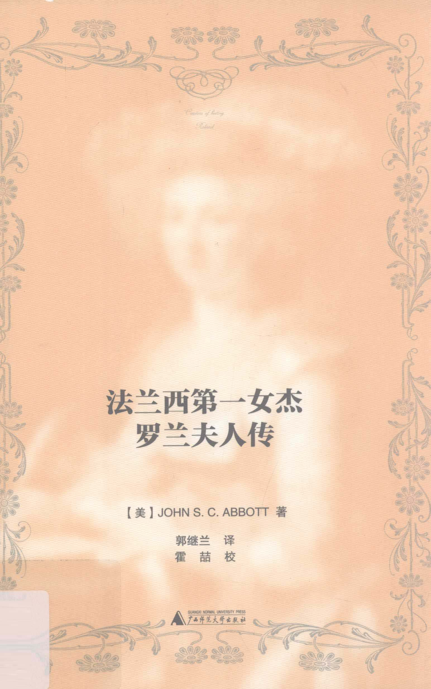
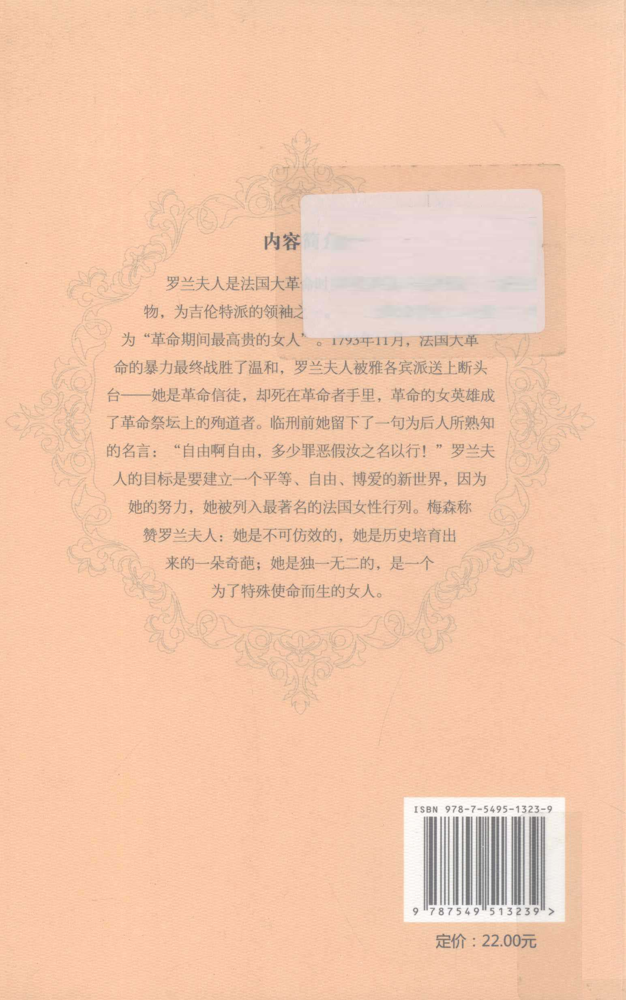
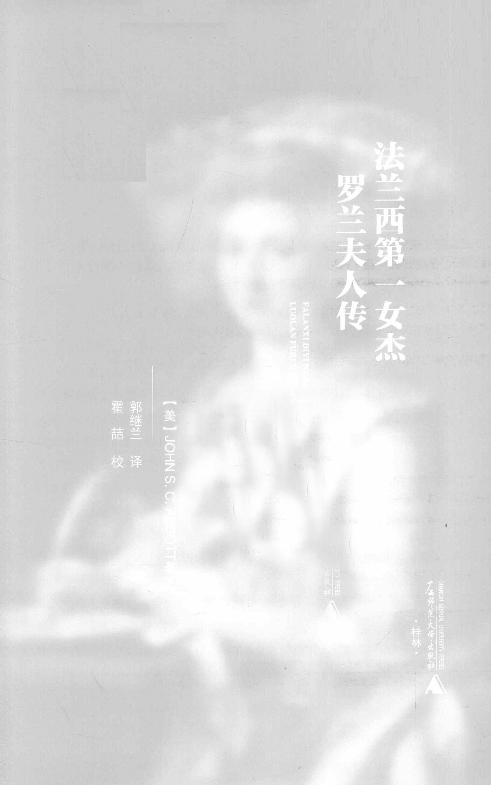
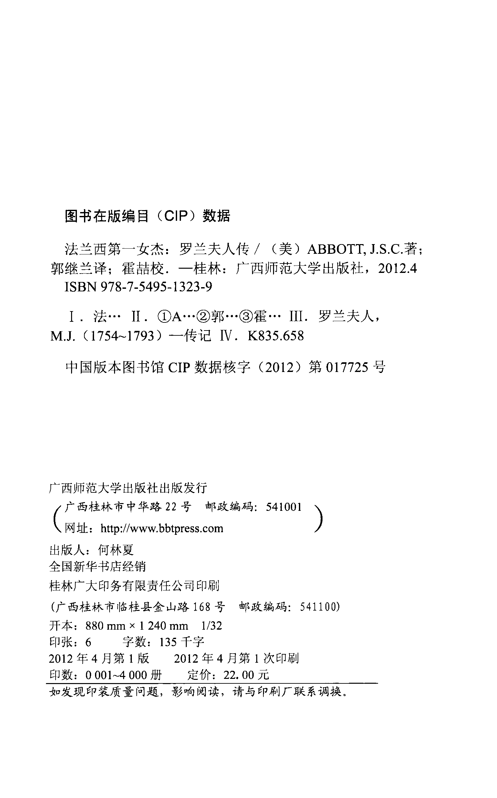

# 封面与版权

本书正文由扫描页识别，并对重点疑点作原图核对，尚未逐字人工校完。原页、插图与旁注均保留供对照。第五章扉页（PDF 第71页）在源文件中已损坏。

<small><a href="images/pages/001.png">PDF 第1页 · 查看原页</a></small>

<small><a href="images/pages/002.png">PDF 第2页 · 查看原页</a></small>

<small><a href="images/pages/003.png">PDF 第3页 · 查看原页</a></small>

<small><a href="images/pages/004.png">PDF 第4页 · 查看原页</a></small>

