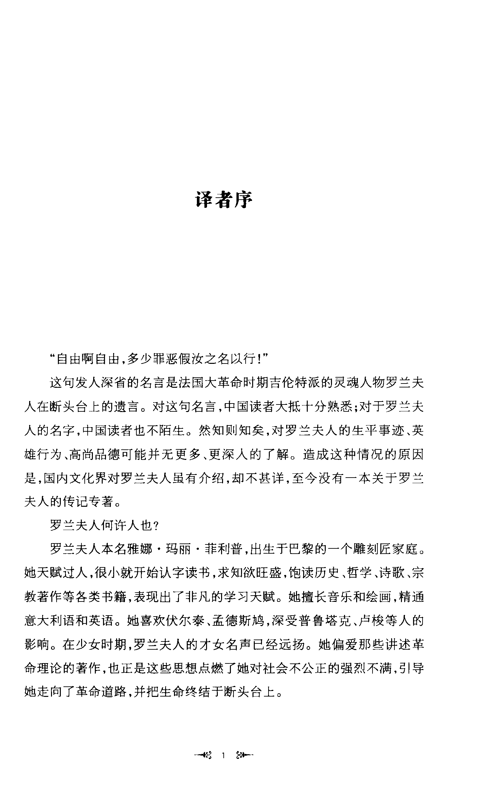
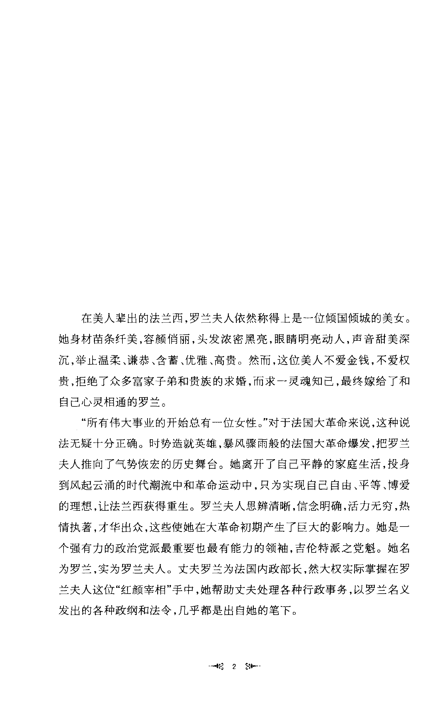
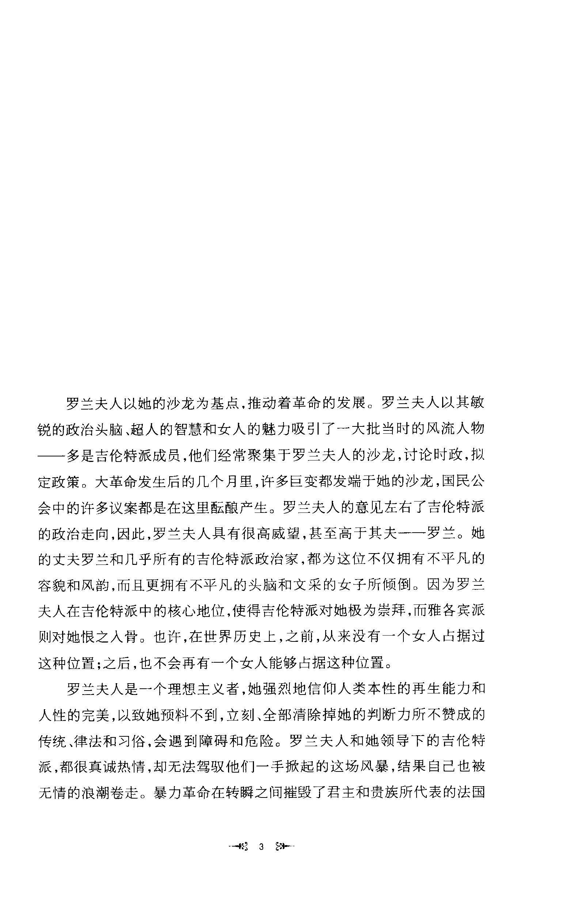
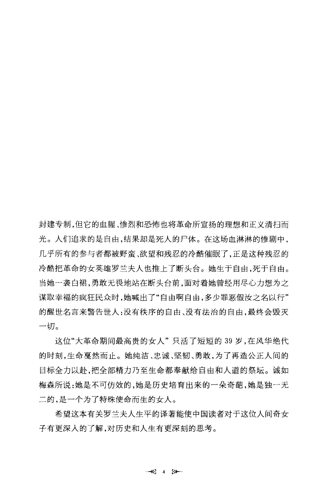
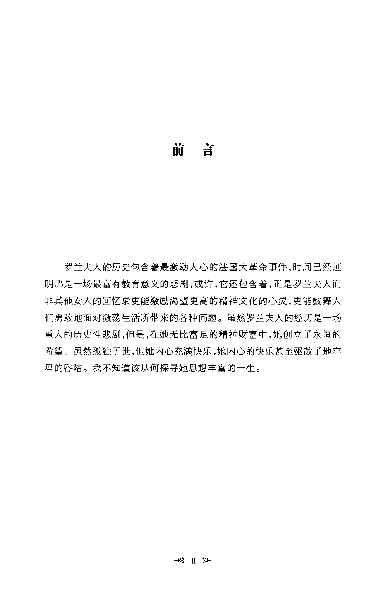

# 译者序

<small><a href="images/pages/005.png">PDF 第5页 · 查看原页</a></small>

译者序

“自由啊自由，多少罪恶假汝之名以行！”

这句发人深省的名言是法国大革命时期吉伦特派的灵魂人物罗兰夫人在断头台上的遗言。对这句名言，中国读者大抵十分熟悉；对于罗兰夫人的名字，中国读者也不陌生。然知则知矣，对罗兰夫人的生平事迹、英雄行为、高尚品德可能并无更多、更深入的了解。造成这种情况的原因是，国内文化界对罗兰夫人虽有介绍，却不甚详，至今没有一本关于罗兰夫人的传记专著。

罗兰夫人何许人也？

罗兰夫人本名雅娜•玛丽•菲利普，出生于巴黎的一个雕刻匠家庭。她天赋过人，很小就开始认字读书，求知欲旺盛，饱读历史、哲学、诗歌、宗教著作等各类书籍，表现出了非凡的学习天赋。她擅长音乐和绘画，精通意大利语和英语。她喜欢伏尔泰、孟德斯鸠，深受普鲁塔克、卢梭等人的影响。在少女时期，罗兰夫人的才女名声已经远扬。她偏爱那些讲述革命理论的著作，也正是这些思想点燃了她对社会不公正的强烈不满，引导她走向了革命道路，并把生命终结于断头台上。

原页对照（含插图与旁注）

<small><a href="images/pages/006.png">PDF 第6页 · 查看原页</a></small>

在美人辈出的法兰西，罗兰夫人依然称得上是一位倾国倾城的美女。她身材苗条纤美，容颜俏丽，头发浓密黑亮，眼睛明亮动人，声音甜美深沉，举止温柔、谦恭、含蓄、优雅、高贵。然而，这位美人不爱金钱，不爱权贵，拒绝了众多富家子弟和贵族的求婚，而求一灵魂知己，最终嫁给了和自己心灵相通的罗兰。

“所有伟大事业的开始总有一位女性。”对于法国大革命来说，这种说法无疑十分正确。时势造就英雄，暴风骤雨般的法国大革命爆发，把罗兰夫人推向了气势恢宏的历史舞台。她离开了自己平静的家庭生活，投身到风起云涌的时代潮流中和革命运动中，只为实现自己自由、平等、博爱的理想，让法兰西获得重生。罗兰夫人思辨清晰，信念明确，活力无穷，热情执著，才华出众，这些使她在大革命初期产生了巨大的影晌力。她是一

<blockquote>
个强有力的政治党派最重要也最有能力的领袖，吉伦特派之党魁。她名为罗兰，实为罗兰夫人。丈夫罗兰为法国内政部长，然大权实际掌握在罗兰夫人这位“红颜宰相”手中，她帮助丈夫处理各种行政事务，以罗兰名义发出的各种政纲和法令，几乎都是出自她的笔下。
</blockquote>

原页对照（含插图与旁注）

<small><a href="images/pages/007.png">PDF 第7页 · 查看原页</a></small>

罗兰夫人以她的沙龙为基点，推动着革命的发展。罗兰夫人以其敏锐的政治头脑、超人的智慧和女人的魅力吸引了一大批当时的风流人物—多是吉伦特派成员，他们经常聚集于罗兰夫人的沙龙，讨论时政，拟定政策。大革命发生后的几个月里，许多巨变都发端于她的沙龙，国民公会中的许多议案都是在这里酝酿产生。罗兰夫人的意见左右了吉伦特派的政治走向，因此，罗兰夫人具有很高威望，甚至高于其夫一一罗兰。她的丈夫罗兰和几乎所有的吉伦特派政治家，都为这位不仅拥有不平凡的容貌和风韵，而且更拥有不平凡的头脑和文采的女子所倾倒。因为罗兰夫人在吉伦特派中的核心地位，使得吉伦特派对她极为崇拜，而雅各宾派则对她恨之入骨。也许，在世界历史上，之前，从来没有一个女人占据过这种位置；之后，也不会再有一个女人能够占据这种位置。

罗兰夫人是一个理想主义者，她强烈地信仰人类本性的再生能力和人性的完美，以致她预料不到，立刻、全部清除掉她的判断力所不赞成的传统、律法和习俗，会遇到障碍和危险。罗兰夫人和她领导下的吉伦特派，都很真诚热情，却无法驾驭他们一手掀起的这场风暴，结果自己也被无情的浪潮卷走。暴力革命在转瞬之间摧毁了君主和贵族所代表的法国封建专制，但它的血腥、惨烈和恐怖也将革命所宣扬的理想和正义清扫而光。人们追求的是自由，结果却是死人的尸体。在这场血淋淋的惨剧中，几乎所有的参与者都被野蛮、欲望和残忍的冷酷催眠了，正是这种残忍的冷酷把革命的女英雄罗兰夫人也推上了断头台。她生于自由，死于自由。当她一袭白裙，勇敢无畏地站在断头台前，面对着她曾经用尽心力想为之谋取幸福的疯狂民众时，她喊出了“自由啊自由，多少罪恶假汝之名以行”的醒世名言来警告世人：没有秩序的自由、没有法治的自由，最终会毁灭一切。

原页对照（含插图与旁注）

<small><a href="images/pages/008.png">PDF 第8页 · 查看原页</a></small>

这位“大革命期间最高贵的女人”只活了短短的39岁，在风华绝代的时刻，生命戛然而止。她纯洁、忠诚、坚韧、勇敢，为了再造公正人间的目标全力以赴，把全部精力乃至生命都奉献给自由和人道的祭坛。诚如梅森所说：她是不可仿效的，她是历史培育出来的一朵奇葩，她是独一无二的，是一个为了特殊使命而生的女人。

希望这本有关罗兰夫人生平的译著能使中国读者对于这位人间奇女子有更深入的了解，对历史和人生有更深刻的思考。

原页对照（含插图与旁注）

<small><a href="images/pages/009.png">PDF 第9页 · 查看原页</a></small>

言

前

罗兰夫人的历史包含着最激动人心的法国大革命事件，时间已经证明那是一场最富有教育意义的悲剧，或许，它还包含着，正是罗兰夫人而非其他女人的回忆录更能激励渴望更高的精神文化的心灵，更能鼓舞人们勇敢地面对激荡生活所带来的各种问题。虽然罗兰夫人的经历是一场重大的历史性悲剧，但是，在她无比富足的精神财富中，她创立了永恒的希望。虽然孤独于世，但她内心充满快乐，她内心的快乐甚至驱散了地牢里的昏暗。我不知道该从何探寻她思想丰富的一生。

原页对照（含插图与旁注）

