# 第一章 童年时代

<small><a href="images/pages/012.png">原书第1页 · PDF 第12页 · 查看原页</a></small>

1754—1767年

原页对照（含插图与旁注）
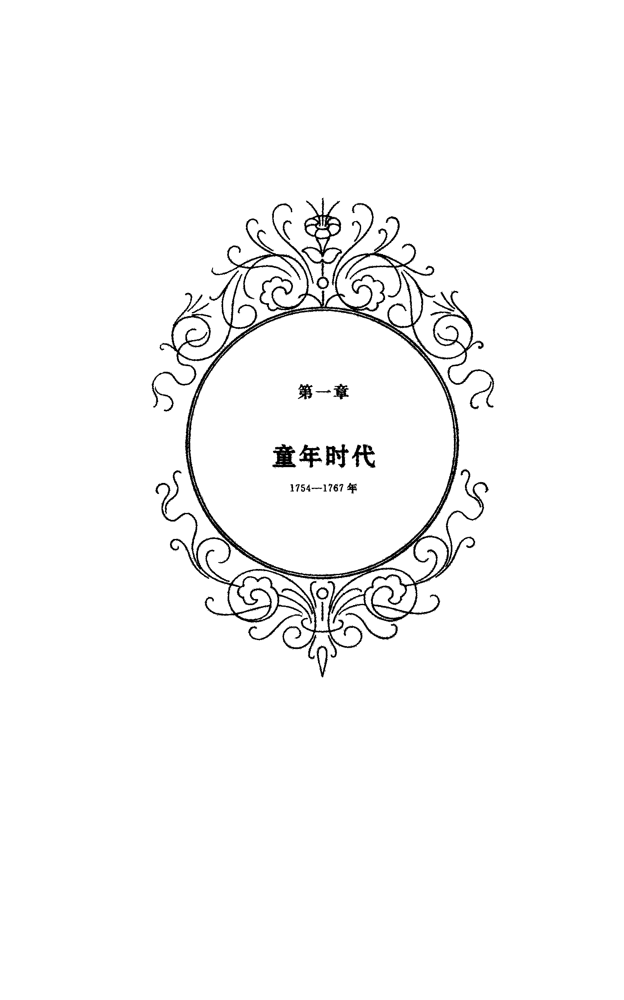

<small><a href="images/pages/013.png">原书第2页 · PDF 第13页 · 查看原页</a></small>

法国大革命产生了很多著名的重要人物，其中，鲜有人比罗兰夫人名声更大、更值得注意。罗兰夫人一生跌宕起伏，激励着仰慕她和同情她的心灵，也激励着按照上苍给予自己心灵的能力正直地生活的人们。一个人若对女人力量、对个人的巨大影响不能十分欣赏，便读不懂罗兰夫人精神高尚和英雄行为的一生。罗兰夫人集心灵高贵、富有教养和女人的优雅、漂亮之魅力于一身。为了解开她所拥有的不可思议的影响力之谜，详细地追溯她从出生到辉煌时刻以及悲壮死亡的一生经历，非常有必要。

1754年，在巴黎拥挤的珠宝街上，有一家并不出名的作坊，雕刻匠格拉蒂安 •菲利普（Gratien Phlippon）生活在这里。菲利普与一个美丽的女人结了婚。与丈夫的烦躁不安与牢骚满腹相比，这个美丽的女人性情温和、知足常乐。每天，雕刻匠在店铺二楼简陋却舒适的工作间劳作。他对自己的生活很不满意：他的地位卑微；家人被禁止享有那些大量给予其他人的精美奢侈品，只能过着简朴的生活。他经常痛苦地抱怨：卑微的身份和辛苦的劳作束缚了他的命运，而有些人并不值得尊重，只是更为幸运，生下来就安逸富足、荣耀奢侈。人的社会地位的不平等、不公正的想法已经在劳动阶层中酝酿，不久就以法国大革命的能量火山般爆发了。没有人像菲利普这样以一种焦躁不安的心情去思考那些巨大的差异，也没有人像他那样不停地大声抱怨。当一日的劳作结束时，菲利普喜欢与同他志趣相投的伙伴们聚会，谈论他们所受到的不幸压迫，谈论贵族的极度傲慢自大。因为口才很好，菲利普常常能深深打动有同情心的听众。劳动者的日夜劳作和贫困的命运与宫廷阶层在凡尔赛宫挥金如土的奢侈、在香榭丽舍大街的招摇过市的对比，使聚集在他内心的怒火更炙更旺。

原页对照（含插图与旁注）
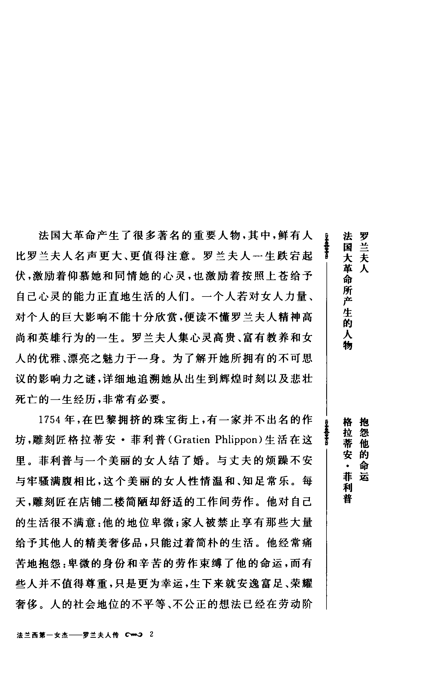

<small><a href="images/pages/014.png">原书第3页 · PDF 第14页 · 查看原页</a></small>

菲利普是个哲学家，而非基督徒，顺从是他从没学习过的美德，他也不希望学习。他把基督教视为已发展为罗马天主教会的权力机器，他认为，基督教是人们自由和上进的巨大障碍，是用迷信和刀枪围建起来的堡垒，贵族与国王安全地躲在里面。于是，一如他对法国制度的看法一样，他对教会的教义充满了敌意。

在菲利普的眼中，君主就是一个专制者，上帝则是一个欺骗者。他断定，人民的解放，不仅需要推翻尘世的君主，还需要推翻天国的君主。从这些搅动菲利普心灵的想法中，人们能够看到法国大革命的起因。在剧院和咖啡馆里，各种小册子和报纸传播着这些思想；工人在店铺里、学生在宿舍里鼓吹着这些思想；在百科全书和评论中，这些思潮构成了自由思想和欢宴歌曲的合奏曲；从巴黎到外省，这些观点口口相传，直到法国像一个勃然大怒的魔鬼一样，在它愤怒的踩踏之下，整个国家震动起来。

菲利普夫人和丈夫截然不同，她是一个被信仰、信任、服从所支配的人，她从不质疑她的意志所服从的罗马教会的教义。她平和、知足、快乐。虽然无从探寻她的虔诚，但毫无疑问她的虔诚很真挚，在生活中的每一刻，她都承认上帝的支配之手，承认她卑微的命运是上帝的意志，她从不沉溺于抱怨，也从不怨恨贵族和贵族妇女们的好命。菲利普夫人是一个勤劳的家庭妇女，从早到晚，她满足而平静地哼着赞美诗。在愉快的日常劳作中，她一直以平和的心态慰藉着内心无法安宁的丈夫。菲利普很爱他的妻子，他常感受到她那种基督徒性情的优越感。

原页对照（含插图与旁注）
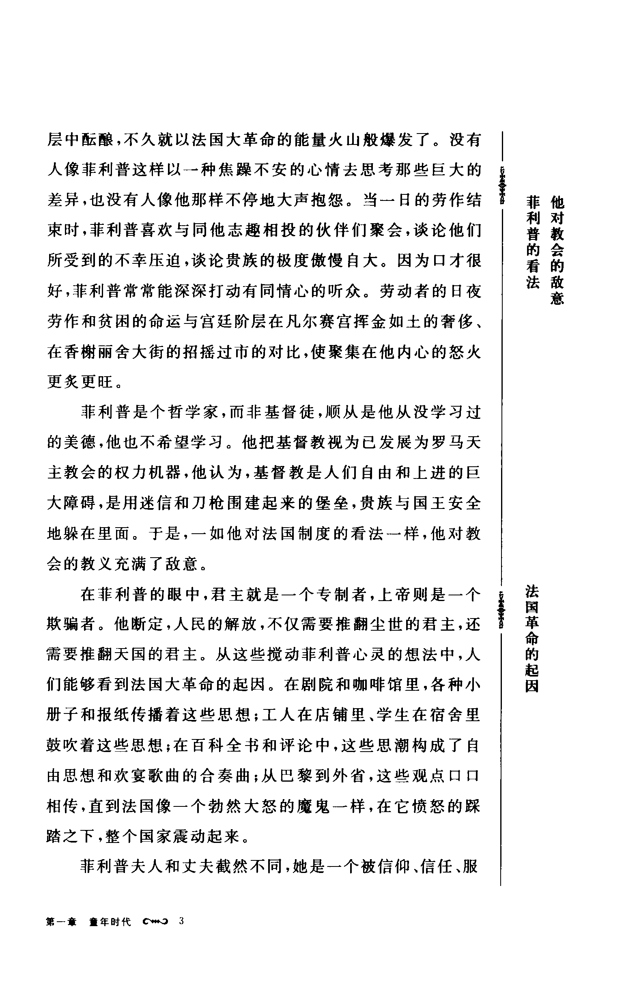

<small><a href="images/pages/015.png">原书第4页 · PDF 第15页 · 查看原页</a></small>

这对夫妇所生的八个孩子之中，只有一个孩子，即让娜·曼侬（Jeanne Mannon），或者称雅娜·玛丽（Jane Mary）在出生时存活下来。1754年，雅娜出生后，她的父亲最先抱起了她，从此，她成了父亲痛苦和钟爱的对象。雅娜的母亲以平静、深沉、持久的母爱给雅娜的心灵留下了弥足珍贵的财富。现在，雅娜成了这个家庭的中心人物，犹如众星拱月，父母都为她而活，她是他们在尘世的一切。母亲希望为教会和上帝来培养她，这样她就有可能成为一个天使，居住在上帝的宝座旁。这种美好的希望给虔诚母亲的劳作和关爱镀上了一层金子般的色彩。她的父亲则痛苦地怨恨着：为什么他聪明美丽的女儿—甚至在婴儿时就已经显示出最聪明的才智—注定过卑微辛苦的生活？而杜伊勒里宫和爱丽舍花园里成群的孩子，既没有这么聪明也没有这么漂亮，却可以纵享无尽的财富，生活在一个奢侈豪华的世界里。看起来，菲利普的这种想法比他构想天国的任何想法都更有吸引力。这些想法像一簇火苗，燃烧在这位野心勃勃的父亲的胸

原页对照（含插图与旁注）
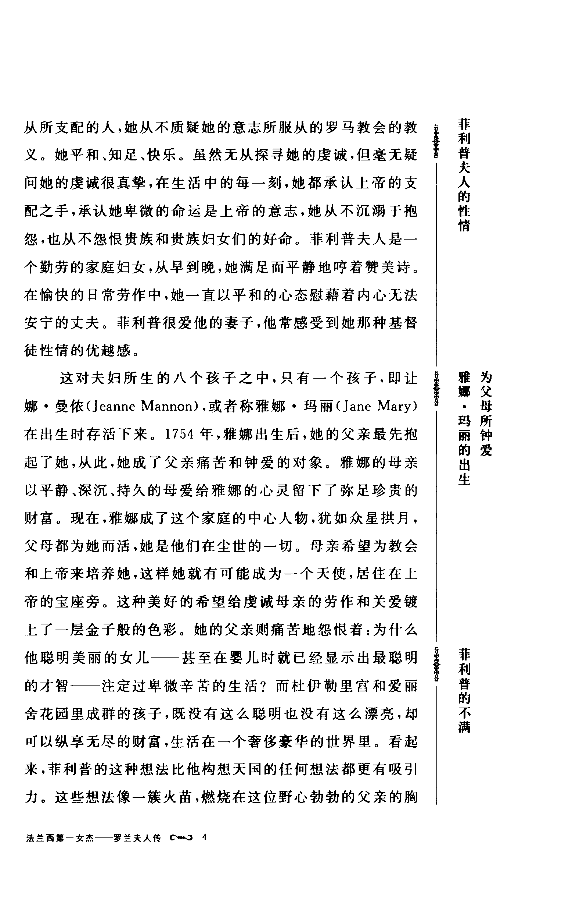

<small><a href="images/pages/016.png">原书第5页 · PDF 第16页 · 查看原页</a></small>

膛里，无法扑灭。

这位很溺爱孩子的父亲把活泼迷人的孩子视为日常伙伴。他时常拉着她的小手，对幼小的她倾诉他的想法、幻想、白日梦。在孩子的耳边，他讲述着贵族们的傲慢、国王的自大、自己因困苦生活所受的压迫，他讲述着这些不公正的事情。无忧无虑的孩子常常厌倦这些抱怨，而转向母亲宁静、快乐的心灵寻求安慰。在母亲那里，雅娜找到了安宁—这就是令人宽慰、平静、虔诚的服从。但是她父亲的忧郁态度还是给她的个人情感投下了忧思的阴影，从而把忧郁的气质和反常思考的神态注入她的性情之中。雅娜生来便拥有一股不寻常的优雅气度。从幼年起，她便常常被美丽典雅的自然、文学、事物等吸引而入神。在夏日的傍晚，她喜欢独坐窗前，凝视绚丽的落日，她的思绪漫游在仿佛对她打开的更为光明的世界门口，漫游在遥远的壮丽景观中。她沐浴在落日的余晖中，任由思绪飞翔，受父亲那些思想的影响，她常常无法克制住自己的情绪而潸然泪下。打动人心的诗歌、描写英雄美德和成就的书籍是她的最爱。雅娜尤为喜欢普鲁塔克（Plutarch）①的名人传，她常常把它放在自己的枕头下，不厌其烦地一读再读。那些著名的古代英雄成了她寂寞心灵和常常思索的朋友，像对待自己最亲密无间的个人朋友一样，她仰慕并热爱他们，不知不觉中，她的个性也被塑造成了那些古代英雄的模式，她兴趣盎然地模仿着他们的行为。

<blockquote>
① 普鲁塔克（约46—125年）：生活于罗马时代的希腊作家，《希腊罗马名人传》一书留名后世。——译者注
</blockquote>

原页对照（含插图与旁注）
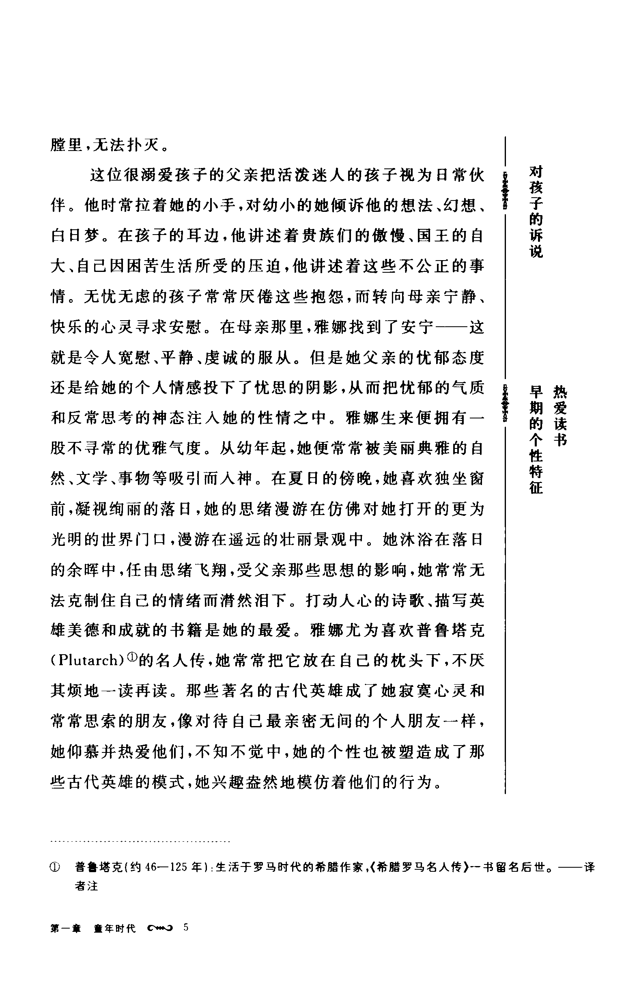

<small><a href="images/pages/017.png">原书第6页 · PDF 第17页 · 查看原页</a></small>

在雅娜12岁时，一天，父亲发现她正在为不能成为一个罗马少女而哭泣。虽然她很年幼，但她想象着，凭借才能、磨砺和英勇，她也可以表现为一个英雄人物，她的经历也会使希腊、罗马故事中最令人骄傲的描述黯然失色。

雅娜好像从来不知晓孩童的轻薄和无知。她还不到四岁时，便会阅读。从那时起，她的阅读渴望非常强烈，父母给了她大量图书，她都能不吃力地阅读。她不仅博览群书，而且，为了具体的兴趣，还能进行持续的广泛阅读，用心记下所有重要的事实。雅娜对书籍如痴如醉，把她从书中拉出来的唯一成功方法是给她一束鲜花，因她非常喜爱鲜花。在雅娜的人生沉浮中，直至其死亡时刻，书与鲜花一直伴其左右，给了她最大的快乐。她没有玩伴，认为玩耍不过是和父母在一起玩，父母是她唯一和永久的伙伴。从幼年起，雅娜就习惯于成熟心灵的想法和情感。在容貌上，从小到大，与其说她很漂亮，不如说她有种独特的引人注目。随着成长，她的外表更为美丽，身材曲线分明，面庞灵动秀气，神态温柔优雅，这给予她一种秀外慧中的迷人力量。她并没有刻意寻找这种力量，也没有想过这种力量，但其言行自有一种几乎令人无法抗拒的吸引力和说服力。

也正是因为缺少玩伴和习惯于和成熟的心灵交流，造成了雅娜在幼年时期就贪婪地渴求知识。书本是她闲暇时的唯一东西。跟父亲散步后、跟母亲做完家务后，她便一头扎进她的小图书馆，坐在她房间的窗前，沉迷于她无限的思想王国中。通常认为，时势造就英雄——这是事物内在的、固有的趋势，是战胜环境的结果。无法否认的是，造物主可能赋予了这颗心灵一些与众不同的聪明天分。可以确信，从雅娜幼年时期的学习能够推断出，她将形成一种独特的性格。

原页对照（含插图与旁注）
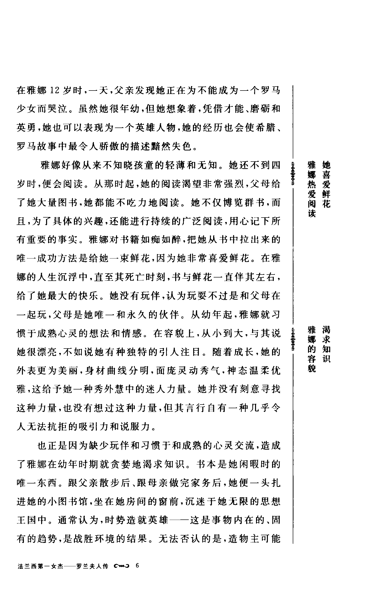

<small><a href="images/pages/018.png">原书第7页 · PDF 第18页 · 查看原页</a></small>

在一个炎热的夏日午后，雅娜也许牵着父亲的手，和父亲一道沿着林荫大道散步，她目睹了一幅令人愉悦的画面：漂亮无比的马儿们佩戴着昂贵的马鞍，拉着一辆金黄色的四轮马车，沿街奔跑—-多么赏心悦目啊！身着艳丽制服的仆人们、马弁们骄傲地骑在马上，这样的壮观场面，简直能穷尽一个孩子的想象力。菲利普挽着他的小女儿，指给她看这种景观，当他凝视着稚子的惊奇和快乐时，不满的父亲说道：“看那个贵族，看那个夫人、小孩，如此骄奢地闲坐在马车里，他们没有权力坐在那里！我和我的孩子为什么必须走在如此酷热的人行道上，而他们却身着艳丽时装安坐在车里，去狂欢作乐？压迫的法律迫使我交付我的一部分辛苦所得去供养骄傲和无知的他们。但当人们醒过来，意识到自己的不公正这一时刻到来的时候，专制者将会在人们面前发抖！”他继续在心情烦乱的沉默中散步，思索着他的想法和所遭受的不公平。雅娜和父亲返回家中，她希望父亲也能有一辆四轮马车和身着制服的仆人，马弁。她思考着政治，思考着困王和贵族，思考着人的不公正、不平等。她安静地独坐在窗前，开始阅读《公正的阿里斯提得斯（Aristides）》①，阅读提米斯托克利（Themistocles）的《斯巴达人的美德》，阅读布鲁图

<blockquote>
① 阿里斯提得斯（公元前530—公元前 468）：雅典政治家、将军。他以公正处事著称，廉得”公正者”的称号。—一译者注② 提米斯托克利（约公元前 529或528一公元前462 或460年）：古希腊雅典民主派政治家、统帅。—译者注
</blockquote>

原页对照（含插图与旁注）
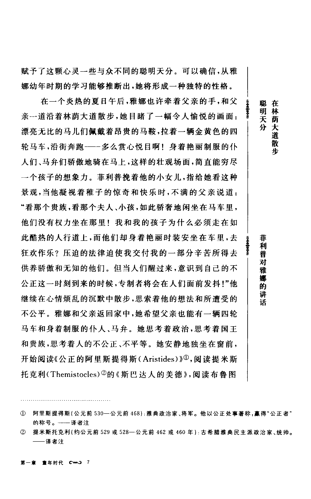

<small><a href="images/pages/019.png">原书第8页 · PDF 第19页 · 查看原页</a></small>

（Brutus） ①，阅读《格拉古兄弟的母亲》，她头脑里浮现出希腊和罗马的古代圣王。她鄙视巴黎的轻佻、当代的柔弱，她那年轻的胸膛跳动着在精神上和功勋上成为贵族的渴望。就这样，当她同龄的其他孩子都在玩耍他们的玩具时，她却梦想着贵族的覆灭和国王的倾覆，梦想着人类的自由、博爱、平等。对一个孩子来说，这是奇怪的梦想，但更为奇怪的是，这些梦想竟然实现了。

父亲的不信神和母亲对神的虔诚，像大海里两股相搏击的潮流一样，在她的胸膛里作着斗争：她那敏锐的理解力和对自由的热爱使她认同所谓哲学家的思索，她那温柔亲切的性情和热爱思考又使她在基督教的崇高观念和抚慰心灵的安慰中寻求安宁。雅娜的父母对她的教育尤为重视，希望能给予她获取最高成就的每一项便利。当时在法国，几乎无一例外地由修道院的修女们对年轻女子进行教育。修道院与世隔绝的安静、孤寂激发了这位想象力丰富的女孩的热情火苗，虽然她非常喜欢自己的家，但还是很盼望去修道院的时刻到来。她有一种英雄式的自我牺牲，能够从世界和其快乐中抽身而出，把全部身心投入到虔诚、冥想、学习中去。母亲的宗教精神正对她施加一种强有力的影响。一天晚上，她双膝跪下，流着眼泪，恳求送她去修道院，以在合适的心境下，接受重要的基督教教育。

父母为雅娜选择了巴黎的天主教会众妇女团体的修道

<blockquote>
① 布鲁图（公元前85一公元前42年）：罗马政治家，暗杀恺撒者之一。—译者注
</blockquote>

原页对照（含插图与旁注）
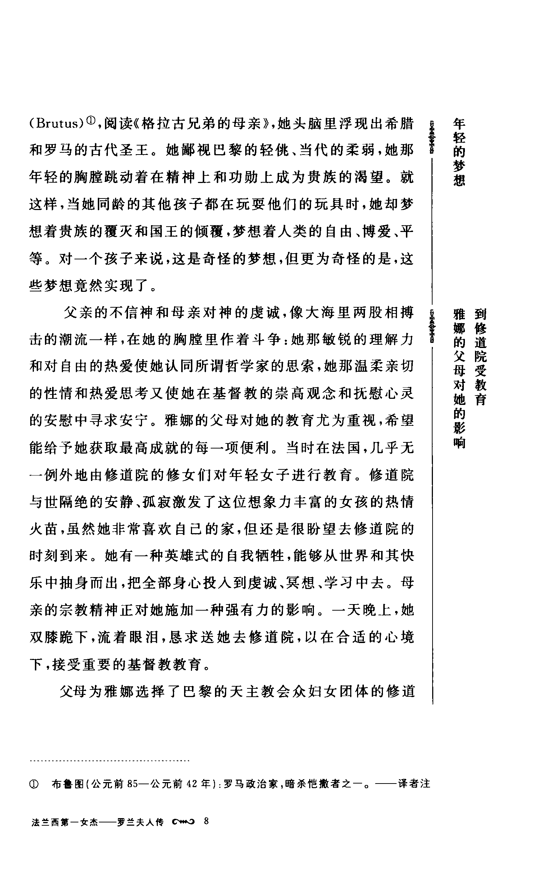

<small><a href="images/pages/020.png">原书第9页 · PDF 第20页 · 查看原页</a></small>

院。在回顾自己的经历时，关于这件事情，雅娜后来写道，当被关进监狱般的房间时，“我紧抱着亲爱的妈妈，这是我生命中和她第一次别离，我的心都碎了。但我正在服从上帝的声音，我迈进了修道院的门槛，含泪对上帝做出我所能做的最大奉献。这一天是1765年5月7日，我十一岁零两个月。在昏暗的监狱中，在袭击祖国的政治风暴中，对我最重要的一切都被清扫而光，我该如何整理我的思想？我该如何描述生命中这个时期我所享受的快乐和宁静呢？无论多么绚丽的色彩也不能描画出一颗年轻心灵的柔软情感，这颗心温柔而敏感，憧憬着幸福，开始体验自然之美，独自理解神灵之性。在修道院的第一个夜晚我很激动。双亲不再庇护我。我离亲爱的妈妈这么遥远，她一定在慈爱地想念我。屋里灯光昏暗，我和四个与我年龄相仿的孩子睡在一起。我轻轻地偷偷从床上爬起来，挪到窗前，皎洁的月光下，能清楚地俯瞰花园里的一切。我聆听着，周围沉寂无声。我这样表述，是带着尊敬的态度。高大的树木在地面上投下巨大的阴影，为安静地思考提供了一个绝妙的处所。我抬头仰望天空，天空晴朗宁静。我想象着上帝正在为我的虔诚微笑，给我的奖励是已经在天国为我提供了希望的居所。喜悦的泪水从我面颊滑落，我神圣而欢喜地重复着我的誓言，接着去享受上帝选中的孩子之睡眠”。

雅娜对知识的追求如饥似渴，学习起来不知疲倦，非常刻苦。时间飞梭如电，每日每时都不应虚度。她热切地阅读着她面前的每一本书，在脑海中珍藏下其中的知识和优美文字。这个年龄不大的孩子阅读着、思考着各类书籍，像传奇文学、神话传说、传记、游记、历史、政治哲学、诗歌、道德论文等。她不喜好那些孩子气的娱乐活动，在娱乐时间，她周围的女孩们都兴高采烈地玩要适合她们年龄阶段的游戏，而忘记了学习，雅娜却独自在花园里散步，欣赏缤纷鲜花、凝视蓝天白云。在自然的美景中，她的眼睛似曾看到了上帝之手，她醉心于那些定然能打动高贵心灵的永恒和无限的崇高思想。雅娜的老师很省心，因为雅娜对任何学习都带着高涨的热情，在其他人几乎还没有开始之前，成绩已经表彰了她的努力。

原页对照（含插图与旁注）
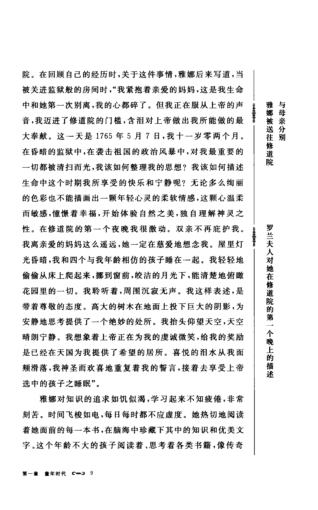

<small><a href="images/pages/021.png">原书第10页 · PDF 第21页 · 查看原页</a></small>

雅娜精通音乐和绘画。相比于那些比较枯燥的学科，虽然她也带着很大的兴趣和努力去学习它们，但她更喜欢能够使人心灵丰富，美丽优雅的文明成果。

我们能够猜想，雅娜在修道院里所目睹的场面给她那颗想象力丰富的心灵留下了难忘的印象。修道院里，蜡烛袅袅燃烧，散发出朦胧的微光，祈祷者在做礼拜；风琴呜呜咽咽地弹奏着哀歌，令人耳朵发麻；在祈祷和唱赞美诗的庄严大会上，修士身着各色服装、修女戴着头巾；悲凉的钟声悠悠不绝，哀伤地为死去的姐妹敲击安魂曲，在幽暗的夜晚，人们点亮火把，把死去的姐妹安葬——这些安排得如此熟练的、制度庄严的各种仪式，深深触动着这个年轻人的情感和想象力，也使拥有诗人气质的雅娜在精神上获得了更高的升华。

因此，在雅娜的心目中，上帝成为一个诗意般美丽的想象。宗教是热情和情感的驱动力，对上帝的崇拜和祟高、美丽混合在一起，雅娜为这些热烈的想象所感动着。在那些温暖的岁月里，她那颗情感丰富的心灵很厌恶无神论、不忠、背叛、庸俗。上帝存在的观念和对上帝存在的崇拜，是她情感的中心。这种心灵状态是诗歌的，而非宗教的，它并不涉及神法的唯灵论含义，也不涉及无价值观念，它不需要一个救世主。这种情感崇高而美丽。当雅娜夜晚站立在沙穆尼山谷之中时，当雅娜聆听暴风兩中的隆隆雷鸣时，或在六月清新美好的早晨陶醉地凝视大自然美景时，当晴空无云、风止树静、湖水不惊、乌鸣啾啾，空气中弥漫着鲜花的芳香时，雅娜常能感受到这种情感。很多人误解了这种高度的诗歌热情，实际上，这些画面会激发人的虔诚精神。

原页对照（含插图与旁注）
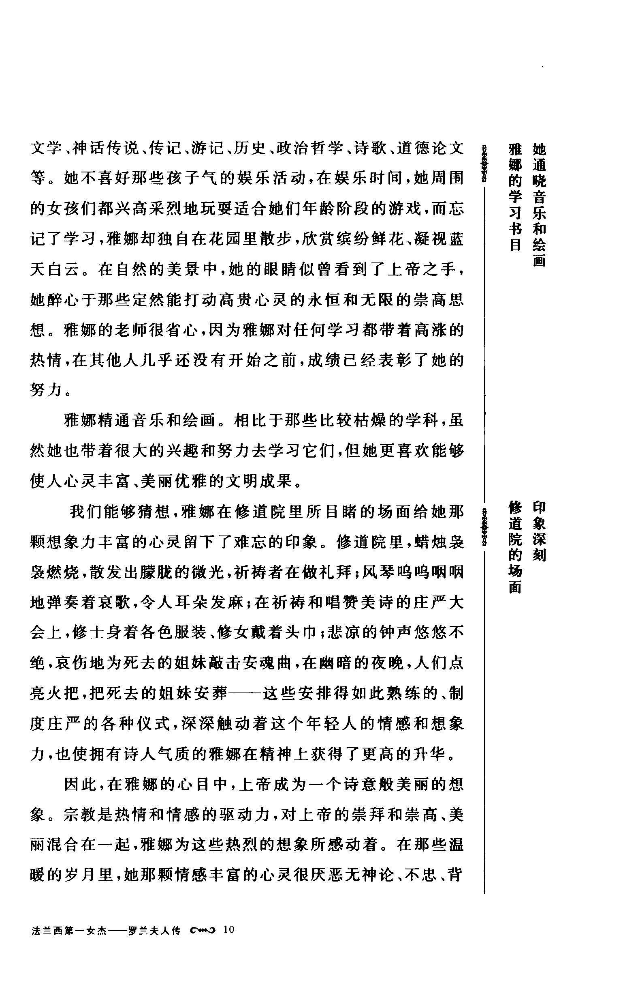

<small><a href="images/pages/022.png">原书第11页 · PDF 第22页 · 查看原页</a></small>

当雅娜居住在修道院里时，有一位戴着面纱、非常有趣的年轻女子，她来自令人失望的某地。因为她怀着成为一名修女的目标进入修道院，所以一开始就带上了白色的面纱，这是她对自己目标执著的一种表示，她因此达到了见习修女的级别。在她数个月的见习修女期间，她须经受最严格的守夜、斋戒、孤独、祈祷等训练，以使她明确理解她所迈人的乏味的、自我节制的生活。如果她没有被这些困难吓倒，她就可以继续坚持她的决定，然后她将戴上黑色的面纱，庄重宜誓她将葬身于幽暗的修道院中，再也不能从中挣脱，到了这一步就再也无法反悔。无论在斗篷下还是面纱下都仍颤动的心，将在屋顶尖尖的小房间里找到它的活坟墓，直至死亡时才能安眠。若不带着深深的感情，一个人不可能带着平常的分享心来目睹出现这种结果的仪式，这个场面对雅娜的精神产生了难以磨灭的影响。花环戴在美丽的牺牲者的头上；纱布裹住她的身体；庄严的、挽歌般的赞美诗，埋葬她所有情感和快乐时光的安魂曲；柩衣覆盖着她，这是其委身于一座活坟墓的标志。这一切是如此深深地震动着这个充满热情的孩子，她把脸埋在双手中，无法克制地流着眼泪。

原页对照（含插图与旁注）
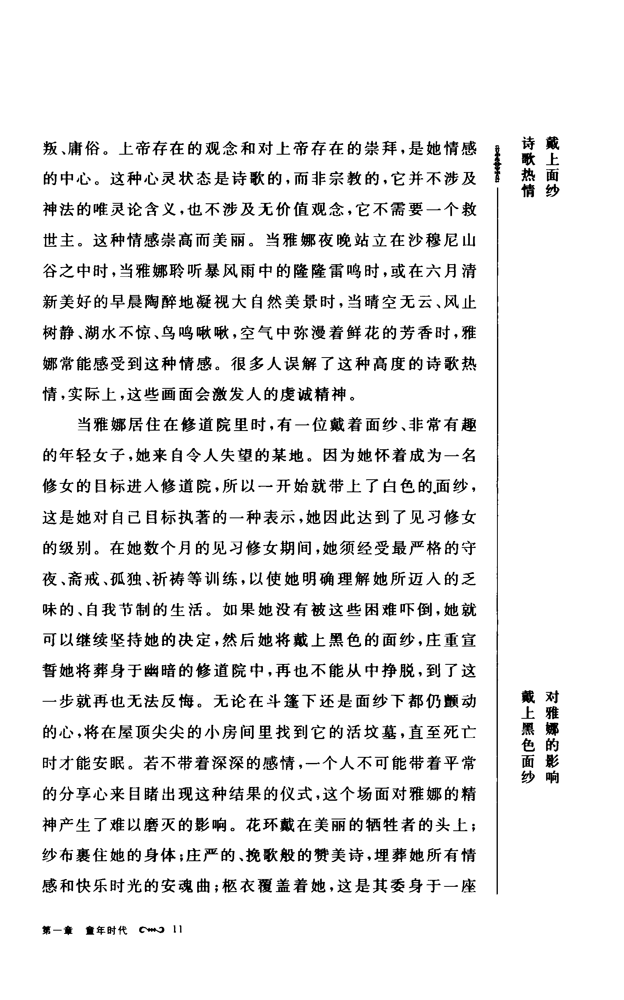

<small><a href="images/pages/023.png">原书第12页 · PDF 第23页 · 查看原页</a></small>

年轻的见习修女很伟大的想法势不可挡地激起她对崇高道德的仰慕。为了禁欲、苦修、祈祷的乏味生活，而放弃所有尘世欢乐，这是显而易见的英勇！雅娜不禁想起了她所仰慕的罗马少女和妇女。雅娜怀着最浪漫的热忱立志做一些伟大、高尚的事情。如此放弃生活并没有遭到她明的判断力的谴责，反而激励着她满腹热情地以某些有意义的方式去实践忍耐、牺牲和殉道的生活。她觉得她是为了做一些伟大事情而生的，她很蔑视日常生活中所有的普通事情。这些就是一个浪漫女孩的梦想，然而，这些梦想并不是一颗柔弱、伤感心灵中转瞬即逝的幻想，而是一个舞动着想象力节杖、一个最坚强的才华横溢者灵魂深处最远大的志向。这些早期的性格发展，使人想起有些人对拿破仑的评价—-拿破仑的身上，“除了想象力一无所有”，“只有想象力”，但这位聪明的观察家又说道：“想象力统治世界！”

那些并非为了名声，而是为了内心的知识提升、道德高尚、英雄主义的远大志向和伟大的模糊憧憬，如通常的白日梦一样，并没有令雅娜对生活的积极责任产生厌憎，它们并没有削弱她的个性，或者把她变成一个空想家；相反，它们激励、鼓舞着她欣然履行每一项责任。它们使雅娜鄙视安逸和奢侈，乐于自我克制，最大程度地提升自己。她身心的全部才能都在为任何可能的命运做着准备。有时候，她的想象很疯狂，但就算她再疯狂的想象也不能描述出现实所带给她的如此不凡的生涯。古代所有的历史故事，也比不上她所遭受的经历和痛苦之记录。以往任何时代的男女英雄都没有像她这样用乐观坚毅的态度面对困境，散发出伟大的人性光辉。

原页对照（含插图与旁注）
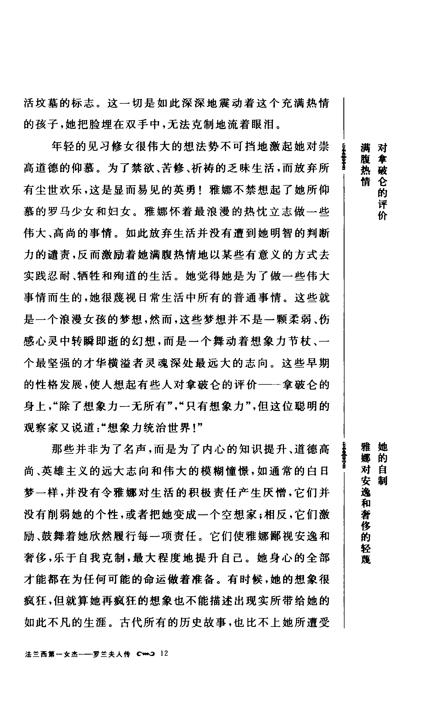

<small><a href="images/pages/024.png">原书第13页 · PDF 第24页 · 查看原页</a></small>

原页对照（含插图与旁注）

