# 第二章 少女时代

<small><a href="images/pages/025.png">原书第14页 · PDF 第25页 · 查看原页</a></small>

1768—1769年

原页对照（含插图与旁注）
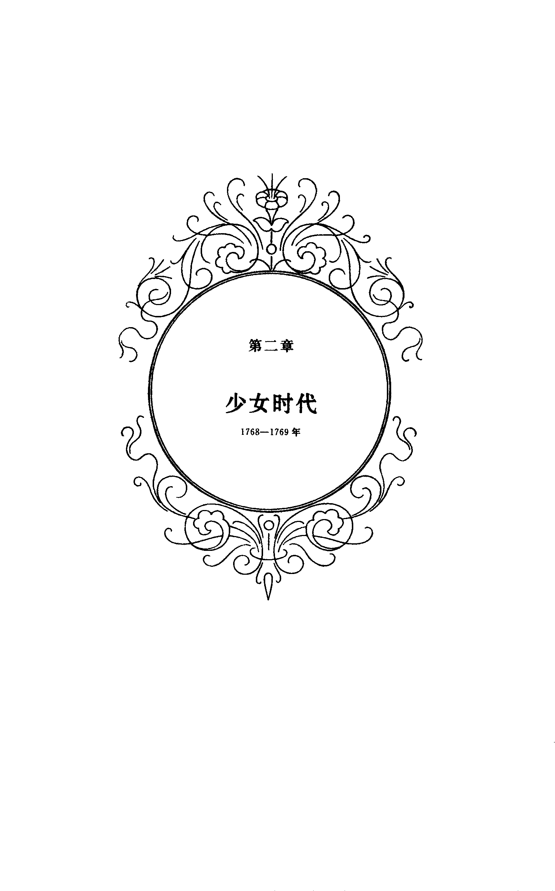

<small><a href="images/pages/026.png">原书第15页 · PDF 第26页 · 查看原页</a></small>

童年时期在修道院所目睹的场景激起了雅娜内心的强烈感情，对雅娜影响很大，这种影响力一直没有从雅娜富有想象的心灵中消逝。修女、修道院、昏暗灯光下的祈祷仪式、缓缓燃烧的蜡烛、晨祷、晚祷以及午夜的哀歌，与罗马天主教相关联的一切事物散发出诗一般的吸引力，这些远比其他任何事物更令这个情感浪漫的女孩印象深刻。雅娜恰恰拥有一颗最易为这种魔力着迷的灵魂，她陶醉于昏暗的修道院之中的各种景象，陶醉于奢侈的享受之中。看来，雅娜没有受到支配她这个年龄段女孩的一般动机的影响，她的快乐几乎完全是智力和精神方面的，她的志向远在平常孩童的想法之上。一度，雅娜完全被身边的新奇景象吸引住了，整个身心都服从于她所沉浸其中的事物之统治。在以后的岁月里，凭着十分达观的精神，雅娜把自己的理性从这些错误的观念中解放出来，她走向了另一个极端，在缺乏快乐的无信仰迷宫之中迷了路。但是，直到雅娜死亡的时刻，她的喜好都保留着这些早期印象的痕迹。即使基督教在严重遭受世俗的腐败连累时，也远远胜于根本没有宗教，甚至，罗马教廷也从没有像无神论者这样血腥地挥舞着权杖。

雅娜在修道院待了一年，然后，带着深深的遗憾，离开了修女们。雅娜非常留恋姐妹们，她和其中一个已经与贵族订婚的姐妹结下了深厚的友谊，并把这种友谊维持了一生。在很多年里，雅娜和这位朋友一直保持着通信。很大程度上，雅娜把后来成就她名声的写作才能归因于这种通信，写信是对写作最好的训练之一。雅娜的父母也渴盼自己的孩子在这方面取得进步，尽力鼓励雅娜经常写日常书信。因此，最重要的学习，即表达能力的学习，就转变为一种快乐。带着渴望去追求学习必然会获得成功，若对这种努力不以然，认为是在浪费时间，无疑是一种悲哀的错误。

原页对照（含插图与旁注）
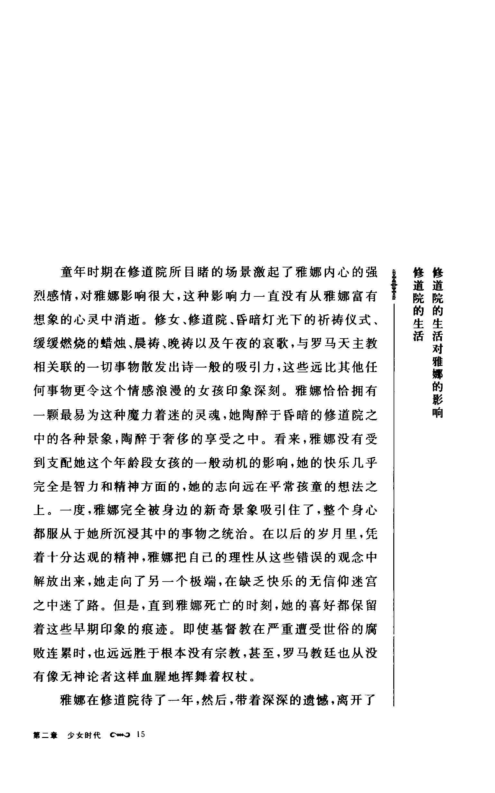

<small><a href="images/pages/027.png">原书第16页 · PDF 第27页 · 查看原页</a></small>

在修道院的时候，雅娜第一次参加了主的晚餐圣礼，神圣的仪式深深地影响并震动了雅娜的心灵。在迎接这次圣餐礼之前的几周中，雅娜通过独居、自我反省、祈祷等方式，认真地为这次神圣的赴会做准备。雅娜把这一切视为她与上帝结合、自己永生幸福的保证。当这一时刻到来时，她是如此激动，竟然哭泣得浑身发抖，根本不能走向圣餐台，结果，只好由两位修女搀扶着她前去。这种深厚的感情完全发乎自然，没有丝毫的矫揉造作，令雅娜贏得了姐妹们特别的尊敬。

心灵的沉思幻想是如此危险而又如此诱人，雅娜很乐意臣服于它，它和修道院中包围着雅娜的一切有影响之物尤其和谐一致，也塑造了身居其中者的虔诚心灵。姐妹们的赞扬鼓励着雅娜把自己的心灵交付给这些幻想来统领。每颗心或多或少都熟悉幻想所拥有的令人兴奋的力量。当夜幕降临时，雅娜喜欢独自一人到修道院的僻静之处，迈着碎步走来走去，聆听着自己单调而重复的脚步声，在寂静之中，只有脚步声打扰着凝重的沉默。雅娜常常徘徊在死去的姐妹墓前，着迷地陷入哀伤沉思之中，渴望着自己前往天国之父怀抱的启程，在那儿，自己便能享受到至善至美的幸福。曾经一度，雅娜的心中充满这种强烈的渴望。

原页对照（含插图与旁注）
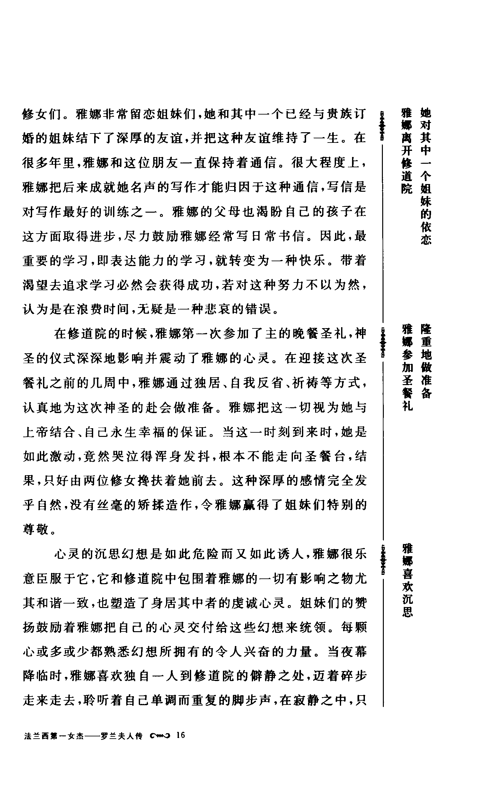

<small><a href="images/pages/028.png">原书第17页 · PDF 第28页 · 查看原页</a></small>

在这年年末，雅娜离开了这个宁静的隐居之所。雅娜非常喜欢这儿，这儿给雅娜留下了很多永不磨灭的印象。雅娜的父母，虽然细心地关注着自己的孩子，却没能注意到雅娜膨胀的精神需求，他们把雅娜送到了她的祖母和姑姑安热丽（Angelieu）处，雅娜和她们一起度过了自己的13岁。

雅娜的祖母是一位举止优雅、心灵高贵、令人尊敬的女人，她很重视生活的礼节和仪表的雅致。雅娜的姑姑和蔼热心，心中充满谦恭顺从的虔诚情感，这使她常常散发出纯洁的光芒，这光芒甚至穿透了罗马天主教会的一切障碍。雅娜和她们一起生活了一年，她们所在的地方几乎与世隔绝，雅娜发现这里和孤寂的修道院几乎完全一样。雅娜对父母、对修女老朋友们的偶然探访，是打乱平静日常生活的事件。读书依然是她的主要事务和快乐所在，雅娜也依然保持着爱思考的习惯，在她的个性中，她那些崇高的梦想日益获得了优势地位。

因此，雅娜仍然居住在精神和情感的广袤地域中。甚至，通过赋予日常生活和个人的有限生命之间一种神秘的联系，连最普通的生活责任也对她变得很有吸引力。雅娜沉浸于自己的思想中，把永远和自己交流、和自然交流、和上帝交流，当做个人情感和抱负的最高目标。

虽然雅娜没有看不起那些较为低下的心理活动，但很不重视它们。在每一个好天气的傍晚时分，雅娜坐在自己房间的窗前，欣赏落日的绮丽，用那些未来的荣耀和幸福的愿景—仿佛这些场面已经展现在她面前—•来滋养自己那热情洋溢的心灵。雅娜想象着，自己几乎能看见天使的翅膀在绚丽的霞光中若隐若现，穿过那些漂亮的林荫道，朵朵白云堆积在金色的云霞之上；她想象着，那遥远的地方乃是享受天国之福者的居所。在雅娜真诚而热烈地祈祷时，她忍不住会表达出这些燃烧在内心深处的激情。当雅娜想起崇高的上帝，眼中便饱含着无法克制的泪水，上帝是如此值得她虔诚地尊敬。

原页对照（含插图与旁注）
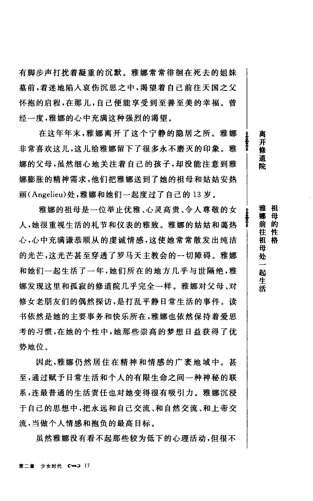

<small><a href="images/pages/029.png">原书第18页 · PDF 第29页 · 查看原页</a></small>

对雅娜拥有这些明显的、高尚的品德之迹象，雅娜的父亲感到很高兴，他尽自己所能激发雅娜在学习和思考方面的更大热情。雅娜成了父亲的偶像，她富有想象力的心灵越充满浪漫的志向，父亲就越高兴。坚持不懈的勤奋、干劲与她那些梦想结合在一起，雅娜的热情使她所做的每一件事情都获得了成功。雅娜渴望了解每一样事情。当父亲把雕刻刀放到她手中，希望教她学习雕刻，雅娜很快就获得了这项技能，令她的双亲目瞪口呆。此后，雅娜在雕刻上消磨了许多愉快的时光，比如她雕刻的光滑的铜盘、美丽的花朵图案等都深受朋友们喜爱。

雅娜的母亲有着更准确的判断力，她努力召唤女儿从喜欢停留的不真实的世界中回头，努力使女儿对现实的生活责任感兴趣。她开始热切期待女儿返回家中，这样，她就可以引导女儿做一些家务事，对每一个女人来说，这种知识技能的重要性都是不言而喻的。在这方面，雅娜的母亲很不成功，因为雅娜在父亲的鼓励下继续做梦。雅娜也真切地明白母亲的良苦用心，她准备配合母亲的全面规划。

原页对照（含插图与旁注）
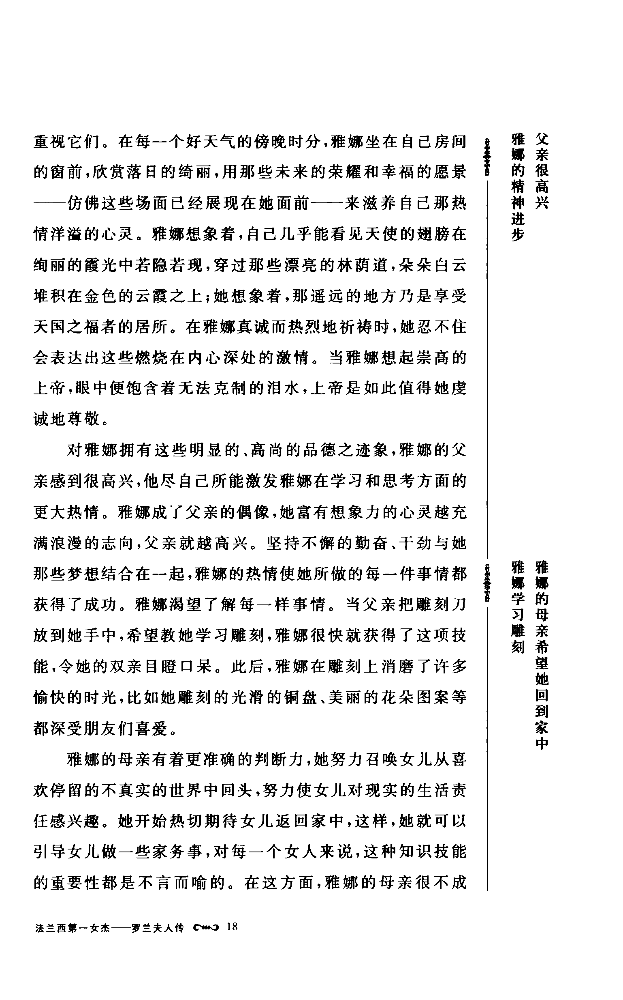

<small><a href="images/pages/030.png">原书第19页 · PDF 第30页 · 查看原页</a></small>

在这段时间，一个偶然发生的事件突出地显示了雅娜在思想上已经成熟。在法国大革命爆发前，法国贵族的行为傲慢自大，他们呈现出的面貌是今天的美国人难以想象的。一天上午，雅娜那心灵高贵、很有教养的祖母带着她去了德布瓦莫勒尔（De Boismorel）夫人的府邸。德布瓦莫勒尔夫人是一位有贵族头衔的女士，祖母曾教导过这位贵妇的子女们。对雅娜来说，这是一件大事，为了去参观贵族的府邸，雅娜打扮得非常讲究。这个有志气的女孩，完全没有贬低地位低于自己的社会等级的倾向，也没有对地位高于自己的社会等级表示敬意的意愿，她完全没有意识到她将蒙受令人感到屈辱的傲慢对待。门口的门卫向菲利普夫人礼貌地致敬，雅娜遇到的仆人们都对她彬彬有礼，她也礼貌地、举止高贵地一一回礼。祖母很为孙女骄傲，仆人们也纷纷赞美这位年轻的女士。雅娜天性中的自豪使她立刻警觉起来，她感到，仆人们如此恭维她是不对的，他们之所以这样做，是认为她的社会地位和等级在他们之上。

呜呼！可怜的人之本性，所有人都喜欢向上爬，很少人愿意降低身份支持平等。一个高个的男仆人告知她们到了富丽堂皇的餐厅门口。这家贵族住宅的所有陈设估计都让不习惯于富丽堂皇的人眼花目眩、心受震撼。德布瓦莫勒尔夫人身上穿着尽显富贵气派的衣服，坐在一个有垫子的凳子上，双手正在做针线活。她的脸上涂着厚厚的脂粉，看起来非常端庄高贵。当通报客人到来的时候，她从自己的刺绣上抬起眼睛，

原页对照（含插图与旁注）
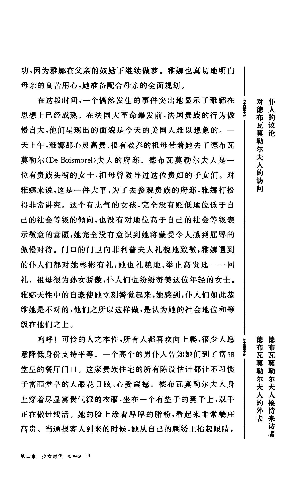

<small><a href="images/pages/031.png">原书第20页 · PDF 第31页 · 查看原页</a></small>

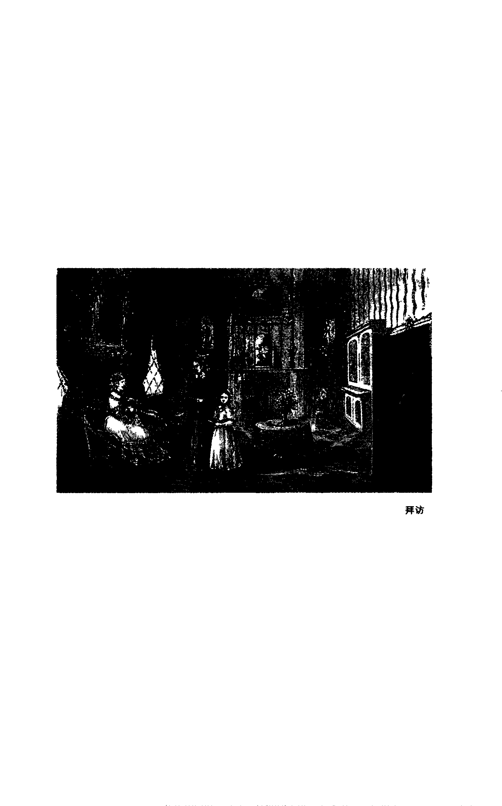

<small><a href="images/pages/032.png">原书第21页 · PDF 第32页 · 查看原页</a></small>

向雅娜和祖母扫视了一眼，眼神冷漠无情。她没有站起来接待她们，甚至没有稍微地欠欠身。她用一副施惠于人般高傲的、高高在上的口气对雅娜的祖母说道：

“哦！菲利普女士，上午好！”

雅娜很不高兴她们在大厅里尤其是在餐厅受到接待，罗马少女的骄傲在雅娜心中升起，她很愤怒地对自己说：“在这个房间里，我的祖母竟然被称作‘女士’！”

“很高兴见到你，”德布瓦莫勒尔夫人接着说道，“这个漂亮的女孩是谁？我猜是你的孙女？她会成为一个美丽的女人。亲爱的，到这里来。啊！我看她有点害羞。你的孙女多大了？菲利普女士，虽然她的肤色有点黑，但皮肤很干净，几年后会变得白一些，她已经是一个不错的女孩了。”

她这样喋喋不休地说了一会儿，也不等回答。最终，她把头转向几乎不敢抬头的雅娜，说道：“你有多么美丽的一双手啊！拥有这么美丽的手，一定运气非常好。亲爱的，你抽过奖吗？”

“从来没有，夫人，”雅娜立刻回答道，“我不喜欢赌博。”

“多么美妙的声音！”这位贵妇喊出声，“如此甜美饱满！多么庄重的女孩啊！亲爱的，你一点都不喜欢吗？”

“我知道我对上帝的责任，”雅娜回答道，“并且，我会努力履行它。”

“真是一个好女孩，”这位贵妇答道，“你希望做修女，还是不希望？”

“我不知道我的命运会是什么，我目前也不急于猜测它。”

原页对照（含插图与旁注）
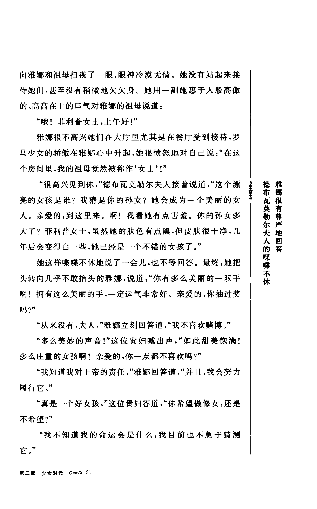

<small><a href="images/pages/033.png">原书第22页 · PDF 第33页 · 查看原页</a></small>

“多么爱用警句啊！”德布瓦莫勒尔夫人回答道，“你的孙女读了很多书，是吗？菲利普女士。”

“是的，夫人，阅读是她最大的快乐。”

“啊！”这位贵妇说道，“我看情况也是这样，但看来她不可能成为一个作家，确实有点遗憾。”

在谈话当中，雅娜因自尊受到伤害而激动得面颊发红，心跳得很厉害。她感到愤怒，感到蒙受了耻辱，非常渴望逃离这样遭受羞辱的拜访。在心灵上，她意识到，无论在哪一方面，她都不比她所仰慕的古希腊和罗马女子差。正如她厌恶大厅中仆人们伪装的平等一样，她立刻本能地对这间客厅的傲慢占有者的无知退避三舍。

这次拜访之后不久，雅娜被带到玛丽•安托瓦内特（Ma-ria Antoinette）的奢侈居所度过了一星期。凡尔赛是一个宫殿林立和廷臣充斥的城市，那里集中着所有令人眼花缭乱的王室的奢华炫耀和骄奢淫逸。像雅娜这个年龄的大多数女孩都可能为这种皇家的盛大场面着迷，感到震撼。

雅娜被允许观看和部分地参加所有盛大的宴会、演出、官延舞会、灯展，以及被允许使用大使们和亲王们镀金的马车。但这个年轻的少女，只不过刚从儿童时期和修道院的孤寂中走出来，对于这所有的豪奢竟一点也不惊奇，她用一副哲学家的谴责眼光悲哀地注视着这些场面。大臣们的卑躬屈膝激起了她的轻蔑，她对比着豪富、挥霍无度的宫廷与重税之下缺乏舒适居所的穷人，深深地思考着君主专制主义的价值——为了纵容少数人放荡的享乐而使得百万人挨饿。感觉到自己的心灵和外在的魅力被拜倒在地位和权力神龛前的人们完全忽略，雅娜的自尊也深深地被刺痛。很快，雅娜厌倦了这些令人痛苦的场面，因为厌恶这些活人的轻浮，雅娜便寻求和卓越的死者在一起，来抚慰自己受伤的心灵。雅娜选择了花园作为去处，她漫步在那些极其引人人胜的装饰场景的雕塑中，让自已沉溺于那些令她常常沉迷的梦想所带来的奢侈享受中，那些梦想常常引领她的思想远离她周围的琐事，奔向英雄的品质和辉煌的成就。

原页对照（含插图与旁注）
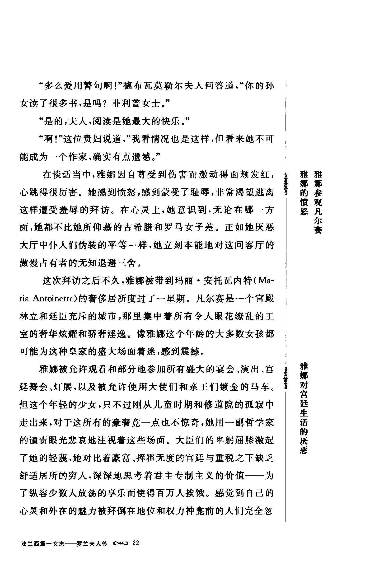

<small><a href="images/pages/034.png">原书第23页 · PDF 第34页 · 查看原页</a></small>

“女儿，你这趟行程玩得开心吗？”雅娜的妈妈问她。

“当它结束的时候我很高兴，”雅娜与众不同地答道，“而且，要是多待几天，我会讨厌我看到的所有人，会让我不知如何忍受我的憎恶。”

“为什么啊？孩子，这些人给了你什么伤害啊？”

“他们使我感到不公正，而且，他们看起来很愚蠢。”这位13岁的哲学家回答说。

雅娜是这么早就开始了对政治问题的思考，并种下了同情的种子，这种同情心后来激励着她为人民的解放、为建立共和政权、为摧毁波旁王朝的王权而行动。想象中的荣耀光环环绕着雅娜，她想起了古代的共和国，想起了那些为自由殉难的男女英雄们，或者，用她自己坚定有力的话说：“回想起雅典的时候，我叹息不已，在雅典我可以欣赏到艺术而不用因看到专制主义而生气。我无法忍受我是一个法国女人。我对希腊共和国的黄金时代神往不已，我忽略了因它曾经引起的暴风雨。我忘记了阿里斯提得斯的流放、苏格拉底（Socrates）的死亡、福西翁①（Phocion）的定罪。我很少想到，上天保留我是为了做犯类似错误的见证人，是为了认可同样的原则，是为了参与同样的受迫害之荣耀。”

原页对照（含插图与旁注）
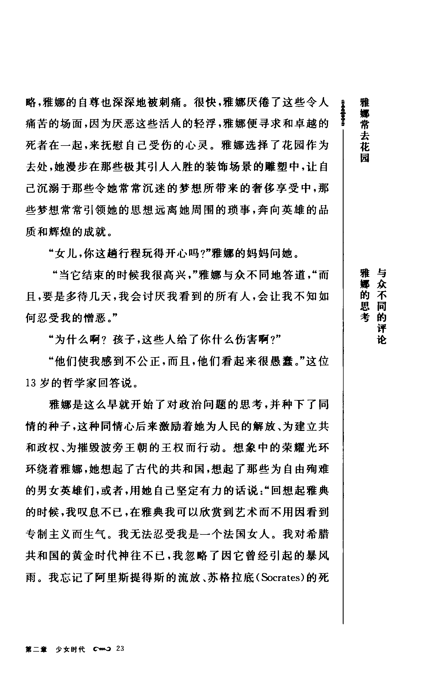

<small><a href="images/pages/035.png">原书第24页 · PDF 第35页 · 查看原页</a></small>

旋即，雅娜迈人14岁，她离开了祖母家，返回父母家中。此时，她的父亲虽然谈不上富有，但也抛掉了贫穷，并且能够无困难地供养家人，是那种俭省的小康之家。现在，雅娜仍以毫不减退的热情去追求学习和无止境的阅读。在把现实和真理作为思想基础的需求中，在如传记所揭示的性格发展中，在历史所描述的帝国兴亡中，在科学的事实中，在精神和物质哲学的原则中，雅娜的心灵找到了适合它的养料。雅娜在读书时习惯于手中有笔，记录下大量的事实摘要和尤其能打动自己的观点。

虽然没有自己的大图书馆，虽然读的书很多都是借来的，但是，雅娜常常很认真地摘抄下书中的知识，并珍藏在自己常看的书中，对于那些令她特别感兴趣的章节，她会一遍又一遍地反复阅读。由于做了摘要和摘抄，雅娜便在读书中加进了自己的思考而不囿于原文，因此她阅读的东西都牢牢地储存在脑海中，成为她自身知识的一部分。

雅娜的母亲明白家庭事务知识对女儿的重要性，于是，带她去市场买肉买菜，并常常让她承担起家庭采购的大部分责任。对于这些最有用却乏味的事情，这个充满想象力的女孩虽然屈从去做了，但身上仍带着一股没有受到影响的女王

<blockquote>
① 福西翁（约公元前 400—公元前317）：雅典将军、演说家。——译者注
</blockquote>

原页对照（含插图与旁注）
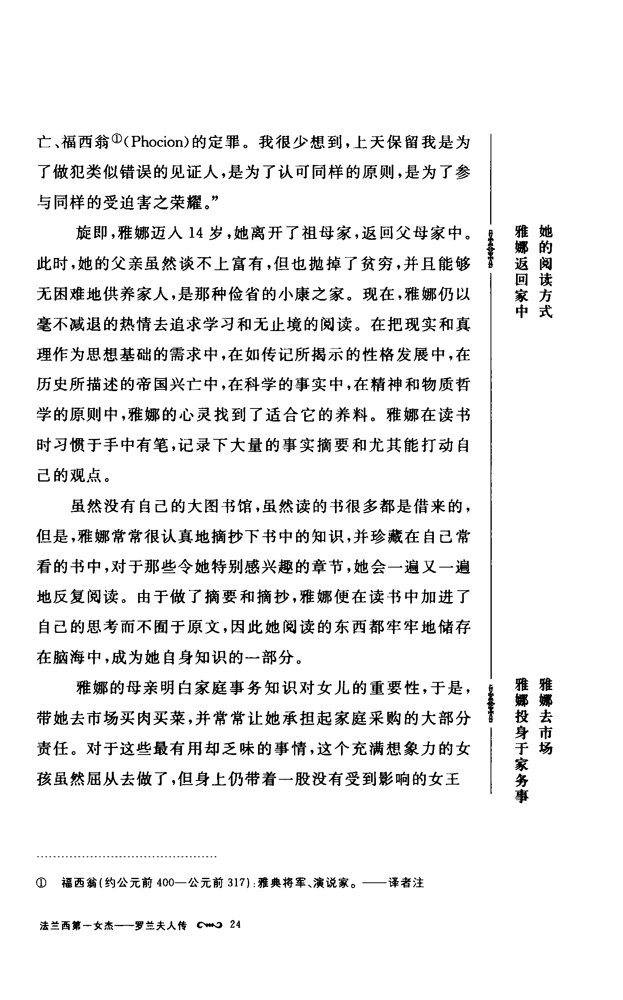

<small><a href="images/pages/036.png">原书第25页 · PDF 第36页 · 查看原页</a></small>

般的高贵，以至于她走进市场的时候，卖水果的女人会急于在其他顾客之前为她服务。先到者也并不因这种忽视而觉得受到冒犯，而是站到旁边，为那些总是令其他人的心灵无法抗拒地受她影响并难以描述的优秀特征所打动。值得注意的是，雅娜显然从没有从卑微的家务劳动生活中厌恶地转身离开。

这要高度赞扬她那代表智慧和理性判断力的母亲，正是她成功地把女儿从其引以豪的想象世界和浪漫王国中引领到这些没有吸引力的现实事务上，而这些现实事务正是我们的日常之必须。这一时刻，人们看见这位激情洋溢的少女在她的小房间里全神贯注于学习和研究，提升或吸引人类心灵的最高主题需要她丰富快乐地幻想；下一时刻，人们看到雅娜在厨房里，在慈爱、虔诚的母亲指导下，接受从睿智的母亲口中讲出的关于节俭、勤劳、经济的教导。白围裙系在雅娜的腰间，她的手不久前还忙着转动天球仪，现在却正忙着准备晚餐。就这样，在雅娜的情性中，欣赏真实世界、幻想世界中一切美丽、高尚的事物与家务技能、现实常识连接在一起。就这样，雅娜为用高雅心灵的魅力与优雅倾倒众生做着准备，为成就自己做着准备。在生活的变动中，她的心灵一直栖居于美好的领域内，同时，她拥有智慧、机智和有益的习惯，这些都为她镇定地迎接命运的变迁直到获取胜利做着准备。雅娜欣赏自己，用她自己的话讲就是坦率而不自负。她后来写道：“在我母亲恰当的管理下、我把认真学习、愉悦的消遣和料理家务结合在一起，这种结合令人十分快乐，也使我适应了每一样事情。这好像预示了未来人生的沉浮，并使我能够忍受未来的一切变化。无论家在哪里，我都能像工匠锯木头那样熟练地为自己准备饮食；但是，见到过我这样忙于家事的人，都认为这不是我应该从事的一个事务。”

原页对照（含插图与旁注）
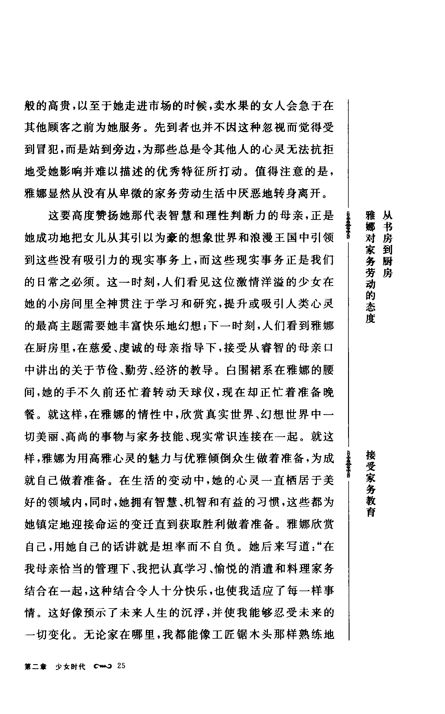

<small><a href="images/pages/037.png">原书第26页 · PDF 第37页 · 查看原页</a></small>

就这样，雅娜遵照上帝的旨意，为她通过才华和遭遇使她辉煌的人生做着准备。这段时间早期，在雅娜胸中斗争的那些情感，不久之后，在法国，就搅动了每一颗心灵，以无秩序毁灭的方式推翻了教会的圣坛和国王的宝座。

很多天主教教士的腐化生活以及他们的懒惰、奢侈，开始让雅娜忧虑自己的信仰，父亲对此的不停谴责给这种暗示增添了额外的推动力。她看到国家的自豪和权力是由教会施加的迷信恐怖所支撑，她不能对从扭曲的良心、无知、愚昧、昏聩糊涂中榨取金钱的阴谋视而不见，她羡慕母亲平静的虔诚，却无法对自己隐瞒：自己的信仰是情感，自己的原则也是情感。她对修道院的感情是那样深，她那么喜欢那儿温和的姐妹们，她想为凌驾于自己之上的精神主宰之庞大建筑寻找一个根基，却徒劳无益。因为大吃大喝的教士和饥饿的教徒、兴奋神经和麻痹心灵的庆典、懒惰无用且常常粗野放荡的化缘修士和修道士，她十分鄙视教皇崇拜的浮华与隆重，她的理性开始逐渐谴责教皇崇拜是一种奴役人类的强大迷信。虽然如此，基督教情感的影响像守护天使一样，依然环绕在她左右，当她心灵迷茫地在无信仰的迷官中摸索的时候，她的心仍然忠于纯洁的基督教道德，忠于希望获得永生而安慰灵魂的一切。甚至在陷入最痛苦的无神论困惑时，良心成为她的上帝，她虔诚地服从着良心的声音。

雅娜从教会转向了国家。雅娜看到，傲慢贵族的儿女们衣着华丽地坐在镀金的四轮马车上，他们身边簇拥着不可一世的仆人们。马车穿过爱丽舍花园，这时候，雅娜正步行在尘土飞扬的道路上，马车擦身而过。雅娜那颗骄傲的灵魂越来越反抗这显而易见的不公正。她研究过社会结构，她熟悉压迫民众的方式，她了解税收体系的运作：税收制度设计得如此精心，以使人民群众论陷于贫困潦倒，以使王公贵族沉醉于纸醉金迷的生活。当她想到如此炫耀、昭然地展示掠夺时，愤怒深深地刺伤了她的心。居住之地的僻静有助于她更深刻地思考这些巨大的生活不平等。虔诚没有教导她屈从，哲学也没有教导她不能调整世俗国家的分配以使财富的分配与功德相一致。然而，当尽显宫廷显赫气派的显贵们驾车擦过这个平民少女，把她笼罩在马车荡起的尘土之中时，他们根本想不到，这个女孩的声音会帮助他们从根基上加固他们的城堡，会有助于用较寻常的破坏方式摧毁法国的君主和贵族。

原页对照（含插图与旁注）
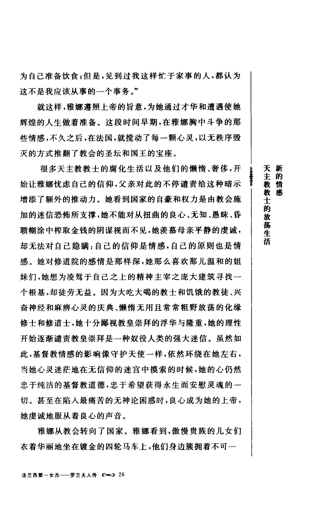

<small><a href="images/pages/038.png">原书第27页 · PDF 第38页 · 查看原页</a></small>

这段时间，环境使雅娜和几个与贵族家庭有关系的女士有来往。这些贵族女士的愚昧、傲慢、无知使雅娜在内心里非常鄙视她们。雅娜不禁感觉到，自己对她们有一种无法衡量的优越感；但她依然愤怒地观察到，出生的偶然性给予了她们一种虛假的高贵，这使她们持一种高傲的态度轻视她。一个贵族出身的女士，由于交往者的欺骗和自己的挥霍，失去了财富和朋友，在雅娜父亲家中寄宿了一阵子。这位女士40来岁，对其出身的骄傲令人无法忍受，她举止造作，令人生厌。她尤其无知，未受过教育，不能写一行正确的字，除了那些在舞会上和剧院中获得的知识之外，什么都不懂，没有任何一种品行能够贏得人们的尊敬。当时，这个女人正试图通过打一场官司，重新获得一部分失去的财产。雅娜帮她写申诉书、写信件，有时候和她一起去对一些有影响力的人物施加影响。雅娜注意到，虽然这位女士的方方面面都不足以使人尊重、喜欢，但因为她的出身，她依然受到了恭敬的尊重，当她提起她那些出身高贵的祖先们的名字时—-那些名字一直挂在她的嘴边——人们都带着极大的尊敬听她说话。雅娜比较着这位目不识丁的贵族后代享受到的礼遇和祖母在拜访德布瓦莫勒尔夫人时所受的待遇，在她看来，这个世界是极端地不公正，这个社会的制度是极度地荒谬。就这样，她的头脑正在为革命领域内的活动接受训练，她正深刻地思考着社会各方面的弊病，她已经变得倾心于古代的共和自由，她准备热情地拥抱任何的变革希望。在她看来，所有少女时期的游戏和娱乐对她来说都是不重要的，因为日复一日，她整个的精神力量倾注于那些深邃的思考、那些提升自己和人类的抱负之中了。

原页对照（含插图与旁注）
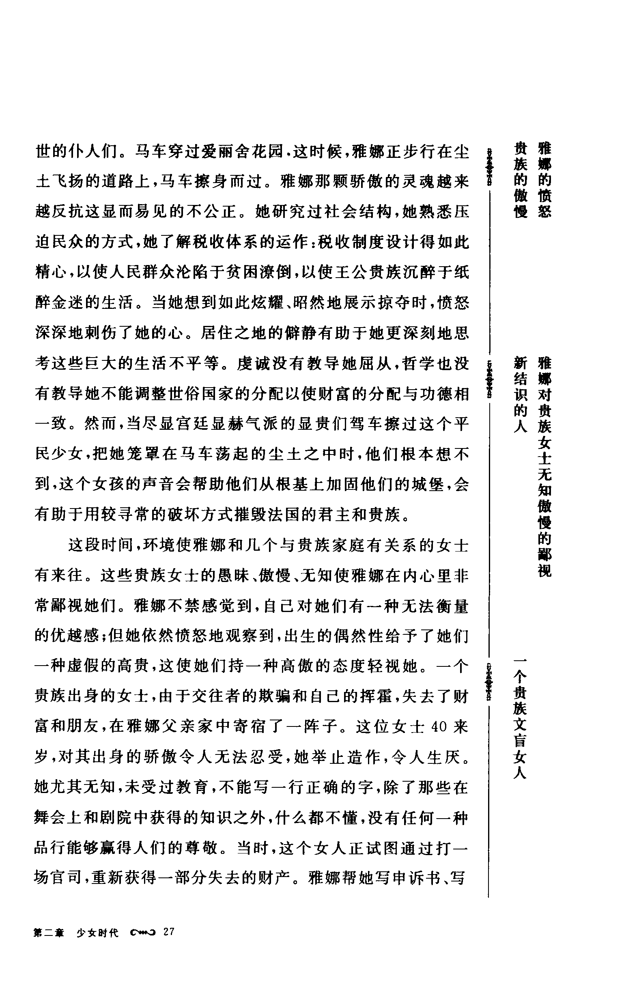

<small><a href="images/pages/039.png">原书第28页 · PDF 第39页 · 查看原页</a></small>

原页对照（含插图与旁注）
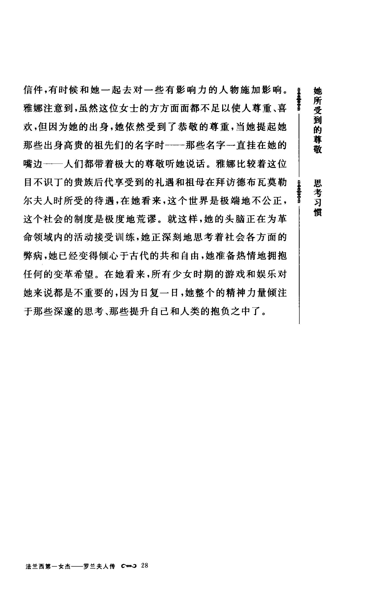

