# 第三章 青年时代

<small><a href="images/pages/040.png">原书第29页 · PDF 第40页 · 查看原页</a></small>

1770—1775年

原页对照（含插图与旁注）
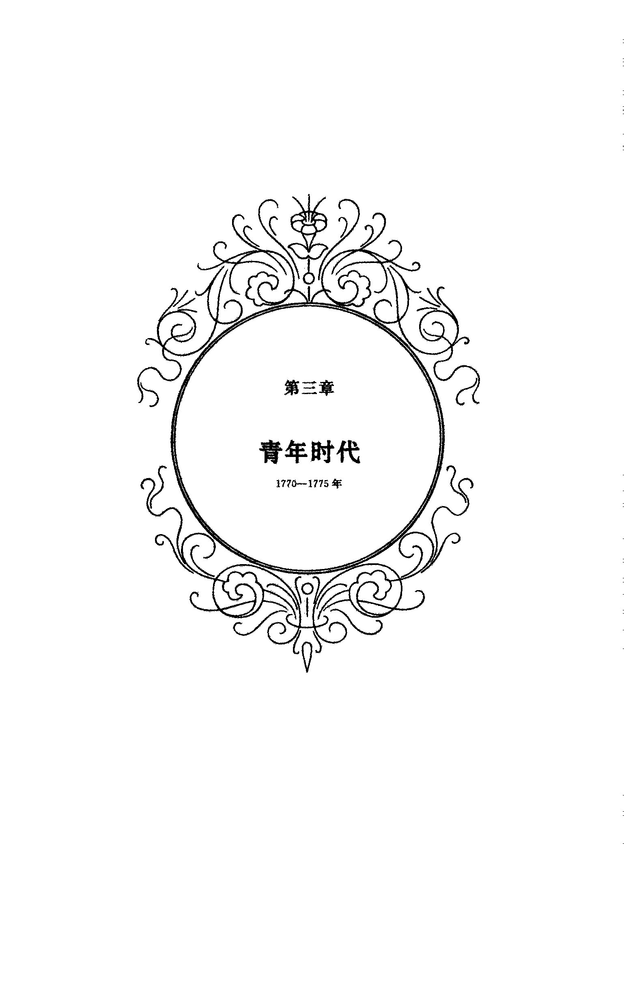

<small><a href="images/pages/041.png">原书第30页 · PDF 第41页 · 查看原页</a></small>

一颗像雅娜这样活泼、富有想象力、感情丰富的灵魂，不会意识不到爱情而长期沉睡。雅娜对自己的个性作过不矫揉造作的感人描述，在雅娜后来于昏暗的监狱里所写的日记中，她提及了第一次在她心中涌起的神秘情感。坦率—直是雅娜突出的性格。雅娜描述了她在一个无知不觉中引起自己爱慕的年轻男人面前，内心所经历的奇怪的怦怦跳动、局促不安、爱慕，本能的羞怯。这是一位名叫塔博拉（Taboral）的年轻画家，他面庞苍白、忧郁、聪明，是一位眼中流露出激发心灵的热情的艺术家，他常常拜访雅娜的父亲。雅娜刚好正在读卢梭（Rouseau）的小说《新爱洛伊斯》，这本书是喷涌多愁善感的源泉。雅娜年轻的心燃起了火苗，容颜上不知不觉地浮现出她的梦想和幻想，一位受欢迎的客人住进了她心中的城堡。这位羞怯敏感的年轻人，虽然不会像女孩子一样脸红，却不敢同这位才艺才华让父亲十分自豪的女儿讲话。在店里，雅娜一听到他说话，便会巧妙地制造一些借口进来，有时候寻找一支笔或者别的东西。但当她出现在塔博拉面前时，本能的羞怯又让她溜走了，她溜走得比进来的时候还迅速，心脏“扑通”；“扑通”地跳着，赶紧跑回自己的小房间里躲起来了。

然而，这种感情，来得快，去得也快，非常短暂，雅娜很快就忘记了。实际上，虽然雅娜的想象力非常丰富，但是，她的想象也很朝气蓬勃、理智。她的判断力引导她远离那些使人萎靡不振的爱情梦想，这些梦想足以使一个意志薄弱的心灵沉溺其中，无法自拔。一个在心灵和容貌上都如此迷人的年轻女子不会不引人关注，很多追求者相继出现，但雅娜对他们统统不感兴趣。在当时的法国，社会的习俗是，对想与雅娜牵手结婚的任何人来说，获得与雅娜见面的机会都非常困难。因此，对求婚者来说，权宜之计通常是先给雅娜的父母写信。父母常常把这些信件直接交给雅娜阅览，雅娜通过书信的风格来判断写信人的品行。雅娜的父亲知道女儿才华出众，便让女儿做自己的秘书代为回复所有的信件。于是，雅娜写好回信后，父亲抄写一遍，写上自己的名字送出去。雅娜常常对这种郑重其事的回信感到好玩有趣，好像她就是父亲一样，以父母辈的稳健谨慎态度来讨论自己的终身大事。在后来的岁月中，她以她丈夫的名义给国王写信，给内阁写信。出自她笔端的意见，为法国的内阁所采纳，指导着国民议会。

原页对照（含插图与旁注）
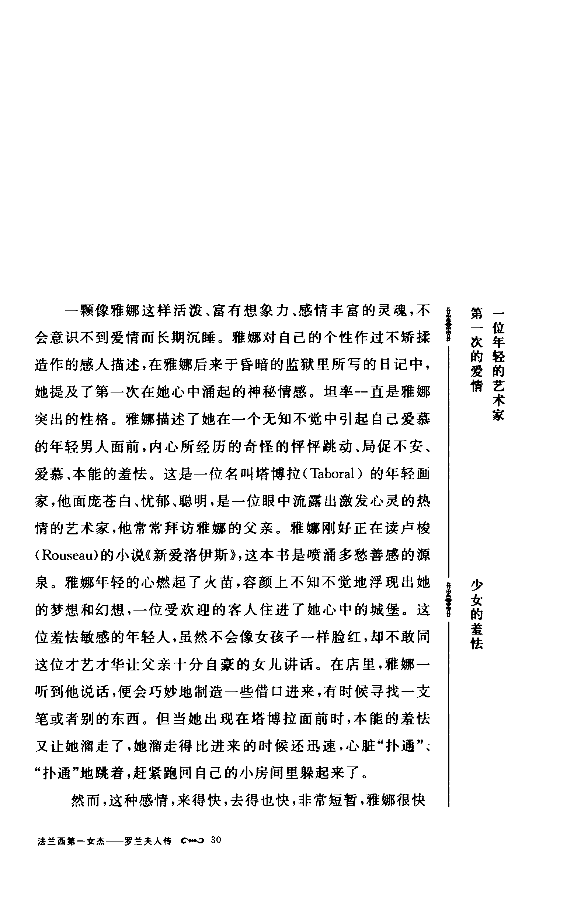

<small><a href="images/pages/042.png">原书第31页 · PDF 第42页 · 查看原页</a></small>

雅娜的父亲把商业视为财富之源，把财富视为权力和尊严之源，他非常希望女儿能接受一些相识的、家族从事商业的年轻人提出的有利可图的求婚。但雅娜根本没有这种想法，她那骄傲的灵魂对这种结合深为厌恶，由于她那古代英雄所特有的高尚姿态，由于她那愿栖息于崇高的才领域里的远大志向，她不能想象她的灵魂与那些把精力花费在买卖上的人结合。于是，她宣布，除非她对一个人感到志趣相投、志同道合，否则，她宁愿不要丈夫。

曾经，一个非常富有的肉制品商人邻居向雅娜求婚，他的财富吸引了雅娜的父亲，父亲很希望女儿能够接受这次求婚。对于父亲的催促，雅娜坚定地回答道：

原页对照（含插图与旁注）
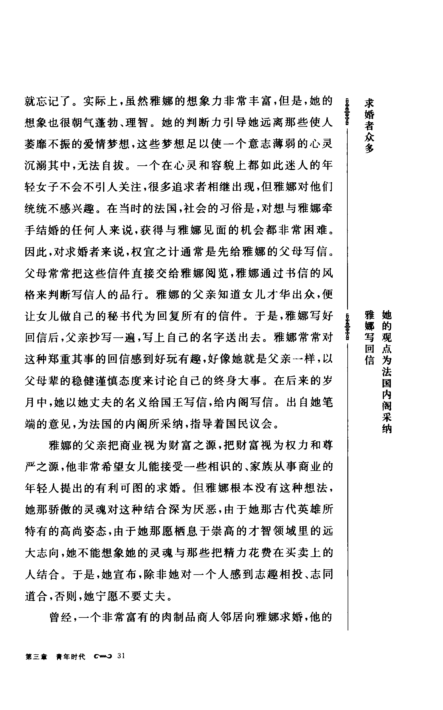

<small><a href="images/pages/043.png">原书第32页 · PDF 第43页 · 查看原页</a></small>

“亲爱的父亲，我不能从我高贵的想象中滑落下来。对于丈夫，我所要的是一颗灵魂，而非一笔财富。与其出卖我的灵魂与一个我没有任何感觉的人结婚，我宁愿独身死去。想想，从我幼年时期，我便和一切时代的伟人们相连在一起—我熟悉那些崇高的思想、那些辉煌的事件———我一直和柏拉图，和所有的哲学家、诗人、古代的政治家生活在一起。要是我和一个店主结婚，他永远也不能理解或者感受我做的任何事情。父亲，你为什么允许我染上这些理智的习惯和爱好呢？你希望我这样结婚吗？我不知道我会和谁结婚，但他必须是一个能够分享我的思想，并与我的追求志同道合者。”

“但是，我的女儿，也有很多生意人学识渊博、举止文雅。”

“或许吧，”雅娜答道，“但他们并不拥有我希望我的丈夫所拥有的那类知识、心灵特征、智力水准。”

雅娜的父亲说道：“你不认为某先生和他的妻子很幸福吗？他怀揣着大笔的财富刚从生意场上退休。他们拥有美丽的房子，可以招待良友嘉宾。”

雅娜回答道：“我不评判其他人的幸福，不过，我的心并不固守在富人身上，我认为完全的感情结合是幸福婚姻必不可少的，我无法与任何志趣、品位和我不一致的人结合。我的丈夫必须优秀于我，既然自然和法则规定他优秀，如果他不是真正地优秀，我会感到耻辱。”

“那么，我想，至于你的丈夫，你想要他是一个指导老师，但是，和那些学识渊博的绅士们结婚，女人很少会幸福，那些绅士们自尊心很强，钱却很少。”

原页对照（含插图与旁注）
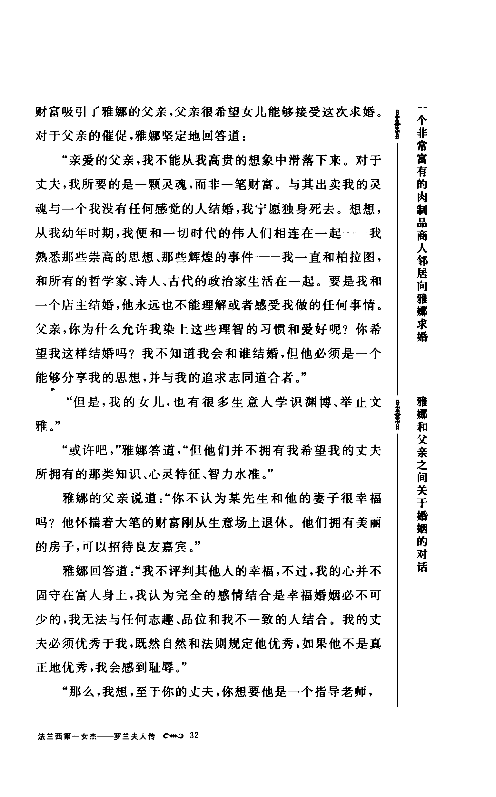

<small><a href="images/pages/044.png">原书第33页 · PDF 第44页 · 查看原页</a></small>

“父亲，”雅娜认真地答道，“我不关心职业，我只希望嫁一个我爱的男人。”

“但你坚持考虑的这样一个男人，在商业行业里永远找不到。然而，你会发现，当你丈夫积累了大笔的财富，你舒服地坐在自己的客厅里是非常愉悦的事情。看看达尔让（Dar-gens）夫人，她和她丈夫一样也懂得珠宝，当丈夫不在的时候，她能很熟练地做生意，即使她成了一个寡妇，她也能够熟练地打理好丈夫的一切生意。你非常聪明，由于你研究过关于宝石的著作，你会很容易地理解生意事务。如果你喜欢德罗姆（Delorme）、达布略（Dabrieu！）或者——你可以做你高兴做的一切，你会过一种很幸福的生活。”

“父亲，”雅娜认真地大声说道，“我已经发现，在商业中发财致富的唯一办法是低买高卖，对顾客索要高价，对工人压低工资。我永远也不会屈尊去做这些营生，我也决不敬重一个从早到晚以这些事务为职业的人。”

“那么，你认为没有诚实的商人？”

“我认为有，”雅娜回答道，“但并不多，在他们之中，我不可能找到一个与我志趣相投的丈夫。”

“如果你不能找到你想象中的偶像，你打算怎么办？”

“我会独身生活。”

“或许你会发现那并不像你想象的愉快，你认为时间仍然很多，但疲倦最终会到来。你知道神话故事里，众多的爱人很快都会离去。”

原页对照（含插图与旁注）
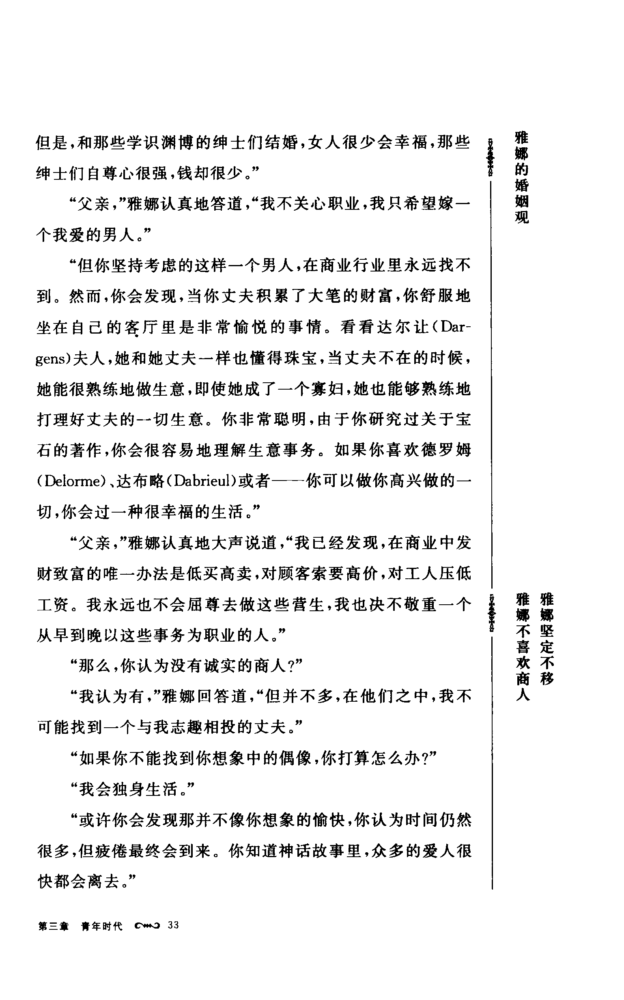

<small><a href="images/pages/045.png">原书第34页 · PDF 第45页 · 查看原页</a></small>

“哦！然后，由于应该得到幸福，我会向夺去我幸福的不公正复仇。”

“噢！我的孩子，现在你又到云端上去了，飞翔到这样一个高度固然令人高兴，但保持住这个高度却很难。”

雅娜明智的母亲，急于看到女儿能在生活中安顿下来，努力想使女儿和一位年轻的医生联姻。要得到希望的结果，很有必要采取一些策略。

年轻的开业医生很愉快地帮助了雅娜的母亲，在他们作了金钱方面的安排，达成了协议后，雅娜才知道这件事情。一天上午，母亲和女儿一起出去拜访一个朋友，在这个朋友的房子里，按照事先的约定，雅娜未来的丈夫偶然出现了。这是一场奇怪的会面，朋友们过火地表演着他们的角色，结果，雅娜立刻就看穿了这个阴谋：她的母亲忧心忡忡且很迫切；她的朋友们十分健谈，频频狡猾地做着暗示。这位年轻的绅士毫不吝啬他的讨好本领，对雅娜全是轻率的赞美。他津津有味地吃着糕点，以众所公认的流行的空洞方式很轻率地谈论着。这个骄傲的女孩不知道，在婚姻的市场上，她就这样被卖掉。雅娜喜欢医生这个职业，因为它预示了一颗有知识的心灵，她愿意与他结识。母亲催促她立刻下决定。

“什么，妈妈！”雅娜喊道，“你愿意我仅依靠一次简单的见面就决定一个人做丈夫？”

“这样说并不准确，”妈妈回答道，“这位年轻绅士与我们的朋友很熟悉，这使我们能够判断他的品行和生活方式，我们了解他的性情，这些都很重要。你毕竟已经到了成家的适当年龄，你已经拒绝了很多商人的求婚，单单从这个阶层中，你就可能找到归宿，你下定决心不嫁给商业阶层的男人，你可能再也不会遇到另一起这样的求婚。现在，从外部每一个方面看，这桩姻缘都是非常合适的，要当心你拒绝得太轻率。”

原页对照（含插图与旁注）
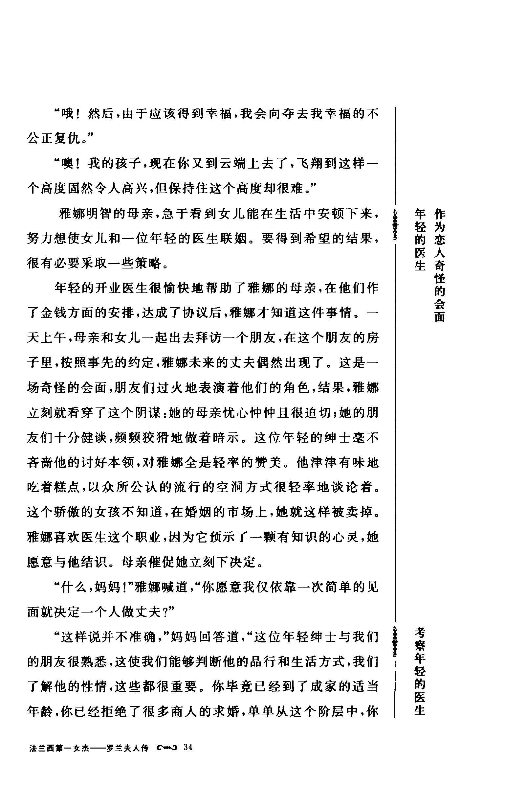

<small><a href="images/pages/046.png">原书第35页 · PDF 第46页 · 查看原页</a></small>

在这般催促下，雅娜同意在父亲家中考察年轻的医生，以使自己可以了解他。然而，雅娜坚信，没有任何尘世的力量该引导她嫁给医生，除非她能发现，他有一颗与自己志趣相投的灵魂。幸运的是，因为金钱方面的安排，在雅娜的恋人和父亲之间，发生了一场争执。因为这场争执，雅娜免去了在这件事情上更进一步的麻烦，并中断了双方之间更进一步的联系。

现在，雅娜母亲的健康状况开始急剧恶化，一场中风的打击使她丧失了一贯的心情方面的弹性，由于与社会隔绝，她变得沉默、悲伤。

考虑到逼近的死亡，她常常哀叹，在自己离开这个世界之前，不能看到女儿步入美满的婚姻。一位很诚实、勤勉、节俭的珠宝商向雅娜求婚，再一次唤起了母亲的担忧。

“为什么？”母亲哀伤而急切地喊道，“你为什么拒绝这个年轻人？他性格随和，正直、稳重，名声很好。他的境况已经很不错，正走在很快就有美好前程的坦途中。他理解你有一颗出众的灵魂，他表示会非常尊重你，以听从你的意见为荣。你可以用你喜欢的任何方式引导他。”

“但是，我亲爱的妈妈，我不想要一个需要引导的人做丈夫，对我来说，他将会是太累赘的一个孩子，需要我照顾。”

“你知道你是一个异想天开的女孩吗？我的孩子，你认为你会喜欢是你导师和专制君主的丈夫吗？”

雅娜回答道：“我肯定不喜欢一个人表现出一副权威的架势，如果那样，只会激起我的抵制。但我确信我不可能爱上一个需要我统治的丈夫，我将会为我自己的权力感到耻辱。”

原页对照（含插图与旁注）
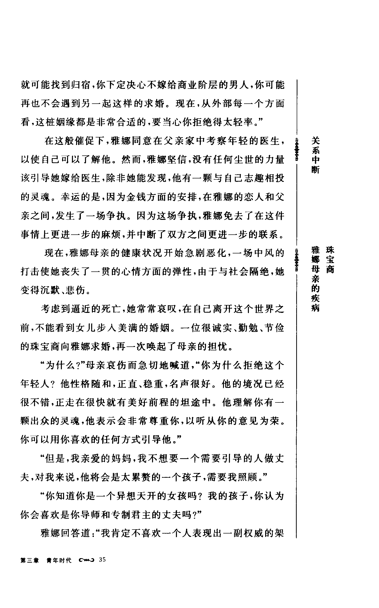

<small><a href="images/pages/047.png">原书第36页 · PDF 第47页 · 查看原页</a></small>

“我理解你，雅娜，你想要一个能把他当做导师的男人，同时，在每一具体事情方面，他又要服从你。”

“不，妈妈，这二者都不是。我憎恶奴役，绝对统治只会使我难堪。我希望能获得这样一个男人的感情：他将他的幸福存在于造就我的幸福，因为他的判断力和对我的尊重应当指示他这样做。”

“但是，我的女儿，这世上几乎没有像幸福的夫妻这样一种东西，如果没有你所想象的如此必要的志趣相投、看法一致，是否幸福就不能存在？

“我不知道，妈妈，我羡慕幸福的单身汉。”

“那好吧，除了那些你不羡慕的配偶，也许有些更合适的人一直还在单身。我或许比你想象的还要快些离开这个世界。你父亲仍还年轻，我不能告诉你所有不愉快的事情，我对你的溺爱让我担心。如果在我去世之前，我能看到你和某一位值得相许的男人结了婚，我真的会很高兴。”

在雅娜心里，第一次很严肃地出现了母亲死亡的想法。雅娜急切地注视着母亲，望着母亲苍白、憔悴的脸庞和消瘦的身体，突然被揭示出来的可怕事实摆在她面前，雅娜悲痛地颤抖着身体，泪如泉涌。母亲很感动，努力安慰她。

“亲爱的孩子，不要担忧。”母亲温柔地说道，“我的病还没有很危险，但是，我们要制订计划，我们应该考虑所有的机会，比如说，一个可敬的人来帮助你。你现在已经20岁了，你不能期望再像过去五年中那样，有那么多的求婚者。我也许突然间就离开你了。那时候，不要拒绝一个也许没有你渴望的完美但真心爱你的男人做丈夫，和这样的人在一起你会得到幸福。”

原页对照（含插图与旁注）
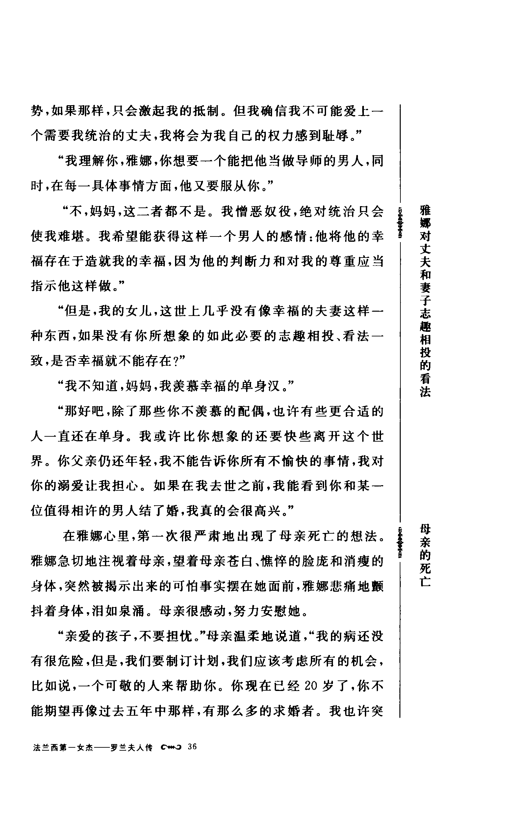

<small><a href="images/pages/048.png">原书第37页 · PDF 第48页 · 查看原页</a></small>

“好的，亲爱的妈妈，”雅娜深深地叹息了一声，说道，“就像你一样幸福。”

在这样很激动的时刻，雅娜不由自主地说出了这些话。以前她从未敢绕这么远地提及志趣相投的全部要求，她不由得观察起父母亲之间存在的合适性。实际上，母亲的忍耐、温顺性情是如此显著，以至于雅娜不知道她忍受的痛苦多么深，也不知道她过的是一种受折磨的生活。雅娜偶然注意的结果是她睁开的双眼看到了可悲的现实。母亲十分不安，她的脸变了颜色，嘴唇颤抖着，她没有回答雅娜的话，再也不张口唠叨女儿的婚姻问题。

雅娜的父亲，因为没有宗教信仰来约束他的情欲或者指导他的行为，他逐渐陷入了那些他能接触到的具有时代特征的放荡习惯中去。他忽视了自己的生意，结交了一些名声不好的人，对妻子，他变得暴躁、专横，常常夜间很晚还不着家，浪迹于酒馆之中。关于丈夫和父亲的堕落，无论是母亲还是女儿都没有相互说起过。然而，雅娜对父亲的影响力很强，她常常利用自己的劝说技巧，把将要降临到温顺、不反抗的母亲身上的风暴消解掉。

可怜的母亲，在沉默中和悲伤中，正迅速地跌入坟墓，比雅娜想象的还要迅速。一个夏日，父亲、母亲和女儿一起去乡下短途游行。这天，天气温暖美好，他们在塞纳河平静的河面上泛舟，大自然的美景和装饰河两岸的艺术让他们大饱眼福。当再一次呼吸到乡村中令人精神焕发的空气时，濒临死亡的妻子苍白的脸上充满了活力和生气。这也许是恢复健康的迹象，女儿用这样虚妄的希望欺骗着自己的担忧。当他们返回家中的时候，由于旅行，菲利普夫人十分疲惫，便去自己的卧室休息。雅娜则在女仆的陪伴下，前往修道院拜访她的修女老朋友们。这次拜访十分短暂。

原页对照（含插图与旁注）
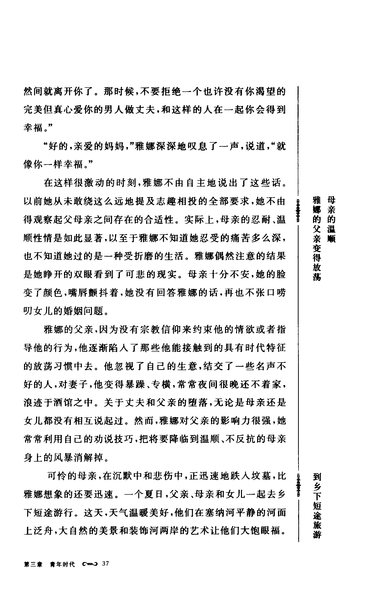

<small><a href="images/pages/049.png">原书第38页 · PDF 第49页 · 查看原页</a></small>

“你为什么如此匆忙要走呢？”阿加莎（Agatha）姐妹问雅娜。

“我急于回到母亲身边。”

“但是，你告诉我她好多了啊。”

“她是比平常好很多，可我有一种担心她的奇怪感觉，只有再看到她，我才能感到轻松。”

雅娜急匆匆地回家了，刚到门口就迎到一个小女孩，小女孩告诉雅娜，她母亲的病十分严重。雅娜飞奔到母亲的房间里，发现她几乎已经毫无生气，源于瘫痪的另外一个打击已经来临，母亲就要死了。母亲抬起疲倦的双眼看着女儿，但她颤抖的声音已经说不出任何亲切的话语，只有一只手臂能听她的使唤，她抬起手来，深情地抚摸着心爱女儿的面颊，拂去她脸上滚落的泪水。牧师前来给予最后的宗教安慰。雅娜努力举着灯，双眸凝视着正在死亡的母亲，痛苦压倒了雅娜，灯突然从手中滑落，她不省人事地倒在地板上。当她从昏厥中苏醒过来，母亲已经死去。

雅娜完全被无法抑制的巨大悲痛压倒了，可以理解，对这次受到的情感打击，在很多天里，她的生命也深受其害。在这艰难的时刻，雅娜没有成为家庭的支柱，反而增加了家庭的负担和照顾。当雅娜整个身体因为惊厥所颜抖的时候，阿贝•勒格朗（Abbe L.egrand）站在雅娜的床边，理智地说道：“有感情是好事，但如果感情太丰富就很不幸了。”逐渐地，雅娜平静下来，但对她来说，生活是黑暗的。现在，她开始认识到亲爱的母亲所忧虑的那些不幸。提到她去世的母亲，雅娜说道：“世上不再有一位善良，和蔼的女人。她的品性没有什么卓越之处，但她拥有每一种让认识她的人都喜爱的品质。因为天生拥有温和的性情，美德对她来说，不需费力去追求。她纯洁、宁静的精神沿着自己平坦的道路前进，就像潺潺的溪流一样，以同样的温和冲刷着阻挡它前进的岩石底部，流过它所装扮、点缀的山谷。随着母亲的死亡，我青年时代的安宁也随之结束，在此之前，我享受着幸福的情感，做着喜爱的工作。”

原页对照（含插图与旁注）
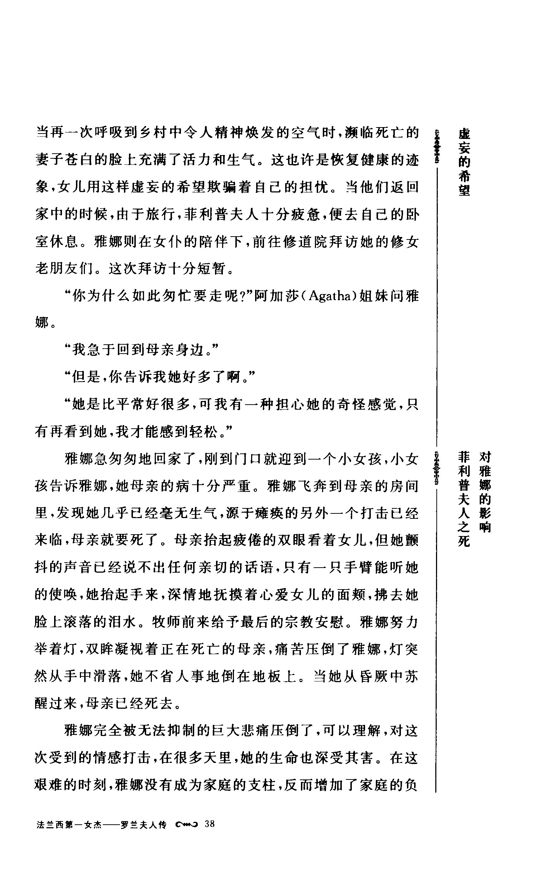

<small><a href="images/pages/050.png">原书第39页 · PDF 第50页 · 查看原页</a></small>

很快，雅娜发现，实际上，父亲的家是一个伤心之地，她在世上真正是孤单一人。父亲现在开始以更快的步伐向放荡的生活沉论，作为不能阻碍犯罪的无信仰的受害者，他放任自己心甘情愿地成为情欲主宰的俘虏，成为衰败王朝统治造成的混乱之俘虏。

雅娜羞辱地看到，一个女人被接纳进入这个家庭并取代了母亲的位置。根据上帝的法律，这是不被认可的婚姻。深深的悲伤侵入这个受到伤害的女孩心中。在家中，她感到自己被遗弃了，她只是一个外人。她把自己关闭在小屋中，与自已的思考和书籍为伴。现在，只有那些反映破碎心灵、曲调忧伤的挽歌，才能拨动她那天性敏感的心弦。既然从来没有不受忧思侵染的天才，那么，便可以怀疑是否有不在不幸的学校中经受磨炼的伟大品性。现在，雅娜的心不可抑制地渴望得到一些性情相近的朋友的同情，她想把疼痛的头靠在给予她支持的胸怀中。在孤独的沉思中，她安慰着自己，用写作来寄托自己的想法，笔成了她的朋友，成了她每一个不振作时刻的安慰物。在她的日记中，她坦率地呼喊出自己的情感和感情。她做的摘要、摘抄和原创思想的手稿，也越来越厚，通过这种方式，在日常生活中，她锻炼着修辞能力和口才能力，在日后的生活中，这些能力令她的朋友们震惊着迷。

原页对照（含插图与旁注）
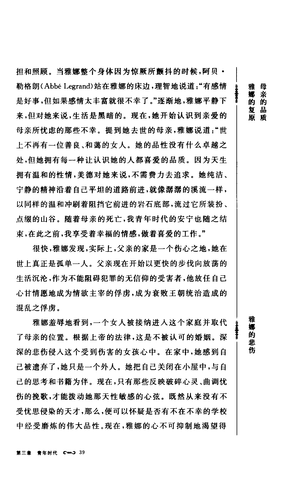

<small><a href="images/pages/051.png">原书第40页 · PDF 第51页 · 查看原页</a></small>

在雅娜重要的未来生涯中所具有的每一个特征，其发展都能够明显地追溯到这些早期生活变动的影响，这些印象深深地、有力地铭刻在她的本性之中。热爱知识、浪漫、有宗教情怀、热情洋溢的心灵、仰慕英雄主义、效仿高尚事业中的殉难者，这一切共同促成了雅娜能对其他人的情感享有统治权，促成了雅娜几乎能够随心所欲地左右人们的意志。

一天，德布瓦莫勒尔先生——雅娜曾经不愉快地拜访过的那位贵妇的丈夫—到菲利普先生的商店造访，自豪的父亲忍不住向他展示了雅娜的一些手稿。这位有鉴赏力的贵族对手稿中展现出来的才华高兴不已，他给雅娜写了封极力赞美的信函，提议她可自由使用自己颇有价值的图书馆，并鼓励她致力于文学方面的追求，立刻开始写作。对德布瓦莫勒尔先生的称赞，雅娜非常高兴，非常急切地想利用他最可贵的帮助，对他有关写作的建议，雅娜在回信中，附寄了几行诗。这几行诗歌后来被罗兰夫人的女儿在一篇有趣的随笔中被翻译成：

天降抱负于男性

攀登名誉之高峰

可走短途向天国

原页对照（含插图与旁注）
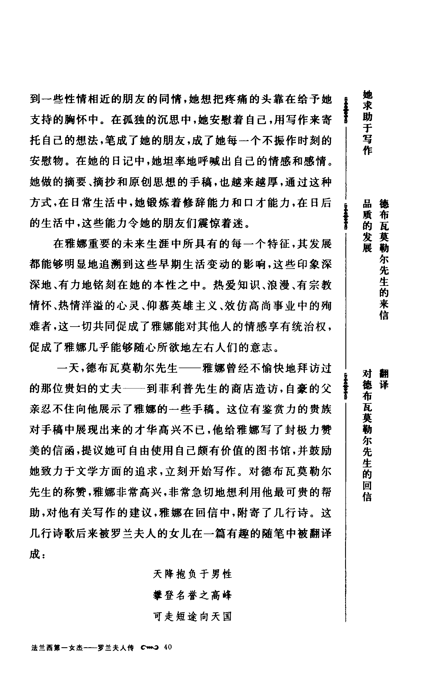

<small><a href="images/pages/052.png">原书第41页 · PDF 第52页 · 查看原页</a></small>

凭死获得不朽名

英勇驰骋在沙场

功业后世永不忘

时光岁月荏苒飞

青铜石碑刻荣光

柔弱女子实堪伤

荣耀奖賞无希望

囿于狭小天地中

德行谦逊以为荣

女子名声如落叶

红颜零落名不存

神圣庙堂虽留名

只存在世朋友心

后来，雅娜与德布瓦莫勒尔先生之间的友好通信，贯穿了德布瓦莫勒尔先生的一生。德布瓦莫勒尔先生是一位可敬的智者，他对这位年轻的朋友十分感兴趣，竟然希望雅娜能和自己的儿子结婚。他儿子在性格上好逸恶劳而又优柔寡断。父亲希望儿子娶一位果敢决断的妻子，以使他受益。然而，像不热爱财富一样，雅娜也没有热爱地位头衔的倾向，对这位平庸的年轻贵族，她丝毫不感兴趣。明智的父亲看到完全不可能促成这桩婚事，便搁下了这件事情。

由于和德布瓦莫勒尔先生的友谊，雅娜常常被引见给上层社会的贵族们和妇女们，甚至，德布瓦莫勒尔先生那刻板、傲慢的妻子也对这位迷人的年轻女子变得很感兴趣。雅娜出众的才干和才艺帮助了德布瓦莫勒尔夫人周到妥当地应酬了很多社会交往，这些是她高贵的出身所不能赋予她的。

原页对照（含插图与旁注）
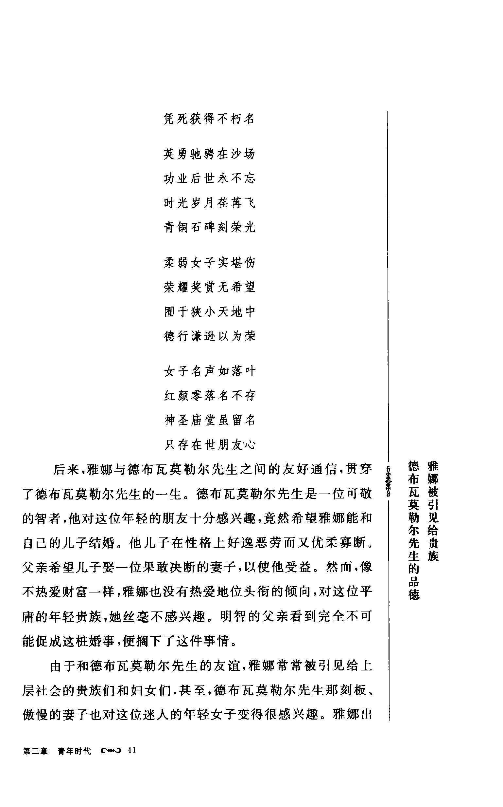

<small><a href="images/pages/053.png">原书第42页 · PDF 第53页 · 查看原页</a></small>

然而，和法国贵族的稍微相识并没有令雅娜提高对他们的尊重，她发现，那些时常出人于德布瓦莫勒尔夫人客厅中的老侯爵夫人，年老贵妇们的谈话比到父亲店铺中来访的商人更加枯燥乏味，更加浅薄无知。雅娜很蔑视这些费族，也很厌恶她所看到的不仅包括懒惰和骄奢淫逸，还包括放荡和完全没有原则等很多现象。作为一个仔细观察人类本性的观察家，雅娜清醒的头脑使她游走于那些人之中，而从不穿她们的服饰，也不会模仿她们的习惯。雅娜的着装风格非常朴素雅洁。她也从不受愚蠢的、无灵魂的、矫揉造作的时尚之影响，哪怕一点点。

德布瓦莫勒尔夫人曾经称赞过雅娜在这些方面的品位，她谈道：

“你不喜欢羽毛是不是，菲利普小姐？你和我们周围这些让人头晕眼花的女孩子多么不同啊！”

“我从不佩戴羽毛，”雅娜回答道，“因为我认为它们与一位依靠双脚走路的艺术家女儿的生活状况不相符。”

“但如果你在生活中处于一种不同的状况，你会佩戴羽毛吗？”

“在那种情况下，我不知道我会做什么，我很不重视这些小事，我只考虑什么适合于我，根据人们的穿戴传递出来的表面信息来判断他入，是很遗憾的。”

现在，菲利普先生开始更迅速地滑向放荡的生活。雅娜竭尽全力做了一切吸引他热爱家庭的事情，但是，所有的努力完全无效。一夜又一夜，父亲夜不归宿，流连在酒馆中和牌桌上。他和一些与雅娜不但没有共同品位，而且必然招致雅娜反感的人来往。他那些同伴时常到家里来，菲利普先生所拥有的可观财产，在这种放荡的过程中很快消失了。现在，雅娜的处境极其糟糕，一直是她守护天使的母亲，现已长眠在坟墓中，父亲在堕落的道路上越滑越远，对自己和世界越来越不满，对女儿也日益忽略、无情，雅娜面临着很快成为被遗弃的孤儿并沦人赤贫的危险。

原页对照（含插图与旁注）
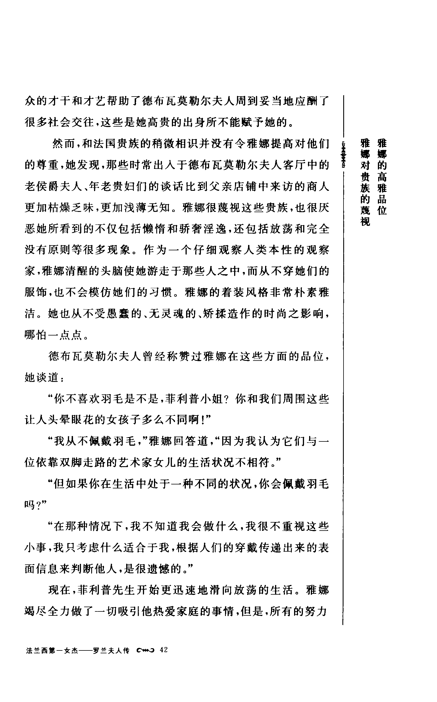

<small><a href="images/pages/054.png">原书第43页 · PDF 第54页 · 查看原页</a></small>

在这种情况下，雅娜听从了朋友的建议，采取了法律程序，捍卫母亲的财产免遭毁灭，从而使自己获得大约100美元的年收人。

在人生早晨中这些乌云密布、充满暴风雨的黯淡时刻，雅娜在她的文学爱好中找到了可靠的支持和安慰。她持笔在手，摘抄书中优美的章节，阐发书中隐含的思想。在做这些事情当中，她忘记了不幸，消磨了很多时光，否则，难以忍受的悲伤会压垮她。玛丽•安托瓦内特用悲哀、疲倦、绝望的声音喊道：“在人生的灾难中，修身养性是一个多好的办法啊！”这个平民女子用快乐的语调也发出了同样的呼喊。

原页对照（含插图与旁注）
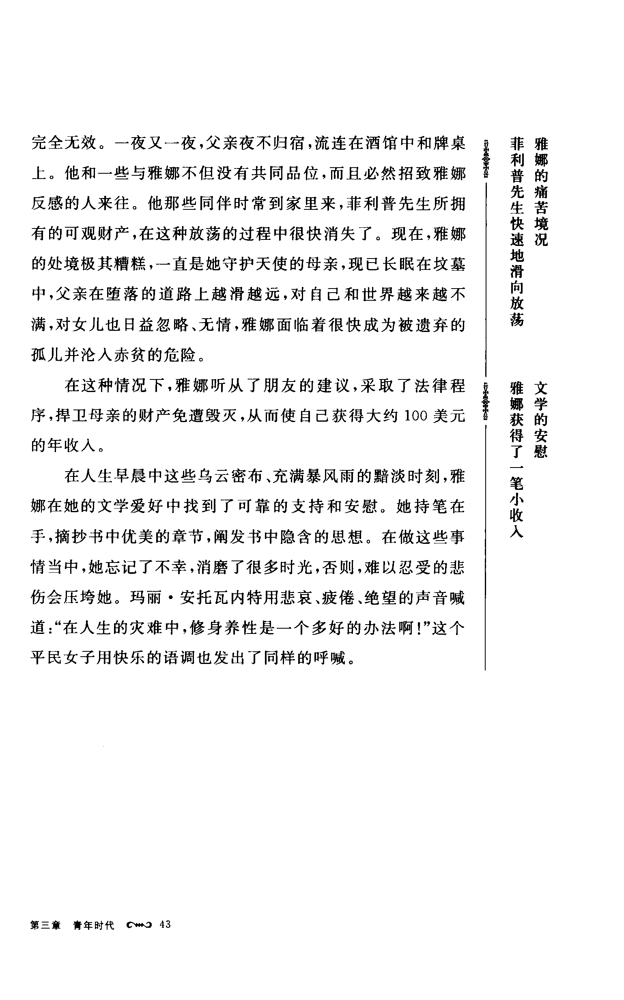

