# 第四章 婚姻生活

<small><a href="images/pages/055.png">原书第44页 · PDF 第55页 · 查看原页</a></small>

1776—1785年

原页对照（含插图与旁注）
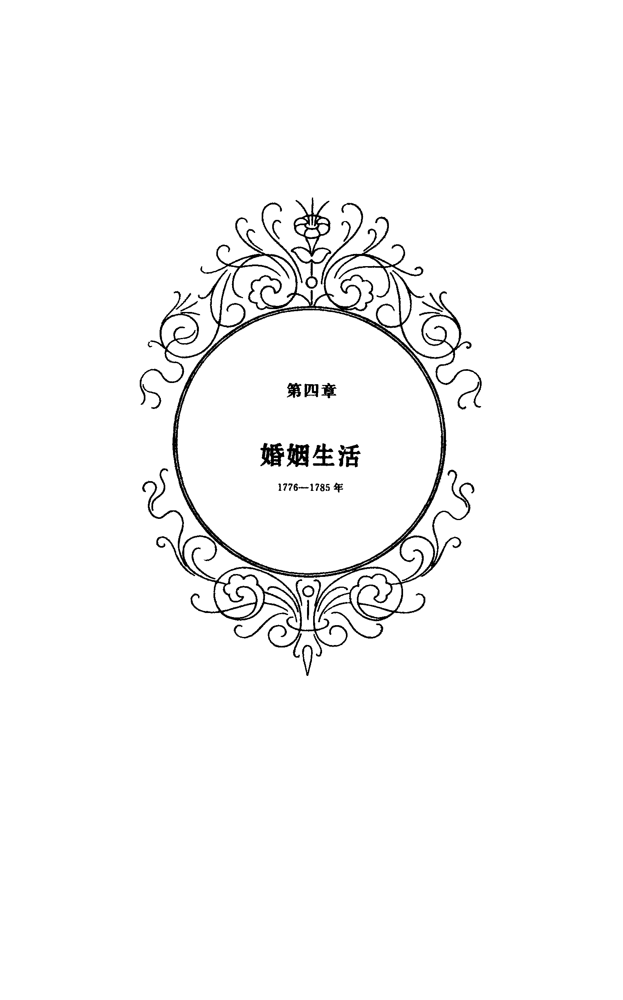

<small><a href="images/pages/056.png">原书第45页 · PDF 第56页 · 查看原页</a></small>

当雅娜在修道院的时候，结识了一位来自亚眠的年轻女士苏菲•卡内（Sophia Cannet），她们建立了深厚的感情，彼此的联系持续多年。亚眠有一位名叫罗兰•德•拉普拉蒂尔（Roland de la Platiere）的绅士，生于殷实之家，官居制造业督察员的重要职位。罗兰先生把时间主要花费在旅行和做学问上，他几乎对与政治经济学相关联的所有学科都深感兴趣，对政治经济学这门重要的学科投注了很大的精力，写了一些关于商业、机械、农业方面的文章，这使他在文学界和科学界颇有盛誉。罗兰先生经常拜访苏菲的父亲，苏菲常向他说起自己的朋友雅娜，给他看过雅娜的画像，给他读雅娜热情洋溢的来信中的一些选段。这位冷静的哲学家对这位充满热情的女子很感兴趣，便恳求苏菲给他写一封介绍信，在他去巴黎做年度访问时，顺道去拜访雅娜。苏菲对罗兰先生非常尊敬，也常给雅娜写信提及她父亲的这位朋友。

一天，当罗兰先生携带着苏菲的介绍信登门拜访的时候，雅娜正独坐在她那孤独凄凉的家中，沉思默想。她的朋友在信中写道：“你将从我常向你提及的哲学家手中接到这封信。罗兰先生很有见识，拥有无可指责的古典风范，只不过他酷爱古代、蔑视当代，他的德行尤其值得尊敬。”

原页对照（含插图与旁注）
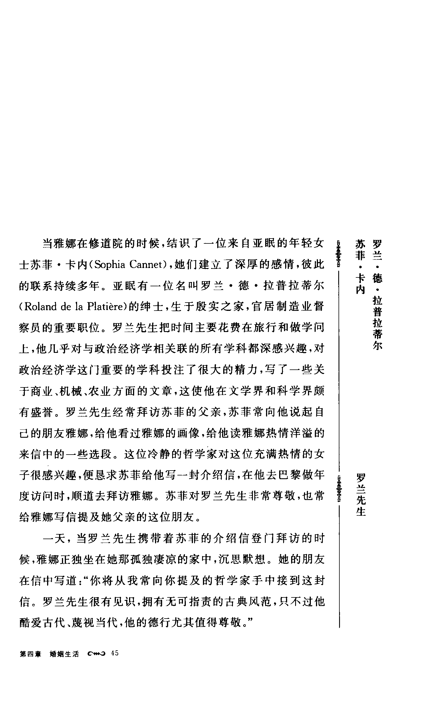

<small><a href="images/pages/057.png">原书第46页 · PDF 第57页 · 查看原页</a></small>

这位绅士这样被介绍给雅娜，他40岁左右，身材修长瘦削，走路时候微微前倾，在言行举止上显现出的沉着是自觉和理智力量的结果，然而同时，他也表现出轻微的、并不令人着恼的笨拙，这种笨拙是一个人长时间醉心于科学和研究不可避免地形成的。罗兰夫人对罗兰的描述中说，虽然罗兰的言行举止并不拥有时尚男人所有的从容优雅，但他彬彬有礼，很吸引人，他的言行举止是把受过良好教育的文雅男人与有吸引力的朴实哲学寮融合在一起。他很瘦，脸色发黄，几缕头发覆盖着宽阔、智慧的额头，为他的相貌增添了一种仪表堂堂的吸引力。在倾听人讲话时，他的脸上呈现出深深思索几乎是忧伤的表情，但在讲话的时候，他很兴奋，愉悦的笑容漾在他生动的脸上。他的声音浑厚响亮，说话方式很简洁，并且爱用警句。他的言谈充满渊博的知识，并包含着富有启发性的思想。

雅娜，热情浪漫的雅娜，从这位沉静的哲学家身上，看到了一位古代的圣人，她几乎对他崇拜得五体投地。罗兰先生的一切感情都与洋溢在自己头脑中的珍贵情感相一致，雅娜找到了她一直在寻找而以前没有找到的东西—一颗能真正引起共鸣的灵魂。她并没有想到爱情，她敬仰罗兰先生，把他视为一位长者，视为一位哲人，根据他的见解，她可以判断自己的看法是正确还是错误。

的确，罗兰先生在他所有的思想行动上，十分冷静、从不感情用事，从来不会进入那些美丽的空想王国和浪漫的幻想领域，而这些恰恰是雅娜时常乐于陶醉其中的。或许，愈是因为他那严谨且缺乏想象力的哲学，愈是使雅娜尊敬他。他那思虑的智慧，他对琐碎的人生追求的提炼，他那高雅的志趣和雄心大志，他那高于众多同胞的思想意识，他那成为人类救助者的清醒愿望，等等，这些品质无法抵挡地引发了雅娜的爱慕。雅娜爱慕他，就像一个信徒爱慕他的导师一样。雅娜热切地聆听着他所有的话，喜欢与他交流思想。对这种敬意，罗兰先生绝非感觉不到，虽然他并没有怀着一种恋人的情感看待雅娜，但也非常陶醉于和雅娜的交往，因为雅娜和他谈话时候，她是那么的欣喜若狂。罗兰夫人认为，认真地倾听其他人的谈话，而非总是作出自己的评论，更能使她结识朋友。两颗头脑而非心灵，立刻结合在一起，然而，这种柏拉图式的结合很快会使一个人更加脆弱。

原页对照（含插图与旁注）
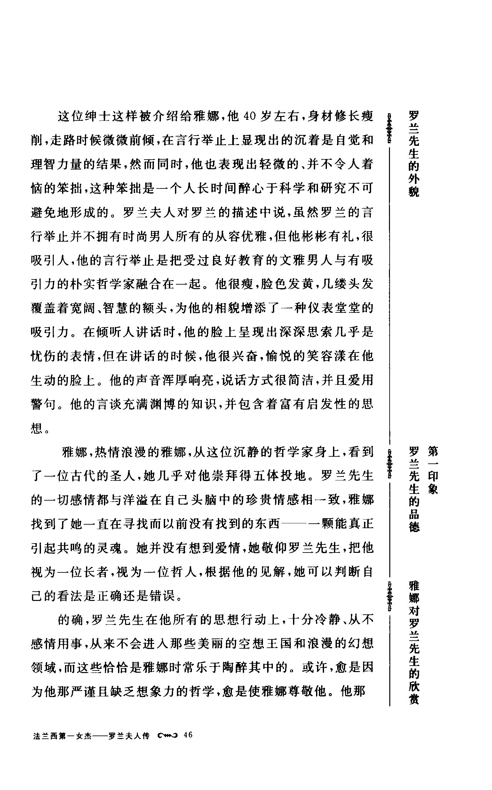

<small><a href="images/pages/058.png">原书第47页 · PDF 第58页 · 查看原页</a></small>

罗兰先生曾到德意志旅行，写了很多游历日志。由于他准备离开巴黎，前往意大利，于是，他留下了这些日志和一些其他手稿，交托给雅娜。她写道：“在他于意大利度过的18个月中，这些手稿比时常的访问令我对他有了更深的了解。这些日志和手稿由旅行、感想、写作计划、个人轶事组成。他坚强的意志、严格的原则和个人的品位皆跃然纸上。”罗兰亦把雅娜引见给他的兄弟——本尼迪克特（Benedictine）①教团的一位修道士。在离开巴黎的18个月里，罗兰先生一边在意大利、瑞士、西西里、马耳他旅行，一边写下了关于这些国家的笔记。后来，他出版了这些笔记。他的兄弟将罗兰先生和自己写信交流过的笔记转交给了雅娜。雅娜怀着浓厚的兴趣阅读

<blockquote>
① 圣本尼迪克特（St.Benedict）：5世纪意大利名僧。—一译者注
</blockquote>

原页对照（含插图与旁注）
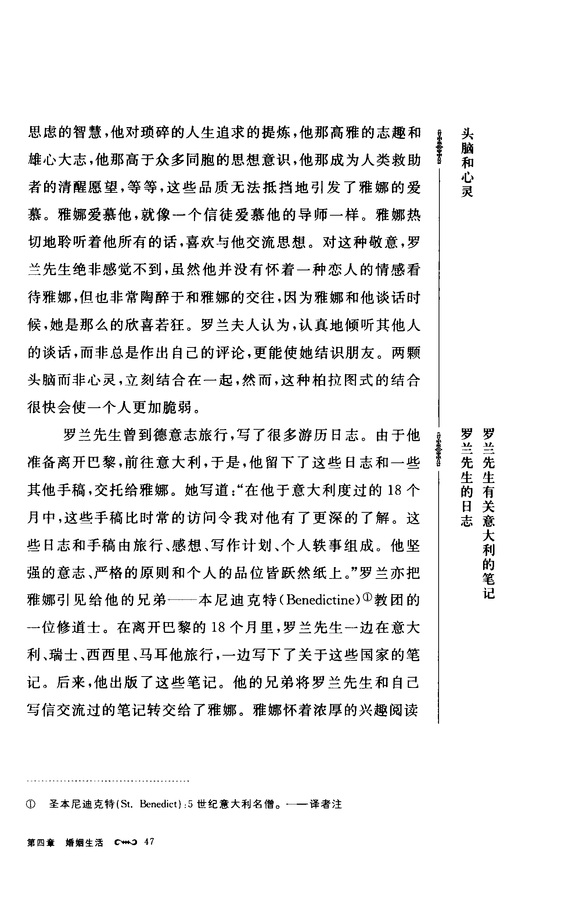

<small><a href="images/pages/059.png">原书第48页 · PDF 第59页 · 查看原页</a></small>

着这些笔记，最后罗兰先生返回巴黎时，他们相互的了解加深了一层。罗兰先生向雅娜提出了自己的写作方案，他高兴地发现，雅娜赞成自己所做的一切和所设想的一切。雅娜在罗兰先生身上发现，他是一位非常可贵的朋友。他的吸引力、精神生活、淡泊哲学深深地铭刻在她的想象中，获得了她的理解。

在他们俩好像都想把对方作为恋人以前，两三年过去了。雅娜把罗兰视为导师和朋友，并没有年轻人那般炙热的爱情令雅娜心神激荡，也没有热情洋溢的情感燃烧于雅娜的胸膛，驱使雅娜到他身边去。精神上的热情激励着她乐于接受和高尚的思想进行精神上的结合。另一方面，罗兰先生带着一种平静的、父亲般的赞赏看待这位才华横溢的女子，他也为雅娜的才华和辞令魅力所着迷，最重要的是，雅娜对他的深深仰慕令他欲罢不能。对他们的交往，两人都非常愉悦，他们为相见而高兴，为分别而不快。他们交流着写作计划，交流着政治改革，交流着对哲学和科学的思考。罗兰先生自然自信十足，固执已见，比较强势。雅娜非常尊敬他，她像服从法律一样接受他的主张，因此，他受到奉承赞美，她也很快乐。

罗兰先生返回到亚眠的官署处，为他关于意大利的作品出版事宜做准备。他们之间保持着大量的、经常性的通信。

他把手稿和所有被提议出版的样稿寄给雅娜，雅娜再把附有细读而得出相关思考的稿件回寄给他。偶尔，在对哲学的讨论和对政治的思考当中，彼此的笔下也流露出得体的亲昵表示。在他们认识了好几年之后，罗兰先生才坦率表白自己的爱慕之情。雅娜很了解罗兰家族的骄傲，依照罗兰家族的看法，雅娜的家庭背景这般不好，这是一桩得不到什么好处的联姻。雅娜太骄傲，不愿进入一个可能因这种联姻会感到耻辱的家庭。因此，雅娜坦诚地告诉罗兰先生，她为他的求婚感到荣幸，她敬重他远胜于她所认识的任何男人。雅娜使罗兰先生相信，充分回报他的感情是她最大的幸福，但她的父亲是一个堕落的人，由于父亲越来越多的债务和品行错误，会使所有和父亲相关的人深深蒙羞。因此，她不能想象，接受罗兰先生对她慷慨的付出反成为他未来耻辱的根源。

原页对照（含插图与旁注）
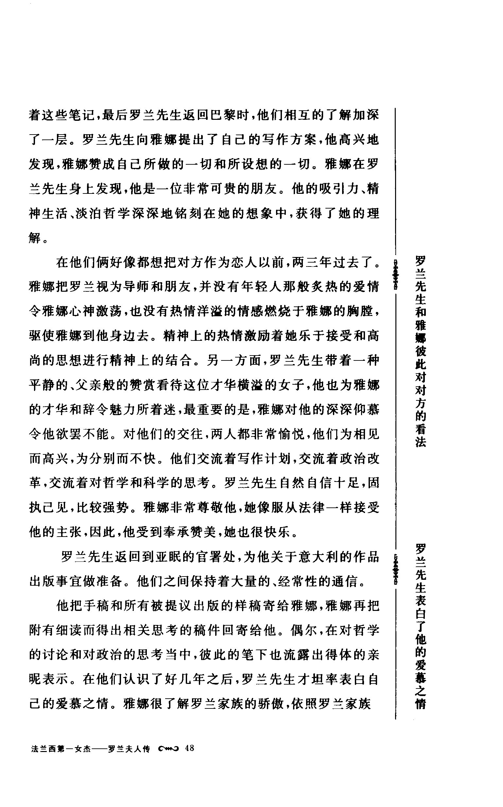

<small><a href="images/pages/060.png">原书第49页 · PDF 第60页 · 查看原页</a></small>

这种态度根本不可能使哲学家恋人退缩。雅娜愈是这般表明高尚的心灵——她确实是非常真诚的—…罗兰先生愈是诚挚地坚持他的求婚。最后，雅娜被他的恳求打动，同意他向自己的父亲提议婚事。罗兰先生便写信给菲利普先生，结果，他收到了一封污辱性的回信答复，菲利普先生很粗暴地拒绝了他的提议。菲利普先生声称，他根本没有接受这种有刻板原则的人做女婿的念头，这种人总是会因他的一切小错误而责备他。他也告诉自己的女儿，在这样一个苛求道德的人身上，她找到的不会是一个伴侣或者地位平等者，而将是一位审查员和专制者。雅娜把父亲的拒绝深深地埋藏在心中，下定决心，如果不能嫁给自己选择的男人，将不与其他任何男人结婚。于是，她给罗兰先生写信，请他放弃他的想法，不要再给他自己招致更多的悔辱。然后，她请求父亲允许她离开家，隐居到修道院去。

在修道院，雅娜受到了十分热情的接待，她在那儿早已经贏得了很高的尊敬。雅娜从母亲那里继承得来的收人微薄，使她必须尽可能俭省地生活，她决定根据最低标准来控制自己的日常开销。她的食物相当简单：稍微加点盐的马铃薯、米饭、大豆，偶尔奢侈地吃点黄油。雅娜只允许自己一周离开修道院两次：一次，花一个小时去拜访一位亲戚；另外一次，看望她父亲，查看一下他的床品衣物等。雅娜的小房间在屋顶下的阁楼里，下雨的天气，砸落在屋瓦上啪嗒啪嗒的雨滴声减轻了她浓浓的思念，使她能够安然入睡。她小心谨慎地避开与修道院的其他居住者交往，只接受深受爱戴的姐妹阿加莎每晚一个小时的拜访。她把时间都用在了令她快乐的文学爱好上，勤奋而不懈。对雅娜来说，这种安静而又与世隔绝的生活很有吸引力。实际上，一个享受这种生活方式的人永远不会厌倦生活，而对于时尚和享乐的信徒来说，生活会逐渐变得倦怠，生活逐渐就变成了负担。就这样，在平静中，几个月过去了。雅娜常常在花园中无人的时刻，去那儿散步。

原页对照（含插图与旁注）
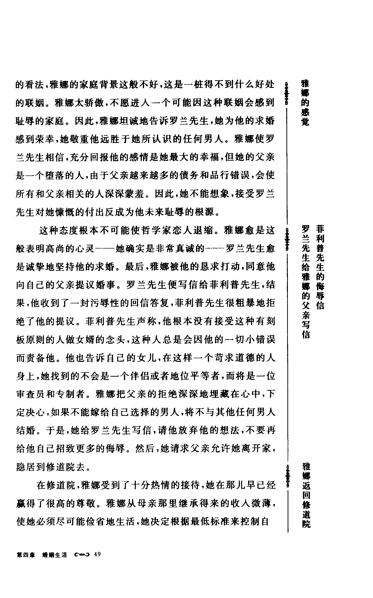

<small><a href="images/pages/061.png">原书第50页 · PDF 第61页 · 查看原页</a></small>

顺从的精神，她长期培育着；责任的履行，使她享受着良心的安宁；精神的升华，使她超脱了不幸；时间的统筹安排，使她在每一时刻都在做适当的事情；高度专心的习惯，使她能把精力集中于学习和研究；高雅的品位和长了翅膀一般的想象力，在她面前打开了神奇的想象世界，也是令她小屋蓬荜生辉和心灵富有的珍宝。诚然，她度过了一些忧伤的时光，但即使是那些忧伤也自有它们的迷人之处，也比那些通过缺乏思考的躁动兴奋得来的最快活时刻更能给人享受。罗兰先生继续和雅娜保持着经常、友好的通信，但她还是为哲学家屈服于父亲的粗暴拒绝而放弃，颇受伤害。在罗兰先生又一次逗留巴黎的五六个月期间，他顺便到修道院看望了雅娜。在栅栏后，他看到了雅娜那张苍白、忧伤的脸，看到了雅娜因对他忠诚的爱而饱含痛苦的眼神。听到雅娜充满特殊魅力的声音，他脑海中那些有点褪色的印象，便又鲜活起来。

原页对照（含插图与旁注）
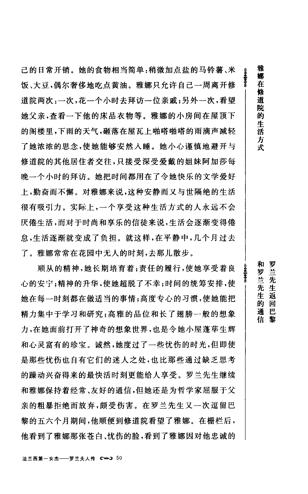

<small><a href="images/pages/062.png">原书第51页 · PDF 第62页 · 查看原页</a></small>

于是，罗兰先生再次向雅娜提出求婚，恳求雅娜同意立刻由他的兄弟主持结婚仪式。雅娜十分茫然，她不愿意父亲再继续控制她，也为哲学家恋人展示出来的热情渴望有点苦恼。雅娜的头脑中已经完全消除了浪漫爱情的幻想，但是，她为罗兰先生的坚定不移感到高兴，这表明他成熟的判断力赞成他的选择，他准备面对因和她结婚可能牵涉到的所有令人不快的情形。雅娜不再迟疑，答应了他的请求。他们在1780年冬天结婚，当时，雅娜25岁，丈夫比她大20岁。

婚姻生活的第一个年头，罗兰夫妇在巴黎度过。对罗兰夫人来说，这是非常愉快的一年。丈夫正在出版一本关于人文科学的著作，她把满腔热忱、全副精力都投入到了丈夫的写作事业上，她认真细致地为手稿的出版做准备，校订校样。

她和丈夫一起住在书房里，成为他一切思想上的同伴，成了他所有事务上的助手。在冬天，她享受的唯一消遣活动是上一门有关自然史和植物学的课程。罗兰先生租下了家具齐全的寓所，罗兰夫人在家务事方面曾受到母亲的良好教导，她留意到各种食物都不合罗兰的胃口，便愉快地亲自下厨，亲手丈夫准备饮食。丈夫占据了她的所有时间，并且自然而然地变得相当苛刻、专横，为了尽可能地独享她的亲密感情，他竟然希望她与其他人隔绝交往。罗兰夫人毫无怨言地顺从了这种苛求，虽然，有时候她也感觉到，实际上，她对自己年轻活泼的感情牺牲很大。罗兰夫人把全部身心都奉献给了丈夫所从事的研究，以至于她的健康受到了严重的损害。由于她习惯于分担丈夫的所有事务，罗兰开始感到，如果没有她，在任何时候、任何地方，他都无法工作。

原页对照（含插图与旁注）
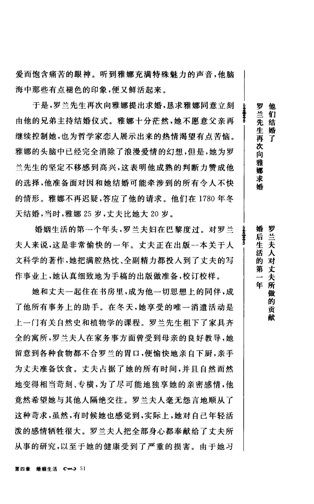

<small><a href="images/pages/063.png">原书第52页 · PDF 第63页 · 查看原页</a></small>

这年年底，罗兰先生和妻子返回到亚眠。不久，罗兰夫人生下了一个女儿，这是她唯一的孩子。

她十分勤勉地照料着、养育着女儿。虽然罗兰夫人是一个妈妈和护理员，但她并没有中断写作工作，她仍然带着书和笔，同住在书房里。罗兰先生正在为一本百科全书写几篇文章。罗兰夫人很有效率地帮助丈夫搜集资料、安排这件事情。实际上，她正挥舞着—支远比丈夫的更为有力的笔，她那丰富的词汇、出色的表达能力和发挥出来的想象力，令她掌握了一种非常吸引人的文体风格。由于很多文章辞藻丰富多彩、想象力优美奇特，罗兰先生获得了盛誉，他把这些归功于妻子瑰奇的想象力。罗兰先生经常生病，令罗兰夫人很担心他的生活。罗兰夫人对丈夫的温柔照顾加固了把他们结合在一起的纽带，他无法不深爱对他如此奉献的年轻美丽的妻子，她也无法不爱一个她寄予深深祝福的人。罗兰夫妇在亚眠待了四年。他们的小女儿欧朵拉（Eduora）是父母最大的快乐之源，罗兰夫人对女儿早期智力的开发深感兴趣。罗兰先生的职位待遇相当丰厚，他的写作事业也相当成功；在社会地位上，他们属于显赫门第中的富有家庭，因为罗兰先生的祖先都是贵族。现在，他想凭借累积的财富，渴望恢复祖先因财富的丧失而失去的贵族头衔。在环境的变化之下，我们也不能过分地指责我们的共和主义女英雄愿意丈夫恢复高贵的社会地位，她相信他完全应该被授予贵族的头衔，尊称她为罗兰费妇肯定不会令她不快。爬上地位高于我们的人的高位，比帮助地位低于我们的人取得我们所在的位置，更能令人愉快，这是人类脆弱本性的通病。在申请贵族特许状的过程中，他们遇到了困难，因为在当时，这项事务被取消了，以后也没有再恢复。无论怎样，后来，这种做法都遭到了他们的民主派对手的莫大讥讽。

原页对照（含插图与旁注）
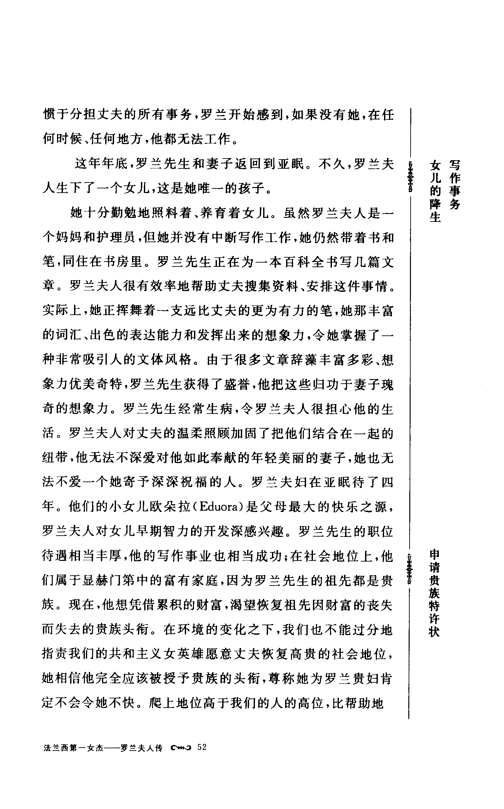

<small><a href="images/pages/064.png">原书第53页 · PDF 第64页 · 查看原页</a></small>

大约这个时候，罗兰夫妇访问了英格兰，他们受到了很认真的接待。罗兰夫人十分羡慕这个国家相对自由的制度，她感到，作为一个民族来说，英国人远远超越法国人。返回家中后，她对压迫法国人民的专制君主制的不满甚于以往。

罗兰先生从亚眠调动到里昂，里昂是他的故乡，在这个更大的地方，他继续担任公职，职位是商业和制造业督察长。冬天，罗兰夫妇居住在里昂；夏季，他们隐居到罗兰先生父亲的庄园——拉普拉蒂尔，那儿离里昂城仅数英里之遥，是一个风景优美、一派田园风光的幽居之处。罗兰先生的母亲和哥哥也同住这个庄园中，他们是罗兰夫妇快乐幸福之中的痛苦因素。看来，在生活中，每种快乐都必然包含着自身的痛苦，纯粹的幸福不会降临。对罗兰夫人来说，拉普拉蒂尔拥有尘世天堂所有的一切，但是，在那儿，堕落的人类所面临的诸多永恒的考验也破门而人。婆婆骄傲、蛮横、无知、脾气暴躁，其性格的每一方面都令人不悦。在生活中，少有比一位易怒暴躁的妇女更令人烦恼的事，而且，由于年龄已大的原因，婆婆更是平添了双倍的乖戾。

罗兰的哥哥则粗俗、自大，感情一点也不细腻，根本意识不到他会给其他敏感的人增添烦恼。心灵上受过磨炼的罗兰夫人，凭借着自己的快乐精神，居然击败了这些烦恼，逐渐融人到这个不和谐的家庭之中，促进了和谐和平的相处。不过，一个清朗的秋日，婆婆那令人生气的饶舌和狂躁的情绪终于安静下来，她在无法醒来的长眠之中安静了。那时，罗兰夫人也很可能流泪不止。这件事情过去后不久，他们被这幽居之地的宁静所吸引，为了度冬过夏，他们便在那儿安住下来。

原页对照（含插图与旁注）
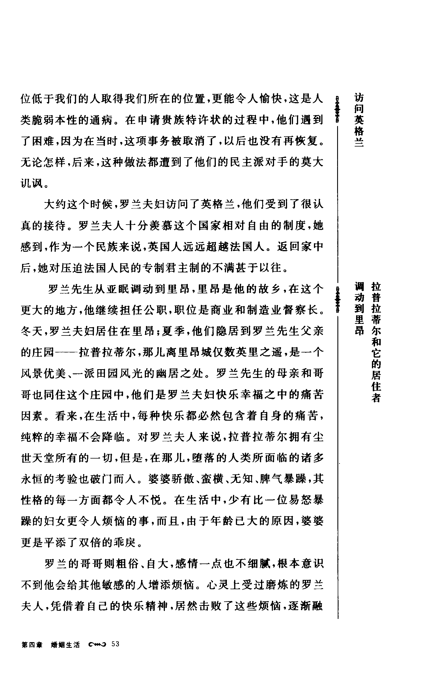

<small><a href="images/pages/065.png">原书第54页 · PDF 第65页 · 查看原页</a></small>

拉普拉蒂尔，即罗兰先生父亲的遗产，是位于索恩河流域博若菜山脚下的一处庄园。这个地方非常僻静，非常原生态，溪流从山上蜿蜒而下，穿过狭窄的山谷、平坦肥沃的牧场、茂盛的葡萄园，夹岸栽种着垂柳白杨。那儿有一座颇大的正方形石屋，窗户整齐，屋顶平坦，覆盖着红瓦，是一个很舒适、宽敞、坚固的住宅。屋檐挑出墙面很远，能够保护窗户免受夏天烈日的曝晒和冬天雨雪的侵袭。房屋的外墙挺直，全无装饰，涂以白石灰，经年的暴雨雪使得一些地方的墙面已经开裂，石灰已经脱落。这座住宅拔地而起，沿着五块大石阶而上，可进人前门，台阶旁安装着生锈的铁栏杆。谷仓、酿酒房、鸽舍、羊圈簇集在一起，于是，这所农舍和它的外屋，几乎呈现出一个小村庄的面貌。这里有一个菜园和一个花园，花园中有弯弯曲曲的小道，有香气四溢的开花灌木所环绕的凉亭。果园里，各种果树在割过的草地上投下姿态纷呈的树荫。葡萄园里，长排长排低垂的葡萄藤，使这幅充满田园风光和引人入胜的画面完美无比。远处，能看见博若莱山脉蜿蜒的山脊。在高于这些山的再远处，隐约浮现出积雪覆盖的阿尔卑斯山山顶。在这里，在交往上的与世隔绝中，在和谐的宁静中，在广阔的大自然中，罗兰夫人度过了她生命中五个最幸福的年头—因为世上很少人能够享受到这样的五年时光。看到树梢和蓝

原页对照（含插图与旁注）
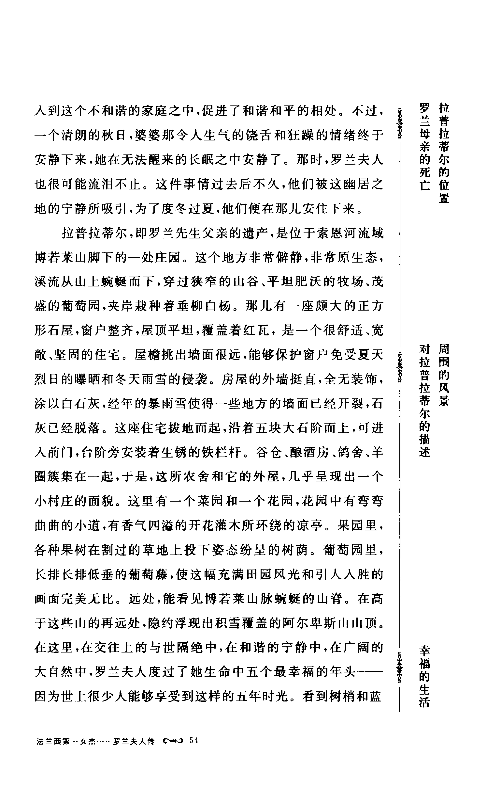

<small><a href="images/pages/066.png">原书第55页 · PDF 第66页 · 查看原页</a></small>

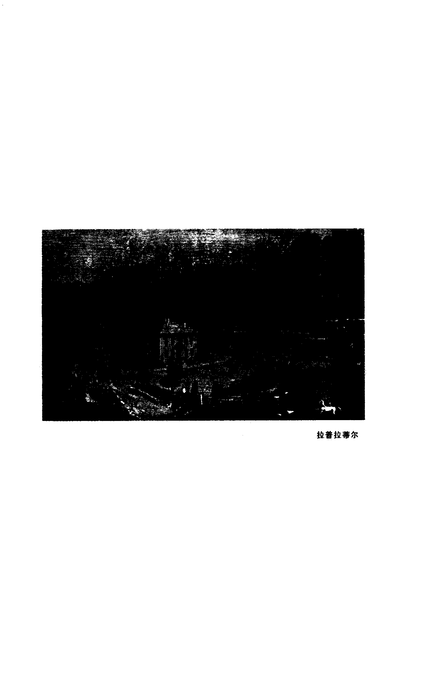

<small><a href="images/pages/067.png">原书第56页 · PDF 第67页 · 查看原页</a></small>

天下少有的四方院落，她的精神是如此快乐，如果在她城市的家，只有从窗户中才能看到这些景致。山川、草地、碧水、蓝天，这些生气勃勃的美景奢侈地铺展在眼前，罗兰夫人深深地陶醉于其中。无边的苍穹映人眼帘，引领着她的想象力也漫无边际地漫游着，自然和想象是她的朋友，在它们的王国里，她找到了自己的家。她享受着丰厚的收人，一直从事着最祟高的写作事业，她高兴于丈夫和女儿欧朵拉的交往，她游刃有余地管理着家务事，这种游刃有余使得管理家务也成了一种快乐。时间舞动着快速的翅膀飞逝而过。

这宁静快乐的五年，在她的人生中，介于阴云密布的早晨和狂风暴雨的晚上，这五年的生活方式必定相当有吸引力。她日出而作，把精力投放在丈夫和孩子身上，亲自指挥早餐的安排，怀着充满深情的快乐，亲自下厨，细致地为丈夫准备他简朴的饮食。在一个相亲相爱的家庭中，共同进餐是一日当中最令人高兴的会面。吃完饭后，罗兰先生进入书房开始他的脑力劳动，和他在一起的，还有他安静的伴侣和视他为偶像的欧朵拉。欧朵拉在父母的看管下，自得其乐于画画、阅读或者其他的学习。同时，罗兰夫人以最有条理的精神忙碌着她的家务事。她是一位完美的主妇，每天上午处理她所有的家务事，从地下室到阁楼，都要一一过目。她指挥着保存水果、储藏葡萄酒、亚麻布分类和其他家庭琐事，这些事情占据着一位优秀主妇的注意力。条理化地分配时间，好像是她天性中本能的原则，使她能够在两个小时内做完所有事情。她指挥忠诚的仆人去做这些事情。在所有事务上，都需要这样的指挥，这种指挥和领导其他人发挥力量的才能，并不是非常普遍

原页对照（含插图与旁注）
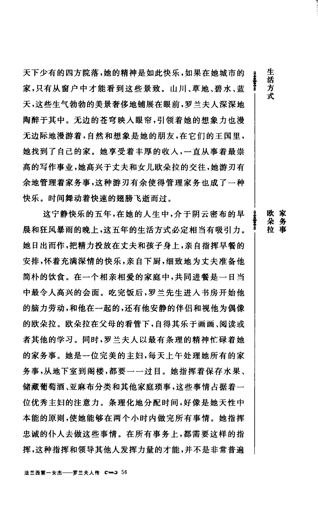

<small><a href="images/pages/068.png">原书第57页 · PDF 第68页 · 查看原页</a></small>

的人类天赋。

罗兰夫人处理完家务事后，在一天当中的其余时间，便进人书房，参与到丈夫的工作中去。这些脑力工作一直对她拥有特别的吸引力。罗兰先生的学术声望和政治地位吸引了很多前来拉普拉蒂尔的访问者。因此，他们几乎总要陪同客人进餐。在上午的写作工作结束后，罗兰夫人便开始为晚宴梳妆打扮，她要发挥她独有的头脑魅力和举止魅力，在餐桌上招待客人们。然后，一天的工作就结束了。这种社交谈话性的宴会颇耗时间，宴会结束后，人们会到花园里散散步，到葡萄园中逛逛，看看在农庄大院里所发现的众多有意思的东西。罗兰夫人便经常退出人群，回到书房，给她的朋友们写信，或者检查欧朵拉的功课。通常，天气好的日子，罗兰夫人会挽着丈夫的胳膊，走几里路，到农民的家里探访，因为她一贯的亲切，所以，她深受村民们喜爱。晚上，喝过茶后，夫妇俩又进入图书室。有名望和影响力的客人们经常和他们在一起，卓越的哲学和才华令他们振奋喜悦，时间过得飞快。由于阅读当时的刊物，罗兰夫人作为读者也常常被召集到谈话中去。当不阅读刊物的时候，罗兰夫人常常坐在她的工作台边，做些针线活，同时，安静而不多嘴地参与谈话。罗兰夫人说：“这种非常朴素的生活，并不是我的丈夫——我全心爱着的男人一个人的功劳，温柔的友谊和极大的信任在每一个生活时刻都留下了痕迹，为每一样东西都增添了价值，若没有这些，将什么价值都没有。这是一种最能增进道德和幸福的生活，我欣赏它的价值，我祝贺自己能享受它，我尽自己最大的努力使之长久。”她再三地描绘乡村乐趣的迷人画面：“我储存非常美味可口的梨子；我们烘葡萄干，修剪枝权；我们用葡萄酒做早饭；我们眺望着仆人在葡萄园中忙碌，我们在树林的浓荫中、青青的草地上休息：我们从树上采集核桃，采集冬天要储藏的水果，把它们放到阁楼晾干；吃过早餐后，我们和人们一起去摘杏。亲爱的朋友，暂时除掉你的脚镣，来我们的隐居处，加入我们吧！在这里你会找到真正的友谊和真正简单的心灵。”

原页对照（含插图与旁注）
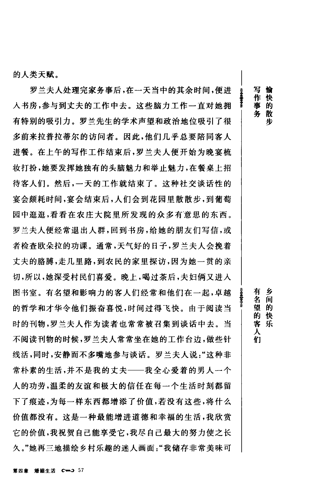

<small><a href="images/pages/069.png">原书第58页 · PDF 第69页 · 查看原页</a></small>

在罗兰夫人众多的才能之中，她学到了不少医学技能。在这样一个地方，穷困农民无法接触到医生，罗兰夫人不仅慷慨地给予了他们很多小安慰，而且，她以忘我的勤勉，探访生病的农民，为他们的疾病开药方。她常常被召唤到10或12英里远的地方看望病人，对这样的求助，她从没有置之不理。在星期天，她的院子中挤满了从周边地区聚集来的农民，有些是寻求救济的残疾者，其他人则是带来一点表达他们感激之情的礼物，因为贫困，他们只能带来这些。有脸蛋红红的小男孩带来一篮子板栗；有饱经忧患、苍白瘦弱但眼中带着感激的母亲，带来一些用山羊奶做成的香喷喷的小奶酪，赠送给她的女恩人；也有挂着拐杖蹒跚而来的老人，带来一篮子从自家果园里摘来的苹果。对这些未受启蒙、地位低下的农民做出的表达感激之举，罗兰夫人感到高兴。在早年岁月中，她如此深情地抱有共和主义的观念，当为丈夫寻求贵族特许状的时候，她都有点背离这种观念了，现在，这种观念带着新的热情在她胸中复苏了。穷人和下层人尤其把罗兰夫人视为朋友，在那僻静的山谷中所有农家的炉火边，人们都用崇拜的声音念叨着罗兰夫人的名字。罗兰夫人和她的丈夫开始越来越把他们的利益与周围的穷人视为一体，以口舌和笔为人民的权利作辩护。罗兰夫人和穷人的交往使她越发感觉到法律的沉重压迫，这种压迫的法律设计是为了让少数人沉溺于奢侈，而大多数人则被放逐给贫穷和没有希望的无知。她无比信任人民的美德，认为他们的解放将会开创太平盛世里真正的幸福。现在，她看到人民的情感大海正在十分平静地安睡。后来，她看到了这同样的海洋受到了暴风雨的猛烈冲击。

原页对照（含插图与旁注）
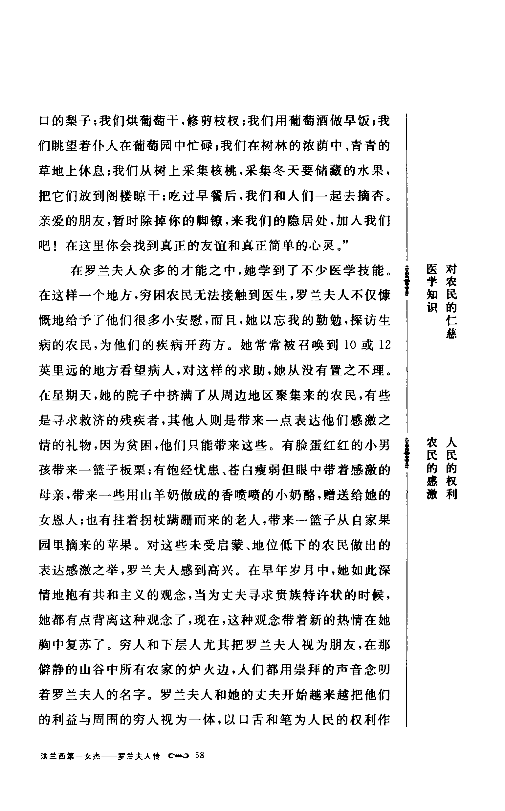

<small><a href="images/pages/070.png">原书第59页 · PDF 第70页 · 查看原页</a></small>

原页对照（含插图与旁注）
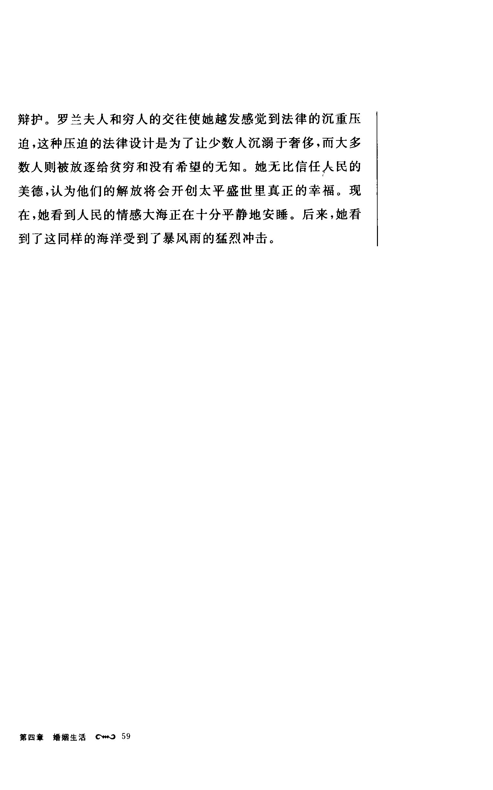

