# 第五章 国民议会

<small><a href="images/pages/071.png">原书第60页 · PDF 第71页 · 查看原页</a></small>

> 原文件此页已损坏。章节名据原书目录保留；无法辨认的扉页内容未作猜补。

<small><a href="images/pages/072.png">原书第61页 · PDF 第72页 · 查看原页</a></small>

罗兰夫人生活在拉普拉蒂尔，享受着这个世界赐给她的和平与幸福。当那场可怕的精神风暴——法国大革命—最初的预示性声音传到她耳中的时候，她急切地捕捉着这些声音，认为它们是最显著的政治和社会福音的预兆。她欣喜地断言，长期遭受压迫的人们重申自己的权利并将获胜的时刻正在到来。她没有想到，涌起的巨浪将会以不可抵挡的潮流，打翻她的国家，并将她和她深爱的一切人都卷入其中。她梦想着，无知的、被奴役的人们将从埃及的奴役中被引领到不受荒野和沙漠之苦的希望之乡——对于一位博爱的女士来说，这是可以原谅的梦想。她是如此强烈地信仰人类本性的再生能力，以致她预料不到，立刻、全部清除掉她所不赞成的传统、律法和习俗，会遇到障碍和危险。罗兰夫人的整颗心都被唤醒，她把她所有的情感和精神都投入到人类的福利事业当中。很难想象，若非她早年遭遇到那些地位高于她的傲慢者的羞辱，若非遭遇到获取贵族许可状时的困难，她的热情会如此强烈地被激发出来，她的性格会像这样。她的奉献热情激发了她那较少激动的丈夫的热忱。凭借着由笔端和声音所构成的充满魅力的雄辩力量，占据她身心的强烈情感也逐渐鼓舞了她的朋友们。

原页对照（含插图与旁注）
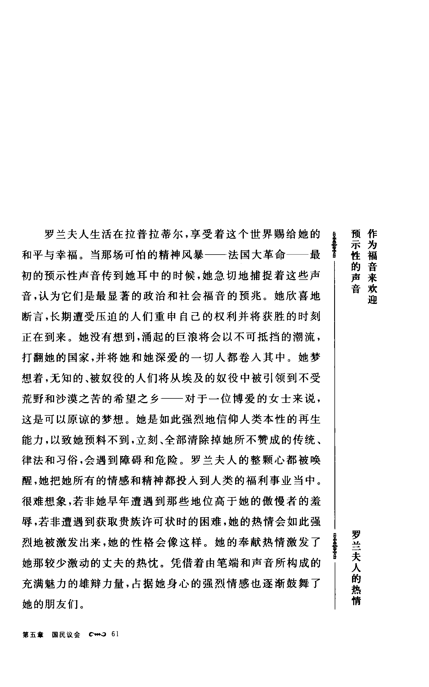

<small><a href="images/pages/073.png">原书第62页 · PDF 第73页 · 查看原页</a></small>

仅在不久前，路易十六（Louis XVI）和玛丽•安托瓦内特才继承波旁王朝的王位。路易十六很仁慈，但不具备在这样风雨飘摇的时代中掌控政府所必需的果敢性格。玛丽•安托瓦内特既无头脑上的文化修养也无社会方面的知识，她是一个可爱但被宠坏了的孩子，有与生俱来的高贵品性，也有因接受琐碎的教育自然地、不可避免地会导致的缺点。她一直想着，也只想着享乐，从来想不到责任和义务。国王和王后不能只沉酒于奢华而不做其他事情，这种想法在她头脑中从没有出现过，与其说这是她的不幸，还不如说这是她的错误。很难想象，还有哪两种性格比路易和玛丽二人的性格更无资格占据王位。人民正慢慢地，以无法抵制的力量，起义反对衰老而腐析的贵族和君主制的弊端。路易，这个仁慈、正直、纯洁、没有污点的男人，成了傲慢的、压迫人的、放荡的君主的替罪羊。在好几个世纪里，这些君主用铁蹄踩踏在臣民的脖颈上，世代累积起来的仇恨正倾泻到路易那忠诚的头颅上，这位优柔寡断的君主完全不知自己的处境。

当法国各地不满的喧嚷声越来越高，越来越持久时，国王启动了协调制度，召开了国民议会。会议人员由贵族、高级教士和法国各地人民选举出来的代表组成。

罗兰先生是里昂和附近地区人民十分崇拜的一个偶像，现在他开始丢弃贵族的特权，高票当选为里昂市参加国民议会的代表。在热闹的里昂市，革命活动已经强有力地开始，罗兰的名字是人们为摆脱压迫时代而斗争的号召。罗兰先生在城市的住所度过了一段时日，在那里，他草拟提出时局强烈关注的问题。在罗兰夫人的沙龙里，每晚都有革命派中最有影响力的人物召开会议。罗兰夫人的热情激发了他们的热情，她那广闻博见的头脑和令人着迷的辞令口才引导着他们的讨论。城市中有冲劲的年轻人汇聚到这位洋溢着热情的女人身边，从她口中说出进入他们耳中的自由之辞藻，极富魅力，带着一股骑士般的奉献精神，他们甘愿接受罗兰夫人头脑的领导。

原页对照（含插图与旁注）
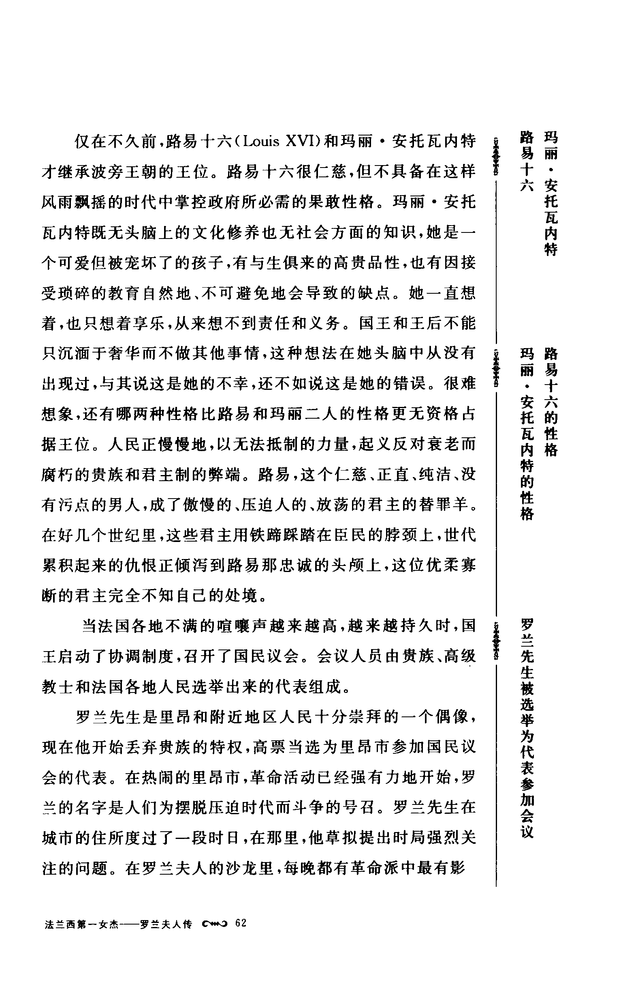

<small><a href="images/pages/074.png">原书第63页 · PDF 第74页 · 查看原页</a></small>

在平民和贵族、民主派和贵族之间正在涌现的斗争中，作为革命派中最著名、最有影响力的人物，罗兰先生和妻子面临着这样的处境：整个里昂贵族圈对他们越来越仇恨，摆开了反对他们的阵势，每天，他们的名字都挂在非常热情的改革拥护派和极度敌视他们的反对派嘴边。责难和欢呼同样鼓舞着罗兰夫人，她的整颗心都倾注到人民自由的主张中，这个目标变成了她的热烈渴求，她集中了全部的身心力量，投身于这个目标。

1791年2月20日，罗兰夫人陪同丈夫到巴黎去，因为他要人席国民议会。他们的名望已经很高，五年前离开首都时，她身份低微、心情消沉；现在，她回到了这里，已经拥有财富，身份得到提升，声名远扬，为觉醒的力量而欣喜。她那令人信服的影响力正指导着把古老的法国贵族从城堡中驱赶出来的方案，她那活跃的头脑正引领着动摇波旁王朝宝座的进攻。罗兰先生品德毫无瑕疵、廉洁正直、质朴礼貌、才干超群，立刻在他的同事中树立了权威。妻子的才智和迷人的口才能力，也为罗兰先生的名声增添了很多光彩。满腔热忱的罗兰夫人正好写成了一本关于新的情势秩序的小册子，小册子的语言刚劲有力、深刻感人，一下子卖出6万册——鉴于那个时代读者相对较少，这是很大的一个数目。当然，罗兰夫人也受到了极受吹捧的关注，她的观点获得了很大的尊重。她平常也去参加国民议会的会议，怀着深深的兴趣，聆听着会议的辩论。国王和王后已经从凡尔赛的王官中被拖走，实际上成了关押在杜伊勒里宫中的囚犯。很多贵族已经脱离了看起来环伺于四周的危险，加入了科布伦茨的侨民军。但是，还是有一些贵族和不少高级教士坚守在职位上，作为国民议会的代表，勇敢但无效地努力捍卫王权和教会的古代特权。

原页对照（含插图与旁注）
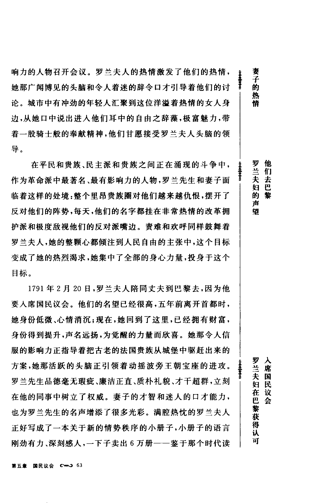

<small><a href="images/pages/075.png">原书第64页 · PDF 第75页 · 查看原页</a></small>

罗兰夫人目睹了举止高贵优雅、知识文化全面的保王党人，他们明显优胜于正以年幼的赫尔克里斯①那样力大无比的力量推翻专制力量的平民出身者，她深感耻辱，再也无法压制或者隐藏这种感受。她所有的品位都赞同古代的贵族和他们的捍卫者，而她所有的原则都赞同人民。当她对比民主派领导人不够优雅的外表、笨拙的演说和集结在王权周围那些人的典雅的风度、优美的措辞时，对于与她同甘共苦的这些人，她心中生起了一股想提高他们的交际水平和知识水平的强烈渴望。与贵族的斗争持续不长，上升的民主力量很快战胜了他们。暴力取代了法律。现在，权力的斗争主要发生在改革方案更为激进或者较少激进的共和党人之间。最温和的派别，由那些主张保留王权但通过自由宪法给予限制，并保留多数长期以来赢得尊重的制度和习俗的人们组成，他们被称作吉伦特派。之所以这样称呼他们，是因为这个派别最有名

<blockquote>
① 赫尔克里斯：希腊神话、罗马神话中的神仙，宙斯与阿尔克墨涅之子，力大无比的英雄，因完成赫拉要求的十二项任务而获得永生。
</blockquote>

原页对照（含插图与旁注）
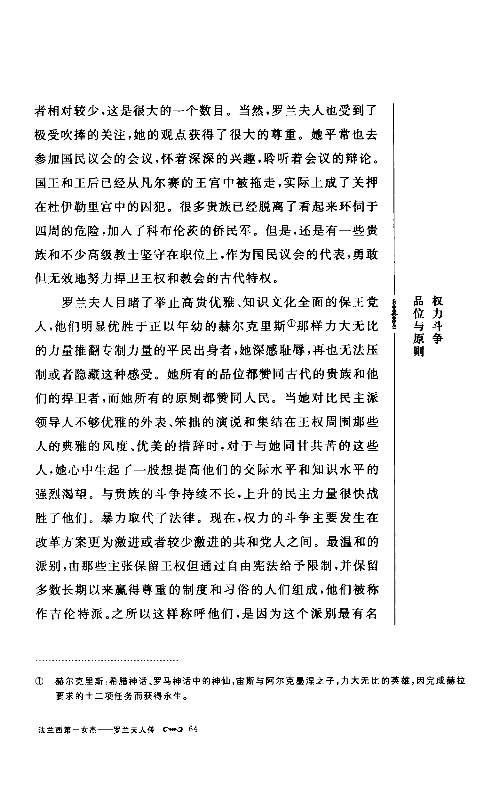

<small><a href="images/pages/076.png">原书第65页 · PDF 第76页 · 查看原页</a></small>

的领导人都来自吉伦特省。他们愿意剥夺国王的许多特权，但不愿剥夺他的王位；他们愿意夺取他的专制权力，但不愿意夺取他的性命；他们愿意唤起人们享有自由，但自由必须受到健全法制的约束。反对吉伦特派的派别叫雅各宾派——他们的改革观点更为激进，他们主张推翻国王和神坛，打倒一切特权阶层，没收贵族的财产，王子与乞丐平等。革命的法国已经分化为这两大派别，这两派之间的斗争也是人间所目睹的最残酷、最势不两立的斗争。

罗兰先生和妻子，在巴黎安下了一个住处，那是一个很方便的聚会场所。由于他们的吸引力，每天晚上，许多很有影响力的国民议会代表都聚集在他们身边，这些代表带着全部热情和精力，加入了吉伦特派。每周有四个晚上，吉伦特派的领导人都在罗兰夫人的沙龙里开会，商议有关措施。在这些人之中，有一名来自乡下的年轻律师，他表情呆滞，脸色发黄，姿态不雅，他在国民议会中发表的啰唆演说令代表们生厌，这也使他很不受人欢迎。他常常被辩论驳倒，并被蔑视的咳嗽声阻挠，但他对讽刺挖苦和无礼羞辱好像毫无感觉。他在国民议会中很孤立，没有朋友，他对所有的派别一律攻击，也被所有的派别蔑视不理。但是，他拥有不屈不挠的精神、毫不动摇的确定目标，他对财富和奢侈深为鄙视，对名誉和个人享受十分淡泊，这些品质确保他越来越具备优势，直到他罗伯斯庇尔（Robespierre）的名字震惊所有法国人。这个安静忧郁的年轻人和其他人一起出现在罗兰夫人的沙龙里。罗兰夫人本能地意识到他的罕见才能，为他的与众不同所打动，对他印象十分深刻。罗伯斯庇尔被罗兰夫人无与伦比的口才魅力迷住了，他安静地待在她的椅子旁边—因为他没有交谈的才能-铭记着她那自然、优雅的修辞比喻，吸纳着她的观点。

原页对照（含插图与旁注）
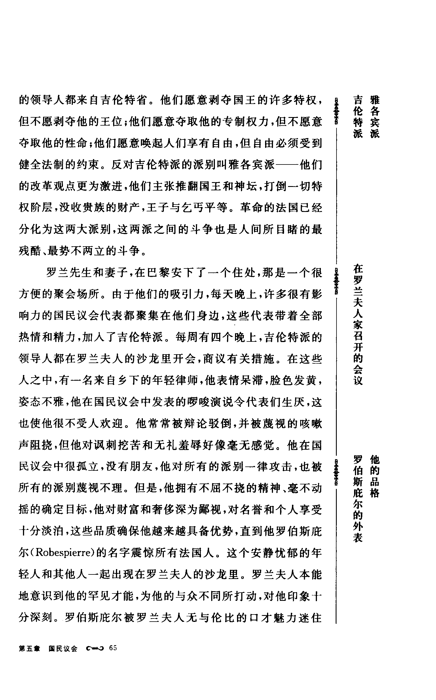

<small><a href="images/pages/077.png">原书第66页 · PDF 第77页 · 查看原页</a></small>

他对时代局势有清醒的认识，可能是一个忠诚的爱国者，他没有友谊的牵制、良心上的不安、仁慈的本能，这令他对实现目标所导致的流血或者不幸毫不同情。

此刻，在法国大革命喧嚣的舞台上，虽然斗争着的是吉伦特派和雅各宾派这两大派，但仍然存在着已经丧失了力量和被制服的保王党残余，他们的头领是饱受凌辱的国王，也有众多为权力而斗争的小团体、小派系。在罗兰夫人的沙龙里那些政治性的晚间聚会上，罗兰夫人总是在场。在这种场合中，她并不是作为一个显眼的角色惹人注意地参与社交辩论，而是作为一位安静谦和的女士，有着众所周知的超群智力，她活跃的头脑对调动气氛持有浓厚兴趣。她施加的影响是一个多才多艺的女人所体现出来的文雅、高贵、魅力。她在自己适当的领域内展现着活力，她不做咄咄逼人的演说，也不加入到男人之中大声辩论，她用无形的手温柔地、娇媚地触摸着他人内心的行为动机，她利用女性的辞令口才，说出其他人急于采纳、拥护并有力执行的富有洞察力的建议，且无损于体现女人的伟大和力量的细致感觉。她没有想过把优雅精致的女性武器放置一旁，而到女人无力治理的领域中，去抓取男人笨重粗粝的盔甲，这是任何女人都挥舞不动的。一个女人如果进行这种努力，肯定会招致除了少数不合时宜之人以外所有人的反感，因为人们根本看不到女人在身心方面所作出的特别牺牲。

当绅士们聚集在僻静的房间或者适合秘密会谈的图书室和书房里，当丈夫和朋友们正在讨论政治措施的时候，罗兰夫人便坐在旁边的小工作台上。她手中忙碌着针线活或者她的笔，聆听着他们说出的每一句话，她常常紧闭双唇，克制着自己说出对一些软弱提案的责备或者敦促采取更大胆的行动的建议，克制着这种难以抑制的渴望。当密谈结束后，公开的社交谈话继续，她低沉、甜美、迷人的声音才又响起，随之，人们相继被吸引到她身边来。

原页对照（含插图与旁注）
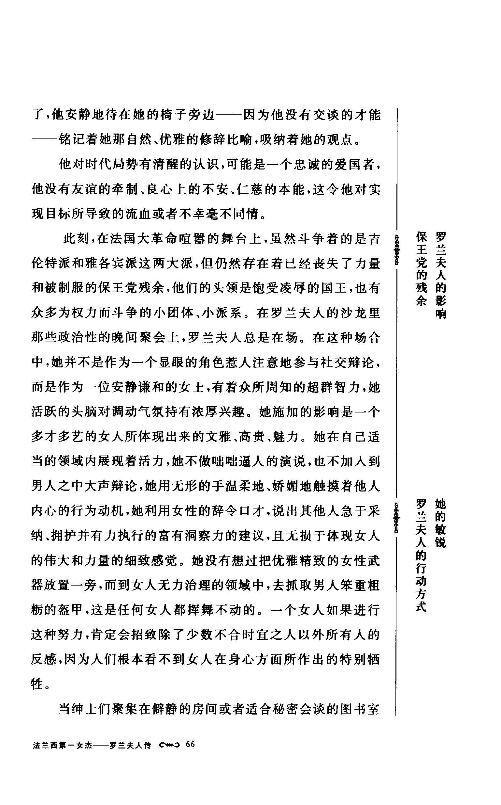

<small><a href="images/pages/078.png">原书第67页 · PDF 第78页 · 查看原页</a></small>

在这种时刻，罗伯斯庇尔往往安静沉思地俯身在她的椅子旁边，他不像其他人那样像学习一本自己所欣赏的书式地学习罗兰夫人，而更多是以一种坚忍的漠然来学习她。第二天，在国民议会中，他的同事便对他厚脸皮的发言会心一笑，他们不是笑他的观点，而是笑他对演讲女教师的丰富语言学习得如此认真，甚至收藏了每个词、每句话。通常，当罗伯斯庇尔用令人印象深刻的语言——不久前刚从更有说服力的口中、甜美的声音中听来的——表达一些高尚的情操时，每个人都会把目光投向他，侧耳细听。

但是，法国大革命像一个毁灭的幽灵一样，正以它无法抵制的力量向前猛冲，自由正变得不受法律约束。暴民们在大街上胡作非为，放火烧毁了城堡，拆掉了修道院，搜捕甚至杀死教士、贵族，洗劫了王宫，亵渎宗教圣坛。吉伦特派那些名声显赫、口才雄辩、充满爱国精神的男人们，衷心希望斩断专制的手臂，推行一种井然有序的自由。现在，他们开始担心，他们看到，这个幽灵正被召唤过来，可能会把每一样神圣的东西都践踏到尘埃里。吉伦特派的反对者雅各宾派，纠集着他们周围大声喊叫着“杀、烧、毁”的民众，在毁灭的道路上

原页对照（含插图与旁注）
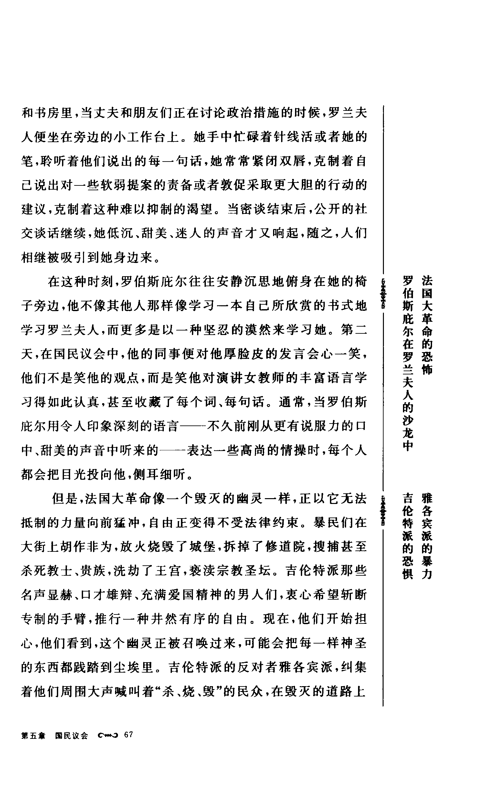

<small><a href="images/pages/079.png">原书第68页 · PDF 第79页 · 查看原页</a></small>

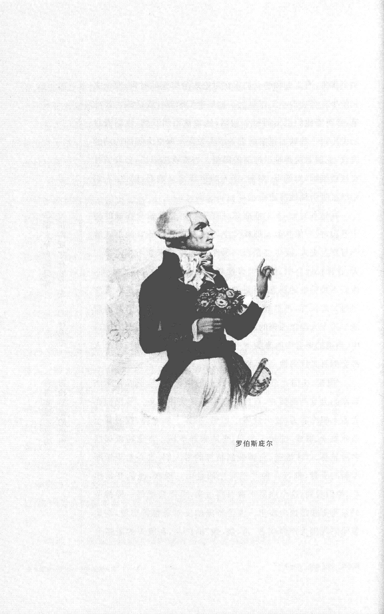

<small><a href="images/pages/080.png">原书第69页 · PDF 第80页 · 查看原页</a></small>

向前奔驰，直到从大地上清除掉每一个社会等级差别的残余和每一种宗教约束。吉伦特派陷入了深深的困境之中：他们不能折回步伐试图恢复王权，这种努力不仅绝对无效，而且肯定会使他们陷于快速的、无可挽回的毁灭；他们也不能和雅各宾派结盟，去不计后果地攻击每一样被时间证明值得尊重的事物，用无礼、无知、堕落的暴民变幻无常的决定代替礼仪、法律和秩序。对他们来说，剩下的唯一希望就是为坚定地坚持自己的立场而斗争，这也是法兰西唯一的希望。恢复君主制是不可能的，而雅各宾派的胜利就是毁灭。在国民议会中两派打出的旗帜周围是成百万的法国民众，现在，哪一派能够激发起民众充分的权力意识呢？哪一派能争取到最高的民众选票支持呢？哪一派能最为成功地迎合民众的口味呢？吉伦特派拥有才干、正直和不受腐蚀的爱国精神，他们预见了自身的危险境况，但是，他们决心去迎战它，如果他们必须灭亡，那也要穿着盔甲在战斗中灭亡。在早期，除了罗兰夫人，没有人觉察到这种危险，甚至早在他们意识到他们正走向深渊之前，对即将到来的危险，她就警告过她的朋友们。她敦促他们采取预防措施，一旦他们的职位守不住时，可以采取撤退。罗兰夫人说：“我曾认为，再没有比专制王权更大的祸害了，但现在，我看到，将有其他更为可怕的大灾难。”

罗伯斯庇尔，这个与吉伦特派交往并有点儿精神忧郁的人，时常准备着投向这派或者那派，他审时度势，表现得十分谨慎，现在他开始倾向于更为大众化的派别，随后，他就变成了鼓动人心的魔鬼。虽然他日益引人注意，但还没有广受欢迎。一度，罗伯斯庇尔因为支持一些不受欢迎的措施而受到指控，引发了民众反对他的叫嚷声，又响又沉的复仇誓言响彻巴黎的大街。他在国民议会中的敌人借此提出了一个针对他的指控法令，敌人将利用断头台斧头的致命力量除掉他。罗伯斯庇尔的危险迫在眉睫，他被迫躲藏起来。罗兰夫人总是为那些使之高贵的勇敢所驱使，当天夜里，她在丈夫的陪同下，去了罗伯斯庇尔的藏身处，邀请他到自己房子中一个更为安全的避难所。然后，罗兰夫人不顾疲劳正在阻碍着她的仁慈，急忙去了一个很有影响力的朋友布松（Busot）先生那里，恳请他在指控罗伯斯庇尔的法令颁布之前，赶快行动，尽力为罗伯斯庇尔开脱，使他无罪。布松先生很犹豫，但无法抵挡罗兰夫人的热切请求，他回答道：“我会尽我所能拯救这个不幸的年轻人，虽然我一点也不赞同他的很多观点。他对自己考虑太多而不热爱自由，但他在为自由服务，对我来说，这就够了，我会为他辩护。”就这样，罗伯斯庇尔的性命被挽救了。他活下来了，却通过把他的恩人们送到监狱并杀死的方式去报答他们。拉马丁（Lamartine）说道：“在裁判所附属监狱的地牢里，罗兰夫人快意地回忆了那个夜晚。如果掌权的罗伯斯庇尔回忆起这个夜晚，回忆应该比刽子手的斧头还要冰冷地袭向他的内心。”

原页对照（含插图与旁注）
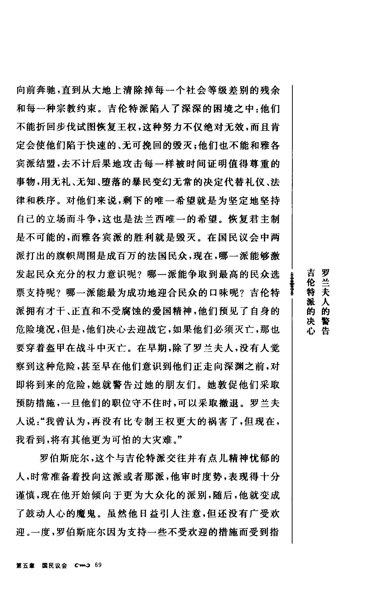

<small><a href="images/pages/081.png">原书第70页 · PDF 第81页 · 查看原页</a></small>

因此，罗兰夫人所发挥的强大影响是无法被隐瞒的。她的丈夫通过她一直渴望加诸到他身上的才华而变得更加出色。对个人的名望，罗兰夫人似乎没有任何野心，她仅仅寻求提高伴侣的地位，扩大伴侣的声誉。人们通过对罗兰夫人的口耳相传和有时在国民议会中的坦率声明，从罗兰年轻可爱的妻子那里，吉伦特派大胆果敢的措施获得了推动力。

原页对照（含插图与旁注）
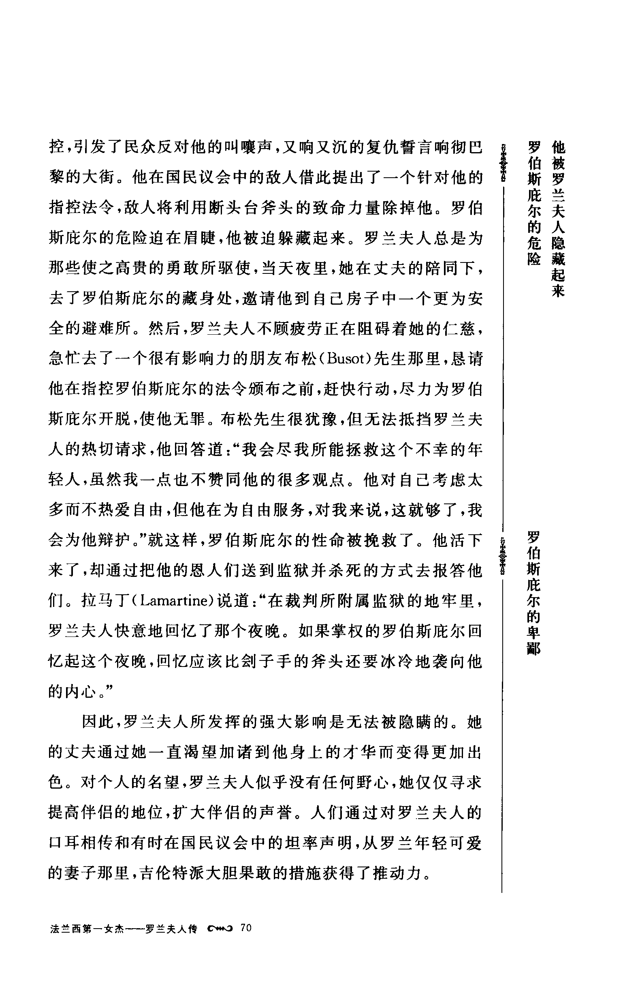

<small><a href="images/pages/082.png">原书第71页 · PDF 第82页 · 查看原页</a></small>

1791年9月，国民议会解散了，罗兰夫妇返回到宁静的拉普拉蒂尔乡下。但在修剪葡萄藤、饲养家禽、照料宁静地盛开在花园中的花儿等事务中，他们并不能忘却他们所经历的激动人心的场面，也不能忘却他们预料到即將到来的更为令人激动的场面。罗兰夫人与罗伯斯庇尔、布松保持着经常的通信，她给一本广泛传播的杂志撰写了很多十分精彩的文章，这本杂志为吉伦特派创建以倡导他们的政治观点。此时，在罗兰夫人和她丈夫之间出现的问题是，在这狂暴的时代中，他们是否应该放弃鼓动革命和危险的政治生活，与世隔绝地在乡下隐居，平静奢侈地从事文学、科学事业，或者再次驰向惊涛骇浪的革命和混乱的海洋。很少人能理解人们的心灵会怀疑他们作出的决定。结果，罗兰夫妇把小鸡留在了院子里，把兔子留在了笼子里，弃置了花儿任其独自开放，在12月的白雪覆盖小山之前，他们再次回到混乱喧哗的巴黎居住了。巴黎正在召集新的国民议会，根据法律，最近解散的议会的所有代表都被排除，不得继任。罗兰夫妇的朋友们从他们的疗养地迅速地汇聚到巴黎，帝国各地有影响的人物，也纷纷聚集到大都会，观察事态的进展。人们组建了俱乐部，讨论时下的重大问题，形成公众舆论，威慑国民议会。这是一个黑暗的时期，但人们是如此陶醉于饮啜荣誉和权力的兴奋剂，结果，那些喝过一次的人发现，所有的饮料都很陈腐乏味。罗兰夫妇刚到巴黎安顿下来，就被卷人到大革命的阴谋和反阴谋当中。罗兰先生认真严肃、沉默寡言、高深莫测，他没有卓越的才能招人妒忌，在衣着、马车或者派头等方面，他从不摆阔以免引起比他地位低的其他人的欲望。德行上恬淡寡欲的名声使他影

原页对照（含插图与旁注）
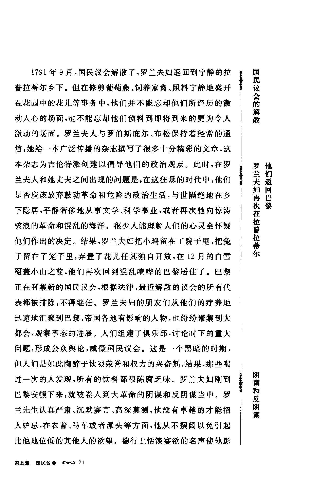

<small><a href="images/pages/083.png">原书第72页 · PDF 第83页 · 查看原页</a></small>

响很大，沉默寡言赋予他一种神秘的智慧。因此，没有人畏惧他作为竞争对手，于是，他被慨然推向人前，成了无异议的政党领袖，所有人都希望通过他来促进自己的利益。在美国，他就是我们所说的合格候选人。相反，罗兰夫人则充满活力、才华横溢，人们普遍仰慕她的才华。她勇敢的建议、敏锐的劝告、机智的应答、偶尔使用的尖锐讽刺、深沉热烈的仁慈、持之以恒的乐观、诚挚热忱的博爱、无人能及的出色口才，都使她成为由最聪明的知识分子所组成的一个圈子的中心。那时候，韦尼奥（Vergniaud）、佩蒂翁（Petion）、布里索（Brissot）和其他一些人还相对不出名，但他们的声望在文化界广为传颂，都对罗兰夫人很尊敬。

法国大革命的幽灵仍旧迈着巨大的步伐前进，已被摧毁的王权在人民起义的加倍打击下震颤不已，大屠杀在整个王国盛行，火光夜夜照亮着天空。贵族抛弃了财产，从危险和死亡之中逃亡到驻扎在科布伦茨的侨民军队中避难。受到侮辱并且已是囚徒的国王只在名义上进行统治。在这种形势下，路易十六被迫解散现行的政府，组建另一个更为人民所接受的政府。国王希望，通过组建一个共和派政府来平息民主派的情绪。而这样一来，除了退位，他没有其他路可走。

对国王来说，这是要他喝下的一杯苦酒。他那骄傲而又勇敢的皇后宣称，她宁可死也不愿投到共和派的怀抱里寻求保护。国王屈从了王后的压力，把他的部长们解职了，投向了吉伦特派，以任命新一届政府。吉伦特派恳请罗兰先生担任最重要的内政部长职位。这是一个充满危险的职位，但什么雄心不面对危险呢？在当时的事态下，内政部长就是法国的君主。罗兰先生那不显眼的、隐匿的雄心一直为成功所滋养着，此刻，他微笑地看着主动送到手中的权力，有些紧张。现在，罗兰夫人的全部热情都用来把她的丈夫推向伟大的巅峰。因为荣耀，她很高兴；因为危险，她也很不安。但是，对她那高尚的精神来说，面临的危险越大，所做的行为也就越英勇。她说道：“虽然担子很重，但罗兰先生对他自己的力量有清楚的认识，他源源不断的力量源于对自由和国家有益的情感。”

原页对照（含插图与旁注）
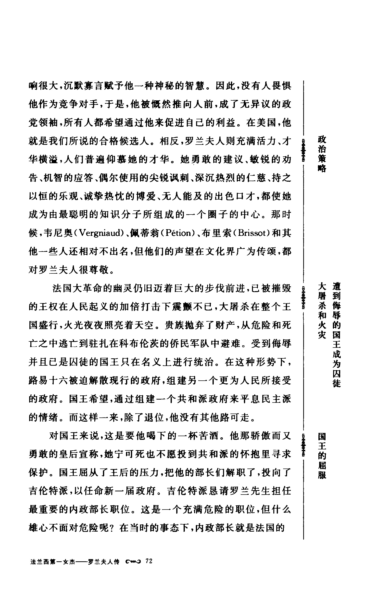

<small><a href="images/pages/084.png">原书第73页 · PDF 第84页 · 查看原页</a></small>

1792年3月，罗兰先生就任他那艰巨而崇高的职位。分配给罗兰夫妇使用的府邸是先前为财政总管占据的宫殿，内克（Necker）①夫人在其荣耀时期把它装修得十分华丽。罗兰夫人进入这座宏伟的建筑，其显赫的社会地位高于最高贵的法国贵族，她以无人能及的优雅和尊贵开始履行她的地位所赋予的各项复杂职责。就这样，雅娜从孤独的、与书为伴的雕刻匠女儿的卑微地位上升为富丽堂皇的贵族宫殿的女主人，与政治家和亲王们结交来往。

当罗兰先生作为皇家主人的部长首次在宫廷中亮相时，他没有穿戴历代习俗所要求的宫廷服装。在衣着上，他喜欢朴素简洁的原则。他希望，虽然他在高位，但看起来仍是人民中的一员，他没有忘记富兰克林对法国所产生的印象—-在凡尔赛衣着华丽的人群中，共和主义者最朴素的穿着，令富兰克林感动。于是，他身着普通的黑外套，头戴一顶圆帽子，脚穿一双用丝带而非鞋带扣系上的脏鞋子出现在杜伊勒里宫。

<blockquote>
① 内克（1732-1804）：日内瓦金融家，在巴黎经营银行业多年。法国路易十六时期，先后任财政总监和财政大臣。——译者注
</blockquote>

原页对照（含插图与旁注）
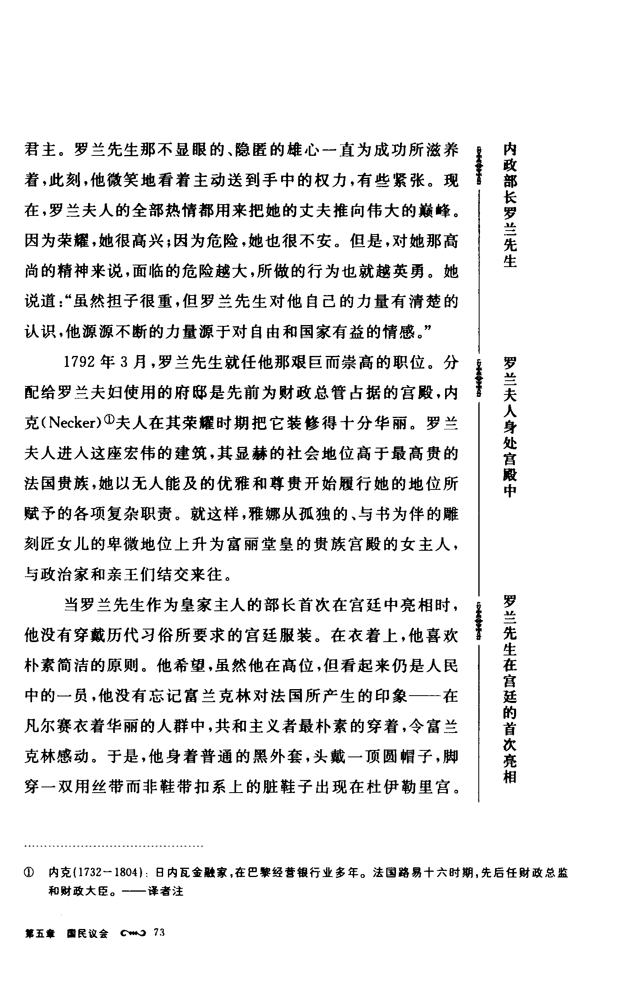

<small><a href="images/pages/085.png">原书第74页 · PDF 第85页 · 查看原页</a></small>

朝臣们很愤怒，国王也对罗兰先生的失礼行为十分不悦。典礼官很惊愕，带着骇异的表情向杜穆里埃（Damuriez）将军大声说：“亲爱的阁下，他的鞋子甚至不用鞋带扣系住！”这位将军也带着最可笑的故作严肃的表情大声说道：“宽恕我们吧！我们所有人都将一起毁灭！”

不过，国王因为面临给他带来重大压力的重大问题，很快忘记了礼仪的疏忽，他明白获取他的部长们的信任和亲善的重要性，于是，他带着十分亲切和安抚的态度与他们商议。在和国王的初次会晤中，罗兰先生为国王的卓越气质和爱国情操感到欣喜，返回府邸后，他向妻子宣告，总体上，公众对国王进行了错误的评价，国王是正在进行的改革的真诚朋友，是明显强加给他的宪法的诚恳支持者。罗兰夫人以她那特有的睿智迅速答道：“如果路易是宪法的真诚朋友，那么，他的德行必定在常人之上。罗兰先生，不要太相信你自己的德行，你只不过是一个游走于众多朝臣之中的诚实的乡下人——在众人的堕落之中，有德行是危险的。他们说着我们的语言，我们都不懂他们的语言。不！路易不可能喜爱束缚他的锁链，他可能在假装亲吻捆绑他的锁链，他仅仅在考虑如何才能一脚踢开它。倒下的伟人不会喜爱他的衰败，没有人喜欢自己的耻辱。相信人的本性吧，它们从不会欺骗我们。不要相信宫廷，你的德行太高尚，以至于看不见廷臣们在你脚下设置的陷阱。”

原页对照（含插图与旁注）
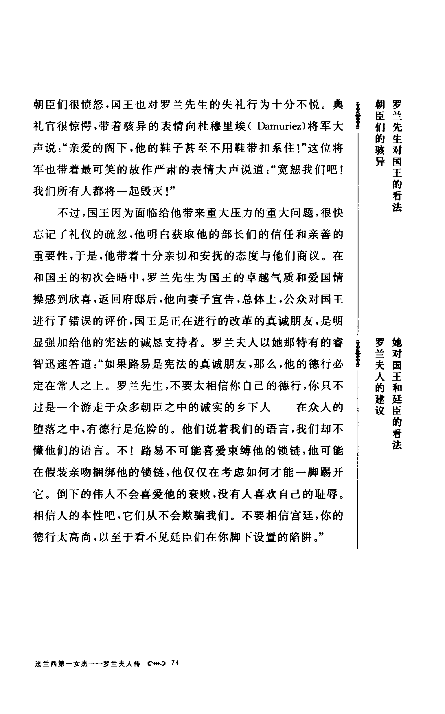

