# 第六章 罗兰内阁

<small><a href="images/pages/086.png">原书第75页 · PDF 第86页 · 查看原页</a></small>

1792年

原页对照（含插图与旁注）
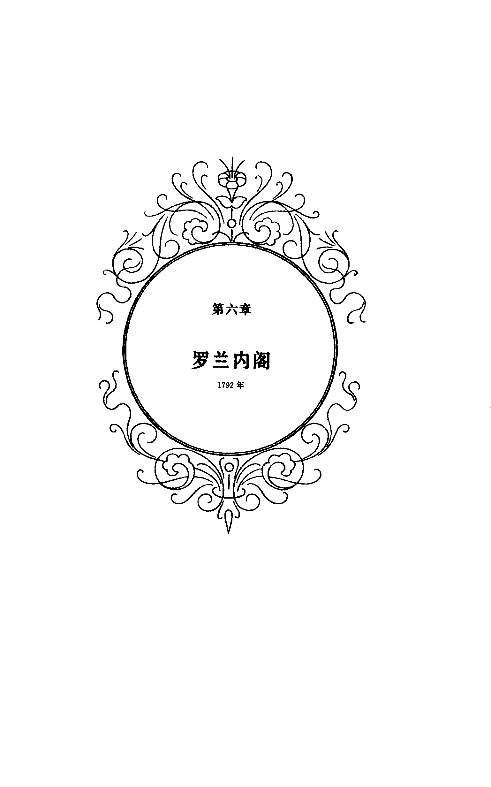

<small><a href="images/pages/087.png">原书第76页 · PDF 第87页 · 查看原页</a></small>

从分配给内政部长居住的宏伟官邸的所有宽敞房间中，罗兰夫人选择了一间相对小而且僻静的房间，用心装饰了一下，作为图书室和书房。这是她非常喜爱的一个僻静地。在这里，在妻子面前，罗兰先生习惯于和他的朋友们会面，进行机密交谈。因此，罗兰夫人不仅熟悉当时发生的所有重要事件，而且，她还和那些重大运动中的主角们结下了亲密的个人交情。路易十六采取了摇摆不定的政策，他努力调和每个党派的结果是失去了所有派别的信任和支持。吉伦特派预见到国王和所有的政府机构可能面临的危险，非常希望能说服国王放弃这些错误的措施，坚定公开地支持已经进行的改革。他们感觉到，如果国王能够积极支持吉伦特派所采取的立场，对他自己和整个国家都将是安全的。这个时候，吉伦特派希望维持王权，但他们希望限制它的权力，用共和主义的自由制度圈住它。虽然极有主见、精力充沛、野心勃勃的王后怂恿着国王，由于面临着来自民众的压力，国王还是迟缓地、不情愿地逐条屈从了，同时，他一直希望事态能有一些变化，使他能够恢复失去的权力。

吉伦特派的处境开始越来越危险。盘踞在科布伦茨的贵族侨民军队，在普鲁士国王的统领下，人数正迅速增加。和欧洲所有强大王权结成同盟的弗雷德里希（Frederic）①正率领着锐不可当的军队向巴黎进军，扬言要恢复国王失去的权威，向革命领导人实行严厉的复仇。在法国，有数十万地位显赫的人和富人，都加入了这支军队。

原页对照（含插图与旁注）
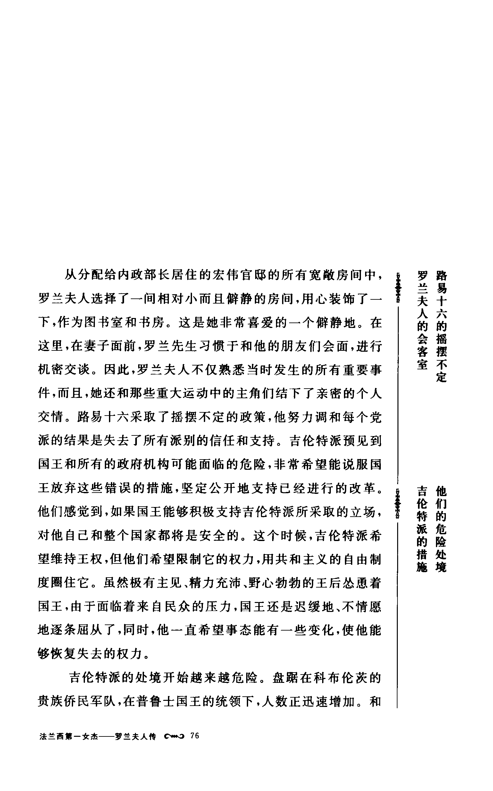

<small><a href="images/pages/088.png">原书第77页 · PDF 第88页 · 查看原页</a></small>

罗马天主教的教士全体无例外地，把其精神权威的全部影响力都给予了这支军队。每时每刻，巴黎都被侵略军队逼近的谣言搅动着，人们都认为路易十六希望从巴黎逃走，去领导侵略军队。国王对自己的计划垂头丧气、优柔寡断、摇摆不定。玛丽 •安托瓦内特则愿意赴汤蹈火，把军队集结到她的旗下。这就是在保皇派方面，吉伦特派所面临的形势。吉伦特派准备采取最积极的措施击退武装联军的干涉。

在另一方面，吉伦特派看到，另一个嘈杂、吵闹、狂暴的派别正在涌现，扬言要不惜任何方式破坏与可憎的王权有关的一切。这个出现于社会最底层、要把地位高于他们的所有阶层都打翻的新派别，由病态、饥饿、野蛮、不顾后果的人组成，它的旗帜之下集结着所有堕落的、放荡的人们。这些人把自己称作人民，他们是刚勇好战的渔家女人，有着魔鬼面孔和心肠、在非正常环境中成长起来的男孩们，无家可归居住在巴黎阴沟处的男人和女孩们，人数的众多增强着这个派别的力量。无论什么时候，这些人都很高兴党派的领导人召唤他们。这就是雅各宾派。

对于这些突然出现在面前的神秘异象，和要颠覆人类一

<blockquote>
① 弗雷德里希：普鲁土国王（1786—1797）。——译者注
</blockquote>

原页对照（含插图与旁注）
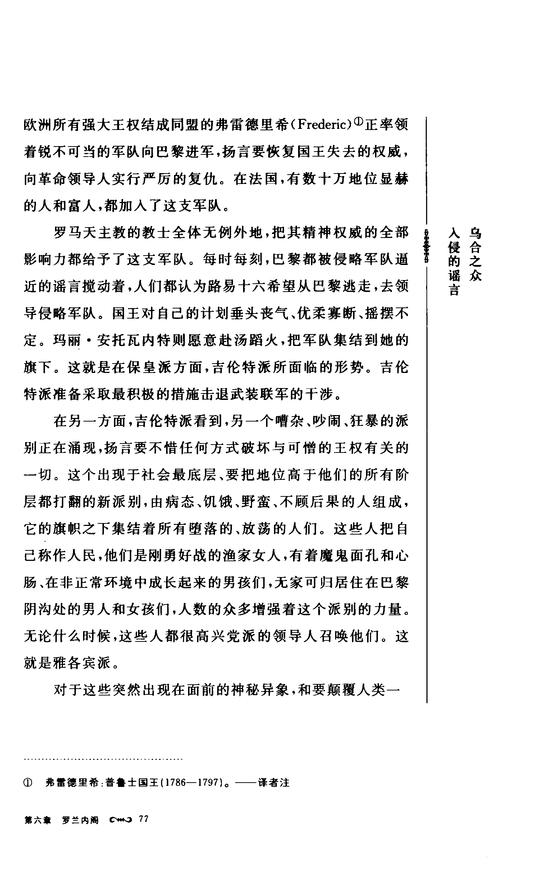

<small><a href="images/pages/089.png">原书第78页 · PDF 第89页 · 查看原页</a></small>

切差别的大声叫嚷，吉伦特派战栗了。最卑贱、堕落的臣民已经从国王的头上取下、掠走王冠。吉伦特派通过罗兰夫人，催促内政部长要求国王立刻宣布对国外军队和他们的支持者开战，催促他也应该颁布一条针对不支持革命措施的天主教教士的法令。确实，对国王来说，这是令他难以下咽的一杯苦酒。路易宣布，他宁可死也不签署这样的法令。在暴徒中出现了放火和屠杀。民众造成的压力是如此大，为了保存吉伦特派和保护国王的安全，看来绝对有必要采取果断措施。吉伦特派敦促罗兰先生给国王星上一封最真诚的劝谏信。罗兰夫人坐在书桌前，替丈夫写这封信，她运用熟练掌握的热情洋溢的风格表达了这封信，对正逼近的危险的忧虑感染了她热诚的言辞。罗兰先生为信中的言辞所打动，可考虑到言辞的大胆和真诚，却相当害怕。罗兰先生把这封信呈给了国王。信中最后的段落能够给我们展现出这封信的一些思想特征：

“您热爱、服务于革命，人民才会同您一样热爱革命、服务于革命。因为所面临的危险，巴黎正处于动荡之中。请罢免煽动各省叛乱的教士！请批准消除人民狂热的措施！请在巴黎的城墙四周设立防卫军队！如果再拖延下去，您就会被认为是敌军的同谋者和帮凶。上帝啊！您让国王们都双目失明了吗？我知道在君王面前，实情罕受欢迎，我也知道，向国王们隐瞒实情常常使革命成为必然。我作为一名公民，一位部长，我认为自己有责任向国王陈述实情，任何东西都不能阻拦我把实情传达到国王的耳朵中。”

信中的建议让这位软弱无力的君王极为不快，但是，采纳所推荐的方案显然是国王避免毁灭的唯一机会。

原页对照（含插图与旁注）
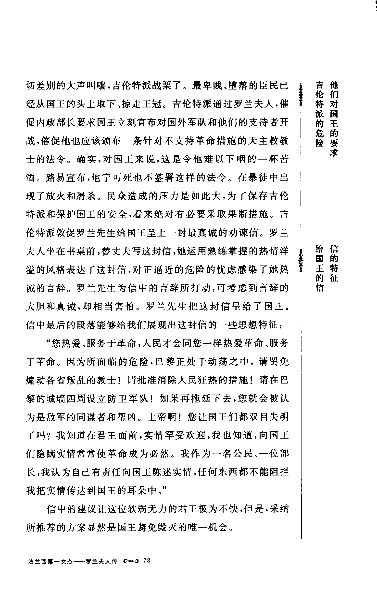

<small><a href="images/pages/090.png">原书第79页 · PDF 第90页 · 查看原页</a></small>

对于国王拒绝签署针对王权的坚定支持者的法令，我们敬重他的宽宏大量。我们也敬重那些正为建立公民自由和宗教自由而与专制权力作斗争的人们。当我们想到国王和他蒙难的家族，对他们的不幸，我们的同情油然而生，我们会谴责这封信是如此苛刻无情；而当我们想到世世代代的法国人民被碾压进贫穷卑微中，我们又高兴听到这种严厉严正的事实传入王族的耳中。然而，就罗兰夫人的这封信来说，与其说是她彰显的女性魅力吸引了我们，不如说是她了不起的才能令我们心生敬佩。1792年6月11日，这封著名的信被呈递给国王。在同一天，罗兰先生便接到了国王告知他被免职的信函。人们情不自禁为国王展示自己的精神和自尊而喝彩，若是他展示了这种力量，他至少死得更荣耀。

但是，就像无畏的部长夫人指示把这封信交给国王一样，我们也不用怀疑是国王专横的王后下令在回信中解除部长的职位。玛丽•安托瓦内特和罗兰夫人的交手就像希腊人和希腊人交手一样。

“我被免职了。”罗兰先生回到家中，对妻子喊道。

“把你的信在国民议会上公开，这样，国民就会看到你是因为什么建议而被解职。”勇敢无畏的妻子回答道。

罗兰先生这样做了，于是，他被视为爱国主义的一个殉难者。这封信在热烈的掌声中念完，被要求印刷几万份，传播到王国的83个省份。从这些省份中，会产生击退首都最狂躁的愤怒和欢呼的回响。整个法国传阅了这封著名的信，不，是更大的范围，整个欧洲都传阅了这封信。罗兰成了英雄，无数的喝彩传入失败的部长耳中，同时，无数的诅咒也愈发响亮、不祥地响彻在摇摇欲坠的王权周围。到目前为止，罗兰夫人的这一打击，是法国王权所遭到的最沉重的一击。

原页对照（含插图与旁注）
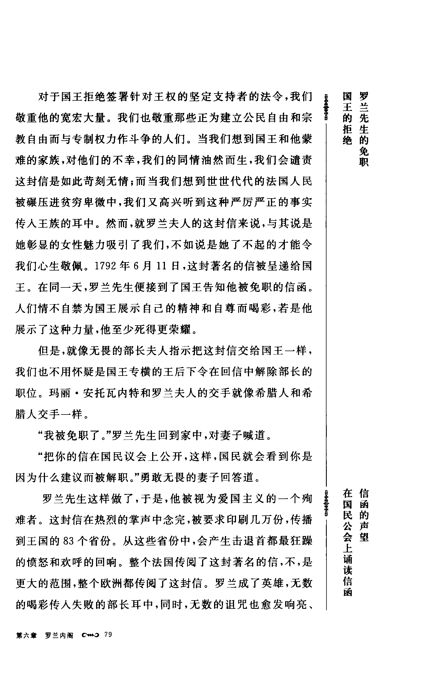

<small><a href="images/pages/091.png">原书第80页 · PDF 第91页 · 查看原页</a></small>

罗兰夫人是如此喜欢担任女英雄的角色，她一点也没有因为挫折感到沮丧，尽管挫折在权力扩大的时刻到来。在受到热烈欢迎的浪潮中，罗兰夫人和丈夫从宏伟的宫殿撤出，他们在那儿居住的时间如此短暂。带着些许可以原谅的夸耀，他们在骚动的首都一条很不起眼的街道上，选择了一处非常简陋的公寓作为隐退之所，这是一位哲学家为其幽暗的阁楼引以为豪的一处隐居之所。但现在，罗兰先生和妻子比以往任何时候都强大有力。这封著名的信把他们推到了改革支持者的前列，并被总是变幻无常的民众铭记在心中，甚至雅各宾派也被迫发出普遍的赞美声。罗兰先生的公寓总是挤满了人。所有重要的方案在提交给国民议会之前，都要经过罗兰先生和妻子的讨论和定夺。

在巴黎，当时有位名叫巴巴鲁（Barbaroux）的年轻政治家，他英俊非凡，才智过人，挺拔的身材和有点忧郁的出众容貌使他具有一种特别的吸引力。他和罗兰夫人结下了十分纯洁深厚的友谊。一天，在一个讨论时局危急问题的社交会上，他和罗兰夫妇坐在一起，被免职的部长向他说道：“做什么来拯救法国呢？我们没有可以依靠的军队抵制人侵。除非我们能够避免宫廷的阴谋，不然我们已经取得的成果都要失去。在六周内，奥地利人将会到达巴黎，我们对这场最光荣的革命奋斗了很多年，难道那时候看着它一天之内被颠覆吗？如果自由在法兰西死亡，那么全人类将永远失去自由。所有乐观的希望都是骗人的，偏见和暴政将再次统治世界。让我们阻止这些灾难吧！如果专制的军队践踏到法国北部，让我们撤退到南方各省，在那里建立一个自由民的共和国。”

原页对照（含插图与旁注）
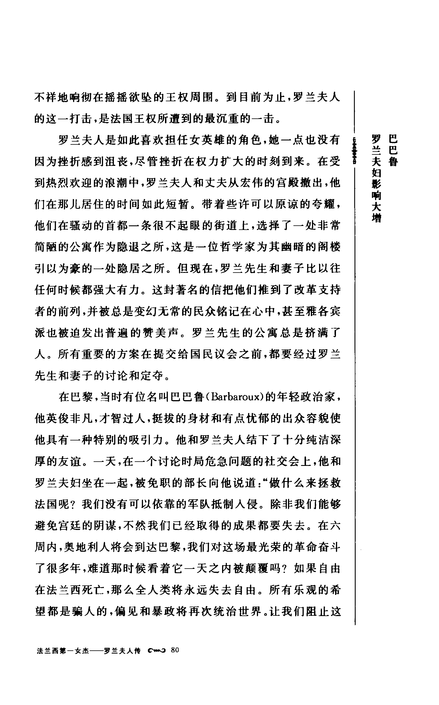

<small><a href="images/pages/092.png">原书第81页 · PDF 第92页 · 查看原页</a></small>

当罗兰的妻子听到这种大胆的提议时，泪水在她眼睛里打转，这种思想如此地不同寻常，如此地充满风险，它需要自我牺牲和献身的奇人。罗兰夫人也许原先向丈夫建议过这种思想，并用她全部的热情极力主张这种思想。巴巴鲁恰恰正是这样一个人：他的全部精神都为这样一种伟大的事业所鼓舞着。他拿起地图，迅速在南部勾勒出一幅寄托自由和希望的草图，他描绘着共和国的版图，从杜河、艾尔河、隆河，到多尔多涅河；从难以攀登的奥弗山脉，到迪朗斯河和海边。深深的喜悦浮现在三个人的脸上，就这样，他们私下所首创的一个计划，将以地震般的威力，使欧洲的每个王权都摇摇欲坠，直至震撼到基督教世界的中心。巴巴鲁深深铭记着事业的伟大感和危险性，离开了罗兰夫妇，他对一个朋友评价他们：“在当代的所有人中，依我看来，罗兰最类似于加图（Cato）①，但必须承认，他的勇气和才能应归功于他的妻子。”在此之前，吉伦特派一直希望保存王权，只用自由的制度圈住它，他们把英国的政府体制作为他们的模范。而从这一天起，吉伦特派免除了对国王的责任，他们在罗兰夫人的会客室里秘密商议，要在讲坛上制造舆论，要彻底推翻君主制度，建立像美国那样的共和国。他们同雅各宾派展开了比赛，努力看谁能给予王权最沉重的打击。这是一场生与死的斗争。人侵军队的胜利将会

<blockquote>
① 加图（前234年一前149年）：罗马共和国时期的政治象、国务活动家、演说家，以恪守美德著名。—一译者注
</blockquote>

原页对照（含插图与旁注）
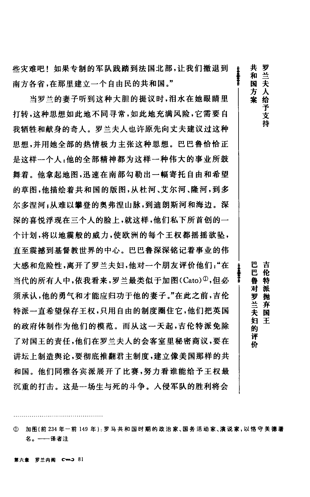

<small><a href="images/pages/093.png">原书第82页 · PDF 第93页 · 查看原页</a></small>

对和革命运动相关的一切事物造成绝对性的毁灭。可以这么说，对摧毁波旁王朝的专制主义，或许罗兰夫人的头脑比其他任何人都发挥了更强更有力的影响。

罗兰夫人对吉伦特派发挥的影响是诸如男人所不能发挥的。她胸怀磊落，毫无轻率之嫌，行为无可指责。她也不可能对聚集在她周围的人们的敬意和爱慕毫无感觉。比佐（Buzot）爱恋着罗兰夫人，把她视为最能鼓舞心灵的崇拜对象。罗兰夫人不知不觉地俘获了他的全部身心，成为他的整个世界。这个不可抑制的销魂秘密一直隐藏到罗兰夫人死亡。在那个时候，她披露了这个秘密，透露出很少人能够理解的神秘的思想冲突。她这样写比佐：“他敏感、热情、忧郁，好像生来就是要带给人快乐和分享快乐。在亲切的私德中，这个人会忘记整个世界。他拥有崇高的动力和持久的感情，那些喜欢贬低自己所无之物的粗俗者指责他是一个梦想家。他容貌英俊、外表文雅，永远用精心、整洁、合体的衣着展示着对自己和他人的尊重。当这个国家的渣滓把人民中的阿谀奉承者和腐败者抬到高位—为获得人民亲善，凶狠地发誓、喝酒、穿着破烂时，比佐仍保持着苏格拉底的道德，保持着西庇阿（Scipio）①的正派得体。于是，他们摧毁了他的房子，像他们对阿里斯提得斯曾经做过的那样将他流放。令我惊讶的是，他们竟然没有颁布应该忘记他名字的法令。”

这些话是罗兰夫人在临刑之前的夜晚写于地牢之中的。

<blockquote>
① 西底阿（前236一前184/183年），古罗马统帅和政治家，生于贵族家庭。——译者注
</blockquote>

原页对照（含插图与旁注）
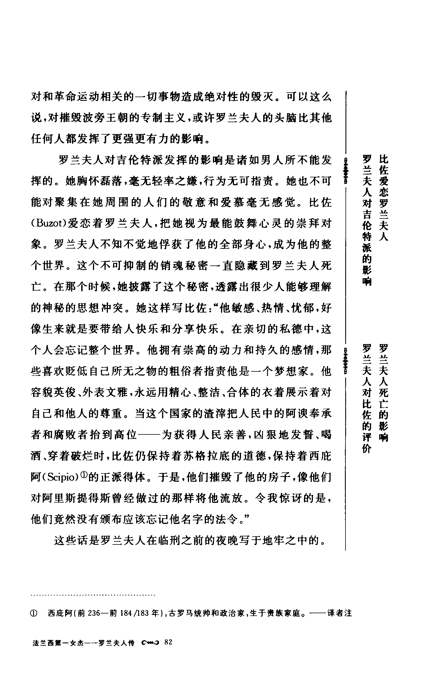

<small><a href="images/pages/094.png">原书第83页 · PDF 第94页 · 查看原页</a></small>

那时，比佐是逃亡者，正被冷酷无情的暴徒追击，他躲藏在圣埃米利奥山的山洞中，当罗兰夫人死亡的消息传来，他像被闪电击中，跌倒在地上。在很多天里，他一直处于疯狂之中，再也没有恢复快乐。

现在，丹东（Danton）出现在罗兰夫人的沙龙里。他身材高大，头发蓬乱，声音洪亮，他蜷伏在有思想的女主人脚下。这个被察觉到很聪敏的人很快将成为权力的参与者。一看到丹东，罗兰夫人便意识到了他的非凡才干，意识到他对共和事业能给予重大帮助。罗兰夫人希望能贏得丹东的合作，起先她试图安抚他，“如同一个女人抚拍一头狮子”。但很快，确信丹东冷酷无情和根本没有原则之后，她厌增地放弃了他。后来，丹东再三努力，以恢复她对自己的好感，但都无济于事。每时每刻，巴黎和整个法国都在上演着新的暴乱场景。罗兰先生是民族的偶像，那封著名的信是全体敬仰的对象，反对罗兰被免职的疾呼声如雷鸣般冲人国王的耳朵。在法国各地，革命的狂热火势发出强烈的光芒，在这种举动的煽动下，火势愈发旺盛。权力的发现令民众兴奋发狂，他们抱着毁灭、流血的渴望，正在列队准备与国王、宫廷和贵族战斗。关押在杜伊勒里宫的王室人员，每天都要喝下底层渣滓羞辱他们的酒。

奥地利和普鲁士联合了科布伦茨的侨民军，准备进军巴婺，恢复国王的王位。骚动、恐怖、狂热蔓延到每个人心中，不计其数的妇女、男孩、病态饥饿的男人聚集在巴黎街头，反对国王和贵族的演说令他们愤怒发狂。他们涌到杜伊勒里宫的所有街道上，闯进每扇大门，翻过每堵墻，冲进屋门，砸破窗户，说着淫秽下流的话，在所有的王室圣地胡作非为。他们把雅各宾主义的脏红帽强戴到国王的头上，把最令人厌恶、最狠毒的诅咒灌进受到侮辱的王后耳中。路易十六除了召回罗兰先生，别无希望——保皇派不能给他任何保护，雅各宾派则利用蝗虫般的民众凌驾在他头上，只有罗兰先生可以带领着吉伦特派，能够在王权和暴民之间形成一个庇护之所。在平静的胜利中，罗兰先生被召回，再次从幽暗的住所搬到了富丽堂皇的部长府邸。如果说，是罗兰夫人的信使他免职，但也正是她的信以巨大的威力使他再次官复原职。

原页对照（含插图与旁注）
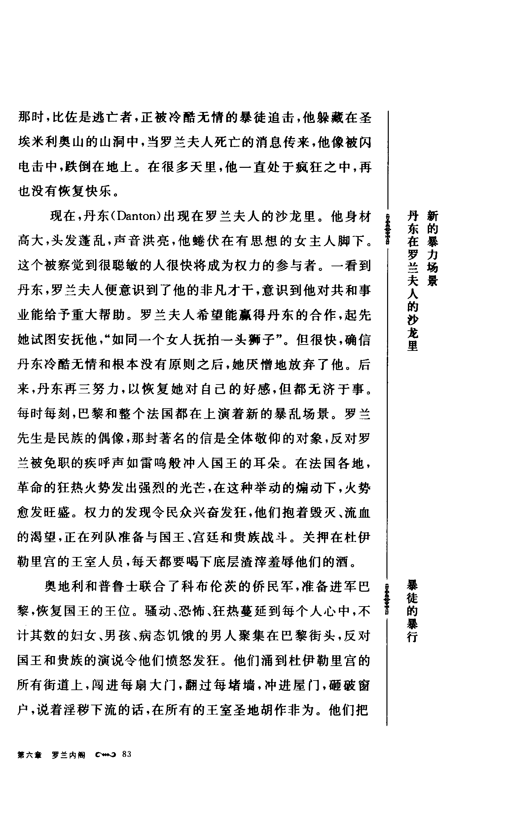

<small><a href="images/pages/095.png">原书第84页 · PDF 第95页 · 查看原页</a></small>

罗兰的位置并不令人羡慕，虽然位高权重，影响巨大，但也充满了复杂、辛苦和危险。革命的幽灵四处游荡，没有任何世俗的力量能够阻止，无法阻挡的革命洪流要推翻一切不能顺其势头的人，已经不可避免。罗兰夫人比丈夫更清醒地认识到危险，她怀着强烈的情感，冷静而坚定地注视着正在涌起的风暴。她积极选择的生活方式显示了她奇特的个性和伟大的道德勇气。从低微的身份上升到如此显赫的高位，有地位、有财富的人们奉承地围在身边。对此，她完全没有眩晕，而是决心把全副精力都献给动乱时代的需要，她不愿把时间浪费在流行的派对和缺乏同情的慰问上。她说：“我对学习和研究的热爱如同我对打牌的憎恶一样强烈，同愚蠢之人交往，我感觉不到任何快乐。”一周两次，她设宴招待内阁成员和其他在政治生活中有影响的人们，她的丈夫希望与这些人交流沟通。罗兰夫妇所在的宫殿被先前的使用者装修得极富东方的奢华。

像从前一样，罗兰夫人选择了最小的一间屋供自己使用，她把小房间布置为自己的书房。她住在那儿，沉浸在学习研

原页对照（含插图与旁注）
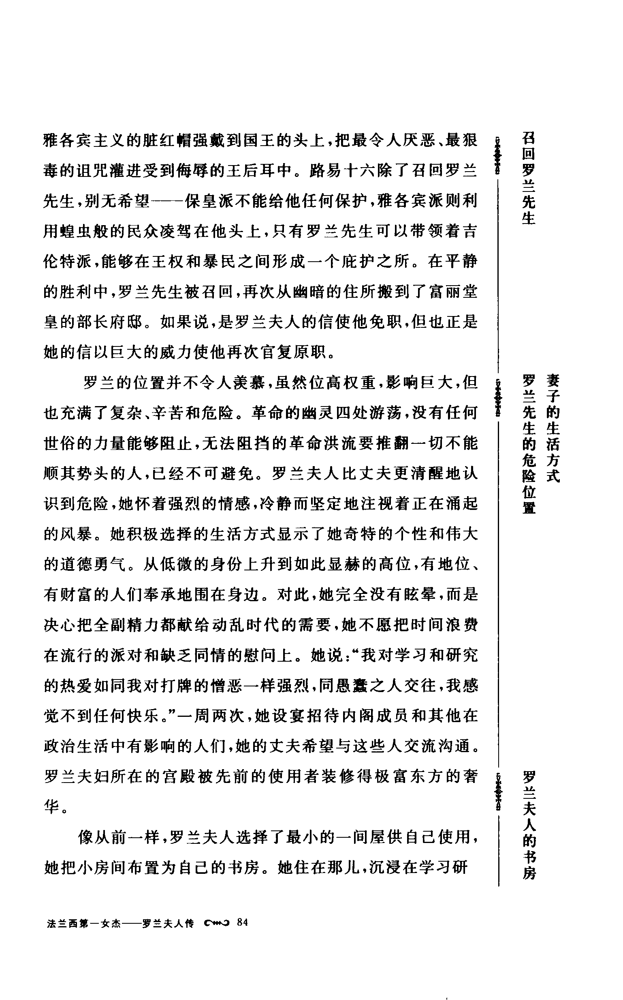

<small><a href="images/pages/096.png">原书第85页 · PDF 第96页 · 查看原页</a></small>

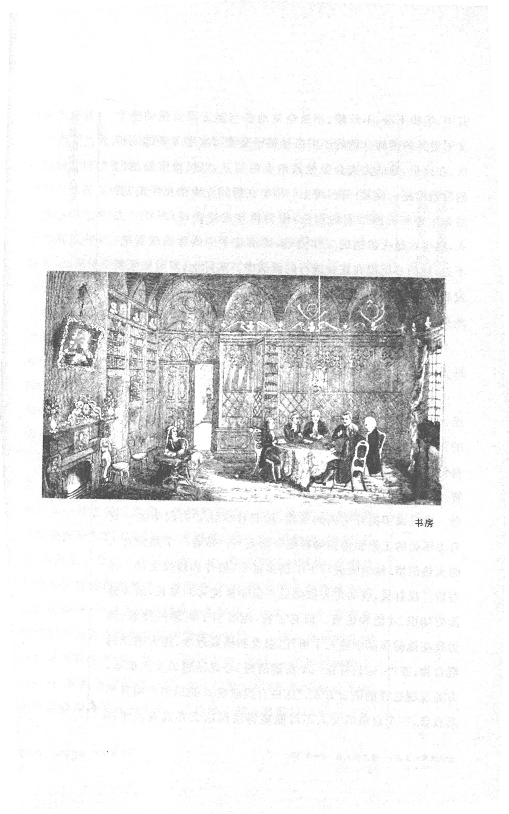

<small><a href="images/pages/097.png">原书第86页 · PDF 第97页 · 查看原页</a></small>

究中，笔耕不辍，不炫耀、不被察觉地参与制定简直搅动整个文明世界的措施。她的小书房是秘密交流国家事务者的庇护所，在这里，她的丈夫会见他政治上的朋友，以慎重实施他们的政治措施。夜复一夜，绅士们围坐在房间正中的桌子前，罗兰先生蹙着沉静思索的眉头，作为领导主持会议，而罗兰夫人，则坐在她火炉边的工作台前，忙活着手中的针线或者笔，不过，她的心沉浸在正在进行的谈话中。实际上，罗兰先生所发表的看法，只不过是重述在先前的讨论中罗兰夫人灌输到他头脑中的那些观点。

一个有着罗兰夫人这般热情生动的想象力的人，意识到巨大的权力，很可能时不时地感觉到精神上的狂喜。

从宫殿的窗户中，罗兰夫人俯瞰着工匠们的店铺，在那里，她度过了幼年。那时，她走在尘土飞扬的街道上，而骄傲的贵族荣耀地在她身边掠过。现在，贵族正恳求地期待那个身份低微的孩子，给他们一个微笑。罗兰夫人拥有罕见的机智，这使她常常引导着政治举措的制定进程，而不用露面去做。她只渴望提升丈夫的荣耀，没有什么比丈夫因为她一直努力所做的工作而得到喝彩更令她高兴。带着一个热情女人的火热激情，她为丈夫写下了很多宣令、信件和政府文件。她写道：“没有我，我的丈夫依然是一位非常优秀的部长，因为他拥有知识、才能和正直。但有了我，他吸引了更多的注意，因为我在他的作品中输入了勇气、温柔和权威理性、迷人感情的混合物，或许，这只有在一个头脑清楚、心灵敏感的女人那里，方能发现这样的语言方式。”这种自我欣赏式的坦率声明并不是自负，一个自负的女人不可能赢得法国这么多高尚人士的

原页对照（含插图与旁注）
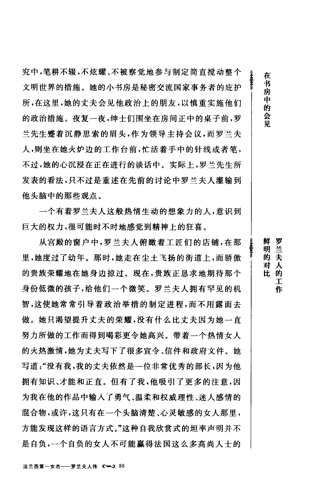

<small><a href="images/pages/098.png">原书第87页 · PDF 第98页 · 查看原页</a></small>

热爱和尊敬。

当罗兰夫人思索着令人惊奇的生活变化，思索着她现在占据的特殊位置时，这时候，发生了一件奇怪的事情，这件事情有力地甚至可笑地冲击着她的心灵。在罗马，教皇关押了一些法国艺术家。法国执行委员会想对教皇表示抗议，并要求释放艺术家。罗兰夫人坐下来写这封信，威胁严厉、威严的教皇，如果他拒绝遵照请求办理，将对他实施严厉的报复。在书房里，当她准备给教皇国、天主教会的首领写信时，她停下了手中的笔，想起了自己的地位，仅在几年前，她还是一个卑微的雕刻匠的女儿。她回想起她在修道院中对教皇敬畏、爱慕的迷信情感，当时她认为教皇几乎仅次于上帝，甚至几乎等同于上帝。带着一股不矫揉造作的意识力量的尊严，她审阅着给教皇信中的一些重要段落。这种对比是如此惊人，让她感到如此荒唐可笑，以致她爆发出一阵难以克制的大笑。

当雅娜还是一个17岁的羞怯少女时，她曾和她的姑姑去一个地位高贵十分富有的贵族家，在那儿，她和姑姑受到了和仆人一起进餐的邀请。雅娜骄傲的心大受动，她表情激动地坐在仆人们的餐厅中，在那儿，招待员、男管家、厨师、仆役、男侍从以及夫人小姐的女仆们，穿着俗气的服装，呈现出最令人厌恶的自大神态。她回家了，心中充满了对贵族和仆役们的鄙视，怀着新的渴望梦想着罗马共和国。一天，有权有势的罗兰夫人正从她那富丽堂皇的餐厅———她一直在那儿招待着帝国最著名的人物—到画室去，这时，一个年老的绅士走过来，在她面前深鞠一躬，非常的卑躬屈膝，恳请她给予将他引荐给内政部长的荣幸。这位绅士就是奥德里（Haudry）先生，雅娜就是被邀请和他的仆人们一起进餐。这个曾经骄傲的贵族，在大革命的摧毁下，已经失去了地位和财富，现在看着罗兰夫人的地位远高于他，就像以前他的地位远远在她之上一样。她回想起因贵族目中无人的傲慢而令她心灵蒙羞的许多场面，不由得感受到环境改变所给她带来的胜利。

原页对照（含插图与旁注）
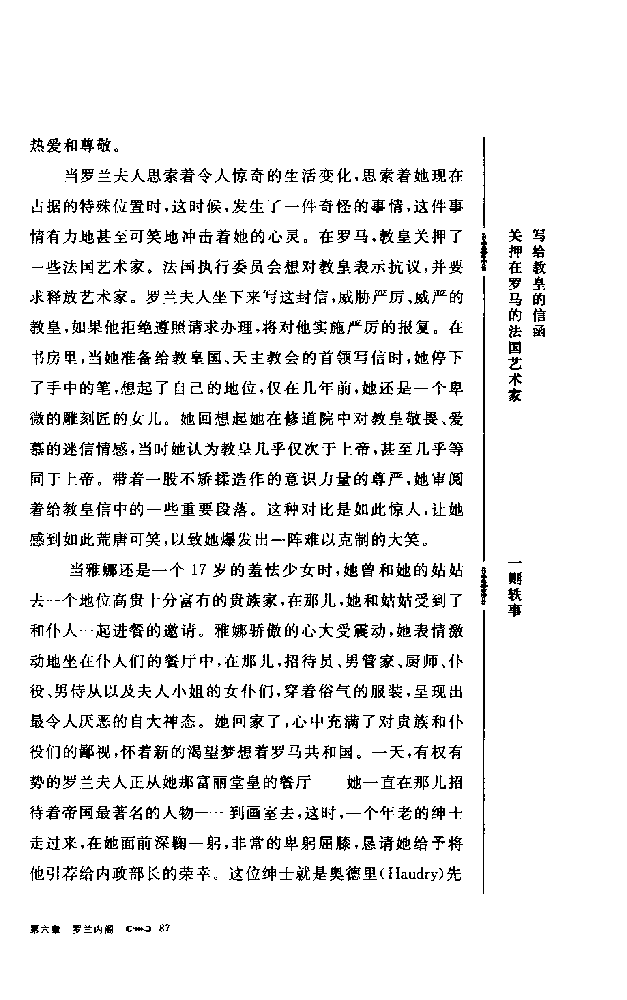

<small><a href="images/pages/099.png">原书第88页 · PDF 第99页 · 查看原页</a></small>

混乱在整个法国盛行，国王和王室人员被囚禁在圣殿里。现在立法议会已采用国民公会的名字。在国民公会中的吉伦特派和领导内阁的罗兰先生，正在尽力争取恢复法律的统治，如果有可能，就挽救下国王的性命。雅各宾派无法对抗深受欢迎的罗兰先生，曾经一度和吉伦特派合作，现在，开始再次与吉伦特派分道扬镳。他们迎合暴民，鼓励每一种无视法律的暴力行径，利用引人同情的粗俗粗野的外貌、语言、举止煽动着大众的激情，叫嚷着分配财产，处死国王。在声调语气上，日益大胆嚣张，他们宜称吉伦特派是国王的朋友，是大众自由的敌人。这股玷污民主的喧嚣浪潮，现在正以无可抵挡的巨浪涌现，丹东和罗伯斯庇尔正驾驭着这股可怕的力量。面对骇人听闻、病态发狂的卑劣和犯罪之幽灵，人性闭上了它的眼睛。正在涌现的风暴，根本无俗世的手臂可以阻挡，它发出的隆隆轰鸣声，重重落入欧洲人的耳朵中，基督教王国吃惊地看着从巴黎的地和阁楼中爆发的野蛮人侵景象。地位低下的受压迫的人类正准备为时代累积的不公正发起报复。王权被推翻了，关押在地牢中的王室家族饱受凌辱，衣衫褴褛，几乎要饿死。目前，民众普遍叫喊着成立共和国，在这种呼声中，雅各宾派和吉伦特派结成了联盟，但雅各宾派指责吉伦特派没有诚意，密谋恢复国王的王位。

原页对照（含插图与旁注）
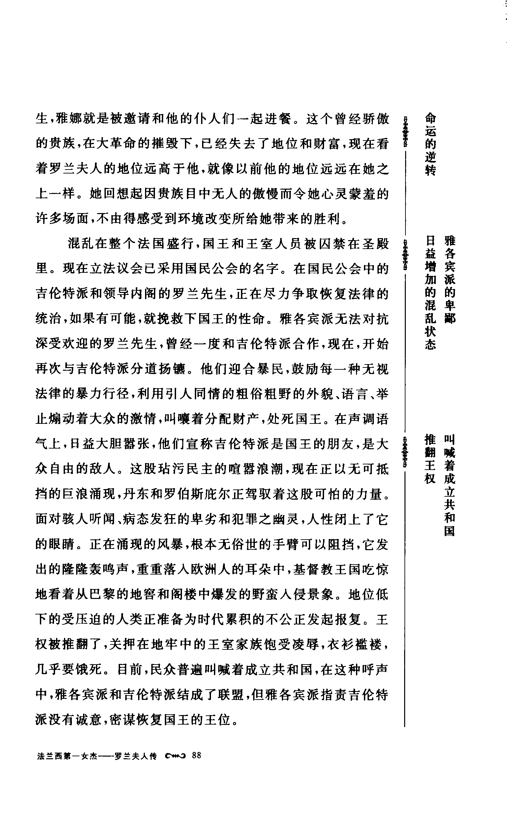

<small><a href="images/pages/100.png">原书第89页 · PDF 第100页 · 查看原页</a></small>

罗兰夫人以丈夫的名义，为国民公会起草了代替王权的共和国方案。从孩童时代起，她就渴望着一个自由纯洁的共和国，她为罗马人的理想美德着迷，在她生动的想象中，共和国消除了人类所有的腐败。虽然事实上废除了王权和世袭制，整个法国也大声呼吁成立共和国，她手中的笔也为国民公会提交了一个保障大众自由的宪法，但是，她内心却忧虑不已

-丈夫名义上是内政部长，可已经失去了权力。巴黎的暴民侵占了王位、宪法、法律的位置。雅各宾派正在取得决定性的优势。每日，法国最高尚公民的鲜血染红了断头台，对无罪者的大屠杀弄脏着大街和监狱。面对每天看到的恐怖景象，罗兰夫人的心退缩了。吉伦特派徒劳地抵制着这股将把他们都冲走的洪流。宣告共和国成立的时刻，罗兰夫人心中充满难以形容的喜悦。但现在，对她的祖国，她看不到一线希望，不可能恢复君主制，代之以共和国不可避免，世间没有力量能阻止共和国。可是，在这个共和国中，她只看见了共和国先驱的灭亡和她所珍视的一切事物的毁灭，她只看见了整个国家的混乱状态。

她心情沮丧地给朋友写信：“我们都处在罗伯斯庇尔和马拉（Marat）的刀口之下，你了解我对革命的热爱，现在我为之感到羞愧。妖魔玷污了革命，革命是丑恶的。”

原页对照（含插图与旁注）
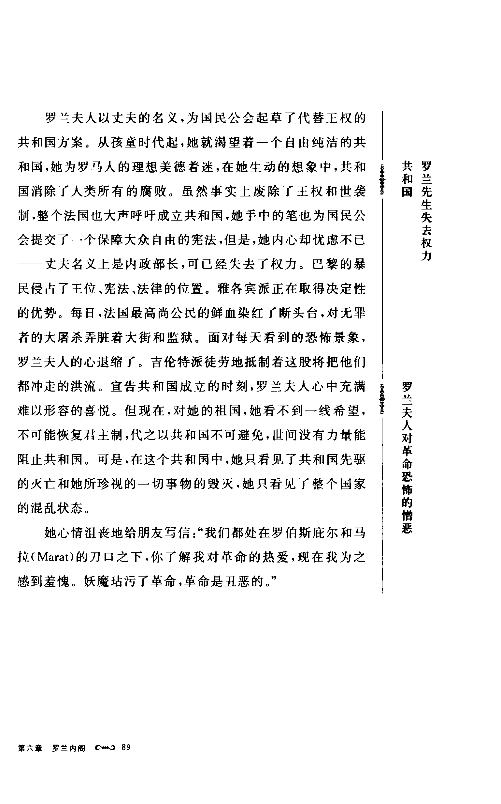

