# 第七章 罗兰夫人和雅各宾派

<small><a href="images/pages/101.png">原书第90页 · PDF 第101页 · 查看原页</a></small>

1792年

原页对照（含插图与旁注）
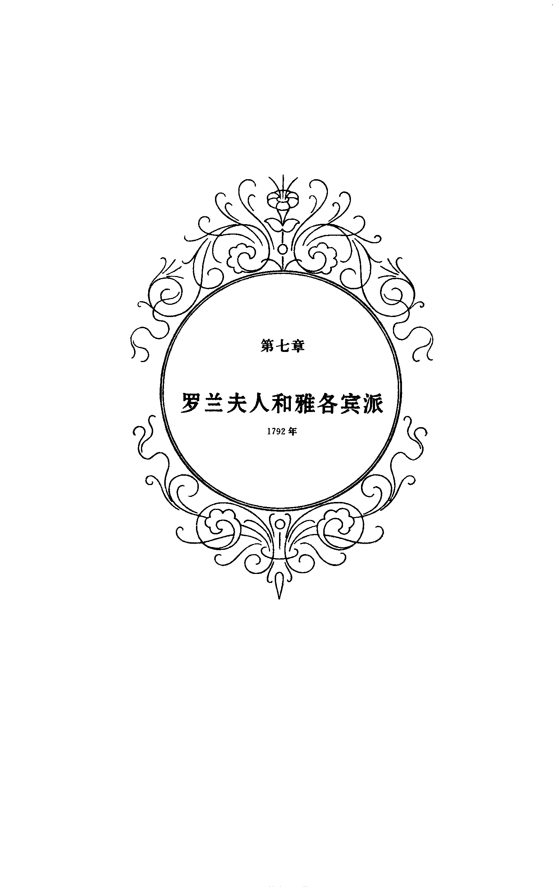

<small><a href="images/pages/102.png">原书第91页 · PDF 第102页 · 查看原页</a></small>

现在，普鲁士人正在向巴黎进军，来自联军的攻击炮火落在屋顶上，法国边境的城市相继向入侵者投降。在敌军的胜利面前，法国人在败退。乐观的希望在君主制度拥护者心中升起：普鲁士的炮火将会轰开囚禁国王和王室成员的圣殿铁门，将恢复被俘虏的国王的王位。考虑到所面临的危险，革命家们几乎发狂，他们知道巴黎有几万、整个法国有数十万十分富有、十分有影响力的人心怀着些微的成功希望，欢迎普鲁士人做他们的救星。因此，如果国王取得胜利，那么，革命运动的领导人将罪大至极，无望获得宽宥，死亡将是他们不可避免的命运。恐怖弥漫在首都中，巨大的危险把所有的革命派团结在一起共同御敌，连最有口才的吉伦特派领导人韦尼奥都对被困城市提及投降的市民提出了死亡法令。

午夜时分，国民公会口头通过了对付严重紧急情况的极其特殊、专制的措施。丹东大声疾呼：“我们必须唤醒全体法国人民！”这些呼喊声现在开始非常可怕地震动着欧洲人的耳朵：“把我们的侵略者统统打倒！巴黎的叛国者正准备加入我们的敌人，不管他们人数有多少，我们必须逮捕他们！危险迫在眉睫，必须迅速果断地采取防范措施。太阳升起的时候，我们必须搜查巴黎的每处处所，把那些我们担心加入国家敌人队伍中的人关押起来，即使他们的数量有三万人。”国民公会毫不迟疑地通过了法令。巴黎的大门将被锁上，任何人也不能逃脱出去；大街上杜绝马车行走；命令所有的公民都要留在家中；所有部门、法庭、俱乐部都要延缓开会，以免分散公众的注意力；在夜间，所有的住宅里都要灯火通明，以使搜查能有效进行；在武装士兵陪同下的委员们，以法律的名义进入每户住宅，每个公民都要展示自己所拥有的武器，如果任何东西引人怀疑，个人连同他的建筑都将遭受最严格的搜查。一个人哪怕进行最轻微的欺骗、拒绝或者不彻底坦白任何可疑的迹象，这个人都将被逮捕并监禁起来。一个人如果被发现不在自己家中，他将作为可疑对象被监禁起来。所有无人居住的房屋周围都布置了士兵守卫。在围墻周围布置有双重的士兵封锁线，以逮捕任何企图逃走的人。备有武力的船艇巡游在塞纳河上。在巴黎城的两端最远处，每一个可能的逃跑通道都被关闭。花园、小树林、公共散步场所，统统进行搜查。执行这项工作花费了很大的精力，可能预料到这种快速的行动会出现大批人死亡，于是，在当天夜里，革命者便派了一群工人带着火把和适当的工具，去打开了巴黎地下公墓的通道。

原页对照（含插图与旁注）
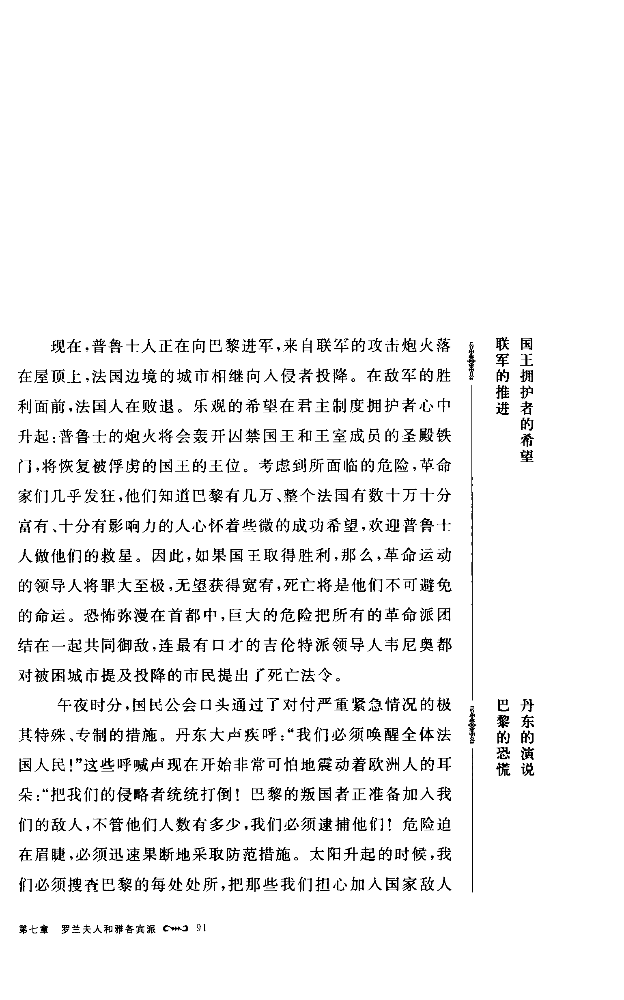

<small><a href="images/pages/103.png">原书第92页 · PDF 第103页 · 查看原页</a></small>

法令把恐怖传递到无数人心中，以闪电般的速度把恐怖扩散到巴黎的所有大街和住宅。每个表达过效忠国王观点的人、每个有侨民军或者保王派朋友的人、每个对革命的残暴发出过责难之词的人、每个继承有显赫名字的人、每个有不友善邻居或者有敌意仆人的人，都对厄运的迅速到来战栗不已。

用长枪武装起来的人群，加入到发自于社会渣滓那残忍、不可抵制的力量中，他们在战争乐曲的伴奏下，在大街上横冲直撞。当委员们敲门的时候，门内的家人因为恐惧而脸色苍白，不敢动弹，严厉的调查人对自己严于职守威通出来的痛苦，显得非常高兴，对那些文化上越优雅或者地位越高的家庭，权力的行使者就越粗野地践踏羞辱他们。权力的行使者搜查着为工人所熟悉的各种藏匿地，他们砸开锁，打开镶嵌板，割开床板床垫，撬开地板，试探深井，为找到秘门密道搜索着阁楼地窖。无论在哪栋房子中，只要他们发现一个人隐瞒了自己的情感，或者发现了生锈的枪支，发现了任何王室成员的老画像、与王室徽章有关的纽扣、一封来自可疑人物的信件，或者持有反对“恐怖统治”的观点，那么，这家的父亲就作为不适合同住的叛国者，立刻从家中、从妻儿身边被粗暴地拖走，带着强烈的耻辱，穿过街道，被迅速地关进监狱。这是巴黎的一个悲哀之夜。

原页对照（含插图与旁注）
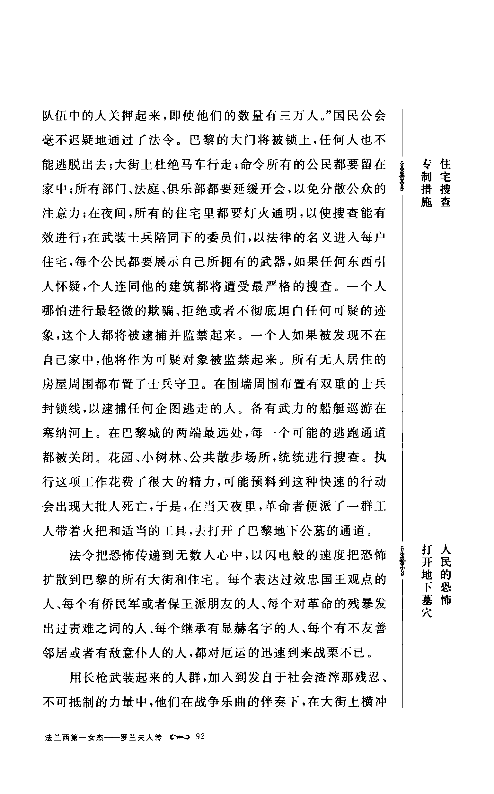

<small><a href="images/pages/104.png">原书第93页 · PDF 第104页 · 查看原页</a></small>

君主制的支持者很快发现躲藏无用。起先，他们爬进烟囱里，但很快，烟火便把他们熏烤了出来。他们躲藏在挂毯后面，但长毛和刺刀嘲弄地刺进了他们的身体。他们在地窖里挖了地洞躲进去，利用木桶、杂物、木头或者煤炭的遮盖试图瞒过搜捕者的眼睛，但狂热的革命者的机敏足以应对这些策略，他们把注定的失败者拖扯到灯光下。很多保王党人逃进了医院，在那儿的传染病房里，与死人和即將死的人躺在一起，但即使在那儿，他们也遭到了追击和逮捕。住宅搜查持续了三天，“整个城市就像一个囚犯，当把它搜查到时，便捆住了它的腿脚”。一万个可疑的人被逮捕关押进监狱，很多人在家中或者大街上被残杀，被不公正地逮捕的一些人，后来得到了释放。

原页对照（含插图与旁注）
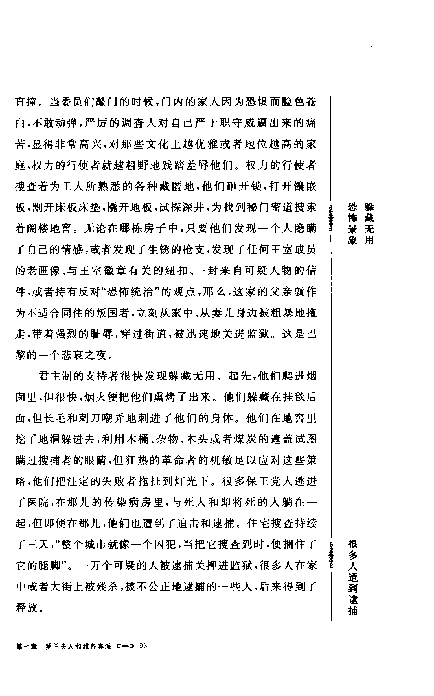

<small><a href="images/pages/105.png">原书第94页 · PDF 第105页 · 查看原页</a></small>

三十个教士被拖到了市政厅的一个房间中。每辆马车装六个人，五辆马车将把他们送往阿贝义监狱。当警枪发出马车启程的信号时，无数的暴民聚集在马车周围。窗户是打开的，民众能够看到这些他们认为的叛国者和他们认为准备加人侵略军的人，他们正耀武扬威地靠近马车。

暴民都越来越多，在混乱的人群中，马车困难地蠕行。马车两边响起了诅咒声，暴力的态势和威胁越来越多，当众多的男人、妇女和男孩子咆哮着来到一个十字路口时，马车竟然完全被挡住了去路，无法正常通行，停了下来。一个男人把他的衣袖卷到胳膊肘，手里拿着闪闪发光的马刀，强行闯过护送队，站到其中一辆马车的踏板上，一只手攀着车门，一而再再而二地把他的马刀刺进教士们的身体，哪儿有机会就刺向哪儿。他拔出鲜血染透的马刀，在人们面前挥舞着，人群中响起一阵可怕的呼喊声，于是他又把马刀刺向车内。然后，刺客转换到下一辆马车，再次向在马车内挣扎𨚫无法躲避、无法逃跑的教士进行同样的屠杀。就这样，他从一辆马车到另一辆马车，一直把所有的马车都刺遍，而武装的护送队则发出嘲讽的大笑看着这一切，疯狂的人群中响起残忍的得意呼喊。

骑马的护送士兵慢慢地为马车打开了一条通道，马车向前移动着，已经死去或者正在死去的同胞身上淌下的血流在公路上，标注着他们的行程。当他们到达监狱的时候，从马车的车板上，八具死尸被拖了下来，更多没有死去的人则是重伤，血块凝固。当咆哮在周围的狂潮退却的时候，可怜的受害人十分恐惧地被猛地抛人了监狱。

但是，监狱内的可怕场景比外面有过之而无不及。在通向监狱院子的宽敞大厅里，十二个男人坐在一张大桌子周围，他们发达健壮的四肢、粗俗残忍的面容显示出他们熟悉放荡和屠杀。他们穿着社会最底层人的服装，头上戴着毛线帽，卷着衣袖，围系着屠夫的围裙，丝毫不为身上的衬衫或者外套感到难为情。桌子的最前面坐着马亚尔（Maillard）—当时嗜杀的巴黎暴民的偶像。这些人组成了一个自作决定的法庭，对带到他们面前的人，判决他们活着或者即刻死亡。

原页对照（含插图与旁注）
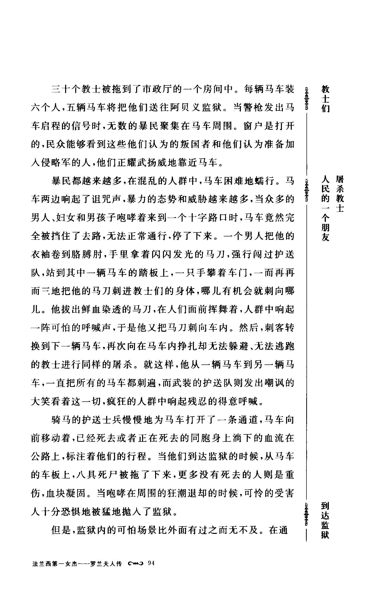

<small><a href="images/pages/106.png">原书第95页 · PDF 第106页 · 查看原页</a></small>

受雇于国王的150个瑞士军官和士兵最先出席，他们被集体带到审判席前。马亚尔说：“你们杀害了人民，人民要实行报复。”于是，大门打开，院里的杀人者手持沾满鲜血的武器，对猎物嚎叫不已。士兵们被驱赶到院子里，在刺刀、马刀、棍棒的打击下倒下，在院子的一角，他们血淋淋的尸体堆积成可怕的人垛。很快，教士们也遭到了相同的命运。一个瞬间足够审讯、判决、执行死刑。夜幕降临，白兰地和兴奋唤醒了人类内心的魔鬼。生命是一个玩具，杀人是一种娱乐。人们燃起了火把，喝起了带进来的酒水，高兴快活的歌声响彻在夜空中，恐怖的屠杀仍在继续进行。偶尔，由于一时之念，一个人获得释放，但无辜者和有罪者以同样的方式倒下。怀疑就能治罪，一个显赫的名字就是罪行，根本没有时间去辩护。审判者的眉头一皱之后，杀人者的殴打就随之而来。类似的场面发生在巴黎的所有监狱中。

大车不断地到来运走死尸，尸体堆积的速度比运走它们的速度还快。监狱的院子因为鲜血而变得潮湿、光滑，石头上厚厚地铺上了搬来的稻草，墙头下放置了长凳，提供给希望观看屠场的妇女使用。长凳上立刻坐满了妇女，这些妇女为所有她们认为受贵族腐蚀的人的死亡而狂喜，为看到那些高贵优雅的人倒在贫穷、堕落者的棍棒下而高兴。杀人犯使用死者的身体作为板凳，他们坐在死尸上，喝着混有火药的白兰地，吸着烟袋。在巴黎的九个监狱中，这些恐怖持续到直至清空所有的受害人。畸形成长的男孩们用棍棒击打着在善心、地位、德行方面很杰出的人们，伴随着殴打，他们爆发出残忍的大笑。在首都的街巷里，从污浊的贫民窟爬出来的最底层的卑劣者把多才多艺、高贵美丽、纯洁无瑕的女人们剁成碎片，然后把被肢解的肢体嘲弄地挑在长矛尖头。

原页对照（含插图与旁注）
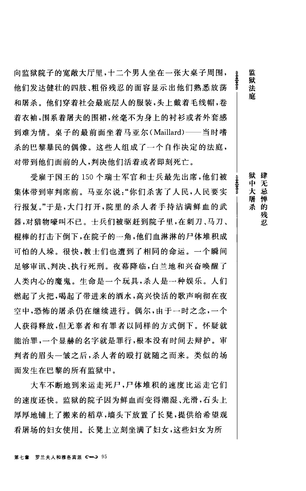

<small><a href="images/pages/107.png">原书第96页 · PDF 第107页 · 查看原页</a></small>

甚至连孩子也卷人到这场盲目的大屠杀中，他们被称为撕咬贵族的小兽。

我们不能更详细地讨论这些令人作呕的场景细节，以防读者因这些细节而厌恶生命。然而，尽管这样，我们还是应该把这些流传下来，因为重要的是，所有的眼睛都应读到这些可怕但有教育性的教训，所有人都应知道没有一种专制像无政府状态的专制这样可怕，有法不依比没有法律还令人可憎。

在比塞特监狱中，关押了3500个囚犯。暴徒强行打开了监狱大门，在地牢门内，用大炮轰击，在那里进行了五天五夜的屠杀。极度兴奋的暴徒，疯狂与日剧增，来自脏污之所的嗜血游民蜂拥而来，他们对鲜血的热切渴望无法消灭。现在没人能说出受害者的人数。残缺不全的尸体被快速运到地下公墓，被不加分别地扔成一堆，任其腐烂。据很多人估计，在大屠杀期间，大约有一万人受害。这些暴行的消息传播到法国各省，在每个城市都激起了暴民类似的暴行。

在奥尔良，商人的住宅遭到洗劫，商人和其他的富人或者有名望地位的人遭到屠杀，而提议反抗的一些人则被慢火烧死。

原页对照（含插图与旁注）
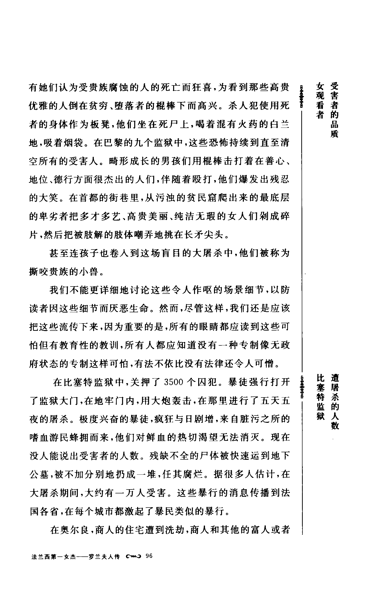

<small><a href="images/pages/108.png">原书第97页 · PDF 第108页 · 查看原页</a></small>

在普鲁士军队正通近的一个城市里，一些保皇派人士对朋友的成功感到乐观，便举行了一些庆祝活动庆贺友军的成功，在庆祝活动中，他们的女儿跳起了舞蹈。这些年轻的女士们全都遭到逮捕，共有十四个，她们被装到大车里运往断头台。这些年轻美丽的女孩们，年龄在14到18岁之间，出生于高贵、富有的家庭，她们统统被斩首了。这群年轻的无辜者站在断头台下，一个接一个地走上断头台，她们被绑到支架上，斧头落下，她们的头颅也落进篮子里。在这种可怕至极的折磨下，仿佛有一些超自然的力量支撑着孩子们，她们没有昏厥过去，没有大声痛哭，没有绝望的尖叫。她们以一种殉难者的镇静迎接了自己的命运，每个人争相向同伴显示她死得多么像一个女英雄。

在雅各宾派的挑唆下，这些场景在上演着。丹东和马拉鼓励这些残忍的违法暴力措施，他们说道：“我们必须让我们的敌人胆战心惊！这是我们唯一的安全！”他们派代表深入到城市中最污秽可鄙的场所煽动指导暴民，提议为卑劣的杀人者拨给充足的经费。这些杀人者强行闯人监狱，不管老幼、有罪无罪，一律屠杀。洋溢着狂喜、沾满着污血的杀人者，成群地涌向市政当局的大门，要求报酬。一个肌肉发达、个头高大的无耻之徒，卷着袖子，一身的屠夫打扮，全身溅满了血迹和脑髓，说道：“你认为我今天只挣了二十四法郎吗？我亲手杀死了40个贵族！”金钱很快耗完了，仍然有成群的杀人者群集在委员会，由于要求没有立刻得到满足而愤怒不已。杀人者举起沾满鲜血的武器对准了煽动者的咽喉，威胁他们，如果不能提供金钱，他们将立刻遭到同样的屠杀。

原页对照（含插图与旁注）
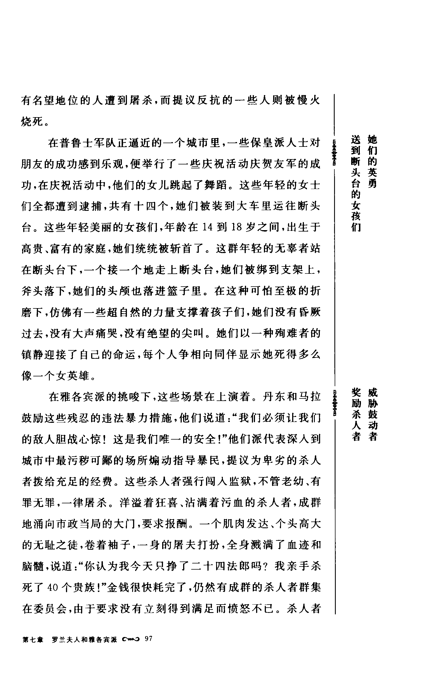

<small><a href="images/pages/109.png">原书第98页 · PDF 第109页 · 查看原页</a></small>

在这般要求下，委员会付了一半的钱，并为另一半写下了欠条。

罗兰先生因为这些他无力镇压的恐怖行为，几乎疯狂。现在，暴民在雅各宾派的带领下，获得了完全的优势，他仅仅是名义上的部长。罗兰先生敦促国民公会立刻采取有力措施阻止那些丧心病狂的违法暴力行径。国民公会中的许多吉伦特派人士强烈表达他们对大屠杀的憎恶，但说话却不管用。其他人对雅各宾派现在有效使用的武器感到害怕，因为他们知道如此引领狂暴的暴民，以至于暴民把正滴着鲜血的锋利刀刃从监狱转向国民公会大厅，指向所有厌憎雅各宾派权力的人的喉咙，可能非常简单。考虑到这种危险，吉伦特派战栗不已，他们已经帮助开通了这股洪流的渠道，现在它正席卷着它面前的一切事物。罗兰夫人清楚地看到了、深切地感到了她和她的朋友们所面临的危险，她知道，他们也知道，失败就是死亡。现在国民公会中的重要斗争是争取民众的声音。

吉伦特派尽管几乎绝望，但还是向人们说明混乱状态的可怕，团结他们周围的大众，以维系已经确立的、敬畏法律的共和国，希望还不算太晚。雅各宾派决定，在当前支持他们的暴民恐怖行动的帮助下，他们要把反对者送上断头台，毫无阻碍地实施他们的措施。在雅各宾派头头们的示意下，像失去了灵魂一般残忍凶恶的疯狂人群号叫着包围了国民公会。雅各宾派向吉伦特派展示着这些同盟军，就像一个哈巴狗在展示自己的利齿。

原页对照（含插图与旁注）
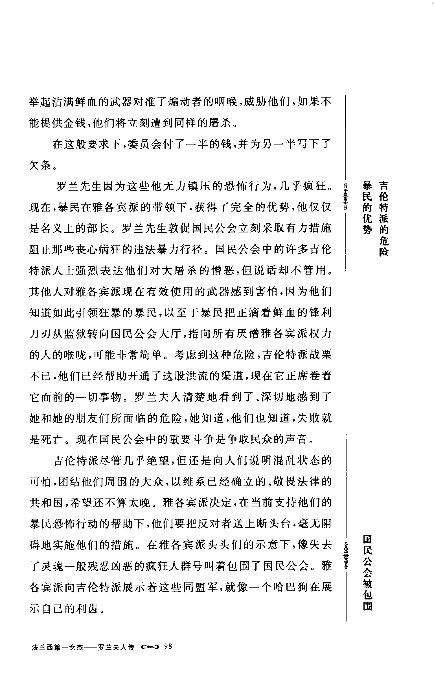

<small><a href="images/pages/110.png">原书第99页 · PDF 第110页 · 查看原页</a></small>

在演说、公告和声明书中，雅各宾派宜称，吉伦特派在内心是共和国的敌人。他们指控吉伦特派因为革命必要的猛烈而憎恨革命，指控吉伦特派密谋恢复王权。他们精明地采用了吉伦特派支持或反对的措施，从而帮助雅各宾派自身或者增加民众对吉伦特派的猜疑，激起民众反对吉伦特派的怒火。由七千法国侨民和十万受过严格训练的军队组成的联军，在最有能力、最有经验的将领的指挥下，正缓慢却稳妥地向巴黎推进，以救出国王、恢复王权，向侮辱王室的人复仇。人们听到了回响在巴黎群山中的隆隆炮火声，知道敌军离这座暴动的都市越来越近，炮火声把惊恐注人所有人心中。在这样的情况下，雅各宾派已经屠杀了那些被认为支持贵族的人，现在他们正集中力量清扫他们面前的所有对手。雅各宾派通过了一条法令，命令巴黎每一个有能力当兵的男人，都要扛起步枪，冲向前线迎战侵略军。如果缺乏钱财，那就把拥有财富的贵族送上断头台，并没收他的财产。

现在，罗伯斯庇尔和丹东断绝了与罗兰夫人和她的朋友们之间的交情，他们不再出现在吉伦特派经常会面的小书房中，而是现身于目前迅速取得优势的无组织、喧闹的派别前面，可是，在洪峰到达顶点的滔天巨浪面前，他们也将被席卷而去。

罗兰夫人强烈要求她在国民公会中的朋友们，应对煽动狱中大屠杀的雅各宾派领导人进行指控、审判、处罚。在这种时刻，指控罗伯斯庇尔和丹东的罪行需要非凡的勇气，因为无数的法国人都被这些暴行吓坏了，目前统治巴黎的暴民一听到保护他们偶像的警钟，便会立刻集结起来。

原页对照（含插图与旁注）
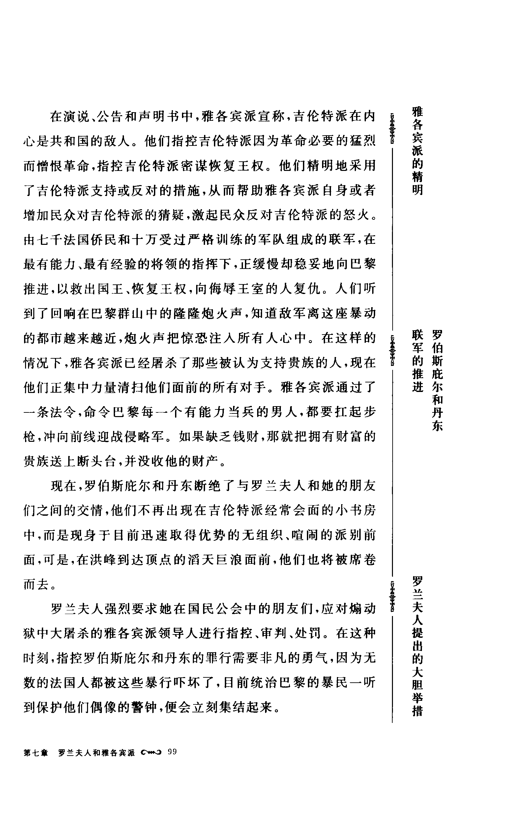

<small><a href="images/pages/111.png">原书第100页 · PDF 第111页 · 查看原页</a></small>

一天晚上，罗兰夫人正催促韦尼奥做出果敢、危急的决定，她说：“法国的唯一希望在于法律的神圣不可侵犯，这种残暴的大屠杀导致无数人内心因恐惧而发抖。法国和世界上一切智慧、善良的人们都会站出来支持以赤胆忠心为屏障抵制暴行的人。”

韦尼奥悲哀地回答道：“努力有什么用呢？街头的力量支持这种大屠杀，在街头的战斗中，这种抗争必然终结，大炮在我们的敌人一边，有名望的秩序支持者们已被杀害，恐怖将控制其余的人，我们只会惹来我们自身的毁灭。”

无畏的女士回答道：“如果我们活着屈服于这些卑鄙的暴民，那又何必活着呢？让我们为权利斗争吧，如果我们必须死去，让我们带着尊严和英勇高兴地死去。”

尽管没有成功的希望，尽管知道他们将注定毁灭，但罗兰先生和韦尼奥仍奋然而起，采取了行动。第二天，他们英勇地出现在国民公会中，在正疯狂涌动的巨流面前，决定把生死置之度外。他们只不过站在了那儿，但为罗兰夫人的精神所鼓舞的代表们，便发表了那些曾从罗兰夫人口中讲出的雄辩观点。

当罗兰先生慷慨演讲时，国民公会的代表们竖耳静听。罗兰声明了法律和秩序的真正原则，号召国民公会反对民众的暴力，捍卫自身的尊严，建立一支献身于捍卫自由和正义的武装力量。吉伦特派的其他人，受到回归温和情势的鼓舞，也积极勇敢地敦促采取果断行动。凯尔桑（Kersaint）说：“站在这儿，起而反抗大屠杀需要一些勇气，但这是为那些煽动屠杀的人支起断头台的时候了。”斗争进行了两三天，这种必须决出生死的斗争十分激烈。吉伦特派和雅各宾派之间的问题是：“谁将躺在断头台上？”一度，斗争的结果并不明朗。雅各宾派召唤了他们的支持者—暴民，暴民们包围了国民公会的门窗，用喊叫声支持自己的朋友。其中一个人说道：“我刚刚穿过人群，目睹了会场上的激烈阵势。如果通过了控告法案，在明天黎明到来之前，将会有很多人头落下。”吉伦特派发现，在斗争结束时，他们落败了，但并非一败涂地，他们仍然抱有希望。

原页对照（含插图与旁注）
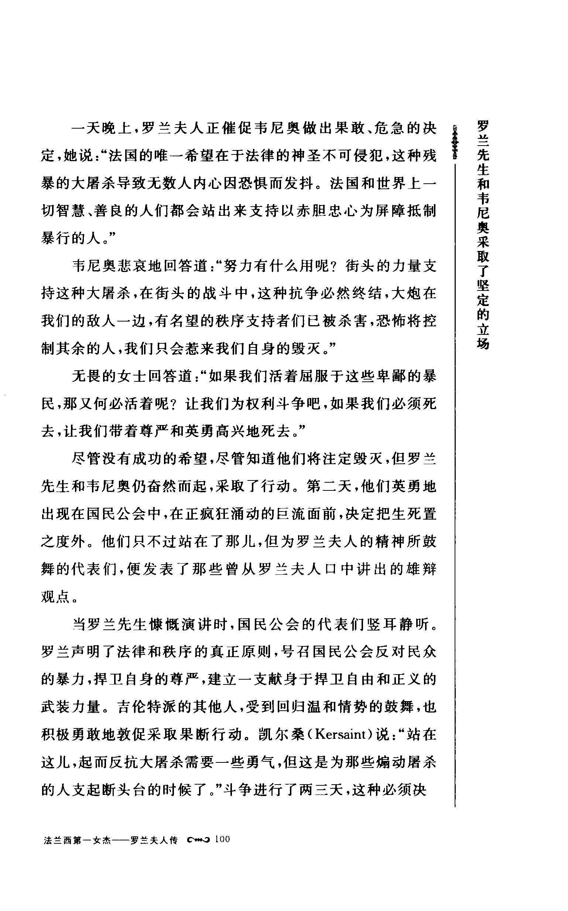

<small><a href="images/pages/112.png">原书第101页 · PDF 第112页 · 查看原页</a></small>

罗兰先生还没有在人群中完全失去威望，这股浪潮依然成功地把他再次推到内政部长的位置。现在，他意识到自己全然无力，于是，他向国民公会提出了辞职，这本来也只不过是名义上的权力。一段时间以来，罗兰先生的对手们一直努力着要把民众的仇恨浪潮引向罗兰，尤其是他的妻子，丹东和罗伯斯庇尔认为并宣称他们是吉伦特派中最能鼓舞人心的灵魂人物。

罗兰的支持者对罗兰的品德评价很高，极力坚持他应被邀留职。对他的支持，国民公会的意见正在动摇，恼羞成怒的丹东冷笑着，站起来说道：“我反对邀请，没有人比我更公正地欣赏罗兰先生，但如果你邀请罗兰，那么，你也必须邀请他的妻子。每个人都知道罗兰先生并不是独自在他的职位部门内。至于我自己，我独立地在我的部门内，我没有妻子帮助我。”

这种不礼貌的、恶毒的影射受到了雅各宾派的欢迎，从他们的坐席上传来一阵嘲笑的叫喊声。然而，大多数人对丹东这样攻击一位女士表示不悦，对他倍加责备，其中一名吉伦特派人士立刻登上讲台，说道：“无论是罗兰先生有一位以自己的精神激励他的智慧妻子，还是他依据自己的决定独自行事，对这个国家来说，都很重要。”这种反驳也得到了热烈的欢呼。

原页对照（含插图与旁注）
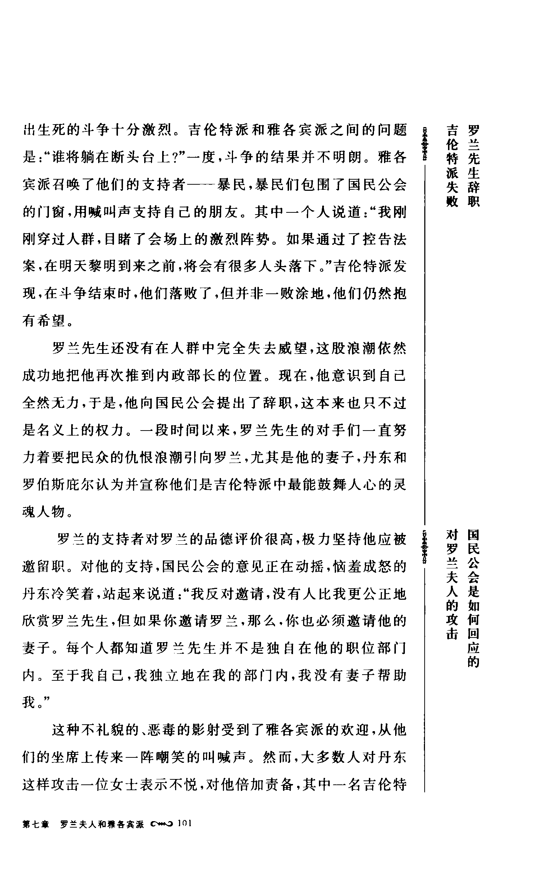

<small><a href="images/pages/113.png">原书第102页 · PDF 第113页 · 查看原页</a></small>

第二天，作为内政部长的罗兰先生致信国民公会，表示自己决心继续任职。这封信是罗兰夫人努力以热情的辞藻、以高尚的英雄主义精神和最可贵的挑战精神写成的。信中说：“国民公会的明智之处不在于郑重邀请一个人留职，它认为一个人的声誉十分重要，但这种再三的斟酌令我十分荣幸，它清楚地宣告了国民公会的期望。这种期望说服了我，我愿意接受并勇敢地支持这项事业。我决定继续任职，之所以这样做，是因为有太多的危险需要面对，我不能对这些危险视而不见，我只有勇敢地挑战它们。拯救祖国是被期望的目标，对于这个目标，我将鞠躬尽瘁，死而后已。我遭到缺乏勇气的谴责，但在那些公然抨击庇护凶手的时刻，难道不需要勇气吗？”

躲避在僻静书房中的罗兰夫人，在精神上，在激烈的讲坛斗争中，与罗伯斯庇尔、丹东、马拉对抗着。罗伯斯庇尔等人深知，这些锋利的箭是从谁的弓弦上射出的。吉伦特派也深知他们有关很多极有技巧的躲避和报复性的回击受惠于谁。

一派对罗兰夫人极为崇拜，另一派则对她恨之人骨。也许，在世界历史上，之前，从来没有一个女人占据过这种位置，之后，也不会有一个女人能够再占据这种位置。对显现于面前的深渊，丹东开始退缩，他希望与吉伦特派重新结成联盟。于是，他对罗兰夫人的才华、精神和睿智表达了最深切的仰慕，他说：“我们必须一起行动，否则革命的浪潮将淹没我们所有人。联合起来，我们就能阻止它。不联合，它就将压倒我们。”丹东再一次出现在罗兰夫人的书房中，与吉伦特派作了最后一次会谈。丹东希望联合，但和吉伦特派没能达成一致，丹东坚持吉伦特派必须宽恕大屠杀，至少默认大屠杀的必要性。吉伦特派说道：“除了不惩罚凶手和帮凶，我们同意其他所有的提议。“会谈中断了，丹东恼怒地退出，站到了罗伯斯庇尔那边去。雅各宾派和吉伦特派准备恢复他们之间的斗争，这不是为了权力的斗争，而是为了活命的斗争。

原页对照（含插图与旁注）
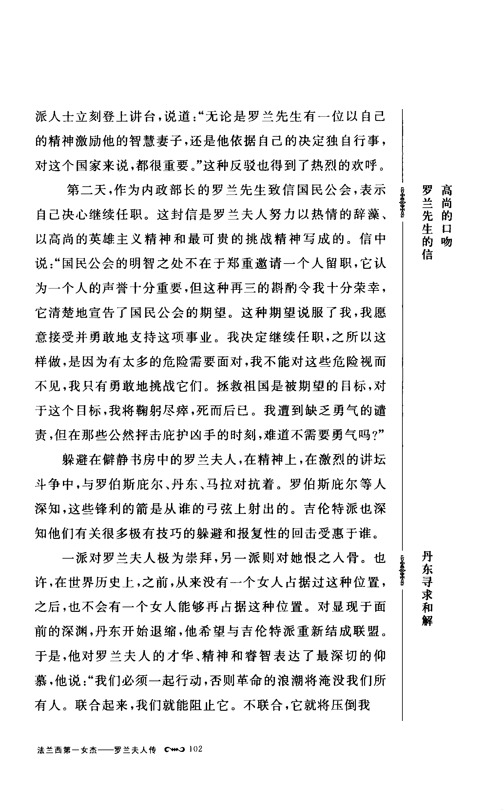

<small><a href="images/pages/114.png">原书第103页 · PDF 第114页 · 查看原页</a></small>

吉伦特派深知，除非他们使人民恢复正义感—用断头台惩罚那些煽动屠杀无数未被判罪的公民的人，否则，革命的狂潮将很快把每一样东西都清扫而光。雅各宾派将会以对保王.党实施过的大屠杀方式毁灭吉伦特派，清除掉对手。罗兰夫人也许能从危险中逃脱，和丈夫一起退却到宁静安全的地方，但是她却力劝丈夫继续担任职位，自己也决心留下来，无论结局将会怎样，都准备迎接自己的命运。从没有一个常人在面对危险，充分理解危险的严重性时，比这个极富热情的女人更能展示出坚韧来。

原页对照（含插图与旁注）
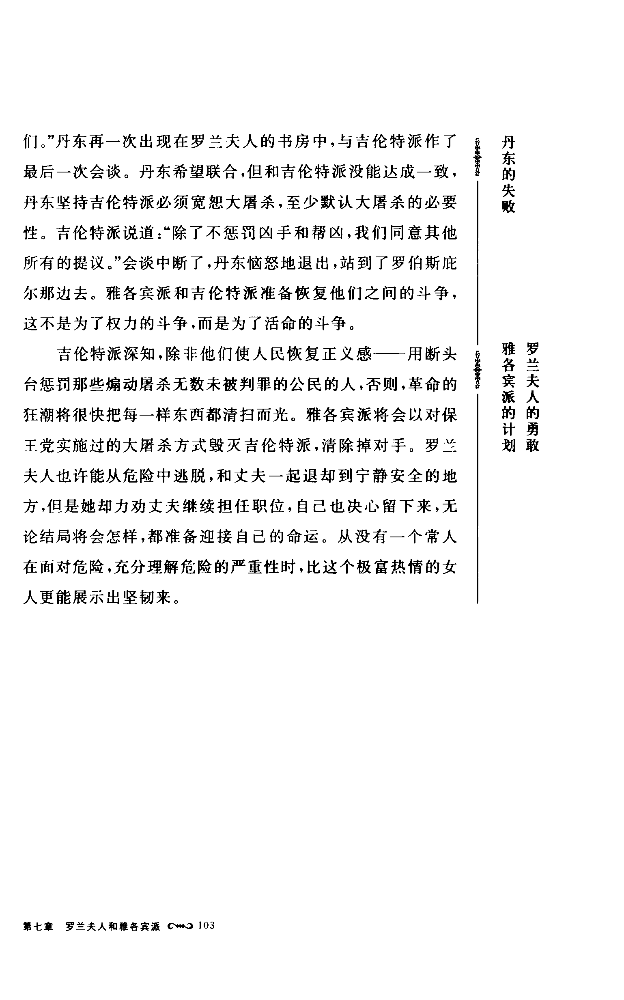

