# 第八章 吉伦特派的最后斗争

<small><a href="images/pages/115.png">原书第104页 · PDF 第115页 · 查看原页</a></small>

1792—1793年

原页对照（含插图与旁注）
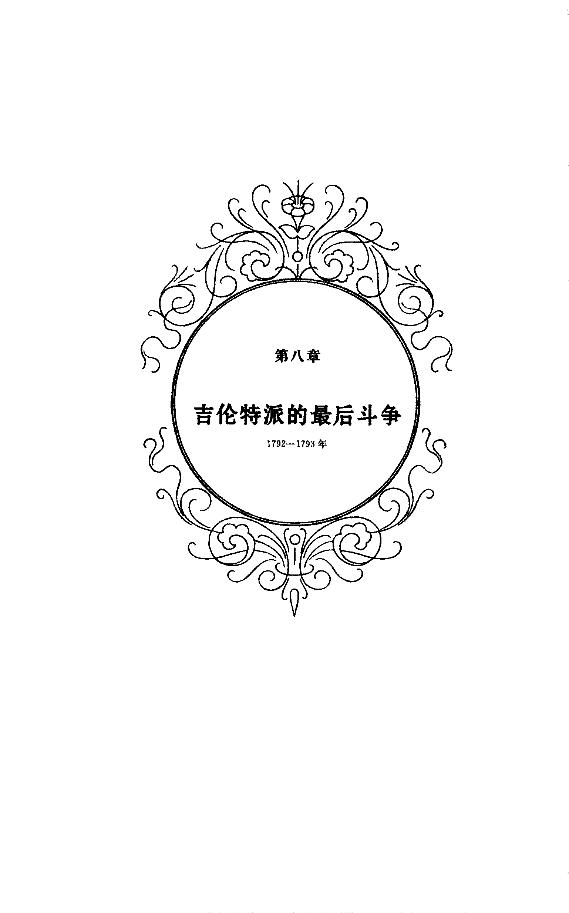

<small><a href="images/pages/116.png">原书第105页 · PDF 第116页 · 查看原页</a></small>

现在，雅各宾派决定审判国王。通过在大街上张贴公告，通过在国民公会、公众聚会、俱乐部中进行煽动性的演讲，通过每一种所能想象到的虚假推断和诽谤，雅各宾派激怒着无知的民众，使民众深信，对于目前正临头的灾难，国王是罪魁祸首。革命风暴已经使荒芜席卷到所有平静的行业，可怕的饥饿开始直盯着巴黎人民的脸膛。因为面包师拒绝供应面包，激怒的暴民把面包师吊在了面包店门前的灯柱上。农民不敢运送供应品进城，因为他们确信会遭到拥有至高权力的人的抢劫，这些人获得了犯任何罪行都不受惩罚的自由。

大多数人完全相信，狱中的国王和王室的支持者正在制造一个阴谋，他们要用饥饿使人民屈服。现在，从许多不见其人的口中发出的可怕谣言在到处散布，这些谣言说，吉伦特派是这个阴谋的同谋者，吉伦特派憎恨革命，吉伦特派希望挽救国王的性命，吉伦特派欢迎人侵的军队，因为这能给他们提供机会恢复路易十六的王位。据称，雅各宾派是人民唯一真诚的朋友，吉伦特派被指控为正在与贵族结盟。这些猜疑像大海上的薄雾一样，出现并浮动在巴黎城中。这些猜疑随处都能遇到，并毫无抵抗地遭到攻讦。在雅各宾派的刊物中透漏着这些猜疑，随着分歧的日益加大，在国民公会的讲坛上，雅各宾派也提出了这些猜疑。在民众集会上，马拉身着污秽破烂的衣裳，向可怜、可增、饥饿的民众夸张地演讲，大声并咒骂地宣布这些猜疑。雅各宾派非常高兴，现在他们利用形势的力量，把对手逼到了难以脱身的位置。如果吉伦特派投票赞成处死国王，他们因此便支持了雅各宾派那些广受暴民欢迎的残暴措施，暴民现在成了雅各宾派势力的得力助手，但是，荣耀将全部归于雅各宾派，因为这将毫无困难地使民众确信，吉伦特派仅仅在服从一项他们不能抗拒的措施。另一方面，如果吉伦特派确实本能地憎恶这些流血行动，胆敢投票反对处死国王，他们就将无可挽回地遭到毁灭。那时候，吉伦特派就将作为共和国的背叛者和王室的支持者，暴露在人民面前，像有害的畜生一样，吉伦特派将在大街上被围猎，或者被杀死在自己家中。吉伦特派清楚地察觉到正向他们快速盘旋而来的毁灭旋涡，一夜又一夜，他们多次在罗兰夫人的书房中焦急地商议对策。但是，在严重的危险之中，很不易决断出所必需的任务或者明确的方针。

原页对照（含插图与旁注）
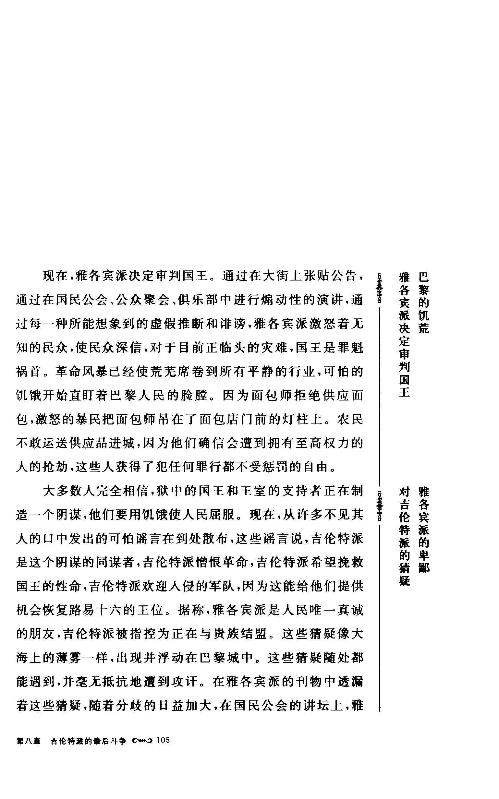

<small><a href="images/pages/117.png">原书第106页 · PDF 第117页 · 查看原页</a></small>

现在，雅各宾派正直接无耻地企图把民众的怒火引向罗兰夫人。

在动乱时代中，无原则的冒险家挤满了首都，阿希尔•维亚尔（Achille Viard）便是其中的一个。维亚尔被雇佣为间谍，假装很忠诚于吉伦特派，以结交吉伦特派并巧妙获取罗兰夫人的信任。通过歪曲和夸大罗兰夫人的话，他要捏造一个会使罗兰夫人遭断头台斩首的罪名。罗兰夫人立刻看穿了他的本性，十分轻蔑地责令他从自己面前消失。然而，维亚尔以罗兰夫人的控告者的身份，出现在国民公会，他指控罗兰夫人为了保护国王，与国内外有影响力的人物进行秘密通信。国民公会传唤罗兰夫人到现场，与控告人对证，为自己免于上断头台做辩护。在巨大的危险面前，罗兰夫人优雅高贵的精神没有动摇。作为从革命风暴中涌现出来的很有影响的派别里最能鼓舞人心的天才人物，她的名字常常在国民公会中被提起，她的才华、造诣、令人着迷的口才，使她名声远扬至整个欧洲。在立法机关，很多杰出人物，无论是充满热情的年轻人还是德高望重的老者，都带着深深的敬慕——几乎是宗教般的敬意尊重罗兰夫人。而为罗兰夫人的力量和智慧挫败的那些人，则对她恨得牙痒，决意要用断头台上的斧头或者杀人者的匕首除掉挡住他们去路的罗兰夫人。

原页对照（含插图与旁注）
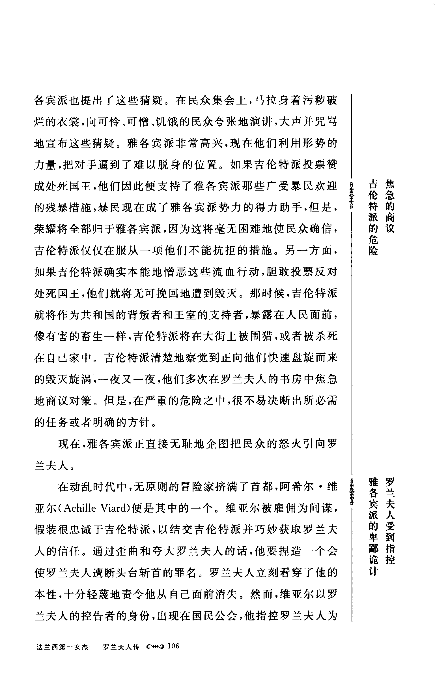

<small><a href="images/pages/118.png">原书第107页 · PDF 第118页 · 查看原页</a></small>

这个年轻美丽的女人在外貌和心灵上，兼有所有的自然魅力和才华魅力，她脸上洋溢着英雄般的坚毅，她的风度展示了最完美女性的可爱与谦和。当她为了捍卫自己的生命，走进满是愤怒男人的会场时，刺耳的嘈杂声立刻安静了下来，争论者的怒火也减弱了，会堂中立刻充满最有礼貌的沉默，每双眼睛都注视着罗兰夫人，对她心怀同情和热爱她的朋友们悸动不已。她的多半敌人也都消除了敌意，希望自己能支持她而感到光荣。罗兰夫人站在被告席前。

主席问道：“叫什么名字？”

她停顿了一下，眼神镇定地注视着询问者，然后，以清晰流畅的语调回答道：

“罗兰！我以这个名字为豪，因为他是一个仁慈、可敬的男人。”

“你认识阿希尔•维亚尔吗？”主席问道。

原页对照（含插图与旁注）
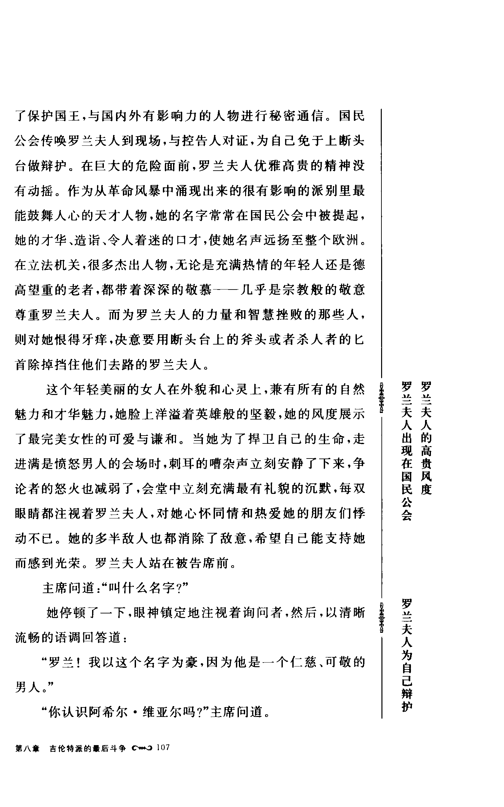

<small><a href="images/pages/119.png">原书第108页 · PDF 第119页 · 查看原页</a></small>

“我见过他一次，只一次。”

“你们之间发生过什么事？”

“他给我写过两封信，请求会面。我接见过他一次，在短暂的交谈后，我察觉到他是一个间谍，轻蔑地把他赶走了，他应当得到这样的蔑视。”

罗兰夫人的回答镇定而有尊严，态度自然率直，维亚尔对她的指控明显地出于预谋和谬误，甚至令她的敌人都为他们没有道德准则的起诉而感到羞耻。她的音调短暂地颤抖了一下，但意志坚定，没有任何恐怖能够吓倒她，她开始为自己辩护。在这些狂怒战士的呼喊声中，人们第一次听到了一个女人的声音，不习惯于这种场面的国民公会为她魅力非凡的口才迷住了。自知卑鄙无耻、背信弃义、造假诬陷的维亚尔根本不敢开口。在欢呼声中，罗兰夫人被宜告无罪。

在现场，主席提议应向罗兰夫人致以国民公会最高的敬意，他的提议获得了热情的接受。当罗兰夫人退出会场的时候，她心中洋溢着大获全胜的激动，耳中听到了全体人员向她致敬的热烈掌声。在她这样为自己和朋友辩护并击败对手的时刻，她吸引了所有法国人的目光。马拉怒火万丈，咬牙切齿。丹东沮丧透顶，沉默不语。罗伯斯庇尔为以前就常令自己着迷的魅力再次征服，他表达了对阴谋的蔑视，最后一次，向他早期的朋友微微地笑着，很快，他就冷酷无情地把她拖到了断头台上。

推翻君主制建立共和国后的那天晚上，吉伦特派相聚在罗兰夫人家，欣喜欲狂地庆贺人民自由的诞生，在那时，还有一线希望，或许能够在民众中发现维护宪法的智慧与美德。美国宪法是吉伦特派的理想模式，吉伦特派虚妄地梦想着，华盛顿和他的同胞在基督教美国建立的制度能在不信仰宗教的法国稳固地扎根，他们努力对过去蒙上遗忘的面纱，对未来铺展开希望的幻想。聚集在这儿的都是国家中最优秀的男人，他们心心相印地交流着高尚的情怀。意识到正在他们身边涌现的可怕危险，罗兰夫人内心激荡、脸色苍白，在那晚的狂喜中，她流露出异常的神色。上了岁数的罗兰眼中含泪，爱恋地、满足骄傲地注视着美丽的妻子，好像在内心问她，是不是他们心中所有崇高的愿望此时还没有实现呢。获得胜利的共和派人士几乎不知道该唱胜利的乐曲还是葬礼的挽歌。吉伦特派享有盛名的演说家韦尼奥，在他们之中尤为突出。他脸颊苍白，平静沉思地微笑着，静静地坐在那儿，他的思绪明显漫游在正涌现的未来幻境中。在晚宴结束时，他倒满酒杯，举杯提议为共和国的永垂不朽干一杯。罗兰夫人头脑中一直充满着对古典作品的回忆，她手中拿着一束花，在韦尼奥的酒杯中，撒下一些玫瑰花瓣。韦尼奥一饮而尽，然后声音低沉地说道：“今晚，我们应该喝下我们酒中的桕树叶，而不是玫瑰花瓣，为一出生就沾满大屠杀鲜血的共和国干杯，谁知道我们不是在为自己的死亡干杯呢。什么都不管了，如果这酒是我自己的鲜血，我也宁愿对着自由和平等一饮而尽。”所有的客人都热烈地回应：“共和国万岁！”宴会结束后，罗兰向朋友们宣读了一份由他和妻子起草的关于共和国的文件，第二天，他们将要到国民公会上提出这份文件的观点。

原页对照（含插图与旁注）
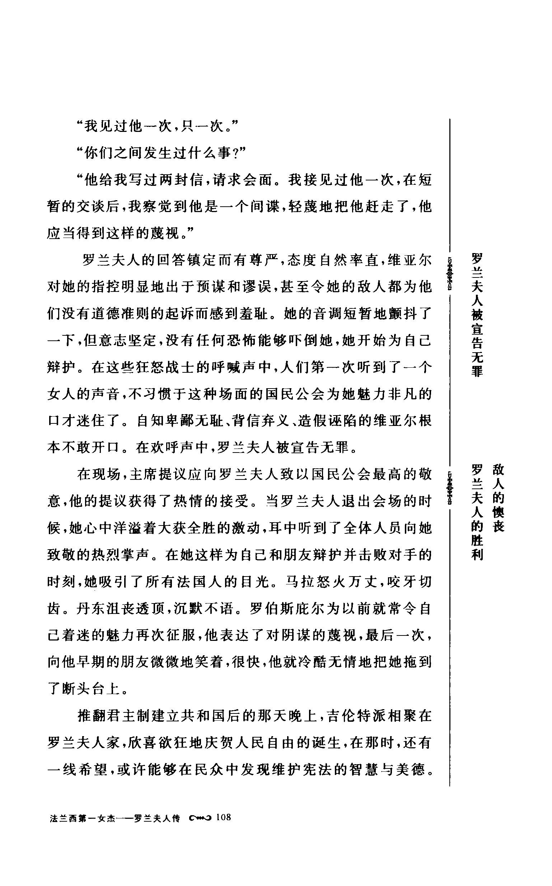

<small><a href="images/pages/120.png">原书第109页 · PDF 第120页 · 查看原页</a></small>

王室人员现在仍然被关押在圣殿的地牢中，在凄凉的囚禁时光中苟延残喘。疯狂的暴民们，在大街上骚乱，无视一切法律，大声诅咒地要求处死国王。有个人斗胆说出他认为不需要路易十六的流血来建立共和国，便立刻被刺中了心脏，在残忍的狂欢中，他那残缺不全的遗体被拖到巴黎的大街上。一个售卖小册子和报纸的可怜人，刚从阅览室中走出来，便被指控出售支持王室的书籍，怀疑就可判罪，他遭到了三十把匕首的穿刺而倒下了。像这类的警告意味深长且又令人难忘，很少人敢于说话支持国王。

原页对照（含插图与旁注）
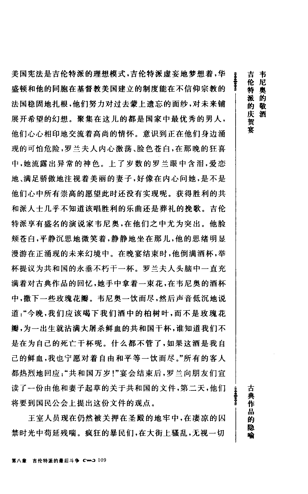

<small><a href="images/pages/121.png">原书第110页 · PDF 第121页 · 查看原页</a></small>

1793年1月，囚禁中的君主被带到了国民公会的会堂接受审判。对法国来说，这是草木含悲、天地失色的一个阴暗日，阴沉的雾气浮荡在寒冷的空气中，狭窄的小道和阴暗的通道上闪烁着几缕微弱的灯光，伴随着冬日夜晚的降临，街道愈发地黑暗。武装士兵包围了这座建筑物，指向每条通道的重炮旁边站着手持燃烧火把的炮手们，准备向敌人发射出一阵枪林弹雨。无数的暴民来回涌动在附近所有的街道上。民众沉闷的抱怨声和在阴冷夜晚发出的狂风呼号一起增大。代表们费力地穿过围在会堂周围的人海前行。暴民们那粗糙的着装、发怒的面容、刺耳的声音、凶猛的姿态非常清楚地显示出，他们决心取走国王的性命，要是代表们不投票表决他死亡，国王和代表们将一起遭到毁灭。当每一个代表挤过拥挤的人群时，耳中都会听见威胁的语气发出低沉而又断然的嘀咕：“他死，或者你死！”

当代表们用胳膊肘推开涌过来的人们前行时，熟悉坐在特定位置的代表面孔的人们，便大声号召民众呼喊代表的名字。当呼喊到丹东、马拉、罗伯斯庇尔的名字时，士兵公然为这些民众的偶像开路，最热烈的致意呼喊声落入他们耳中；当喊叫到韦尼奥、布里索和吉伦特派的其他主要人物时，那些紧握的拳头、舞动的匕首、生气的威胁表明，谁要不遵从人民的意志，谁就会遭到可怕的报复。安排保卫代表的专门士兵也遭到了暴民的侮辱和暴力。大厅里挤满了巴黎最残暴的恶棍。

原页对照（含插图与旁注）
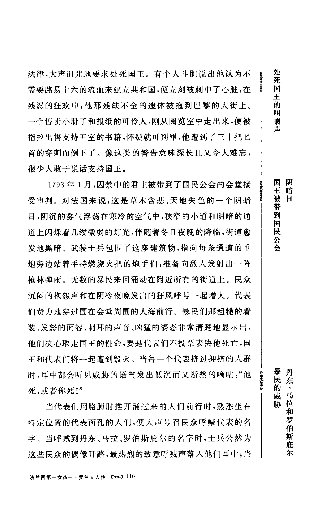

<small><a href="images/pages/122.png">原书第111页 · PDF 第122页 · 查看原页</a></small>

内部的会堂灯光昏暗，天花板中央挂着一个树枝形的吊灯，只能照亮房间中某些部分，而离灯较远的地方则一片昏暗。所有人都应在充分认识到他们对暴民的责任下行动，于是，罗伯斯庇尔提议，投票应该拒绝无声的投票形式，每一个轮到的代表，应该走向讲台，用清楚的声音宣布他的意见。投票开始后，一度，很不确定结果将会怎样，在交替的投票记录中，“死亡”和“流放”的意见势均力敌。现在，一切都取决于吉伦特派将要执行的方针，如果他们投票赞成死亡，国王的性命就休已。在吉伦特派中，韦尼奥第一个被叫到宣布他的意见。众所周知，他对大革命导致的残暴深恶痛绝，对国王的坏命运，也常常公开表示同情，因为国王的最大罪行只是软弱而已。毫无疑问，韦尼奥的投票决议将是整个党派意见的标志，由此看来，国王的生死就悬在他的嘴边。

大家也都知道，之前的一个晚上，与一位女士共同进餐时，韦尼奥对圣殿里的俘虏们表达过深深的同情，他已经宣称他将保留国王的性命。韦尼奥的勇气无可怀疑，他的正直也无可指责，在大炮和暴民长枪对着他胸膛的情况下，尽管公正地下决定是如此困难，但是，毋庸置疑，韦尼奥会从良心上投票。

当喊到韦尼奥的名字时，所有的交谈立刻停止，会堂中出现了死一般的寂静，每一双眼睛都盯在他身上。韦尼奥慢慢地登上讲坛的台阶，表情沉静，但双唇紧闭，仿佛要紧守住坚定的决心。他停顿了一下，全体人员也都屏住了呼吸。韦尼奥紧蹙着双眉，仿佛再一次思考自己的决定，然后，用低沉、严肃、坚决的声音说出了“死亡”一词。

原页对照（含插图与旁注）
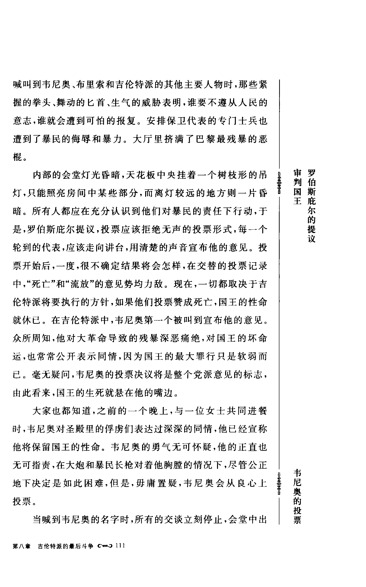

<small><a href="images/pages/123.png">原书第112页 · PDF 第123页 · 查看原页</a></small>

一时间，会堂里鸦雀无声，接着，再次充满被禁止的交头接耳声。韦尼奥走下讲坛，消失在人群中。现在，国王的一切希望都破灭了。其余的吉伦特派人士也投票赞成死亡，路易十六被宣判上断头台。

一致投票赞成国王死亡，在短时间内又把吉伦特派和雅各宾派联合在一起，但是占优势的一派，因为战胜对手而得意洋洋，胜利鼓励着他们进行新的勒索。危险在增加，欧洲正在集结军队反对染透鲜血的共和国，国王的死刑在先前赞同革命的很多人心中激起了难以压制的憎恶，那些被没收了财产的人，那些丧失了社会地位的人，正准备欢迎作为他们解救者的侵略联军。在当时，为了应对这种紧急局势，国民公会建立了可怕的革命法庭，它扬起了断头台的斧头作为政府最强有力的工具，它也使得无辜者血流成河。马拉说道：“在法国免受国内的敌人伤害之前，26万人头必须落地。”现在，处于优势之中的丹东、马拉、罗伯斯庇尔，正驾驭着暴民的暴力狂潮不可抵抗的力量，当他们希望推行任何措施的时候，他们便派出代理人前往堕落、犯罪的处所和潜伏之处，让嗜血的杀人者包围、充斥于国民公会的会堂。马拉说道：“那些声称自己可敬的人，希望对他们称之为乌合之众的人发号施令，我们将教训他们，乌合之众统治的时代到来了。”

原页对照（含插图与旁注）
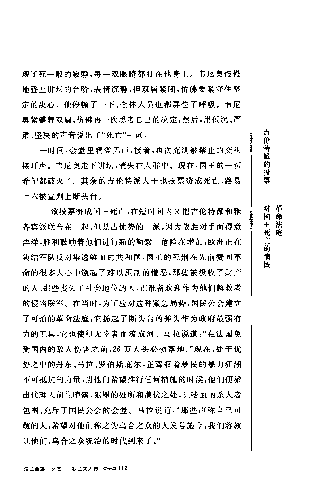

<small><a href="images/pages/124.png">原书第113页 · PDF 第124页 · 查看原页</a></small>

在当天晚上，国民公会提议并颁布法令，由国民公会任命的五位法官、一个陪审员、一个公诉人组成的革命法庭，拥有无限的权力，可以生杀予夺和没收财产。吉伦特派不敢投票反对这个法庭，因为舆论将把他们宣告为最坏的叛国者。现在，法兰西就是一个停尸房，从未变干的鲜血流成了河。无辜者得不到保护，美德遭人怀疑，怀疑就能治罪，断头台施以惩罚，被没收的财产就是指控受贿的罪证。就这样，在自由和人民权利的名义下，在法国君主制度的废墟上，建立了最残暴无情的专制制度，人性饱受它的压迫。

一次又一次地，雅各宾派召集暴民到国民公会上，用杀人的匕首对准代表们的胸膛，强迫他们投票表决。

现在，罗兰夫人对自由已经绝望，诽谤毫不留情地向她和丈夫袭来，对她来说，如此意料不到的报复，比上断头台还可怕。先前允诺的革命成果全部不复存在，所兑现的只有悲哀和罪行。吉伦特派仍然相聚在罗兰夫人的书房里，商讨相关的措施，以躲避迫近的毁灭，但一切措施都无济于事。

现在，最令人痛苦的窘迫包围着罗兰先生：若不想自己和国民公会中的支持者陷于被送往断头台的境地，他就不能放弃职权；要是继续掌握职权，他就要被迫目睹不仅自己的灵魂反对，而且自己必须明确认可的残暴行为。因为忧虑，他脸色苍白，寝食难安。共和国已经彻底失败，法兰西只不过是连遭风暴打击的混乱海洋。

在这种处境下，罗兰先生，心情哀伤地递交了他最后的辞呈。他退缩到巴黎一条偏僻街道上的简陋住所，在那儿，他焦虑不安地注视着事态的进展，他开始准备离开诱惑暴民的首都，远离这些人类力量不能平息的风暴，到宁静且与世隔绝的拉普拉蒂尔，寻求一处隐居之所。尽管如此，罗兰和妻子的影响仍然令那些操纵可怕违法暴力机器的人们畏惧。罗兰夫妇知道，用匕首消灭他们的杀人者已经被雇佣。可是，罗兰夫人好像对个人安危毫不在意，她只关心丈夫和孩子。他们能看见凶暴的男人潜伏在房子周围，朋友们催促他们尽快从危险重重的住处转移，因为无论是神圣的法律还是朋友们的武器都不能再给他们提供任何保护。危险迫在眉睫，罗兰夫人的朋友们给她带来了乡下女子的服装，恳求她穿上，伪装一下，趁着夜色逃走，没有家人的牵累后，丈夫也能在她之后逃走。但是，罗兰夫人骄傲地拒绝了，她认为这是一种怯懦的手段，她把衣服扔到一边，大声说道：“我为采取任何这样的策略感到耻辱，我既不伪装自己，也不打算秘密逃走，我的敌人一直可以在我的住所找到我。如果我被杀害，我也将死在自己家中。我对祖国负有做出坚贞榜样的义务，我愿意这样做。”

原页对照（含插图与旁注）
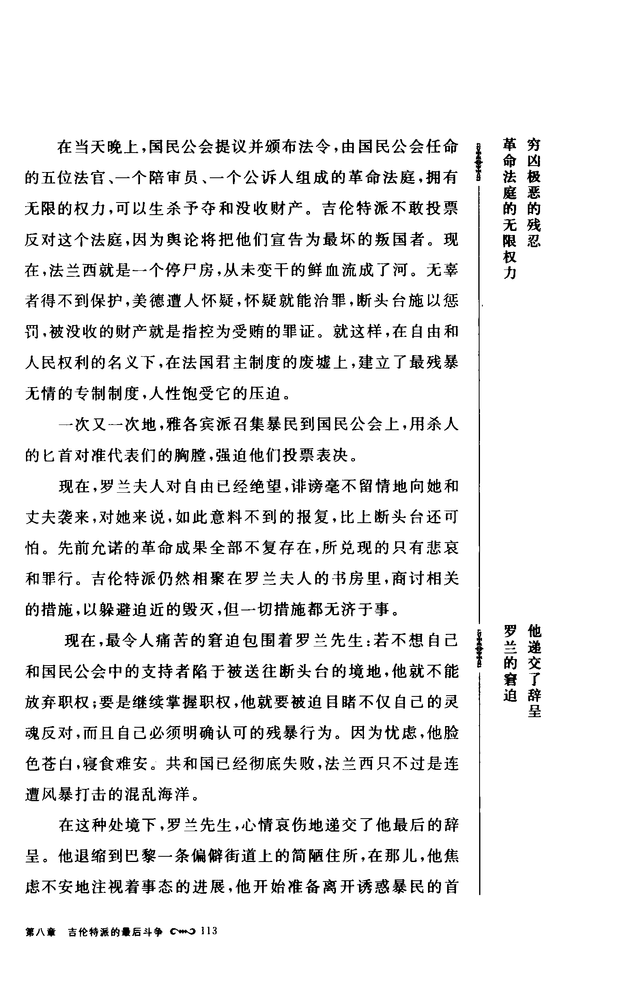

<small><a href="images/pages/125.png">原书第114页 · PDF 第125页 · 查看原页</a></small>

但罗兰夫人完全意识到了自己的危险，每晚都对这种凶险忧心忡忡，她把装满子弹的手枪放到枕下，防卫自己以免遭受到比死还恶劣的侮辱，法国革命已经提供了如此众多的例子。在吉伦特派的影响被巴黎暴民的叫嚷声压倒之时，在那些更有道德、更能清除首都此种腐化的乡村地区，他们的影响却在增加。在首都，从欧洲各地涌来的流氓诅咒叫骂着罗兰的名字，而在农民耕作、热爱法治和平的省份，人们则以尊敬的语气提及他的名字。因此，雅各宾派有认真的理由畏惧这种反对力量，他们决定通过断头台消灭吉伦特派的声音。现在，他们要采取最残酷的举措来毁灭吉伦特派。他们密谋纠集暴民，准备遵从马拉的指令，包围国民公会，煽动他们从门窗闯人会场，在混乱之中，把吉伦特派刺死在座席上。但在指定实施密谋的几个小时之前，这个阴谋被察觉并暴。在野蛮同盟者的保护下，雅各宾派的领导人凌驾于法律权力之上，要对反抗者实行惩罚。

原页对照（含插图与旁注）
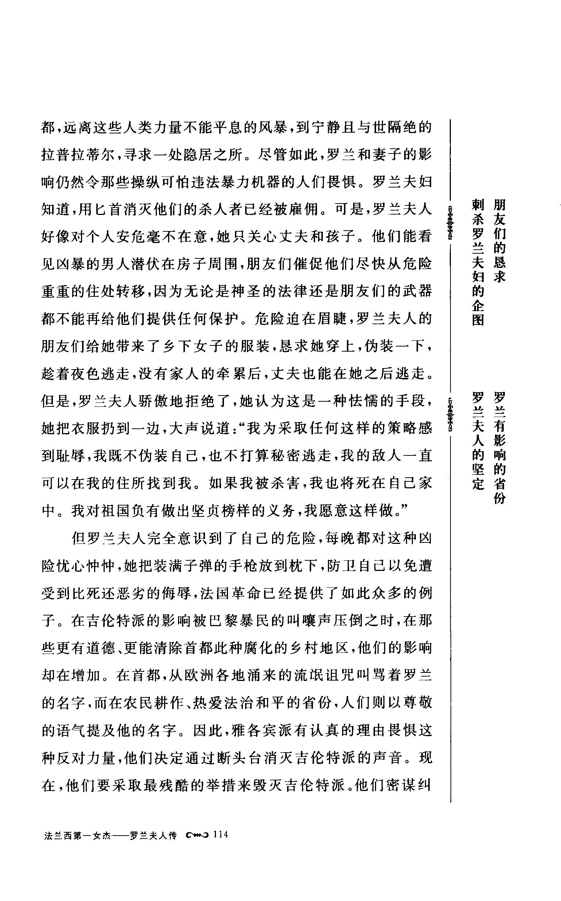

<small><a href="images/pages/126.png">原书第115页 · PDF 第126页 · 查看原页</a></small>

雅各宾派再次指定了一个夜晚，手持武器的一伙人正要包围每个吉伦特派人士的住所，把反对雅各宾派统治的这些人暗杀在他们的床上。在大祸降临之前的几个钟头，这个阴谋又被泄漏给吉伦特派。这些注定的牺牲者要从周围布下的天罗地网中逃脱，确实困难无比。目前，从前线不断传来损失惨重的消息，最让他们惊慌的消息是旺代省和法国其他重要地方支持复辟君主制的叛乱。这些聚集的危险把恐惧深深注人雅各宾派的心中，促使他们铤而走险。尽管罗兰夫人现在相对而言是个小人物，但每天晚上，在国民公会中为自由和生命斗争的法国杰出人士，依然爬上昏暗的楼梯，来到她偏僻的住所—她的住所隐蔽在哈普街一所庭院的深处。在那儿，他们详谈当天的事情，并商谈有关来日的情况。

此时，雅各宾派正部署一场可怕的暴乱，那些暴乱已使巴黎的每颗心都陷入恐怖之中。雅各宾派集合了众多疯狂的男人和女人，动荡的时代已经把这些人从基督教世界的每一个角落召集了过来。为了坚持他们的要求，这些人聚集在国民公会会堂的周围。1793年5月31日凌晨3点，凄厉的警钟声响起，从一个钟楼传到另一个钟楼，街头响起了暴动枪炮的隆隆声，把市民从睡梦中惊醒，人群中产生了骚动和恐怖。刺骨的寒风吹动着阴沉空气中的雾气，呼啸的狂风恰似悲伤世界正当其时的挽歌。蜂拥的大众前往指定的市政厅集合。

原页对照（含插图与旁注）
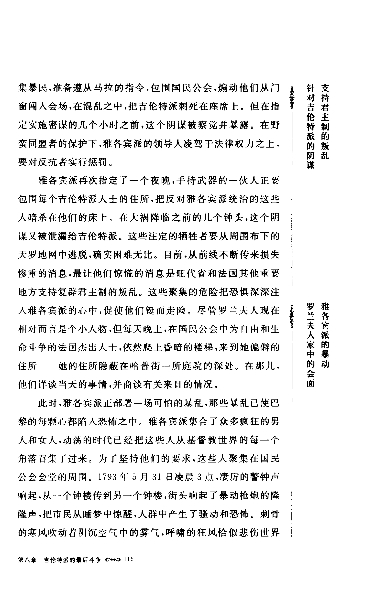

<small><a href="images/pages/127.png">原书第116页 · PDF 第127页 · 查看原页</a></small>

心惊胆战的市民们，很清楚这些演示是暴力流血场面的先兆，他们推开窗口，心有余悸地看着魅影般涌过来的昏暗景象。重炮车车轮的辘辘声、火药的闪光伴随着枪炮的时时爆炸声、纷乱的嘈杂声，这一切都是即将到来的一天或许比黑夜更黑的可怕征兆。最近，在对手的杂志上和煽动性的演说中，吉伦特派被称为罗兰派，对手赋予他们这个名字，等于承认了罗兰夫人在吉伦特派中的突出地位，随之而来的是竭力谴责罗兰夫人和她的丈夫。透过这场正来临的暴风雨的不祥声音，人们能听到与吉伦特派主要人物名字联系在一起的强烈诅咒和威胁：“打倒贵族、打倒叛囤者、打倒罗兰派！”喝醉的男人，鲁莽的男孩、恶毒的女人，以嘶哑的声音和尖锐的声音不断地喊叫着这些话。

那天夜里，十分了解这种运动的吉伦特派，没有人人睡，他们在自己住所采取了防范措施，只有勇敢无畏的韦尼奥拒绝采取安全防护的措施。他说：“现在，对我来说，活着有什么意义呢？我的鲜血或许比我的话语更能有力地唤醒祖国、拯救祖国，我准备着牺牲。”吉伦特派的一名成员拉布（Rabout）先生是一个爱思考、很虔诚的人，他一听到这些喧闹声，便从床上起来，对着窗户细听着大都会的街道上涌起的混乱，他听了一会儿，平静地说道：“我们的末日到了！”然后，他跪倒在床前，大声祈求上帝保佑他的同伴、祖国和他自己。不少朋友和一些不知道祈祷力量的朋友都和拉布先生一起祈祷，但每颗灵魂本能地恳求上帝仁慈的时间只剩下几个钟头了。基督教朋友的祈祷深深感动了吉伦特派人士，于是，他们全部虔诚地俯下身去。祈祷的力量使他们得到了支持并平静下来，假如他们必须死亡的话，他们决意死在责任的岗位上。在6点钟，他们身藏手枪或者匕首，走向街头，他们未被认出来，安全成功地抵达了国民公会。

原页对照（含插图与旁注）
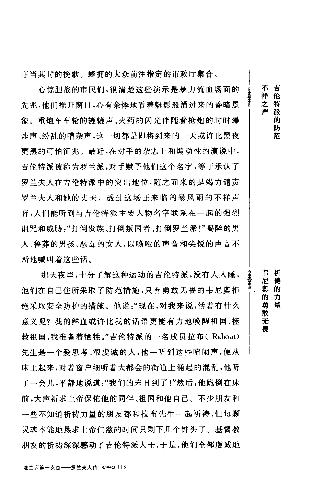

<small><a href="images/pages/128.png">原书第117页 · PDF 第128页 · 查看原页</a></small>

一两个雅各宾派分子已经更早地来到了国民公会，在不眠之夜中兴奋得脸色发白的丹东，神经紧张地来回走动，以无力阴郁的微笑向他的老朋友们打招呼。卢韦（Louvet）向戈代（Gaudet）说道：“你看，那张丑恶的脸上透露着多么可怕的期望。”代表们很快到齐，会堂里很快挤满人。现在，吉伦特派十分无助，他们的力量之筋脉已被割断，斗争实质上已经结束了，对他们来说，剩下的就是以未被击败的精神，英雄地迎接自己的命运。

原页对照（含插图与旁注）
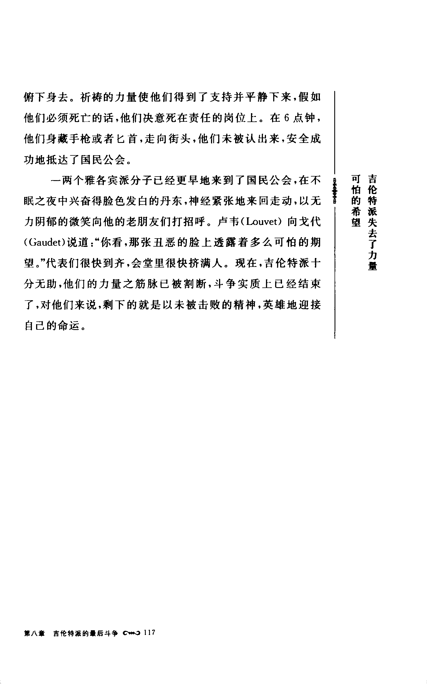

