# 第九章 罗兰夫人的被捕

<small><a href="images/pages/129.png">原书第118页 · PDF 第129页 · 查看原页</a></small>

1793年

原页对照（含插图与旁注）
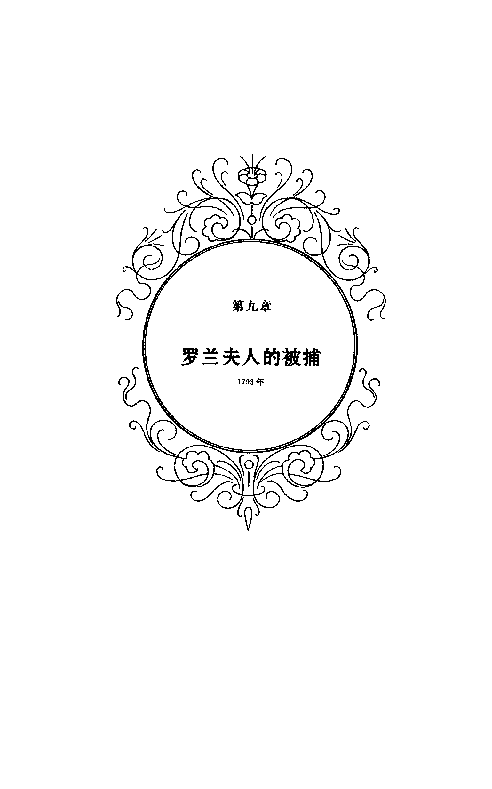

<small><a href="images/pages/130.png">原书第119页 · PDF 第130页 · 查看原页</a></small>

现在，法国由国民公会统治，国民公会由巴黎的暴民统治，雅各宾派则是这帮暴民的头领，任何时候、任何地方，只要他们高兴，他们就煽动暴民的愤怒，操纵暴民的狂暴，通过一直迎合暴民的热望，来获取和保持暴民的亲善。雅各宾派声称只有自己是人民的朋友，提倡所有倾向于镇压高尚者、迎合堕落者的措施。罗伯斯庇尔、丹东、马拉现在成了民众的偶像。

1793年5月30日早晨，巴黎的街道笼罩在暴风雪的阴暗之中，天空黑云密布、寒风凛冽，雨雪阵阵。泥泞的街道上，积满了水洼，自然万物都毫无生机，一派阴沉。在大街上，正发生着另一场比自然战争更为可怕的风暴。蝗虫般的人群中，在礼仪、外表、头脑、心灵上都畸形、野蛮、残酷的魔鬼男人、邪恶女人和结实、好色、嗜杀的男孩们，像黑暗中的小鬼一样前往国民公会胡作非为，无人能说出他们的人数，他们可怕的嚎叫声震耳欲聋，弄得人心惶惶，没有力量能够制止他们，也没有办法防范他们的暴力。很多人希望从坟墓中把过去坐在法国王位上的最专制的国王重新召唤起来，以驱赶世上一切专制中最可怕的专制—暴民的专制。这是支撑雅各宾派观点的力量，这是雅各宾派在对手面前挥舞而被称作正义之剑的

原页对照（含插图与旁注）
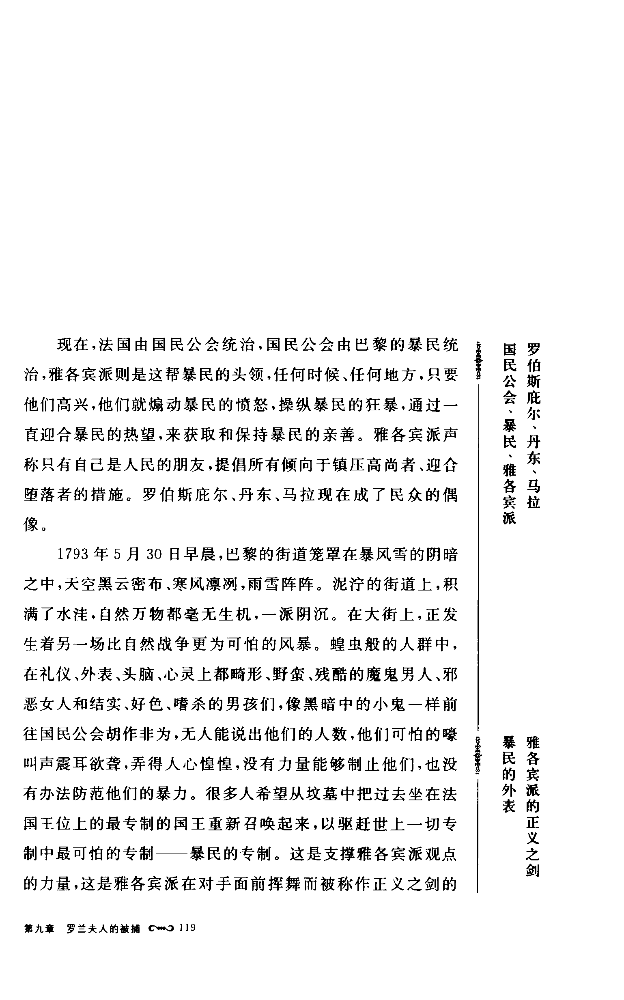

<small><a href="images/pages/131.png">原书第120页 · PDF 第131页 · 查看原页</a></small>

血剑。

国民公会大约由800名代表组成，其中有22名著名人士被认为是吉伦特派的领导人物。雅各宾派已决心以叛国罪的罪名指控、逮捕并审判他们。国民公会拒绝服从这种专制、血腥的要求，于是，雅各宾派召集暴民来强迫国民公会服从。

当无数暴民以不可抗拒之势潮水般涌过来的时候，天空中响起凄厉的警钟声和轰鸣的警报枪声。暴民从四面包围了大会，强行进入会场，挤满每一处空地，爬上长椅，把演讲人推挤到椅子上，挥舞着短剑匕首。他们的咒骂与激烈的辩论混杂在一起，甚至雅各宾派也对自己所唤起的这股恐怖精神害怕不已。杀人者叫喊着：“打倒吉伦特派！”“杀死叛国者！”暴民的叫嚷声使吉伦特派无法发言，也几乎无法试图为自己辩护。吉伦特派坐在长椅上，可怕的场景令他们情绪激动、面色苍白，但他们依然十分坚决、毫不动摇。当雅各宾派演讲人库东（Couthon）正大声谴责时，由于猛烈地热情演讲，他竟喘不过气来，他向服务人员要一杯水。韦尼奥说道：“给库东一杯血，他太渴望喝血了。”

在无数杀人者的短剑匕首下，不容置辩地，国民公会提议并通过了指控法令，暴民胜利了。

然后，在欢呼声中，国民公会表决全巴黎都应高兴地张灯结彩，庆祝人民战胜那些阻止革命前进的人。如果有谁没有在窗户上点起明亮的灯笼，每个巴黎市民都悉知厄运将会等候他。接着，代表们又热烈地决定，国民公会的代表应该到外面去，亲近民众。在这种时刻，谁敢反对这种感情表示呢？已经堕落的国民公会遵从了暴民的要求，代表们走向街头，被肮脏的胎膊拥抱着，被卑鄙、可耻、堕落的污秽胸膛拥抱着。路易十六终于被报了仇。现在白天过去，夜晚降临，但首都的大街上灯火辉煌，就像正午的阳光般明亮。国民公会的代表们在火炬手和无数沉溺于狂欢而喝醉了的男人，女人的包围下，被迫列队穿过巴黎的主要街道。作为俘虏，吉伦特派也被带着游街以为胜利增添荣耀，一名雅各宾分子对韦尼奥说：“你喜欢这种欢呼还是断头台？”韦尼奥淡然而不在乎地答道：“对我来说都一样。在这样的行程和断头台之间，并没有其他选择，行程引领我们前往断头台。”22名吉伦特派人士被逮捕收押到监狱里。

原页对照（含插图与旁注）
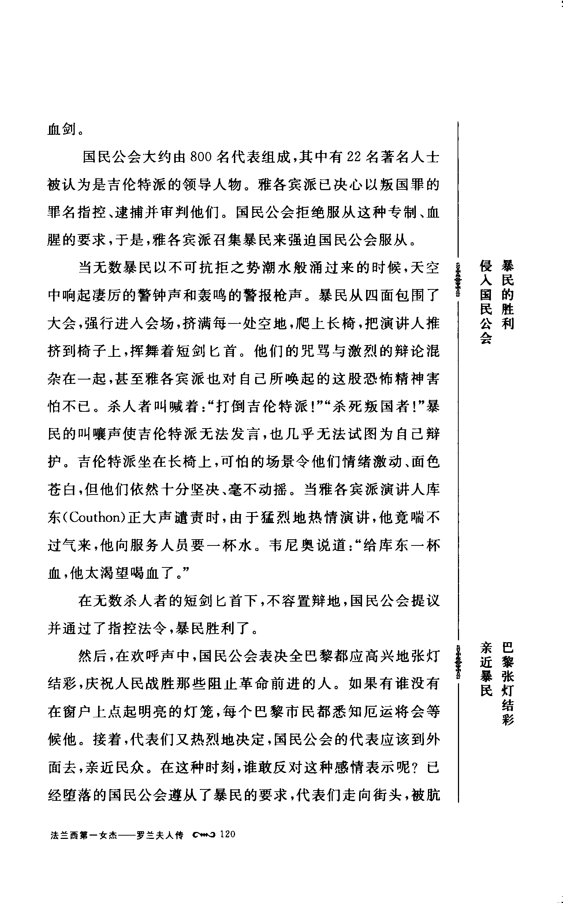

<small><a href="images/pages/132.png">原书第121页 · PDF 第132页 · 查看原页</a></small>

在这可怕的一天当中，当在国民大会中发生着这些事情的时候，罗兰夫人和丈夫正在自己的住所，为最痛苦的忧虑不安折磨着。动乱城市中的叫喊声、钟声、炮声为暴风的呼号声增强了威力，甚至令最坚强的心灵也陷入恐慌。现在，他们无处可逃，因为栅栏已被关闭，且受到严密的监视。罗兰夫人深知，如果她的朋友们倒下，她也必须和他们一起倒下，她和他们拥有共同的原则，她指导了他们的措施，她希望共担他们的命运。正是这种高尚的情感致使她拒绝为自己的安全做准备，促使她在日益增加的危险之中，和同志们坚守在一起。任何可疑之人进入这条街道都有巨大的危险，尽管如此，在漫长难捱的一整天中，朋友们还是给他们带来了事情进展的消息，除了耐着性子等待必定到来的打击，他们无计可施。

暮色深沉，即将人夜时分，六个全副武装的男人登上楼梯，闯进罗兰的寓所。当这些人以国民公会的名义，告知罗兰先生被捕时，这位哲学家镇静地打量着他们，说道：“我不承认你们手中令状的权力，我也不会主动跟你走，我只能用我白发苍苍的头颅来反抗，但我会反抗到最后一息。”

原页对照（含插图与旁注）
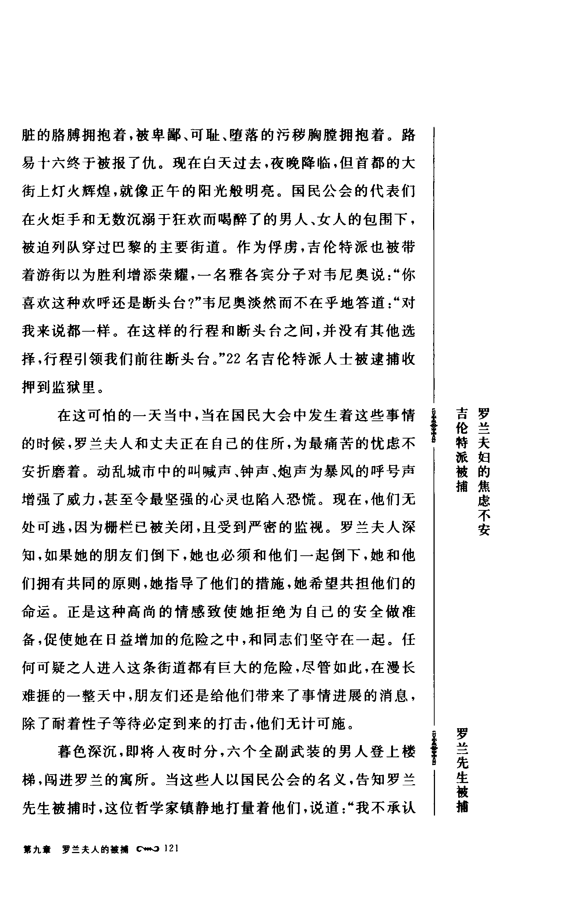

<small><a href="images/pages/133.png">原书第122页 · PDF 第133页 · 查看原页</a></small>

这行人的头头回答说：“我没有使用暴力的命令，我将回去向委员会报告你的回答，同时，留下一个士兵保护你的人身安全。”

这种时刻唤起了罗兰夫人的所有力量和英勇决心，她立刻坐下来，很有条理的头脑迅速行动起来，在很短的时间里，她给国民公会写了一封信。她留下一个明友和丈夫待在一起，叫来了一辆出租马车，驱车飞快地前往杜伊勒里宫，国民公会的人员正在那儿开会。杜伊勒里宫的花园里充满了混乱的人群。

罗兰夫人强行闯过人群，来到会场外部的门前。驻扎在各条通道上的哨兵不允许她进入会场。

“公民们，”她即刻敏捷地采用了雅各宾派的腔调，“在这个拯救我们祖国的日子里，在那些叛国者威胁我们的时候，你们不知道我要递交给会议主席的一些文件的重要性。”

这些话像是一件护身符，大门立刻打开了，罗兰夫人走进了请愿者大厅，对里面的一个哨兵说道：“我想找一个会场通报人。”

“那只有等到有人出来。”哨兵粗鲁地回答道。

罗兰夫人十分焦急地等了一刻钟。她的耳朵几乎为大声的争论、欢呼、咒骂的喧闹声震聋，这些叫嚷声一时稍微低下去，便接着再次雷鸣般地响起来，在拥挤的大街上激起相应的附和声，喧闹声在夜空中增强变大。在人类所有的声音之中，无数人疯狂的叫嚣声音是很可怕的。最后，罗兰夫人瞥见了曾经召唤她前往国民公会被告席回应维亚尔指控的通报人，便对他诉说了他们夫妇的危险，恳请他把信交到会议主席手中。通报人罗泽（Roze）先生拿着这封信，用胳膊肘推开人群，消失不见。一个钟头过去了，仿佛过了一个世纪之久，里面的吵闹丝毫没有减弱。最终，罗泽先生再次出现了。

原页对照（含插图与旁注）
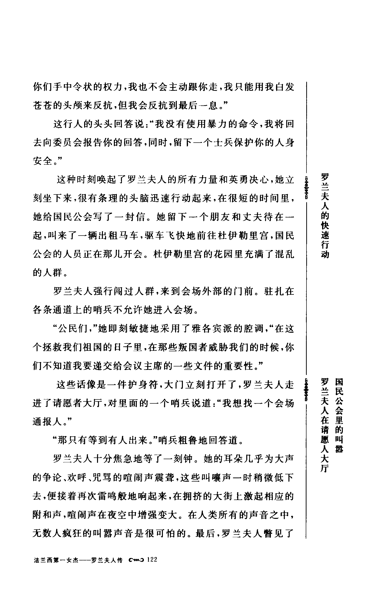

<small><a href="images/pages/134.png">原书第123页 · PDF 第134页 · 查看原页</a></small>

罗兰夫人着急地问道：“怎么样，我的信如何处理的？”

罗泽先生回答：“我把它交给了主席，但到现在为止，对它还没有进行任何处理。里面到处是难以形容的混乱，暴徒要求指控吉伦特派。我刚帮助一个人秘密逃走，其他人正利用混乱隐蔽起来，设法逃走，没有人知道将会发生什么事情。”

“天哪！我的信还没有被阅读。请为我召唤几个代表，我有话对他们讲。”

“叫谁呢？”

“实际上，除了那些被剥夺了公民权的人，我与其他人几平都不熟悉，我也不敬重其他人。请告诉韦尼奥我要见他。”

虽然韦尼奥正处于可怕的焦虑中，但还是立刻听从了罗兰夫人的召唤。罗兰夫人请求韦尼奥设法让她进入被告席，这样她就可以为她的丈夫和朋友们辩护。

韦尼奥说：“在国民公会目前的状态下，这是不可能的，即使可能，也是没有用的。国民公会已经失去了所有的权力，它变成了乌合之众的武器，你的话不会有任何用处。”

罗兰夫人回答：“也许他们会发一下善心，我敢于讲出那些如果你讲就会使你面临指控的话，我无所畏惧。如果我不能拯救罗兰，我也要大声说出对共和国有益的实话，一个勇敢的榜样也会使国民感到羞耻。”

原页对照（含插图与旁注）
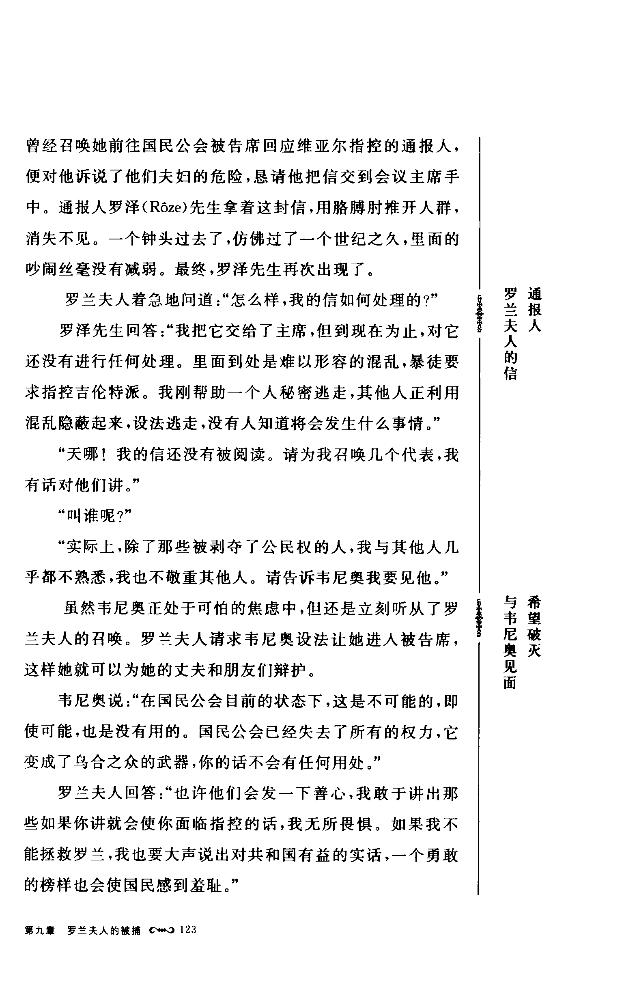

<small><a href="images/pages/135.png">原书第124页 · PDF 第135页 · 查看原页</a></small>

韦尼奥说道：“我想无论如何努力都是没有用的。你的信在两三个钟头内根本不可能被读到，很多申诉人群集在被告席上，整个大厅里充 着噪音、混乱、暴力。”

罗兰夫人停顿了片刻，说道：“那我必须赶紧回家，确定我丈夫发生了什么事情，我立刻返回家，也请告诉我们的朋友们。”

韦尼奥悲伤地握了握她的手，仿佛是最后的告别。受到罗兰夫人的勇气的鼓舞，韦尼奥返回会场去迎战向他袭来的暴风雨。罗兰夫人急匆匆地回到住处，发现丈夫已经成功避开了士兵的监视，从后面的一条通道逃脱，躲避到一个朋友家中。寻找了一会儿，罗兰夫人在他的避难所找到了他，她激动得流出了眼泪，扑到他的怀里，告诉他自己所做的一切，十分欣喜他是安全的。然后，罗兰夫人毅然返回国民公会，下决心如果有可能，就进入会场去。现在已经接近午夜，大街上灯火通明，但罗兰夫人不知道这些彩灯是在庆祝哪个党派的胜利。

当罗兰夫人到达杜伊勒里宫的时候，她发现那里非常安静，空旷，而刚才这里还聚集了大约4万暴民。原来会议已经结束了，代表们在“亲善”他们的民众簇拥下，正在大街上走动。在宫殿的各处门前，一些哨兵瑟瑟发抖地站在寒冷的细雨中。

一群外表粗野的人正围在一尊大炮前，罗兰夫人走向他们。

她问道：“公民们，今晚，每一样事情都进展顺利吗？”

他们答道：“哦，非常顺利，在那边的自由树下，代表们和人们相互拥抱，唱着《马赛曲》。”

原页对照（含插图与旁注）
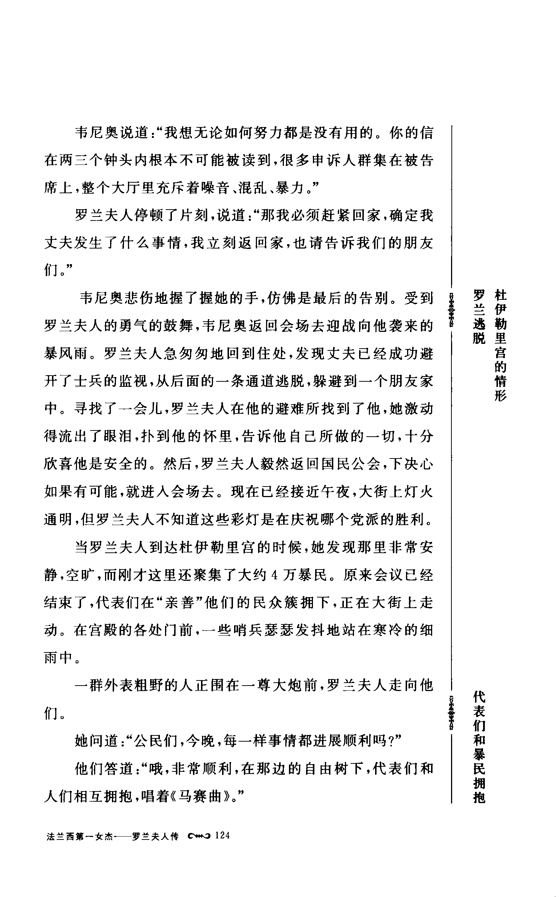

<small><a href="images/pages/136.png">原书第125页 · PDF 第136页 · 查看原页</a></small>

“那22名吉伦特派人士遭遇如何？”

“他们全部被逮捕了。”

受到这个打击，罗兰夫人几乎晕倒。她急忙穿过小巷，来到自己的出租马车前。有一条失去主人的小狗跟随着她。马车夫温和地问道：“这是您可怜的小动物吗？”在这个充满危险的晚上，他说话的温和声调使罗兰夫人的眼泪夺眶而出。

“我想要它，把它送给我的小儿子。”马车夫说道。

在这样的时刻，罗兰夫人很高兴一个车夫还拥有一个父亲和男人的情感，她说道：“把它放到马车里吧，我会为你小心照顾它。请立刻驱车前往卢浮官的美术馆。”罗兰夫人抚摸着这个有感情的小动物，十分厌烦人类的情感，她渴望离群索居，与那些知恩图报的动物一起与世隔绝。她坐在车里，呼喊道：“但愿我们能脱离法国，在法治的美利坚共和国找到一处家园。”

到卢浮宫下车后，她拜访了一个朋友，她希望和他商量能使罗兰先生逃出巴黎城的办法。她的朋友刚刚上床休息，但立刻起来，与罗兰夫人交流了各种方案，并约定在第二天早晨7点钟会面。罗兰夫人根本没有想到自己，她只想着营救她的朋友们。她累得筋疲力尽地回到了凄凉的家中，向正在熟睡的孩子俯下身去，忍不住眼泪纷飞，尽情释放着母爱。在恢复了坚强后，她坐下来，给罗兰写了一份解释她所有行动的备忘录，说如果她要和他躲避在一起，这将会危及他的安全。当罗兰夫人躺倒在床上要休息一会的时候，黎明前的黑暗正在涌现。悲伤和劳累压倒了她，当一队武装人员粗暴地闯进她的房子，进行传讯时，她刚刚入睡。她很清楚地知道传讯对象，逮捕她的命令展示在她面前，她镇静地朗读了命令，请求允许她给一个朋友写封信，她的要求得到许可。但写完信后，军官告诉她，他有必要知道信中的内容。于是，罗兰夫人平静地把信撕成了碎片，投进了火炉中。然后，在还未醒来的孩子脸上印下最后一吻，便离开家前往监狱。在巴黎，流血太过随意，断头台的操作太过频繁，对罗兰夫人来说，她正走的路通向哪里，是毫无疑问的。

原页对照（含插图与旁注）
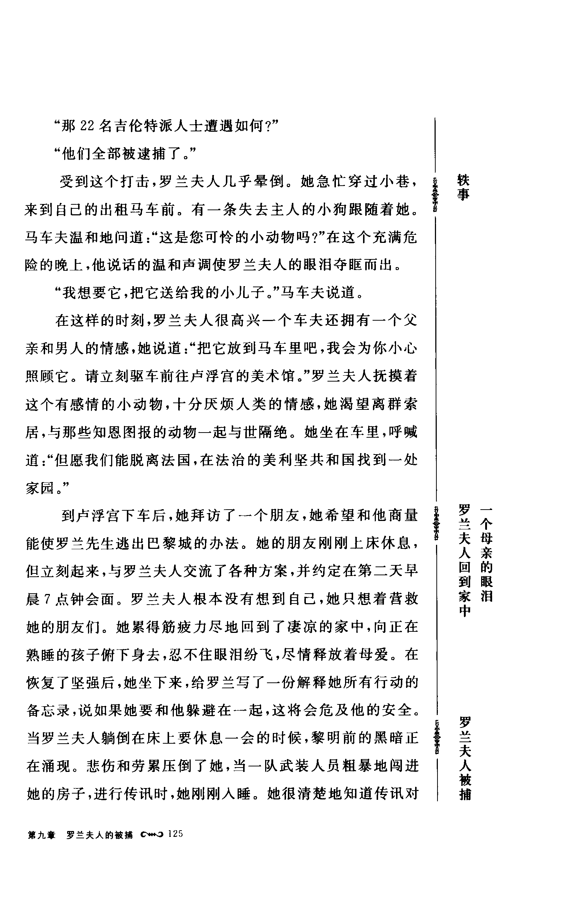

<small><a href="images/pages/137.png">原书第126页 · PDF 第137页 · 查看原页</a></small>

在这个寒冷阴霾的早上，罗兰夫人在军官们的陪同下，穿过自己住所的客厅，在这里，她成了被热烈仰慕、爱慕的对象，仆人们聚集到她周围，唱起哀歌，歌声盈满整个房子，甚至连硬心肠的士兵都被这场面感动了，他们其中的一个人喊道：“你是多么受爱戴啊！”在这种受到考验的时刻，只有罗兰夫人十分平静，她镇定地回答道：“因为我爱他们。”当她被宪兵带着离开家时，一群人聚集在她的门前，这些人认为她是国家的叛徒，与敌人结盟，他们喊道：“送上断头台！”对他们的喊叫，罗兰夫人无动于衷，她平静而同情地看着这些人，没有任何举动，也没有回答。其中一个军官，为了减轻她所遭受的悔辱，问她是否希望把马车的窗户关上。

她回答道：“不用！受迫害的清白者不能表现出一副有罪和羞愧的姿态，我不惧怕诚实的人的观看，我要勇敢地面对我的敌人。”

军官说道：“你有巨大的决心，因而如此镇定地等待正义！”

她大声说道：“正义，如果正义存在，我就不会在这里。但是，就像现在我前往监狱一样，我将无所畏惧地走向断头台。”

原页对照（含插图与旁注）
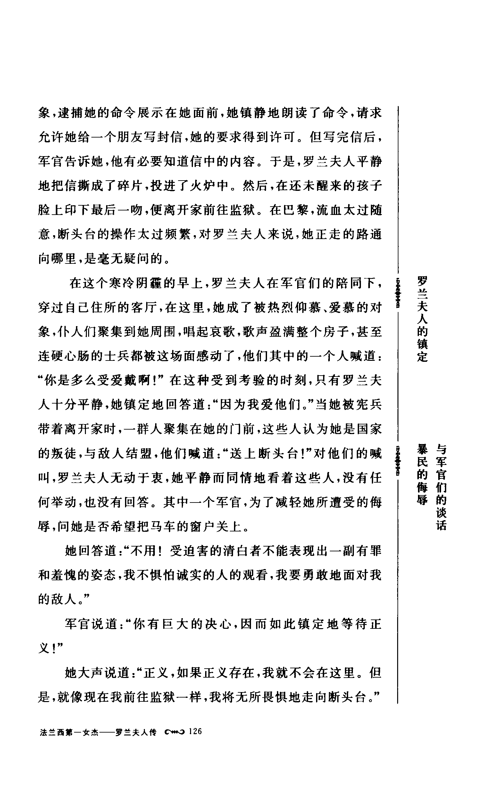

<small><a href="images/pages/138.png">原书第127页 · PDF 第138页 · 查看原页</a></small>

其中一个军官粗暴地说道：“罗兰的逃走就是他有罪的证明。”

罗兰夫人愤怒地回答：“一个为自由事业服务的人竟然受到如此残暴的迫害，他的行为光明磊落，他的账目清清楚楚，他理应避免最终的妒忌和恶意的侮辱。与正直的阿里斯提得斯和不屈不挠的加图一样，是他的美德招致了敌人。让他们把怒气撒向我吧，我蔑视他们的权力，情愿去死。为了国家，罗兰先生应该保存生命，对国家，他或许更加有用。”

当他们到达阿贝义监狱的时候，罗兰夫人先被带进一间宽大，黑暗的房间中，里面住了许多人，这些人神态十分忧郁，要么在地板上慢慢地走来走去，要么靠在简陋的床上。接着，罗兰夫人登上一个狭窄、脏乱的楼梯，来到狱卒的房间。狱卒的妻子是一个仁慈的女人，她立刻感受到这位迷人的囚犯身上散发出一股吸引力，因为还没有单人牢房提供给罗兰夫人，她便让罗兰夫人在当天的其余时间待在她的房间里。带罗兰夫人到监狱的特派员下令，对罗兰夫人要严厉对待。然而，这只是口头上的指示，并没有受到认真的重视。狱卒供给罗兰夫人的食物不是难以下咽的监狱伙食，而是较为可口的饭菜。早饭过后，罗兰夫人被允许给国民公会写一封关于自己被非法逮捕的信。一天就这样过去了。

在晚上十点钟，罗兰夫人的单人牢房备好，她第一次走进了牢房。这是一间阴冷、空荡荡的房间，岁月的灰尘和潮湿使墙面都已发黑。牢房中有一个小壁炉，一个装着双层铁窗栏的小窗户，甚至在中午，也只能透进微弱的光线。在牢房的一角，有一张铺着稻草的床。夜间的寒气从没有玻璃的窗户袭进来，凄凉的警钟声昭示着首都依然充满混乱和暴力的场面。罗兰夫人躺在粗陋的床上，疲劳压倒了她，直到第二天中午十二点，她才从无梦的睡眠中醒来。

原页对照（含插图与旁注）
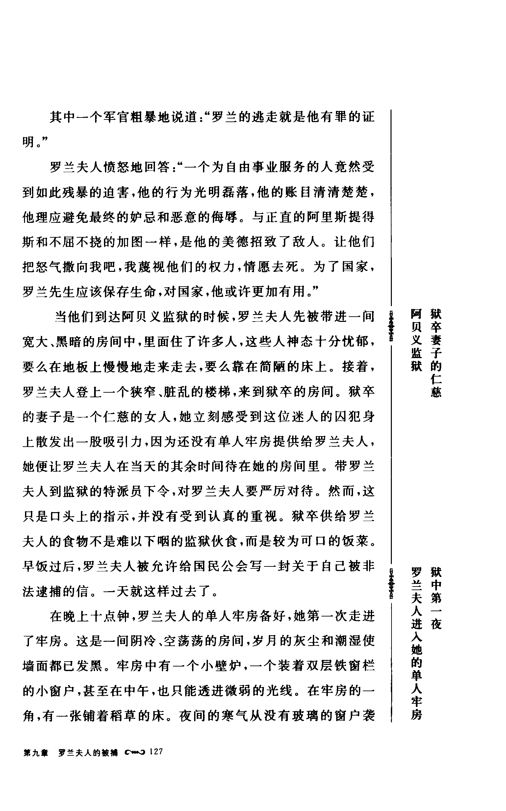

<small><a href="images/pages/139.png">原书第128页 · PDF 第139页 · 查看原页</a></small>

一个朋友带走了欧朵拉，她被母亲留给哭泣的佣人照顾，这位朋友像母亲一样照顾和保护着欧朵拉。虽然罗兰夫人再也没有见到她心爱的孩子，当确知她已经找到一个因为母亲的原因而珍爱她的家后，罗兰夫人的心在狱中安定下来。

很快，罗兰夫人遭逮捕关押的消息传到了她不幸的丈夫耳中，罗兰先生正在避难。他的尴尬是最令人痛苦的：留下来与妻子一起承担她的厄运，无论结果如何，都只会减少她逃亡的机会，增加她的危险；然而，抛下高尚的妻子独自面对无情的敌人，看来又是如此不坦荡大度。现在，胜利的雅各宾派，正如猎犬般地急切地搜索着巴黎的每一个角落，要把失败的部长从藏身之处揪出来。显而易见，首都中很快就没有隐秘的藏身之处，使他能够躲避警戒搜索，他必须赶紧逃走，寻找安全之地。他的朋友为他弄来了农民的破烂服装。在一个黑夜，罗兰先生独自一人，心惊胆战地从藏身之处潜行，开始沿着曲折迂回、人烟稀少的路线逃亡到瑞士的边境，他希望在阿尔卑斯山寂静的山间找到一个临时的避难所来埋葬自己。

一个人可以勇敢无畏、不屈不挠地面对敌人，但当他回过头看的时候，也会感到后怕不已，恨不得飞一般地离开敌人。两三天里，他的脚上就起了水泡，他痛苦地艰难跋涉于凄凉的旅程。当罗兰先生进入穆兰地方时，他那显著的特征被人认出，于是，他遭到了逮捕，被押回巴黎，投进了监狱。在狱中，他苦恼了一阵子。后来，罗兰再次逃脱，在一些朋友的帮助下，躲藏到鲁昂附近。在那儿，他处于一种无法形容的焦虑、痛苦状态，这种状态一直延续到妻子死亡。

原页对照（含插图与旁注）
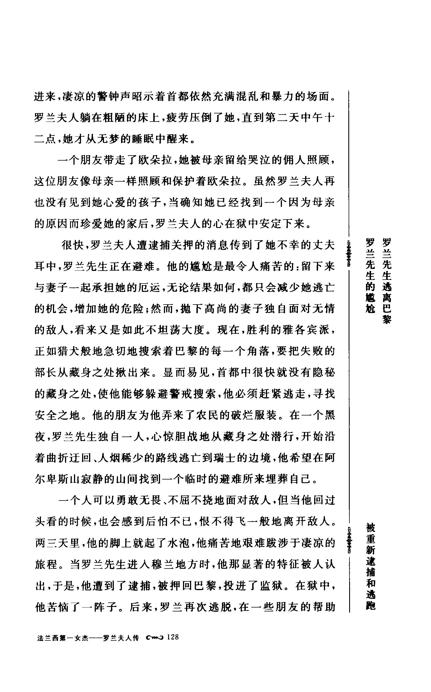

<small><a href="images/pages/140.png">原书第129页 · PDF 第140页 · 查看原页</a></small>

当罗兰夫人从长长的一觉中醒来，她并没有陷于绝望和无用的抱怨之中，而是立刻开始尽可能舒适地布置她的牢房。她环视着四周，寻找着能得到的制造舒适和愉快的材料。这极好地说明了心安和快乐的精神不仅能够减轻剧烈的痛苦，而且能够缓解最深重的尘世悲伤。她面带着发自内心、真诚亲切的微笑，获得了一些帮助，她得到了一张小桌子，然后又得到了一张铺在桌上的洁白桌布。

罗兰夫人把小桌子放在窗户附近，用作写字桌，对所拥有的这张小桌子，她非常珍惜，擦得干干净净。她微笑着告诉她的看守人，她做了一个火炉边的餐桌，实际上，不过是一个铁锈斑斑的小餐桌。罗兰夫人从浓密的卷发上拔下两个发夹，插进一块板子上用作挂衣服的小钉子。布置这些时，她是如此快乐，就好像在她曾是主人的宫殿中那样优雅地指挥布置漂亮的家具。就这样，她为学习做着准备，她下一步关心的是要弄到一些书，在她身上的口袋里恰好装了她很喜欢的一卷书—汤普森（Thomson）的《四季》。通过狱卒的妻子，她又成功地获得了普鲁塔克的《名人传》和谢里丹（Sheridan）的《辞典》。

狱卒和他的妻子都深为这位囚犯的魅力所吸引，当天，他们就邀请罗兰夫人共进晚餐。在孤寂的牢房中，罗兰夫人清楚地听到“咚咚”的鼓声、“嘡嘡”的钟声和各种喧闹声，这些声音宣告着民众仍在大街上发动骚乱风暴。一个忠诚的仆人前来看望罗兰夫人，看到女主人身处这样的境地，可怜的女孩流下了眼泪。罗兰夫人也被这种情感压倒了片刻，但她很快就恢复了自我克制，她努力抛开心中所有关于丈夫和孩子的痛苦想法，尽可能调整自己勇敢地适应环境。监狱中的规矩十分严格，政府每天为每位犯人拨款20便士做生活费。罗兰夫人把其中10便士交给狱卒支付他放进牢房的家具，另外10便士作为伙食费。然而，狱方允许囚犯们，只要他们愿意，可以自己掏钱购买食物。罗兰夫人，凭着使她战胜各种不幸的淡泊精神，决心按照监狱补助费生活，她早餐只吃面包和水，主餐只吃粗肉和蔬菜。这般俭省节俭下来的钱，她分给了狱中更可怜的囚犯们。她允许自己的唯一放纵是购买书籍和鲜花。通过阅读和用笔写作，罗兰夫人消磨着令人厌恶的囚禁时光。尽管，时不时地想到凄凉的家庭和破灭的希望，她的精神也会为痛苦压倒，但是，哪怕在这令人不快的监狱环境中，她仍然在出现于身边的温暖情感中找到了很大的安慰。

原页对照（含插图与旁注）
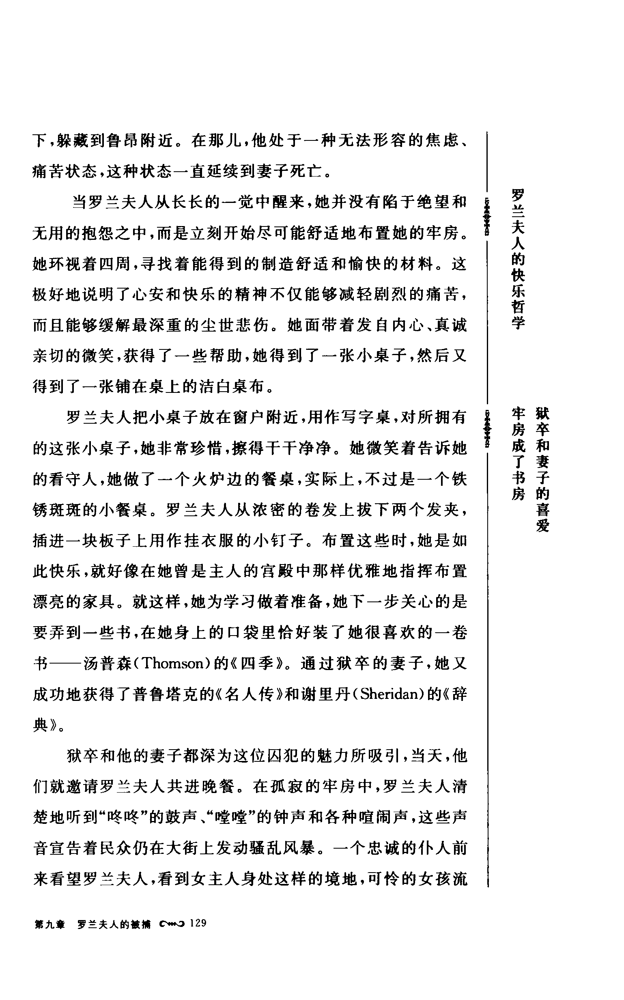

<small><a href="images/pages/141.png">原书第130页 · PDF 第141页 · 查看原页</a></small>

虽然，罗兰夫人已被迫放弃了年轻时代的所有热情梦想，但是，她仍然对自己的信仰保持着信心。她认为，不久以后这些黑暗的风暴就会从政治视野中消失不见，国家很快会迎来更为光明的时日。任何不幸都不能扰乱她宁静的心灵，任何重重的危险都不能使她丧失勇气。为了合理利用每一小时，她立刻系统地安排自己的时间。想到丈夫在躲藏地很安全，亲爱的朋友甘愿照顾他的需要，她感到高兴；想到女儿受到母亲般的细心照顾，她感到安心。令人焦虑的可怕斗争已经结束，她沉着平静地服从了自己的命运。在遭受狂风暴雨击打如此长时间以后，她好像在她的牢房中找到了一个宁静的港湾，她的思绪飞回到往昔的日子，在父亲屋檐下的小房间中，她十分平静快乐地与书籍共度的那些时光。然而，她仍然在尽力争取重获自由，她写信给国民公会，抗议自己的非法被捕。她发现，所有的努力都无用处，但她仍然没有失去勇气，也没有怨恨之语。她把大多数时间用于撰写她对所经历的历史事件的评论，她把这些文件托付给一个常来看望她的朋友保存起来。后来，她那些富有文采、感情真挚的文章和她的回忆录一起出版了。由于受过良好教育的头脑能有这样的消遣，囚禁的时光也滑得飞快，甚至伴着幸福。或许有人发现，在欧洲，懒洋洋地倚靠在舒适马车上或者躺在柔软床上的很多女士，也少有这般快乐的时刻。

原页对照（含插图与旁注）
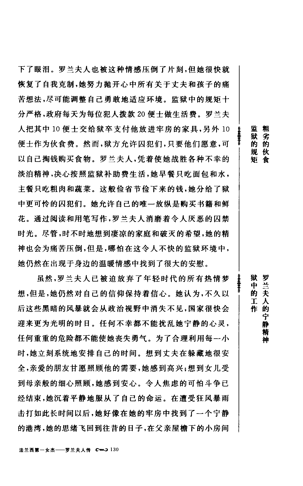

<small><a href="images/pages/142.png">原书第131页 · PDF 第142页 · 查看原页</a></small>

一天，一些委员到罗兰夫人的牢房造访，希望从她口中套出她丈夫的藏身之所。罗兰夫人面色平静地看着他们，说道：“绅士们，我当然知道我丈夫在哪儿，我不屑对你们撒谎。我也知道我自己的力量，我向你保证，没有任何尘世的力量能够劝服我背叛丈夫。”

委员们退出去，他们很敬佩她的英勇，认为她仍然能够发挥影响，这种影响或许会使他们有一天也被推到断头台上。罗兰夫人的命运已被注定，她的英勇就是她的罪行，她太杰出，不能让她活着。

原页对照（含插图与旁注）
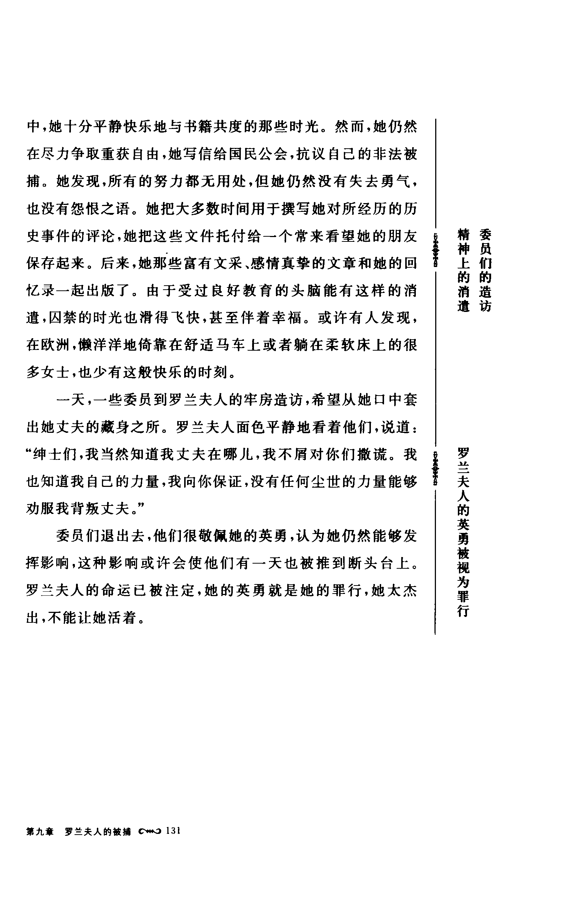

