# 第十章 吉伦特派的命运

<small><a href="images/pages/143.png">原书第132页 · PDF 第143页 · 查看原页</a></small>

1793年

原页对照（含插图与旁注）
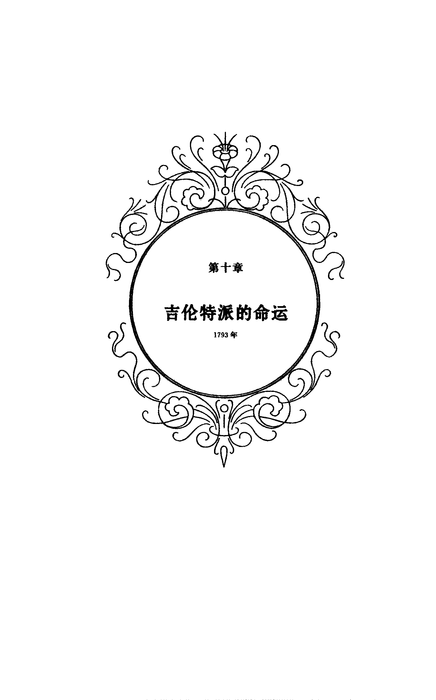

<small><a href="images/pages/144.png">原书第133页 · PDF 第144页 · 查看原页</a></small>

罗兰夫人是吉伦特派的灵魂人物，由于吉伦特派的命运与罗兰夫人的经历如此紧密地联系在一起，故我们现在先把狱中的罗兰夫人撇在一边，回过头来关注一下她的同伴们的命运。预示着暴风雨正来临的雷鸣声已经给吉伦特派发出了警告，于是，很多人通过各种伪装，逃出了巴黎，他们无依无靠、穷困潦倒，流浪在欧洲各地。然而，也有另外一部分人太过于骄傲，不愿意逃走，他们怀着最高尚的爱国主义情操，不愿受良心的谴责，愿为深爱的祖国牺牲自己，他们决心坚守在自己的职位上，迎战敌人。他们镇静坚定地等待着敌人的进攻。然而，这种英勇气概只不过更加激怒、鼓舞了敌人，在法兰西，仁慈很久以前就消逝了。

在国民公会被淹没在杀人者叫嚣杀戮中的那个混乱、可怕夜晚之后，很快，21名吉伦特派人士就被逮捕，被投进了裁判所附属监狱的地牢中。他们被关押在一起，他们完全知道，对他们的审判不过是一场讥笑嘲讽，他们的毁灭已经注定。他们用所拥有的豁达精神和引以为豪的崇高精神安慰、鼓励着彼此。这些阴暗的牢房，位于街道的水平面之下，就算是正午的阳光也只能从小铁窗中微弱地透进光线。由于囚禁、污秽的空气和哀伤，他们的脸色很快变得苍白憔悴。

原页对照（含插图与旁注）
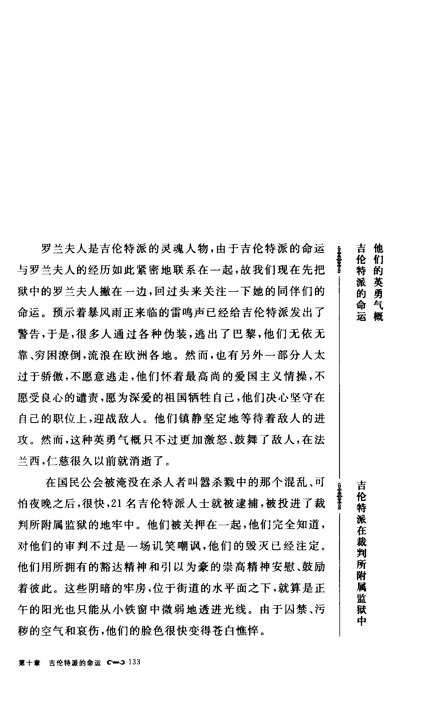

<small><a href="images/pages/145.png">原书第134页 · PDF 第145页 · 查看原页</a></small>

没有什么比这种情景更不幸：一个习惯于精致优雅生活、有知识品位的杰出男人身陷极大的悲惨之中，远离了舒适的生活，甚至被剥夺了人类的尊严。这些杰出的政治家和能言善辩的演说家，曾经，他们的话语震动全欧洲人的耳朵，现在，他们变成了最令人嫌弃的乞丐般憔悴和悲惨的模样。地牢的潮湿污秽使他们的衣服破烂不堪，不能清洗，因为不能洗面刮脸，他们几乎失去了人类的模样，他们彼此也厌憎起来。

他们没有宗教赋予的慰藉支撑，必定为很多最黑暗的悲伤时光所包围着。

不少代表是年轻人，他们正处于生气勃勃的生命之晨，胸膛中洋溢着充满喧嚣世界的激情，心中怀着饱满的希望，爱激励着他们、良好的健康鼓舞着他们。他们发现，自己就这样突然从荣誉和权力的顶峰掉进了凄凉黑暗的地牢，从这里出去，只是把他们带向断头台，光明的生活希望已破灭在午夜漆黑的黑暗之中。在这些人等待审判的时候，几个月慢慢地过去了。日复一日地，当违法暴力的魔鬼在血污的首都大街上暴乱时，他们就听到警钟的长鸣声、警枪的回荡声、暴动鼓的敲击声。当装有死刑犯的车辆辘辘地行驶过他们头顶的街道时，暴民恶魔似的高声咒骂伴随着车辆，这些车辆正承载着民众的狂怒前往断头台。尽管如此，吉伦特派人士仍然十分坚强地努力振作精神，面对自己的命运。

在三重铁门防护和无数哨兵的看守下，想从结实的石头墻中逃走根本没有可能，哨兵们以性命为他们看管的囚犯的安全负责。几星期过去后，对吉伦特派人士的关押严厉度变得稍微温和一点，通常，允许吉伦特派人士隔着铁门与朋友会面，也允许他们看书，这有助于缓解禁闭的沉闷。韦尼奥的姐夫带着自己的儿子、一个10岁的男孩来探望韦尼奥。这个可爱男孩的容貌使韦尼奥想起他亲爱的姐姐，他内心悲哀地涌现出对过去欢乐的回忆。这个孩子看到囚禁中的舅舅好像一个坏人一样：他面颊憔悴凹陷、头发蓬乱地搭在额前，长长的胡须使得面庞很丑陋，衣服烂成了一条条。小男孩被这凄惨的景象吓坏了，他紧紧地依偎着父亲，突然大哭起来。

原页对照（含插图与旁注）
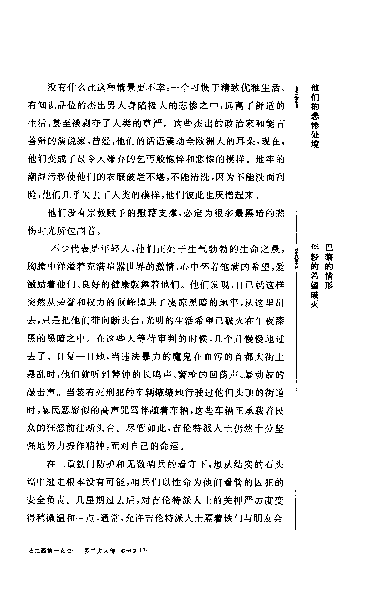

<small><a href="images/pages/146.png">原书第135页 · PDF 第146页 · 查看原页</a></small>

韦尼奥亲切地抱起他，说道：“孩子，好好看着我。当你成为一个男人的时候，你会说你见过韦尼奥—共和国的奠基人，在最辉煌的时期，他总是穿着最漂亮的衣服—-他受到了最不应当的迫害，准备为自由而死。”这些话给这个孩子的心灵留下了深刻的印象。半个世纪过去之后，他依然记着并反复向人讲述着。

这些杰出的人物在一天早上被带走并处死了，但关押吉伦特派人士的牢房至今依旧保留着，黑暗的石墙上，仍然记录着他们曾在那儿刻下的情感，显示着那些鼓舞他们、支撑他们的情感之原貌。这些谚语似的箴言和英勇表达，从法国的悲剧或者名著中收集而来，用他们血管中的鲜血写成。有人在一个地方认真地写道：

“当加图不再有力量保护罗马自由时，他仍然自由，并且知道为了人类该怎样去死。”

再有：

“一个正直的人绝不会完全不幸。”

在另一处有：

“真正的自由是灵魂的自由。”

原页对照（含插图与旁注）
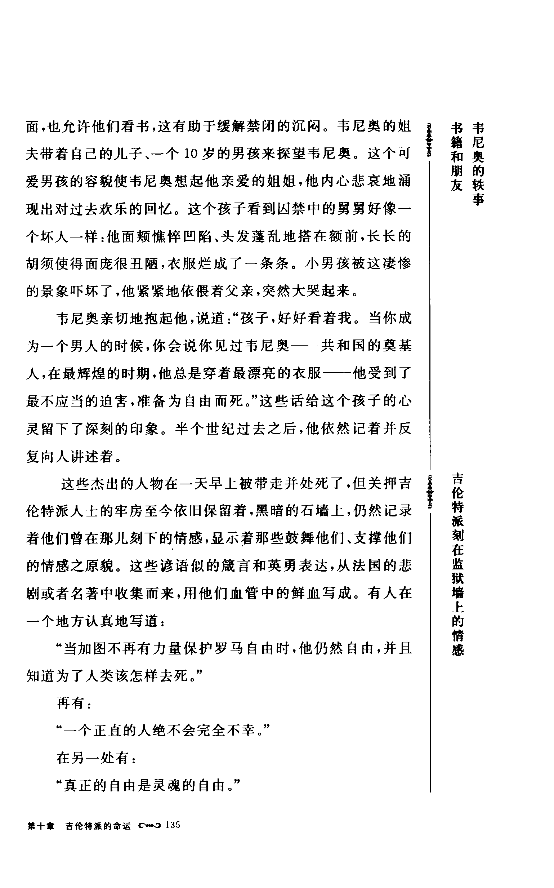

<small><a href="images/pages/147.png">原书第136页 · PDF 第147页 · 查看原页</a></small>

在一处横梁上写着：

“甚至连上帝都乐于看到勇敢的人与逆境作斗争。”

再有：

“在重大的不幸之中，接受自己、美德、正义、上帝的安慰多么重要。”

在这之下写着：

“时代并不比我的心灵更为纯净。”

有一行用血刻下的大写字母，这是韦尼奥的笔迹：

“死亡胜过蒙受羞辱。”

但那儿有一句话可能是一位虔诚的人士所刻下的，这句话“效仿基督”改编而成：

“记住，召唤你来，不是让你过放纵享乐的生活，而是要辛苦劳作、经受苦难。”

拉苏尔斯（La Source）和西耶里（Sillery）是十分忠诚的朋友，两人被关押在一间牢房中。拉苏尔斯是一位虔诚的基督徒，在虔诚的安慰中，他找到了坚定的支撑。西耶里多情善感，是朋友的虔诚安慰了他。拉苏尔斯谱写了一首极好的赞美诗，适合愉快庄重的氛围。他们把唱赞美诗称之为晚间的修行，一夜又一夜，人们听到这首悲伤的哀歌从他们黑暗的牢房中轻轻地流传出来，音调是如此的优美哀伤，以至于但凡听到过它的人们，心中从没有抹去这首歌。很难设想，会有比这种丧钟更为感人的东西，在午夜黑暗凄凉的地牢中，它温柔地唱着：

请平息侵袭我们心灵的骚动，

请给予我们您那有力的帮助。噢！慈悲之源啊，滅轻我们的苦痛，

原页对照（含插图与旁注）
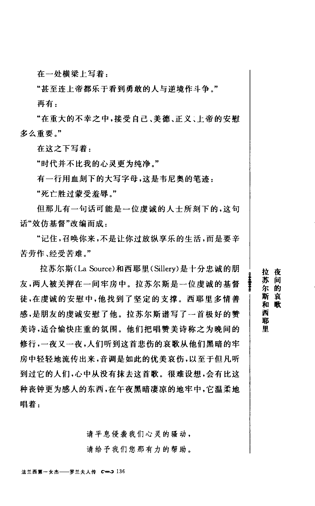

<small><a href="images/pages/148.png">原书第137页 · PDF 第148页 · 查看原页</a></small>

打破、打破我们痛苦的枷锁！

大声呐喊的囚禁者啊，

热爱飞翔的悲伤者啊，

接受我们饱含热泪的敬意吧，

这是我们所能给予的全部敬意。

永生的主啊！请捍卫我们的事业，

噢，上帝，请帮助无罪的人。

她永远住在您旁边，

她永远信赖您。

您最明白人心中的秘密；

您最了解压迫者与被压迫者。

请您怜悯地看待我们的过错，

消弭冒犯您招致的厄运吧。

但杀人者的武器获胜；

暴行袭击我们的生命；

他们冷漠无情、洋洋得意、嘲笑奚落地屠杀，

我们用最后一口气祈祷。

祭拜爱国者坟墓的时刻，

光荣的时刻将会到来。

我们在心中悲愤地宣布，

祖国将为我们的名誉昭雪。

原页对照（含插图与旁注）
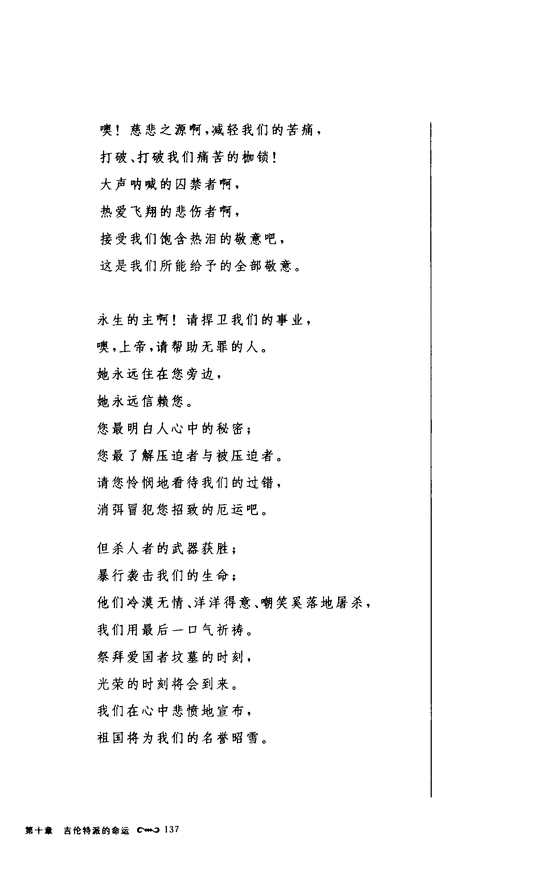

<small><a href="images/pages/149.png">原书第138页 · PDF 第149页 · 查看原页</a></small>

在这些杰出的囚犯等待着自己的命运时，夏天来了又去了。虽然内心厌世沮丧，但他们仍然尽力相互鼓舞，英勇坚毅地迎接自己可怕的命运。审判他们的日子终于到来，那天是1793年10月20日。布告和蛊惑人心的演说，早已把他们作为叛国者展示在暴民面前，巴黎的民众叫嚣着要把他们送上断头台。他们从裁判所附属监狱的地牢中被带到了取错名字的正义厅。众多愤怒的男人包围着法庭，到处充满咒骂声。那天，巴黎上演了临时兵营的一幕。雅各宾派知道，仍然有很多有影响的公民敬重吉伦特派是不可腐蚀的爱国者，他们决定防止可能发生的营救，他们有理由担心发生反对革命的行动。因此，他们调集了自己控制之下的军事力量，部署在审判现场周围。身插羽毛、头戴铁盔、手持闪亮马刀的骑兵队巡逻在大街上，民众根本不可能集合起力量。重炮车隆隆地走过，路面都震动不已，这些重炮准备着对敌人发射出暴风雨般的炮弹。长队的步兵，身负步枪和闪闪发光的刺刀，守卫着通向法庭的每一条道路。在法庭上，仇恨的情感正嘲笑地高高坐在审判席上。

这些囚犯们鼓足勇气，坚强地面对命运的决定性时刻。在庄严的队列中，他们两个两个地走进审判法庭，坐到被宪兵和绷着脸的群众包围着的长椅上，在已经决定他们命运的法官面前，接受审讯。整个世界的目光都在看着他们，被告在名誉上、地位上、才能上都很出众，在偏远的省份，也有很多人是他们的朋友，因此，举行这次审判仪式非常必要。少数几个人还抱着生还的希望，他们虚妄地梦想着，通过保持沉默，屈从于摧毁他们的不可抵抗的力量，可能会博得一些怜悯。这是这些伟人所不足取的弱点。但是，在凄惨的地牢中关押了几个月，有多少人的头脑还能够保持镇静呢，在阴暗的地牢中，精神力量的源泉随着希望的熄灭而消亡。审判持续了一星期之久，10月30日，夜间11点钟，判决下来了，宣判他们全部犯有阴谋反对共和国的罪行，判处死罪，第二天，旭日初升时，将把他们押上断头台。

原页对照（含插图与旁注）
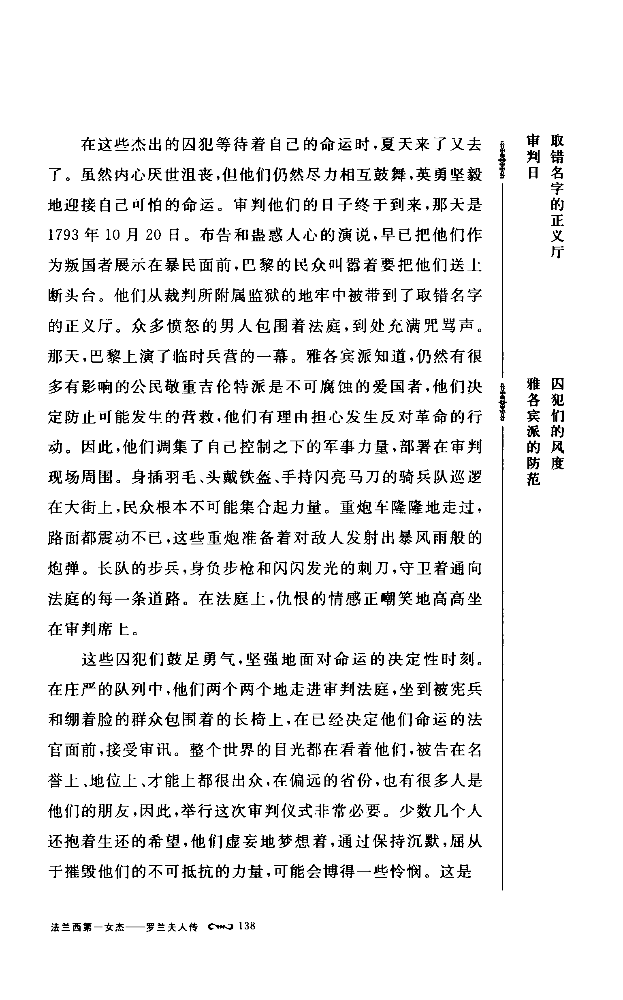

<small><a href="images/pages/150.png">原书第139页 · PDF 第150页 · 查看原页</a></small>

当宜读宜判书的时候，其中一个被告人瓦拉泽（Valaze）先生，做了个手势，好像在撕扯他的衣服，接着便从椅子上倒在了地板上。布里索用力扶起他，说：“什么！瓦拉泽，你丧失勇气了吗？”瓦拉泽虚弱地回答：“没有，我要死了。”他停止了呼吸，他的手依然紧握着刺进胸口的匕首把柄。

一瞬间，出现了无法形容的悲惨一幕：死刑犯们悲痛地围在同伴的遗体旁，一些期待宣判无罪的人，被逼近的死亡压垮了，屈从于瞬间的脆弱，大声谴责，失声痛哭。其他的人，脸色苍白茫然，忧郁沉默地看着四周。有一个人，疯狂兴奋地在头顶挥舞着手臂，大喊道：“这是我生命中最辉煌的一天！”韦尼奥坐在最高处的长椅上，冷静坦然地看着这种场面，欣喜自己的精神已经战胜了危险和死亡。

一些人展示的脆弱只不过是瞬间的，很快，他们就打起了精神，勇敢地迎接自己不可避免的死亡。他们围拢在死去的同伴尸体旁，哀悼了一会儿。然后，排成队列，回到了牢房。当被判死刑的吉伦特派人士从司法宫法庭回到裁判所附属监狱的地牢时，刚好是午夜。他们在地牢中等待飞逝的时光带来黎明，那时，他们将迈步走向断头台。

现在，他们恢复了镇定沉着，心中洋溢着崇高的热情。为了履行对狱友们许下的承诺，他们通过声音的回响，告诉狱友们自己的命运，于是，他们唱起了《马赛曲》。当他们用精神高昂的声调唱起《马赛曲》时，裁判所附属监狱的屋顶回响着这首歌：

原页对照（含插图与旁注）
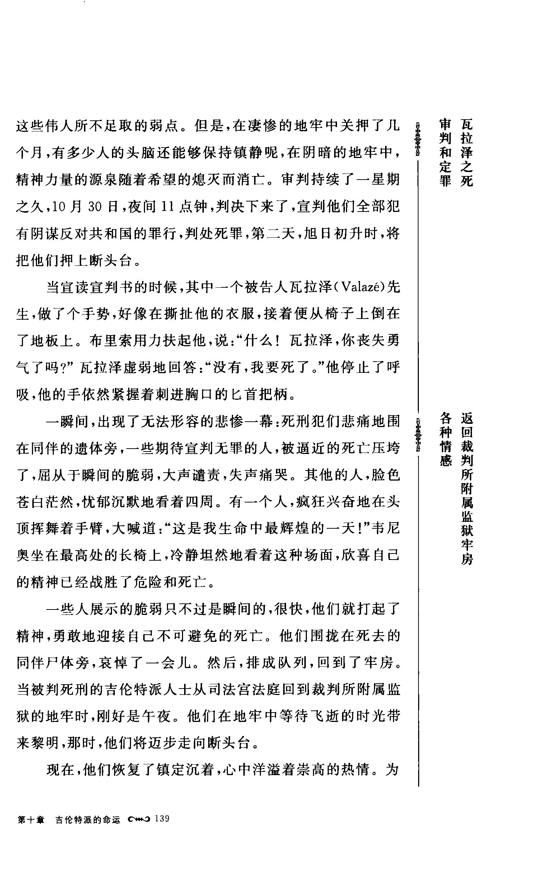

<small><a href="images/pages/151.png">原书第140页 · PDF 第151页 · 查看原页</a></small>

前进，前进，祖国的儿女，

那光荣的时刻已来临，

专制暴政在压迫着我们，

我们的祖国鲜血遍地。

这是他们死亡的哀声。当他们慢慢地穿过昏暗的监狱走廊，走向牢房时，这首挽歌般呜咽的胜利歌曲穿透到阴暗地牢的最深处，唤醒了每一个不幸者，他们都从床上抬起头来。护卫队的武器在地下洞穴的石板上格格作响，大革命不幸的受害者，从暂时忘掉一切的睡眠中，或者从梦见已经被毁的精致华美家园之美梦中惊醒，他们透过铁窗，注视着这支忧伤的队伍，向这些人大声做最后的道别。如果吉伦特派被无罪开释，就会给他们带来一些希望，他们或许也能得到怜悯，现在，他们万分失望地倒在枕头上，监狱中充满了悲痛、哀伤。

既然命运已被注定，于是，死刑犯们都把软弱搁置到一边，开始彼此相互鼓励，作为殉难者，准备迎战最后的严峻考验。他们被安排到一间通向好几个牢房的大房间里，并把同伴的遗体安放到其中一个角落，因为根据审判判决，瓦拉泽仍然温热流血的遗体要运回牢房，第二天早晨再用马车和囚犯们一起运往断头台，斧头也将从没有气息的尸体上砍下头颅，然后，所有没有头的躯干将掩埋在一起。

原页对照（含插图与旁注）
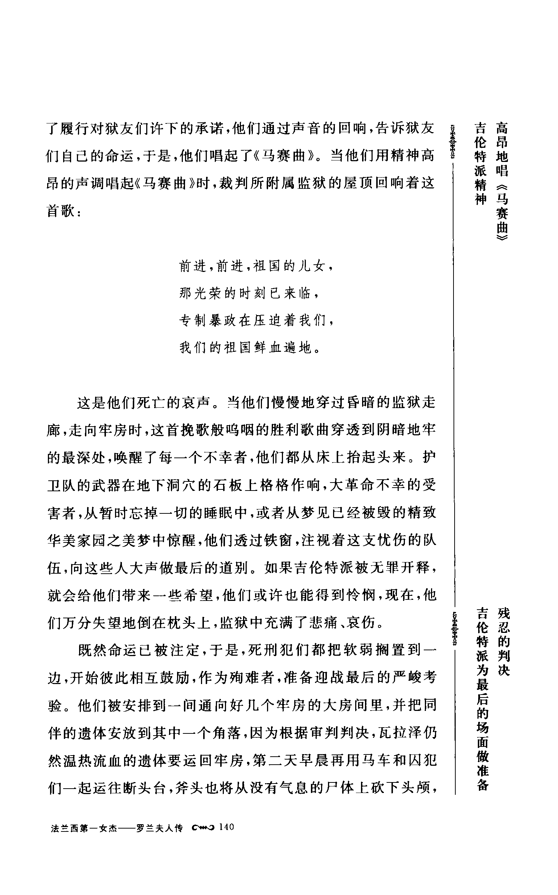

<small><a href="images/pages/152.png">原书第141页 · PDF 第152页 · 查看原页</a></small>

一位逃脱了流放并隐藏在巴黎的富有朋友，答应在审判他们之后的夜晚，给他们送去一场丰盛的酒宴，这场酒宴到底是庆贺宴还是葬礼宴，取决于无罪判决还是有罪判决。

这位朋友遵守了他的诺言，在囚犯们被押回到牢房后不久，这位朋友便摆好了桌子，安排好为他们送行的最后晚餐。在监狱中，这是一张很大的橡木桌子，桌子上铺着一块很华丽的桌布，由于恶劣的监狱伙食，等待审判的人和等待处死的人围坐在桌子周围。几个仆人走进来，点燃了明亮的灯笼，灯笼发出异乎寻常的光芒照亮了昏暗的地下室，白昼一般的亮光铺散在可怜的草床上、生锈的铁窗上、锁链上和没有太阳光或者炉火能够烘干的滴着水的石墙上。这是很奇怪的一个场面：在最凄凉的牢房之中，有一场丰盛的酒宴，还有一个死人躺在地上，参加宴会的人正等待照亮他们死亡和葬礼的清晨曙光降临。丰盛的美酒佳肴送来了，摆放在死刑犯们的面前。花瓶中的鲜花散发着芳香，展示着它们的美丽，在这儿，以前从没有看见过这样怒放的鲜花。当光彩夺目的烛台、昂贵华丽的餐具、美丽无比的花束、贵重珍奇的器皿接连出现，奢侈壮观地摆满整张桌子时，没有清洗、没有刮过胡须的苍白憔悴脸庞，都盯着这不寻常的场景。

在沉默中，死刑犯们入席。他们都是才华出众、口才不凡的人，突然从权力的顶峰被抛到断头台下。阿贝•朗贝尔（Abbe Lambert）牧师是吉伦特派中最卓越的几位人士的亲密朋友，他获准进入监狱，陪伴他的朋友们前往断头台，并给予他们最后的宗教安慰。他站在走廊里，从开着的门中注视着这些围坐在桌子边的人们，他手里拿着笔，记下了他们的话语、姿态、叹息，他们的脆弱和坚强。我们应该感激阿贝•朗贝尔牧师，是他记下了吉伦特派在最后的晚餐中所上演的崇高一幕的所有信息。这场筵席一直延续到拂晓，晨光开始朦胧地透进监狱的铁窗，屋外的阵阵喧哗声宣告正准备对他们执行死刑。

原页对照（含插图与旁注）
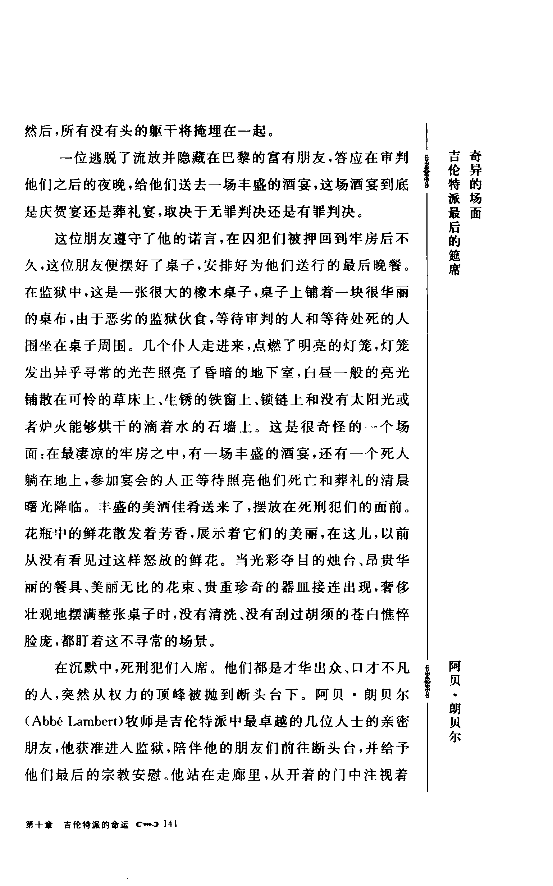

<small><a href="images/pages/153.png">原书第142页 · PDF 第153页 · 查看原页</a></small>

他们之中地位最突出、口才最雄辩的韦尼奥主持筵席。

除了对荣誉的热爱外，韦尼奥没有多少生活的牵绊，因为他既没有父母，也没有妻儿。韦尼奥相信后人会公正地对待他，相信他的死亡将会是他一生中最光荣的行为。从这些杰出人物带有几分乐趣、平静温和的谈话和从容的食欲中，没有人能想象出这是他们最后的晚餐，并且是一场暴力死亡的序幕。当撤去桌布时，留下了水果、鲜花、葡萄酒，谈话变得热烈欢快起来，时不时引起一阵欢闹。几个最年轻的人妙语如珠、笑声阵阵，尽力驱走翌日死亡消沉他们意志的阴影。这种愉快是反常的、不真实的，与这些人不相符的。死亡不是一句笑话，没有人会试图通过死亡来令自己荣耀。一颗真正高贵的灵魂会毅然地，绝不会轻率地面对死神。偶尔，从年轻人口中爆发出笑声和欢乐的歌声，因为他们努力用一种兴奋的精神激励自己，向敌人显出他们对生命和死亡的蔑视。其他人则是深深地思考着，他们更为平静，也更真正地勇敢。

“明天这个时候我们将在做什么呢？”迪科（Ducos）说道。

所有人都停下来了。宗教有它的希望，哲学有它的梦想，无信仰则悲哀地一片茫然，每个人都是根据自己的信仰回答。有人说：“劳累了一天后，我们休息了。”无神论者的脑海一片黑暗：“再也不会醒来。”“死亡是永恒的睡眠”成了无神论者令人沮丧的信条，他们盼望着断头台的斧头落下，终结一切思考，把他们带回到不存在，他们的被创造便是产生于不存在。“不！”福谢（Fauchet）、卡吕（Carru）和其他一些人回答道：“灵魂的毁灭不是我们的命运，我们是不朽的。肉身可能会腐烂，而这些生动的思想、这些无限的希望，将不会消亡。明天，在另一个遥远的世界里，我们还会思考、感觉、行动、解决人类头脑中无形的命运问题。”不析是主题，即将死亡的嘴唇不再唱歌，勉强的笑声逐渐消失，站立在可怕深渊的边沿，没有人带着消息从那里回来过，每个灵魂都感觉到一种对不的渴望。

原页对照（含插图与旁注）
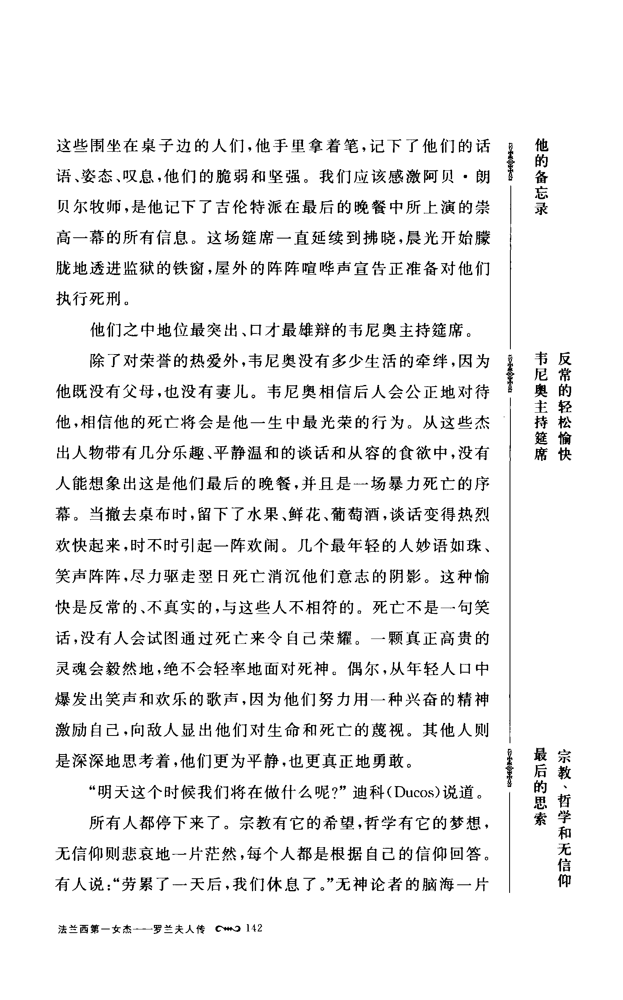

<small><a href="images/pages/154.png">原书第143页 · PDF 第154页 · 查看原页</a></small>

他们转向韦尼奥，他过人的才华、令人信服的口才和没有污点的人生博得了他们的一致尊重，他们向他请求给予指引、真理和安慰。阿贝•朗贝尔牧师描述了韦尼奥的讲话影响：“他的外表、姿态、语言、声音从没有这么深深地打动他的听众。”总之，这场谈话被描述为几乎是非常神奇的雄辩之一。在韦尼奥讲话期间，有些人被唤起了最高尚的热情，所有人都被深深感动，很多人哭泣起来，韦尼奥大声说道：

“死亡绝对是最伟大的生命行为，因为它产生了更高级的存在状态。若非如此，便会有些事物比上帝还伟大——如正义的人们为祖国无益无望地牺牲自己，这种推测是亵渎上帝的愚蠢行为，我很蔑视厌恶地拒绝接受。不！韦尼奥并不比上帝伟大，但上帝要比韦尼奥正义。上帝不会容忍韦尼奥明天上断头台，在未来的时代，他会宣告韦尼奥无罪，并为韦尼奥复仇。”

现在，黎明的曙光开始透进窗户。其中一个人说：“让我们上床吧，睡到我们被喊起来前去进行我们最终的睡眠。生命是如此微不足道，不值得为失去的睡眠时间感到遗憾。”

原页对照（含插图与旁注）
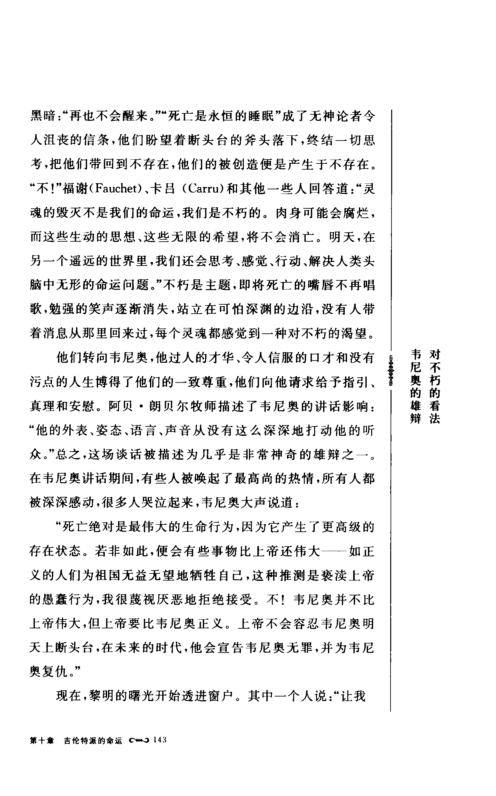

<small><a href="images/pages/155.png">原书第144页 · PDF 第155页 · 查看原页</a></small>

另一个人说：“在所剩的不多时间里，让我们还是守候着吧，来世是确凿无疑、不同寻常的，无数人都没能力为之做好准备。”

于是，他们从桌子边起身，大多数人退回到自己的牢房里，躺在了草床上，让身体休息片刻，并思索一会儿。然而，仍有13个人留在了大房间，在社交中获得某种支持。他们彼此低声地交谈着，他们因为兴奋劳累而疲倦不已，需要睡眠。一些人哭泣着，睡意体贴地袭来，使他们的心灵产生片刻的空白。

10点时，囚犯们听到打开铁门铰链的吱吱嘎嘎声、宪兵们重重的脚步声、马刀的哗啦声在阴暗的走廊和牢房中响起，士兵们带着刽子手前来带死刑犯们前往断头台。当锋利的斧头落下，死刑犯们长长的头发将从脖颈上割断。

每个人都给他们的亲人朋友留下一些简单而令人感动的纪念品。让索纳（Gensonne）拔下一缕黑发，交给阿贝•朗贝尔，请他转交给自己的妻子，他说道：“告诉她，这是我能送给她的唯一爱情纪念，我最后关于死亡的想法是她的想法。”韦尼奥从口袋里掏出表，并用刀子在表盒上刻下几行温柔记忆的诗句，把它送给一位他一心一意爱着的年轻女子，原本不久后他将与她结婚。每个人都交给阿贝牧师一些感情的遗物，请他转交给被遗弃在身后深爱着他们的人们。在弥留之际，人们希望被铭记在所爱之人的感情中，很少情感比这种情感更力强烈。

原页对照（含插图与旁注）
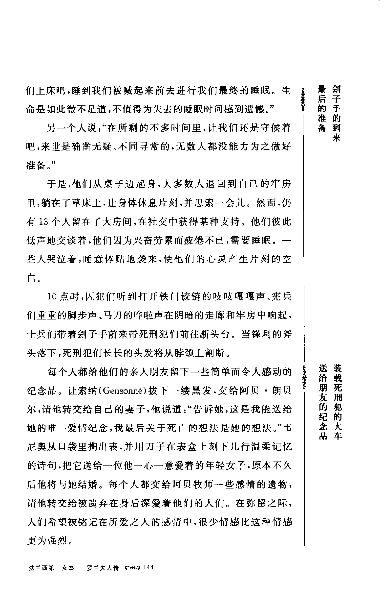

<small><a href="images/pages/156.png">原书第145页 · PDF 第156页 · 查看原页</a></small>

一切准备完毕，宪兵们把排成一列的死刑犯们带到监狱的院子里，在那儿，五辆简陋的马车正在等候他们，要把他们运送到断头台。不计其数的巴黎人拥挤在监狱周围，像海洋中起伏的波涛一样，挤满了院子，挤满了附近的道路。每辆马车上装载五个人，在最后一辆车里，安排了瓦拉泽的尸体和四个活着的同伴。

对吉伦特派来说，胜利的时刻到来了，英雄主义欢快地战胜了所有的痛苦。灿烂的太阳和十月早晨的清新空气使他们的身体充满活力，正经历的悲壮场面鼓舞着他们的精神，鼓舞着他们进发出最高涨的热情。当马车从院子中离开时，吉伦特派洪亮高亢、异口同声地唱起《马赛曲》。这首葬礼的圣歌，不像悲哀的挽歌，而是欢快歌曲的声调，响彻并消逝在空中，人群沉默地注视着他们。随着他们喊出意味深长的句子，在人群中，一些友好的声音冒着风险加入了合唱：

专制暴政在压迫着我们，

我们的祖国鲜血遍地。

唱完每句歌词后，他们的声音都陷入片刻的寂静，然后声调再次高亢。到达断头台后，他们长久地拥抱在一起，相互道别，这是像他们活着时一样，在死时也相互交流的一个表示。然后，他们一起大声地、坚定地继续唱起他们的葬礼曲。

一个人走向断头台时，仍然和同伴们一起唱着歌，他被绑到支架上，但他的歌声依然饱满有力，支架慢慢地倒下，他的声音仍然毫无颤抖地加入到胜利的大合唱中，闪闪发光的斧头闪电般地落在断头台的沟槽里，他的头颅落进了篮子里，他的声音永远寂静下来。另外的人，一个又一个地走向断头台，每个人口中都大声唱着歌曲，直到死亡终结他的声音。在那儿，没有软弱，没有发抖的脚步，没有失色的脸孔、没有颤抖的声音。但是，随着人头的相继落地，流血的尸体被并排放在一起，到后面的时刻，歌声逐渐无力。最后，只有一个人独自唱着歌曲，他就是韦尼奥，他们之中最杰出的一个人，长时间的监禁，使他那智慧的脸上落下了死一般的苍白，但他坚定无畏地、用极其洪亮的声音唱着由合唱变为独唱的歌。他毫无恐惧地走上断头台，看着朋友们没有生命的身体，环视着被吓倒的人们，人们正在默然地感受着这种令人敬佩的英雄气概。

原页对照（含插图与旁注）
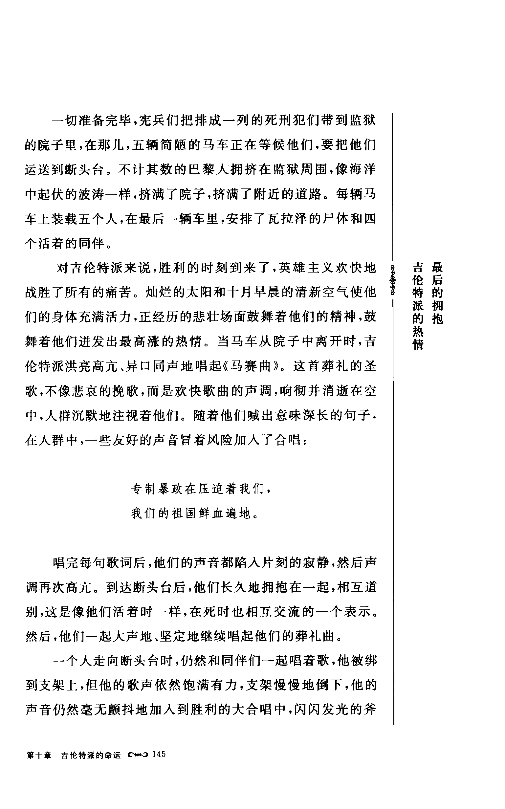

<small><a href="images/pages/157.png">原书第146页 · PDF 第157页 · 查看原页</a></small>

韦尼奥沉默地站了一会儿，然后，当把自己交给刽子手时，他再次唱起了歌曲：

前进，前进，祖国的儿女，

那光荣的时刻已来临。

在高亢的歌声中，斧头完成了它血腥的使命，那些曾经指导这场革命风暴、发出的爱国呼吁震撼法国人耳朵的嘴唇，在死亡中沉寂下来。就这样，吉伦特派——共和国的奠基者、共和国的牺牲者毁灭了。他们投票把路易十六和玛丽王后交给了断头台，他们也最早地紧随其后。一辆大车运走了21具尸体，把它们埋葬到路易十六坟墓旁边的一个大坑里。

吉伦特派犯了很多错误。很少有人能够透过动荡时代的乌云烟雾，清楚地辨清真理和责任的道路，但是，吉伦特派最忠诚地献身于法国的自由，他们推翻了君主制，建立了共和国，他们死亡于拒绝打开人们所要求的鲜血通道。吉伦特派的一些人已经逃脱了，佩蒂翁、比佐、巴巴鲁和戈代化了装流浪着，隐身在荒凉、人烟稀少的山洞中。拉法耶特（La Fay-ette）是持有这种信念最著名的信徒之一，在奥莫茨地牢被乏味地监禁数年之后，他从断头台上被营救下来。罗兰夫人在牢房中拖延度日，努力保持着平静，同时，她的心灵饱受每天黎明传到耳中的屠杀和不幸消息的折磨。

原页对照（含插图与旁注）
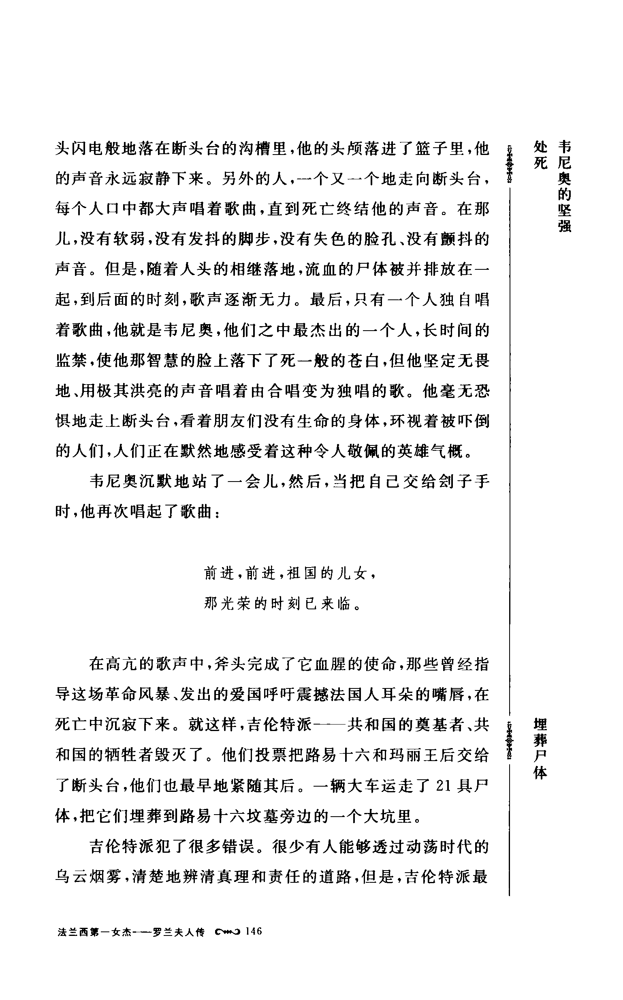

<small><a href="images/pages/158.png">原书第147页 · PDF 第158页 · 查看原页</a></small>

现在，雅各宾派越来越叫嚣着流血。为了战胜拉法耶特的死神，他们竭力把他从牢房中拉扯出来。他们毫不放松警惕性地追捕着从他们的狂暴之中逃脱的吉伦特派分子，他们训练猎犬闻嗅人的气味，到荒野的藏身处进行搜捕。吉伦特派人士在其藏身之处，遭受着人类本性或许尚能忍受的寒冷饥饿。一度，五个吉伦特派人士窝在一个30英尺深的地洞里，这个地洞与一所房子的地下室有一个秘密的通道。慷慨的女主人冒着生命危险，为他们提供日常食物，她只能提供给他们最少量的伙食，以防泄露购买如此多张嘴所需要的粮食的真相。

这正是隆冬时分，在阴寒潮湿的地窖里，他们无法烤火取暖，这样的活坟墓简直比死亡还恶劣。搜捕非常严密，他们有必要分散开来。其中一个人前往比利牛斯山，途中遭到逮捕并被处死。其中三个人在夜间艰苦跋涉于严寒之中，雨雪和凌烈的寒风穿透着他们破烂的衣裳，痛苦的遭遇简直令他们无法顾及生命。但他们还是被抓获，在断头台的利刃下找到了远离不幸的避难所。最后，除了佩蒂翁和比佐，所有人都被

原页对照（含插图与旁注）
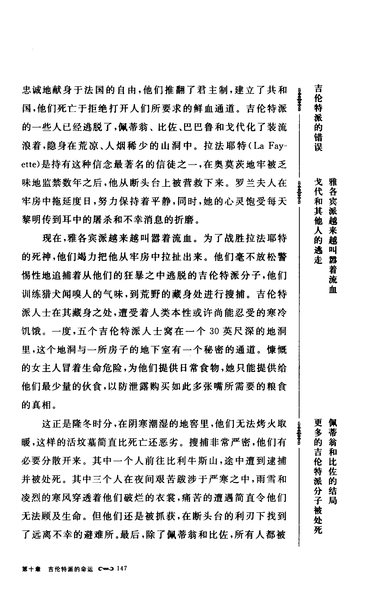

<small><a href="images/pages/159.png">原书第148页 · PDF 第159页 · 查看原页</a></small>

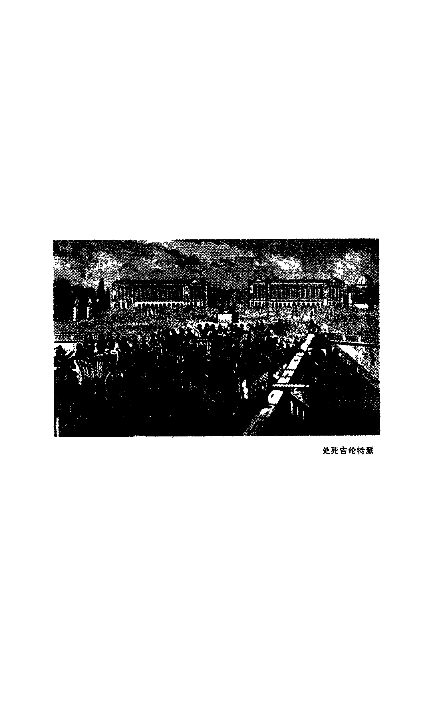

<small><a href="images/pages/160.png">原书第149页 · PDF 第160页 · 查看原页</a></small>

抓住、处决了。佩蒂翁和比佐的结局陷入神秘，没有人知道在他们疲惫的流浪生活的日日夜夜里，他们的境遇如何———除了上帝的眼睛没人看到过他们。一些农民在群山中发现，在他们的藏身之处，人的尸骨已被狼群撕裂成碎块，破烂的衣服上遍布着动物留下的锋利牙齿印。他们就是曾在所有人中幸存的贵族佩蒂翁和比佐，但他们是如何死亡的？是为苦难所疲惫不堪，在绝望中放弃，亲手结束了自己的生命？还是遭受到饥饿、劳累、冬天寒流的侵袭而死亡？或者，由于他们的虚弱，为山中饥饿的狼群袭击而亡？佩蒂翁和比佐的死亡场面陷入到晦涩费解之中。或许，当一切神秘都解开之后，这个悲惨境况才能显示出来。

原页对照（含插图与旁注）
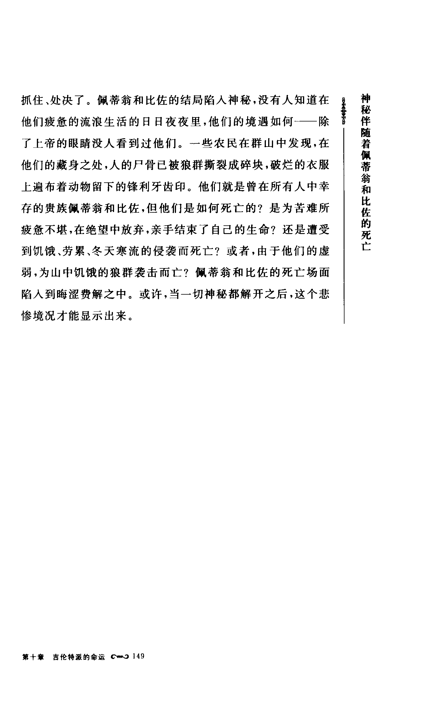

