# 第十一章 狱中生活

<small><a href="images/pages/161.png">原书第150页 · PDF 第161页 · 查看原页</a></small>

1793年

原页对照（含插图与旁注）
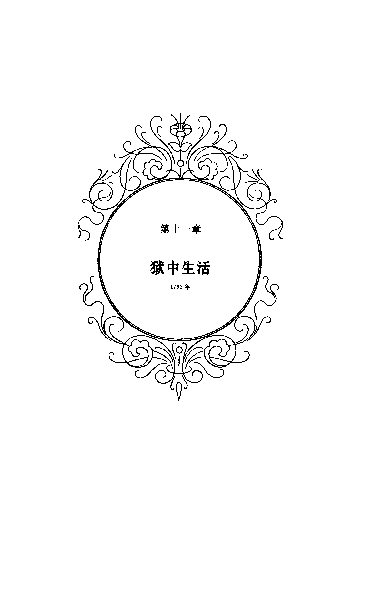

<small><a href="images/pages/162.png">原书第151页 · PDF 第162页 · 查看原页</a></small>

罗兰夫人在阿贝义监狱待了4个月。一天，一位官员进入她的牢房，令她无比吃惊的是，这位官员告诉她，她被释放了，因为没有发现针对她的指控。她几乎不敢相信自己的感觉—担心如果自己醒来，发现自己的自由只不过是梦中幸福的胡话。于是，她乘坐四轮马车，飞速地驰往自己的家门。罗兰夫人眼中充满着喜悦的泪水，心脏因为快乐的颤动几乎要跳出胸膛，她期盼着再次把心爱的孩子揽人怀中。她的手按在了门锁上—还没有跨过门槛—正在这时，在她住所门前守候着的两个男人，再次以法律的名义逮捕了她。尽管她流着眼泪恳求他们，他们还是把她押送到了圣比拉志监狱。这所令人作呕的罪恶处所充斥着从巴黎的街道上清扫进来的不道德和寡廉鲜耻的堕落妇女们。很显然，强迫受害人与她厌恶、拒斥的人们在一起，这是故意的悔辱。罗兰夫人宁可死，也不愿意与丑恶、垃圾等交往。

雅各宾派知道对罗兰夫人的第一次逮捕违法，因为害怕她的力量，便很急切地想在一个更为合法的基础上抓获她，因此，他们采用了这种先释放、再次逮捕的手段。这种残酷的打击甚至一度击败了罗兰夫人那坚忍、顺从的精神，幸福的梦想瞬间变为绝望的黑暗，她把脸埋在手中，放声大哭，痛苦得心都碎了。在虽然短暂但很激烈的抗争之后，她恢复了一贯的镇静。而且，她很快赢得了狱卒的同情，狱卒把她从那些可耻的同伴中转移到一间狭窄的牢房里，在那里，她能够享受到独自一人的奢侈。在牢房一角，狱卒为她铺了一张简陋的床，还在些微的光线下安放了一张小桌子，这些光线是通过安装着铁窗栏的小窗微弱地透进来的。

原页对照（含插图与旁注）
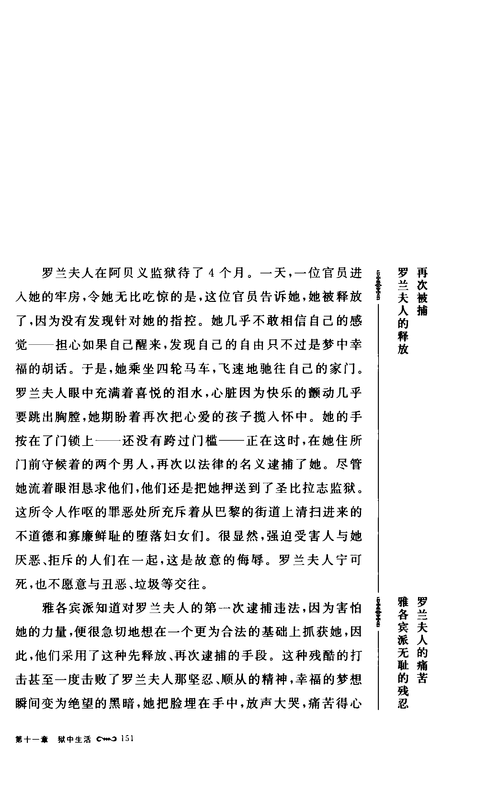

<small><a href="images/pages/163.png">原书第152页 · PDF 第163页 · 查看原页</a></small>

罗兰夫人召唤起所有的毅力来支撑自己，她重新恢复了日常工作，合理分配一天中的每一时刻，很规律地充分利用时间。她努力学习英语，每天都花费一些时间画画。这是她十分喜爱的一项才艺，她没有样本可以模仿，但她的想象力驰骋在绿色的田野上，驰骋在乡村家园中那流水潺潺的小溪边。此刻，她迈着自由的步伐，徜徉在自己充满创造力的笔端所勾勒出来的葡萄园中；此刻，在静穆的傍晚时分，她拥抱着孩子，依靠在丈夫的胸前，荡漾在风平浪静的湖面上；她又一次坐在农民家中简陋的炉火旁，给予贫困者所需要的帮助，接受感恩之心的答谢。就这样，乘着想象力的自由翅膀，她沉浸在所有的良辰美景中，并把它们生动逼真地展现在自己眼前。有时候，她几乎忘记了自己是一个囚犯，很多时候，她也用玛丽•安托瓦内特的语言宣称：“在人生的灾难中，修身养性是一个多好的办法啊！”

一些忠诚的朋友冒着生命的危险，不时前来探望她，在恐怖、血腥统治的黑暗时刻，没有比同情受指控者更令人不可原谅的罪行了。这些朋友们前来探望罗兰夫人的时候，常常很谨慎地带给她一些水果和鲜花等礼品。终于，狱卒的妻子，不能抑制住对一个自己热爱和敬慕的人的同情，冒着风险把罗兰夫人转移到一间更为舒适一点的牢房里，在那儿，光线能较为明亮地透进窗户的铁窗栏。在窗户边，罗兰夫人能够看见在天空中自由飞翔的云彩和鸟儿。她甚至得到许可，通过朋友获得了一架钢琴，从而令她消磨了许多时光。音乐、绘画和鲜花都是她生活中的装饰。狱卒的妻子布绍（Bouchaud）夫人，对她的囚犯抱有一种最仁慈的情感，每天都去探访她，力所能及地为她减轻监禁生活的痛苦，最终，她的同情心被大大激起，竟然不顾所有慎重的考虑，愿帮助罗兰夫人逃走。罗兰夫人这种奉献深深感动。虽然她完全知道，很快，她必然死在断头台上，但是，她还是坚决拒绝了任何可能累及朋友的逃走方式。其他人和布绍夫人联合起来，恳请罗兰夫人接受布绍夫人的慷慨帮助。他们的努力完全白费了，罗兰夫人宁愿自己死去，也不愿招致使这些深爱她的朋友们面临上断头台的可能性。当权者很快发现了罗兰夫人被仁慈对待的事情，狱卒受到了严厉的惩罚，被下令立刻从牢房中搬走钢琴，把罗兰夫人严厉地囚禁在她的牢房中。这种变化并没有扰乱她精神上的宁静，对古代最著名的杰出人物，她深入地学习过，深深地仰慕他们，以至于她的心灵本能地表现出同样的模式，在战胜每一样俗世的罪恶中，她找到了更高层次的快乐。

原页对照（含插图与旁注）
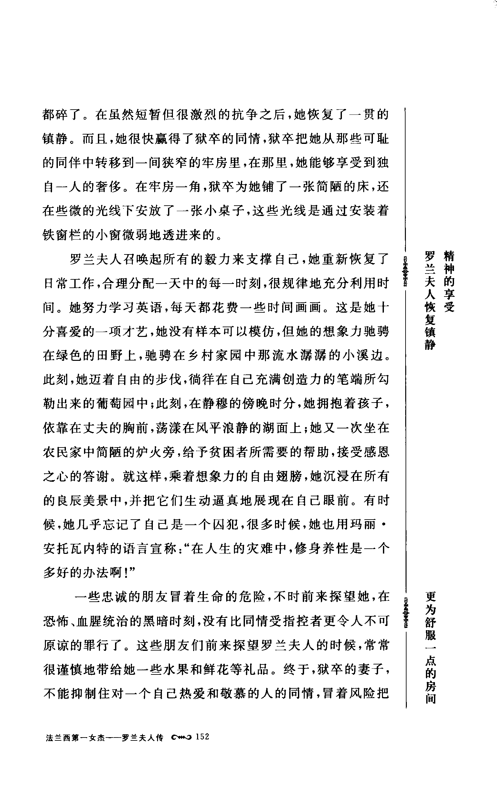

<small><a href="images/pages/164.png">原书第153页 · PDF 第164页 · 查看原页</a></small>

一位当时正居住在法国的英国女士，在罗兰夫人有权势时期常去拜访她。那时，罗兰夫人的家中呈现出一派世间所能呈现出来的极度辉煌，有钱人和有地位的人都谄媚地俯身在她身边。于是，这位英国女士记述了在那些不幸的黑暗日子里，她到牢房里对罗兰夫人的一次探访。

“我到圣比拉志监狱看望了她。在那儿，她的灵魂没有屈服于环境，仍然保持着她惯有的平静，在阴暗的牢房中，就像她过去在部长府邸中那样，她仍然保持着充满活力的快乐。她已经给自己弄到了一些书籍，我发现她正在读普鲁塔克。她告诉我她渴望死亡，她说起这些的时候神情沉静，使我确信她正准备以她那高贵的品质坚定地迎接死亡。当我问到她的女儿—一个才13岁的孩子之后，她突然哭起来，不可遏制地回忆起丈夫和孩子来，勇敢的自由事业牺牲者陷入到妻子和母亲的情感当中。”

原页对照（含插图与旁注）
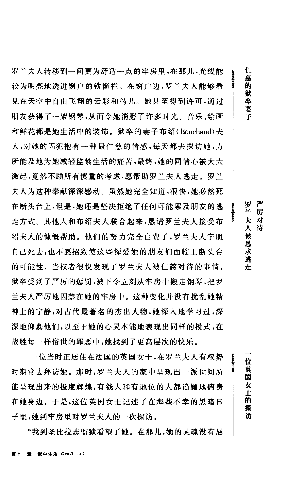

<small><a href="images/pages/165.png">原书第154页 · PDF 第165页 · 查看原页</a></small>

冷酷的委员们已经下令，把罗兰夫人幽禁到一间没有光线透入的牢房中。但是，拥有怜悯之心的狱卒还是冒险曲解了这道命令，把罗兰夫人安置到一间早晨的太阳光能够勉强透进铁窗的牢房中。在这间牢房中，能看到光线，但是很昏暗，某种程度上，或许只能安慰一下即将永远闭上的眼睛。本能地欣赏美好事物的心灵，会在最坏的逆境之中，渴望惬意的景象。

罗兰夫人的朋友们给她带来了鲜花，这是从儿童时期，她就最热烈喜欢的东西。这些珍奇的植物看起来能够领会和报答纯真的爱，在监狱的铁窗内，它们好像带着喜悦和感激一样，生长得很茂盛，缠绕的枝蔓和花朵，遮住了生锈的铁窗栏，把令人厌烦的牢房外观变成了一个花园的凉亭，在那里，鸟儿喜欢筑巢和唱歌，诗人喜欢停留忘返。

在修道院的时候，罗兰夫人和其中一位同伴结下了深厚的友谊，时间的流逝并没有削弱这份情感，在人生的浮沉中，她们一直保持着经常的通信。一天，这位朋友亨丽埃特•卡内（Henriette Cannet）获准进入了罗兰夫人的牢房，她谱写了一份世间会出现但很少能与之相比的传奇友情。她敦促罗兰夫人和她互换装束，那样就可以逃出监狱和断头台。亨丽埃特说：“如果你留下，你就必死无疑；而如果我留在你现在的地方，他们并不会取走我的性命，只不过在短暂地囚禁之后，把我释放。我无所畏惧，在这混乱的时代里，我也太微不足道，引不起人们的注意。”

原页对照（含插图与旁注）
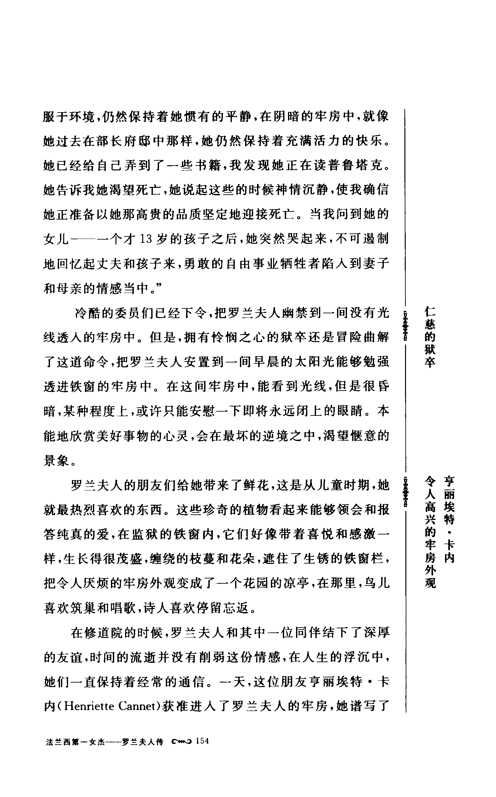

<small><a href="images/pages/166.png">原书第155页 · PDF 第166页 · 查看原页</a></small>

她接着说道：“我是一个寡妇，没有孩子，我的人生也不对我要求任何责任。你有年岁已高的丈夫、可爱的幼女，他们都极度需要你的照顾。”因此，她请求罗兰夫人和她交换衣服，尽力逃走。但是，无论是恳求还是眼泪都无济于事。罗兰夫人拥着她的朋友，流着眼泪，动情地说道：“他们会杀死你，我的好亨丽埃特！你的鲜血会永远保留在我身上，我宁愿死亡一干次，也不愿因为你而谴责我自己。”享丽埃特发现她的一切请求都没有用处，便悲哀地与罗兰夫人道别，并再也不被允许前来探望。

罗伯斯庇尔现在正处于权力的顶峰，掌管着生杀予夺的大权，只要他说一句话，就可以恢复罗兰夫人的自由。但他是个铁石心肠的人，对人类的情感无动于衷，不愿意让断头台失去一个受害者。一天，生病的罗兰夫人正躺在监狱的医疗室中，一个看护她的医生声称自己是罗伯斯庇尔的朋友。提及罗伯斯庇尔的名字，罗兰夫人回想起他们早期的友谊，回想起当罗伯斯庇尔深陷危险时，她努力营救他性命的举动，这使她产生了给他写信的想法。

她服从了自己的想法，写信如下：

“罗伯斯庇尔！我准备向你提交一些证据，我准备对你重

原页对照（含插图与旁注）
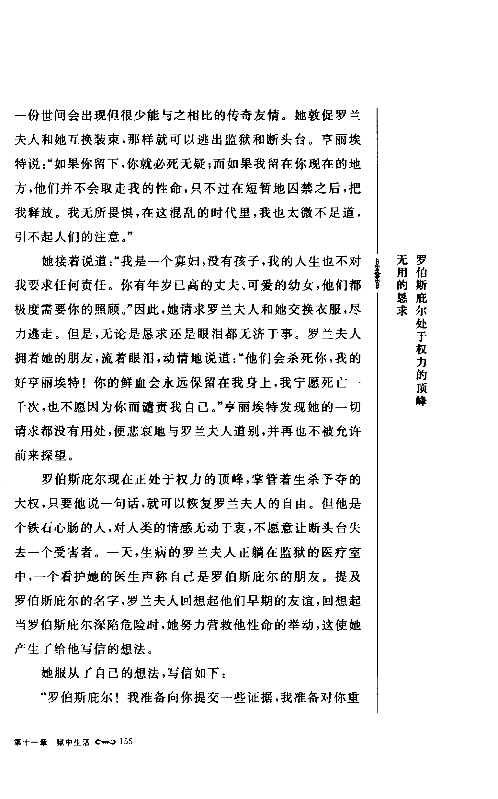

<small><a href="images/pages/167.png">原书第156页 · PDF 第167页 · 查看原页</a></small>

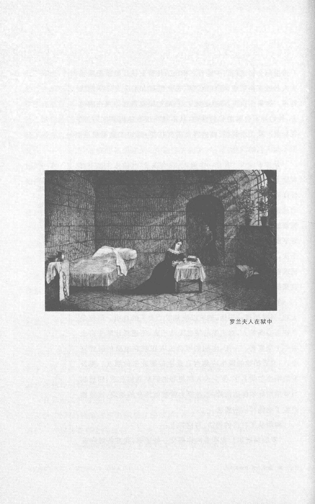

<small><a href="images/pages/168.png">原书第157页 · PDF 第168页 · 查看原页</a></small>

述我向这位承诺转交这封信的朋友说过的关于你人品的话。你可以放心，这不是一个恳求者在给你写信，我从来没有求过任何人帮忙，也不是为了免于牢狱之苦来请求一个人—-如果他高兴的话，就使我恢复自由。不！祈求和恳求属于有罪之人或者奴隶们。抱怨和牢骚与我的本性从不相符，我知道该怎样承受一切事情，我也很清楚在每一个共和国初期，对之起作用的革命在变革中总是会选择主要的参与者作为自己的牺牲品，牺牲者的命运就是要经历这些，因为恢复他们的名誉会成为历史学家的任务。然而，我仍在困惑地猜想，我只不过是一个女人，应该怎样面对这样的一场风暴，这种风暴通常应该由一场革命的重要领导人来承受。罗伯斯庇尔，你非常了解我的丈夫，我谅你不敢说，你认为，他是个不诚实的人，德行粗暴，这好比说加图德行尖刻一样。他厌恶世事，为迫害所激怒，厌倦人生，已经风烛残年、力不从心，仅仅渴望在某个不为人知的地方埋葬自己和自己的烦恼，并在那儿隐身起来以使自己生活的时代免于一场犯罪。

“很令人好笑的是，传说我是同谋者。作为玩笑来说，这不是太严重的一件事情，但向我表露出来的敌意程度从何而来呢？在我的生命中，我从没有伤害过一个人，对于那些伤害和压迫我的人，在我心中，我也没有发现希冀他们不幸的念头。我在寂寞中长大，我的心灵指向严肃的研究、简单的爱好、热情地仰慕革命—我的性别使我不能参与公共事务，虽然我很乐于谈论它们—我蔑视最初流传的对于我的诽谤中伤，我把那些流言归于因无知和卑鄙而滋生的妒忌，它们恰恰令人高兴地衬托出我的崇高地位。但是，我更喜欢平静的默默无闻，那时候，我度过了很多幸福的时光。

原页对照（含插图与旁注）
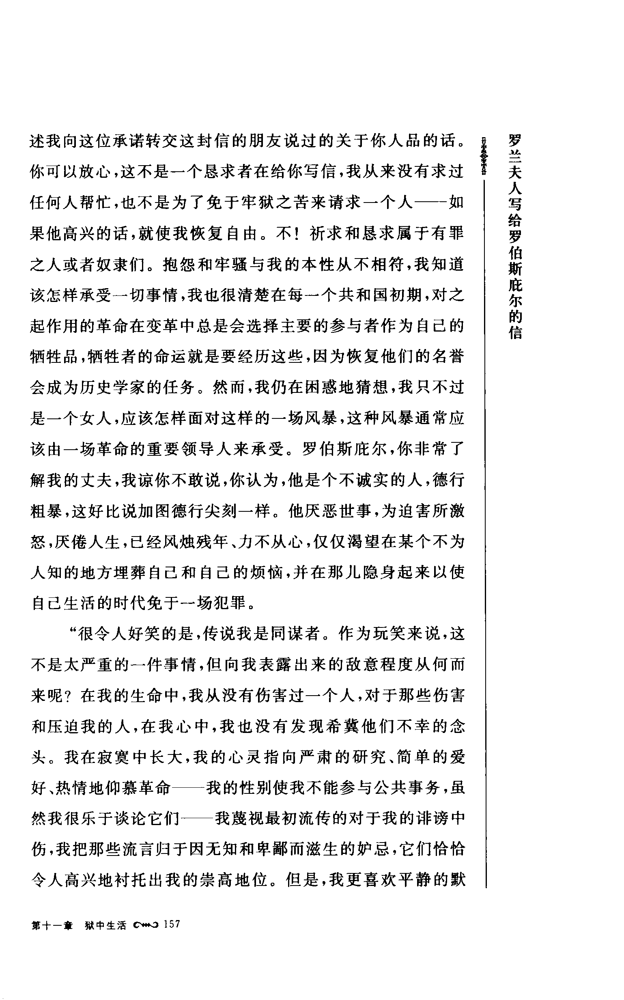

<small><a href="images/pages/169.png">原书第158页 · PDF 第169页 · 查看原页</a></small>

“到现在为止，我在监狱中已经度过了五个月。我与我亲爱的孩子分离开来，她那无辜的头可能再也不能靠在母亲的胸前；我远离了我拥有的珍爱的一切；我承受着对一个被误解之人的恶言谩骂；我被限制于只能听到士兵们谈话，因为他们在我的窗户下监视着我，讨论着我即将临近的死刑话题；我为阅读到来自从没见过我的报刊的受雇者施加给我的猛烈的诽谤而感到震惊；我厌烦了无人问津，没有要求，没有询问。相反，我为能胜任与我的不幸命运做斗争而感到骄傲。

“罗伯斯庇尔！我并不是要用我目前的悲凉画面来激起你的怜悯。不！由你表达出来的这种情感，是对我的冒犯，应当予以拒绝。我写信是为了给你启迪，命运变幻无常民众的支持同样也是如此。看看前代那些革命人物的命运吧—一先是人民的偶像，后是人民的统治者——从维特里乌斯（Vitellius）到恺撒（Casar），或者从锡拉库扎的演说家希波（Hippo）到我们巴黎人的演说家。苏拉（Scylla）和马略（Mari-us）迫害了成干的骑士、元老以及其他众多不幸的人们，但他们能够阻止他们的名字遭受后代人公正的咒骂吗？他们自己享受了幸福吗？无论命运给予我什么，我都明白该如何以与我相称的风度去顺从它，或者以我认为明智的方式先于命运而行动。在领受到被迫害的荣誉后，我难道不希望成为一名更伟大的殉道者吗？可以说，尽管如此，了解你的命运、了解像我这样能够勇敢面对命运的精神，还是非常重要。如果你能够公正客观地阅读这封信，那么，对你和祖国都不会毫无益处。我可以这样说，在任何情况下，罗伯斯庇尔，你无法否认我所断言的真理。除了良心不安的情感，任何认识我的人都不能令我烦扰。”

原页对照（含插图与旁注）
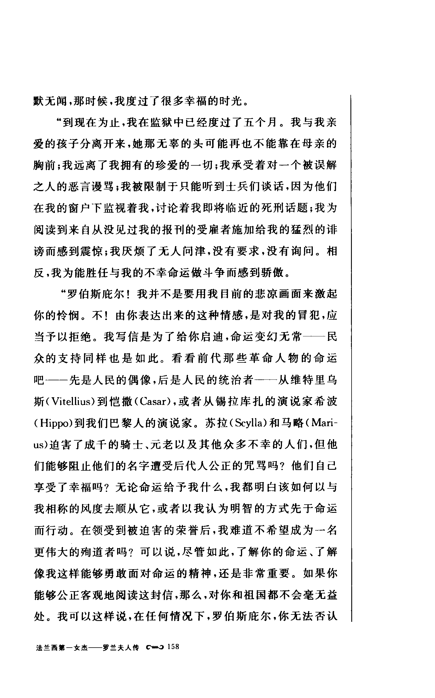

<small><a href="images/pages/170.png">原书第159页 · PDF 第170页 · 查看原页</a></small>

罗兰夫人宁可选择死亡也不愿活着而感谢敌人的同情，如果她能依靠自身正直的力量取得成功的无罪开释，她会非常欣喜。但是，她那高傲的灵魂不会卑躬屈膝地接受那些应该受到人类咒骂的人的赦免，她宁可把这样的赦免令撕成碎片，毅然地走向断头台。

在生命的不幸中，只有骄傲和豁达的态度才能支撑着度过严寒、冰冷。罗兰夫人只在天主教会表现出来的浮华和炫耀中，在无知或者奢侈教士公然放荡的生活中，遇到过基督教。当统治物质世界和心灵世界的神圣的上帝观念触动她那诗意般的性情时，启示宗教如同她心灵所遇到的那样，仅仅由华丽的场面、荒谬的教义和愚蠢的传统构成。她敬慕虔诚和纯粹奉献的精神，她天性庄重，爱沉思，十分虔诚。就宗教而言，她的心灵处于罗马人那种理智的、高尚的、不可腐蚀的状态：罗马人拒绝承认没有反对者的愚昧大众的盲目崇拜；罗马人痛苦地探索着上帝的启示和真理；罗马人有时充分相信主宰一切的上帝，有时又一再担忧是否存在上帝或者任何不朽。

在罗马天主教教士所动用的仪仗队、遗物、奇怪的装束和精神的恐怖当中，罗兰夫人只看见了厚颜无耻的欺骗。对她来说，教皇制度只不过是个巨大的怪物，利用可憎的迷信压迫人民，利用它超出常人的能量维持贵族和王权的腐化。在她抛弃这个制度时，没有朋友把她引领向温暖的、受庇护的、快乐的福音派之虔诚的隐修处，她几乎不可避免地被时代哲学引领向寒冷、荒凉、暴风雨袭过的高处。在那里，灵魂找不到任何躲避之处，只能发挥它不屈不挠的忍耐力。在某种程度上，在用英雄主义的光辉照耀人性的历代人物中，罗兰夫人所展现出来的精神，为她贏得了“第一人”的美誉。

原页对照（含插图与旁注）
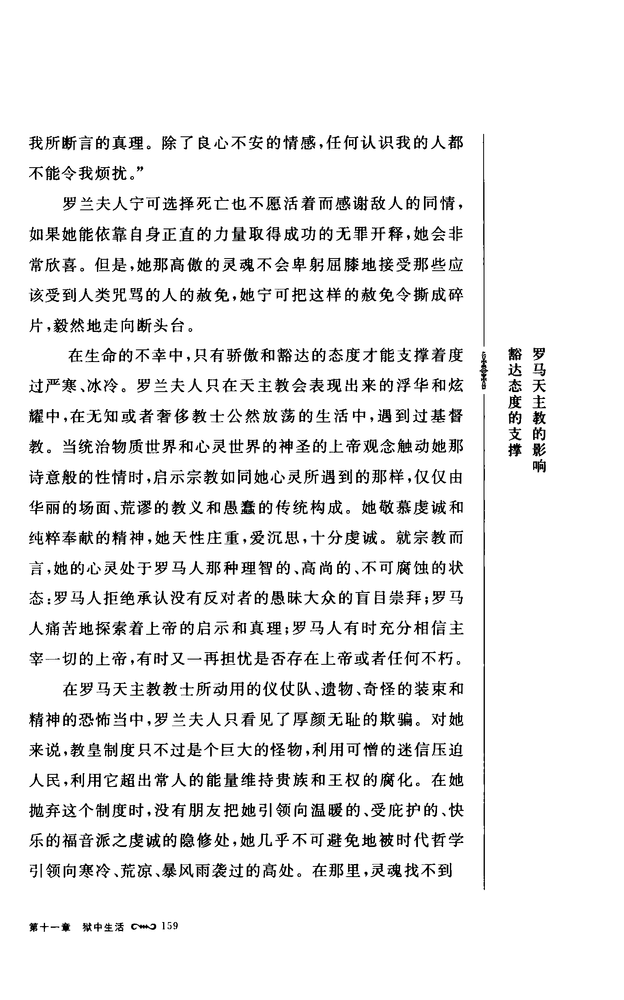

<small><a href="images/pages/171.png">原书第160页 · PDF 第171页 · 查看原页</a></small>

在这些情感的影响下，罗兰夫人得出结论：对她来说，自己亲手结束生命比被敌人拖到断头台上更为荣耀。她弄到了一些毒药，在沉人不可知的神秘之前，她平静地坐下来，写下自己最后的想法，写下对爱人最后的留言。在这种场合，在她所做的茫然虚幻的祈祷中，有些事情尤其感人。

她的祈祷流露出一种痛苦的不确定性：是否有存在主宰一切的神灵能听到她的呼喊。不过，她的祈祷还是灵魂本能的休息，是为了寻求比在灵魂深处能够找到的更高级更神圣的支撑。

“上帝！至高无上的主啊！宇宙的圣灵啊！我内心深处感受到伟大的、真正的、不的一切重大原则——我相信上帝的存在，因为我必定来自比我周围的东西更高级的事物—我即将和您的本质重新结合了。”在给丈夫的告别信中，她写道：“原谅我，我尊敬的和引以为荣的丈夫，原谅我毅然结束了我奉献给你的生命。相信我，我爱生命，更因为你的不幸而爱你，如果能允许我分担你的不幸的话。现在，由于我的死亡，你将从徒劳无益的悲痛中解脱出来。”

当罗兰夫人给她挚爱的欧朵拉写信时，母爱的情感喷薄而出：“原谅我，亲爱的孩子，我可爱的女儿，你文雅的形象深深地印在我心中，有关你的每一件往事都动摇着我坚定的决心，如果你温柔的母亲能够留在人世来教导你、守护你的话，她绝不会把你无助地留在人世间。”

原页对照（含插图与旁注）
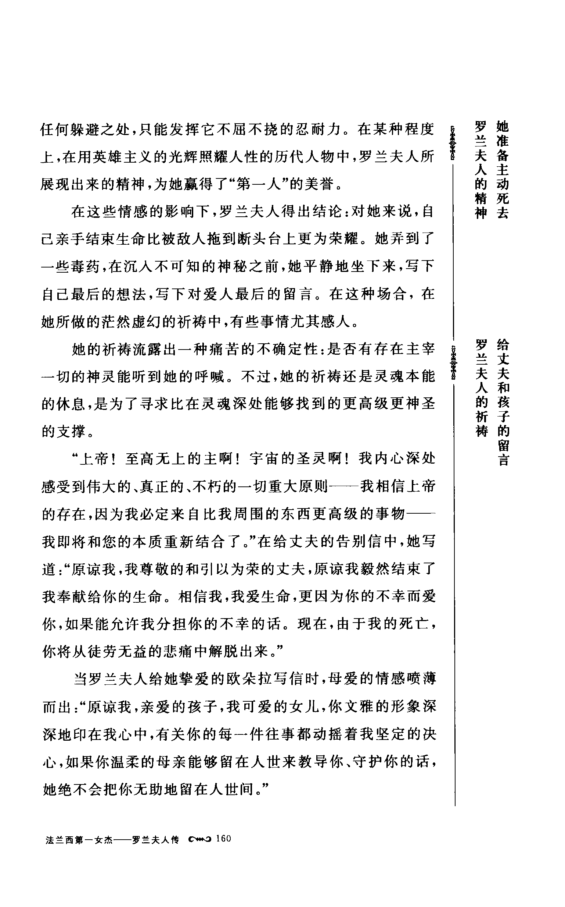

<small><a href="images/pages/172.png">原书第161页 · PDF 第172页 · 查看原页</a></small>

然后，对她的朋友们，她呼喊道：“我挚爱的朋友们，请把你们一直表露给我的情感转移到我那没有母亲的孩子身上。不要为我的决定哀伤，这能够终结对于我的许多严厉的审讯。你们都十分了解我，相信软弱或者恐怖都督促着我准备迈出这一步。”

在遗留下更能令女儿、朋友和仆人珍藏的这般细微的感情纪念时，罗兰夫人立完了遗嘱。然后，她重提起她一直深爱和敬慕的自然之美，现在她要永远离开这些了，她写道：“再见了！再见了，灿烂的太阳！之前你把你的光亮隐藏在天空，你一定要给我的窗户镀上金色的光辉。再见了，寂静的索恩河畔，你那原野的美丽是如此幸福地溢满我心。还有你们，贫穷但诚实的蒂济人民，我喜欢你们的劳动，我救济过你们的困苦，我护理过你们的病痛——再见了！再见了，哦！我儿童时代宁静的房间，在那儿，我学习热爱美德和真理——在那儿，在书籍中和高兴地学习烹饪中，我发挥着想象力；在那儿，我默默地学习控制我的情感，并轻视自己的自负。再一次说再见，我的孩子，记住你的母亲，无疑你的命运将会比她的命运少些坎坷。再见，亲爱的孩子，我的胸怀养育了你，我真挚地希望教导给你我自己持有的每一种情感和观点。”

盛满毒药的杯子端在她手中，在她心里，她并没有这样的感觉：喝下它，她会违抗高级力量的命令。但是，对孩子的爱占了上风，欧朵拉的微笑在眼前浮起，为了欧朵拉，她应坚持活下去。罗兰夫人扔掉了毒药，决心不再考虑主动从自己尘世命运的烦恼哀伤中退缩，而是坚韧地把自己交给那些她不能施加任何控制的势力。这种短暂的斗争结束了，她恢复了

原页对照（含插图与旁注）
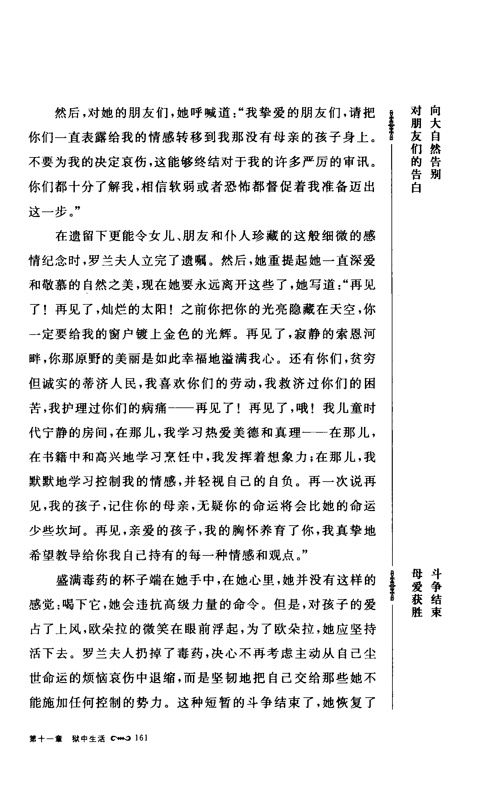

<small><a href="images/pages/173.png">原书第162页 · PDF 第173页 · 查看原页</a></small>

惯有的镇静和愉快。

现在，塔西佗（Tacitus）是罗兰夫人最喜欢的作家，她把时间都花在了学习塔西佗对英雄品质和行为的精彩描述上。英雄主义成为她的宗教，高尚和坚毅成为她的灵魂偶像。

罗兰夫人的眼睛里闪烁着光亮，胸膛中跳动着高尚的情感，她思索着塔西佗对殉难的爱国者和哲学家的生动刻画。在塔西佗的描述中，灵魂凭着与生俱来的能量战胜了毁谤、痛苦和死亡。考虑到每一天都有可能上断头台，罗兰夫人把自己的精神倾注到所有可能的悲剧细节中，这样，她就会对恐怖非常熟悉，就会用勇敢无畏的眼神看待断头台和斧头。

罗兰夫人把一天当中的诸多时间消磨在撰写自己的人生回忆录上。她的回忆录是打动人心、感人肺腑的叙述，在这样的预期——每一句话都有可能被刽子手进来带她前去受审和上断头台所打断——中写下。在这种心灵的祖露中，人们能看到她高贵的本性：慷慨而坚强、天生的慷慨所滋生的仁慈、顺从宿命的勇气。精神升华的意识成为她唯一的宗教信仰和唯一的安慰，死后留下一个高尚名声的期盼是她唯一的天堂。基督徒敬佩她，也必然怜悯她。除非带着深深的感情，人们不会读懂她写下的思想。

此时，罗兰夫人的思绪漫游在自己早熟而充满梦想的童年时光里：她逗留在自己的小房间里，凝视着金色的落日。当想起早年的家时，她眼中含满了泪水。她想起因母亲死亡而产生的孤寂，以及因父亲那令人蒙羞的再婚所带来的更深的孤寂。那样的婚姻虽为无信仰的年代所容忍，可是根据上帝的旨意，一个人那样占据了妻子的位置，是得不到祝福的。她思绪的翅膀再一次飞过监狱黑暗的铁窗栏，飞到她举办婚礼的美丽乡村的家中，在那儿，她度过了自己最幸福的年代。她忘记了身边的镣铐、石墙和阴暗的地牢，在想象中，她再一次踏人了花丛、踏入了绿色的田野，在收获葡萄的季节，吃着鲜美的、熟透的葡萄；她想起了那些令人愉快的家庭琐事，想起了她的牛奶场和识得她声音到她手中觅食的家禽；她面前浮起了她的书房和惬意的脑力工作•…多么令人陶醉的景象，她像夏娃失去了伊甸园一样哀叹着。有名望有权力的时光进人她的思绪中：她的丈夫再一次成为国王的部长，她的椅子边围绕着最有影响的政治家和最有才华的演说家，她的头脑引导着风起云涌的革命浪潮，影响着欧洲最骄傲的君主们的决定。

原页对照（含插图与旁注）
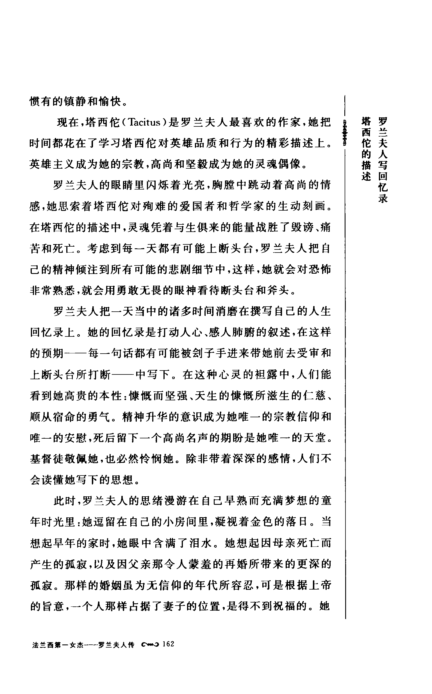

<small><a href="images/pages/174.png">原书第163页 · PDF 第174页 · 查看原页</a></small>

很轻微的动静驱散了幻想，把她从梦想之中唤回到现实中来。她是一个囚犯，正身处石头和钢铁构成的昏暗牢房中，在这里，没有获得解救的可能性，血淋淋的死亡正等候着她。丈夫是一个逃亡者，为比禽兽还残忍的人类猎犬所追击着。她所深爱的女儿被没爹没娘地遗弃在冷酷的人世间。断头台已经把她深爱的许多人送进了坟墓，但在她被送往断头台以前，她还要在监狱的铁窗内挣扎着度过一些悲伤的时日。女人的本性战胜了理性的刚毅，在眼泪的肆虐中，她得到了片刻的安慰。

1793年10月31日，从裁判所附属监狱的地牢中，吉伦特派人士被带出去处死。就在那一天，罗兰夫人被从圣比拉志监狱转移到裁判所附属监狱，转移到她的朋友们死后腾出来的阴暗牢房里。她被关进了一间空荡荡的、条件非常恶劣的牢房，那是一个地下贮藏室，里面甚至没有一张床。

原页对照（含插图与旁注）
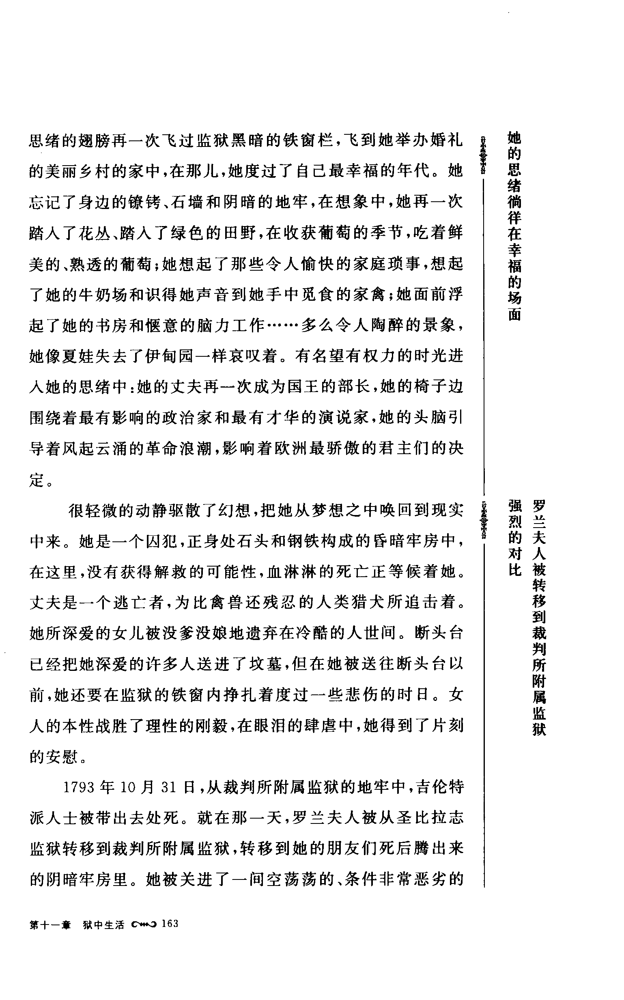

<small><a href="images/pages/175.png">原书第164页 · PDF 第175页 · 查看原页</a></small>

为同情心所打动的另外一个囚犯，把他自己的床垫塞进了罗兰夫人的牢房，这样，她不就用被迫在冰冷潮湿的石板上睡眠。此时，冬天的寒潮已经到来，监狱管理者还没有给她被子，在漫漫长夜里，罗兰夫人冷得发抖。

裁判所附属监狱由位于司法宫下面的一系列黑暗潮湿的地下室构成。人们想象不出比这些阴暗的洞穴更为阴暗的地方，长长的、弯曲的走廊通向黑暗得如同坟墓一般的牢房。俯身走下一段巨大的石梯，走进这阴森森的住所，通过两道门—时间已经使铁大门的强硬变形但没有被削弱—人们就走进了一个巨大的迷宫一般的监狱。想象一下，你游荡在这些错综复杂的大厅迷宫、拱门、地下室和地道里，从厚重石墙的缝隙透过来的昏暗灯光反而增加了令人恐怖的感觉，在这里，人会感到毛骨悚然。塞纳河从旁边流过，仅仅隔着一条通往码头的公路。塞纳河的河床高于监狱的底部，因此，周边的土地为河水所浸泡，湿漉漉的水汽也弥漫在这座坟墓的墙上和地板上。河水的哗哗声，头顶道路上马车行走的辘辘声、当民众涌进涌出正义厅时嘈杂沉重的脚步声，与凄凉牢房中囚犯们发出的呻吟声交织在一起。在这座巨大的建筑物中，分布着一两个狭小的院子，囚犯们可以在院子里仰望四面高高耸起的陡峭墙壁，就像在井里一样，只能看到一块四方的天空。矗立在坚固地基上的巨大四角塔，从前是彰显权力和法律的帝王宫殿，在这里，法国国王纵情享乐，而囚犯就在他们的脚下呻吟。现在，这座坚固的封建堡垒已经变成了君主制的坟墓。在这些最令人可怕的一间牢房里，玛丽•安托瓦内特—-皇家的女儿，在人类所能遭受到的最大痛苦中呻吟不已，在遭受到能想象到的每一种侮辱后，被拖到了断头台上。

原页对照（含插图与旁注）
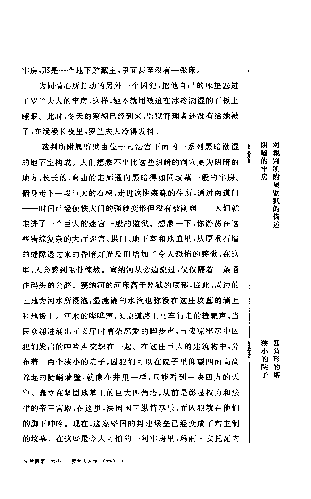

<small><a href="images/pages/176.png">原书第165页 · PDF 第176页 · 查看原页</a></small>

罗兰夫人被投进了不幸的皇后曾待过的牢房的隔壁。在这儿，骄傲的奥地利君主的女儿和卑微的工匠的孩子，在前所未有的人生沉浮中，发现她们在距离断头台不过几步远的途中相遇了。君主制的受害人和大革命的牺牲品被关到了同样的地牢中，被同样的断头台毁灭。在法国大革命风暴的舞台上，她们作为对手相遇，她们年龄几乎相同，一个拥有财富、地位和祖先的权力，另一个拥有非凡的能力和有教养的头脑。两个人都拥有不寻常的个人魅力、为热情所鼓舞的精神和最高傲的英勇。在生时，她们是对手；在死亡时，她们相遇了。第十二章

原页对照（含插图与旁注）
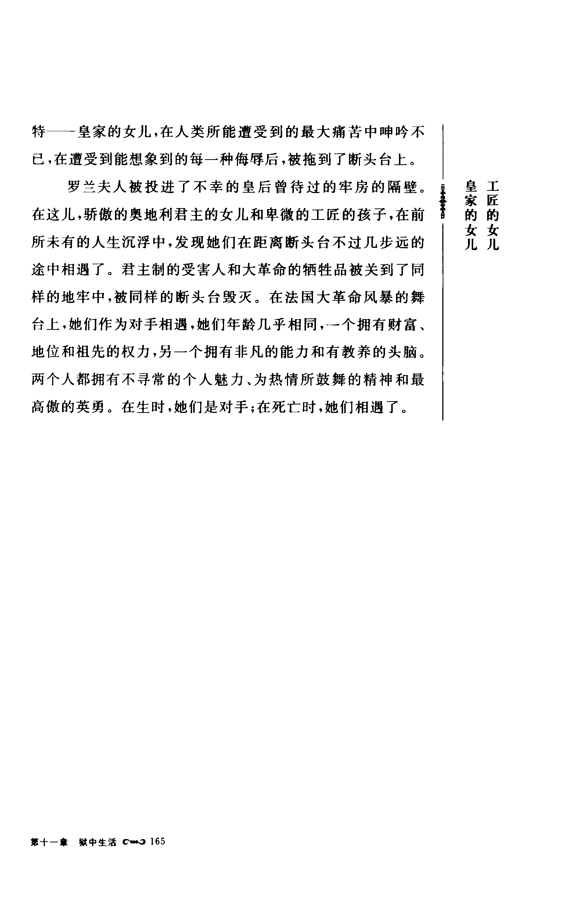

<small><a href="images/pages/177.png">原书第166页 · PDF 第177页 · 查看原页</a></small>

罗兰夫人的审判与处死

1793年

原页对照（含插图与旁注）
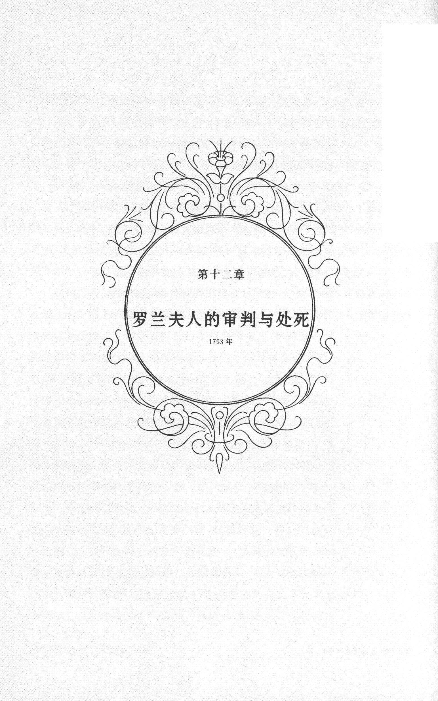

<small><a href="images/pages/178.png">原书第167页 · PDF 第178页 · 查看原页</a></small>

罗兰夫人被投进裁判所附属监狱后的第二天，一名臭名昭著的革命派官员就审问了她，仔细盘问了她和吉伦特派的友谊问题。罗兰夫人坦率地承认她怀念吉伦特派，对他们充满敬重，她声称，她和他们都是共和国自由的忠诚支持者，他们希望保存而不是破坏宪法。这次审讯极端地令人生气、令人无法忍受，持续了三个小时，由连珠炮似的控告组成，而且，几乎不允许罗兰夫人进行辩解。这次审讯使罗兰夫人领悟到，这就是将要对她的指控的本质。她在牢房里坐了整整一夜，用笔迅速草拟了辩护词—它被人称为是最有说服力、最能打动人心的革命作品，它是如此优雅地展示出罗兰夫人的勇敢品质、沉着精神、美丽、有活力的思想情感。人们将一直怀着强烈的兴趣阅读她写下的辦护词。

她写道：“你们指控我是所谓阴谋者的同谋。我很早就和这些绅士们中的一些人很熟悉，早在他们被认为是叛徒而发生的事件之前。从他们离开巴黎到现在，我们的通信完全与公共事务无关。可以这么说，我没有进行过任何一类的政治性通信，在那方面，我很克制自己。的确，你们没有要求我讲述我特殊的感情，然而，我有权为这些友谊感到自豪，我为这些人感到自豪。我并不想隐瞒什么，我承认，我对我的监禁感到遗憾，我收到了迪佩雷（Duperret）有我两封信的消息，这两封信是一位或是两位朋友在他们离开巴黎之前或者之后写给我的，我没有说这件事。迪佩雷已经把这两封信交到了其他人的手中，信从来没有到达我手中。

原页对照（含插图与旁注）
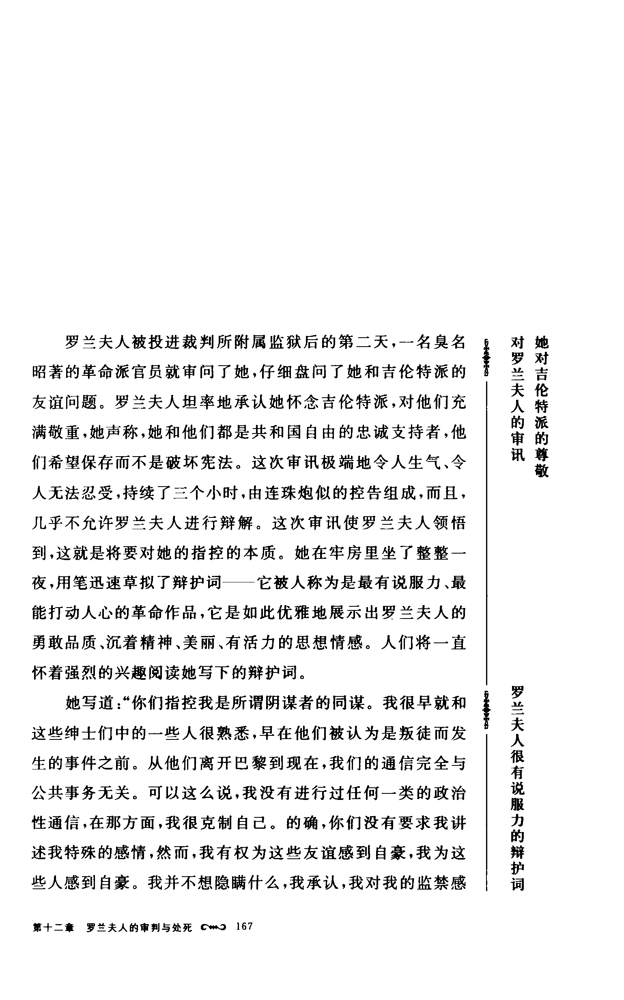

<small><a href="images/pages/179.png">原书第168页 · PDF 第179页 · 查看原页</a></small>

“还有一次，我收到了要打断我的锁链的恳切请求，和为我效劳帮助我实现我想要以任何方式逃亡的提议，并转告我今后可以去希望去的任何地方。责任和荣誉阻止了我听从这一提议。在责任上，我不能危及那些向我表露关心的人的安全；在荣誉上，因为我宁可选择接受不公正审判的风险，也不愿使自己面临根本与我不相符的有罪猜疑。当我同意自己被捕的时候，并没有带着以后要逃脱的想法。毫无疑问，如果没有切断所有的通信方式，或者不是因为受到囚禁的阻碍，我会尽力学习我的朋友们所做的一切。我知道，根据任何法律，我的所作所为都不受到禁止。任何时代或者任何国家，忠诚于把人们联系在一起的尊敬情感和兄弟感情，会被认为是罪行吗？

“我并不妄自评判你们对那些已经被剥夺公民权的人们所实施的举措，但我永不会相信，我所完全信任的那些正直和爱国的人们怀有邪恶的意图，如果他们做错了，那也不是故意为之。

“他们没有降低人格地倒下了，我把他们视为不幸的人，而不是要受谴责的人。他们的光荣使我深受感染，我情愿加人到被他们的对手迫害的荣耀中。他们被指控为阴谋背叛国家，但我知道，他们都是共和国坚定的支持者。他们都是很仁慈的人，他们被说服，善的法律对促成那些怀疑共和国能否维持下去的人们的善良意愿很有必要。争取人心比杀死人更为困难，每一个时代的历史都表明，通过英明的制度，引导人们走向道德需要极大的才能，而武力只能压迫人们，使其恐惧，或者消灭人们，使其死亡。我常常听到他们说，富足和幸福，只能来自公正的、仁慈的、保护人民的政府。刺刀的威力只能产生恐怖，而不会产生面包。我也见过他们为了人们的利益，为高涨的热情所鼓舞，蔑视阿谀奉承者，决心宁可忍受奉承者的欺骗，也决不愿采用同样的手段。我承认，对我来说，这些原则和行为完全不同于暴君或者野心家的观点和行动，暴君和野心家只对人民的屈从感到满意。我十分尊敬这些宽宏大量的人们，这种错误—-假如是一种错误的话——将伴随我走向坟墓，无论在哪里，我追随这些你们不允许我跟随的人们，我都感到自豪。

原页对照（含插图与旁注）
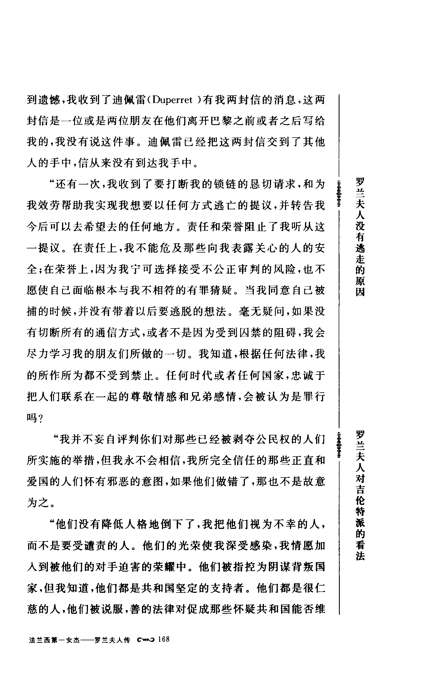

<small><a href="images/pages/180.png">原书第169页 · PDF 第180页 · 查看原页</a></small>

“我的辩护对那些盼望真理的人们比对我自己更为重要。我在冷静地和高兴地自觉履行我的责任，我盼望在来世我的灵魂能够获得安宁，同样，我严肃的性情和勤奋的习惯使我免受愚蠢的放荡和钻营的阴谋所腐蚀。拥护自由并对之进行反思，已经使我领悟到，要树立一种正义的价值。我很高兴地看待法国革命，每当我心怀怜悯地想到贫困的社会阶层时，我相信革命定会终结我所僧恨的专制权力和我一直哀叹的积弊。我对革命的进步持有浓厚兴趣，我热衷于谈论公众事务，但我并没有逾越我的性别所限定的界线。我有些小小的才干，相当豁达，某种程度上较为不平常的勇气，在危险时刻不许自己让丈夫的精神变得软弱，或许，这些品质是认识我的人们所轻率称赞的，也使我在陌生人中树立了敌人。有时候，罗兰先生把我当做秘书使唤，比如，那封有名的写给国王的信，是完全复制于我的手稿。如果奥利地人要审判我，如果他们考虑把一个部长的责任也宜于扩展至他妻子的话，这可能是对我的控告之中所能加上的极好一条罪行。但是，在很久以前，罗兰先生就表现出他在政治经济学伟大原则方面的知识和信念，在最近十五年他所出版的大量作品中，可以找到证据。他的学识和正直都是他自己的，他不需要妻子也可以使自己成为一位有能力的部长。在他的房子里，从没有举行过秘密的会议，每周，他的同事和一些朋友在餐桌前聚会一次，用公开的方式交流每个人都关注的事务。他的作品中自始至终流露着对秩序与和平的热爱，他认为秩序与和平是促进公众幸福和品行的最好原则，他的作品将永远证明他的智慧，他的账簿也证明了他的廉直。

原页对照（含插图与旁注）
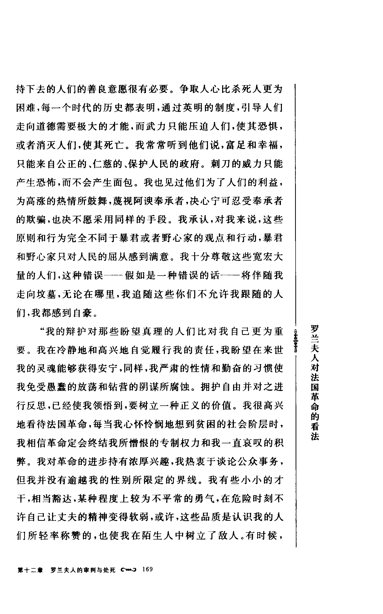

<small><a href="images/pages/181.png">原书第170页 · PDF 第181页 · 查看原页</a></small>

“对于嫁祸给我的罪行，我要说明，我和迪佩雷从来不熟悉，在罗兰先生任职期间，我偶然见过他，在我丈夫不任职的六个月期间，他从没有来过我们家。这话同样适用于其他人—我们的朋友，他们确实与加罪于指控我们的阴谋和同谋不符合。显然，根据我给迪佩雷的第一封信，我只写给他，是因为我不知道其他的人会写信给我，是因为我认为他乐意同意帮我的忙。那么，我和他通信就不可能是商量好的。我和他的通信不可能是之前亲密关系的结果，只可能是别有用心的结果。后来，这也给了我一个机会，来听取那些离开的人的解释，我和那些人是为友谊的纽带所联系，与一切的政治考虑因素无关。在这些人离开后的初期，我和他们保持着通信，这是完全毫无疑问的，但在这件事情上，没有不利于我的文字记

原页对照（含插图与旁注）
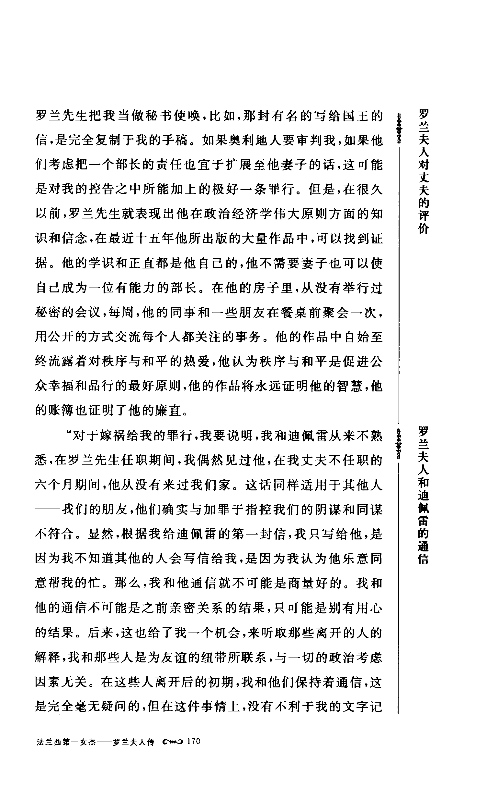

<small><a href="images/pages/182.png">原书第171页 · PDF 第182页 · 查看原页</a></small>

录的证据。

“那些举证只不过要得出我持有被称为阴谋者的观点和看法，这种推理很有根据，我毫无保留地承认，我确实持有和他们相一致的观点和看法，我对此感到自豪。但是，我从没有以一种可以看成是犯罪或者易于惹起骚乱的方式来表露我的观点。目前，在无论什么策划中成为同谋，提出建议或者提供执行手段都是必要的，我什么都没有做，没有法律能判我有罪。

“我知道，在革命中，法律如同正义一样常被遗忘，我站在这里就是证明。我把对我的审判只归于异常动乱时期所导致的偏见和强烈的敌意，这种偏见和敌意通常指向那些被安排到显著位置上的人，或者拥有能力、精神的知名人士。我的勇气很容易把我驱赶到我预料将对我宣判的地方去，不过，我想，我情愿经历那种判决；我想，我该给祖国树立这种榜样；我想，如果我被判刑，必定会留给暴政对牺牲一个女人的所有厌增，这个女人的罪行在于：拥有她从没有滥用的一些才能，拥有对促进人类幸福的热切渴望，在危难之时有足够的勇气承认朋友，并冒着生命危险向美德致敬。有资格称为伟大的人们，敢于丢掉他们的自私动机，他们感到，他们属于全人类。他们的见解将指引后代。我是一个遭受到迫害的有道德之人的妻子，我支持那些为欺骗、妒忌之辈的仇恨所迫害和牺牲的人们。轮到我死亡是必然之事，因为牺牲掉那些受到严重压迫的人、铲除自身罪行的目击者，是暴政的规则。我有双倍的理由死在你们手中，我期盼着死亡的来临。在谬误和刚愎的命令下，当清白无辜者走向断头台时，她所前进的每一步都是迈向光荣。希望我是祭献给党派狂暴情绪的最后一个牺牲者。我很高兴离开这个不幸的尘世，它吞噬了美德的朋友、饮下了正义的鲜血。

原页对照（含插图与旁注）
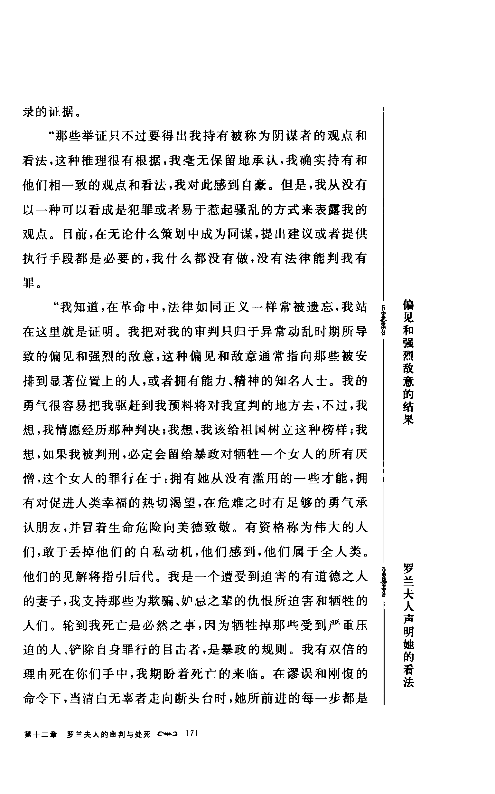

<small><a href="images/pages/183.png">原书第172页 · PDF 第183页 · 查看原页</a></small>

“真理！友谊！我的祖国！神圣的目标，我心中最珍贵的情感，请接受我最后的奉献，我把生命奉献给你们，请你们一定要让我的死亡从容而荣耀。

“公平的上帝！请教导这些不幸的人们，我期盼他们自由。自由属于高尚的人们，他们蔑视死亡，他们知道必要时给予自己自由。自由不属于软弱的人们，他们心怀内疚地达成妥协，用谨慎的名义来掩盖自己的自私和怯懦。自由也不属于腐败的坏蛋，他们发迹于道德败坏的温床，或者发迹于贫困的泥沼，对断头台上流下的鲜血尽情欣赏。欣喜于博爱、行动于正义、鄙视溜须拍马者、尊敬真理是一个人的责任，各位公民！而你们不是这样的人，你们徒劳地谈论自由。相反，你们无法无天的自由，反过来会使你们所有人都成为受害者，你们想要面包，给予你们的会是死尸，最终，你们将把你们的脖子伸到枷锁中去。

“我既不隐瞒我的观点，也不隐瞒我的看法。我知道，一位罗马妇女因为哀悼她死去的儿子而被送上断头台。我也知道，在充满欺骗和党派狂热的时代，一个人胆敢承认自己支持被判罪者或者被剥夺公民权者，会给自己招致什么样的命运，但我不畏惧死亡，除了内疚，我从不畏惧任何东西，我不愿以卑鄙的托辞为代价换取性命。这个时代是多么可悲啊！真理被人们漠视，在人群中，那些尊敬真理的人们伴同着危险是可悲的，在这种情况下，一个敢于勇敢面对危险的人是快乐的。

原页对照（含插图与旁注）
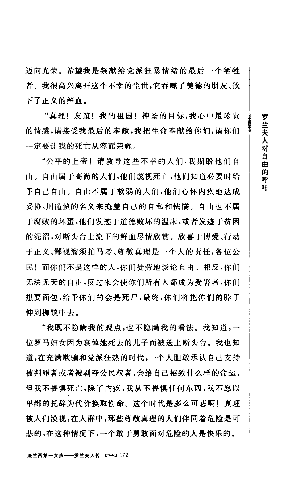

<small><a href="images/pages/184.png">原书第173页 · PDF 第184页 · 查看原页</a></small>

“在个人观点问题上缺乏证据，也没有任何法律的支持和正当理由，看看是否符合你们宣判我有罪的目的，宣判我有罪，这是你们目前的职责。”

这份辩护词她在一个晚上快速写成，典型地体现了她的心理活动。写完这份慷慨激昂的辩护词后，罗兰夫人就寝休息，安睡得如同一个宁静的孩子。革命法庭派出的委员会，传讯了她好几次，他们对她进行审讯，决心取走她的性命，但如有可能，他们希望在法律的形式下实施。罗兰夫人十分镇定沉着，很有尊严地经受了所有的审讯。当她的敌人看到，她在阴森森的牢房中，依然情绪很好、散发着魅力、十分自在的时候，他们也无法抑制住对她的敬佩之情。她知道自己将从牢房里走向暴力的死亡，却没有心灵上的畏缩，她的精神显然对所有尘世的罪恶取得了完全的胜利。

牢房的门上部有一扇铁窗，附近的牢房里，关押的尽是法兰西十分著名的女士和先生。随着死亡时刻的临近，罗兰夫人的勇气和活力好像在增加。她的容颜散发着热情，她的思想和言语闪耀着崇高的光彩，她整个外表呈现出一个人被委派为承担某些伟大光荣使命的特征。在被带向断头台之前，罗兰夫人在裁判所附属监狱只不过停留了几天，在那些为数不多的时日里，她以身示范，用自己鼓舞人心的话语，在众多囚犯中传播着热情和英雄主义的精神，鼓励着人们克服对断头台的恐惧，克服深深的胆怯和沮丧。她所散发出来的情感和快乐使人们对她的美丽、温柔和魅力产生了一种新的印象。长时间的囚禁和平静地看待确定到来的死亡，赋予了她一种低沉的嗓音，并且在说话时微微的震颤，这使她那雄辩的话语以令人兴奋的力量强有力地传向每一颗心灵。那些在走廊里走动的人们或者相邻牢房中的囚犯们，常常邀请她对他们说些鼓励和安慰的话。

原页对照（含插图与旁注）
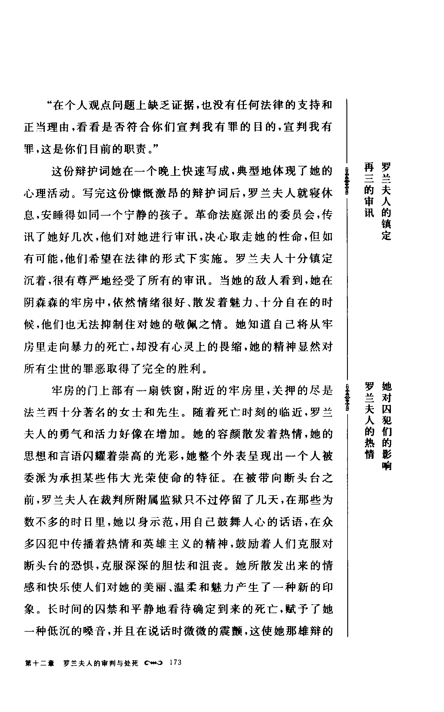

<small><a href="images/pages/185.png">原书第174页 · PDF 第185页 · 查看原页</a></small>

罗兰夫人站在自己牢房门边的一张凳子上，双手抓住把她与观众隔离开来的铁窗栏，这里就是她的讲坛。她那优美的声调回荡在那些错综复杂的阴暗地牢的通道中，穿透一间又一间的牢房，唤起了那些陷于绝望的人们内心深处的活力。的确，这是在这些阴森的地穴中所能看到的奇径一幕。当罗兰夫人那清晰美妙的声音像令人慰藉的天使一般萦绕在锈迹斑斑的铁门里，萦绕在黑暗潮湿的走廊里时，坟墓一般的寂静主宰了那儿。有个人，当时是这座监狱的一个犯人，后来从那些可怕的场面中幸存了下来，他用热情的字眼描述了罗兰夫人那打动灵魂的言辞所产生的几乎不可思议的效果。罗兰夫人已经度过了人生的青年时期，但她仍然十分迷人，她那美妙动人的声音与最奇特的表达能力结合在一起，在她的嘴唇因死亡而沉静了很久以后，那些曾经听过她讲话的人，在心灵深处，还常常萦绕着她的音调。囚犯们以最大的注意力倾听着她那热情洋溢的讲话，几乎把她视作来鼓舞他们作出英雄行为的神明。她常常谈起已经牺牲在断头台上的吉伦特派人士，她无所畏惧地承认对吉伦特派的友情，一直以“我们的朋友”来谈论他们。而且，她很细心，从没有吐出过一句会使人哭泣的话语，她希望自己能躲避开脆弱的温柔情感，希望自己能引领同伴们的思想，使之远离任何可能削弱他们力量的冥想。

偶尔，在孤寂的牢房中，当丈夫和孩子的模样浮现在面前时，她的想象便停留在自己凄凉的家中和枯萎的希望里—丈夫为违法的暴力所通缉和追击，孩子不久就将成为孤儿

原页对照（含插图与旁注）
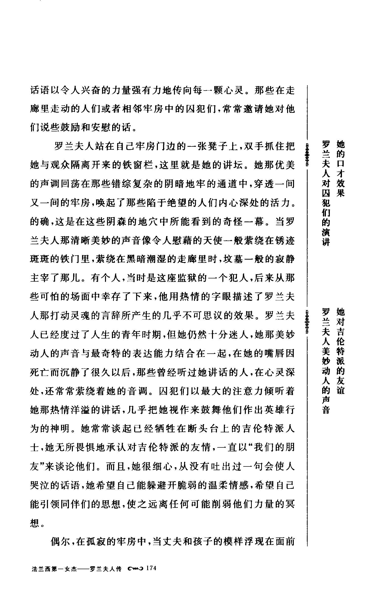

<small><a href="images/pages/186.png">原书第175页 · PDF 第186页 · 查看原页</a></small>

这个时候，女人的柔情往往战胜英雄的坚忍克已。她把脸埋在手中一-会儿，泪如泉涌。但很快，她便努力恢复了镇静，擦掉眼泪，整理一下面容，浮起惯有的微笑。她在裁判所附属监狱停留了不过一周，在这段时间中，她受到所有人的钟爱，成了最受关注和爱戴的突出对象。罗兰夫人的事例是世界历史上所呈现出来的最不同凡啊的事例之一，在她的事例中，最高程度的英勇与最无法抵挡的女性魅力结合在一起。一个不像女人的女人绝不会为男人所爱慕，她可能因为她的才能而受尊敬，她可能因为她的仁慈而贏得荣誉，但她不会贏得人内心深处最温暖的情感。但是，罗兰夫人，凭着顽强的意志、坚定的目标、凡人不能超越的坚韧的忍耐力，兼有着温柔、亲切和慈爱—她性别属性中的本能—一这一切把总是令女人激动的纯洁、热情的爱戴聚集到她身上。虽然她的朋友们中很多人是在法国很杰出的男人，他们把罗兰夫人尊崇为偶像，但是，诽谤的气息从没有敢于流露出她有不得体的行为之罪行。

在罗兰夫人受审判的前一天，她的支持者肖沃•德•拉加尔德（Chauveau de la Garde）来探访她，和她商量关于为她辩护的问题。她非常清楚，任何为她说话支持她的人都要冒着生命危险，她也完全意识到自己的结局已被注定，于是，她从自己的手指上摘下一枚戒指，对他说道：

“明天我就不在了，我知道等待我的是什么命运。你的好心帮忙对我无济于事，反倒会给你自己带来危险。因此，我恳请你不要到法庭来，接受我这最后表示敬意的见证吧。”

原页对照（含插图与旁注）
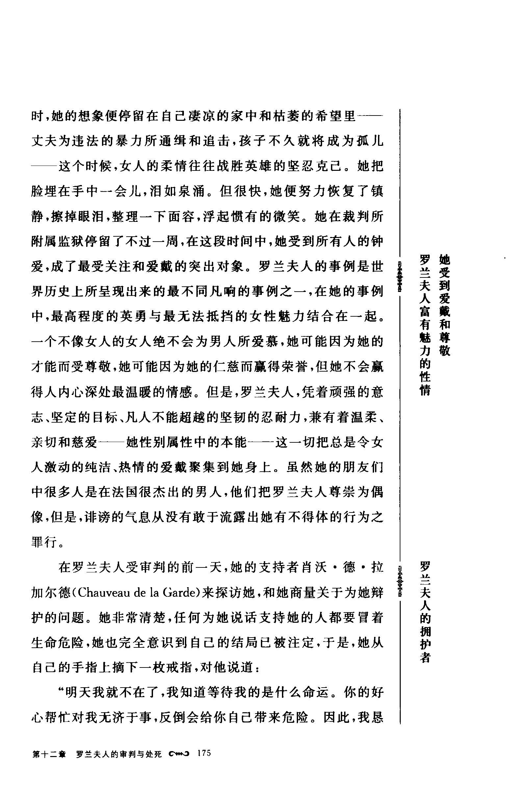

<small><a href="images/pages/187.png">原书第176页 · PDF 第187页 · 查看原页</a></small>

第二天，罗兰夫人被带走接受审判。她穿上了一袭白色的衣裙，象征自己清白无辜，她那长长的黑发波浪一样地披泻在她的颈上和肩上。罗兰夫人带着一种不寻常的美丽从地牢里出来，正在走廊里走动的囚犯们朝她围拢过来，微笑地向她说些鼓励的话，这些话是往常她把力量注入他们心里的话。她镇静地、不可征服地面对着她的审判员，指控她的罪行是：她是罗兰的妻子和罗兰支持者的朋友。罗兰夫人承认，她为犯下所指控的这两种罪行感到自豪。只要她试图为自己辩护一言半语，她便遭到审判员的严斥。面对充斥在法庭上的暴民的叫嚷，她只好缄口不言。现在，暴民无可置辩地左右着立法大厅和行政大厅。当罗兰夫人注意到审判的进展正快速地、无法抵挡地把她推向断头台时，在高涨的情绪的鼓舞下，罗兰夫人眼中的平静未被打乱，精神上的沉着未被动摇。然而，在法律的形式下，很难对罗兰夫人提出任何能够对她判刑的指控。甚至在最黑暗的时刻，只因为一个女人是其丈夫的妻子和其丈夫支持者的朋友，而处死这个全欧洲的目光都注视着的女人，法兰西也相当羞愧。最后，审判长要求她说出丈夫的藏身之处，罗兰夫人骄傲地回答道：

“我不知道任何法律能够强迫我违反最强烈的自然感情。”这就足够了，罗兰夫人被立刻判处死刑。她的宣判书是这样表述的：

“公诉人现对雅娜•玛丽•菲利普，即前任内政部长罗兰的妻子提出控告。她邪恶地、故意地帮助、协助已发生的分裂共和国的阴谋，危害了法国人民的自由和安全。在她住所处，召集那场阴谋的主要人物秘密开会，并通过保持通信以促成他们的叛国图谋。审判员听取了公诉人陈述的理由，根据法律的适用，判处雅娜•玛丽•菲利普即罗兰的妻子死刑。”

原页对照（含插图与旁注）
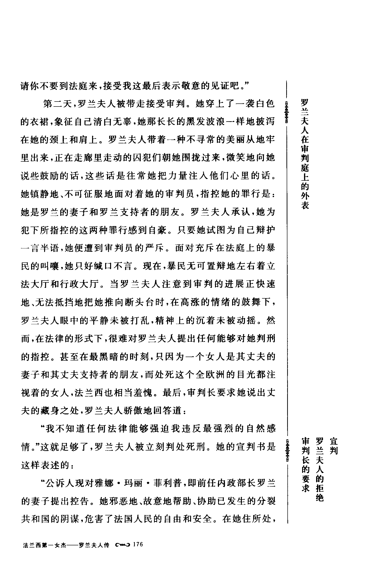

<small><a href="images/pages/188.png">原书第177页 · PDF 第188页 · 查看原页</a></small>

罗兰夫人平静地听完了对她的宣判，然后起身，对审判员很有尊严地深鞠一躬，微笑着说道：

“先生们，感谢你们认为我值得分担你们已屠杀的伟大人物们的命运，在断头台上，我将努力效仿他们的坚定。”

她迈着孩子般轻快的脚步，带着几乎显而易见的快乐，快速走向狭窄的人口，走进牢房。当天亮时分，她将被从牢房带向血腥的断头台。囚犯们聚在一起，欢迎她的归来，他们急切地围在她的身边，罗兰夫人面带平静的微笑看着他们，把自己的手横在脖子上，做了一个表明自己命运的手势。宣判和处决之间的几个小时正在流逝，罗兰夫人退到自己的牢房中，写下一些与朋友们告别的话，在一把传入狱中的竖琴上，她演奏着挽歌。挽歌的旋律是如此凄凉哀伤，浮荡在黑暗的深夜里，穿过那些坟墓一般的地穴，像不属于凡间的音乐一样，淌人那些被囚禁的绝望灵魂。

1793年11月10日，阴沉沉的早晨降临在巴摯城，这是长时间笼罩在恐怖统治阴影之中的法国最黑暗的一天。那天早上，裁判所附属监狱庭院中笨重的大门被打开，走出了一列装载着前往断头台的受害人的长车队。罗兰夫人思考自己命运的时间已足够长，对自己精神上的磨炼也足够严格，所以在这最后的考验时刻，她并不缺乏坚韧。在走出牢房之前，她认真地为死亡仪式做了梳妆打扮。当她向围在自己身边哭泣的囚犯们挥手告别时，脸上挂着平静的微笑，散发出愉悦的饱满精神，她神采奕奕、容光焕发。

原页对照（含插图与旁注）
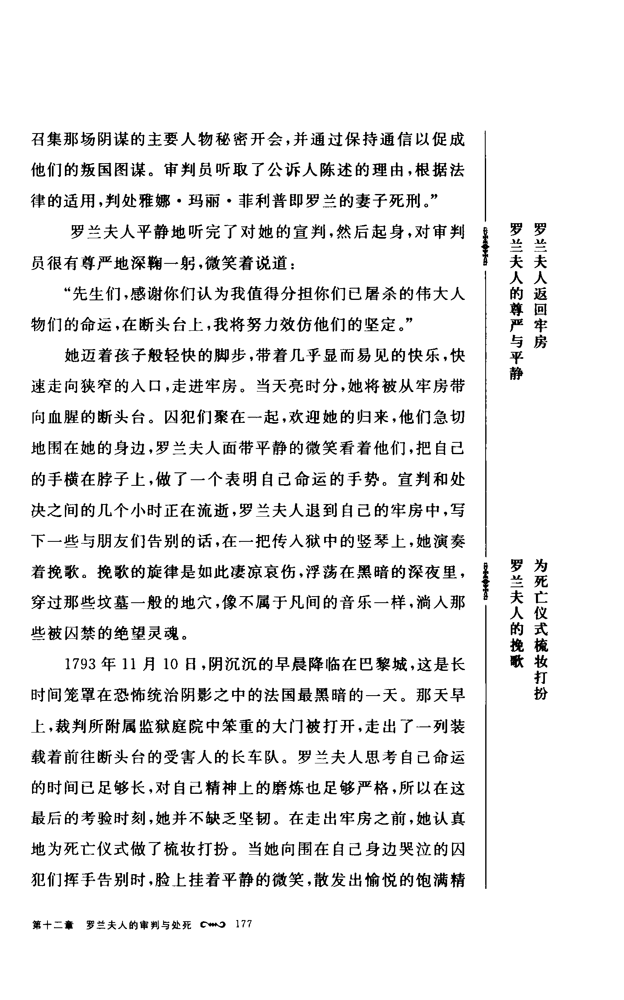

<small><a href="images/pages/189.png">原书第178页 · PDF 第189页 · 查看原页</a></small>

最后一辆车分配给了罗兰夫人，她脚步轻快灵活地走上马车，好像这是一辆驰往美好早晨的马车。在她身边，站立着一位身体虚弱的老人—-拉马什（La Marche）先生，他脸色苍白、浑身发抖，因为正在到来的恐怖，他那虚弱的心脏几乎停止跳动。罗兰夫人用手臂支撑着他，面带着亲切的微笑，以令人愉快的口气，对他说着安慰和鼓励的话。这个可怜的老人感觉到，在死亡的黑暗时刻，上帝给他派来了一位帮助他坚强的天使。当马车沿着道路沉重地行驶，离断头台越来越近时，有两三次，通过她令人振奋的话语，她甚至使他那苍白的脸上出现了淡淡的笑意。

现在，对巴黎民众来说，断头台是主要的娱乐工具。断头台被架得很高，以便于所有人都有好的视角观看它上演的景象。目睹这种行为的男人、女人、男孩、女孩，在经历这种恐怖的残暴时，简直比观看剧院里虚幻的、夸张的悲剧，或者斗鸡场、耍熊场上的争斗还更要兴奋。无数人充斥在大街上，男人、女人、孩子，喊叫着、狂笑着、咒骂着。

罗兰夫人的名望、非凡的优雅美丽和不仅英勇无畏而且愉快欢欣的神态，都令她成为公众观看的著名对象。一袭白色的长裙优雅地罩在她优美的形体上，由于某些原因被刽子手疏漏剪掉的黑亮头发浓密地垂至腰间。11月的寒风刺骨地肆虐在街头，在寒风的影响下和这种场面的刺激下，她那生动的面容洋溢着青春的红润。她坚定地站立在马车里，眼光平静地看着大街两边的人群，平静地听着充斥在空气中的叫嚷。一大群人围住了罗兰夫人所站立的马车，叫喊着：“上断头台！上断头台！”罗兰夫人温和地看着他们，俯身在马车的围栏上，声音温和得如同在跟自己的孩子讲话，对他们说道：“我的朋友们，我正在去断头台，一会儿就到那儿了。送我去断头台的人不久就会像我一样，我清白地离去，他们却将沾满鲜血地前来。你们现在为我的死亡欢呼，那时候你们会以同样的热情为他们欢呼。”

原页对照（含插图与旁注）
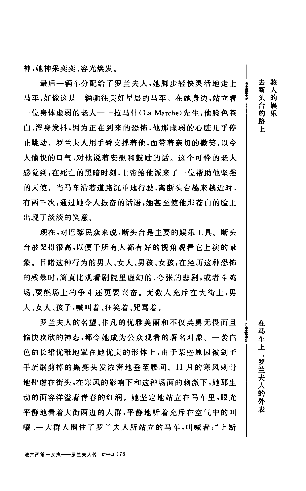

<small><a href="images/pages/190.png">原书第179页 · PDF 第190页 · 查看原页</a></small>

直到离开牢房前往断头台的时刻，罗兰夫人还在继续写着她的回忆录。当马车几乎到达断头台底下的时候，如此悲壮的场面深深地震撼了她的心灵——这种源于死别和走向来世的情感如此急切地冲进她的心灵，以至于她无法抑制书写下自己热烈情感的渴望。于是，她请求一位军官给她提供纸笔，给她一些时间，可是，这个请求被拒绝了。就这样，我们失掉了她生命中没有写下的一章，这是多么遗憾啊！毫无疑问，那个时刻，她写下的文字必将会长期震颤着世人倾听的耳朵，她灵魂的呐喊必将穿越高山、峡谷、大洋，专制不能制止它，时间也不能削弱它。

终于，长长的队伍来到了断头台，血腥的工作已经开始。把受害人从马车上拖下，斧头快速地一起一落，人头一个接一个地掉进篮子里，流血的尸体堆迅速地变大。刽子手来到罗兰夫人和她衰弱的同伴一同站立的马车前，罗兰夫人面带着愉快的微笑，全部身心都投入到把坚强输入这位老人心灵的努力中。刽子手抓住了罗兰夫人的胳膊，她微微地抗拒着，喊道：“停一下，我想请您帮个忙，不是帮助我自己，我恳求你答应我。”然后，她转向身边的老人，说道：“你先于我上断头台吧，看到我流血会使你遭受两次死亡的痛苦，我让你免去因为目睹处死我而产生的痛苦。”但苛刻的军官断然拒绝，回答道：“我的命令是先杀你。”罗兰夫人脸上带着动人的微笑，迷人的优雅几乎令人无法抗拒，她答道：“你断然不能拒绝一个女人最后的请求。”她的魅力感化了铁石心肠的法律执行者，他停了下来，微微迷惑地看了她一会儿，服从了罗兰夫人。于是，这个生不如死的可怜老人，被带到断头台上，倒在了致命的斧头下。罗兰夫人的脸色没有任何变化，也没有任何可见到的紧张发抖，她注视着沉重的杀人工具，它寒光闪闪、锋利无比地执行着取人性命的任务，已被斩首的朋友的躯体被弃掷到一边，为她腾出了位置。罗兰夫人表情平静，脚步轻快地攀上断头台。这个断头台建造在杜伊勒里宫花园和爱丽舍花园之间的空地上，当时被称作革命广场，现在被称为协和广场。它是欧洲其他广场所无法超越的，现在，有两个大理石喷泉装饰着这个地方。沾满鲜血的断头台上，一直流着深红色的河流，然后，血流溢满建造在其中的一个喷泉的场地。广场上有一座用陶土制成的自由雕像，现在，它的正面建造了埃及式的方尖石碑。罗兰夫人在高高的断头台上站了一会儿，平静地望着民众，然后，在巨大的自由雕像前深鞠一躬，高喊道：“自由啊！自由！多少罪恶假汝之名以行。”她任由刽子手把自己捆绑到支架上，支架落到水平位置，她的头颅被放到致命的斧头下，寒光凌厉的铁刃滑过断头台的沟槽，罗兰夫人的头颅与她的身体切断。

原页对照（含插图与旁注）
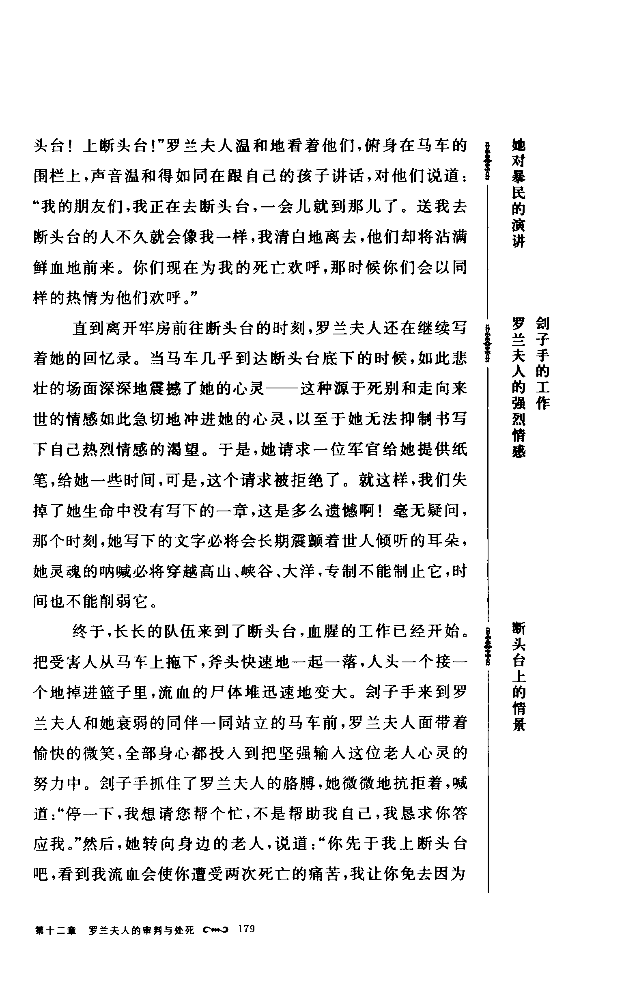

<small><a href="images/pages/191.png">原书第180页 · PDF 第191页 · 查看原页</a></small>

就这样，罗兰夫人在39岁的年龄死去。她的死亡令所有熟悉她的人陷入深深的悲伤。她亲密的朋友比佐，当时是一个逃亡者，听到这个消息时，他陷入极度的疯狂状态，在

原页对照（含插图与旁注）
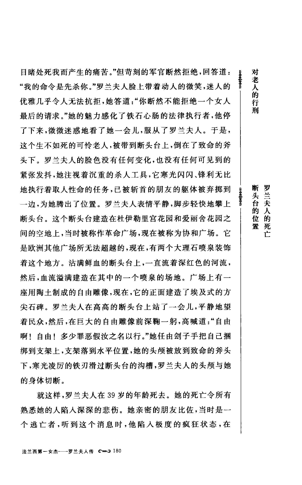

<small><a href="images/pages/192.png">原书第181页 · PDF 第192页 · 查看原页</a></small>

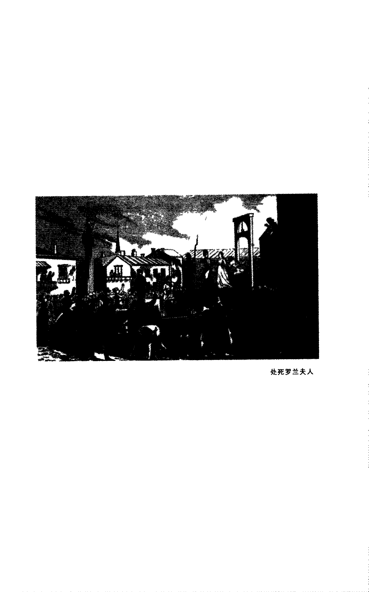

<small><a href="images/pages/193.png">原书第182页 · PDF 第193页 · 查看原页</a></small>

很多天里都没有恢复过来。她忠诚的女仆人也为悲伤所击倒，竟然亲自前往革命法庭，请求让她也死在深爱的女主人所死去的同样的断头台上。革命法庭吃惊于这种激动人心的忠诚情感，宣布女仆人疯掉了，命令她从他们眼前走开。一个男仆人也做了同样的请求，但他被送上了断头台。

当获悉这个结局的时候，罗兰先生无比悲痛，一度，他完全失去了知觉。活着对他来说，再也无法忍受，他不知道任何宗教上的安慰，豁达的态度也仅仅鼓励他淡然坚忍。在夜里，他私自离开了周密地隐藏他六个月的好朋友，为了使他的保护人免于因他之故带来的危险，他浪迹到离藏身之处比较远的一个地方。在漫长的冬夜里，他悲伤地行走着，直到早晨的第一缕晨光出现在东方。

他从自己的手杖里拉出一柄长的细剑，靠在一棵树上，把锋利的剑刺向自己的身体。长剑刺人他的心胜，他倒在了冰冷的地面上。一些农民经过这里，发现了他的尸体，在他外套的胸口部分，用别针别着一张纸，纸上写着这些话：“无论您是谁，若发现了这些遗骸，请尊重它们，因为它们是一个有德行的人的遗骸。在听到我妻子的死亡后，我无法在这个为罪恶所玷污的世上再活一天。”

罗兰夫人的女儿成功地逃脱了狂暴的革命暴政，生活在好心的保护者的围绕之中。后来，她嫁给了尚普诺（Champe-neaux）先生——她母亲的一个亲密朋友的儿子。

这就是罗兰夫人精彩的人生，它是给人教诲令人警世的一段历史，一直提醒着我们：现实比小说更奇特。

原页对照（含插图与旁注）
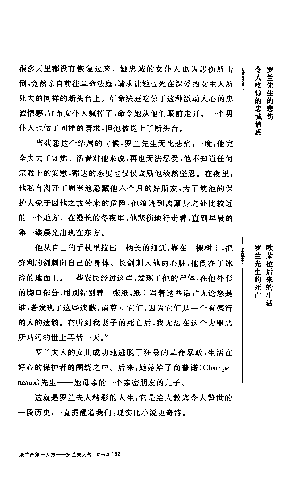

