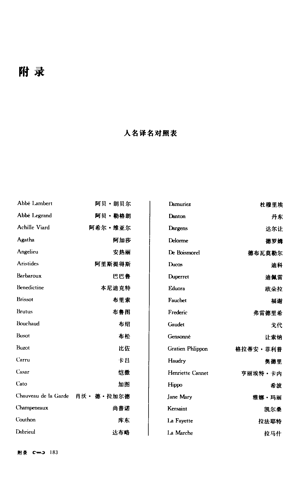
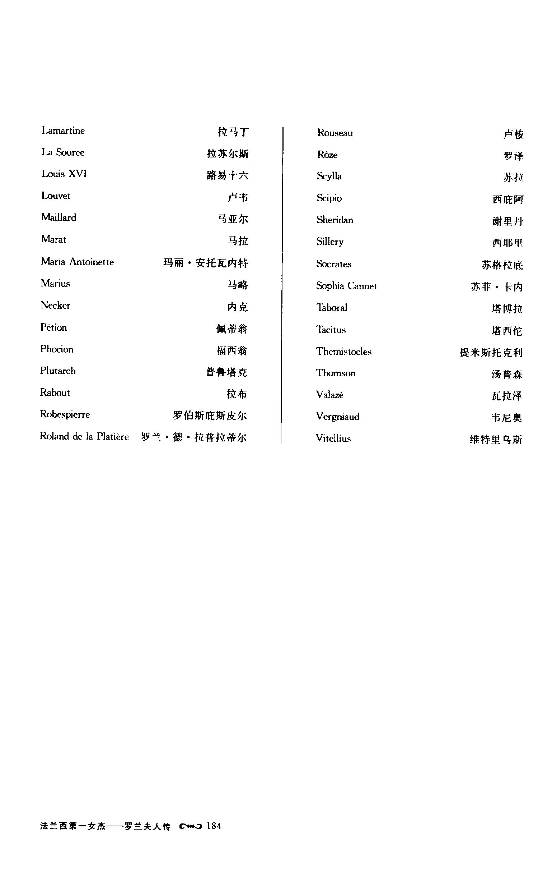

# 附录 人名译名对照表

<small><a href="images/pages/194.png">原书第183页 · PDF 第194页 · 查看原页</a></small>

<table><thead><tr><th>原文姓名</th><th>原书译名</th></tr></thead><tbody><tr><td>Abbé Lambert</td><td>阿贝·朗贝尔</td></tr><tr><td>Abbé Legrand</td><td>阿贝·勒格朗</td></tr><tr><td>Achille Viard</td><td>阿希尔·维亚尔</td></tr><tr><td>Agatha</td><td>阿加莎</td></tr><tr><td>Angelieu</td><td>安热丽</td></tr><tr><td>Aristides</td><td>阿里斯提得斯</td></tr><tr><td>Barbaroux</td><td>巴巴鲁</td></tr><tr><td>Benedictine</td><td>本尼迪克特</td></tr><tr><td>Brissot</td><td>布里索</td></tr><tr><td>Brutus</td><td>布鲁图</td></tr><tr><td>Bouchaud</td><td>布绍</td></tr><tr><td>Busot</td><td>布松</td></tr><tr><td>Buzot</td><td>比佐</td></tr><tr><td>Carru</td><td>卡吕</td></tr><tr><td>Casar</td><td>恺撒</td></tr><tr><td>Cato</td><td>加图</td></tr><tr><td>Chauveau de la Garde</td><td>肖沃·德·拉加尔德</td></tr><tr><td>Champeneaux</td><td>尚普诺</td></tr><tr><td>Couthon</td><td>库东</td></tr><tr><td>Dabrieul</td><td>达布略</td></tr><tr><td>Damuriez</td><td>杜穆里埃</td></tr><tr><td>Danton</td><td>丹东</td></tr><tr><td>Dargens</td><td>达尔让</td></tr><tr><td>Delorme</td><td>德罗姆</td></tr><tr><td>De Boismorel</td><td>德布瓦莫勒尔</td></tr><tr><td>Ducos</td><td>迪科</td></tr><tr><td>Duperret</td><td>迪佩雷</td></tr><tr><td>Eduora</td><td>欧朵拉</td></tr><tr><td>Fauchet</td><td>福谢</td></tr><tr><td>Frederic</td><td>弗雷德里希</td></tr><tr><td>Gaudet</td><td>戈代</td></tr><tr><td>Gensonné</td><td>让索纳</td></tr><tr><td>Gratien Phlippon</td><td>格拉蒂安·菲利普</td></tr><tr><td>Haudry</td><td>奥德里</td></tr><tr><td>Henriette Cannet</td><td>亨丽埃特·卡内</td></tr><tr><td>Hippo</td><td>希波</td></tr><tr><td>Jane Mary</td><td>雅娜·玛丽</td></tr><tr><td>Kersaint</td><td>凯尔桑</td></tr><tr><td>La Fayette</td><td>拉法耶特</td></tr><tr><td>La Marche</td><td>拉马什</td></tr></tbody></table>

原页对照（含插图与旁注）

<small><a href="images/pages/195.png">原书第184页 · PDF 第195页 · 查看原页</a></small>

<table><thead><tr><th>原文姓名</th><th>原书译名</th></tr></thead><tbody><tr><td>Lamartine</td><td>拉马丁</td></tr><tr><td>La Source</td><td>拉苏尔斯</td></tr><tr><td>Louis XVI</td><td>路易十六</td></tr><tr><td>Louvet</td><td>卢韦</td></tr><tr><td>Maillard</td><td>马亚尔</td></tr><tr><td>Marat</td><td>马拉</td></tr><tr><td>Maria Antoinette</td><td>玛丽·安托瓦内特</td></tr><tr><td>Marius</td><td>马略</td></tr><tr><td>Necker</td><td>内克</td></tr><tr><td>Pétion</td><td>佩蒂翁</td></tr><tr><td>Phocion</td><td>福西翁</td></tr><tr><td>Plutarch</td><td>普鲁塔克</td></tr><tr><td>Rabout</td><td>拉布</td></tr><tr><td>Robespierre</td><td>罗伯斯庇斯皮尔</td></tr><tr><td>Roland de la Platière</td><td>罗兰·德·拉普拉蒂尔</td></tr><tr><td>Rouseau</td><td>卢梭</td></tr><tr><td>Rôze</td><td>罗泽</td></tr><tr><td>Scylla</td><td>苏拉</td></tr><tr><td>Scipio</td><td>西庇阿</td></tr><tr><td>Sheridan</td><td>谢里丹</td></tr><tr><td>Sillery</td><td>西耶里</td></tr><tr><td>Socrates</td><td>苏格拉底</td></tr><tr><td>Sophia Cannet</td><td>苏菲·卡内</td></tr><tr><td>Taboral</td><td>塔博拉</td></tr><tr><td>Tacitus</td><td>塔西佗</td></tr><tr><td>Themistocles</td><td>提米斯托克利</td></tr><tr><td>Thomson</td><td>汤普森</td></tr><tr><td>Valazé</td><td>瓦拉泽</td></tr><tr><td>Vergniaud</td><td>韦尼奥</td></tr><tr><td>Vitellius</td><td>维特里乌斯</td></tr></tbody></table>

原页对照（含插图与旁注）

