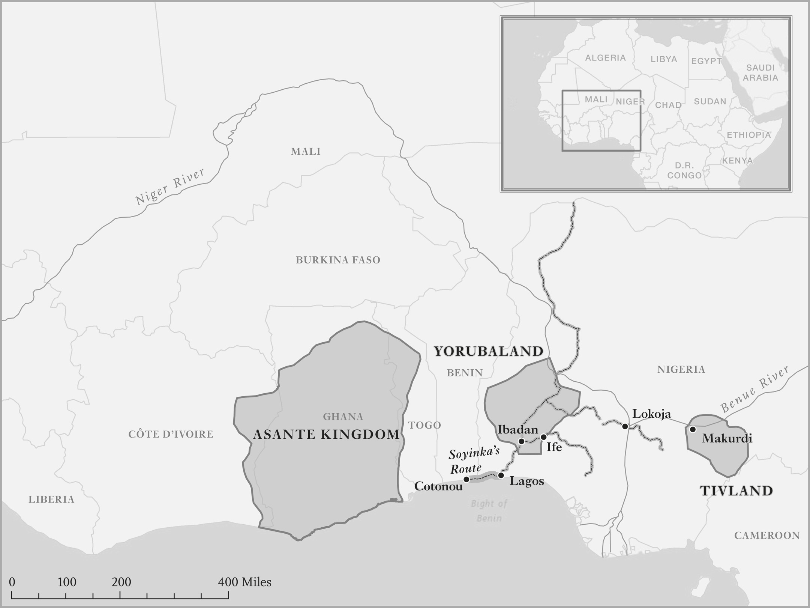

# How Does History End? · 第1章　历史如何终结？

## A Coming Anarchy? · 无政府状态山雨欲来？

In 1989, Francis Fukuyama predicted the “end of history,” with all countries converging to the political and economic institutions of the United States, what he called “an unabashed victory of economic and political liberalism.” Just five years later Robert Kaplan painted a radically different picture of the future in his article “The Coming Anarchy.” To illustrate the nature of this chaotic lawlessness and violence, he felt compelled to begin in West Africa:

> 一九八九年，法兰西斯．福山预测「历史的终结」，所有国家会趋向美国式的政治和经济制度，形成他所谓的「经济与政治自由主义定于一尊」。仅仅五年后，罗伯．柯普兰（Robert Kaplan）就在论著《无政府状态山雨欲来》（Coming Anarchy ）中，描绘出截然不同的未来景象。为了说明无政府状态这种无法无天、暴力横行的混乱本质，他深感必须从西非开始说起：

West Africa is becoming the symbol of [anarchy] . . . Disease, overpopulation, unprovoked crime, scarcity of resources, refugee migrations, the increasing erosion of nation-states and international borders, and the empowerment of private armies, security firms, and international drug cartels are now most tellingly demonstrated through a West African prism. West Africa provides an appropriate introduction to the issues, often extremely unpleasant to discuss, that will soon confront our civilization. To remap the political earth the way it will be a few decades hence . . . I find I must begin with West Africa.

> 西非已经成为〔无政府状态〕的象征……疾病、人口过剩、犯罪横行、资源稀少、难民逃离、国家机器日益朽坏，私人军队、保全公司、国际毒品卡特尔[〔注1〕](#note-1) 各自为政的现象，透过西非角度，最能明显地展现出来。西非为讨论起来极为不愉快、很快就会冲击我们文明的这个问题，提供了适当的简介，因此为了重塑未来几十年的政治景象，我发现我必须从西非开始谈起。

In a 2018 article, “Why Technology Favors Tyranny,” Yuval Noah Harari made yet another prediction about the future, arguing that advances in artificial intelligence are heralding the rise of “digital dictatorships,” where governments will be able to monitor, control, and even dictate the way we interact, communicate, and think. So history might still end, but in a very different way than Fukuyama had imagined.

> 二○一八年，尤瓦尔．哈拉瑞（Yuval Noah Harari）在文章〈为什么科技对暴政有利〉（Why Technology Favors Tyranny）中预测未来时，认定人工智慧的进步，预示「数位独裁政权」会兴起，政府会拥有监视和控制能力，甚至会主导我们的互动、通讯和思考。因此，历史仍然可能结束，只是结束的方式和福山所想像的大不相同。

But how? The triumph of Fukuyama’s vision of democracy, anarchy, or digital dictatorship? The Chinese state’s increasing control over the Internet, the media, and the lives of ordinary Chinese might suggest that we are heading toward digital dictatorship, while the recent history of the Middle East and Africa reminds us that a future of anarchy is not so far-fetched. But we need a systematic way to think about all of this. As Kaplan suggested, let’s begin in Africa.

> 但究竟会怎么样结束呢？是福山预见的民主制度赢得胜利，还是无政府状态或数位独裁政权获胜？中国国家机器加强控制网际网路、媒体和人民生活，可能显示我们正朝数位独裁政权的方向前进；同时，中东和非洲最近的历史提醒我们，无政府状态的前景并非遥不可及。但是，我们需要一个有系统的方法来思考这一切；我们不妨遵循柯普兰的建议，从非洲开始思考。

## The Article 15 State · 第十五条国家

If you keep going east along the West African coast, the Gulf of Guinea eventually turns south and heads to Central Africa. Sailing past Equatorial Guinea, Gabon, and Pointe-Noire in Congo-Brazzaville, you arrive at the mouth of the river Congo, the entry point to the Democratic Republic of the Congo, a country that is often thought to be the epitome of anarchy. The Congolese have a joke: there have been six constitutions since the country gained its independence from Belgium in 1960, but they all have the same Article 15. The nineteenth-century French prime minister Charles-Maurice Talleyrand said that constitutions should be “short and obscure.” Article 15 fulfills his dictum. It is short and obscure; it says simply Débrouillez-vous (Fend for yourself).

> 如果你沿着西非海岸向东航行，到几内亚湾后转为向南走，航向中非，经过赤道几内亚、加彭和布拉萨市刚果的黑角市（Pointe-Noire），你会抵达进入刚果民主共和国入口的刚果河口。人们经常认为，这个国家是无政府状态的缩影。刚果人有一个笑话，说这个国家一九六○年从比利时手中，争取到独立后，一共制定了六部宪法，六部宪法都有相同的宪法第十五条。十九世纪法国总理夏尔．莫里斯．德塔列朗（Charles-Maurice Talleyrand）说过，宪法应该「简短而含混」。第十五条符合他的名言，简短而含混，只表示「要自求多福」（Debrouillez-vous）。

It’s usual to think of a constitution as a document that lays out the responsibilities, duties, and rights of citizens and states. States are supposed to resolve conflicts among their citizens, protect them, and provide key public services such as education, healthcare, and infrastructure that individuals are not able to adequately provide on their own. A constitution isn’t supposed to say Débrouillez-vous. The reference to “Article 15” is a joke. There isn’t such a clause in the Congolese Constitution. But it’s apt. The Congolese have been fending for themselves at least since independence in 1960 (and things were even worse before).

> 一般认为，宪法是说明公民和国家责任、义务和权利的文件，国家理当解决公民之间的冲突，保护公民，提供教育、健保和基础建设等个人无法自行适当提供的重要公共服务。宪法理当不该要人民自求多福。提到「宪法第十五条」只是笑话，刚果宪法中没有这一条；但是，这个笑话很适合，因为刚果人至少从一九六○年独立以来，一直都在自求多福（独立以前的情况甚至更糟）。

Their state has repeatedly failed to do any of the things it is supposed to do and is absent from vast swaths of the country. Courts, roads, health clinics, and schools are moribund in most of the country. Murder, theft, extortion, and intimidation are commonplace. During the Great War of Africa that raged in the Congo between 1998 and 2003, the lives of most Congolese, already wretched, turned into a veritable hell. Possibly five million people perished; they were murdered, died of disease, or starved to death.

> 他们的国家一再疏于做好该做的事：国家机器在庞大的国土上消失无踪，全国大部分地方的法院、道路、诊所和学校破败不堪，谋杀、窃盗、勒索和恐吓屡见不鲜。一九九八年至二○○三年间，刚果爆发非洲大战[〔注2〕](#note-2) ，大部分刚果人已经苦不堪言的生活，变成了名副其实的地狱。丧生的人可能多达五百万人，死因包括谋杀、病死与饿死。

Even during times of peace the Congolese state has failed to uphold the actual clauses of the constitution. Article 16 states: All persons have the right to life, physical integrity and to the free development of their personality, while respecting the law, public order, the rights of others and public morality. But much of the Kivu region, in the east of the country, is still controlled by rebel groups and warlords who plunder, harass, and murder civilians while looting the country’s mineral wealth.

> 即使在承平时期，刚果国家机器也疏于维护真正的宪法条文。宪法第十六条规定：所有人民在尊重法律、公共秩序、他人权利和公共道德下，拥有生命、人身安全和自由发展个性的权利。但是，在刚果东部的基伍（Kivu）地区，大部分土地仍然由叛乱团体和军阀割据，他们在掠夺刚果的矿物财富的同时，还肆行抢掠、骚扰和谋杀平民。

What about the real Article 15 in the Congolese Constitution? It begins, “The public authorities are responsible for the elimination of sexual violence . . .” Yet in 2010 an official of the United Nations described the country as the “rape capital of the world.” The Congolese are on their own. Débrouillez-vous.

> 真正的刚果宪法第十五条到底说什么？这一条开宗明义就说：「政府官署必须负责消除性暴力……。」但是，二○一○年时，联合国一位官员说，该国是「世界强暴之都」。刚果人民孤立无助，只能自求多福。

## A Journey Through Dominance · 任人宰割之旅

This adage is not apposite just for the Congolese. If you retrace the Gulf of Guinea, you arrive at the place that seemed to best sum up Kaplan’s bleak vision of the future, Lagos, the business capital of Nigeria. Kaplan described it as a city “whose crime, pollution, and overcrowding make it the cliché par excellence of Third World urban dysfunction.”

> 「自求多福」这句格言不仅适用于刚果人。如果你沿着几内亚湾返航，你会抵达拉哥斯。这是奈及利亚的商业首都，也是柯普兰认为最能用「前途暗淡」四个字来形容的都市。柯普兰描述这个城市「犯罪、污染和过度拥挤的程度，到了象征第三世界都市功能障碍集大成的地步」。

In 1994, as Kaplan wrote, Nigeria was under the control of the military with General Sani Abacha as president. Abacha did not think that his job was to impartially resolve conflicts or protect Nigerians. He focused on killing his opponents and expropriating the country’s natural wealth. Estimates of how much he stole start at around $3.5 billion and go higher. The previous year the Nobel Prize–winning writer Wole Soyinka returned to Lagos, crossing the land border from Cotonou, the capital of neighboring Benin (which is shown on Map 1).

> 柯普兰写道，一九九四年的奈及利亚由军方统治，萨尼．阿巴查（Sani Abacha）将军担任总统。阿巴查不觉得自己的责任是公允地解决冲突或保护国民，却把重点放在屠杀反对派和侵夺国家的天然财富上，估计他盗窃的财富起码有三十五亿美元，而且可能还更多。前一年，诺贝尔文学奖得主、奈及利亚作家渥雷．索因卡（Wole Soyinka）要从邻国贝南（参见地图一）首都柯多努，走陆路穿越两国边界回拉哥斯。

He recalled, “The approach to the Nigeria-Cotonou border told the story at first glance. For miles we cruised past a long line of vehicles parked along the road right up to the border, unable or unwilling to cross.” People who ventured across “returned within an hour of their venture either with damaged vehicles or with depleted pockets, having been forced to pay a toll for getting even as far as the first roadblock.”

> 他回忆说：「接近奈及利亚和柯多努边界时，第一眼就可以看出整个情况，我们走了好几英里，越过长长一排停在路边、一直排到边界的汽车，这些车子不是无法穿越边界，就是不愿意穿越。」尝试越境的人「一小时内就折返，不是车子受损，就是口袋空空，因为他们被迫缴交买路钱，却连第一个路障都还没有走到」。

Undeterred, Soyinka crossed into Nigeria to find somebody to take him to the capital, only to be told, “Oga Wole, eko o da o” (Master Wole, Lagos is not good). A taxi driver came forward pointing to his bandaged head with his bandaged hand. He proceeded to narrate the reception he had received; a bloodthirsty gang had pursued him even as he drove his car in reverse at full speed.

> 索因卡没有被吓倒。他越境进入奈及利亚，想找人载他到首都去，得到的回答却是：「索因卡爷，拉哥斯不好哦。」一位计程车司机用包着绷带的手，指着自己包着绷带的头部，叙述自己得到的待遇。他说自己虽然全速倒车，还是有一帮嗜血的帮派分子追着他打。

Oga . . . Dose rioters break my windshield even as I dey already reversing back. Na God save me self . . . Eko ti daru [Lagos is in chaos]. Finally, Soyinka found a taxi to take him to Lagos, though the reluctant driver opined, “The road is ba-a-ad. Very bad.” As Soyinka put it, “And thus began the most nightmarish journey of my existence.” He continued:

> 爷……我已经倒车退后了，乱贼还是打破我的挡风玻璃，上帝救我……拉哥斯现在一片混乱。最后，索因卡找到一部计程车，载他到拉哥斯，不过这位不情不愿的司机表示：「路况很差──差，非常差。」然后就像索因卡说的那样：「开始了我有生以来最可怕的旅程。」索因卡继续说道：

The roadblocks were made up of empty petroleum barrels, discarded tires and wheel hubs, vending kiosks, blocks of wood and tree trunks, huge stones . . . The freelance hoodlums had taken over . . . At some roadblocks there was a going fee; you paid it and were allowed to pass—but that safe conduct lasted only until the next barrier. Sometimes the fee was a gallon or more of fuel siphoned from your car, and then you were permitted to proceed—until the next barrier . . . Some vehicles had clearly run a gauntlet of missiles, cudgels, and even fists; others could have arrived directly from the film set of Jurassic Park—one could have sworn there were abnormal teeth marks in the bodywork.

> 路障用空汽油桶、废轮胎和轮毂、贩卖亭、木块、树干和巨石搭成……路障由兼差流氓接管……有些路障有规定费率，你缴了钱，就可以通行，但也只能安全通行到下一个障碍为止。有时候，通行费是从你的车里，吸出一加仑多的汽油，然后就放你过去──直到下一个路障又被拦下来为止……有些车子显然有遭到飞弹、棍棒、甚至拳头撞击的痕迹，有些车子可能像直接从电影《侏罗纪公园》场景开过来一样──有人发誓说，板金上有不正常的齿痕。

As he approached Lagos, the situation grew worse. Normally the journey into the heart of Lagos would take two hours. Now it was already five hours later, and we had covered only some fifty kilometers. I became increasingly anxious. The tension in the air became palpable as we moved nearer to Lagos. The roadblocks became more frequent; so did the sight of damaged vehicles and, worst of all, corpses.

> 他接近拉哥斯时，情况变得更糟糕。进入拉哥斯市中心的路程通常要花两小时，现在已经过五小时了，我们才走了五十公里。我愈来愈急，我们愈接近拉哥斯，空气中的紧张气氛变得很明显，路障变得愈常见；毁损的车子也一样常见，最可怕的东西是尸体。

Corpses are not an unusual sight in Lagos. When a senior policeman went missing, the police searched the waters under a bridge for his body. They stopped looking after six hours and twenty-three corpses, none of them the one they were seeking. While the Nigerian military looted the country, Lagosians had to do a lot of fending for themselves. The city was crime ridden and the international airport was so dysfunctional that foreign countries banned their airlines from flying there.

> 尸体在拉哥斯并不罕见。有一位高级警官失踪时，警方曾在一座桥下的水里，寻找他的尸体。六个小时后，警方停止搜寻：他们共找到二十三具尸体，没有一具是他们要找的人。奈及利亚军队掳掠国家时，拉哥斯人必须很努力地自求多福。整个城市犯罪横行，国际机场功能失常极为严重，以至于许多国家禁止本国航空公司飞往拉哥斯。

Gangs called “area boys” preyed on businessmen, shaking them down for money and even murdering them. The area boys weren’t the only hazard people had to avoid. In addition to the odd corpse, the streets were covered in trash and rats. A BBC reporter commented in 1999 that “the city is . . . disappearing under a mountain of rubbish.” There was no publicly provided electricity or running water. To get light you had to buy your own generator. Or candles.

> 叫做「地区男孩」的帮派劫掠商家，逼勒金钱，甚至杀害商人。这些地区男孩不是唯一必须避开的危险人物。街上除了尸体之外，还堆满垃圾和老鼠。一九九九年时，英国广播公司一位记者曾经批评说：「……这个城市……在垃圾山中。」市内没有公共供应的电力和自来水，要获得照明，你必须自己购买发电机，或是使用蜡烛。

The nightmarish existence of Lagosians wasn’t just that they lived in rat-infested, trash-strewn streets and saw corpses on the sidewalk. They lived in continual fear. Living in downtown Lagos with the area boys wasn’t fun. Even if they decided to spare you today, they might come after you tomorrow—especially if you had the audacity to complain about what they were doing to your city or didn’t show them the subservience they demanded. This fear, insecurity, and uncertainty may be as debilitating as actual violence because, to use a term introduced by political philosopher Philip Pettit, it puts you under the “dominance” of another group of human beings.

> 拉哥斯人不只过着恶梦般的生活，住在老鼠肆虐、街上满布垃圾、人行道会看到尸体的地方，他们还一直活在持续的恐惧当中。跟地区男孩一起住在拉哥斯市中心并不好玩，即使他们决定今天放过你，明天也可能再找上门──尤其是如果你居然胆大包天，批评他们在城市里的所作所为，或是不肯表现出他们要求的恭顺之心的话，更是如此。这种恐惧、不安全和不确定，可能会像实际的暴力那样，让你身心耗弱不堪。借用政治哲学家菲立普．佩蒂特（Philip Pettit）的说法，因为这样会让你落入任人「宰割」的处境中。

In his book Republicanism: A Theory of Freedom and Government, Pettit argues that the fundamental tenet of a fulfilling, decent life is non-dominance—freedom from dominance, fear, and extreme insecurity. It is unacceptable, according to Pettit, when one has to live at the mercy of another, having to live in a manner that leaves you vulnerable to some ill that the other is in a position arbitrarily to impose.

> 佩蒂特在大作《共和主义：自由与政府理论》（Republicanism: A Theory of Freedom and Government ）中，主张满足、体面生活的基本原则是不受到宰割──免于宰割、恐惧和极端不安全的自由。根据佩蒂特的说法，我们不能接受下述这种生活：必须活在别人的摆布之下，活在容易受他人强加的某种恶意迫害的情况中。

Such dominance is experienced when the wife . . . finds herself in a position where her husband can beat her at will, and without any possibility of redress; by the employee who dare not raise a complaint against an employer, and who is vulnerable to any of a range of abuses . . . that the employer may choose to perpetrate; by the debtor who has to depend on the grace of the moneylender, or the bank official, for avoiding utter destitution and ruin.

> 下述情况就是受到这种宰割的例子：妻子发现自己处在丈夫可以任意殴打、却毫无补救之道的处境中；员工处在不敢对雇主抱怨，又可能受到雇主……一系列凌虐危害的状况中；债务人处于必须仰赖金主或银行职员鼻息，以免变成赤贫阶级，被彻底毁灭。

Pettit recognizes that the threat of violence or abuses can be as bad as actual violence and abuses. To be sure, you can avoid the violence by following some other person’s wishes or orders. But the price is doing something you don’t want to do and being subject to that threat day in and day out. (As economists would put it, the violence might be “off the equilibrium path,” but that doesn’t mean that it doesn’t affect your behavior or have consequences that are almost as bad as suffering actual violence.) As Pettit sees it, such people

> 佩蒂特承认：暴力或凌虐的威胁，可能和真正的暴力或凌虐一样糟糕。不错，你可以靠着遵循别人的愿望或命令来避免暴力，但代价是得做你不想做的事情，而且每天都要受到这种威胁影响（经济学家会说，暴力可能是「偏离均衡路径」（Off the Equilibriwn path），但这并不表示这种事情不会影响你的行为，或产生跟承受实际暴力几乎一样恶劣的后果。）佩蒂特说，这种人：

live in the shadow of the other’s presence, even if no arm is raised against them. They live in uncertainty about the other’s reactions and in need of keeping a weather eye open for the other’s moods. They find themselves . . . unable to look the other in the eye, and where they may even be forced to fawn or toady or flatter in the attempt to ingratiate themselves.

> 活在别人的阴影中，即使别人没有举起手来对付他们，情况还是一样。他们活在不确定别人会有什么反应的氛围中，必须睁大眼睛，保持警觉，注意别人的情绪……不能正视别人的眼睛，甚至会被迫摇尾乞怜、谄媚拍马或奉承别人，以便讨好自己。

But dominance doesn’t just originate from brute force or threats of violence. Any relation of unequal power, whether enforced by threats or by other social means, such as customs, will create a form of dominance, because it amounts to being subject to arbitrary sway: being subject to the potentially capricious will or the potentially idiosyncratic judgement of another. We refine Locke’s notion and define liberty as the absence of dominance, because one who is dominated cannot make free choices. Liberty, or in Pettit’s words, non-dominance, means emancipation from any such subordination, liberation from any such dependency. It requires the capacity to stand eye to eye with your fellow citizens, in a shared awareness that none of you has a power of arbitrary interference over another.

> 不是只有蛮力或暴力威胁会导致宰割，胁迫、习俗等社会力量造成的任何不平等权力关系，都会创造宰割，因为这样等于屈从于武断的影响；受制于别人可能反复无常的意愿，或可能的独特判断。我们把洛克的主张更细致化，把「自由」定义为不受宰制，因为受人宰制者不能自由选择。自由，或佩蒂特说的「不受宰割」，表示从这种从属地位、从这种依赖中解放出来，这需要你跟同胞们能够达成共识，共同认知你们都没有强制干预对方的权力。

Critically, liberty requires not just the abstract notion that you are free to choose your actions, but also the ability to exercise that freedom. This ability is absent when a person, group, or organization has the power to coerce you, threaten you, or use the weight of social relations to subjugate you. It cannot be present when conflicts are resolved by actual force or its threat. But equally, it doesn’t exist when conflicts are resolved by unequal power relations imposed by entrenched customs. To flourish, liberty needs the end of dominance, whatever its source.

> 重要的是，自由不但要求你拥有选择行动自由的抽象观念，还要求你拥有行使这种自由的能力。如果有一个人、团体或组织能够胁迫、威胁或运用社会关系的力量让你屈服，行使自由的这种能力就不存在；在冲突要靠实际暴力或威胁解决时，这种能力不会存在。但同样地，若解决冲突要靠根深柢固的习俗强加不平等权力关系时，这种能力也不存在。自由要蓬勃发展，就必须终结宰制，无论来源为何。

In Lagos liberty was nowhere to be seen. Conflict was resolved in favor of the stronger, the better-armed party. There was violence, theft, and murder. Infrastructure was crumbling at every turn. Dominance was all around. This was not a coming anarchy. It was already there.

> 自由在拉哥斯根本不存在。每当冲突发生时，武装比较优良、比较强大的一方总是处在有利的位置；暴力、窃盗、谋杀和宰割的现象处处可见，每一个转角的基础建设都在崩坏。无政府状态并非「山雨欲来」，无政府状态早已降临。

## Warre and the Leviathan · 战争状态和国家巨灵

Lagos in the 1990s may seem an aberration to most of us living in security and comfort. But it isn’t. For most of human existence, insecurity and dominance have been facts of life. For most of history, even after the emergence of agriculture and settled life about ten thousand years ago, humans lived in “stateless” societies.

> 对过着安全、舒适生活的大部分人来说，一九九○年代的拉哥斯似乎是个失常的地方；其实不然。人类存在的大部分时间里，不安全和宰割一直都是生活中的现实。有史以来的大部分时间里，甚至在大约一万年前农业和定居生活出现后，人类还是活在「无国家」的社会中。

Some of these societies resemble a few surviving hunter-gatherer groups in the remote regions of the Amazon and Africa (sometimes also called “small-scale societies”). But others, such as the Pashtuns, an ethnic group of about 50 million people who occupy much of southern and eastern Afghanistan and northwestern Pakistan, are far larger and engaged in farming and herding. Archaeological and anthropological evidence shows that many of these societies were locked in an even more traumatic existence than the inhabitants of Lagos suffered daily in the 1990s.

> 其中若干社会类似幸存在亚马逊和非洲偏远地区的采猎团体（有时候也叫做「小规模社会」），但是像普什图族（Pashtuns）这样的种族团体，规模却大得多。普什图族人口大约有五千万人，占据阿富汗南部和东部，以及巴基斯坦东北部大部分地区，以农耕和畜牧为生。考古人类学证据显示，许多这种社会都没有发展前景，过着比一九九○年代拉哥斯居民日常生活还痛苦的日子。

The most telling historical evidence comes from deaths in warfare and murder, which archaeologists have estimated from disfigured or damaged skeletal remains; some anthropologists have observed this firsthand in surviving stateless societies. In 1978, the anthropologist Carol Ember systematically documented that there were very high rates of warfare in hunter-gatherer societies—a shock to her profession’s image of “peaceful savages.” She found frequent warfare, with a war at least every other year in two-thirds of the societies she studied. Only 10 percent of them had no warfare.

> 最有力的历史证据出自战争与谋杀的死亡数据，这些数据是考古学家根据毁损骨骸估计出来的；若干人类学家曾经亲眼观察过幸存的无国家社会。一九七八年，人类学家卡洛．安柏（Carol Ember）有系统地记录采猎社会中非常高的战争比率──这一点冲击她们这一行所抱持「野蛮人很和平」的印象。她发现她研究的社会中经常有战争，其中三分之二的社会每两年至少要打一次仗，只有十分之一的社会没有战争。

Steven Pinker, building on research by Lawrence Keeley, compiled evidence from twenty-seven stateless societies studied by anthropologists over the past two hundred years, and estimated a rate of death caused by violence of over 500 per 100,000 people—over 100 times the current homicide rate in the United States, 5 per 100,000, or over 1,000 times that in Norway, about 0.5 per 100,000. Archaeological evidence from premodern societies is consistent with this level of violence.

> 史蒂芬．平克（Steven Pinker）根据劳伦斯．吉立（Lawrence Keeley）的研究，编纂了过去二百年人类学家所研究二十七个无国家社会的证据，估计暴力造成的死亡率超过十万分之五百──比率是目前美国的一百倍（每十万人有五人遭到杀害），更是挪威的一千倍以上（每十万人约有○．五个人遭到杀害）。前现代社会的考古证据也符合这种暴力水准。

We should pause to take in the significance of these numbers. With a death rate of over 500 per 100,000, or 0.5 percent, a typical inhabitant of this society has about a 25 percent likelihood of being killed within a period of fifty years—so a quarter of the people you know will be violently killed during their lifetimes. It is hard for us to imagine the unpredictability and fear that such brazen social violence would imply.

> 我们应该理解这些数字的意义。以每十万人有超过五百人或千分之五遭到杀害来说，这种社会的一般居民在五十年内，遭到杀害的可能性大约为百分之二十五。也就是说，你认识的人在他们五十年寿命期间，大约有四分之一会遭到暴力杀害。我们很难想像这种赤裸裸社会暴力所暗示的不可预测性和恐惧。

Though a lot of this death and carnage was due to warring between rival tribes or groups, it wasn’t just warfare and intergroup conflict that brought incessant violence. The Gebusi of New Guinea, for example, have even higher murder rates—almost 700 per 100,000 in the precontact period of the 1940s and 1950s—mostly taking place during peaceful, regular times (if times during which almost 1 in 100 of the population gets murdered each year can be called peaceful!). The reason appears to be related to the belief that every death is caused by witchcraft, which triggers a hunt for the parties responsible for even nonviolent deaths.

> 虽然这些死亡和屠杀，大都是对立部落或团体之间的交战所造成，但暴力无休无止的原因不仅在于战争和团体之间的冲突。以新几内亚的盖布希族（Gebusi）为例，他们的谋杀率甚至更高。该族在与外界接触之前的一九四○年代至一九五○年代期间，每十万人中就有将近七百人是遭到谋杀而死亡，大部分还是发生于一般承平时期（如果每年有将近百分之一人口遭到谋杀可以说是承平的话）！原因似乎跟他们相信每起死亡案例（甚至包括非暴力死亡）都是巫术作祟有关，这种信仰导致人们竞相猎巫，引发更多谋杀行为。

It’s not just murder that makes the lives of stateless societies precarious. Life expectancy at birth in stateless societies was very low, varying between twenty-one and thirty-seven years. Similarly short lifespans and violent deaths were not unusual for our progenitors before the past two hundred years. Thus many of our ancestors, just like the inhabitants of Lagos, lived in what the famous political philosopher Thomas Hobbes described in his book Leviathan as continuall feare, and danger of violent death; And the life of man, solitary, poore, nasty, brutish, and short.

> 无国家社会的生活之所以很危险，不仅因为谋杀盛行，无国家社会的人平均寿命也很短，介于二十一岁至三十七岁之间。在二百年前我们祖先身上，类似寿命短促的现象也不罕见，因此我们很多祖先就像拉哥斯居民那样，过的日子类似著名政治哲学家汤玛斯．霍布斯（Thomas Hobbes）在巨作《巨灵论》（Leviathan ）中的描述：持续的恐惧、横死的危险；男人的生活孤独、贫困、难受、残酷、匮乏。

This was what Hobbes, writing during another nightmarish period, the English Civil War of the 1640s, described as a condition of “Warre,” or what Kaplan would have called “anarchy”—a situation of war of all against all, “of every man, against every man.” Hobbes’s brilliant depiction of Warre made it clear why life under this condition would be worse than bleak. Hobbes started with some basic assumptions about human nature and argued that conflicts would be endemic in any human interaction. “If any two men desire the same thing, which nevertheless they cannot both enjoy, they become enemies; and . . . endeavor to destroy, or subdue one an other.” A world without a way to resolve these conflicts was not going to be a happy one because

> 霍布斯写书时，正值一六四○年代英国内战期间：另一个可怕的时代。上文是他对文明丧失的「战争状态」（Warre）的描述，柯普兰把这种状态叫做「人人互相为战的无政府状态」，也就是所有人对抗所有人的状态。霍布斯对战争状态的精彩描述，清楚说明了为什么活在这种状态中比在荒野中生活还糟糕。霍布斯先对人性做了若干基本假设，主张冲突在人类的任何互动中都很常见：「如果两个人都想要同一样东西，且彼此不能共享，他们就会变成敌人；而且……彼此会努力毁灭或制服对方。」无法解决这种冲突的世界不会让人快乐，因为：

from hence it comes to passe, that where an Invader hath no more to fear, than an other mans single power; if one plant, sow, build, or possesse a convenient Seat, others may probably be expected to come prepared with forces united, to dispossess and deprive him, not only of the fruit of his labour, but also of his life, or liberty. Remarkably, Hobbes anticipated Pettit’s argument on dominance, noting that just the threat of violence can be pernicious, even if you can avoid actual violence by staying home after dark, by restricting your movements and your interactions.

> 从此以后，侵略者将不再害怕其他人一己之力；因为如果有人种植、耕作或据有一个方便的位置，可以想像其他人很可能会联合起来，不但夺取他的劳动成果，还要剥夺他的生命或自由。值得注意的是，霍布斯也预示了佩蒂特所说的宰割观点，指出光是暴力的「威胁」本身就可能有害。即使你能够借着天黑后留在家里、减少自身行动和外界互动，以避免实际的暴力，但你仍受到暴力威胁的影响。

Warre, according to Hobbes, “consisteth not in actuall fighting; but in the known disposition thereto, during all the time there is no assurance to the contrary.” So the prospect of Warre also had huge consequences for people’s lives. For example, “when taking a journey, he arms himself, and seeks to go well accompanied; when going to sleep, he locks his dores; when even in his house he locks his chests.” All of this was familiar to Wole Soyinka, who never moved anywhere in Lagos without a Glock pistol strapped to his side for protection.

> 根据霍布斯的说法，战争状态「并不是指实际战斗，而是人人都知道彼此有发动战争和冲突的倾向」。因此，战争状态的展望对人民生活会有极大的影响，霍布斯举例：「旅行时，人们会准备武器，会设法在良好的护卫陪伴下前进，睡觉时会锁门，即使是待在自己家里时，也会锁好柜子。」索因卡对这一切都很熟悉，他在拉哥斯时，如果没有把格洛克手枪佩在身侧，以求自保，就绝对不会到任何地方去。

Hobbes also recognized that humans desire some basic amenities and economic opportunities. He wrote, “The Passions that encline men to Peace, are Feare of Death; Desire of such things as are necessary to commodious living; and a Hope by their Industry to obtain them.” But these things would not come naturally in the state of Warre. Indeed, economic incentives would be destroyed. In such condition there is no place for industry, because the fruit thereof is uncertain, and consequently no culture of the earth, no navigation nor use of the commodities that may be imported by sea, no commodious building, no instruments of moving and removing such things as require much force, no knowledge of the face of the earth.

> 霍布斯也承认人类想要一些基本的生活福利和经济机会。他写道：「促使人类倾向和平的热情包括对死亡的恐惧；渴望得到宽裕生活所必需的财产；以及希望借着劳动获得这些东西。」但是，在战争状态下，这些东西不会自然出现，实际上，战争状态反而会摧毁经济诱因。在这种情况下，生产劳动毫无地位，因为劳动的成果不确定，因此土地上没有种植，海上没有航行，没有办法利用可能经由海运进口的商品；没有宽敞的建筑，没有力量很大、可以搬运或移除这种东西的工具，没有跟地球表面有关的知识。

Naturally, people would look for a way out of anarchy, a way to impose “restraint upon themselves” and get “themselves out from the miserable condition of Warre, which is necessarily consequent . . . to the natural Passions of men.” Hobbes had already anticipated how this could happen when he introduced the notion of Warre, since he observed that Warre emerges when “men live without a common Power to keep them all in awe.” Hobbes dubbed this common Power the “great LEVIATHAN called a COMMON-WEALTH or STATE,” three words he used interchangeably.

> 人民自然会寻找脱离无政府状态的方法，设法替「自己强加限制」，促使「自己脱离战争状态的悲惨境遇，这种状态是人类发挥热情天性必然得到的结果」。霍布斯提出战争状态的观念时，已经预期到可能出现这种情形。霍布斯认为会出现战争状态，起因是「人类生活中缺少一个让众人都敬畏的共同权力」。霍布斯把这种共同权力，称为「伟大的巨灵」（Leviathan）[〔注3〕](#note-3) ，又叫「共同体」（Common-Wealth）或「国家」（State）；霍布斯把这三个名词交互使用[〔注4〕](#note-4) 。

The solution to Warre was thus to create the sort of centralized authority that the Congolese, the Nigerians, or the members of anarchic, stateless societies did not have. Hobbes used the image of the Leviathan, the great sea monster described in the Bible’s Book of Job, to stress that this state needed to be powerful. The frontispiece of his book, shown in the photography section, featured an etching of the Leviathan with a quotation from Job: There is no power on earth to be compared to him. (Job 41:24)

> 因此，解决战争状态的方法，是创造某种刚果人、奈及利亚人或无政府、无国家社会成员所缺少的中央集权权威。霍布斯利用圣经《约伯记》中描述的大海怪利维坦的形象，强调这种国家需要很大的权力，他这本大作的封面图附在本书相片集里，上面有一只利维坦的蚀刻图像，还附了约伯所说的一句话：在地上没有像他造的那样，无所惧怕。（《约伯记》四十一章二十四节[〔注5〕](#note-5) ）

Point taken. Hobbes understood that the all-powerful Leviathan would be feared. But better to fear one powerful Leviathan than to fear everybody. The Leviathan would stop the war of all against all, ensure people do not “endeavor to destroy, or subdue one an other,” clean up the trash and the area boys, and get the electricity going.

> 的确如此。霍布斯知道最强而有力的巨灵一定令人害怕，但是只怕一种力量，胜过每一种力量都怕。国家巨灵会阻止人人互相为战，确保人民不会「摧毁或制服彼此」，会清运垃圾，扫除地区男孩，供应电力。

Sounds great, but how exactly do you get a Leviathan? Hobbes proposed two routes. The first he called a “Common-wealth by Institution . . . when a Multitude of men do Agree, and Covenant, every one, with every one” to create such a state and delegate power and authority to it, or as he put it, “to submit their Wills, every one to his Will, and their Judgments, to his Judgment.” So a sort of grand social contract (“Covenant”) would accede to the creation of a Leviathan.

> 听起来很好，但是你要怎么做，才能形成国家巨灵？霍布斯提出了两种方法，他把第一种方法称为「根据制度建立的共同体……即群众同意、互相立约」，创造这种国家，并把权力和权威授予国家，或是如同他所言：「每一个人的意志都屈从他的意志，每一个人的判断都屈从他的判断。」这一来，某种宏大的社会契约（霍布斯所说的「立约」）会同意创造一个巨灵国家；不过，在拉哥斯做这样的安排很难。

The second he called a “Common-wealth by Acquisition,” which “is acquired by force,” since Hobbes recognized that in a state of Warre somebody might emerge who would “subdueth his enemies to his will.” The important thing was that “the Rights, and Consequences of Sovereignty, are the same in both.” However society got a Leviathan, Hobbes believed, the consequences would be the same—the end of Warre.

> 霍布斯把第二种方法叫做「根据并吞形成的共同体」，也就是「用武力并吞」。因为霍布斯承认，在战争状态下，某个人可能脱颖而出，「制服敌人、使敌人屈从他的意志」。重点是两种方法的「权利和主权发挥的影响都相同」。然而，霍布斯认为，不管社会怎么形成国家巨灵，结果都会结束战争状态。

This conclusion might sound surprising, but Hobbes’s logic is revealed by his discussion of the three alternative ways to govern a state: through monarchy, aristocracy, or democracy. Though these appear to be very different decision-making institutions, Hobbes argued that “the difference between these three kindes of Common-wealth consisteth not in the difference of Power; but in the difference of Convenience.” On balance, a monarchy was more likely to be convenient and had practical advantages, but the main point is that a Leviathan, however governed, would do what a Leviathan does. It would stop Warre, abolish “continuall feare, and danger of violent death,” and guarantee that the life of men (and hopefully women too) was no longer “solitary, poore, nasty, brutish, and short.”

> 这种讨论听起来可能让人惊讶，但霍布斯透过讨论君主、贵族或民主三种治理制度的方式，显露他的逻辑思考方式。他认为这三种决策机构大不相同：「这三种共同体的差别不在于权力的不同，而在于方便性的不同。」总之，霍布斯认为君主制度可能比较方便，而且拥有实际优势，但重点在于不论国家巨灵如何管理，都会做该做的事情：结束战争状态，消除「持续的恐惧和横死的危险」，保证男人的生活（希望女人也一样）不再「孤独、贫困、难受、残酷、匮乏」。

In essence, Hobbes maintained that any state would have the objective of the “conservation of Peace and Justice,” and that this was “the end for which all Common-wealths are Instituted.” So might, or at any rate sufficiently overwhelming might, makes right, however it came about. The influence of Hobbes’s masterpiece on modern social science can hardly be exaggerated. In theorizing about states and constitutions, we follow Hobbes and start with what problems they solve, how they constrain behavior, and how they reallocate power in society. We look for clues about how society works not in God-given laws, but in basic human motivations and how we can shape them.

> 霍布斯认为，本质上，任何国家的目的都是「维护和平与正义」，而且这正是「建立共同体的目的」。因此，强权，或任何大到足以具有压倒性的力量，不论从何而出，就是公理。霍布斯的杰作对现代社会科学影响之大，非笔墨所能形容。当我们在构思国家和宪法的理论时，会遵循霍布斯的思路，从国家和宪法会解决什么问题、如何约束行为、如何重新分配社会的权力开始着手。我们不在神授的律法中，而是在人类的基本动机和如何塑造这种动机中，寻找社会如何运作的线索。

But even more profound is his influence on how we perceive states today. We respect them and their representatives, regardless of whether they are monarchies, aristocracies, or democracies. Even after a military coup or civil war, representatives of the new government, flying in their official jets, take their seats in the United Nations, and the international community looks to them to enforce laws, resolve conflicts, and protect their citizens. It confers on them official respect. Just as Hobbes envisaged, whatever their origins and path to power, rulers epitomize the Leviathan, and they have legitimacy.

> 但是，霍布斯对我们今天如何看待国家的方式影响还更深远。我们尊敬国家及其代表，无论其为君主、贵族或民主制度。即使在军事政变或内战后，新政府的代表搭着公务飞机，在联合国中就座，国际社会仍然期望他们执行法律、解决冲突和保护公民，并赋予他们官方般的尊重。就像霍布斯所设想的那样，无论统治者的权力从何而来，都象征国家巨灵，拥有合法性。

Hobbes was right that avoiding Warre is a critical priority for humans. He was also correct in anticipating that once states formed and began monopolizing the means of violence and enforcing their laws, killings declined. The Leviathan controlled the Warre of “every man, against every man.” Under Western and Northern European states, murder rates today are only 1 per 100,000 or less; public services are effective, efficient, and plentiful; and people have come as close to liberty as at any time in human history. But there was also much that Hobbes didn’t get right.

> 霍布斯说对了，避免战争状态的确是人类的急切要务；他也正确地预测到，一旦国家形成，开始独占暴力手段、开始执法，杀戮和谋杀就会减少──国家巨灵会控制「人人互相为战」的战争状态。在今天的西北欧国家中，谋杀率只有十万分之一不到，公共服务有效率、有效能、供应又充足，人民的自由接近人类有史以来最高的程度。但霍布斯也有很多地方没有说对。

For one, it turns out that stateless societies are quite capable of controlling violence and putting a lid on conflict, though as we’ll see this doesn’t bring much liberty. For another, he was too optimistic about the liberty that states would bring. Indeed, Hobbes was wrong on one defining issue (and so is the international community, we might add): might does not make right, and it certainly does not make for liberty. Life under the yoke of the state can be nasty, brutish, and short too. Let us start with this latter point.

> 例如，事实证明，无国家社会相当善于控制暴力和压制冲突，但我们很快会看到，这种社会并不能带来多少自由。霍布斯另一个错误，是他对国家会带来自由的看法太乐观。的确如此，霍布斯搞错了一个关键（我们或许可以补充说，国际社会也错了）：那就是强权并非公理，而且确实无法带来自由。在国家的统治枷锁下，生活也可能变得难受、残酷、匮乏。我们从最后一点开始谈起。

## Shock and Awe · 震慑与敬畏

It wasn’t simply that the Nigerian state didn’t want to prevent the anarchy in Lagos or that the state in the Democratic Republic of Congo decided it would be best not to enforce laws and let rebels kill people. They lacked the capacity to do these things. The capacity of a state is its ability to achieve its objectives. These objectives often include enforcing laws, resolving conflicts, regulating and taxing economic activity, and providing infrastructure or other public services. They may also include waging wars.

> 不是奈及利亚国家机器不想阻止拉哥斯的无政府状态，也不是刚果民主共和国国家机器认定不执法、让叛军杀戮百姓最好，实际情形是这两个国家缺少做好这些事情的能力。国家的能力就是达成国家目标的能力，这些目标经常包括执法、解决冲突、规范经济活动并开征税赋、提供基础建设和其他公共服务；也可能包括发动战争。

The capacity of the state depends partly on how its institutions are organized, but even more critically, it depends on its bureaucracy. You need bureaucrats and state employees to be present so that they can implement the state’s plans, and you need these bureaucrats to have the means and motivation to carry out their mission. The first person to spell this vision out was the German sociologist Max Weber, who was inspired by the Prussian bureaucracy, which formed the backbone of the German state in the nineteenth and twentieth centuries.

> 国家的能力一部分取决于体制的组织方式，但更重要的是取决于国家的官僚体系。你需要官僚和国家雇用的人员在场，以便他们实施国家的计划，你需要这些官僚拥有执行任务的手段和动机。第一个提出这种愿景的人是德国社会学家马克斯．韦伯（Max Weber），他从组成十九世纪和二十世纪德国国家机器骨干的普鲁士官僚身上，得到启发。

In 1938, the German bureaucracy had a problem. The governing National Socialist German Workers’ (Nazi) Party had decided to expel all Jews from Austria, which had recently been annexed by Germany. But a bureaucratic bottleneck quickly emerged. Things had to be done properly, so each Jew had to assemble a number of papers and documents to be able to leave. This took an inordinate amount of time.

> 一九三八年，德国官僚碰到一个问题。执政的国家社会主义德国工人党（纳粹党）决定，要把德国最近兼并的奥地利境内的所有犹太人驱逐出境；但是，官僚瓶颈迅速出现。事情必须妥善办好，好让每一位犹太人收到一套文件和证件，以便遣送出境，做这些事情要耗费非常多的时间。

The man who occupied desk IV-B-4 in the SS (Schutzstaffel, a Nazi paramilitary organization), Adolf Eichmann, was put in charge. Eichmann came up with the idea for what the World Bank would nowadays call a “one-stop shop.” He developed an assembly line system that integrated all the offices concerned—the Ministry of Finance, the income tax people, the police, and the Jewish leaders. He also sent Jewish functionaries abroad to solicit funds from Jewish organizations so that the Jews could buy the visas needed for emigration. As Hannah Arendt put it in her book Eichmann in Jerusalem:

> 纳粹党亲卫队（准军事组织）负责犹太人事务的帝国保安总局第四分局B处第四科科长阿道夫．艾希曼（Adolf Eichmann），提出了世界银行现在称为「一站式」服务的构想，发展出一种生产线式的系统，整合所有相关部门，包括财政部、所得税税务人员、警察和犹太人领袖。艾希曼也派遣犹太人事务官员到国外，向犹太人组织募款，好让犹太人购买移民所需的签证。汉娜．鄂兰（Hannah Arendt）在大作《平凡的邪恶：艾希曼耶路撒冷大审纪实》（Eichmann in Jerusalem ）中写道：

At one end you put in a Jew who still has some property, a factory, or a shop, or a bank account, and he goes through the building from counter to counter, from office to office, and comes out at the other end without any money, without any rights, with only a passport on which it says: “You must leave the country within a fortnight. Otherwise you will go to a concentration camp.” As a result of the one-stop shop, 45,000 Jews left Austria in eight months. Eichmann was promoted to the rank of Obersturmbannführer (lieutenant colonel), and moved on to become the transport coordinator for the Final Solution, which involved solving many similar bureaucratic bottlenecks to facilitate mass murder.

> 你把一位犹太人从一栋建筑物的一端放进去时，他仍然拥有一些财产、工厂、商店或银行帐户，他在里面从一个柜台走到另一个柜台，从一间办公室走到另一间办公室，再从另一端出来时，已经变成身无分文的人，没有任何权利，只有一本护照，护照上面写着：「你必须在两周内离开这个国家，否则就要进集中营。」因为一站式作业的结果，有四万五千名犹太人，在八个月内被迫离开奥地利，艾希曼晋升为亲卫队上级突击队大队领袖（中校），成为「最后解决方案」的运输协调官，参与解决很多类似的官僚瓶颈，促成后来的犹太人大屠杀。

Here was a powerful, capable state at work, a bureaucratic Leviathan. But it was using this capacity not for solving conflicts or stopping Warre, but for harassing and dispossessing and then murdering Jews. The German Third Reich, building on the tradition of Prussian bureaucracy and its professional military, certainly counts as a Leviathan by Hobbes’s definition. Just as Hobbes wanted, Germans, at least a good portion of them, did “submit their Wills, every one to his Will, and their Judgments, to his Judgment.”

> 这是运作顺利、力量强大、能力高强国家机器的例子，是官僚式的国家巨灵；但是，国家没有运用这种能力解决冲突，或结束战争状态，反而用来骚扰、剥削犹太人，然后再加以谋杀。德意志第三帝国建立在普鲁士官僚体系和专业军事传统上，确实是符合霍布斯定义中的国家巨灵。至少一大部分德国人像霍布斯所希望的那样：「每一个人的意志都屈从他的意志，每一个人的判断都屈从他的判断。」

Indeed, the German philosopher Martin Heidegger told students, “The Führer alone is the present and future German reality and its law.” The German state also generated awe in the population, not just among Hitler’s supporters. Not many wanted to cross it or break its laws. Awe turned into fear, with the SA (Sturmabteilung, brown-shirted paramilitaries), SS, and Gestapo roaming the streets. Germans spent their nights in cold sweats, waiting for the hard knocks on their doors and the jackboots in their living rooms that would take them to some basement for interrogation or draft them to go to the Eastern front to face almost certain death.

> 的确如此，德国哲学家马丁．海德格（Martin Heidegger）告诉学生：「元首一个人是德国现在和未来的现实与法律。」德国国家机器不仅在希特勒的支持者心中引发敬畏，也在人民心中引发敬畏，没有多少人愿意违抗国家或违反国家法律。在纳粹冲锋队（Sturmabteilung，准军事组织褐衫军，亲卫队前身）、亲卫队和盖世太保巡行街头之际，德国人冒着冷汗度过黑夜，等待强力的叩门声和军靴踩在起居室的足声，等着被人带到某个地下室审讯，或是徵调到几乎必死无疑的东线战场。

The German Leviathan was feared much more than the anarchy in Nigeria or the Congo. And for good reason. It imprisoned, tortured, and killed huge numbers of Germans—social democrats, Communists, political opponents, homosexuals, and Jehovah’s Witnesses. It murdered 6 million Jews, many of whom were German citizens, and 200,000 Roma; according to some estimates, the number of Slavs it murdered in Poland and Russia exceeded 10 million. What Germans and citizens of the territories Germany occupied suffered under Hitler’s reign wasn’t Hobbes’s Warre. It was the war of the state against its citizens. It was dominance and murder. Not the sort of thing Hobbes was hoping for from his Leviathan.

> 德国国家巨灵的可怕程度，远远超过奈及利亚或刚果的无政府状态；德国人的确有充分理由害怕，因为德国国家巨灵监禁、刑求、杀害数量惊人的德国人，包括社会民主党人士、共产党人、政治反对者与耶和华见证会（Jehovah’s Witnesses）的信徒。德国国家机器谋杀了六百万犹太人，其中很多人还是德国公民；另外，还杀害了二十万罗姆人[〔注6〕](#note-6) ，根据某些估计，德国在波兰和俄罗斯谋杀的斯拉夫人超过一千万人。在希特勒的统治下，德国人和德国占领区的公民不是承受霍布斯说的「战争状态」，而是国家对抗公民的战争，是宰割和谋杀，不是霍布斯所希望国家巨灵所做的事情。

## Reeducation Through Labor · 利用劳改实施再教育

Fear of the all-powerful state is not confined to abhorrent exceptions such as the Nazi state. It is much more common than that. In the 1950s, China was still the darling of many Europeans on the left, Maoist thought was de rigueur in French cafés, and Chairman Mao’s Little Red Book was a choice item in trendy booksellers. After all, here was the Chinese Communist Party that had thrown off the yoke of Japanese colonialism and Western imperialism and was busy building a capable state and socialist society out of the ashes.

> 对全能国家的恐惧不限于纳粹德国这种令人憎恶的特例，实际情形更加常见。一九五○年代，中国仍然是很多欧洲左派人士心中的宠儿，毛泽东思想是法国咖啡馆的热门话题，《毛语录》是时尚书店的首选书籍。毕竟中国共产党解除了日本殖民主义和西方帝国主义的枷锁，正忙着在废墟中，建立起有能力的国家和社会主义社会。

On November 11, 1959, the secretary of the Communist Party in Guangshan County, Zhang Fuhong, was attacked. A man called Ma Longshan took the lead and started to kick him. Others set on him with fists and feet. He was beaten bloody and his hair ripped out in patches, his uniform was torn to threads, and he was left barely able to walk. By November 15, after repeated further attacks, he could only lie on the floor while he was kicked and punched and the rest of his hair torn out.

> 一九五九年十一月十一日，河南光山县共党书记张富洪遭到攻击。一位名叫马龙山的男子带头，开始用脚踢张富洪，其他人跟着拳打脚踢，把张富洪打到流血，头发也遭到成片拔下，制服被人撕成碎布条。张富洪伤势严重，但勉强还能走路。到十一月十五日，张富洪遭到进一步攻击，变成只能躺在地上，任人拳打脚踢，剩下的头发也被人拔光。

By the time he was dragged home he had lost control of his bodily functions and could no longer eat or drink. The next day he was attacked again, and when he asked for water, it was refused. On November 19, he died. This harrowing depiction is painted by Yang Jisheng in his book Tombstone. He recalls how earlier that year he was urgently called home from boarding school because his father was starving. Upon reaching home in Wanli, he noticed that

> 等到他被人拖回家时，他已经丧失对自己身体功能的控制，不能吃喝。隔天他再度遭到攻击，他要水喝，却遭到拒绝。到十一月十九日，他终于撒手人寰。杨继绳在大作《墓碑》一书里，描绘了这种悲惨景象。他回忆那一年稍早的时候，朋友因为他父亲饿到撑不下去，紧急把他从寄读的学校叫回家。他回到湾里的老家时，注意到：

the elm tree in front of our house had been reduced to a barkless trunk, and even its roots had been dug up and stripped, leaving only a ragged hole in the earth. The pond was dry; neighbors said it had been drained to dredge for rank-tasting mollusks that had never been eaten in the past. There was no sound of dogs barking, no chickens running about . . . Wanli was like a ghost town.

> 家门前的榆树没有皮，白花花的，底下的根也刨光了，剩下一个凌乱的土坑。池塘干了，邻居说是为了捞蚌放干的。蚌有股难闻的腥味，过去是不吃的。没有狗叫，没有鸡跑……湾里一片死寂。

Upon entering our home, I found utter destitution; there was not a grain of rice, nothing edible whatsoever, and not even water in the vat . . . My father was half-reclined on his bed, his eyes sunken and lifeless, his face gaunt, the skin creased and flaccid . . . I boiled congee from the rice I’d brought . . . but he was no longer able to swallow. Three days later he departed this world. Yang Jisheng’s father died in the great famine that struck China in the later 1950s, when possibly 45 million people starved to death. Yang shows how

> 走进家门，真是家徒四壁，没有一粒粮食，没有一点能吃的东西，水缸里连水也没有……父亲半躺在床上，两眼深陷无神，脸上没有一点肌肉，皱纹宽阔而松弛……我用带回的米煮成稀饭……但他已经不能下咽，三天以后就与世长辞。杨继绳的父亲死于一九五○年代末期发生的中国大饥荒中，当时饿死的人数可能达到四千五百万。杨继绳继续说明：

starvation was a prolonged agony. The grain was gone, the wild herbs had all been eaten, even the bark had been stripped from the trees, and bird droppings, rats, and cotton batting were all used to fill stomachs. In the kaolin clay fields, starving people chewed on the clay as they dug it. The corpses of the dead, famine victims seeking refuge from other villages, even one’s own family members, became food for the desperate. Cannibalism was widespread.

> 死亡前的饥饿比死亡更恐怖。玉米心吃光了，野菜吃光了，树皮吃光了，鸟粪、老鼠、棉絮都用来填肚子。在挖观音土的地方，饥民们一边挖，一边大把大把地往自己嘴里塞着观音土。死人的尸体，外来的饥民，甚至自己的亲人，都成了充饥的食品。同类相食很普遍。

The Chinese lived through a nightmare in this period. But, just as in the Third Reich, it was not brought on the people by the absence of a Leviathan. It was planned and executed by the state. Zhang Fuhong was beaten to death by his comrades in the Communist Party, and Ma Longshan was the county party secretary. Zhang’s alleged crime was “right deviationism” and being a “degenerate element.” That meant he attempted to instigate some solutions to the mounting famine. Even mentioning the famine in China could cause you to be labeled “a negator of the Great Harvest” and to be subjected to “struggle,” a euphemism for being beaten to death.

> 中国人在这段期间里，经历了一场梦魇，但是就像第三帝国那样，梦魇的起因不是没有国家巨灵，梦魇是国家机器规划和执行的。张富洪是被共产党同志打死的，马龙山是县党委书记，张富洪涉嫌的罪名是「右倾」，是「坏分子」，意思是他试图针对饥荒恶化推动某种解决方案。连提到中国的饥荒，都可能同僚被人贴上「否定大丰收」的罪名，遭到美其名为「斗争」、实际上是打死的惩罚。

In Huaidian People’s Commune, another part of the same county, 12,134 people, a third of the population, died between September 1959 and June 1960. Most starved to death, but not all; 3,528 people were beaten by cadres of the Communist Party, 636 of those died, 141 were left permanently disabled, and 14 committed suicide. The reason so many people perished in Huaidian is simple. In the autumn of 1959, the grain harvest brought in 5.955 million kilos, which was not unusually low. But the Communist Party had decided to procure 6 million kilos from the farmers. So all the grain from Huaidian went to the cities and the party. The farmers ate bark and mollusks, and starved.

> 一九五九年九月至一九六○年六月期间，在同县份[〔注7〕](#note-7) 的槐店人民公社里，有一万二千一百三十四人、也就是三分之一的人口死亡，大部分人都是饿死的，但并非全部都死于饥饿；有三千五百二十八人曾经遭到共产党干部殴打，其中六百三十六人死亡，一百四十一人永久残废，十四人自杀。槐店会有这么多人死亡，原因很简单。一九五九年秋季，槐店人民公社的谷物收成有五百九十五万五千公斤，产量不算特别低落，但共产党已经决定要向农民分配采购六百万公斤，因此槐店的所有谷物收成全都送去城市和共党手里，农民得吃树皮和软体动物，因此饿死。

These experiences were part of the “Great Leap Forward,” the “modernization” program launched by Chairman Mao Zedong in 1958 with the aim of using the Chinese state’s capacity to dramatically transform the country from a rural, agrarian society into a modern urban and industrial one. This program required heavy taxes on peasants in order to subsidize industry and invest in machinery. The result was not just a human disaster, but also an economic tragedy of major proportions, all planned and implemented by the Leviathan. Yang’s disturbing book brilliantly illustrates how the Leviathan, which had “the power to deprive an individual of everything,” implemented the measures, such as requisitioning the entire grain production from Huaidian commune, and how they were enforced by “struggle” and violence.

> 这些经验是「大跃进」的一部分。大跃进是毛泽东一九五八年发动的「现代化」计划，目标是要利用中国国家机器的能力，戏剧化地把中国从农业社会，蜕变为都市化和工业化的现代社会。这种计划需要对农民课征重税，以便补贴工业和机器的投资。结果不仅造成人道惨剧，也是全部由国家巨灵规划和实施的大规模经济悲剧。杨继绳在这本令人难过的书中，用精妙的文字，说明「拥有权力剥夺个人所有一切事物」的国家巨灵，如何推行这些措施，例如征收槐店人民公社的全部谷物生产，以及如何利用「斗争」和暴力，执行这些措施。

One technique was to centralize cooking and eating into a “communal kitchen” run by the state so that “anyone who proved disobedient could be deprived of food.” Consequently, “villagers lost control of their own survival.” Anyone who opposed the system was “crushed,” and the consequence was to turn everyone into either “despot or slave.” To stay alive, people had to allow others to “trample upon the things they most cherished and flatter things they had always most despised” and demonstrate their loyalty to the system by engaging in “virtuoso pandering and deceit”—dominance pure and simple.

> 其中一个手段是把烹饪和进食集中化，变成国家机器经营的「公共食堂」，以便「剥夺凡是已经证实是不服从分子的食物」。因此，「村民失去掌控自己生存的控制权」。凡是反对这种制度的人都会遭到「镇压」，结果把每一个人都变成「暴君或奴隶」，为了保命，人们必须让别人「践踏自己最珍视的东西，奉承他们总是最鄙视的东西」，借着发挥「高明的迎合和欺骗」，展现对这种制度的忠心不二──根本就是纯粹且彻底的任人宰割。

Hobbes argued that life was “solitary, poore, nasty, brutish, and short” when “men live without a common Power to keep them all in awe.” Yet Yang’s description shows that even though all “stood in awe and terror before Mao,” this led to the creation rather than the abatement of a nasty, brutish, and short life for most. Another tool of governance the Communist Party created was the “Reeducation Through Labor” system. The first document to use this phrase was the “Directives for a Complete Purge of Hidden Counter-revolutionaries,” published in 1955.

> 霍布斯认为，「人类生活中缺少一个让众人都敬畏的共同权力」时，生活会变得「孤独、贫困、难受、残酷、匮乏」。但是，杨继绳的描述显示，虽然所有人都「毕恭毕敬地站在毛泽东前面」，结果对大部分人来说，却是创造、而非消除了难受、残酷和物质匮乏的生活。共产党创造的另一个统治工具是「劳改再教育」制度，采用这种词汇的第一份文件是一九五五年发布的〈关于展开斗争肃清暗藏的反革命分子的指示〉。

By the next year the reeducation system had been born and camps set up throughout the country. These camps perfected various types of “struggle.” Luo Hongshan, for example, was sentenced to three years of reeducation through labor. He recalled: We woke up at 4 or 5 every morning and went to work at 6:30 am . . . laboring straight until 7 or 8 in the evening. When it was too dark to see, we would stop. We really had no notion of time. Beatings were common, and some detainees were beaten to death.

> 到了隔年，劳改制度已经诞生，劳改营已经在全国各地设立。这些劳改营把各种「斗争」形式改得「尽善尽美」，例如被判三年劳改的罗洪山回忆说：我们每天早上四、五点起床，六点半上工……一直劳动到晚上七、八点，到天太黑，看不到时才停止工作，我们其实没有时间观念。毒打是家常便饭，有些拘留人犯被毒打到死。

I know of 7 or 8 detainees on the number 1 middle work unit who were beaten to death. And this doesn’t count those who hung themselves or committed suicide because they couldn’t bear the abuse . . . They used iron clubs, wooden bats, pick handles, leather belts . . . They broke six of my ribs, and today I am covered with scars from head to foot . . . All kinds of torture—“taking a plane,” “riding a motorcycle” . . . “standing on tiptoe at midnight” (these were all names for types of punishment)—were common. They would make us eat shit and drink urine and call it eating fried dough sticks and drinking wine. They were really inhuman.

> 我知道第一工作中队有七、八个劳改犯被打死，这还不算因为受不了毒打而上吊或自杀的人……他们用铁棒、木棍、十字镐柄、皮带……打断了我六、七根肋骨，今天，我从头到脚还布满伤疤……各式各样的刑求──「坐飞机」、「骑机车」……「半夜脚尖站立」（这些都是处罚的名称）──是家常便饭。他们会叫我们吃大便、喝尿，说这样是吃油条和喝葡萄酒，他们真的是丧心病狂。

Luo was not arrested during the Great Leap Forward, but in March 2001, when China was already a respected member of the international community and an economic powerhouse. Indeed, the Reeducation Through Labor system was expanded after 1979 by Deng Xiaoping, the engineer of China’s legendary economic growth over the last four decades, who saw it as a useful complement to his “economic reform” program. In 2012 there were around 350 reeducation camps with 160,000 detainees. A person can be committed to such a camp for up to four years without any legal process.

> 罗洪山不是在大跃进时期被捕，而是在二○○一年三月被捕，这时中国已经成为国际社会上备受尊敬的一员和经济强国。事实上，劳改制度是在一九七九年后，在改革开放总工程师邓小平手里扩大实施的。这位开创过去四十年经济成长传奇的人认为，劳改是他的「经济改革」计划有用的辅助措施。二○一二年时，中国大约设有三百五十座劳改营，扣留十六万劳改犯。人民可能不经任何司法程序，就被关进劳改营最高达四年之久。

The reeducation camps are just one part of an extensive gulag of detention centers and various illegal “black jails” dotting the Chinese countryside and are complemented by an expanded “community corrections system,” which has grown rapidly in recent years. In May 2014 the system was “correcting” 709,000 people. The struggle continues. In October 2013 Premier Xi Jinping decided to praise the “Fengqiao experience,” and urged Communist Party cadres to follow its example.

> 劳改营只是中国绵密「古拉格群岛」[〔注8〕](#note-8) 中的一环，由散布中国乡间的拘留中心和各种非法「黑牢」构成，再辅以近年扩大实施、快速成长的「社区矫正」制度。到二○一四年五月为止，正在接受这个制度「矫正」的人数高达七十万九千人。斗争还在持续。二○一三年十月，中国国家主席习近平决定歌颂「枫桥经验」，敦促共产党干部学习这个榜样。

The phrase refers to a district in Zhejiang Province that implemented Mao Zedong’s “Four Clean-ups” political campaign in 1963 without actually arresting anyone, but rather by inducing people to publicly monitor, report on, and help to “reeducate” their neighbors. It was a prelude to China’s Cultural Revolution, in which hundreds of thousands and perhaps millions of innocent Chinese would be murdered (the exact numbers are unknown and undisclosed). The Chinese Leviathan, just like the Leviathan in the Third Reich, has the capacity to resolve conflicts and get things done. But it uses its capacity not to promote liberty but for naked repression and dominance. It ends Warre, but only to replace it with a different nightmare.

> 枫桥经验指的是浙江省的枫桥区在一九六三年，推动毛泽东的「四清」政治运动。该运动实际上没有逮捕任何人，而是诱导大家公审、举报、协助「再教育」邻居，这种运动是文化大革命的前奏，数十万、甚至可能有数百万无辜的中国人会在这场大革命中，遭到杀害（正确的数字还不知道，也未见披露）。中国的国家巨灵就像第三帝国的国家巨灵一样，有能力解决冲突、完成任务，却不用自己的能力促进自由，而是用来推动赤裸裸的镇压和宰割。国家结束了战争状态，却代之以另一个不同的梦魇。

## The Janus-Faced Leviathan · 巨灵的两面性格

The first crack in Hobbes’s thesis is the idea that the Leviathan has a single face. But in reality, the state is Janus-faced. One face resembles what Hobbes imagined: it prevents Warre, it protects its subjects, it resolves conflicts fairly, it provides public services, amenities, and economic opportunities; it lays the foundations for economic prosperity. The other is despotic and fearsome: it silences its citizens, it is impervious to their wishes. It dominates them, it imprisons them, maims them, and murders them. It steals the fruits of their labor or helps others do so.

> 霍布斯论点中的第一个问题是：认定巨灵只有一张脸孔。但实际上，国家机器是两面人，其中一张脸孔像霍布斯所想像的那样，会防止战争状态、保护子民、公平的解决冲突、提供公共服务、便利设施和经济机会，奠定经济繁荣的基础。另一张脸孔却显得专制而可怕：会逼使公民沉默无声，不为人民愿望所动，宰割、拘禁、摧残、杀害人民，偷窃人民的劳动成果，或协助其他人这样做。

Some societies, like the Germans under the Third Reich or the Chinese under the Communist Party, see the fearsome face of the Leviathan. They suffer dominance, but this time at the hand of the state and those controlling the state’s power. We say that such societies live with a Despotic Leviathan. The defining characteristic of the Despotic Leviathan isn’t that it represses and murders its citizens, but that it provides no means for society and the regular people to have a say in how its power and capacity are used.

> 有些社会，像第三帝国统治下的德国，或共产党统治下的中国，会显现出国家巨灵的可怕脸孔。人们遭到宰割，但这次却是落在控制国家权力的国家机器手里。我们称这种社会是生活在「专制巨灵」（Despotic Leviathan）底下。「专制巨灵」的明确特性不是镇压和杀害公民，而是不提供任何方法，让社会和一般人在国家权力和职能的运用上拥有发言权。

It isn’t that China’s state is despotic because it sends its citizens to reeducation camps. It sends people to camps because it can, and it can because it is despotic, unrestrained by—and unaccountable to—society. Hence we are back to the Gilgamesh problem from the Preface. The Despotic Leviathan creates a powerful state but then uses it to dominate society, sometimes with naked repression. What’s the alternative? Before answering this question, let’s return to the other problem with Hobbes’s account—his presumption that statelessness means violence.

> 说中国是专制国家，不是因为中国把公民送进劳改营，而是因为中国可以用专制、不受社会约束、也不必向社会负责的方式，把人民送进劳改营。因此，我们现在又回到序言中谈到的吉尔迦美什难题上，「专制巨灵」创造了强大的国家机器，然后用这种机器宰割社会，偶尔还加上赤裸裸的镇压。我们有什么别的选择吗？在回答这个问题前，我们先要回到霍布斯论说中的另一个问题，就是他认为无国家状态代表暴力的假设。

## The Cage of Norms · 规范形成的牢笼

Though the human past is replete with instances of Warre, there are plenty of stateless societies (living under the “Absent Leviathan”) that managed to control violence. These range from the Mbuti Pygmies of the Congo rain forest to several large agricultural societies in West Africa, such as the Akan people of modern Ghana and Côte d’Ivoire. In Ghana the British administrator Brodie Cruickshank reported in the 1850s that

> 人类历史中虽然充满战争状态的例子，却有很多生活在「巨灵并不存在」（Absent Leviathan）的无国家社会努力想控制暴力。从刚果雨林的恩布提（Mbuti）小黑人到西非的几个大型农业社会，如现代迦纳和象牙海岸的阿坎人（Akan）都是例子。一八五○年代派驻迦纳的英国行政长官布洛迪．柯鲁克山（Brodie Cruickshank）在报告中指出：

the paths and thoroughfares of the country became as safe for the transmission of merchandize, and as free from interruption of any description, as the best frequented roads of the most highly civilized countries in Europe. As Hobbes would have expected, the absence of Warre led to flourishing commerce. Cruickshank observed, “There was not a nook or corner of the land to which the enterprize of some sanguine trader had not led him. Every village had its festoons of Manchester cottons and China silks, hung upon the walls of the houses, or round the trees in the market-place, to attract the attention and excite the cupidity of the villagers.”

> 这个国家的道路和大街在商品运输安全上，在不受任何形式干扰上，足以媲美欧洲最文明国家最多人走的道路。就像霍布斯所预期的那样，消除战争状态能促使商业蓬勃发展。柯鲁克山指出：「若干乐观交易商的事业心引领着他们，踏遍各个角落，每个村庄都用挂在房子墙壁上、或缠在市场中树木上的曼彻斯特棉布和中国丝绸，作为装饰，吸引村民的注意力，激发他们的欲求。」

You couldn’t have such bustling enterprise in a society that was incapable of resolving conflicts and ensuring some type of justice. Indeed, as the French trader Joseph-Marie Bonnat observed later in the nineteenth century: It is to the exercise of justice, in the small villages, that the first hours of the day are devoted. How did the Akan people exercise justice? They used (social) norms—customs, traditions, rituals, and patterns of acceptable and expected behavior—that had evolved over generations.

> 这个社会必须有能力解决冲突和确保某种程度的公义，才能出现这么活跃发展的商业。的确如此，就像十九世纪末叶法国商人约瑟夫．马利．薄纳（Joseph-Marie Bonnat）所说的：在小村庄里，每天的头几个小时都用在公义的行使上。阿坎人怎么行使公义？他们利用经过世世代代演变出来的社会规范，如习俗、传统仪式和人们可以接受和期望的行为形态。

Bonnat described how people gathered around for consultation. The elders are “accompanied by those in the village who are not working,” and they “go and sit under the most shady tree, the slaves following their master and carrying the chair on which he is to sit. The company, which always includes a large part of the inhabitants, goes to listen to the debate and takes the part of one of the litigants. On most occasions the matter is arranged amicably, the guilty person paying the costs; this consists usually of palm wine which is distributed to those present. If the matter is serious, the penalty consists of a sheep and also of a specified quantity of gold dust.”

> 薄纳描述人们如何集会，如何进行咨商。长老由「不工作的村民陪同，走到树荫最浓的树下坐定，奴隶拿着主人等一下要坐的椅子，跟在主人后面。大部分居民会过去听取辩论，支持一位诉讼当事人。争端大都以友善的方式处理，有罪的人要付出代价，代价通常包括分给到场民众喝的棕榈酒。如果争端严重，惩罚会包括一只绵羊，也会包括特定数量的金砂」。

The community listened and used its norms to decide who was guilty. The same norms then ensured that the guilty desisted, paid up, or undertook another form of restitution. Though Hobbes saw the all-powerful Leviathan as the fountainhead of justice, most societies aren’t that different from the Akan. Norms determine what is right and wrong in the eyes of others, what types of behaviors are shunned and discouraged, and when individuals and families will be ostracized and cut off from the support of others.

> 社区听取争辩，再利用社区的规范，决定谁是有罪的一方，然后，同样的规范确保停止犯罪、缴清罚款或进行另一种形式的赔偿。虽然霍布斯认为，全能的国家巨灵是正义的源头，但是阿坎人的社会和大部分社会相比，差别并没有那么大。社会规范负责决定其他人眼中的对错，决定哪些行为应该避免和阻止，决定个人和家庭何时要遭到排斥，以及何时会切断对别人的支持。

Norms also play a vital role in bonding people and coordinating their actions so that they can exercise force against other communities and those committing serious crimes in their own community. Although norms play an important role even under the auspices of a Despotic Leviathan (could the Third Reich have survived if all Germans thought that it lacked all legitimacy, stopped cooperating with it, and organized against it?), they are critical when the Leviathan is absent because they provide the only way for society to avoid Warre.

> 规范在结合众人，协调众人的行动上，也扮演至为重要的角色，这样人们就可以对其他社区，或对自己社区里犯下重大罪行的人动用武力。虽然社会规范在「专制巨灵」的支持下，扮演重要的角色（如果所有德国人都认为第三帝国缺少合法性，不再跟他们合作，甚至有组织地反抗第三帝国，请问第三帝国可能继续生存吗？）但在国家巨灵并不存在的情况下，规范却更是至关紧要，因为规范是这种社会避免战争状态的唯一依靠。

The problem for liberty, however, is multifaceted. The same norms that have evolved to coordinate action, resolve conflicts, and generate a shared understanding of justice also create a cage, imposing a different but no less disempowering sort of dominance on people. This too is true in every society, but in societies without centralized authority and relying exclusively on norms, the cage becomes tighter, more stifling.

> 然而，自由的问题具有多重面向，当相同的社会规范演变成能够协调行动、解决冲突、创造对公义的共识时，也同时创造了一个与专制不同、宰割力量却不见得比较小的牢笼，罩在人民身上。这种情形虽然在每一个社会都会发生，但在没有中央集权、完全依赖规范的社会里，这种牢笼会变得更紧迫、更容易让人窒息。

We can understand how the cage of norms emerges and how it restricts liberty by staying in the Akan country and studying the account of another British official, Captain Robert Rattray. In 1924 Rattray became the first head of the Anthropological Department of Asante, one of the largest Akan groups, and part of the British colony of the Gold Coast, now Ghana. His job was to undertake a study of Asante society, politics, and religion. He transcribed an Asante proverb thus: When a chicken separates itself from the rest, a hawk will get it.

> 我们可以借着英国官员罗伯．雷崔瑞（Robert Rattray）的纪录，了解规范牢笼如何出现、如何限制自由。一九二四年，雷崔瑞出任阿散蒂人类学部门的首任主管。阿散蒂是最大的阿坎人族群之一，也是今天的迦纳、当时是英国黄金海岸殖民地的一部分。他的任务是负责研究阿散蒂的社会、政治和宗教，他转译了一句阿散蒂的谚语：脱离鸡群的鸡会被老鹰抓走。

For Rattray this proverb captured a critical aspect of the organization of Asante society—that it was molded by immense insecurity and potential violence. Though the Asante eventually developed one of the most powerful states in precolonial Africa, this state was founded on basic social structures dating from an era before centralized political authority emerged. Without effective state institutions, how could you avoid “a hawk”? Norms had evolved to reduce vulnerability to violence and exposure to those who could carry it out, providing some protection against hawks. But at the same time, they imposed their cage; you would have to surrender your freedom and stand with the other chickens.

> 雷崔瑞认为，这句谚语掌握了阿散蒂社会组织的精义，也就是这个社会是靠极度的不安全感和潜在的暴力塑造出来的。虽然阿散蒂最后发展成前殖民时代非洲最强大的国家之一，国家的基础却建立在中央政治权威出现前的基本社会结构上。没有有效的国家机器，你怎么能够避开「老鹰」？发展可以降低暴力风险和规范执行者曝险程度的规范，可以提供若干保护，以免受到老鹰侵害，但同时该规范也会把牢笼加在人民身上；你必须放弃自由，和其他鸡只站在一起。

Even in stateless societies some people were more influential than others, had more wealth, better connections, more authority. In Africa these people were often the chiefs, or sometimes the most senior people in a kinship group, the elders. If you wanted to avoid the hawks, you needed their protection and you needed numbers to defend yourself, so you attached yourself to a kin group or lineage. In return, you accepted their dominance over you, and this is what became the status quo, enshrined in Akan norms. As Rattray put it, you accepted “voluntary servitude.”

> 即使在无国家社会里，还是会有一些人的影响力比别人大，比较富有、关系比较好，也比较有权威。如果是在非洲，这种人通常都是酋长，或者偶尔是一个亲属团体中最年长的长老。如果你想避开老鹰，你需要他们的保护，需要众人的防护，因此你会附属在亲属或血缘团体中。作为提供保护的回报，你必须接受他们的宰制。这就成为社会现状，铭记在阿坎人的规范中。就像雷崔瑞说的那样，你接受了「自愿为奴」的状态。

A condition of voluntary servitude was, in a very literal sense, the heritage of every Ashanti; it formed indeed the essential basis of his social system. In West Africa it was the masterless man and woman who ran the immanent danger of having what we should term “their freedom” turned into involuntary bondage of a much more drastic nature. By involuntary bondage of a “much more drastic nature,” Rattray meant slavery. So if you tried to free yourself from the chains of voluntary servitude, most likely you would be captured by hawks, in this instance slavers, and sold into slavery.

> 从很基本的字面意义来说，自愿为奴的状况是每一位阿散蒂人的遗产，实际上构成他的社会系统的根本基础。在西非，没有主人的男女，就是在冒着风险，把「自己的自由」变成更极端的非自愿束缚。雷崔瑞所说的「更极端的」非自愿束缚，指的就是奴役。因此，如果你设法解脱自愿为奴的锁链，你最可能的下场是被老鹰抓住。在这个例子里，就是被奴隶贩子抓住，遭到卖身为奴。

Indeed, a lot of the Warre in Africa was rooted in different groups trying to capture and sell others into slavery. Many vivid accounts describe the experience of Africans who were caught up in this trade. One, the story of Goi, was translated into English by a missionary, Dugald Campbell. Toward the end of the nineteenth century, Goi lived in the south of what is now the Democratic Republic of the Congo, in the lands of a Chief Chikwiva from the Luba people. His father died when he was young and he grew up with his mother, sister, and brother.

> 事实上，非洲很多社会都盛行着不同团体试图要捕捉别人，再把别人当奴隶卖掉的做法；而这也导致这些社会处于战争状态中。很多鲜明的纪录描述非洲人沦落为奴的经验，例如传教士杜果．康宝（Dugald Campbell）就会把奴隶果伊（Goi）的故事翻译成英文。故事发生在十九世纪快要结束时，果伊住在今天刚果民主共和国南部鲁巴族酋长纪奎华（Chikwiva）统领的土地上，他幼时丧父，跟妈妈、妹妹和弟弟相依为命。

One day a war party appeared, and came yelling along the path shouting their war cries. They attacked the village and killed several women. They caught young women, chased and captured us boys, and tied us all together. We were driven to the capital and sold to the slave traders, who nailed wooden shackles on our feet.

> 有一天：一个交战团体出现，口中杀声连连。他们从小路上冲进来，攻击这个村庄，杀害了几位妇女，抓住年轻女性，也追逐、抓捕我们男孩，再把我们绑在一起，驱赶到首都，卖给奴隶商人。然后，这些人口贩子把木制脚镣钉在我们的脚上。

From there Goi was taken to the coast, “Dragged thus from my house and from my mother, whom I never saw again, we were driven along the ‘red road’ to the sea.” The road was “red” because of all the blood spilled along it. By this time Goi was so weak and emaciated from starvation and constant violence that he was almost worthless.

> 果伊从那里被人带到海岸，「于是，我被人从家里和妈妈身边拖走，此后再也没有见到妈妈。我们被人赶着，沿着『红色道路』，走到海边」。这条路会变成红色，是因为有太多的血流在路上。这时，果伊已经因为挨饿和不断的暴力，变得瘦弱不堪，几乎毫无价值了。

Reduced to a skeleton, a mere shadow, and unable to travel, I was carried round the villages and offered for sale. No one was willing to give a goat or a hen for me . . . Finally one of the missionaries named “Monare” paid a coloured handkerchief for me, worth about fivepence, and I was free. So at any rate they told me, but I did not believe it, for I could not understand what freedom meant, and I thought I was now a slave of the white men. I did not want to be free, for I would only be caught and sold again.

> 我瘦成只是皮包骨的影子，无法行动，被人载着，到四处的村庄兜售。没有人愿意拿一只山羊或一只母鸡来换我……最后，一位名叫「莫纳」的传教士，替我付了一条价值大约五便士的彩色手帕。我自由了，无论如何，他们就是这样告诉我，但是我不相信，因为我不了解自由的意义，认为我现在是白人的奴隶。我不想要自由，因为我只会再度被人抓去卖掉。

The threat from slavers and the cage of norms conspired to create a spectrum of unfreedom. At one end of the spectrum was the extreme of slavery experienced by Goi. At the other end were obligations and duties you had to accept in order to avoid the hawks. This meant that belonging to a kinship group or society protected you, but didn’t make you free from dominance. If you were a woman, you could be traded for bridewealth and exchanged in a marriage, not to mention the more general subjugation and abuse that was the lot of women in a patriarchal society dominated by chiefs, elders, and men generally.

> 奴隶贩子和规范牢笼的威胁加在一起，产生了一种不自由的光谱。光谱的一端是果伊经历过的极端奴役，另一端是为了逃避老鹰而必须接受的义务与责任：这表示你属于某个亲属团体或社会，受到保护，但不会让你免于遭受宰割。如果你是女性，你可能在婚姻的交易中被卖掉，换取聘金──这还不提在通常由酋长、长老和男性主宰的父权社会中，很多妇女比较常遭遇到的欺压和侵害。

Within this spectrum of unfreedom were many different types of relationships. One of those, fraught with dominance, can be seen from the story of Bwanikwa, also written down by Campbell. Bwanikwa too was a Luba and her father had a dozen wives. The head wife was a daughter of an important local chief, Katumba. Bwanikwa recalled how

> 在不自由的光谱中，有很多不同类型的关系。我们可以从另一则康宝撰写的布万尼夸（Bwanikwa）故事中，看到另一种宰割关系。布万尼夸也是鲁巴族人，父亲娶了十二个老婆，大老婆是本地重要酋长卡屯巴（Katumba）的女儿。布万尼夸回忆道：

the head wife had just died. According to Luban custom he [her father] was mulcted for death dues. He was ordered to pay three slaves, as compensation for his wife’s death . . . my father could raise only two. One of his four daughters had to be handed over to make a third, and I was chosen . . . When he handed me over to my master, he said to him as we parted: “Be kind to my little daughter; do not sell her to anyone else, and I will come and redeem her.” As my father was unable to redeem me, I was left in slavery.

> 大老婆刚刚去世。根据鲁巴族的习俗，他（她爸爸）被课处死亡罚款，必须缴纳三名奴隶的钱，作为妻子死亡的补偿……我父亲只能筹到两名奴隶的罚金。他必须把四个女儿中的一个交出去，凑出第三名奴隶，于是他选中了我……他把我交给我的主人。我们要分别时，他对我的主人说：「请好好对待我的小女儿，不要把她卖给别人，我会来把她赎回去。」因为我父亲无法把我赎回去，我就沦为奴隶了。

Bwanikwa’s status was that of a pawn or a pledge, another relationship of subjugation common in Africa. Pawning someone meant giving them to another person for a specific purpose. Often this was payment for some sort of loan, debt, or obligation. But in Bwanikwa’s case it was because her father couldn’t find an extra slave. If he’d found the slave, he could have redeemed Bwanikwa. A pawn was different from a slave; there was no automatic sale, and the expectation was that the situation was temporary.

> 布万尼夸的地位好比典质或担保品，这是非洲另一种常见的欺压关系。把人送去当担保品，表示是为了特定目的，把他们交给另一个人，这样做经常是为了清偿贷款、债务或义务。但是，布万尼夸的情形是因为她爸爸找不到第三名奴隶，如果他能够找到奴隶，就可以把布万尼夸赎回去。典质的人跟奴隶不同，不能自动卖掉，而且预期这种状况只会短暂维持。

But as Bwankiwa realized, it could merge into slavery. F. B. Spilsbury, a visitor to Sierra Leone in 1805 and 1806, explained: If a king or any other person goes to a factory, or a slave ship, and procures articles which he is not at that time able to pay for, he sends his wife, sister, or child as a pawn, putting a tally round their necks; the child then runs among the slaves until exchanged.

> 但是，就像布万尼夸所遭遇的那样，典质也可能与奴隶制度相结合。一八○五和一八○六年至狮子山游览的史毕尔斯伯里（F. B. Spilsbury）解释说：如果国王或任何人到工厂、奴隶船去，购买他当时无法付款的东西，他会把妻子、姐妹或孩子送去当典押品，在他们的脖子上放一条帐目；这个小孩就置身奴隶中，直到被赎回或再被交换为止。

A related condition was that of a ward. People would send their children as wards to a more powerful family to be brought up in their household. It was a way of keeping them safe, even if they knew this would often involve permanent separation and even if it meant plunging them into a relationship of subservience to their caretakers.

> 监护是另一种与此类似的状况。有人会把自己的子女送给比较有势力的家庭，让子女以被监护人的身分，由这种家庭抚养长大。这是维护子女安全的一种方法，但是他们知道，这样做经常代表永久性地分离，甚至代表让子女沦落到受制于监护人的困境中。

These stories show that people were routinely treated as objects to be pawned and pledged. They often ended up in relationships of dominance. You had to obey the chief, the elders, your caretakers, and, if you were a woman, your husband. You had to follow the customs of your society closely. If you recall Pettit’s definition of being dominated—as living “in the shadow of the other’s presence . . . in need of keeping a weather eye open for the other’s moods . . . forced to fawn or toady or flatter in the attempt to ingratiate themselves”—you’ll see this fits it very well.

> 这些故事显示，人经常被当成物品一样典质和成为担保品，这种人最后经常沦落到遭受宰割的命运。你必须服从酋长、长老或监护人──如果你是女性，你必须服从丈夫，你必须严格遵守你所属社会的习俗。如果你回想一下，佩蒂特对任人宰割的定义是：「活在别人的阴影中……必须睁大眼睛，保持警觉，注意别人的情绪」──你就知道这种形容非常贴切。

How did these subservient social statuses emerge? How were they justified? The answer is, again, norms; these relationships evolved as customs accepted by society and supported by beliefs of what was proper and right. People could be pawned and wards had to relinquish their freedom; wives had to obey their husbands; people had to tightly follow their prescribed social roles.

> 这种从属社会地位怎么出现的？怎么被「正当化」的？答案还是规范作祟。这种关系是从社会接受的习俗中演变出来，还得到什么事情才正确合宜的信念支持。人可以典当，被监护人必须放弃自由，妻子必须服从丈夫，大家必须谨守既定的社会角色。

Why? Because everybody else expected them to. But at a deeper level, these norms were not completely arbitrary. Though norms are not chosen by anybody and evolve over time from practices and collective beliefs, they are more likely to become widely accepted if they also play a useful role in society, or at least for some people in society.

> 为什么？因为所有的人都期望他们这样做。但是，从更深入的层面来看，这些规范并不完全这么武断。虽然规范不是出自任何人的选择，而是从实际做法和共同信念中，慢慢演变出来的，要是规范在社会上，或是对社会上的有些人，也能扮演某种有用的角色，就比较可能被大家广为接受。

Akan society consented to norms restricting freedoms and the unequal power relations they implied because they reduced people’s vulnerability to Warre. If you were a ward or pawn of an important person, the hawks were less likely to mess with you, and maybe less likely to capture you and enslave you. Another Asante proverb Rattray wrote down summarized their situation even more succinctly: “If you have not a master, a beast will catch you.” To be free was to be a chicken among the hawks, a prey for the beast. Better to settle for voluntary servitude and give away your liberty.

> 阿坎人社会同意限制本身自由的规范、同意其中隐含的不平等权力关系，是因为规范会降低他们受到战争状态侵害的风险：如果你出典或受一位重要人士监护，老鹰比较不可能惹你，也比较不可能抓你去当奴隶。雷崔瑞写下了另一句阿散蒂谚语，以更简要的方式总结了他们的状况：「如果你没有主人，野兽会把你抓走。」自由人是老鹰眼中的小鸡、野兽眼中的猎物，因此安于自愿为奴、放弃自由比较好。

The cage of norms isn’t just about preventing Warre. Once traditions and customs become so deeply ingrained, they start regulating many aspects of people’s lives. It’s then inevitable that they will start favoring those with a little more say in society at the expense of others. Even when norms have evolved over centuries, they get interpreted and enforced by these more powerful individuals. Why shouldn’t they tilt the board in their favor and cement their power in the community or the household a little more?

> 规范牢笼不只跟防止战争状态有关，一旦传统和习俗变得极为根深柢固，就会开始管制人民生活中的方方面面。这时情势就会不可避免地，开始有利于在社会上拥有比较大话语权的人，其他人会遭到牺牲。即使规范要经过很多个世纪的演变，还是要由比较有势力的人解释和执行。这些有权势者为什么不该把局面扳向对自己有利的方向？或再略微巩固自己在社区或家庭中的权力呢？

With the exception of a few matriarchal groups, the norms of many stateless societies in Africa have created a hierarchy with men on top and women at the bottom. This is even more visible in the surviving customs in the Middle East and some parts of Asia, for example, among the Pashtuns, whom we mentioned earlier. Pashtun lives are tightly regulated by their ancestral customs, called the Pashtunwali. The Pashtunwali system of law and governance puts a lot of emphasis on generosity and hospitality. But it also creates a stifling cage of norms. One aspect of this is the sanctioning of revenge for a whole host of acts. One of the most common compilations of the Pashtunwali starts by noting that

> 除了一些母系社会外，非洲很多无国家社会的规范都创造出阶级制度：男性位在最高阶，女性落入底层阶级。这种情形在中东和亚洲若干地方残存的习俗中，表现得更明显，例如我们前面提过的普什图族就是这样。普什图人的生活由祖传的习俗严格规范，这种法律和治理制度称为「普什图法则」（Pashtunwali），大力强调慷慨和好客，却也创造出一种令人窒息的规范牢笼。其中一种最常见的普什图法则汇编就开宗明义地指出：

a Pashtun believes and acts in accordance with the principles of . . . an eye for an eye, a tooth for a tooth and blood for blood. He wipes out insult with insult regardless of cost or consequence and vindicates his honor by wiping out disgrace with suitable action. Warre is always around the corner, even if there is a lot of generosity and hospitality aimed at preventing it. This has predictable consequences for everybody’s liberty. But the weight falls more heavily on women.

> 普什图人相信并按照……以眼还眼、以牙还牙和以血还血的原则行事。普什图人会不计代价或后果，坚持以侮辱打消侮辱，并以适当的行动，打消耻辱，证明自己的荣誉。战争状态总是蠢蠢欲动，即使普什图人有很多意在防止这种状态的慷慨和好客举措，情形还是一样。可以预测的是，这种情形会影响每一个人的自由，特别是妇女。

Pashtun norms not only make women subservient to their fathers, brothers, and husbands; they also restrict their every action. Adult women do not work and mostly stay inside. If they go outside, they go covered from head to toe with a burka and must be in the company of a male relative. Punishments for extramarital relations are draconian. The subjugation of women is another facet of the illiberty created by the cage of norms.

> 普什图的规范不但要女性服从父亲、兄弟和丈夫，也限制她们的各种行为。成年女性不能工作，大部分时间都待在屋里，要出门的话，必须从头到脚，用称「布尔卡」（burka）的罩袍完全包裹住，还必须有一位男性亲戚陪同。普什图人对婚外情的惩罚十分严厉，对妇女的欺压是规范牢笼所创造不自由的另一个面向。

## Beyond Hobbes · 超越霍布斯

All in all, we are seeing a rather different picture from the one Hobbes painted. The problem in societies where the Leviathan is absent isn’t just uncontrolled violence of “every man, against every man.” Equally critical is the cage of norms, which creates a rigid set of expectations and a panoply of unequal social relations producing a different but no lighter form of dominance.

> 总之，我们看到了跟霍布斯所描绘情况大不相同的景象。缺少国家巨灵的社会，问题不仅止于暴力失控、「人人互相为战」。规范牢笼一样重要，这种牢笼创造了一套僵化的期望，也创造了一整套不公平的社会关系，由此产生的不同宰割形式压力不会比较轻。

Perhaps centralized, powerful states can help us achieve liberty? But we have seen that such states are likely to act despotically, repress their citizens, and stamp out liberty rather than promote it. Are we then doomed to choose between one type of dominance over another? Trapped in either Warre or the cage of norms or under the yoke of a despotic state?

> 集权式的强大国家或许可以帮助我们得到自由吧？但是，我们已经看到这种国家可能施行暴政、镇压公民、践踏自由，而非促进自由。我们是否注定要在两种宰割之间做选择呢？是否不陷入战争状态，就得陷入规范牢笼，或是困在专制国家的枷锁中呢？

Though there is nothing automatic about the emergence of liberty, and it hasn’t been easy to achieve in human history, there is room for liberty in human affairs and this critically depends on the emergence of states and state institutions. Yet these must be very different from what Hobbes imagined—not the all-powerful, unrestrained sea monster, but a shackled state. We need a state that has the capacity to enforce laws, control violence, resolve conflicts, and provide public services but is still tamed and controlled by an assertive, well-organized society.

> 自由虽然不会凭空出现，而且人类历史上要得到自由并不容易，但人们还是有追求自由的空间，这一点极度取决于国家和国家制度的出现。但是，这些制度和霍布斯所想的大不相同，不是无所不能、不受约束的大海怪，而是受制约束缚的国家巨灵。我们需要能够执行法律、控制暴力、解决冲突、提供公共服务的国家。但是，这个国家需要受到自信坚定、条理井然社会的驯服和控制。

## Shackling the Texans · 制服德州佬

The U.S. state of Wyoming was created by the Pacific Railroad Act of 1862, which called for the construction of a railroad to connect the eastern and western United States. The Union Pacific was built west from the Missouri River to link up with the Central Pacific heading east from Sacramento, California. In 1867 it reached what was to become the state of Wyoming, at that time merely a county of the Dakota Territory. By July 1867, settlers were already arriving and General Grenville M. Dodge, chief engineer of the Union Pacific, began the survey for a city at Cheyenne, which would become the capital of the state.

> 美国怀俄明州是由一八六二年的《太平洋铁路法》的产物，该法要求兴建连接美国东部和西部的铁路。联合太平洋铁路要由密苏里河向西铺筑，连接从加州沙加缅度向东铺筑的中央太平洋铁路。一八六七年，太平洋铁路盖到达科他领土[〔注9〕](#note-9) 中一个县的地方（后来成为怀俄明州）。一八六七年七月，拓荒者已经抵达这里。联合太平洋铁路公司总工程师葛伦威尔．道奇（Grenville M. Dodge）将军，开始在将来会变成州首府的夏安（Cheyenne），测量要建立城镇的土地。

It was to be four miles square with well-organized blocks, alleys, and streets. The Union Pacific, the beneficiary of a huge land grant from the government as an incentive to get the railroad constructed, started selling off the lots three days after Dodge surveyed them. The first went for $150. By August 7, though Cheyenne was mostly a city of tents, a mass meeting in a local store chose a committee to write a city charter.

> 这个城镇有四平方英里大，街区、街道和巷子的安排井然有序。道奇完成测量后三天，因为政府鼓励兴建这条铁路而得到拨发极大片土地的联合太平洋铁路公司，就开始出售这些土地。第一块土地以一百五十美元的价格卖出。八月七日，虽然夏安大致上是由帐篷构成的城市，群众仍然在本地一家商店里集会，选择一个委员会负责撰写城市章程。

On September 19 the first newspaper of the town, a triweekly tabloid called the Cheyenne Leader, was launched. By December the newspaper was advising its readers to carry guns at night for self-protection because of “frequent occurrences of garroting.” On October 13 of the next year, the editor asserted: Pistols are almost as numerous as men. It is no longer thought to be an affair of any importance to take the life of a fellow being.

> 九月十九日，这个城镇的第一家报纸、叫做《夏安领袖报》的双日刊小报创刊。十二月，这份报纸建议读者夜间要带枪自保，因为夏安「经常发生勒杀抢劫案」。隔年的十月十三日，该报总编辑声称：手枪的数目几乎跟男人一样多，大家不再认为夺走别人性命是天大的事。

At this point Cheyenne resorted to vigilante justice to solve the problems endemic to the American frontier. In January 1868 three men were arrested for theft but released on bail. The next morning they were found tied together with a sign that read “$900 stole . . . $500 Recovered . . . Next case goes up a tree. Beware of Vigilance Committee.” The next day vigilantes caught and hanged three “ruffians.”

> 夏安当时只能依靠义警，解决这个美国边疆常见的问题。一八六八年一月，三个男人因为窃盗案被捕后，获得交保释放。隔天早上，大家发现他们被人跟一张告示牌绑在一起，告示牌上写着：「偷窃九百美元……找回五百美元……下一个案子会升到树上。谨防治安委员会。」隔天，义警抓到三个「恶棍」，并且把他们吊死。

In the rural cattle areas, things were much worse. As Edward W. Smith of Evanston told the United States Public Land Commission in 1879, “Away from settlements the shotgun is the only law.” As the cattle spread, conflicts between ranchers and homesteaders grew, and the reaction of the cattlemen led to the Johnson County Range War. On Tuesday, April 5, 1892, a special six-car train sped north from Cheyenne, carrying twenty-five Texas gunmen along with another twenty-four locals who had joined them. The men had a “Dead List of seventy men” they intended to kill.

> 农村养牛地区的情况更糟糕。就像一八七九年伊利诺州伊凡斯顿市（Evanston）的爱德华．史密斯（Edward W. Smith）告诉美国公地委员会的那样：「离开定居地后，长枪是唯一的法律。」随着牛群散开，牧场场主和农场场主之间的冲突增加，牧人的反应引发了「强森郡的牧区之战」。一八九二年四月五日，一列有六节车厢的火车，从夏安向北疾驶，车上载了二十五名德州枪手，以及加入这群德州佬的二十四名本地人，这群人有一份他们打算杀害的「七十人死亡名单」。

We don’t have information about the homicide rate in Cheyenne in the 1890s, though data for the mining town of Benton, California, suggests that there it may have reached an incredible high of 24,000 per 100,000! More likely it was closer to 83 per 100,000, the rate during the California gold rush, or 100 per 100,000, the rate in Dodge City, Kansas, in the days of Wyatt Earp.

> 我们没有一八九○年代夏安地区的谋杀比率资讯，但加州班顿（Benton）矿业城镇的资料显示，当地谋害致死率曾经高达每十万人中，就有二万四千人遇害，比率高得不可思议！比较接近的谋杀比率，应该是加州淘金潮时期的每十万人中、有八十三人遭到杀害，或怀特．厄普（Wyatt Earp）时代，道奇市每十万人有一百人遇害的比率。

This sounds as bad as Lagos when Soyinka was trying to make it there with his Glock pistol at the ready. But things turned out quite differently in Wyoming (actually, they turned out rather differently from what Kaplan expected in Lagos too, as we’ll explain in Chapter 14). The anarchy, fear, and violence were contained. Indeed, the Texans were soon holed up at the TA Ranch surrounded by lawmen from the town of Buffalo who were warned of their arrival. After three days of siege, the cavalry came, ordered in by President William Henry Harrison, and shackled all of the Texans and their collaborators.

> 这里的状况看来就跟索因卡打算回拉哥斯时，身上需要随时备便格洛克手枪一样糟糕，但是怀俄明州的情势演变大不相同（实际变化也跟柯普兰预期中的拉哥斯相当不同，第十四章会说明这一点）。无政府状态、恐惧和暴力受到控制，怀俄明州民不再活在任人宰割的威胁中。事实上，那批德州佬很快就躲进当地的牧区里，遭到预先得知他们要来的水牛镇执法人员包围。包围三天后，威廉．哈里逊总统派骑兵队前来，把所有德州佬和共犯上铐带走。

Today Wyoming largely enjoys freedom from fear, violence, and dominance. It has one of the lowest homicide rates in the United States, about 1.9 per 100,000. Wyoming has a pretty good record when it comes to helping people break free from the cage of norms too. Take the subjugation of women. Even during the worst of times, women in Wyoming did not face the same restrictions as those in Pashtun areas of Afghanistan and Pakistan or many parts of Africa.

> 今天怀俄明州大致上享受免于恐惧、暴力和任人宰割的自由，在美国各州中，凶杀比率堪称最低，每十万人中，大约只有一．九个人遇害。怀俄明州民在帮助人民打破规范牢笼方面，也有相当优异的纪录。以欺压女性这件事为例，即使在最糟糕的时期，怀俄明州妇女都没有像阿富汗和巴基斯坦普什图地区的妇女，或像非洲很多地方的妇女那样，面对同样的限制。

But as everywhere else in the world, women in the first half of the nineteenth century had very limited power and no say in public affairs, and had to put up with myriad constraints on their behavior, both because of their unequal status in marriage and because of the norms and customs of their societies. That started to change as women got the right to vote. The first place in the world to grant female suffrage was Wyoming in 1869, earning it the nickname the Equality State. This wasn’t because Wyoming’s customs and norms favored women compared to other parts of the world.

> 但是，十九世纪上半叶时，她们和世界上所有地方的妇女一样，拥有的权力很有限，在公共事务上毫无发言权；而且，一则因为她们在婚姻中的地位不平等，二则因为受制于社会中的规范和习俗，不得不忍受加在她们身上的无数行为限制。这种情形从妇女获得投票权后开始改变，世界上第一个给予女性投票权的地方就是怀俄明州，时间是一八六九年，因此怀俄明州赢得「平等州」的绰号。怀俄明州并不是因为习俗和规范对妇女特别有利，才能办到这一点。

Rather, the state’s legislature granted them voting rights, partly to make it more attractive for women to move to this new state, partly to ensure that there would be enough voters to meet the population requirement for statehood, and partly because once African Americans began gaining full citizenship and voting rights, it seemed less acceptable to leave women out of this process. We’ll see in the next chapter that there are many reasons why the cage of norms often starts breaking down once a state capable of shackling the hoodlums and enforcing laws is in place.

> 怀俄明州州议会选择授予女性投票权，一是希望怀俄明州更能吸引妇女移民到这个新成立的州；二是想确保怀俄明州拥有足够的选民，符合法定设州的最低人口要求；原因之三则是一旦连当地非裔美国人都能获得完整公民权和投票权，那么人们就更不能接受妇女被排除在此一权利之外。为什么国家一旦能够约束恶棍、执行法律，规范牢笼往往就会分崩离析呢？我们会在下一章里探究这件事的诸多成因。

## The Shackled Leviathan · 受制约的巨灵

The Leviathan that got the Warre under control and started to break the cage of norms in Wyoming is a different kind of beast from the ones we have discussed so far. It wasn’t absent except in the very early days. It had the capacity to shackle the Texans. Since then it has massively expanded this capacity and can now resolve myriad conflicts fairly, enforce a complex set of laws, and provide public services that its citizens demand and enjoy.

> 那个控制怀俄明州战争状态、打破怀俄明州规范牢笼的国家巨灵，并不同于我们此前讨论的两种巨灵。除了非常早期外，这个国家巨灵一直都存在，它拥有约束德州恶棍的能力。从十九世纪起该巨灵的能力已经大为扩大，现在可以公平地解决各种冲突，执行一套复杂的法律，提供公民需要和爱用的公共服务。

It has a large, effective bureaucracy (even if it is at times bloated and inefficient) and a huge amount of information about what its citizens are up to. It has the strongest military in the world. But it doesn’t use this military power and its information to repress and exploit its citizens (for the most part). It responds to its citizens’ wishes and needs, and it can also intervene to loosen the cage of norms for everybody, particularly for its most disadvantaged citizens. It is a state that creates liberty.

> 这个国家巨灵拥有庞大、有效率的官僚体系（却经常过于膨胀和缺乏效能），还有本国公民能够胜任什么任务的极大量资讯；这个国家巨灵拥有世界最强大的军力。但它却没有动用这种军力和资讯，镇压和剥削自己的公民（至少大致上如此）。这个国家巨灵回应公民的愿望和需要，也可以进行干预，以便为每一个人放宽规范牢笼，尤其是替最弱势的公民。这个国家巨灵创造了自由。

It is accountable to society not just because it is bound by the U.S. Constitution and by the Bill of Rights, which emphatically exalts the rights of the citizens, but more important because it is shackled by people who will complain, demonstrate, and even rise up if it oversteps its bounds. Its presidents and legislators are elected, and they are often kicked out of office when the society they are ruling over doesn’t like what they are doing. Its bureaucrats are subject to review and oversight. It is powerful, but coexists with and listens to a society that is vigilant and willing to get involved in politics and contest power. It is what we’ll call a Shackled Leviathan.

> 这个国家不仅受到美国宪法约束，也受注重提升公民权利的《权利法案》约束，所以要对社会负责。但更重要的是，如果国家逾越了界线，会受到愿意请愿、示威、甚至起义的人民约束。这个国家的总统和立法机构是民选的，如果社会不喜欢他们的所作所为，经常会把他们赶下台；这个国家的官僚体系要接受评鉴和监督，因此即便官僚体系势力庞大，却必须保持警觉，跟愿意参与政治和争取权力的社会和平共存，听取社会的心声。我们称这种国家是「受制约的巨灵」（Shackled Leviathan）。

In the same way that the Leviathan can shackle the Texan gunmen, so that they cannot do harm to ordinary citizens, it can itself be shackled by common people, by norms, and by institutions—in short by society. It is not that the Shackled Leviathan isn’t Janus-faced. It is, and repression and dominance are as much in its DNA as they are in the DNA of the Despotic Leviathan. But the shackles prevent it from rearing its fearsome face. How those shackles emerge, and why only some societies have managed to develop them, is the major theme of our book.

> 这只巨灵像德州枪手遭到国家巨灵制服、以免他们伤害一般公民那样，本身也会遭到平民百姓、规范和制度约束，简单地说，就是会遭到社会制服。这个受制约的巨灵并非就没有两面性了。巨灵还是具有两面性格，身上的镇压和宰割DNA（去氧核糖核酸）跟专制国家巨灵一样多，但是重重束缚使这个巨灵无法展露它可怕的一面。这些束缚从何而来？为什么只有若干社会设法发展这些制约的力量？这正是本书的主题。

## Diversity, Not the End of History · 多元化，而非历史的终结

Liberty has been rare in human history. Many societies have not developed any centralized authority capable of enforcing laws, resolving conflicts peacefully, and protecting the weak against the strong. Instead they have often imposed a cage of norms on people, with similarly dire consequences for liberty. Wherever the Leviathan has shown up, the lot of liberty has hardly improved. Even though it has enforced laws and kept the peace in some domains, the Leviathan has often been despotic, thus unresponsive to society, and has done little to further the liberty of its citizens.

> 在人类历史上，自由一直是很罕见的东西。很多社会没有发展出任何中央集权，无法执行法律、和平解决冲突和保护弱者免受强者侵害，却经常在人民身上添加规范牢笼，对自由造成同样可怕的影响。而在有国家巨灵现身的地方，自由也几乎都没有改善，因为国家巨灵虽然会执行法律、维持若干领域的和平，却经常实施专制、对社会所需求无动于衷，几乎不曾进一步扩大公民的自由。

Only shackled states have used their power to protect liberty. The Shackled Leviathan has been distinctive in another sense too—in creating broad-based economic opportunities and incentives and promoting a sustained rise in economic prosperity. But this Shackled Leviathan has arrived on the scene only late in history, and its rise has been contested and contentious.

> 只有受到制约的国家，才会用自己的力量来保护自由。受到制约的国家还有另一个不同的地方，就是会创造普遍的经济机会和诱因，促进持续提高的经济繁荣。但是，这种受到制约的国家巨灵一直到历史的晚期才上场，而且崛起的过程争议满满。

We are now seeing the beginnings of an answer to the question we started with. It isn’t that we are heading toward the end of history with the inexorable rise of liberty. It isn’t that anarchy will spread around the world uncontrollably. It isn’t even that all countries around the world will succumb to dictatorships, whether digital or just of the good old-fashioned sort. These are all possibilities, and this diversity, rather than convergence to one of these outcomes, is the norm.

> 历史如何终结？对于这个问题的答案，我们现在已能看到一点眉目了。历史的终点并非自由主义定于一尊，也不是无政府状态会失控地蔓延到全世界，更不是世界上所有国家都会屈服于独裁统治──不论是数位独裁或老式独裁。这些可能性全都存在，这种多元化才是常态。

Nevertheless, there is also a glimmer of hope, because humans are capable of constructing a Shackled Leviathan, which can resolve conflicts, refrain from despotism, and promote liberty by loosening the cage of norms. Indeed, a lot of human progress depends on societies’ ability to build such a state. But building and defending—and controlling—a Shackled Leviathan takes effort, and is always a work in progress, often fraught with danger and instability.

> 即便如此，我们仍然存有一线希望，因为人类有能力借由放宽规范牢笼，建构「受制约的国家」，以便解决冲突，避免专制，促进自由。事实上，历史上人类的许多进步，都取决于社会有没有建立这种国家的能力。但是，要建立、捍卫，乃至于控制这个国家巨灵需要动用很多心力，更是个永不止息、经常充满危险与不确定性的过程。

## Brief Outline of the Rest of the Book · 本书的内容大纲

In this chapter, we introduced the tripartite distinction between the Absent, Despotic, and Shackled Leviathans. In the next chapter, we present the heart of our theory, which concerns the evolution of state-society relations over time. We explain why the emergence of powerful states is often resisted (because people are afraid of despotism) and how societies use their norms, not just to mitigate the possibility of Warre, as we saw in Asante, but also to counter and control state power.

> 本章介绍了「巨灵并不存在」、「专制巨灵」和「受制约的巨灵」这三种国家有什么不同。下一章要说明我们的核心理论，也就是国家社会关系长期演变的理论。我们会解释为什么人们经常会抗拒强大国家的出现（因为害怕这种国家的专制暴政），以及社会如何用自己的规范，减缓在阿散蒂国所见战争状态的可能性，并用来对抗和控制国家的权力。

We focus on how the Shackled Leviathan emerges in a narrow corridor where society’s involvement in politics creates a balance of power with the state, and illustrate this possibility with the early history of the Greek city-state Athens and the founding of the U.S. Republic. We also draw out some of the implications of our theory, emphasizing how different historical configurations lead to the Absent, Despotic, and Shackled Leviathans. We further show that in our theory it is the Shackled Leviathan, not the despotic sort, that develops the most and the deepest state capacity.

> 我们强调受制约的国家巨灵如何在狭窄走廊中出现，在社会和国家之间，创造了权力均衡；我们要用希腊城邦雅典早期的历史，以及美国建立共和制度的例子，说明这种可能性。我们也从理论中提出若干涵义，强调不同的历史因素如何造成巨灵并不存在、专制巨灵和受制约的巨灵这三种结果。我们的理论会进一步证明，真正能发展出最高明、最深厚国家能力的，并非专制国家，而是巨灵受到制约的国家。

In Chapter 3 we explain why Absent Leviathans may be unstable and yield to political hierarchy in the face of the “will to power”—the desires of some actors to reshape society and accumulate greater political and economic power. We’ll see how these transitions away from stateless societies are a mixed bag for liberty. On the one hand, they bring order and may relax the cage of norms (especially when it is in their way). On the other hand, they introduce unrestrained despotism.

> 第三章要解释为什么「巨灵并不存在」的国家可能不稳定。在面对某些人渴望重新塑造社会、积聚更大政经势力的「权力意志」时，巨灵并不存在的国家会向政治阶级低头。对自由来说，从无国家巨灵转型到有国家巨灵是件好坏参半的事情。一方面，转型会带来秩序，而且可能放宽社会规范的牢笼（特别是彼此利益相同时）。但另一方面，转型往往会引进不受约束的专制暴政。

Chapter 4 examines the consequences of the Absent and Despotic Leviathans for the economic and social lives of citizens. It explains why economic prosperity is more likely to emerge under the Despotic Leviathan than under either the anarchic conditions of Hobbesian Warre or in the cramped space created by the cage of norms. But we’ll also see that prosperity created by the Despotic Leviathan is both limited and rife with inequities.

> 第四章要检视巨灵并不存在的国家和专制国家对公民社经生活的影响，说明为什么专制国家比较容易出现经济繁荣，霍布斯式的无政府状态或狭隘的规范牢笼社会则比较难缔造经济繁荣。但是，我们也将看到，专制国家只能创造比较有限，而且充斥着不平等现象的繁荣。

Chapter 5 contrasts the workings of the economy under the Absent and Despotic Leviathans to life in the corridor. We’ll see that the Shackled Leviathan creates very different types of economic incentives and opportunities and permits a much greater degree of experimentation and social mobility. We focus on the Italian communes and the ancient Zapotec civilization in the Americas to communicate these ideas and also to highlight that there is nothing uniquely European about Shackled Leviathans.

> 第五章要比较巨灵并不存在的国家、专制国家与受制约的巨灵国家，比较三种国家的经济运作。我们会发现，巨灵受制约的国家会创造大不相同的经济诱因和机会，容许范围更大的实验精神和社会流动性。本章会把重点放在义大利城邦和美洲萨波特克人古文明，以便传达这些理念，也强调巨灵受制约的国家，并非只是欧洲独有的现象。

This last point notwithstanding, it is of course the case that most examples of the Shackled Leviathan we have come from Europe. Why is this so? Chapter 6 explains why several European countries have managed to build broadly participatory societies with capable but still shackled states. Our answer focuses on the factors that led much of Europe toward the corridor during the early Middle Ages as Germanic tribes, especially the Franks, came to invade the lands dominated by the Western Roman Empire after its collapse.

> 尽管如此，我们仍必须要问，为什么巨灵受制约的国家大部分都出现在欧洲？第六章要解释为什么好几个欧洲国家会致力建立社会普遍参与、但国家仍然受到制约的社会。我们主张：引导欧洲大部分地区走向自由窄廊的因素，大都出现在西罗马帝国崩溃后、日耳曼部落（尤其是法兰克人）侵入西罗马帝国的中世纪期间。

We argue that the marriage of the bottom-up, participatory institutions and norms of Germanic tribes and the centralizing bureaucratic and legal traditions of the Roman Empire forged a unique balance of power between state and society, enabling the rise of the Shackled Leviathan. Underscoring the importance of this marriage, very different types of states emerged in parts of Europe where either the Roman tradition or the bottom-up politics of Germanic tribes were absent (such as Iceland or Byzantium). We then trace the path of liberty and the Shackled Leviathan, which had considerable ups and downs and veered out of the corridor on several occasions.

> 我们认为，日耳曼部落由下而上的参与制度和规范，跟罗马帝国集中化的官僚与司法传统结合，在国家与社会之间，形成了独一无二的权力均衡，促使受制约国家的崛起。与此大不相同的国家，出现在没有罗马传统或日耳曼部落政治制度的其他欧洲地区（如冰岛或拜占庭），这突显了这种结合的重要性。接着，我们要追踪受制约国家在自由之路上的发展。我们会发现这条路一点也不平坦，有些国家因此曾掉出自由的走廊。

Chapter 7 contrasts the European experience with Chinese history. Despite historic similarities, the early development of a powerful state in China completely removed societal mobilization and political participation. Without these countervailing forces, the Chinese development path closely follows that of the Despotic Leviathan. We trace the economic consequences of this type of state-society relationship both in Chinese history and today, and discuss whether the Shackled Leviathan can emerge in China anytime soon.

> 第七章比较欧洲经验和中国历史。虽然两地在历史上有很多相似之处，但由于中国很早就发展出强大的国家机器，导致社会流动性和政治参与遭到彻底消除。也由于中国社会缺乏反制的力量，使中国紧紧遵循专制国家的路线发展。我们会探查这种国家与社会关系对古代中国和现代中国的经济影响，也会探讨中国未来是否可能出现受制约的国家。

Chapter 8 moves to India. Unlike China, India does have a long history of popular participation and accountability. But liberty has been no more successful in taking root in India. We argue this is because of the powerful cage of norms in India, as epitomized by its caste system. Caste relations have not only inhibited liberty but also made it impossible for society to effectively contest power and monitor the state. The caste system has produced a society fragmented against itself and a state that lacks capacity, which is nonetheless unaccountable as the fragmented society remains immobilized and powerless.

> 第八章要移到印度。印度和中国不同，印度有着民众参与和追究责任的长久历史，但自由在印度扎根的情况并没有比较成功。我们认为，这和印度拥有一项强而有力的规范牢笼有关，也就是种姓制度。种姓制度不但抑制自由，还使社会不可能有效地跟国家争权和监督国家。种姓制度也产生了一个彼此自相对抗的破碎社会，国家缺少能力、不能负责；因为破碎的社会既不流动，也没有力量。

Chapter 9 returns to the European experience, but this time to study why some parts of Europe and not others found their way into and stayed in the corridor. In the process of answering this question, we develop another one of the central ideas of the book: the conditional nature of how structural factors influence state-society relationships. We emphasize that the impact of various structural factors, such as economic conditions, demographic shocks, and war, on the development of the state and the economy depend on the prevailing balance between state and society.

> 第九章要重新谈回欧洲经验，但这次是要把重点放在欧洲内部的差异，找到为什么有的欧洲国家能够踏入自由窄廊、坚持不懈，有的欧洲国家却没有办法的原因。我们在回答这个问题的过程中，发展出本书的另一个核心理念：结构性因素会影响国家与社会的关系本质。我们会强调经济状况、人口危机与战争等各种结构性因素，对国家和社会经济发展的影响，取决于国家与社会之间是如何平衡。

There are thus no unambiguous conclusions to be drawn about structural factors. We illustrate these ideas by discussing why, starting with similar conditions and facing similar international problems, Switzerland developed a Shackled Leviathan, while Prussia fell under the dominance of the Despotic Leviathan. We contrast these cases with Montenegro, where the state did not play much of a role in either conflict resolution or in organizing economic activity. We apply the same ideas to explain why Costa Rica and Guatemala diverged sharply in the face of nineteenth-century economic globalization, and why the Soviet Union’s collapse led to a diverse set of political paths.

> 我们会探讨瑞士和普鲁士，探讨何以最初十分相似、面对类似国际问题的两国，只有瑞士发展出受制约的国家巨灵，普鲁士却沦落到由专制巨灵宰割的原因。为了要说明这个核心理念，我们还会拿两国和蒙特内哥罗做比较，后者的国家巨灵在解决冲突与推动经济活动上，都没有发挥多少作用。我们也要用同样的理念，解释哥斯大黎加和瓜地马拉在面对十九世纪的经济全球化时，为什么会走向完全不同的发展道路，以及何以苏联解体会带来众多不同的政治歧路。

Chapter 10 returns to the development of the American Leviathan. We emphasize that, although the U.S. managed to build a Shackled Leviathan, this was based on a Faustian bargain—the Federalists accepted a Constitution that kept the federal state weak both to appease a society that was concerned about the threat of despotism and to reassure Southern slaveholders who were worried about losing their slaves and assets. This compromise worked, and the U.S. is still in the corridor.

> 第十章要回头谈美国的国家巨灵。我们要强调的是，美国虽然建立了一个受制约的国家，却是以浮士德式的交易为基础──联邦党人接受了一部弱化联邦国家机器的宪法，以便安抚担心专制威胁的社会、讨好担心丧失奴隶和资产的南方奴隶主。这种妥协发挥作用，因此美国现在仍然在自由窄廊里。

But it also led to an unbalanced development of the American Leviathan which, even as it has become a veritable international sea monster, still has only limited capacity in several important domains. This is most visible in the inability or unwillingness of the American Leviathan to protect its citizens from violence. This unbalanced development also led to the American Leviathan’s patchy record in structuring economic policy to ensure equitable gains from economic growth. We’ll see how uneven state development has caused a distorted evolution of the power and capabilities of society, and paradoxically how it created room for the state’s power to evolve in unmonitored and unaccountable ways in some domains (such as national security).

> 但是，美国国家机器的发展并不平衡，即使美国已经变成名副其实的国际大海怪，但在若干重要领域上的能力仍然有限：最好的例子就是美国没有能力或意愿保护自己的公民免受暴力侵害。这种不平衡发展也导致美国在建构经济政策、确保人民能够从经济成长中公平获益的纪录上，表现毁誉参半。我们将会看到，国家机器如果发展的不均衡，将会导致社会权力与能力的扭曲发展。更矛盾的是，此等不均衡还替国家在若干领域（如国家安全）上，创造了不受监督又不负责任的发展空间。

Chapter 11 shows that states in many developing countries may act as despots but lack the capacity of the Despotic Leviathan. We explain how these “Paper” Leviathans have come about and why they make so little attempt to build capacity. Our answer is that this is mostly because they are afraid of mobilizing society and thereby destabilizing their control over it. One origin of these Paper Leviathans lies in the indirect rule of colonial powers, which set up modern-looking administrative structures but at the same time empowered local elites to rule with few constraints and little participation from society.

> 第十一章主张，即便很多开发中国家的国家机器表现很像专制巨灵，却缺少专制巨灵的能力。我们会解释这些宛如「纸老虎」般的「纸糊国家」是如何形成的，以及它们为何如此无心致力建立国家能力。我们认为最主要的原因是：它们害怕动员社会会削弱控制社会的力量。这种纸糊国家的起源之一是殖民列强的间接统治，这些强权设立了貌似现代化的行政结构，同时授予本地菁英以几乎没有限制、也没有社会参与的方式来遂行统治。

Chapter 12 turns to the Middle East. Though state builders will often loosen the cage of norms as it limits their ability to mold society, there are circumstances under which despotic states may find it beneficial to strengthen or even to refashion the cage. We explain how this tendency has characterized Middle Eastern politics, the historical and social circumstances that have made it an attractive strategy for would-be despots, and the implications of this development path for liberty, violence, and instability.

> 第十二章要把焦点转向中东。中东各国的建国先贤经常放宽规范牢笼，因为这些规范会限制他们重塑社会的能力，但这也可能让专制国家巨灵找到可乘之机，强化、甚至重新塑造这些规范牢笼，以利于统治。我们会解释这种倾向如何成为中东政治、历史和社会的特征，如何成为对准暴君有吸引力的策略，以及这种发展路线如何影响自由，造成更多暴力和不稳定。

Chapter 13 discusses how the Shackled Leviathan may get out of control when the race between state and society turns “zero-sum,” with each side trying to undercut and destroy the other for survival. We emphasize how this outcome is more likely when institutions are not up to the task of impartially resolving conflicts and lose the trust of some segments of the public. We look at the collapse of the Weimar Republic in Germany, Chilean democracy in the 1970s, and the Italian communes to illustrate these dynamics and identify the structural factors making this type of zero-sum competition more likely. Finally we link these forces to the rise of modern-day populist movements.

> 第十三章要探讨的是，当社会与国家的竞争变成求生存的「零和游戏」，变成双方都在努力削弱和摧毁对方，此时原本受到制约的国家巨灵便可能会失控。这种结果特别容易出现在国家机器不能公正地解决冲突，公众群体因此对之丧失信心的时候。我们会检视德国威玛共和（Weimar Republic）、一九七○年代智利民主制度和义大利人民公社的崩溃，透过这三个例子来说明这种现象，并指出是哪些结构性因素促成零和竞争的出现。最后，我们会把这些结构性因素跟现代民粹运动的崛起连结在一起。

Chapter 14 discusses how societies move into the corridor and whether anything can be done to facilitate such a move. We emphasize several important structural factors, focusing on what makes the corridor wider and thus easier to move into. We explain the role of broad coalitions in such transitions and discuss a number of cases of successful transitions as well as some failed ones. In Chapter 15 we turn to the challenges facing nations in the corridor. Our main argument is that as the world changes, the state must expand and take on new responsibilities, but this in turn requires society to become more capable and vigilant, lest it find itself spinning out of the corridor.

> 第十四章要讨论社会如何进入自由的窄廊，以及是否可以采用什么方法，促进社会采取这种行动。我们要强调好几个重要的结构性因素，探讨哪些方式可能拓宽这条走廊，从而让其变得更容易进入。我们会解释「广泛结盟」在这种转型中的功用，也会讨论几个成功和失败的转型案例。第十五章要检视国家在自由窄廊内所面临的挑战。我们主张在世界变化之际，国家机器必须扩大与承担新的责任，但这同时也会要求社会变得更有能力、更有警觉心，否则就有可能快速掉出自由的窄廊。

New coalitions are critical for the state to gain greater capacity while keeping its shackles—a possibility illustrated by Sweden’s response to the economic and social exigencies created by the Great Depression and how this led to the emergence of social democracy. It is no different today when we are facing many new challenges, ranging from inequality, joblessness, and slow economic growth to complex security threats. We need the state to develop additional capabilities and shoulder fresh responsibilities, but only if we can find new ways of keeping it shackled, mobilizing society and protecting our liberties.

> 为了让国家机器在获得更大能力的同时，能够维持受制约的状态，社会有必要组成新的联盟──我们可以借镜瑞典应付经济大萧条的经验，参考瑞典当时如何催生出社会民主制度来回应社会经济的紧急状态。我们今天要面对的情势与此相似，我们要面对不平等、失业、经济成长缓慢，以及繁复的安全威胁等很多新挑战，我们需要国家机器培养出额外的能力，肩负新的责任；然而，前提是我们找到新的方法，能够同时制约国家机器与动员社会，来保障我们的自由。

## 本章插图

Map 1. West Africa: The Historic Asante Kingdom, Yorubaland and Tivland, and Wole Soyinka’s Route from Cotonou to Lagos

> 地图一 西非：历史上的阿散蒂王国、约鲁巴兰、蒂夫兰和索因卡从柯多努回到拉哥斯的路线。

Asante Kingdom from Wilks (1975). Yorubaland and Tivland from Murdock (1959).

## 译注与编注

〔注1〕【编注】卡特尔（cartel）在此指垄断利益的集团。

〔注2〕【编注】指第二次刚果战争（Second Congo War），涉及超过九个非洲国家，是非洲现代史上规模最大的战争。

〔注3〕【编注】又译「利维坦」。

〔注4〕【编注】本书中偶尔也会交互使用「巨灵」、「国家」与「国家机器」这些名词。

〔注5〕【编注】此句出自《拉丁通俗译本》版《约伯记》四十一章二十四节；但在今天较常见的英语修订版圣经中，应为四十一章三十三节。此处使用繁体中文和合本翻译。

〔注6〕【编注】又称吉普赛人，发源自印度北部、后在世界各地流亡的民族。

〔注7〕【编注】河南光山县。

〔注8〕【编注】《古拉格群岛》是前苏联作家亚历山大．索忍尼辛的名著，他把苏联比喻成海洋，其上满是名为古拉格（也就是监狱与集中营）的岛屿。

〔注9〕【编注】一八六一年至一八八九年间存在于美国境内尚未成为联邦州份的领地，范围包括今天的南达科他州、北达科他州全境，以及蒙大拿州和怀俄明州的部分地区。
