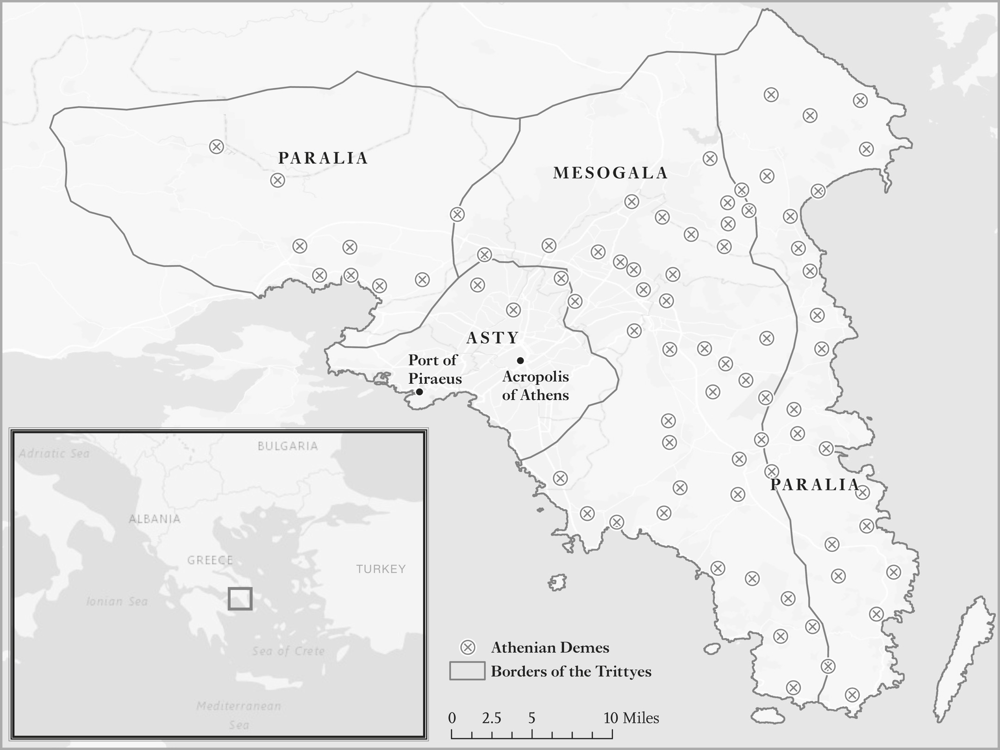
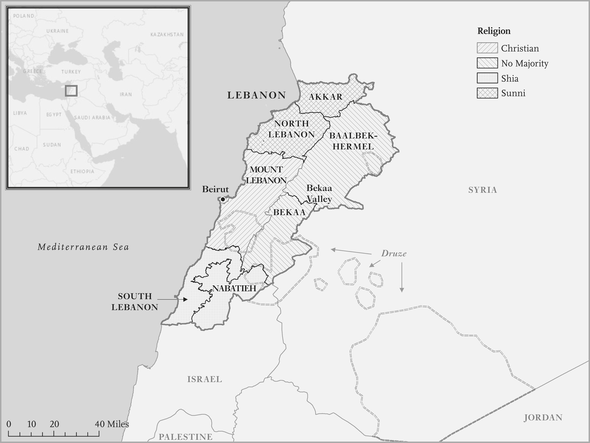
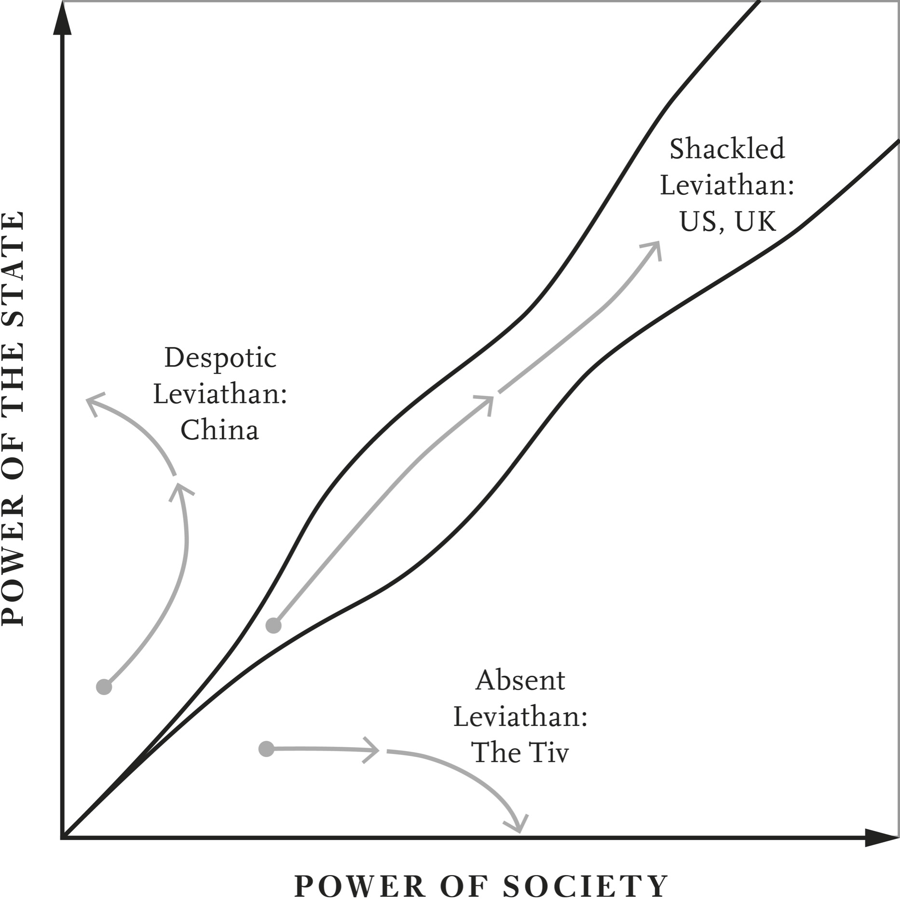

# The Red Queen · 第2章　红皇后

## The Six Labors of Theseus · 忒修斯的六大事迹

By around 1200 BCE, the Bronze Age civilizations that had dominated the Greek world for the previous millennium had started collapsing and were making way for the so-called Greek Dark Ages. Bronze Age Greek societies were run by chiefs or kings living in centralized palaces and bureaucratic administrations that used a writing system called Linear B, collected taxes, and regulated economic activity. All this disappeared during the Dark Ages. The chaos of this new era is the subject of the legends of Theseus, the mythical ruler of Athens. One of the best accounts of his exploits was written by the Greek scholar Plutarch, who spent much of his life as one of the two priests of the Oracle of Delphi.

> 西元前大约一千二百年，主导希腊世界过去一千年的青铜时代文明开始解体，取而代之的是所谓的希腊黑暗时代。青铜时代的希腊社会由集中住在宫殿里的酋长或国王，利用称为「线性文字B」（Linear B）书写系统的官僚体系统治、征税和管制经济活动。到了黑暗时代，这一切完全消失无踪，这个新时代的乱象是雅典神话中统治者忒修斯（Theseus）传奇的主题，把他的功绩写得最好的人是希腊学者布鲁塔克（Plutarch）。布鲁塔克一生的大部分时间里，都担任德尔菲神谕两位掌理祭司中的一位。

Theseus, the illegitimate son of the king of Athens, Aegeus, was raised in Troezen in the northeastern Peloponnese. To claim his rightful throne, Theseus had to travel back to Athens by land or sea. He chose land, but Plutarch notes: It was difficult to make the journey to Athens by land, since no part of it was clear nor yet without peril from robbers or miscreants.

> 忒修斯是雅典国王艾格斯（Aegeus）的私生子，在伯罗奔尼撒（Peloponnese）半岛东北部的特洛曾（Troezen）长大。为了争取合法的王位，他必须从陆路或海路回到雅典，他选择了陆路；但是，布鲁塔克指出：走陆路去雅典很难，因为沿路一点都不平静，盗匪或歹徒充斥。

During the trip Theseus had to battle a series of bandits. The first he encountered, Periphetes, stalked the road to Athens, robbing and killing people with a bronze club. Plutarch recounts how Theseus wrestled with Periphetes and used Periphetes’s own club against him.

> 忒修斯一路上必须和众多盗匪打斗。他遇到的第一个匪徒是佩里弗特斯（Periphetes），佩里弗特斯手持青铜棍，挡住通往雅典的路，抢劫、杀害路过的人。布鲁塔克记述忒修斯怎么样跟佩里弗特斯格斗，并且用佩里弗特斯自己的青铜棍对付佩里弗特斯。

Theseus then managed to avoid other sticky ends, including being tied between two pine trees and gnawed by an enormous wild pig, the Crommyonian Sow; thrown off a cliff into the sea; and wrestled to death. He finally bested Procrustes, the Stretcher, who notoriously cut off people’s limbs to make them fit onto his bed. Theseus’s quest to claim his kingship in Athens vividly illustrates the lawlessness of Greece at the time, without any state institutions to keep order. As Plutarch has it:

> 接着忒修斯设法避开了其他难缠的问题，包括被「扳树贼」辛尼斯（Sinis the Pityokamptes）绑在两棵松树之间、遭到巨大的野猪克罗米翁牝猪（Crommyonian Sow）啃咬。他被猪从悬崖上抛落海中，然后在格斗中杀死这只野猪。最后，他还打败恶名昭彰、砍断别人四肢、好让尸体尺寸适于铺床的「铁床匪」普洛克鲁斯特斯（Procrustes the Stretcher）。[〔注1〕](#note-1) 忒修斯在雅典争取王位的过程，生动地说明当时希腊无法无天、没有任何国家机构维持秩序的乱象。下面是布鲁塔克对这件事的描述：

Thus Theseus . . . went on his way chastising the wicked, who were visited with the same violence from him, which they were visiting on others, and suffered justice after the manner of their own injustice. Theseus’s strategy was therefore very much “an eye for an eye, a tooth for a tooth.” Athens was living Mahatma Gandhi’s “an eye for an eye makes the whole world blind.”

> 因此，忒修斯……继续责罚恶徒，用以暴制暴的方式，对付用暴力欺凌别人的人，借着让他们自作自受来伸张正义。因此，忒修斯的策略非常像「以眼还眼，以牙还牙」。雅典人活在印度圣雄甘地所谓的「以眼还眼会让全世界盲目」的状况下。

Athenian kings didn’t last long, however. By the end of the Dark Ages the city was ruled by a group of Archons, or chief magistrates, who represented its rich families. These elites competed endlessly for power, a process which sometimes led to coups such as the one by Cylon in 632 BCE. Elites recognized that they needed to develop more orderly ways of dealing with conflicts in the city. But it was to be a slow, treacherous road, with unexpected twists and turns.

> 然而，雅典的王权并没有延续很久，到黑暗时代结束时，雅典改由一群代表富裕家族的执政官或首席行政官统治。这些菁英无休无止地争权夺利，偶尔会引发政变，西元前六三二年库伦（Cylon）的政变就是例子。菁英体认到自己需要发展更有秩序的方法，以便应付市内的冲突，但是这样做是缓慢、具有潜在危险和意外曲折的过程。

The first attempt was a decade after Cylon, in 621 BCE, when a legislator named Draco was charged with producing the first written Athenian laws. The fact it took so long to write them down had a lot to do with the disappearance of the Linear B script of Bronze Age Greeks during the Dark Ages. Writing had to be reinvented with a completely different script borrowed from the Phoenicians. Draco’s constitution, as the Greek philosopher Aristotle called it in his Athenian Constitutions, consisted of a series of written laws, only one of which survives.

> 库伦政变十年后的西元前六二一年，雅典人任命名叫杜雷科（Draco）的立法官员，负责开始第一次立法。立法进度这么慢，跟青铜器时期希腊的线性B文字在黑暗时代失传，有很大的关系；希腊人必须借用腓尼基文字，重新创造出完全不同的文字。希腊哲学家亚里斯多德在大作《雅典宪法》中，把杜雷科制定的法律叫做「宪法」，这些法律由一系列成文法构成，现在只有一项法律还幸存至今。

We do know that the punishment for breaking these laws was typically death (hence the modern expression “draconian”). The one surviving fragment of Draco’s laws, which pertains to homicide, reveals that these laws corresponded to something rather different from what we mean today by “constitution,” largely because they were dealing with a society trapped in endemic lawlessness, blood feuds, and violence. The fragment states:

> 我们确实知道犯法的惩罚通常都是处以极刑〔英文的「极其残酷」（draconian）就是出自杜雷科的名字〕。杜雷科所制定法律的仅存片段跟杀人有关，显示这些法律跟今天我们所说的宪法大不相同，主因是这些法律要处理的是无法无天、血腥世仇和暴力的地方性社会问题。残存的片段指出：

And if anyone kills anybody not from forethought, he shall be exiled. There shall be reconciliation, if there are a father or brother or sons, to be granted by all, or the objector shall prevail. If these do not exist, then as far as cousinhood and cousin, if they are all willing to grant reconciliation, or the objector shall prevail. . . . There shall be a proclamation against the killer in the agora by those as far as cousinhood and cousin; there shall join in the prosecution cousins and cousins’ sons and brothers-in-law and fathers-in-law and phratry members.

> 如果有人非预谋杀人，应受流放之刑，如果其中有父亲、兄弟或儿子，有关各方应予和解，或以反对者的意见为准。如果不存在这种关系，则至多达到堂表甥姪关系或堂表兄弟关系的所有各方，都愿意达成和解，否则应以反对者的意见为准……杀人犯罪刑之宣告，应由堂表甥姪关系或堂表兄弟关系人在集会中为之；起诉应由堂表兄弟及其子与姻亲兄弟、姻亲父辈与氏族成员联合为之。

This fragment is concerned with involuntary homicide. Someone who commits such an act should go to exile and await justice. If the extended kin of the person murdered unanimously decide to grant reconciliation, it ends there, but if they don’t, the extended family “shall join in the prosecution” of the killer. The term “phratry” refers to extended kin groups. As we’ll see, however, the influence of the phratry would soon diminish. All of this looks similar to what we see in other societies living with the Absent Leviathan.

> 这项法律的幸存片段涉及非自愿杀人，凡是犯了这种罪的人应该予以流放，等待正义伸张。如果遇害者大家族亲属一致同意和解，案子会就此结案，但如亲属不同意和解，则大家族必须「联合起诉」杀人犯。法条中所称的「氏族」是指大家族团体，然而我们将会看到，氏族的影响力很快就会消失。这一切类似我们在巨灵不存在国家的其他社会中所见景象。

In fact, there are many similarities between Draco’s law and other codifications of informal laws without centralized authority, like the Albanian Kanun. The Kanun, attributed to Lekë Dukagjini in the fifteenth century, was a collection of norms that governed behavior in the Albanian mountains (and wasn’t written down until the early twentieth century). Without a centralized state, Albanian rules and norms were enforced, just like Draco’s homicide law, by extended families and clans. The Kanun heavily featured blood feuds in retaliation for transgressions. This is vividly illustrated by the first clause dealing with murder, which starts with blood feuds.

> 事实上，杜雷科的法律和没有中央权威社会的其他非正式法律汇编、如阿尔巴尼亚的《卡农法典》（Kanun ）之间，有很多类似的地方。《卡农法典》是莱克．杜卡季尼（Leke Dukagjini）在十五世纪时，搜集阿尔巴尼亚山区规范行为的准则，编纂而成的法典（一直到二十世纪初期，才写成文字版本）。阿尔巴尼亚没有中央集权的国家机器，因此规则和规范像杜雷科的杀人法一样，由大家族和部族负责执法。《卡农法典》在报复违法行为时，十分重视血腥世仇，这一点在处理由血腥世仇开启的谋杀案法规第一条中，清清楚楚地表现出来：

Ambush involves taking up a position in covert in the mountains or plains of Albania and lying in wait for an enemy in the blood feud or someone else who is intended to be killed. (To waylay, to lie in ambush, to set a trap for someone.) It was an initial principle of the Kanun that “blood follows the finger,” meaning that according to the old Kanun of the mountains of Albania, only the murderer incurs the blood-feud, i.e. the person who pulls the trigger and fires the gun or uses some other weapon against another person.

> 伏击涉及在阿尔巴尼亚山区或平原的隐密处设伏，等待血腥世仇中的敌人或有意杀害的人（拦截、伏击或为某人设置陷阱）。这是《卡农法典》中「血仇由手指引发」的初始原则，意思是：根据阿尔巴尼亚山区古老的《卡农法典》，只有谋杀犯引发的血腥世仇，也就是扣扳机开枪，或用其他武器对付另一个人的人，才是引发血腥世仇的人。

The later Kanun extends the blood feud to all males in the murderer’s family, even an infant in the cradle; cousins and close nephews incur the blood feud during the twenty-four hours following the murder. Culpability then spreads to extended kinfolk. With respect to accidental murders, the Kanun states, “In this type of killing, the murderer must leave and remain concealed until the affair is clarified.” Exactly as in Draco’s law, except that nobody even tried to write down, clarify, or regulate what these norms were in Albania until the twentieth century.

> 后来的《卡农法典》版本把血腥世仇的范围扩大到凶手家族中的所有男性，甚至包括凶案发生后二十四小时内还在襁褓中的婴儿、堂表兄弟和近亲姪。这一来，罪责就扩张到大范围的亲属中。至于意外杀人的案子，《卡农法典》规定：「在这种凶杀案中，凶手必须离开，躲藏到事态厘清为止。」这种情形正如杜雷科的法律一样，不同的地方只是到了二十世纪，才终于有人试着写下、厘清、管理阿尔巴尼亚的这些规范。

## Solon’s Shackles · 梭伦的枷锁

Less than thirty years after Draco wrote his laws, Athens started the process of building a Shackled Leviathan. The problem of controlling routine conflicts and the power struggles among elites was ongoing. To this was now added conflict between elites and citizens over the direction of society. Aristotle observed that around the time of Draco there was “an extended period of discord between the upper classes and the citizens.” In the words of Plutarch, there was a

> 杜雷科制定法律后不到三十年，雅典人便开始建立受制约的国家机器。控制菁英之间日常冲突和权力斗争的问题仍然存在，现在又增加了菁英和公民之间，为社会该走什么方向而引发的冲突。亚里斯多德大约在杜雷科活着的时代说过：「上层阶级和公民之间，有很长期的不和谐。」用布鲁塔克的话来说则是：

long-standing political dispute, with people forming as many different political parties as there were different kinds of terrain in the country. There were the Men of the Hills, who were the most democratic party, the Men of the Plain, who were the most oligarchic, and thirdly the Men of the Coast, who favored an intermediate, mixed kind of system. In essence, the disagreement was over the balance of power between elites and regular people, and whether the state would be controlled democratically or oligarchically (meaning by the handful of richest and most powerful families). Solon, a trader and widely respected military commander, played the defining role in charting Athens’s course.

> 雅典有着长期的政治纷争，住在国内不同地形的人民，组成很多不同的政党。山丘党是最民主的政党，平原党是最坚持寡头主义的政党，海岸党赞成混合的中庸制度。基本上，歧见在于菁英和平民对于权力均衡的看法不同，以及大家应该用民主的方式，控制国家机器，还是该用寡头的方式（意思是由少数最富裕、最有权势的家族）控制。出身贸易商兼备受尊敬的军事指挥官梭伦（Solon），在决定雅典人的路线时，扮演了决定性的角色。

In 594 BCE, Solon was made Archon for a year. As Plutarch put it, “The rich found him acceptable because of his wealth, and the poor because of his integrity.” The post of Archon had been monopolized by elites, but Solon likely assumed the role through popular pressure, as the struggle between the elites and the citizens tilted a little in favor of the latter. He turned out to be quite a reformer, transforming Athenian institutions in order to constrain the elites’ and the state’s power over the citizens, while at the same time increasing the capacity of the state to resolve conflicts.

> 西元前五九四年，梭伦获得推举出任执政官，任期一年。如同布鲁塔克所言：「富人因为他很富有，觉得可以接受他，穷人是因为他很正直而接受他。」过去执政官的职位一向由菁英垄断，但是梭伦可能是利用民众的压力，出任这个职位，因为这时菁英和公民之间的斗争变得对公民有利。事实证明，他是相当强力推动改革的人，他改造雅典的制度，以便限制菁英和国家机器管制公民的权力，同时提高国家解决冲突的能力。

In a surviving fragment of his writings, Solon observed that his institutional design was intended to create a balance of power between the rich and the poor. To the people I gave as much privilege as was sufficient for them, neither reducing nor exceeding what was their due. Those who had power and were enviable for their wealth I took good care not to injure. I stood casting my strong shield around both parties and allowed neither to triumph unjustly.

> 他在幸存作品的断简残编中指出，他设计制度时，意在创造富人和穷人之间的权力均衡：我尽量授予人民足够的特权，既不减少也不超过他们应得的本分。对于有权有势、令人羡慕的富人，我刻意不伤害他们。我对双方高举着自己强而有力的盾牌，不容许任何一方获得不公平的胜利。

Solon’s reforms attempted to strengthen the people against the elites while at the same time assuring the elites that their interests would not be radically threatened. When Solon became Archon the basic political institutions of Athens consisted of two assemblies, the Ekklesia, which was open to all male citizens, and the Areopagus, which was the main executive and judicial institution. The Areopagus was composed of former Archons and was under elite control. Many Athenians were getting poorer during this period and had been excluded even from the Ekklesia, because they were trapped in debt peonage and servitude and had lost their rights as citizens.

> 梭伦的改革意图强化人民对抗菁英的力量，同时确保菁英的利益不会遭到激烈的威胁，他透过一系列措施，达成了前半部分的目标。梭伦出任执政官时，雅典的基本政治机构由两个议会构成，一个是向所有男性公民开放的人民议会（Ekklesia），一个是主要行政与司法机构的战神山议事会（Areopagus），后者由过去的执政官组成，受到菁英控制。这段期间里，很多雅典人变穷，沦落到充当奴工偿还债务或变成奴隶、丧失公民权的困境。

Aristotle noted that “all loans were made on the security of the person of the debtor until the time of Solon.” This was the Athenian version of the cage of norms, with people turning into perpetually indebted, unfree pawns as a result of their worsening economic conditions. Solon understood that political balance in Athens would require regular citizens to participate in politics, but this wasn’t possible when they were in a position of servitude, and certainly not when they were losing their citizenship.

> 亚里斯多德指出：「在梭伦执政前，所有贷款都是以债务人人身作为担保。」这是雅典版的规范牢笼，人民因此困在永远负债、充当不自由典当品的困境中。梭伦知道要追求雅典的政治平衡，必须有一般公民参与政治，但是在一般公民沦落为奴，而且一定会失去公民身分时，这件事一定会变成不可能的任务。

In Aristotle’s words, “The mass of the people . . . had virtually no share in any aspect of government.” So to ensure greater participation Solon canceled all contracts of debt peonage and passed a law that banned borrowing by using one’s own person as security. He also made it illegal to enserf an Athenian. There was to be no more pawning. At a stroke Solon broke Athenians free from this part of their cage of norms.

> 借用亚里斯多德的话来说，这样等于是「大批百姓……几乎都没有参与政府的任何层面」。因此，为了确保民众能够加强参与政治，梭伦取消所有以服劳役偿还债务的契约，还通过法律，禁止用个人人身作为担保的贷款方式。他也明订奴役雅典人的做法是非法行为，也禁止把人当成典质品。梭伦一举之间，把雅典人从这一部分的规范牢笼中解救出来。

But banning debt peonage wasn’t enough when people were economically subservient to the elite. Greater liberty was necessary to make Athenians more active citizens so that they could get even more liberty. To this end, Solon sought to improve their access to economic opportunities. He implemented a land reform by uprooting the boundary markers of fields. These markers recorded the obligation of the tenants farming the land to pay a sixth of their produce. By eliminating them Solon in effect freed the tenants from the landowners, giving them the land they owned, and turning Attica, the region surrounding Athens, into a land of small farmers.

> 但是，人民在经济上屈从于菁英时，禁止服劳役偿还债务的做法还不够。要把雅典人变成更活跃的公民，以便获得更多的自由，必须赋予他们更大的自由。因此，梭伦设法改善一般人获得经济机会的途径，推动土地改革，拔除田地的界碑，这些界碑上记录的是，佃农的义务是缴纳农产品的六分之一。梭伦拔除界碑后，实际上是从地主手中解放佃农，把土地交到佃农手中，也把环绕雅典的阿提卡（Attica）地区，变成小农的国度。

Solon also eliminated restrictions on movement within Attica. These measures greatly extended the citizenry that could participate in the Ekklesia. The existing balance of power was reconfigured in one fell swoop. Solon also revamped the process of selecting the Archons and increased their number to nine, in part to improve political representation. But he had to keep the elites happy too, and for this he divided the population into four classes based on their incomes from land, and only men from the top two classes could become Archons (chosen by lot from a list of people nominated by the four traditional “tribes” of Athens).

> 梭伦还取消阿提卡地区的迁徙限制，这些措施大大扩充了可以参与人民议会的公民人数，一举重新调整现有的权力均衡。梭伦也修改执政官的遴选程序，并把执政官人数增为九人，原因之一是为了改善参与。但是，他也要让菁英满意，因此，他根据人民从土地得到的所得，把人口分为四个阶级，只有最上层两个阶级的男性可以成为执政官（从雅典四种传统「部落」提名的名单中抽签遴选）。

After serving as Archon, which he could do only once, and for a year, a man could still serve in the Areopagus. Thus the elites would continue to control the Archonship and the Areopagus, but now there were clear rules that opened up the Areopagus to a greater subset of (elite) society and helped to balance different interests. Solon also created a new council of 400, the Boule, which was to serve as the main executive council, and he redefined the role of the Areopagus to be largely judicial. As with the Archons, the four traditional tribes of Athens were equally represented in the Boule.

> 执政官无法连任，任期一年，任期结束后，仍然可以在战神山议事会中服务，因此菁英可以继续控制执政官署和战神山议事会。但是，现在有明确的规则，向更广大的（菁英）社会次级团体，开放战神山议事会的席位，帮助平衡不同的利益团体。梭伦也创设了一个由四百位成员组成的众议会（Boule），作为主要的执行议事会议，他还把战神山议事会的角色，重新界定为大致上承担司法方面的责任。新的众议会跟执政官一样，雅典传统四大部落在众议会中的代表权完全平等分配。

Having established a balance between elites and citizens, Solon started the process of state building. The critical step was judicial reform. Solon first abolished all but one of Draco’s laws. The laws he promulgated were very different. One fragment records that Draco’s law about homicide the anagrapheis [“writers up”] of the laws shall write up on a stone stele, taking it over from the basileus and the secretary of the council, and shall place in front of the Stoa. The poletai shall make the contract in accordance with the law; the hellenotamiai shall provide the money.

> 梭伦建立了菁英和公民之间的权力均衡后，开始进行国家机器的建设，其中最重要的步骤是司法改革。梭伦首先废除杜雷科的所有法律，只留下其中一项。他颁布的法律大不相同，有一个断简残编记录了杜雷科所制定跟杀人有关的法律，说明刻写官员从王者执政官和议会秘书手中，接到法律后，要把法条刻写在石碑上，再放到拱廊前面，司库官员要依法订定契约，财政官员要负责付款。

Even in the one law that Solon kept, he replaced the role of the basileus with the poletai and the hellenotamiai. The word basileus, typical of the Homeric epics the Iliad and the Odyssey, translates as something like “big man,” which was a type of Dark Age chief. Odysseus, whose exploits during his ten-year voyage after the Trojan War are recounted in the Odyssey, was a basileus. The poletai and the hellenotamiai, on the other hand, were magistrates or state officials. So Solon introduced a radical change—bureaucratized state institutions to enforce the law.

> 即使在梭伦所保留的一项杜雷科法律中，梭伦还是把王者执政官的角色，换成司库官员和财政官员。王者执政官是荷马史诗《伊里亚德》和《奥德赛》中的典型用字，意思类似「伟人」，是黑暗时代酋长中的一种。根据《奥德赛》史诗中的记述，特洛伊战争结束后，在海上航行十年才回到故乡的希腊英雄奥德赛，就是王者执政官。另一方面，司库官员和财政官员是民政官或国家官员。因此，梭伦推出了激烈的改革，用官僚化的国家机构来执行法律。

The most distinctive feature of this process was that the more Solon managed to strengthen regular Athenians politically, the further he went in building state institutions. And the more these institutions took shape, the further he went in establishing popular control over them. Thus once the Ekklesia was re-empowered, it featured greater popular participation. In order to achieve this objective, his reforms didn’t just introduce greater representation in assemblies and political institutions, they also brought about changes in institutions and norms, such as the end of pawning, which changed the nature of society and made it more capable of acting collectively and controlling the elites and the state.

> 梭伦改革最明显的特征是：梭伦愈强化雅典平民的政治力量，他就能更进一步建立国家制度；而这些制度愈成形，他也愈能深入地建立人民对制度的控制。于是，当人民议会被重新赋予权力，它就有着更广泛的人民参与。为了达成这个目标，他的改革不只是增加各种议会与政治体制中的代表性，也带来制度和规范的变革；例如，中止人身的典质，改变了社会的本质，使社会更能集体行动，控制菁英与国家。

Aristotle agreed that empowering regular Athenians was the most important aspect of Solon’s reforms and singled out the end of pawning, improved means of resolving conflicts, and access to justice. He remarked: These three seem to be the features of Solon’s constitution which most favored the people: first and greatest, forbidding loans on security of a person’s body; second, the possibility of a volunteer seeking justice for one who was wronged; third, and they say that this particularly strengthened the people, appeal to the court.

> 亚里斯多德认为，梭伦的改革中，最重要的特点是赋权给雅典平民。亚里斯多德特别指出中止人身典质的做法，改善了解决冲突和利用司法的途径，他写道：这三点似乎是梭伦的宪法中对人民最有利的特色：第一点最重要，就是禁止以人身作为贷款的担保品；第二是遭到冤枉的人自愿寻求司法救济的可能性；第三是人们所说诉诸法院的做法特别能够强化人民的力量。

Here Aristotle is emphasizing the presence of some type of “equality before the law,” where laws applied to everybody and common citizens could turn to the courts to seek justice. Though political representation in the Boule and membership of the Areopagus excluded the poorest, anyone could bring a lawsuit and have it heard, and the same laws applied to elites and ordinary citizens alike.

> 亚里斯多德在这些文字中，强调「法律之前存在着某种形式的平等」，强调法律适用于每一个人，公民可以求助于法院，寻求正义。虽然众议会的代表性和战神山议事会的席次把最穷的人排除在外，但任何人都可以提起诉讼，而且同样的法律一体适用菁英和一般公民。

One of the most interesting ways in which Solon institutionalized popular control over the elites was via his Hubris Law. A surviving fragment states: If anybody commits hubris against a child (and surely one who hires commits hubris) or man or woman, whether free of slave, or if anybody commits anything unlawful against any of these, it has created graphai [public suits] hubreos.

> 梭伦在推动人民以制度化的方式控制国家机器时，采用过一个有趣的方法，就是利用《侮慢法》（Hubris Law）。残存的片段法条指出：如果任何人侮慢小孩、男人或女人（雇主犯了侮慢罪也一样），不论遭到侮慢的人是自由人还是奴隶，或是任何人对上述任何人，做了任何不法行为，都会创造侮慢罪的公诉。

This law thus created the crime of graphai hubreos in response to an act of hubris, behavior aimed at humiliation and intimidation. Remarkably, people could be charged with hubris against slaves, who were protected as well, and people were occasionally executed for repeated violations of the law. The Hubris Law enabled Athenians not only to control the elites, but also to enjoy liberty from the dominance of powerful individuals.

> 因此，这项法律为了因应意在羞辱和恐吓的侮慢行为，创造了侮慢公诉罪。值得注意的是，人民可能因为侮慢同样受到保护的奴隶遭到起诉，而且偶尔还有累犯遭到处决。《侮慢法》因此让雅典人不但可以控制国家和菁英，也可以享有解脱权贵宰割的自由。

By banning debt peonage and ending the status of unfree pawns, Solon started simultaneously undermining the elites’ dominance over ordinary citizens and preparing conditions for democratic politics. But there was much more to the power of the elites in Athens at this time. They had become significantly richer, and any increase in the capacity of the state, unless matched by a similar empowerment of society, might increase their political dominance by giving them additional tools for repression and control. So it was vital to strengthen the hands of regular citizens against the elite. This is what the Hubris Law helped achieve by codifying and intensifying existing norms.

> 梭伦借着禁止服劳役偿还债务、取消不自由的人身典质地位，同时开始推动破坏菁英对一般公民的宰割，为实施民主政治做好准备。但是，这时雅典菁英拥有的权力大增，他们已经变得远比过去富有。倘若国家能力增加时，没有一并赋权给社会，那就只是在赋予富人额外的镇压和控制工具，反而有可能增加他们的政治主导力量。因此，加强一般公民对抗菁英的能力至为重要，这就是借着编纂《侮慢法》，把现有规范法制化，所达成的目标。

Solon’s Hubris Law reveals a more general aspect of life in the corridor—the delicate balance for creating liberty requires institutional reforms to work with and build on existing norms, while at the same time modifying and even obliterating aspects of those norms that are holding liberty back. No easy feat to be sure, but Solon’s reforms broke considerable ground on both objectives. In the period before Draco, the rules and laws that governed people’s lives were not written down and were enforced by families and kinship groups, most often using social ostracism and exclusion.

> 梭伦的《侮慢法》勾勒了自由窄廊的样貌──要创造自由，就必须在配合现有规范、并以之为基础推动制度改革，以及同时修改、甚至废除抑制自由的规范之间，求得微妙的平衡。这确实不容易达成，但梭伦的改革在这两方面都颇有进展。在杜雷科制定法律之前，规范人民生活的法规都不是成文法，都是由家族和亲属团体执法，最常利用的手段是放逐和排除政治参与。

Solon managed to build on these norms by codifying and strengthening them as in his Hubris Law, but in the process he also changed these norms, so that hubristic behavior became far less acceptable in Athenian society. We’ll see many examples of this complex dance between institutional change and norms, and how failing to strike the right balance between them may damage the prospects of liberty. Solon struck the right balance.

> 梭伦设法编修和强化这些规范，制定出《侮慢法》，但同时也在修法的过程中改变这些规范，大大降低侮慢行为在雅典社会中的接受度。我们会看到很多例子，显示制度变化和规范之间复杂的互动，以及两者之间如果无法达成适度平衡时，可能会伤害自由的展望。梭伦在这方面达成了适度的平衡。

## The Red Queen Effect · 红皇后效应

How Solon limited the elites’ control over the state and dominance over regular citizens on the one hand and increased the capacity of the state on the other is not a peculiar feature of an ancient civilization. It is the essence of the Shackled Leviathan. The Leviathan can build greater capacity and become much stronger when society is willing to cooperate with it, but this cooperation requires people to trust that they can control the sea monster. Solon built this trust.

> 梭伦一方面限制菁英对国家机器的控制、限制菁英对一般公民的宰割，另一方面却提高国家的能力，这种做法并不是什么古代文明的特例，而是制约国家巨灵的精义。只有社会乐于和国家巨灵合作时，国家机器才能建立更强大的能力，但是这种合作需要人民相信自己可以控制这头怪兽。梭伦赢得了这种信任。

But it’s not just trust and cooperation. Liberty and ultimately state capacity depend on the balance of power between state and society. If the state and the elites become too powerful, we end up with the Despotic Leviathan. If they fall behind, we get the Absent Leviathan. So we need both state and society running together and neither getting the upper hand. This is not unlike the Red Queen effect described by Lewis Carroll in Through the Looking-Glass, and What Alice Found There.

> 但是，自由和国家的终极能力，不仅取决于信任和合作，也取决于国家和社会之间的权力均衡。如果国家和菁英变得太强大，最后就会形成「专制巨灵」的国家；如果国家和菁英落在后面，结果就会变成「巨灵并不存在」的国家。因此，我们需要国家和社会同时并进，彼此都得不到优势。这种情形就像是路易斯．卡洛尔（Lewis Carroll）在《爱丽丝镜中奇遇》（Alice Through the Looking Glass ）中描述的红皇后效应。

In the book, Alice meets and runs a race with the Red Queen. “Alice never could quite make out, in thinking it over afterwards, how it was that they began,” but she noticed that even though they both appeared to be running hard, “the trees and the other things round them never seemed to change their places at all: however fast they went they never seemed to pass anything.” Finally, when the Red Queen called a halt, Alice looked around her in great surprise. “Why I do believe we’ve been under this tree the whole time! Everything’s just as it was!”

> 在这本小说中，爱丽丝遇见红心皇后后，两人一起赛跑。「爱丽丝事后回想时，根本不大记得她们是怎么开始比赛的」，但是她注意到，即使她们拚命地跑，「她们四周的树木和其他东西，似乎根本都没有改变过位置；不管她们跑得多快，她们似乎从来没有超越过任何东西」。最后，红皇后叫暂停。爱丽丝十分惊讶地看着四周，说：「为什么我真的觉得我们一直都在这棵树下！一切都跟原来一模一样！」

“Of course it is,” said the Queen, “what would you have it?” “Well in our country,” said Alice, still panting a little, “you’d generally get somewhere else—if you ran very fast for a long time, as we’ve been doing.” “A slow sort of country!” said the Queen. “Now, here, you see, it takes all the running you can do, to keep in the same place.”

> 「当然是这样啦，」红皇后说：「你们会怎么说呢？」「噢，在我们的国家里，」爱丽丝气喘吁吁地说：「如果你像我们刚才那样，跑得很快、很久的话，你通常会看到别的东西。」「像有点慢吞吞的国家！」皇后说。「噢，在这里的话，你拚命快跑，目的是为留在原地。」

The Red Queen effect refers to a situation where you have to keep on running just to maintain your position, like the state and society running fast to maintain the balance between them. In Carroll’s book all that running was wasteful. Not so in the struggle of society against the Leviathan. If society slacks off and does not run fast enough to keep up with the state’s growing power, the Shackled Leviathan can quickly turn into a despotic one. We need society’s competition to keep the Leviathan in check, and the more powerful and capable the Leviathan is, the more powerful and vigilant society must become.

> 「红皇后效应」（Red Queen Effect）是指你为了维持原有的地位，而必须不断地向前跑；就像国家和社会跑得很快，目的是为了两者之间的平衡。在卡洛尔的小说中，所有的奔跑全都是白费功夫，但在社会和国家巨灵的斗争中并非如此。如果社会松懈下来，跑得不够快，不能跟国家的成长并驾齐驱，受制约的国家可能会快速变成专制国家。我们需要社会的竞争，以便保持国家巨灵受到约束。国家愈强大、愈能干，社会就必须变得愈强大、愈警觉。

We need the Leviathan to keep on running too, both to expand its capacity in the face of new and formidable challenges and to maintain its autonomy, which is critical not only for resolving disputes and impartially enforcing laws but also for breaking down the cage of norms. This all sounds quite messy (all that running!), and that, we’ll see, is often the case. Even though it’s messy, we depend on the Red Queen for human progress and for liberty. But the Red Queen herself creates lots of swings in the balance of power between state and society, as one party and then the other pulls ahead.

> 我们也需要国家巨灵继续奔跑，在面对艰难的新挑战时，壮大自己的能力，同时维持自主性，因为这样不但攸关解决争端和公正无私地执法，也攸关打破规范的牢笼。这一切听来都相当杂乱无章（所有这一切奔跑！）我们会发现，情形经常就是这样：虽然杂乱无章，我们却必须依赖红皇后效应，促进人类的进步和自由。但是，红皇后本人会在社会与国家的权力均衡中，在其中一方忽而超前、忽而落后之际，制造很多的波动起伏。

The way Solon managed to activate the Red Queen effect illustrates these broader issues. His reforms not only set up the institutional basis for popular participation in politics, but also helped relax the cage of norms that both directly restricted liberty and prevented the sort of political participation that is necessary in the corridor. The Athenian cage wasn’t as stifling as in many other societies we’ll see, such as the Tiv later in this chapter. Nevertheless, it was still oppressive enough to block the path of the Red Queen. By breaking down part of that cage, Solon started to fundamentally change society and forge a different type of politics capable of supporting a budding Shackled Leviathan.

> 梭伦设法激发红皇后效应的方式，说明了这些范围比较广大的问题，他的改革不但为民众的政治参与，奠定了制度化的基础，也协助放宽直接限制自由，又在自由窄廊上防止必要政治参与的规范牢笼。雅典人的牢笼不像其他社会的牢笼──例如本章即将谈到的蒂夫族（Tiv）社会牢笼那么令人窒息，却仍然沉重到足以阻挡红皇后的去路。梭伦借着打破牢笼的这个部分，开启了社会的根本变化，也建立了一种与众不同的政治形态，能够支持受到制约的新兴国家巨灵发展。

## How to Ostracize If You Must · 必要时如何自我放逐？

Solon was Archon for a mere (busy!) year after which he went into exile for ten years in order to avoid the temptation to fiddle with his laws. He opined that his laws should not be changed for a hundred years. It didn’t quite work out like that. Instead, a repeated contest between elites and society ensued. Solon had tried to move Athens toward a more capable state and institutionalize popular control while keeping the elites happy, or happy enough.

> 梭伦只当了一年的执政官（这一年也太忙！）然后就自我流放十年，以免玩弄自己制定的法律。他认为他制定的法律应该会维持一百年不变，但实际结果却相当不同。菁英和社会之间的竞争一再出现。梭伦曾经试图把雅典变成较有能力的国家，把对民众的控制制度化，同时让菁英过得很快乐，或是够快乐。

But how happy is happy enough? Conflict soon broke out and led to a series of tyrants, in effect dictators, holding power sometimes with force, sometimes with popular support. Yet Solon’s reforms were popular and had gained legitimacy so that all Athenians, even eager tyrants, had to at least pay homage to them, and in the process, they often deepened them.

> 但是，多快乐才是够快乐呢？雅典很快地就爆发冲突，随之而来的是实际上是独裁者的一系列暴君，这些暴君有时候用武力掌权，有时候靠着人民的支持掌权。但是，梭伦的改革很得民心，也具有合法性，因此所有雅典人，连急于变成暴君的人，至少都必须向这些改革致敬，而且这个过程经常深化了改革。

Peisistratos, the first tyrant to follow Solon, is famous for the cunning ways in which he overthrew Athenian political institutions. On one occasion he deliberately wounded himself and duped the citizens into allowing him armed bodyguards for protection, which he then used to take control of Athens. On another occasion, having been deposed, he rode back into Athens in a chariot with a stately woman dressed as Athena and fooled people into thinking he had been chosen by the god herself to rule Athens.

> 梭伦之后的第一位暴君是庇西特拉图（Peisistratos），他的著名事迹是善于用狡滑的方式，推翻雅典的政治制度。有一次，他故意伤害自己，欺骗公民让他接受武装保镳的保护，然后他却用武装保镳来控制雅典人。另一次是他被废黜后，和一位装扮成雅典娜女神的端庄女性，一起驾着马车，回到雅典，愚弄人民，让人民认为他是雅典娜女神亲自挑选，以便统治雅典的人。

Once in power, however, Peisistratos didn’t totally repudiate Solon’s legacy, but instead continued to increase the state’s capacity. He undertook monumental constructions in Athens and launched a series of measures to integrate Athens with the countryside in Attica. These innovations included rural circuit judges, a system of roads centered on Athens, and processions linking Athens with rural sanctuaries, as well as the Great Panathenaea festival. The religious festivals were a direct descendant of some of Solon’s other measures because he had tried to restrict private elite festivals in favor of more communal public ones. Peisistratos also coined the first Athenian money.

> 然而，庇西特拉图一旦掌权，并没有完全否定梭伦的遗泽，反而是继续提高国家的能力，推动雅典的重大建设，推出一系列的措施，把雅典和周遭的阿提卡地区整合起来。这些创新包括设置乡村巡回法官、兴建以雅典为中心的道路系统，开创结合雅典和乡村神殿与泛雅典娜节的游行队伍。这些宗教节日直接起源于梭伦的若干其他措施，因为梭伦曾经试图限制菁英私人的节日，主张推广比较具有社会性的公共节日。庇西特拉图也是第一个铸造雅典钱币的人。

This is the Red Queen in action. Solon started this dynamic path in earnest, and Peisistratos followed along it, even if the process involved wild gyrations. Tyrants, when they rose to power, gave the upper hand to the state and the elites. Yet they couldn’t dominate society and the demos (“the people”), and they also vied for its support. Though Peisistratos was succeeded by his sons Hippias and Hipparchus and then by Isagoras backed by the rival city-state of Sparta, the demos struck back. In 508 BCE a massive popular uprising swept Cleisthenes into power.

> 这是行动积极的红皇后，梭伦热心开创这种动力十足的行动路线后，庇西特拉图跟着遵照办理，不管过程中出现的狂野转折。暴君崛起掌权后，会让国家机器和菁英得到优势，却不能宰制社会和人民，而且他们也要争取人民的支持。庇西特拉图的王位由儿子西庇亚斯（Hippias）和西巴祝斯（Hipparchus）继承，然后由对手城邦国家斯巴达支持的伊萨哥拉斯（Isagoras）接任，但是人民终于还是出手还击。西元前五○八年，大规模的人民起义把克里斯提尼（Cleisthenes）推上当权的地位。

The reforms Cleisthenes implemented were again aimed at strengthening both state and society, but he went further in the three objectives that Solon had tried to achieve over eight decades earlier—strengthening the hand of society against the elites, increasing the state’s capacity, and loosening the cage of norms. Let’s start with state building. Cleisthenes developed an elaborate fiscal system, which levied a poll tax on metics (resident foreigners); direct taxes on the wealthy, who had to pay for festivals or outfitting warships; a variety of customs, tolls, and charges, particularly at the port of Piraeus; and taxes on the silver mines of Attica.

> 克里斯提尼再度以强化国家和社会为目标，推动改革；但是，他更进一步，推展八十多年前梭伦试图达成的三个目标──强化社会对抗菁英的力量、增加国家的能力，以及放宽规范的牢笼。我们先从国家建设开始说起。克里斯提尼发展出一种精心设计的财政制度，对外国人居民课征人头税；对富人直接课税，使富人必须缴纳节日费用或装备战船的费用；同时开征海关通关费用和规费，尤其是在皮雷埃夫斯（Piraeus）港课征，同时也对阿提卡的银矿课税。

During his Archonship, the state began to provide an array of public services, not just security and coinage, but also infrastructure in the form of walls, roads, bridges, prisons, and relief for orphans and the handicapped. Equally remarkable was the emergence of a type of state bureaucracy. Aristotle claims that in the days of Aristides, around 480–470 BCE, there were 700 men working for the state in Attica and 700 abroad, and in addition 500 guards in the docks and 50 on the Acropolis.

> 克里斯提尼担任执政官期间，国家开始提供一系列的公共服务，不仅提供安全维护和铸币服务，还提供城墙、道路、桥梁、监狱、孤儿与残障救济等基础建设。同样值得注意的是，某种国家官僚体系开始出现，亚里斯多德宣称，在亚里斯底德（Aristides）治理的西元前四八○年至四七○年间，有七百人在阿提卡为国家工作，有七百人在国外为国服务；另外，码头上有五百名警卫，雅典卫城有五十名警卫。

This state was also far more democratically controlled than the one that Solon had set up. To achieve this democratic control, Cleisthenes recognized that he had to further weaken the cage of norms and move away from the tribal basis of political power. So in a daring move, he abolished the four tribes that had populated Solon’s Boule of 400 and replaced them with a new Boule of 500 composed of people chosen by lot from 10 new tribes named after Athenian heros.

> 这个国家由人民控制的程度，也比梭伦所建立的国家更加深入。克里斯提尼为了实现民主控制国家的目标，知道自己必须进一步削弱规范的牢笼，并摆脱以部落为基础的政治权力形式。因此，他采取大胆行动，废除了组成梭伦所创众议会四百位成员的四个部落，改由五百位议员组成新众议会。

Each tribe had 50 representatives in the Boule. Each of the tribes was divided into three smaller units, called trittyes (“thirds” of tribes), and each of these was further subdivided into regional political units, called demes. There were 139 demes scattered throughout Attica (as shown in Map 2). The creation of the regional units in itself was a significant step in the process of state building, almost completely polishing off what was left of the preexisting kin-based identities. Aristotle summarized the effects of this reform by noting that Cleisthenes “made fellow demesmen of those living in each deme so they would not reveal the new citizens by using a man’s father’s name, but would use his deme in addressing him.”

> 新议员从十个以雅典英雄命名的新部落中抽签选出，每个部落在众议会中各有五十位代表，每个部落再分为三个比较小的单位，叫做「三分之一部落」（trittyes）；每一个「三分之一部落」再细分为区域性政治单位，称为「民区」（demes）。整个阿提卡地区，一共散布了一百三十九个民区（如地图二所示）。在建国过程中，区域性单位的创设，本身就是重要的一步，几乎完全抹煞了过去以亲属为基础建立的身分识别遗迹。亚里斯多德总结这种改革的影响后，指出克里斯提尼「把住在每一个区的人变成同区区民，因此他们对他说话时，不再用父亲的姓名，而是用自己的区名，揭露自己的新公民身分」。

To further increase the political power of Athenian citizens against the elites, Cleisthenes also lifted the class restrictions on membership of institutions that had existed during Solon’s days. Membership of the Boule was now open to all male citizens over the age of thirty, and because each could serve for only a year and at most twice in his lifetime, most Athenian men served at some point in their lives. The Boule’s president was randomly chosen and served for twenty-four hours, allowing most Athenian citizens to be in charge at some point. Aristotle summed all of this up by stating: The people had taken control of affairs.

> 克里斯提尼为了在政治上，进一步强化雅典公民对抗菁英的力量，也取消了从梭伦时代就有的机构成员阶级限制，众议会的席次现在向所有年逾三十岁的男性公民开放，而且因为众议员任期只有一年、一生至多以两任为限，大部分雅典男性一生中，都可能在某一段时间里，担任众议员。众议会议长则是随机选任，任期为二十四小时，让大部分雅典公民在某个时间点上，能够担负重责大任。亚里斯多德总结这一切后表示：人民已经控制了政务。

The Boule had authority over expenditures and there was a series of boards of magistrates that implemented policy. Though these boards were chosen by lot and served annually, they were aided by professional slaves acting as state functionaries. Cleisthenes followed in Solon’s footsteps in building on and institutionalizing existing norms that were helpful for strengthening the political power of Athenian citizens while also battling the cage of norms. Most notably, he formalized the institution of ostracism as a means of restraining the political dominance of powerful individuals.

> 众议会有权管理支出，雅典设有一系列行政官员委员会，负责执行政策。虽然这些委员会是靠抽签选出，而且只服务一年，却有充当国家公职人员的专业奴隶协助。克里斯提尼追随梭伦的脚步，继续以有助于强化雅典公民政治力量的现有规范为基础，推动现有规范的制度化，同时也跟规范牢笼搏斗。最值得注意的是，他把流放制度正式化，以便限制有权有势的个人宰制政治。

According to this new law, every year the assembly could take a vote on whether or not to ostracize someone. If at least 6,000 people voted and at least half of them were in favor of an ostracism, then each citizen got to write the name of a person whom they wanted ostracized on a shard of pottery (called an “ostrakon,” and hence the term ostracism). The person whose name was written on the most shards was ostracized—banished from Athens for ten years. Aristotle notes about the law that “it had been passed by a suspicion of those in power.” Like Solon’s Hubris Law, it was a tool using and transforming the norms of society for disciplining elites.

> 根据这项新法，群众集会每年可以投票决定是否放逐某人，如果至少有六千人投票、而且至少半数以上的票数赞成放逐，那么每位公民必须把希望放逐者的名字，写在一片陶片上〔ostrakon，这个字也是《陶片放逐法》（Ostracism）的起源〕，名字在最多陶片上出现的人会遭到流放──逐出雅典十年。亚里斯多德指出，这项法律「是由怀疑当权派的人通过」。这项法律和梭伦的《侮慢法》一样，是用来改造社会规范、惩戒菁英的工具。

Even Themistocles, the genius behind the Athenian victory at Salamis over the Persians and probably the most powerful man in Athens in his day, was ostracized sometime around 476 BCE, when people began to worry that he was getting too powerful and because he wanted to focus on Sparta, and not Persia, as the real enemy. (An ostrakon with Themistocles’s name is shown in the photography section.) Ostracism was used sparingly, and only fifteen people were ostracized over the 180-year period when the institution was in full force, but just the threat of ostracism was a powerful way for citizens to discipline elites.

> 连地米斯托克利（Themistocles）这位当时最有权势、主导雅典人在萨拉米斯（Salamis）之战中打败波斯人的天才，都在西元前四七六年左右遭到流放；因为人们开始担心他权势过大，而且他把斯巴达而非波斯视为雅典真正敌人的打算，也让雅典人担心（写了地米斯托克利名字的陶片，请参见书中照片插页）。《陶片放逐法》用的次数不多，实施这种制度的一百八十年里，只有十五个人遭到流放，但光是放逐的威胁本身，即为公民用来规范菁英的有力方法。

The evolution of the Athenian Constitution did not stop with Cleisthenes, who wrote, according to Aristotle, what turned out to be only the sixth of the eleven Athenian constitutions (did we mention that the Red Queen effect could be messy?). In the process, Athens steadily moved toward both greater empowerment of citizens and a stronger state. True to the nature of the Red Queen, none of this happened without a protracted struggle, with elites pushing in one direction and society in the other.

> 根据亚里斯多德的说法，雅典宪法的演变并未止于克里斯提尼。克里斯提尼制定的宪法原本是雅典人十一次立宪中的第六次（还记得红皇后效应可能变得杂乱无章吗？）在这个过程中，雅典同时朝向加强公民权力和国家力量的方向稳定前进。红皇后的性质名副其实，没有一次不出现旷日持久的斗争，菁英和社会总是背道而驰。

During this period, Athens gradually (and with lots of back-and-forth) built one of the world’s first Shackled Leviathans, a powerful, capable state effectively controlled by its citizens. Athenians had the Red Queen effect to thank for this achievement. The state could not dominate society, but society could not dominate the state either; progress by each was met with resistance and innovation by the other, and society’s shackles enabled the state to expand its remit and capacity into new areas. In the process, society cooperated too, enabling a further deepening of the state’s capacity as it remained under popular control.

> 这段期间里，雅典人逐渐（在频繁的拉锯中）建立了世界上第一个受到公民有效控制、能力高强、受到制约的强大国家巨灵。雅典人的这番成就要归功于红皇后效应：国家不能宰制社会，但是社会同样不能宰制国家；一方的进展会遭到另一方的抗拒和创新，社会的制约使国家能够把职权范围和能力，扩展到新的领域中。社会的合作也使国家在人民的控制下，同时得以强化自己的能力。

Critical in all of this was the way the Red Queen eroded the cage of norms. To shackle a Leviathan, society needs to cooperate, organize collectively, and take up political participation. That’s hard to do if it’s divided among itself into pawns and their masters, phratries, tribes, or kinship groups. The reforms of Solon and Cleisthenes gradually eliminated these competing identities and made room for a broader axis of cooperation. This is a feature we’ll see time and time again in the creation of Shackled Leviathans.

> 在所有这一切情况中，红皇后侵蚀规范牢笼的方式至关紧要。社会要约束国家巨灵，就必须合作，形成集体组织，参与政治；如果社会分成被典质的人、主人、氏族、部落或亲属团体，这一切会变得很难做到。梭伦和克里斯提尼的改革逐渐消除了这些互相竞争的身分，创造了人们扩大合作的空间。我们在受到制约国家巨灵的创造中，会一再看到这种特征。

## The Missing Rights · 失踪的权利

The story of how the American Leviathan became shackled, which we started in the previous chapter, has many parallels to the Athenian case. The U.S. Constitution, brought into existence by the founding fathers, men such as George Washington, James Madison, and Alexander Hamilton, is widely considered a brilliant piece of institutional design, introducing checks and balances and gifting freedom to future generations of Americans. Though there is some truth in this, it’s only part of the story. The bigger part is about the empowerment of the people and how this constrained and modified American institutions and unleashed a powerful Red Queen effect.

> 前一章谈到美国国家巨灵怎样受到约束的故事中，有很多地方跟雅典类似。人们普遍认为，由华盛顿、詹姆斯．麦迪逊（James Madison）和亚历山大．汉弥尔顿（Alexander Hamilton）等建国先贤创制的美国宪法是高明的制度设计，引进了制衡的机制，又赐予未来世代自由的大礼。这种说法虽然有几分道理，却只说对了一半事实。真正重要的关键是人民得到权力的加持，以及这种情形如何限制和修正美国的制度，释出强而有力的红皇后效应。

Let’s take the issue of rights. We owe the protection of rights to the founding fathers and their Constitution, don’t we? Yes and no. The Constitution, which replaced the first laws of the new nation, the Articles of Confederation adopted in 1777–1778, does enshrine certain basic rights, but these were not in the much-lauded document written during the summer of 1787 in Philadelphia. The founding fathers absentmindedly overlooked a gamut of basic rights that we now think of as essential to American institutions and society.

> 我们先谈权利的问题，我们的权利能够得到保护，要归功于开国先贤和他们制定的宪法，对不对？答案是有对有错。这个新国家采用的第一部法律，是一七七七年至一七七八年间制定的《邦联条例》（Articles of Confederation ），而取代《邦联条例》的新宪法《美利坚合众国宪法》的确揭橥若干基本权利；但是，一七八七年夏季在费城制定的这份备受赞扬的文件中，却不包含这些基本权利。美国开国先贤心不在焉，忽视了一整套范围广大、我们今天视为对美国的制度和社会很重要的基本权利。

These ended up in the Constitution, but only later in the form of the Bill of Rights, a list of twelve amendments to the Constitution, ten of which were passed by the first Congress and were ratified by state legislatures. They included the sixth article of the Bill of Rights: The right of the People to be secure in their persons, houses, papers and effects, against unreasonable searches and seizures, shall not be violated, and no warrants shall issue, but upon probable cause supported by oath or affirmation, and particularly describing the place to be searched, and the persons or things to be seized. The eighth article stated:

> 这些权利后来以《权利法案》（Bill of Rights ）的形式，出现在宪法中，一共包括十二条美国宪法的修正案，其中十条修正案是由第一届国会通过，并经过各州州议会批准，包括《权利法案》第四条[〔注2〕](#note-2) 的条文：人人具有保障人身、住所、文件及财物的安全，不受无理之搜索和拘捕的权利；此项权利，不得侵犯。除非依照合理根据，加上宣誓或代誓宣言保证，并具体说明搜查地点和扣押的人或物，否则一概不得颁发搜捕状。第六条[〔注3〕](#note-3) 则说明：

In all criminal prosecutions, the accused shall enjoy the right to a speedy and public trial, by an impartial jury of the State and district wherein the crime shall have been committed, which district shall have been previously ascertained by law, and to be informed of the nature and cause of the accusation; to be confronted with the witnesses against him; to have compulsory process for obtaining witnesses in his favor, and to have the Assistance of Counsel for his defence. All of these rights seem pretty basic. So how come the founding fathers overlooked them? The reason is quite simple, and helps us understand the origins of the U.S. Leviathan’s shackles—and why these shackles do not emerge automatically or easily.

> 在一切刑事诉讼中，被告享有下列权利：由犯罪行为发生地的州和地区的公正陪审团予以迅速而公开的审判，该地区应事先已由法律确定；得知被控告的性质和理由；同原告证人对质；以强制程序取得对其有利的证人；并取得律师帮助为其辩护。所有这些权利似乎都相当基本，开国先贤怎么可能忽略呢？原因相当简单，也有助于我们了解美国国家巨灵所受束缚的起源，以及何以这些束缚并非自动或轻易出现的原因。

Madison, Hamilton, and their collaborators, known as the Federalists, didn’t want to replace the Articles of Confederation because they wanted to strengthen people’s rights. Rather, the Constitution they drafted was designed to control the types of policies being adopted by state legislatures, which the Federalists saw as dangerously subversive. State legislatures, for example, could print their own money, tax trade, forgive debts, and refuse to fund the national debt. Worse, there was also quite a bit of disorder and popular mobilization, with people from all walks of life having caught the idea that they could govern themselves, organize, protest, and get elected to legislatures to push their interests.

> 以联邦党人著称的麦迪逊、汉弥尔顿及其盟友，希望强化人民的权利，不希望换掉《邦联条例》。他们起草的美国宪法，意在控制他们认为各州议会所采用、具有颠覆性危险的政策类型，例如州议会可以自行印制钞券、对交易课税、豁免债务、拒绝支应国债等政策。更糟的是，当时也有相当多失序和民众动员现象，所有阶层人民都意识到，他们可以自我治理、组织、抗议和当选立法议员，推动自己的利益。

In this context, the Constitution was designed to tackle two distinct problems at the same time. The first was to build the federal state in order to coordinate laws, defense, and economic policy across the states. The second was to put the genie of the powerful democratic instinct that the War of Independence against the British had unleashed back into the bottle. The Constitution would achieve both of these objectives by centralizing political power, putting the central government in charge of fiscal policy, and reining in the hurly-burly of popular politics and the autonomous powers of the states.

> 在这种情况下，宪法的设计意在同时处理两个明显的问题。第一个问题是建立联邦制国家，以便在各州之间，协调法律、国防和经济政策。第二个问题是：怎么把独立战争释出的强大民主本能精灵，关回神灯里。宪法应该借着集中政治权力、让中央政府主管财政政策、控制扰扰攘攘的民粹政治，也控制各州的自主权，以便成就这两个目标。

The Federalists were what we call “state builders.” Though Hobbes did allow for two paths to a Leviathan, via Covenant or Acquisition, in practice state building is often spearheaded by some state builders—individuals or groups, like Solon, Cleisthenes, or the Federalists, with the determination and a plan to create centralized authority—who found a proto-state or increase the power of a nascent state. The Federalists had a vision to build a Leviathan that Hobbes would have appreciated (but the Articles of Confederation didn’t allow).

> 联邦党人就是我们所说的「建国元勋」。霍布斯考虑到透过两种途径，建立国家巨灵，一是立约，二是并吞。但在实务上，负责带头进行建国过程的人，经常是梭伦、克里斯提尼或联邦党人建立原始国家，或提高新缔造国家权力的建国者个人或团体。他们有决心，有计划，希望创建一个集中权力的权威。联邦党人的愿景是建立一个霍布斯应该会赞赏（但《邦联条例》不容许）的国家巨灵。

The Federalists were also well aware of what we called the Gilgamesh problem; they understood that there were risks in giving the federal state too much power. For one, it might be so powerful that it would start to prey on society, showing its fearsome face. In a famous passage of the Federalist Papers, a series of pamphlets he wrote with Hamilton and John Jay in order to urge people to ratify the Constitution, Madison noted: In framing a government which is to be administered by men over men, the great difficulty lies in this: you must first enable the government to control the governed; and in the next place oblige it to control itself.

> 联邦党人也很清楚我们所说的吉尔迦美什难题，知道赋予联邦制国家太多权力会有风险，其中一种风险可能是国家会开始把社会当成猎物，显露自己的狰狞面目。麦迪逊在跟汉弥尔顿和约翰．杰伊（John Jay）合写，意在敦促众人，批准美国宪法的一系列称为《联邦党人文献》的小册子中，写了一段名言：建立由人管理人的政府时，大问题在于你必须先让政府有能力控制被统治者，然后再迫使政府控制自己。

Though it is Madison’s statement on the need for the government to control itself that receives most attention today, his initial emphasis, the critical importance of a government “to control the governed,” highlights the second objective of the Federalists—the need to limit the involvement of the common people in politics. Many readers at the time recognized this and were alarmed by it, particularly since the document that was written in Philadelphia lacked any explicit statement of people’s rights. They had a point. As Madison put it in a private letter to Thomas Jefferson shortly after the Constitution was drafted in 1787:

> 虽然麦迪逊的声明中，今天最受关注的部分是政府需要控制自己，他最初所强调政府「控制被统治者」至为重要的说法，却突显联邦党人的第二个目标──需要限制一般人的政治参与。当时很多读者看出这一点，深感震惊，尤其是因为在费城制定的文件中，缺少人民权利的明确声明。他们的看法确实有理，就像麦迪逊在一七八七年起草宪法后不久、写给杰佛逊的私函中说的那样：

Divide et impera, the reprobated axiom of tyranny, is under certain qualifications, the only policy, by which a republic can be administered on just principles. Divide et impera—divide and rule—was the strategy to control democracy. Madison emphasized “the necessity . . . of enlarging the bounds of the general government [and] of circumscribing more effectively the State governments.” The “general government,” which means the federal government, was made less democratic through such devices as the indirect election of senators and the president.

> 在某些情况下，备受谴责的暴政铭言「分而治之」，是依据公正原则治理共和国唯一的政策。分而治之是控制民主制度的策略。麦迪逊强调：「有必要……扩大一般政府权限和更有效地限制州政府的必要性。」「一般政府」指的是联邦政府，联邦政府可以借着间接选举参议员和总统的手段，变得比较不民主。

The need to circumscribe “more effectively the State governments” was rooted in the social turmoil of the 1780s, including revolts and uprisings by farmers and debtors, which Madison thought could jeopardize the whole project of American independence. In fact, an important reason that the Federalists favored the Constitution was that it would provide the federal government with the tax revenues to field a standing army. One consequence of this would be “to ensure domestic tranquility,” as the prologue of the Constitution put it. Indeed, the first action of George Washington’s federally funded army after the Constitution was ratified was to march west from the capital to suppress an anti-tax uprising, the Whiskey Rebellion.

> 「更有效地限制州政府」的需要，起源于一七八○年代的社会动乱，包括农民和债务人的造反和起义。麦迪逊认为，这些动荡可能危害美国独立的整个计划。事实上，联邦党人赞成宪法的重要原因之一，是宪法可以提供联邦政府税收，以便部署常备军，这样应该会像宪法序文中说的那样，促成「国内平靖」。事实上，美国宪法获得批准后，华盛顿总统麾下利用联邦资金成立的陆军，第一项行动就是从首都向西进军，敉平一场称为「威士忌造反」的抗税起义。

Madison and the Federalists’ state-building project generated a great deal of dissent in American society. People feared what a more powerful state, and the politicians controlling it, could do without the protections offered by a Bill of Rights. Even in the United States, the fearsome face of the Leviathan lurked not far beneath the surface. Several state conventions refused to ratify the Constitution without explicit protection for individual rights.

> 麦迪逊和联邦党人的建国大计造成美国社会严重离心离德，人们害怕在没有《权利法案》的保护下，比较强大的国家和控制国家的政客可能为所欲为。即使是美国，国家巨灵狰狞的脸孔还是环伺在侧，好几个州因为个人权利得不到明确的保护，拒绝批准宪法。

Madison himself was forced to admit the need for a Bill of Rights to persuade his own state of Virginia’s convention to endorse the Constitution. He subsequently ran for Congress in Virginia on a pro–Bill of Rights ticket and defended the need for it in Congress in August 1789 on the grounds that it was needed to “conciliate the minds of the people.” (But we’ll see a little later in this chapter and again in Chapter 10 that there were other, more sinister considerations too, and Madison and his collaborators ended up endorsing slavery to make the Constitution acceptable to Southern elites. This would ensure that the Bill of Rights neither protected slaves nor applied against abuses by state governments.)

> 麦迪逊本人被迫承认需要《权利法案》，以便说服自己的维吉尼亚州议会批准宪法。他后来以支持《权利法案》的政见，竞选国会议员席次，并且在一七八九年八月的国会中，以需要《权利法案》「安抚民心」为由，为《权利法案》的需要辩护（但是，我们在本章稍后和第十章里，会再度看到还有具有恶意的其他因素，而且麦迪逊及其盟友为了让南方菁英接受宪法，最后支持奴隶制度，确保《权利法案》既不保护奴隶，也不能用来防止州政府胡作非为）。

The transition from the Articles of Confederation to the Constitution reveals the vital ingredients necessary for a Shackled Leviathan to emerge. First there must be a set of individuals or groups in society, our state builders, to push for a powerful state, which will work to put a stop to the Warre “of every man, against every man,” help resolve conflicts in society, protect people from dominance, and provide public services (and perhaps look after their own interest a little too). The role of this group of state builders—their vision, their ability to form the right coalitions to support their endeavor and their sheer power—is pivotal.

> 从《邦联条例》过渡到《美利坚合众国宪法》的过程中，揭露了建立受到制约国家巨灵所必需的重要因素。首先，社会上必须有一群像我们的建国先贤那样的个人或团体，致力争取建立强大的国家机器，以便中止「人人互相为战的」战争状态，协助解决社会上的冲突，保护人民不受宰割，提供公共服务（可能也要略微照顾自己的利益）。这种建国先贤团体的角色很重要，也就是说，他们的远见、形成正确联盟以便支持联邦制国家的能力，以及本身的纯粹力量很重要。

The Federalists played this role in the founding of the U.S. federal state. They intended to build a veritable Leviathan, and understood that it was vital for the security, unity, and economic success of the new country that it should have a much mightier central state with the power to tax, the monopoly right to print money, and the ability to set a federal trade policy. Moreover, the Federalists were powerful enough to attempt such a state-building project; they already had considerable authority, as well-established politicians themselves. They also drew power from their alliance with George Washington and other respected leaders of the War of Independence. They were highly adept at influencing public opinion too, through the media and their brilliantly argued pamphlets, the Federalist Papers.

> 联邦党人在建立联邦制的美国方面，扮演了这种角色，他们知道国家机器攸关新国家的安全、统一和经济成就，应该有一个力量更大、具有课税、独占钞票发行权、能够制定联邦贸易政策的中央政府，因此打算建立一个名副其实的国家巨灵。此外，联邦党人具有足够的力量，可以尝试推动这种建立国家政府的计划；他们是地位崇高的政治人物，拥有相当高的权威，也从跟华盛顿和备受尊敬的独立战争领袖的结盟中，获得力量，也十分善于透过媒体和精彩的《联邦党人文献》政论小册子，影响舆论。

The second pillar of the Shackled Leviathan, societal mobilization, is even more critical because it is the essence of the Red Queen effect. By societal mobilization we mean the involvement of society at large (in particular non-elites) in politics, which can take both noninstitutionalized forms, such as revolts, protests, petitions, and general pressure on elites via associations or the media, and institutionalized forms through elections or assemblies. Noninstitutionalized and institutionalized powers are synergistic and support each other.

> 受到制约国家巨灵的第二根支柱是社会动员，社会动员甚至更重要，因为社会动员正是红皇后效应的本质。我们所说的社会动员，意思是整个社会（尤其是非菁英）参与政治；这种参与可能用非制度化和制度化两种形式表现，前者如造反、抗议、请愿和透过集会结社或媒体，对菁英施加普遍的压力，后者包括选举和议会。非制度化和制度化力量是共生共荣的力量。

Despotism flows from the inability of society to influence the state’s policies and actions. Though a constitution may specify democratic elections or consultation, such a decree is insufficient to make the Leviathan responsive, accountable, and shackled unless society is mobilized and becomes actively engaged in politics. So the reach of a constitution depends on ordinary people’s ability to defend it and demand what was promised to them, if necessary via noninstitutional means. Constitutional provisions in turn matter both because they grant greater predictability and consistency to society’s power and because they enshrine the right of society to remain engaged in politics.

> 专制起源于社会无力影响国家的政策和行动。虽然宪法可能规定民主选举或协商，然而除非社会动员起来，积极参与政治，否则规定并不足以使国家巨灵起而反应、负起责任和受到制约。因此，宪法的影响力取决于人民在必要时，是否有能力以制度化的手段捍卫宪法，要求宪法赋予人民的权利。宪法的规定进而影响这两件事，因为宪法把更大的可预测性和一致性，赋予社会力量，也赋予社会持续参与政治的权利。

Society’s power is based on people’s ability to solve their “collective action” problem to get engaged in politics, block changes they oppose, and impose their wishes on major social and political decisions. The collective action problem refers to the fact that even when it may be in the interest of a group of people to organize to engage in political action, each member of the group may “free-ride” and go about his or her business without exerting the needed effort to protect the group’s interests, or may even remain unaware of what’s going on.

> 社会力量的基础来自人民是否有能力，解决本身的「集体行动」问题，以便参与政治、阻止社会所反对的变化，并把本身的愿望施加在重大的社会与政治决定上。集体行动问题指的是即使把一群人组织起来，参与政治行动，可能对这一群人有利，却可能碰到群体中每位成员「搭便车」，自行其是，不付出必要的努力，保护群体利益，甚至对现状可能一无所知的问题。

Noninstitutionalized means of exercising power are unpredictable because they do not provide a reliable way of solving the collective action problem, while institutionalized power can be more systematic and predictable. Constitutions can thus enable society to exercise its power in a more consistent manner. It was critical that in the years leading to the drafting of the Constitution, U.S. society had both sources of power. Its noninstitutionalized power was rooted in the popular struggle during the war against the British. Thomas Jefferson captured the essence of this mobilization when he wrote in 1787:

> 非制度化发挥力量的手段会无法预测，是因为这种手段不能提供可靠的方法，解决集体行动的问题；制度化的力量却可能比较系统化、比较可以预测。因此，宪法可以让社会用比较一致的方式，发挥其权力。美国宪法起草前的岁月里，社会上同时拥有「制度化」与「非制度化」两种权力来源是十分重要的因素。美国社会的非制度化权力基础，植根于殖民地和英国作战期间的民众抗争。杰佛逊在一七八七年写作下述文字时，掌握了这种动员力量的精髓：

God forbid we should ever be 20 years without such a rebellion . . . What country can preserve its liberties if their rulers are not warned from time to time that their people preserve the spirit of resistance? Let them take arms. Thanks to the Articles of Confederation, American society had institutional means of preventing the Federalists’ state-building project as well, for example, by refusing to ratify the Constitution in state legislatures. These institutional constraints did not end with ratification, since according to the Constitution, the legislature continued to be a potent restraint on the executive and on federal power.

> 天幸我们二十年来，居然只发生一件叛乱案……如果统治者没有每隔一阵子，就得到警告，知道人民保留了反抗精神，有哪一个国家可以维护本身的自由？让人民揭竿而起吧。因为《邦联条例》的关系，美国社会也拥有制度化的手段，可以借着拒绝在州议会中批准宪法的方式，阻止联邦党人建立国家机器的计划。这些制度性的限制不仅止于此，因为根据宪法，立法机关还会继续针对行政部门和联邦权力，施加有力的限制。

The degree of popular mobilization and the extent to which society was well organized had already played a central role in the War of Independence, which had been fueled by ordinary people’s resentment of British policies. These were the same features of American society that attracted the attention of a young French intellectual touring the country half a century later, Alexis de Tocqueville. In his masterpiece, Democracy in America, Tocqueville commented that in no country of the world has the principal of association been more successfully used, or more unsparingly applied to a greater multitude of different objects, than in America.

> 在人民对英国政策不满所引发的独立战争中，民众动员和社会组织良好的程度，曾经发挥过最重要的功能。半世纪后，法国年轻知识分子亚历西．托克维尔（Alexis de Tocqueville）游历美国时，注意到美国社会的这两种特性。他在巨作《民主在美国》（Democracy in America ）中指出：世界上没有一个国家在运用集会结社的原则上，比美国成功，或比美国更舍得应用在极多的不同目标上。

Indeed, it was a “nation of joiners,” and Tocqueville marveled at “the extreme skill with which the inhabitants . . . succeed in proposing a common object to the exertions of a great many men, and in getting them voluntarily to pursue it.” This tradition of robust popular mobilization empowered U.S. society to have a say in what type of Leviathan would be built. And even if Hamilton, Madison, and their allies wanted to build a more despotic state, society would not comply. So the Federalists were persuaded to introduce the Bill of Rights and other checks on their power to make their state-building project palatable to those who would have to “submit their Wills” to the Leviathan.

> 事实上，美国是「善于合众的人组成的国家」，让托克维尔惊异的是，「居民极为善于……提倡让多数人一起努力、自愿追求的共同目标」。这种强而有力的民众动员传统赋予美国社会权力，因而在美国应该建立什么样的国家巨灵上，拥有发言权。虽然汉弥尔顿、麦迪逊和他们的盟友希望建立比较专制的国家，社会却不愿听从，迫使联邦党人推出《权利法案》，以及约束联邦党人权力的其他束缚，好让「意志必须屈从」国家巨灵的人，接受他们的建国方略。

They weren’t too keen about all of this; Hamilton decried this “excess of democracy,” and proposed that the president and Senate serve for life, which is understandable since the Federalists thought they would control the Leviathan. Not only did this critical second pillar initially prevent the American state from embarking on a despotic path, but the balance of power it engendered ensured that the state remained shackled even as it became more powerful over time (and we’ll see later that in some respects they may have been too successful, constraining the capabilities of the state in the next two centuries, especially when it came to the role of the state to provide protection and equal opportunities for all of its citizens).

> 然而，民众对这一切并不是太热心，汉弥尔顿才指责这种「过度的民主」，提出总统和参议员终身职的建议。这一点可以理解，因为联邦党人认为自己可以控制国家巨灵。社会动员这重要的第二支支柱，不但在一开始时阻止美国国家机器走上专制之路，还催生权力均衡，确保长久之后，即使国家的权力日益强大，仍然会受到约束（我们稍后会看到，这些约束在某些方面可能过于成功，反而限制了未来二百年里国家机器的能力，在为所有公民提供保护和机会平等方面，尤其如此）。

The American state in 1789 was far less powerful than, and almost rudimentary in comparison to, our modern state. It had a tiny bureaucracy and provided only a few public services. It did not even dream of regulating monopolies or providing a social safety net, and it did not view all of its citizens, certainly not slaves or women, as equals, so loosening the cage of norms entrapping many Americans at the time was definitely not high on its priority list. Today, we expect so much more from the state in terms of conflict resolution, regulation, a social safety net, provision of public services, and protections of individual freedom against all sorts of threats.

> 一七八九年时，美国国家机器的权力小得多，和现代美国政府相比，几乎只是粗具雏形罢了。官僚体系的规模很小，只提供少数公共服务，甚至不曾梦想管理独占事业，或提供社会安全网，也没有把所有公民一视同仁、平等对待，奴隶和妇女当然更是等而下之了。因此，放松当时加诸很多美国人身上的规范牢笼，一定不是国家机器的当务之急。

That these can be provided is a consequence of the Red Queen. If all U.S. society at the time could manage was to set in stone hard limits on what the state should do, we would not get many of the benefits (and to be sure also not suffer some of the intransigencies) of our current state. Instead, the American state did evolve over the last 230 years and changed its capabilities and role in society. In the process, it became more responsive to the wishes and needs of its citizens.

> 能够提供这些东西是红皇后造成的影响，如果当时整个美国社会能够针对国家的应有作为，设法订定牢不可破的限制，我们应该不会得到国家现在提供的很多好处（当然也不会遭受其中若干不妥协之害）。相反地，过去二百三十年里，美国国家机器的确有所演进，能力和在社会中扮演的角色也改变了。在这个过程中，国家变得更善于因应公民的期望和需要。

The reason why it could achieve this growth was because the shackles on its ankles meant that society could, with some caution, trust that even with a further increase in its power, it would not become completely unaccountable and display its fearsome face. Its shackled nature also meant that society could contemplate cooperating with the state. Yet in the same way that U.S. society at the end of the eighteenth century did not fully trust Madison and Hamilton without guarantees, society generally does not fully trust those striving to increase the state’s capacity and reach. It will allow them to do so only as it increases its own capability to control the state.

> 国家机器能够这样成长，是因为它有脚镣绑住，这表示社会能够以有点小心翼翼的态度，相信即使国家的权力进一步增进，也不会变成完全不负责任，不会展现狰狞面目。国家机器受到约束的本质也表示，社会可以考虑跟国家合作。十八世纪结束时，美国社会在没有得到保证的情况下，同样不完全信任麦迪逊和汉弥尔顿。社会通常不会完全信任致力提高国家能力和影响力的人，社会只有在自己控制国家的能力提高时，才会让国家这样做。

The subsequent development of state-society relations in the nineteenth-century United States played out in the same messy, unpredictable way that is the hallmark of the Red Queen, as we saw in the Athenian case. As the centralized state became more powerful and more involved in people’s lives, society tried to reassert its control. As society became more mobilized, the elites and state institutions reacted and attempted to wrest back control.

> 十九世纪美国国家与社会关系的后续发展，和我们在雅典的例子中看到的一样，表现出同样混乱和无法预测的红皇后特征。随着中央政府变得愈来愈强大、愈来愈介入人民的生活，社会会设法重申自己的控制权，会加强动员；而菁英和国家机构又会起而反应，设法夺回控制权。

Though we see this dynamic in many aspects of U.S. politics, the biggest fault line was the tension between the Northern and Southern states over slavery, which forced many distasteful compromises in the Constitution. This tension erupted into one of the deadliest conflicts of the nineteenth century after seven Southern states (out of the thirty-four states at the time) declared their secession, forming the Confederate States of America, after the inauguration of Abraham Lincoln in 1861. The secession was not recognized by the government, and the Civil War erupted on April 12, 1861, between the Union and the Confederacy.

> 虽然我们可以在美国政治的很多层面上，看到这种动态关系，但其所导致的最大隐忧还是北方和南方各州为了奴隶制度而激发的紧张。这种紧张迫使建国先贤在宪法中，达成很多令人厌恶的妥协，最后在十九世纪时，引发美国最致命的冲突。在一八六一年林肯总统就任后，南方七州（当时美国有三十四州）宣布脱离美国，组成美利坚邦联；政府不承认这种分裂，北方的合众国和南方的邦联之间，因而在一八六一年四月十二日爆发内战。

In the four years it lasted, the war destroyed much of the transport system, infrastructure, and economy of the South, and cost as many as 750,000 lives. The end of the war led to a powerful swing in the balance of power against the elites, especially Southern elites, as the slaves were freed (with the Thirteenth Amendment), their civil rights were recognized (with the Fourteenth Amendment), and their voting rights were recognized (with the Fifteenth Amendment).

> 四年战争期间，南方大部分运输系统、基础建设和经济遭到摧毁，死亡人数多达七十五万人。战争结束导致权力均衡严重不利于菁英，尤其是严重不利于南方菁英，因为奴隶（根据宪法第十三条修正案）得到解放，奴隶的民权（根据宪法第十四条修正案）获得承认，投票权（根据宪法第十五条修正案）获得承认。

But this wasn’t the end of the series of reactions. The Reconstruction Era, lasting until 1877, empowered the freed slaves and incorporated them into the economic and political system (and they participated with gusto, voting in great numbers and getting elected into legislatures). Yet the Redemption period that followed after Northern troops left the South disenfranchised them again, locked them into low-wage agriculture, and made them subject to a gamut of formal and informal repressive practices, including murders and lynchings at the hands of local law enforcement officers and the Ku Klux Klan.

> 但是，内战所导致的一系列反应并非结束于此，而是延续到一八七七年的「重建时期」。得到解放的自由奴隶在此期间被赋予政治权利，并得以被纳入政治经济体系中（他们热情参与，大量投票，获得当选，进入立法机构）。但在北方军队离开南方后的「国家救赎时期」[〔注4〕](#note-4) 中，他们的公民权再度遭到剥夺，再度困在低薪的农业中，受到一整套正式和非正式欺压行径的煎熬，包括遭到本地执法官员和三Ｋ党徒的谋杀和私刑对付。

The pendulum did not swing back against the elites and in favor of the most disadvantaged segment of Southern society until after the civil rights movement got going in the mid-1950s. (And of course we are nowhere near the end of history as far as the evolution of American liberty is concerned.) Though the standard narrative paints a picture in which the U.S. Constitution protects our rights, there was nothing pretty about the way those rights came to be protected for most Americans—and we owe these rights as much to society’s mobilization as to the document drafted in Philadelphia in 1787. That’s just in the nature of the Red Queen.

> 一直要到一九五○年代中期爆发民权运动后，钟摆再度摆荡到对南方社会菁英不利，对最弱势的民众有利（就美国的自由演变而言，我们根本离历史的终结还远得很）。虽然通说是美国宪法保护了人民权利，但是对大部分美国人来说，这些权利得到保护的过程并没有通说描绘的那么美好。我们能够得到这些权利，社会动员的功劳，绝不亚于一七八七年在费城草拟的那份文件，这种情形正好符合红皇后的本性。

## Chiefs? What Chiefs? · 酋长？酋长是什么？

So the Red Queen effect isn’t pretty, and as we’ll see later in the book, all that running is rife with danger. But when it works, it creates conditions for the type of liberty that Athenians and Americans have enjoyed. But then, why do many societies remain with the Absent Leviathan? Why not attempt to create centralized authority and shackle it? Why not unleash the Red Queen effect?

> 因此，红皇后效应并不美好，我们在本书后面会发现，所有与红皇后赛跑的过程都充满了危险；但是，这种效应发挥作用时，却会为雅典人和美国人所享有的那种自由，创造出条件。但话说回来，为什么很多社会还是处在巨灵并不存在国家的状况中？为什么他们不试着创造中央权威，再加以约束？为什么不让红皇后效应释放出来？

Social scientists have typically linked the failure of centralized authority to emerge to the absence of some key conditions that made it worthwhile to have a state, such as high population density, established agriculture, or trade. It has also been argued that some societies didn’t have the requisite know-how to create states. According to this view, building state institutions is primarily an “engineering” problem of bringing in the right expertise and institutional blueprints.

> 社会学家通常会把无法建立中央权威这件事，跟缺少值得建立国家机器的若干重要条件，如相当高的人口密度、已经成形的农业或贸易等条件，串在一起。也有人认为，有些社会缺少必要的建国知识，根据这种看法，建立国家机构主要是一种「工程」问题，要引进正确的知识技能和制度性蓝图。

Though these aspects all play a role in some contexts, another factor is often more important—the desire to avoid the fearsome face of the Leviathan. If you fear the Leviathan, you will prevent the accumulation of power and resist the social and political hierarchy that is necessary to launch it. We can see a clear instance of this fear blocking the rise of the Leviathan in Nigeria’s history. Away from Lagos and the coastal lagoons, you enter Yorubaland, the home of the Yoruba people.

> 虽然这些因素在某些情况下，都发挥了影响，另一个因素却经常要加重要：这个因素就是避免国家巨灵狰狞面目的意愿。如果你害怕国家巨灵，你会阻止别人积聚权力，建立推动国家机器所需的社会与政治阶级。我们可以在奈及利亚的历史中，清楚看出这种恐惧阻止国家巨灵崛起的例子，离开拉哥斯和沿海潟湖后，你会进入约鲁巴人（Yoruba）的故乡约鲁巴兰。

The A1 heads north first to Ibadan, and then if you swing east on the A122, you pass Ife, the traditional spiritual home of Yoruba chiefs, and then reach Lokoja via the A123 (which can be seen on Map 1 in the previous chapter). Lokoja, located at the confluence of the Niger and Benue Rivers, was made the first capital of colonial Nigeria by Sir Frederick Lugard in 1914. It is supposedly here that his wife-to-be, Flora Shaw, coined the name for the country-to-be. Heading farther east, the A233 dips below the Benue. By the time you reach Makurdi, back on the river, you are firmly in Tivland.

> 沿着A1号公路北上，首先会抵达伊巴丹。然后，如果你转向东，沿着A122号公路走，你会经过约鲁巴酋长传统的圣灵故乡伊费。接着，再沿着A123号公路走，会到达洛克贾（参阅前一章的地图一）。洛克贾位在尼日河和贝努埃河汇流处，是一九一四年奈及利亚成为英国殖民地后，卢吉爵士（Frederick Lugard）选择的第一个首都。据说卢吉的准夫人芙洛拉．萧（Flora Shaw）就是在这个地方，为未来的这个国家创造了奈及利亚的国名。从这里继续向东走，A233号公路会走在贝努埃河的下方，等你到达贝努埃河边的马库尔迪时，你已经深入蒂夫兰地区了。

The Tiv are an ethnic group, organized around kin relations, who were stateless when Nigeria was colonized. They nevertheless formed a coherent group with a well-defined, large, and even expanding territory and a distinct language, culture, and history. We know quite a bit about the Tiv thanks to the anthropologist couple Paul and Laura Bohannan, who studied them from the mid-1940s onward. Their and others’ accounts make it very clear that the same problem as in Athens—preventing powerful individuals from becoming too dominant and bossing around everybody else—was a major concern for Tiv society.

> 蒂夫族是根据亲属关系组织成的种族，英国人把奈及利亚整并成殖民地时，蒂夫族是一支没有国家的民族，却形成条理分明的团体，拥有明确划分、不断扩张的庞大领土，也拥有不同的语言、文化和历史。我们对蒂夫族相当了解，要归功于人类学家保罗和萝拉．布哈南（Paul and Laura Bohannan）夫妇，他们从一九四○年代中期开始研究蒂夫族。他们和其他人的纪录清楚显示，蒂夫族和雅典人一样，有着相同的问题：担心有权有势的个人变成拥有太大的主导力量，因而控制所有的其他人。

But the way the Tiv dealt with this problem was very different. It was by means of norms that made them suspicious of power and willing to take action against those building their power. These norms then prevented the emergence of any political hierarchy. Consequently, though the Tiv did have chiefs, these chiefs had little uncontested authority over others; their main role was mediation and arbitration in resolving conflict and supporting cooperation of the sort we saw with Asante elders in the previous chapter. There was no possibility for a ruler or a big man establishing enough authority to impose his will.

> 这是蒂夫族社会关切的重大问题，但蒂夫族处理这个问题的方法大不相同。蒂夫族利用社会规范来处理这个问题，规范也促使他们怀疑权力，乐于采取行动，对抗有意建立权势的人。然后这些规范会阻止政治阶级的出现。因此，虽然蒂夫族确实有酋长，但对其他人而言，这些酋长几乎没有什么不受挑战的权威，他们的主要角色是调解和仲裁，以便解决冲突，以及支持我们在前一章所见阿散蒂长老所支持的那种合作，统治者或大人物没有机会建立够多的权威，不能用自己的意志凌驾他人。

To understand how the Tiv contained political hierarchy, let us return to Lord Lugard. Lugard wanted to perfect what came to be known as “indirect rule,” a method of running colonies with the help of local notables and indigenous political authorities. But how could you run a country in this way when there weren’t any such authorities? When Lugard demanded to be taken to their chiefs, the Tiv responded, “Chiefs? What chiefs?”

> 要了解蒂夫族怎么抑制政治阶级，我们必须回头谈谈卢吉爵士。卢吉希望称为「间接统治」、由本地贵族和土著政治权威协助治理殖民地的方法更趋完美。但是，在没有半个这种权威的国家里，你要怎么用这种方法治国呢？卢吉要求土著带他去见酋长时，蒂夫族的回答是：「酋长？酋长是什么？」

The system of indirect rule had already developed in Southern Nigeria during the 1890s as British authority spread. Here administrators created “warrant chiefs,” so called because the British gave warrants to powerful indigenous families whom they made chief. After 1914 Lugard wanted something even more ambitious. He argued, “If there are no chiefs . . . the first condition for progress in a very loosely knit community such as the I[g]bos or the . . . [Tiv] is to create units of some size under progressive chiefs.”

> 从一八九○年代起，随着英国的权威扩大，间接统治制度已经在奈及利亚南部地区开始发展，英国官员在这里创造出「委任酋长」，这个名称的由来是英国人颁发委任状，给他们任命为酋长的有权有势土著家族。一九一四年后，卢吉希望推动更有野心的规划，主张：「如果酋长不存在……在像伊格博斯族（Igbos）或蒂夫族等组织非常宽松的社会里，要进步的第一个条件，是在进步酋长底下，创造具有某种规模的单位。」

But just who were these “progressive chiefs”? Lugard and colonial officials got to decide. Lugard wanted progressive chiefs to enforce order, collect taxes, and organize labor to build roads and railways in Tivland. If the Tiv didn’t have real chiefs, he would create them. And so he did after 1914, imposing a new version of the warrant chief system on the Tiv.

> 什么人才是「进步酋长」呢？必须先由卢吉和殖民官员决定。卢吉希望进步酋长执行命令、征税、安排劳工在蒂夫兰铺设道路和铁路。如果蒂夫族没有真正的酋长，他就要创造出酋长来。因此，他在一九一四年后，就在蒂夫族中，推行一种新版的委任酋长制度。

Yet the Tiv hadn’t signed up for that, and they weren’t too pleased with Lugard’s plan. Trouble quickly brewed. Things exploded in 1929 in nearby Igboland, home of another stateless society, the “loosely knit community” of the Igbos. By the summer of 1939, most social and economic activity had come to a standstill in Tivland. The trouble came from a cult called Nyambua, which can be viewed as the Tiv’s revenge against Lugard, now a baron, enjoying his peaceful retirement in England, and his warrant chiefs.

> 但是，蒂夫族不信这一套。他们对卢吉的计划不大满意，麻烦很快就开始酝酿。一九二九年，问题在附近的伊格博兰（Igboland）爆发，伊格博兰是另一个无国家社会，也是伊格博斯族「组织松散」的社会。到一九三九年夏季，蒂夫兰的社会和经济行动都停顿下来，问题出在一种称为「粘布亚」（Nyambua）的邪教，这种邪教可以视为蒂夫族报复已经升为男爵、现在在英格兰享受平和退休岁月的卢吉，也是蒂夫族对他所创设委任酋长的报复。

The head of the cult was a man called Kokwa, who sold charms to provide protection from mbatsav, or “witches.” Mbatsav is derived from the word tsav, which means “power” in the Tiv language, particularly power over others. Tsav is a substance that grows on the heart of a person and can be examined after death by cutting open the chest.

> 这个邪教的首领是名叫柯克瓦（Kokwa）的男子，他会出售符咒，保护信徒不受姆巴萨夫（mbatsav）或「巫师」侵害。姆巴萨夫的字源是「萨夫」（tsav），在蒂夫族语言中，萨夫的意义是「力量」，尤其是加诸别人身上的力量。萨夫是长在人类心脏背后的东西，可以在人死后用切开胸膛的方式检查出来。

If you have it, you can make others do what you want, and kill them using fetishes. Crucially, although some people naturally have tsav, it can be increased by cannibalism. As Paul Bohannan put it: A diet of human flesh makes the tsav, and of course the power, grow large. Therefore the most powerful men, no matter how much they are respected or liked, are never fully trusted. They are men of tsav—and who knows?

> 如果你有萨夫，你可以让别人做你想做的事情，用偶像杀害别人。重要的是，虽然有些人天生就具有萨夫，但透过吃人肉的方式，也可以增加萨夫。就像保罗．布哈南说的那样：吃人肉会让萨夫长大，当然也会让力量成长，因此最有权有势的人，不管他们多么受人尊敬或爱戴，你永远都不能完全信任他们，他们是萨夫人──谁知道会怎么样呢？

The people with tsav belong to an organization—the Mbatsav. Mbatsav has two meanings: powerful people (it is the plural of tsav); and, as we saw, a group of witches. These witches could engage in nefarious activities, for example robbing graves or eating corpses. This is an interesting double meaning. Imagine if in English the word “politicians” simultaneously meant “people who contest for or control elected government offices” and “a group of witches organized for nefarious purposes.” (Not a bad idea, actually.)

> 拥有萨夫的人属于一种叫姆巴萨夫的组织。姆巴萨夫有两种意义，一是有权有势者的复数型，二是像我们所看到的一样，是一群巫师。这些巫师可能从事盗墓、吃尸体等穷凶极恶的活动。这个字词的双重意义很有趣，想像一下，如果英文中的「政客们」（politicians）同时表示「竞选或控制民选政府职位的人」，以及「为达成穷凶极恶目的而组成的巫师团体」（这种构想好像不错）。

People initiated into the Nyambua cult were given a leather wand and a fly whisk. The whisk allowed one to smell out tsav created by cannibalism. A photograph taken by Paul Bohannan of a Tiv diviner with a fly whisk is included in the photography section. In 1939 the whisks were pointed toward the warrant chiefs accused of being witches, an accusation that stripped them of any authority and power that they got from the British.

> 加入「粘布亚」教派的人会获得一根皮革制的手杖，还会得到一支苍蝇拍，苍蝇拍会让人闻出靠着吃人肉而变成的萨夫。本书相片集插页中，有一张保罗．布哈南拍摄的蒂夫族占卜师拿着苍蝇拍的照片。一九三九年时，苍蝇拍指着被指控为巫师的委任酋长，这种指控剥夺了委任酋长从英国人手中得到的任何权威和权力。

Were the Tiv fighting back against the British? Yes and no. Looking deeper you can see that the movement was not simply anti-British; it was anti-authority. As a Tiv elder, Akiga, told the colonial official Rupert East at the time: When the land has become spoilt owing to so much senseless murder [by tsav] the Tiv have taken strong measures to overcome the mbatsav. These big movements have taken place over a period extending from the days of the ancestors into modern times . .

> 这是蒂夫族反击英国人吗？答案是半对半错，看得更深层一点的话，你可以看出，这种运动不仅反英，还反权威。就像蒂夫族长老阿奇佳（Akiga）告诉当时殖民官员卢伯．伊斯特（Rupert East）的话那样：土地因为（萨夫干下）这么多毫无意义的谋杀而败坏时，蒂夫族都会采取强力措施，以便克服姆巴萨夫。这种大型运动从远祖时代到现代这么长的时间里，一直都在发生……

. In fact, religious cults like Nyambua were part of a set of norms that had evolved to protect the Tiv status quo, which meant preventing anybody from becoming too powerful. In the 1930s, the warrant chiefs were the ones getting dangerously powerful, but in the past others had similarly become too big for their boots. Bohannan pointed out how

> 事实上，像「粘布亚」这样的宗教教派，是一整套规范的一部分，发展这种规范，目的是要保护蒂夫族的现状，也就是要防止任何人变得太有权有势。一九三○年代时，委任酋长的权势已经大到了有危险的程度，但是过去其他人也同样变成太有权势。布哈南指出：

men who had acquired too much power . . . were whittled down by means of witchcraft accusations . . . Nyambua was one of a regular series of movements to which Tiv political action, with its distrust of power, gives rise so that the greater political institution—the one based on the lineage system and a principle of egalitarianism—can be preserved. What’s really significant here, and brings to mind Athenians’ preoccupation with hubris and ostracizing powerful individuals, is the phrase “distrust of power.” We have so far talked of the power or the capacity of the state. But the state itself is controlled by a set of agents, which includes rulers, politicians, bureaucrats, and other politically influential actors—what might be called the “political elite.”

> 得到太多权力的人……会因为遭到巫师的指控而削弱……「粘布亚」是一套正常系列运动的一种，蒂夫族对权力的不信任会引发政治运动，因此可以维护范围比较大、以部族世系和平等原则为基础的政治制度。这段文字中，真正重要，而且会让人联想到雅典人对侮慢的观点，想到雅典人用陶片放逐有权有势个人做法的地方，是「对权力的不信任」。到目前为止，我们谈论的是权力或国家机器的能力，但是国家机器本身受到一群代理人控制，代理人包括可以叫做「政治菁英」的统治者、政治人物、官僚体系和在政治上有影响力的其他人。

You cannot have the Leviathan without having a political hierarchy, without somebody—the political elite, a ruler, or a state builder—exercising power over others, giving orders, deciding who is right and who is wrong in disputes. Distrust of power breeds fear of this political hierarchy. The Tiv norms didn’t just regulate and control conflict; they also severely restricted social and political hierarchy. Since curbing political hierarchy means curbing the power of the state, some of these norms, including witchcraft accusations, simultaneously stopped state building in its tracks.

> 如果没有政治阶级，没有什么政治菁英、统治者或建国元勋，把权力加诸别人身上、下命令、决定争执中各方谁对谁错的话，你会无法建立国家巨灵。对权力的不信任孕育出对政治阶级的恐惧，蒂夫族的规范不仅管制和控制冲突，也严格限制社会与政治阶级，因为限制政治阶级表示限制国家的权力，包括巫术的指控在内的若干规范，同时打断了建国之路。

## A Slippery Slope · 滑溜的斜坡

The Tiv society was terrified of the fearsome face of the Leviathan and the dominance that it might bring once it got off the ground. It also had powerful norms preventing the emergence of political hierarchy, so the Tiv ended up living with the Absent Leviathan. But there is a puzzle. If society was so powerful and the state and its elites so weak, why were the Tiv terrified of the Leviathan?

> 蒂夫族社会害怕国家巨灵的狰狞面目，担心国家巨灵诞生后形成的宰割能力；蒂夫族也有防止政治阶级出现的强力规范，因此蒂夫族最后安然地处在巨灵并不存在国家的状态中。但令人费解的是，如果社会这么强而有力，国家和菁英这么脆弱无力，为什么蒂夫族会害怕国家巨灵？

Why couldn’t they activate the Red Queen effect and benefit from the dynamics that would bring a Shackled Leviathan? Why couldn’t they develop the same sorts of solutions for controlling political hierarchy that Solon and Cleisthenes and other Greek institutional innovators or the American founding fathers devised? The answer is related to the nature of the norms guarding against the emergence of political hierarchy. But it also highlights that it is difficult to build the conditions for a Shackled Leviathan and there are limitations to the different types of societal power.

> 为什么他们不能启动红皇后效应，受惠于催生受制约国家的那股变革动力？为什么他们不能像梭伦、克里斯提尼，和希腊其他制度创新能人，或像美国建国先贤一样，发展出同样控制政治阶级的解决之道？答案跟防止政治阶级出现的规范本质有关，却也突显要创造便于建立受到制约国家巨灵的条件很难，而且不同形态的社会力量有其限制在。

In contrast to general societal mobilization and the institutionalized forms of political power, Tiv norms relying on rituals, witchcraft practices, and general beliefs against hierarchy could not be easily “scaled up”; they were not the sort of institutions and norms that would be useful once one group within society became sufficiently powerful and exercised authority over the rest. So the Tiv had the capability to nip the emergence of political inequality in the bud, but not necessarily the capacity to control the process of state building once it was under way. This made any state-building attempt a bit of a slippery slope for the Tiv—once you go down that path, you might slip and end up somewhere you did not intend.

> 蒂夫族规范的基础不是建立在一般的社会动员，以及政治权力的制度化形式上，而是依赖不容易「升级」的仪式、巫术和反对阶级的一般信念；不是社会中某一个团体壮大到足以威加海内时，可以动用的那种制度和规范。因此，蒂夫族有能力摘除政治不平等的芽苞，在建国开始后，却不见得有能力控制这种过程。对蒂夫族而言，这种情况使任何建国企图变得有点像是滑溜的斜坡（下文简称「滑坡」），你一旦走上这条路，就可能往下滑，落在你不想去的地方。

To understand this better, it is useful to contrast the social tools available to the Tiv for controlling political hierarchy to those at the disposal of Athenians and Americans while they were engaged in their state-building efforts. Americans had at least two robust weapons in their arsenal for combating an overeager Leviathan. First, they had institutionalized power for controlling the Leviathan, since state legislatures were influential and could not easily be cast aside, and the federal state would be subject to electoral and judicial controls.

> 要更了解这一点，比较一下蒂夫族跟雅典人和美国人从事建国工程时，用来控制政治阶级的社会工具，会很有用。美国人至少有两种有力的工具，可以用来对抗过度热心的国家巨灵。首先，美国人拥有控制国家巨灵的制度化力量；因为州议会很有影响力，不能轻易地置之不理，联邦政府又会受到选举和司法的控制。

Second, American society was mobilized in a way that Tiv society certainly wasn’t. America, in many ways, was a society of smallholders, nurturing not just economic but also political aspirations. It had norms making it unwilling to accept despotic authority and ready to erupt into a rebellion (as the British discovered). As a result, even if they were apprehensive about a centralized state acquiring much greater powers than might have appeared advisable a decade before, Americans still thought that they could prevent the state from turning into a Despotic Leviathan.

> 其次是美国社会的动员方式的确跟蒂夫族社会不同，美国人在很多方面，是小农社会，不但能够培养经济抱负，也能够培养政治志向。美国拥有很多规范，使美国人不愿意接受专制的权威，而且（像英国人所发现的那样）准备发动叛乱；因此，即使美国人担心中央集权的国家机器，可能获得的权力比十年前所认定的适度权力大很多时，美国人仍然认为，自己可以阻止国家变成专制国家。

Athenians had similar weapons and used them to the same effect. Athens had come out of the Dark Ages with a society intent on reining in the dominance of the elites and their privileges. Its economic structure facilitated societal mobilization. After Solon’s reforms, Athens had become a smallholder society, like the thirteen American colonies, with all of the mobilization that this engendered. Critically, Greek society around this time also became more assertive thanks to changes in military technology.

> 雅典人拥有同样的武器，而且能够用来达成同样的效果。雅典社会走出黑暗时代时，变成有意控制菁英及其特权宰割的社会；雅典的经济结构便于进行社会动员，在梭伦推动改革后，雅典和北美的十三个殖民地一样，已经变成小农社会，拥有这种社会所能产生的动员力量。重要的是，这时的希腊社会因为军事科技的改变，也变得比较有自信。

While during the Bronze Age the metal of choice for weapons was bronze, by the eighth century BCE, iron had supplanted it. Bronze weapons were expensive and hence the natural monopoly of the elite. Iron weapons, on the other hand, were much cheaper and “democratized warfare,” in the words of the archaeologist V. Gordon Childe. In particular, they led to the famous hoplites, the heavily armed Greek citizen-soldiers, who could fight not just other city-states and the Persians but also overeager elites. The balance of power thus tilted further in favor of Athenian society against the elite.

> 青铜时代武器选用的金属是青铜，到了西元前八世纪，铁取代了青铜。青铜武器很昂贵，因此自然由菁英独占；反之，铁制武器便宜得多。用人类学家戈登．齐尔德（Gordon Childe）的话来说：「推动了战争的民主化。」尤其是催生了著名的重装希腊公民士兵。这些重装士兵不但可以跟其他城邦和波斯人作战，也可以对抗过度热心的菁英，因此权力均衡进一步倾向对雅典社会有利，对菁英不利。

All of this mobilization was institutionalized by Solon, Cleisthenes, and other leaders after them, making it much harder for elites to usurp power and quickly reassert their dominance. As a consequence, Athenians, worried though they were like the Tiv about elites becoming too strong and dominant, nonetheless believed that they could rein them in with their ostracism law, iron armor, and assemblies. They weren’t completely wrong.

> 所有这些动员，都在梭伦、克里斯提尼和他们之后的领袖推动下，变成制度化，使菁英更难篡夺权力，更难快速重拾主导地位。因此，雅典人虽然和蒂夫族一样，担心菁英变得太强大、太有主宰力量，却相信自己可以靠着流放法、铁制盔甲和议会，控制菁英。他们的想法并没有完全错误。

This wasn’t so for the Tiv. The power of Tiv society emanated from their norms directed against any type of political hierarchy. Such norms are a powerful way of preserving the stateless status quo because they help solve the collective action problem and induce people to organize in order to cut down to size individuals attempting to become dominant and excessively powerful. They are not, however, that good for organizing collective action for other purposes, such as shackling a Leviathan once it gets going. This is partly because the Tiv, like many other stateless societies, were organized into a series of family lineages grouped together into larger clans.

> 蒂夫族的情形却不是这样。蒂夫族社会的权力来自直接反对任何政治阶级的规范，这种规范是维护无国家现状的有力方法，因为这种规范有助于解决集体行动问题，引领人民组织起来，减少有意成为拥有过大主宰权力的个体人数。然而，这种规范不适于组织集体行动，达成诸如在国家巨灵蠢蠢欲动时，立刻加以束缚的其他目的。个中原因之一是蒂夫族和很多其他无国家社会一样，是由一系列家族世系集合组成的更大部族。

Though the Athenians did have phratries, these were more fluid and less based on powerful genealogical ties, and Cleisthenes severely undercut their role in politics. In contrast, the lowest level of aggregation of Tiv society was an extended family community known as a tar, and if anyone had authority in a tar, it was male elders. This was a society organized vertically through the kinship system where people’s roles in life were closely regulated and prescribed. There was little chance for people to freely form and join any sort of association that could help them mobilize and monitor political power.

> 雅典人虽然确实有氏族，却比较具有流动性，比较不以强力的宗族关系为基础，而且克里斯提尼严重削弱了这种关系在政治中的角色。相形之下，蒂夫族社会最低阶的集合是称为「塔尔」（tar）的大家族社区，要是有什么人能够在塔尔中拥有权威，这个人一定是男性长老。这种社会是根据亲属关系垂直组成的社会，成员在生活中的角色受到严密管制和规范，很少有机会自由集会结社、组织和加入任何协会团体，以便动员和监督政治权力。

In addition, beliefs that any inequality had its roots in witchcraft would start crumbling as soon as hierarchy emerged and gained respect. Kin relations would not provide a platform on which society could deliberate and participate in collective decisions. What’s worse, in a kin-based society political hierarchy is most likely to take the form of one clan’s dominance over the others, paving the way for a type of Leviathan that would ultimately crush all opposition. A slippery slope indeed. Better to keep the Leviathan absent.

> 此外，一旦阶级出现、受到尊敬，相信任何不平等都起源于巫术的信仰一定会开始崩溃；亲属关系无法提供平台，让社会可以考虑和参与集体决策。更糟糕的是，在以亲属关系为基础的社会中，政治阶级更可能变成某个部族宰制其他人，为最后会镇压所有反对力量的国家巨灵奠定基础。这种情况确实是一种滑坡，因此对蒂夫族而言，保持巨灵并不存在国家的状况反而比较好。

## Staying Illegible · 难分难解

Many historical and a few surviving stateless societies look like the Tiv. Not only do they live without a state or much political hierarchy, but they diligently guard against the emergence of hierarchy using whatever tools they have available. Often these are norms and beliefs, just like witchcraft, that have evolved over many generations. But does this have any relevance to modern nations? All 195 countries that exist today have states and laws, and courts and security forces enforcing those laws. Could the Absent Leviathan of stateless societies have any relevance to them? The answer turns out to be yes.

> 历史上和现存的很多无国家社会就像蒂夫族，不但在没有国家或没有什么政治阶级的状态下生活，还用他们能够掌握的工具，努力防止阶级出现，这些工具通常和巫术一样，是经过很多世代演化的规范和信仰。但是，这种例子跟现代社会有关吗？今天存在的所有一百九十五个国家，都有国家机器和法律，也有法院和维安部队执法，无国家社会构成的巨灵并不存在的国家，跟这些国家之间，具有任何关系吗？答案是肯定的。

Though states do exist, they can be extremely weak, leaving large swaths of their countries in the same situation as stateless societies, governed by their norms like the Tiv, or frequently plunging into violence like the Gebusi of Papua New Guinea. More strikingly, despite their modern façade, some states may refrain from setting up basic institutions, acting like the Absent Leviathan in all but name, and for the same reason as the Tiv—because they fear the slippery slope. The modern state of Lebanon is one example.

> 虽然国家确实存在，却可能极为软弱无力，以致大片国土处在等于无国家社会的状态中，像蒂夫族一样，由类似的规范管理，或是经常像巴布亚新几内亚的盖布希族那样，沦落在暴力横行的状态中。更惊人的是，虽然某些国家拥有现代面向，却一直避不建立基本制度，在各方面都像是巨灵并不存在的国家，只差名义上不是；而且这些国家会这样做，原因跟蒂夫族一样，是因为害怕那种滑坡。现代国家中的黎巴嫩就是一个例子。

The U.S. Constitution specifies that the representation in the House of Representatives should be proportional to the population of each state. To determine these populations, within three years of the ratification of the Constitution a census had to be held and it had to be updated every ten years. The first census was launched in 1790 and has since been repeated assiduously every decade.

> 美国宪法规定：众议院中的代表人数应该跟每一州的人口数字成比例。为了判定各州的人口数字，宪法获得批准后的三年内，全国必须进行人口普查；此后每隔十年，必须重新普查一次。一七九○年，美国进行第一次人口普查，此后每隔十年，都持续不懈地重新普查。

There are many reasons why censuses are a good idea, apart from being the basis for a fair distribution of representation in the legislature. They help the government know where its people are, where they come from, how they are living, how educated they are, and perhaps what their income or wealth is. This is important for the state to provide services and raise revenues and taxes. In the words of the political scientist James Scott, censuses help make society “legible” to the state—they provide the information to understand, regulate, tax, and if necessary coerce society.

> 有很多理由显示人口普查是好主意，除了是立法机构中代表权公平分配的基础外，也会协助政府，知道人民现居地、出生地、生活状况、教育程度，所得或财富可能有多少。对国家而言，要提供服务、要征收岁入和税负时，这些资料很重要。照政治学家詹姆斯．史考特（James Scott）的说法，人口普查会协助国家「了解」社会，会提供资讯，让国家了解、管制社会，对社会课税，而且在必要时，胁迫社会。

These activities seem so essential to the existence and function of a state that every state should want to make society legible. The people should also want some degree of legibility, since otherwise they won’t receive any services or be properly represented. You can by now see the flaws in this argument. What if society doesn’t trust the state? What if it is worried about legibility being misused? What if it fears the slippery slope? This is exactly what the Lebanese are concerned about.

> 这些活动对国家的生存和运作似乎极为重要，以至于每一个国家应该都希望了解社会，人民应该也希望获得若干程度的了解，否则人民会得不到任何服务或适当的代表。现在你应该可以看出这段话中的问题了，如果社会不信任国家的话，应该怎么办？如果社会担心国家滥用这种了解，应该怎么办？如果社会害怕前面提到的滑坡，又该怎么办？这些正是黎巴嫩人担心的问题。

Lebanon was part of the Ottoman Empire until World War I and then briefly a French colony until it became independent in 1943. Since independence Lebanon has never held a census. There was one in 1932, which became the basis for a National Pact agreed in 1943, but nothing since then. The 1932 census found that Christians made up 51 percent of the population with a slight edge over the Shia, Sunni, and Druze Muslim communities in Lebanon (which are shown in Map 3).

> 第一次世界大战前，黎巴嫩是奥图曼帝国的一部分，然后短暂地变成法国的殖民地，到一九四三年独立为止。独立以后，黎巴嫩从来没有做过人口普查。虽然一九三二年曾经办理过人口普查，而且这次普查成为一九四三年立国规约的基础，但是此后就再也没有做过人口普查。一九三二年的人口普查发现，基督徒占人口的百分之五十一，略微超过由什叶派、逊尼派和德鲁兹派社区构成的穆斯林人口（参见地图三）。

The pact recognized this configuration by dividing power between the various groups. For example, the president always had to be a Maronite Christian, while the prime minister would be a Sunni Muslim and the speaker of parliament a Shia Muslim. The division didn’t stop there. The deputy speaker and the deputy prime minister always had to be Greek Orthodox Christians, while the chief of the general staff of the armed forces would be a Druze Muslim. Representation in parliament was frozen in a ratio of six to five in favor of Christians to Muslims; within this ratio the different communities were represented according to their population share in the 1932 census.

> 立国规约承认这种结构，并且以之为依据，在不同族群之间分权。例如，总统总是由宗主派基督徒担任，总理一定是逊尼派穆斯林，国会议长一定是什叶派穆斯林。除了不同族群之间的分权，副议长和副总理总是由希腊正教基督徒担任，参谋总长一定是德鲁兹派穆斯林；国会的代表权也冻结为基督徒六、穆斯林五的比率。在这种比率之下，不同社区再根据他们在一九三二年人口普查中的人口比率，分配代表席次。

Predictably, this pact resulted in an incredibly weak state. Power in the country resides not in the state, but in the individual communities, just as you would expect under the Absent Leviathan. The state does not provide public services such as healthcare or electricity, but the communities do. The state does not control violence or law enforcement either. Hezbollah, a Shia Muslim group, has its own private army, as do the many armed clans in the Bekaa Valley. Each community has its own television station and football team. In Beirut, for example, Al-Ahed is a Shia team, while Al-Ansar is Sunni. The Safa Sporting Club is Druze, while Racing Beirut is Orthodox Christian and Hikmeh is Maronite Christian.

> 可以想见，这份立国规约造成虚弱到令人不敢相信的国家，国家的权力没有掌握在国家机器手中，反而像你所预期的巨灵并不存在的国家那样，落入个别社群手中。医疗保健或电力等公共服务不是由国家提供，反而是由社群提供。国家机器也不管制暴力或执法，什叶派穆斯林组成的真主党（Hezbollah）拥有自己的私人武力，贝卡山谷里的很多武装部族也一样。每个社群都有自己的电视台和足球队：例如贝鲁特的阿尔阿赫德球队（Al-Ahed）是什叶派穆斯林的足球队，阿尔安萨尔队（Al-Ansar）是逊尼派的足球队，萨法运动俱乐部（Safa Sporting Club）是德鲁兹派穆斯林的球会，贝鲁特竞技队（Racing Beirut）属于希腊正教基督徒，智慧队（Hikmeh）属于宗主派基督徒。

The intense power sharing in the Lebanese state allows every community to monitor what the others are doing. This gives each group a veto over anything anybody else wants, and leads to terrible gridlock in the government. The gridlock has obvious consequences, such as an inability to make decisions. This matters for public services. In July 2015 the main landfill in the country at Naameh shut down. The government didn’t have an alternative and the trash began to mount in Beirut. Rather than spring into action, the government did nothing. The trash continued to pile up. A picture of the mounting trash in Beirut is included in the photography section.

> 黎巴嫩人这样极度分权，造成每个社群都在监视其他社群的行动，每个群体都可以否决任何人希望做到的事情，导致政府陷入可怕的僵局。这造成明显的影响，例如无法做成决策──这点对公共服务很重要。二○一五年七月，设在纳阿美（Naameh）的黎巴嫩主要垃圾掩埋场关闭，政府无计可施，垃圾开始在首都贝鲁特街头堆积。政府没有迅速行动，反而毫无作为，垃圾继续堆积。本书相片集插页中，就有一张贝鲁特垃圾堆积如山的景象。

In fact, doing nothing was the government’s normal state. Parliament has not voted on a budget for almost ten years, letting the cabinet write its own. After the prime minister Najib Mikati resigned in 2013, it took politicians a year to agree on a new government. No big rush, since between the parliamentary election of June 2009 and 2014, as the landfill filled up, the 128 members of parliament met twenty-one times, about four times a year. In 2013, lawmakers met only twice and passed two laws. One of the laws was to extend their mandate for another eighteen months so they could stay in power.

> 事实上，无所事事是黎巴嫩政府的常态；国会已经有将近十年，没有针对预算做过表决了，放任内阁自行编制预算。二○一三年，总理纳吉布．米卡提（Najib Mikati）辞职后，政客们花了一年时间，才同意新政府的成立。凡事都不急，从二○○九年六月国会选举到二○一四年期间──垃圾掩埋场逐渐满溢，一百二十八位国会议员一共开议二十一次，等于一年有四个会期；但二○一三年内，国会只开议两次，只通过两项法律，其中一项是把议员任期再延长十八个月，好让他们自己继续掌权。

This strategy was used year after year and new elections were held only in May 2018. In the meantime, Lebanon was facing one of its most existential threats, as one million refugees from the civil war in neighboring Syria, equivalent to almost 20 percent of Lebanon’s population, poured into the country. Thus a parliament, elected for four years and refraining from taking any action on vital problems facing the country, ended up “sitting” for nine years.

> 他们年复一年地运用这种策略，到二○一八年五月，才终于举办新的选举。就在这段时间里，黎巴嫩面临最大的生存威胁，因为邻国叙利亚内战造成巨量难民，其中有一百万难民涌入黎巴嫩，数量多到几乎等于黎巴嫩人口的百分之二十。然而，当选四年任期的国会迟迟不采取行动，因应国家面对的重大问题，最后「尸位素餐」九年之久。

Sitting is all relative, of course. After parliamentarians managed to pass a law to plan the 2018 elections, a competition was held by a media outlet for the best tweets to commemorate the event. One of the submissions was “WELL DONE GENTLEMEN, YOU’VE COMPLETED YOUR ONE HOUR OF WORK. You can now return to your permanent vacations.” No big rush to deal with the trash.

> 尸位素餐当然是指相对来说。国会设法通过二○一八年计划举办选举的法律后，媒体为了纪念这件大事，举办了推特（tweet）最佳评论比赛，有一则参赛的投稿写道：「赞！各位先生，你们完成了一小时就能做好的任务，现在可以恢复永久的假期了。」垃圾的处理一点也不急。

The situation got so bad that people began to organize and protest, and a movement calling itself YouStink emerged, using the trash problem as a trigger to call for more profound change in the system. But suspicion is the order of the day in Lebanon. An organization, any organization, is immediately suspected of being the tool of one of the other communities attempting to increase its power. As a despairing Facebook post from the movement on August 25, 2015, put it:

> 这种情况极度恶化后，人民开始组织起来抗议。一个自称「你臭毙了」（YouStink）运动的团体出现，利用垃圾问题为引子，呼吁推动更深层的制度改革。但是，在黎巴嫩，「怀疑」是蔚然成风的常态。任何组织一出现，立刻会遭到怀疑，说他们是其他社群意图增加权力所操弄的工具。这个运动组织在二○一五年八月二十五日，在脸书上贴出一段文字，绝望地表示：

Since the beginning of the #YouStink movement, we have tried to bite our tongues concerning the accusations that fell upon us as a movement . . . Our movement, since its outset, has been accused of being a partisan of Al-Mustaqbal (Future Movement) and working against the rights of the Christians (on the Tayyar website). We were then accused of being partisans of the 8th of March bloc and working against the Al-Mustaqbal (according to both El-Machnouk Ministers and the Government). As for the movement’s members themselves, they have been accused of being bribed, partisans of Walid Jumblat, foreign embassies, the Amal Movement, Hezbollah . . . No one has remained safe from these accusations which main purpose was and is to distort and refute the idea of having an independent non-sectarian alternative.

> 从「你臭毙了」运动开始以来，我们一直努力对加诸于这个运动的指责保持缄默……我们的运动从开始以来，一直被指责为是「未来运动党」（Al-Mustaqbal）[〔注5〕](#note-5) 的党人，致力反对基督徒的权利〔自由爱国运动党（Tayyar）网站这样谴责我们〕。然后又被人指责为「三月八日联盟」的同党，致力反对「未来运动」组织〔环境部长马奇努克（El-Machnouk）和政府这样指责〕。至于这个运动的成员本身，一直被人指责为收受贿赂，是瓦立德·琼卜拉特（Walid Jumblat，德鲁兹派领袖）、外国大使馆、阿迈勒运动党（Amal Movement）和真主党的同伙……没有一个人能够免于这些指控，从过去到现在，这些指控的目的，一直都是扭曲、驳斥我们找出能超越党派的解决方案的理念。

This post illustrates something we often see under an Absent Leviathan: a society divided against itself, unable to act collectively, and in fact deeply suspicious of anybody and any group attempting to influence politics. The behavior of the parliament reflects the fact that the communities do not want it to do anything. As Ghassan Moukheiber, a Christian lawmaker from central Lebanon, put it: They don’t like the institutions such as the parliament meeting too often and competing with them in running the country.

> 这篇贴文说明了我们在巨灵并不存在的国家经常看到的景象，就是自相分裂、无法集体行动的社会。事实上，这种社会深深怀疑任何人或任何团体试图影响政治。国会「尸位素餐」的表现反映所有社群都不希望国会有所行动的事实，如同出身黎巴嫩中部的基督徒国会议员贾山．穆海柏（Ghassan Moukheiber）所言：他们不喜欢国会等机构太常开会，跟他们竞相治理这个国家。

The Lebanese state is not weak because its people have not worked out the right engineering design. In fact, the country has one of the most educated populations in the Middle East, with a fairly modern university system. Many Lebanese study abroad in some of the world’s best academic institutions. It isn’t that they don’t know how to build a capable state. Rather, the state is weak by design because the communities fear the slippery slope. Parliamentarians know they are not supposed to do much, so what is the incentive to show up?

> 黎巴嫩国家机器这么疲弱无力，不是因为人民无法发展正确的建国知识与技能；事实上，黎巴嫩拥有中东教育程度最高的人民，以及相当现代化的大学体系，很多黎巴嫩人留学世界上最优秀的学术机构，黎巴嫩人并非不知道怎么建立能力高强的国家。国家会这么柔弱无力，反而是因为所有社群都害怕前文中所说的滑坡，因而刻意设计成这么柔弱无力。国会议员知道他们不该有太多作为，这么说来，还有什么诱因能够鼓励他们多所表现呢？

They can vote to delay elections because nobody really cares who is elected. Sometimes, as with the trash problem, this has terrible social consequences, but even then it’s hard to make something happen. Nobody wants to give power to parliament, they don’t trust it, and they don’t like social activism either. You never know whom you can trust.

> 他们能够投票赞成延后选举，是因为没有人真的在乎谁当选。这种情形偶尔会和垃圾问题一样，严重影响社会，但即便如此还是很难改变现状。没有人希望把权力授予国会，大家都不信任国会，也不喜欢活跃的社会运动。你永远不知道自己可以信任谁。

Lebanon is not a stateless society. It’s a modern state of six million people with a seat in the United Nations and ambassadors all over the world. But just as with the Tiv, power is elsewhere. Lebanon has an Absent Leviathan. Between 1975 and 1989 Lebanon was plunged into a vicious civil war between its different communities, after being destabilized by an influx of Palestinian refugees from Jordan. The Taif Agreement of 1989, which ended the conflict, brought one adjustment to the National Pact, moving to a 50–50 split between Christians and Muslims in parliament and increasing the representation of Shias. But it also weakened presidential power.

> 黎巴嫩不是无国家社会，而是有六百万人口的现代国家，拥有联合国的席位，在世界各国都派有大使。但是，也和蒂夫族一样，权力旁落在别的地方。黎巴嫩是个巨灵并不存在的国家。一九七五年至一九八九年间，黎巴嫩不同社群之间，因为从约旦涌入的巴勒斯坦难民造成国内情势不稳，爆发恶性内战。一九八九年的「塔亦夫协定」（Taif Agreement）结束了内战，也稍稍调整了原来的立国规约，把国会中基督徒和穆斯林的代表权划分为五十比五十，并增加什叶派的代表权，却也削弱了总统的职权。

Did the 50–50 split represent the communities better than the six-to-five division adopted in the 1943 pact? Probably, but nobody really knows the populations of different communities, and nobody wants to know. Society wants to remain illegible to a state it fears might be captured by others, and to ensure against the possibility, it makes sure the Leviathan continues to slumber. The trash piles up.

> 划分为五十比五十，是否优于一九四三年立国规约采用的六比五呢？很可能如此。但是，没有人真的知道不同社群的人口数字，也没有人想知道。社会希望自己害怕遭到别人掌控的国家继续不了解这个社会。为了避免这种可能性，社会力求确保国家巨灵继续昏睡、垃圾继续堆积。

## The Narrow Corridor · 狭窄的自由走廊

This book is about liberty. Liberty depends on the different types of Leviathans and their evolution—whether a society will live without an effective state, put up with a despotic one, or manage to forge a balance of power that opens the way for the emergence of a Shackled Leviathan and the gradual flourishing of liberty. In contrast to Hobbes’s vision of society submitting its will to the Leviathan, which much of social science and the modern world order take for granted, it is fundamental to our theory that Leviathans are not always welcomed with open arms and their path is a rocky one, to say the least.

> 本书探讨的主题是自由。自由取决于不同形态的国家巨灵及其如何演变──社会是否安于没有一个有效率的国家，或缔造专制国家，还是设法打造权力均衡，催生受到制约的国家巨灵和日渐繁荣发展的自由。霍布斯想像中的景象是社会要屈从国家的意志，大部分社会科学和现代世界秩序都把这一点视为理所当然，我们的理论和这种看法正好相反。我们的基本论点是：国家巨灵并非总是受到热烈欢迎，至少建立国家机器的历程相当崎岖不平。

In many instances society will resist their ascendancy and will do so successfully, just like the Tiv did and the Lebanese still do. The result of this resistance is illiberty. When this resistance crumbles, we may end up with a Despotic Leviathan, which looks a lot like the sea monster that Hobbes imagined. But this Leviathan, though it prevents Warre, does not necessarily make its subjects’ lives much richer than the “nasty, brutish, and short” existence that people eke out under the Absent Leviathan.

> 社会抗拒国家机器优势成功的例子很多，蒂夫族过去就是这样做，今天黎巴嫩人仍然这样做，抗拒的结果是不自由。抗拒失败后，结果可能出现专制巨灵国家，外貌很像霍布斯所想像的大海怪。但是，虽然这种国家能够防止「难受、残酷、匮乏」的战争状态，却不见得能够让其子民过上比巨灵并不存在国家富足多少的生活。

Nor do its subjects really “submit their wills” to the Leviathan—any more than East Europeans chanting the “Internationale” in the streets before the collapse of the Berlin Wall really submitted their wills to Soviet Russia. The implications for citizens are different in some ways, but still there is no liberty. A very different type of Leviathan, a shackled one, emerges when there is a balance between its power and society’s capacity to control it. This is the Leviathan that can resolve conflicts fairly, provide public services and economic opportunities, and prevent dominance, laying down the basic foundations of liberty.

> 人民也没有真正屈从国家的意志──只是像东欧人民在柏林围墙崩溃前，在街道上唱着〈国际歌〉，实际上并没有屈从前苏联的意志那样，这种情形对公民多少会产生不同的影响，但其中仍然没有自由。国家的权力均衡、社会有能力控制国家时，另一种大不相同且受到制约的国家巨灵会出现，这种国家可以公平地解决冲突、提供公共服务和经济机会，防止宰割，奠定自由的根本基础。

This is the Leviathan that people, believing that they can control it, trust and cooperate with and allow to increase its capacity. This is the Leviathan that also promotes liberty by breaking down the various cages of norms tightly regulating behavior in society. But in a fundamental sense this is not a Hobbesian Leviathan. Its defining feature is its shackles: it does not have Hobbes’s sea monster’s dominance over society; it does not have the capability to ignore or silence people when they try to influence political decision making. It stands not above but alongside society.

> 这是人民认为自己可以控制、信任、合作和提高能力的国家巨灵，也是会打破严密管制人民行为的众多规范牢笼、增进人民自由的国家巨灵。但是基本上，这不是霍布斯式的国家巨灵，这种国家明确的特征是拥有各种制约：这种国家不像霍布斯式的海怪，并没有宰割社会；国家试图影响政治决策时，也没有忽视或压制人民心声，这种国家的地位并非高于社会，而是和社会平起平坐。

Figure 1 summarizes these ideas and the forces shaping the evolution of different types of states in our theory. To focus on its main outlines, we simplify matters and reduce everything to two variables. The first is how powerful a society is in terms of its norms, practices, and institutions, especially when it comes to acting collectively, coordinating its actions, and constraining political hierarchy. This variable, shown on the horizontal axis, thus combines society’s general mobilization, its institutional power, and its ability to control hierarchy via norms, as among the Tiv.

> 图表一摘要说明这些理念，以及我们理论中影响不同形态国家演变的力量。为了专注其中的主要轮廓，我们会把一切简化成两个变数：第一个变数是社会规范、做法和制度的力量有多大，尤其是在集体行动、协调行动和限制政治阶级方面的力量，到底有多强大。因此，显示在横轴上的这个变数包括社会的一般动员，制度性力量，以及像蒂夫族那样，透过规范控制阶级的能力。

The second is the power of the state. This variable is shown on the vertical axis and similarly combines several aspects including the power of political and economic elites and the capacity and power of state institutions. Of course, ignoring conflicts within society is a huge simplification, and so is ignoring conflicts within the elite and between the elite and state institutions. Nevertheless, these simplifications enable us to highlight several important ingredients and novel implications of our theory. Later in the book, we’ll go beyond these simplifications and discuss the richer tableau that emerges without them.

> 第二个变数是国家的力量，这个变数显示在纵轴上，同样结合好几个层面，包括政治与经济菁英的权力，以及国家机构的能力与权限。忽略社会中的冲突当然是重大的简化，忽略菁英之间以及菁英和国家机构之间的冲突也一样。然而，这种简化让我们能够强调几个重要因素，以及强调我们理论中崭新的意义。我们会在后文中，超越这些简化，讨论没有简化时出现的更精彩画面。

Think of most premodern polities starting somewhere near the bottom left, without powerful states or societies. The arrows that emanate from this bottom left trace the divergent development paths of state, society, and their relations over time. One typical path shown in the figure, approximating our discussion of the Tiv or Lebanon, begins where society is more powerful than the state and can stymie the emergence of powerful centralized state institutions. This results in a situation where the Leviathan is largely absent because initially the state and elites are too weak relative to society’s norms against political hierarchy.

> 大多数前现代政体从一开始，都出现在靠近左下方的地方，是没有强大国家机器或社会的政体，从左下方开始的箭头描绘国家、社会和两者之间关系不同的长期发展路线。图表中显示的一条典型路线，近似我们针对蒂夫族或黎巴嫩的探讨，从社会比国家有力量、能够阻碍强而有力中央国家机构出现的地点开始，这样会造成国家巨灵大致上并不存在的状况。原因在于一开始时，跟社会中反对政治阶级的规范相比，国家和菁英的力量显得太弱。

The fear of the slippery slope implies that, when possible, society will try to cripple the power of elites and undercut political hierarchy, so the power of state-like entities declines further, and the Absent Leviathan gets established even more firmly. The greater power of society relative to the state also explains why the cage of norms is so potent in this case—with no institutional ways of resolving and regulating conflicts, norms take on all sorts of functions, but in the process also create their own social inequities and various forms of stifling restrictions on individuals.

> 对滑坡的恐惧表示，如果社会有机会，会设法削弱菁英的权力，削弱政治阶级，因此类似国家机器的实体权力会进一步削弱，巨灵并不存在的国家地位会开始变得更巩固。社会的权力比国家大，也说明了为什么在这种状况中，规范牢笼的力量会这么大的原因，因为这时没有制度化的方法，解决和管制冲突；规范承担了各式各样的功能。但是，这个过程也创造了本身特有的社会不公，以及扼杀个人的各式各样限制。

On the other side, starting with greater initial levels of state and elite power than societal power, we see an arrow approximating our initial discussion of the Chinese case where the configuration favors the emergence of the Despotic Leviathan. Here the arrows travel toward yet higher levels of state power. In the meantime, the power of society gets eroded as society finds itself no match for the state. This tendency is exacerbated as the Despotic Leviathan works to emasculate society so that it remains unshackled. In consequence, over time the Despotic Leviathan becomes overwhelmingly powerful relative to a meek society, and a change in the balance of power ultimately leading the Leviathan to be shackled becomes less likely.

> 另一方面，我们从近似跟中国有关、情势有利于出现专制巨灵国家的最初讨论中，可以看到一个箭头，从国家和菁英权力高于社会力量的初步水准上，开始沿着较高的国家权力水准前进。同时，社会发现自己无法跟国家齐头并进时，原本拥有的权力会遭到侵蚀，在专制国家致力削弱社会，以免自己受到束缚时，这种趋势会更形恶化。久而久之，专制国家的权力会大到压倒柔弱的社会，权力均衡的变化最后会导致国家巨灵愈来愈不容易约束。

But the figure also shows that we can have capable states matched by capable societies. This happens in the narrow corridor in the middle, where we see the emergence of the Shackled Leviathan. It is precisely in this corridor that the Red Queen effect is operative, and the struggle of state and society contributes to the strengthening of both and can, somewhat miraculously, help maintain the balance between the two.

> 但是，这张图表也显示，我们可以同时建立能力一样高强的国家和社会，我们会在狭窄走廊的中央，看到这种情形，也看到受到制约的国家巨灵。正是在这条走廊上，红皇后效应才会发动，国家和社会之间的斗争会使双方力量强化，在像奇迹出现般的状况中，协助维持双方之间的平衡。

In fact, the Red Queen—the race between state and society—does more than render both of them more capable. It also reconfigures the nature of institutions and makes the Leviathan more accountable and responsive to citizens. In the process, it transforms people’s lives too, not just because it removes the dominance of states and elites over them, but also because it relaxes and even breaks down the cage of norms, advancing individual liberty and enabling more effective popular participation in politics. Consequently, it is only in this corridor that true liberty, unencumbered by political, economic, and social dominances, emerges and evolves. Outside the corridor, liberty is curbed either by the absence of the Leviathan or by its despotism.

> 事实上，红皇后──国家和社会之间的竞争──不仅促使双方能力增强，也重新调整制度的本质，促使国家巨灵对公民更加负责，更善于回应。同时国家也改变了人民的生活，不仅因为消除了国家和菁英对人民的宰割，也是因为国家巨灵放宽规范牢笼、甚至打破这种牢笼，增进个人的自由，强化了人民参与政治的效率。因此，不受政治、经济和社会宰制妨碍的真正自由，只有在这条走廊上，才能出现和演进。在这条走廊之外，自由会因为巨灵并不存在或变成专制怪兽的缘故，受到抑制。

Yet it is important to recognize the precarious nature of the Red Queen effect. In all of that reaction and counterreaction, one party may pull ahead of the other, yanking both out of the corridor. The Red Queen effect also requires that the competition between state and society, between elites and non-elites, isn’t completely zero-sum, with each side trying to destroy and dispossess the other.

> 但是，有一点很重要，就是我们必须认识红皇后效应的危险本质。在双方所有的反应和逆反应中，一方可能超前，把双方都猛然拉扯到走廊之外。红皇后效应也需要国家和社会之间的竞争，以及菁英和非菁英之间的竞争，不完全是零和游戏，双方不能都试图互相摧毁和互相驱逐。

So in all of that competition, some room for compromise, an understanding that there will be a counterreaction after every reaction, is critical. We’ll see in Chapter 13 that a process of polarization can sometimes turn the Red Queen effect into a zero-sum affair, making the process much more likely to spin out of control. Another noteworthy feature of this figure is that at the bottom left corner, where both state and society are very weak, there is no corridor. This represents an important aspect of our discussion of the Tiv.

> 因此，在所有的竞争中，重要的是必须有一些妥协的空间，有一些「每个反应之后一定会有逆反应」的谅解。我们会在第十三章里，看到两极化偶尔可能把红皇后效应变成零和游戏，造成竞争陷入失控的可能性大为增加。这张图表中另一个值得注意的特点，是左下角国家和社会都很虚弱的地方，不会有自由窄廊存在，这点代表我们针对蒂夫族所做的讨论中，有一个重要的面向需要说明。

Recall that the Tiv did not have norms and institutions capable of controlling political hierarchy once it emerged, and this was the reason why they were so keen to stamp out any whiff of political hierarchy; the choice wasn’t between a Shackled and Absent Leviathan, but between despotism and no state at all. This is a general feature that applies to many cases where both state and society are weak, and highlights that moving into the corridor is feasible only after both parties in the struggle have built some rudimentary capabilities and after some basic institutional prerequisites for a balance of power are in place.

> 请回想一下，一旦政治阶级出现，蒂夫族没有规范和制度可以加以控制，这是他们这么急于扑灭任何政治阶级迹象于未然的原因；他们不是在国家巨灵受到制约，以及国家巨灵并不存在的两种状况中抉择，不是在专制和没有国家之间抉择。这种通性适用在国家和社会都很虚弱无力的很多地方，突显出除非斗争的双方都建立起一些基本能力，也建立一些推动权力均衡的基本制度性先决条件，否则谁也无法踏上自由之路。

## The Proof of the Pudding · 实际经验胜过道听涂说

A theory is most useful when it offers new ways of thinking about the world. Let’s consider a few insights that follow from the theory we have just presented. We started in Chapter 1 with the question of where the world is heading. An idyllic version of Western democracy with no rivals? Anarchy? Or a digital dictatorship? From the vantage point of our theory, each one of these looks like one of the paths described in Figure 1.

> 理论如果能够针对世情，提供新的思考方式，就是最有用的理论。我们现在要考虑一下刚刚所提到理论中的一些见地与涵义。我们在第一章里，开宗明义就问道，我们的世界要走向何方，走向田园美景般所向无敌的西方民主制度吗？走向无政府状态吗？还是走向数位独裁政权？从我们的理论来看，上述每一种情境看来都像图表一中所说路线中的一种。

But what our theory clarifies is that there should be no presumption that all countries will follow the same path. We should expect not convergence but diversity. What’s more, it’s not as if countries can seamlessly transition from one path to the other. There is a lot of “path dependence.” Once you are in the orbit of the Despotic Leviathan, the state and elites controlling state institutions become stronger and society and the norms meant to keep the state in check become even weaker.

> 但是，我们的理论已经厘清现状，指出我们不应该假设所有国家会走上同一条路。我们不该预期万法归一，应该预期世事多变。此外，我们也不能预期国家会以无缝接轨的方式，从一条路线转型到另一条路线上：人世间有很多「路径依赖」（path dependence）[〔注6〕](#note-6) 的状况，一旦你走上专制国家之路，控制国家体制的国家机器和菁英会变得愈来愈强大，意在制衡国家的社会和规范会愈变愈虚弱。

Take China. Many policy makers and commentators have continued to predict that as it grows richer and more integrated into the global economic order, China will become more like a Western democracy. But the path of the Despotic Leviathan in Figure 1 doesn’t converge toward the corridor as time goes by. We’ll see in Chapter 7 that there is a lot of history shaping the dominance of the Chinese state over society and these relationships are reproduced by the specific actions that leaders and elites take in order to impair society so that it cannot challenge and constrain the state. This history makes a transition into the corridor much harder.

> 以中国来说，很多决策官员和评论家持续预测，随着中国愈来愈富有、愈来愈融入全球经济秩序，中国会变得愈来愈像西方民主国家。但是，随着时间过去，图表一中的专制国家路径并没有靠向自由窄廊。我们会在第七章里，看到中国国家机器主宰社会的悠久历史，以及领导人和菁英采取特定行动，削弱社会，使社会不能挑战和约束国家机器，从而再造社会遭到国家宰割的历史事实。这种历史使中国要转型与进入这条走廊，变得困难许多。

Nonetheless, that history matters doesn’t mean that history is destiny. This brings out a second important implication of our theory. There is a lot of agency—meaning that actions by leaders, elites, and political entrepreneurs can facilitate collective action and form new coalitions to reshape the society’s trajectory. That’s why path dependence coexists with occasional transitions from one type of path to another. This coexistence is particularly true for societies in the corridor because the balance between state and society is fragile and can easily break if society ceases to be vigilant or the state lets its capabilities atrophy.

> 历史虽然重要，但过去如此，不代表未来仍会如此，这点带出我们理论中第二个重要的涵义。世界上有很多机构──意思是领袖、菁英和政治企业家的行动可能促成集体行动，形成新联盟，重新塑造社会的轨迹。这是路径依赖和一种路径偶尔过渡成另一种路径的现象、会同时并存的原因。这种并存状况特别适用于走在这条窄廊上的社会，因为国家和社会之间的平衡相当脆弱，如果社会不再保持警觉，或国家让自己的能力萎缩，这种平衡就很容易遭到破坏。

A third, related implication is about the nature of liberty. In contrast to a vision emphasizing the virtues and relentless rise of Western institutions or constitutional designs, in our theory liberty emerges from a messy process, one that cannot be easily designed. Liberty cannot be engineered and its fate cannot be ensured by a clever system of checks and balances. It takes society’s mobilization, vigilance, and assertiveness to make it work. We need all that running!

> 第三种涵义跟自由的本质有关。在我们的理论中，自由出现的过程，和西方制度或宪法设计出现的过程截然不同。人们在想像中，强调西方制度或宪法设计的优点和力争上游的景象，自由却是从一种不能轻易设计的混乱过程中出现的。自由不能事先设计，自由的命运不能靠着巧妙的制衡制度确保，自由必须依靠社会的动员、警觉和自信心，才会运作成功。我们需要红皇后效应，需要国家与社会不断地互相平衡！

Recall from the Preface that the strategy of restraining Gilgamesh with checks and balances, via his doppelgänger Enkidu, didn’t work in Uruk. It’s no different in most other settings, including in the U.S., even if the checks and balances introduced by the Constitution are often emphasized as the mainstay of American liberty. In 1787 James Madison and his collaborators descended on Philadelphia and seized the agenda of the constitutional assembly with the Virginia Plan, which became the basis for the Constitution. But the institutional architecture of the new country turned out to be different from the Virginia Plan because society (or some portion of it) didn’t fully trust the Federalists and wanted to have greater protections for their liberty. As we saw, Madison had to concede the Bill of Rights.

> 请回想序言中吉尔迦美什的故事。神借着创造吉尔迦美什的分身恩吉都，希望用制衡之道约束吉尔迦美什的策略，在乌鲁克城并没有成功；若把这种策略用在其他地方，甚至像在美国那样，把制衡纳入宪法，以致后来经常有人强调这是美国人自由支柱的做法，还是一样没有成功。一七八七年，麦迪逊和盟友前往费城，提出后来变成美国宪法基础的「维吉尼亚方案」，掌握了制宪会议的议程；但是，结果这个新国家的制度结构还是跟维吉尼亚方案不同，因为社会（或社会的一部分）不完全信任联邦党人，希望为自己的自由，争取更大的保障。结果麦迪逊必须勉为其难地承认《权利法案》。

It was society’s involvement and assertiveness that secured the protection of rights in the founding of the U.S. Republic. A fourth implication of our theory is that there are many doorways into the corridor and quite a variety of societies inside. Think of all the ways a country can enter the corridor. Indeed, creating the conditions for liberty is a multifaceted process, involving the control of conflict and violence, the breaking down of the cage of norms, and the shackling of the power and despotism of state institutions.

> 因为有社会坚定地参与，才确保了人民的权利在美国建国之初得到保障。我们理论中的第四点涵义是：要进入这条走廊有很多门径，而且走廊中有相当多各式各样的社会。想想看，国家要踏进这条走廊居然有这么多方法。事实上，为自由创造条件是一种多面向的过程，涉及冲突和暴力的控制、规范牢笼的破坏，以及国家制度权力与专制的约束。

This is why liberty doesn’t emerge the moment a nation enters the corridor, but evolves gradually over time. Some will travel a long time in the corridor without fully controlling violence, some will make only limited progress in loosening the cage of norms, and for others combating despotism and making the state listen to society will be a work in progress. The historical conditions and coalitions that determine how a society gets into the corridor also influence what particular compromises are made in the corridor—often with major and long-lasting consequences.

> 这是为什么国家一踏进这条走廊，不会立刻获得自由，一定要经过长时间的酝酿，自由才会出现的原因。有些国家会在走廊里蹉跎很久，无法完全控制暴力；有些国家在放宽规范牢笼方面，只能创造有限的进步；而其他国家则还在努力对抗专制、让国家机器听社会的话。决定社会如何踏进这条走廊的历史条件和联盟，也会决定社会在这条走廊中会做出哪些影响重大且长期的妥协。

The U.S. Constitution illustrates this point too. The Bill of Rights wasn’t the only concession that was necessary for ratification. The issue of states’ rights was a litmus test for Southern elites hell-bent on protecting slavery and their assets. To this end, the founders agreed that the Bill of Rights would apply only to federal legislation, not to state legislation. This “principle” gave free rein to all sorts of abuses at the state level, especially against black Americans. The Constitution itself enshrined this gross violation of the liberty of a large fraction of the population with the clause that agreed to count slaves as three-fifths of a free person when determining a state’s representation in Congress.

> 美国宪法恰能说明了这一点。为了促请各州批准宪法，《权利法案》不是唯一必须做出的让步；在南方菁英拚命保护奴隶制度和本身财产的情况下，州权问题变成了试金石，因此建国先贤同意《权利法案》只适用于联邦立法，不适用于各州的立法，这个「原则」开启了各州尽其所能地践踏人权──尤其是践踏美国黑人人权的滥觞。先贤把这种严重侵犯一大部分人口自由权的行为入宪，方法是在宪法条文中，同意在决定各州在国会的代表权时，把奴隶当成五分之三个自由人计算。

Discrimination was not just woven into the very fabric of the Constitution; it was also forged by the deep-rooted norms in many parts of the country. The way in which the United States moved into and traveled in the corridor meant that the federal government did not attempt to weaken these norms and their institutional foundations in the South. So intense discrimination and dominance against black Americans lived on well after the Civil War and the end of slavery in 1865.

> 歧视不仅深入宪法的结构之中，也根深柢固地融入美国很多地区的各种规范里。美国踏进这条走廊和在其中移动的方式，表示联邦政府不打算削弱这些规范，也不打算削弱这些规范在南方的制度性基础。因此，严重歧视和宰割美国黑人的行为，在一八六五年南北战争终结奴隶制度后，还一直长久延续。

One of the many egregious manifestations of these discriminatory norms was the existence of “sundown towns,” towns where black people (and sometimes Mexicans and Jews) were not allowed after sunset. America is the country of the car, where people get their kicks “on Route 66.” But not everyone could get their kicks. In 1930, in 44 of the 89 counties that Route 66 wound through, there were “sundown towns.” What happened if you wanted to eat or maybe go to the toilet and the restaurants and bathrooms were only for whites?

> 这种歧视性规范表现在很多令人发指的事情上，其中一种表现方式是「日落城市」的存在。这种城市是太阳下山后，不准黑人停留的地点（偶尔也包括墨西哥人和犹太人）。美国是汽车国度，众人在「六十六号公路」找乐子、过生活，但并非每一个人都能够快意奔驰。一九三○年时，六十六号公路穿行的八十九个县份中，有四十四个县份有「日落城市」。如果你想吃东西，或可能想上厕所，却碰到只准白人进入的城市，请问你怎么办？

Even Coca-Cola machines had “White Customers Only” printed on them. Imagine the quandary of a black driver. The situation was so bad that in 1936 Victor Green, an African American postal worker in Harlem, New York, felt compelled to publish The Negro Motorist Green-Book, providing detailed instructions to black motorists about where they were allowed after dark or where they could go to the toilet (the last edition is dated 1966). So the U.S. experience exhibits the profound implications of how a society gets into the corridor. We’ll see in Chapter 10 that these have consequences not just for the extent of liberty but also for many policy and social choices, with far-reaching global significance.

> 连可口可乐贩卖机上，都贴有「只限白人顾客」的文字，想像一下黑人司机的困窘。情况糟糕之至，以至于一九三六年时纽约市哈林区的非裔美国人邮政员工维特．葛林（Victor Green）觉得，必须出版《给黑人驾驶的绿皮书》（Negro Motorist Green-Book ），提供黑人驾驶人详细指引，让他们知道天黑后何处去，或知道去哪里上厕所（最后一版在一九六六年出版）。因此，美国的经验显示，社会踏进这条走廊的方式具有深远的影响。我们会在第十章里，看出影响所及不只限于自由的程度，也及于很多政策和社会选择。

A surprising, fifth implication of our theory concerns the development of state capacity. In Figure 1 the arrow inside the corridor is heading toward higher levels of state capacity than the Despotic Leviathan is achieving. This is because it is the contest between state and society that underpins greater state capacity. This notion runs counter to many arguments accepted in social science and policy debates, especially on the critical role of strong leaders, that contend that complete control of security and powerful armed forces are necessary for building state capacity.

> 我们理论的第五个涵义跟国家能力的发展有关，且说来令人惊讶。图表一自由窄廊内的箭头指向的国家能力发展程度，高于在专制国家中的发展，因为国家和社会之间的竞争，会为比较强大的国家能力提供支持。这种观念跟社会科学和政策辩论中接受的很多论点背道而驰，跟强人领袖很重要的论点更是大相迳庭；这些论点都认为，要建立国家的能力，必须彻底掌控安全与强大的武装力量。

It is this belief that makes many argue that China may be a good role model for other developing (and perhaps even developed) countries because the lack of challenges to the dominance of the Communist Party enables its state to have such great capacity. But look deeper, and you will see that the Chinese Leviathan, despotic though it is, possesses less capacity than a Shackled Leviathan like the U.S. or Scandinavian states. This is because China doesn’t have a robust society to push it, cooperate with it, or contest its power. Without this balance of power between state and society, the Red Queen effect doesn’t come into play and the Leviathan ends up with less capacity.

> 很多人就是根据这种信念，主张中国可能是其他开发中国家（甚至可能是已开发国家）的模范，因为中国的国家机器能力这么高强，原因之一是没有人挑战共产党的宰制。但是，你更深入观察时，会发现中国的国家巨灵虽然专制，拥有的能力却不如美国或斯堪地那维亚半岛国家，原因是中国没有强而有力的社会可以逼迫国家、跟国家合作或跟国家的权力竞争。没有这种国家和社会之间的权力均衡时，红皇后效应不会发挥作用，结果是产生能力比较差的国家巨灵。

To see the limitations of Chinese state capacity, you need to look no further than the education system. Education is a priority for many states, and not just because a nation would be more successful with an educated workforce. It is also because education is an effective way of inculcating the right sort of beliefs among citizens. So you would expect that a state with significant capacity would be able to provide affordable, high-quality, and meritocractic education and mobilize its public servants to work for that objective. But the reality is rather different. In the Chinese education system, everything is up for sale, including front-row seats near the blackboard or a post as class monitor.

> 要看出中国国家能力的成长性，你不必看得太深入，只需要看看教育体系。教育是很多国家重大施政中的重中之重，不仅因为受过教育的劳动力、会促使国家的发展比较成功，也是因为教育是把正确信念灌输给公民的有效方法。因此，你会期望拥有强大能力的国家，应该能够提供容易负担的优质英才教育，动员公务员致力追求这种目标；但是，实情却大不相同。在中国的教育体系中，一切都可以出售，包括靠近黑板的前排座位和班长的位置。

When Zhao Hua went to enroll her daughter in a Beijing elementary school, she was met by officials from the district education committee who already had a list showing how much each family had to pay. The officials didn’t hang out at the school, but at a bank where Zhao had to deposit $4,800 to get the enrollment. The schools are free, so these “fees” are illegal and the government has banned them five times since 2005 (and it is telling that they had to be banned five times). In another elite Beijing high school, students receive an extra point for each $4,800 their parents contribute to the school.

> 赵华到北京一所小学替女儿注册时，碰到区教育委员会的几位官员，他们手中有一份名单，上面列出每个家庭必须缴交多少钱。这些官员并不经常出现在学校里，但赵华却必须在银行里存入四千八百美元进去，女儿才可以注册。中小学教育是免费的，因此这些「费用」是非法的。从二○○五年起，政府已经下令禁止过五次（既然要禁五次，其中代表的意义就很明显）。在北京的另一所菁英中学里，家长每捐献四千八百美元，学生的成绩就会额外多得一分。

If you want to get your child into a top school, such as the one associated with the prestigious Renmin University in Beijing, the bribe could be as much as $130,000. Teachers also expect gifts—lots of gifts. Chinese news media report that many teachers now expect to be given designer watches, expensive teas, gift cards, and even vacations. More aggressive teachers welcome debit cards attached to bank accounts that can be replenished throughout the year. In an interview with The New York Times, a Beijing businesswoman summed it up: “If you don’t give a nice present and the other parents do, you’re afraid the teacher will pay less attention to your kid.”

> 如果你希望把小孩弄进顶尖的学校，例如跟北京著名的人民大学附属中学，送红包的金额可能高达十三万美元。老师也期望收礼──礼物愈多愈好。中国的新闻媒体报导指出，老师现在期望收的礼物包括设计师手表、昂贵的高级茶叶、礼券，甚至是度假假期；比较积极的老师还欢迎附属于银行帐户、全年可以补钱进去的转帐卡。北京一位女企业家接受《纽约时报》专访时说：「如果你不像其他家长那样送好礼，你怕老师会比较不注意你的小孩。」

How can public servants be so venal? Isn’t China the home of the world’s first meritocratic state bureaucracy? Yes and no. As we’ll see in Chapter 7, there is a long history of a complex, capable bureaucracy in China, but there is an equally long history of pervasive corruption in which many positions are given to the politically connected or auctioned off to the highest bidder. That history continues today.

> 公务员怎么可以这么贪赃枉法？中国难道不是世界第一个用人唯贤的官僚制国家吗？答案既是肯定的，也是否定的。我们在第七章里会发现，中国拥有历史悠久的复杂、能干官僚体系，但是贪腐横行、用人唯亲和买官鬻爵的历史一样悠长；这种历史一直延续到今天。

A 2015 survey of 3,671 Communist Party officials found that two-thirds of them thought that “political loyalty,” not merit, was the most important criterion for getting a government job. Once you’ve surrounded yourself with loyalists, you can get down to the business of shaking down businesspeople and citizens. You can also create compliant subordinates by selling government jobs. The political scientist Minxin Pei analyzed a sample of 50 court cases of Communist Party officials who had been found guilty of corruption between 2001 and 2013. On average, each had sold 41 positions for money.

> 二○一五年内，一项针对三千六百七十一位共党官员的访调发现，高达三分之二的官员认为，获得政府职位最重要的标准，是「政治忠诚」而非才能。一旦你聚拢亲信，你就可以开始左右企业人士和公民，也可以借着卖官创造听话的下属。政治学家贝敏新（Minxin Pei）分析二○○一年至二○一三年间，共党官员涉贪定罪的五十个案例后，发现每一位官员平均卖了四十一个官位。

At the bottom of the pile were county bosses, like Zhang Guiyi and Xu Shexin of Wuhe County in Anhui Province. Zhang sold 11 positions for an average price of 12,000 yuan, a measly $1,500. Xu sold 58 positions at over $2,000 each on average. But higher up the food chain, for example in the prefectures, jobs were sold for a lot more, with some officials managing to get over $60,000 per position. In Pei’s sample the average corrupt official made about $170,000 from selling posts.

> 底层卖官者包括安徽省五河县的领导层张贵义和徐舍新，张贵义卖了十一个官位，平均价格为一万二千元人民币，折合美金的话，只有一千五百美元。徐舍新卖了五十八个职位。但是，在食物链比较上方，例如县级单位，卖官所得高得多，有些官员在卖一个官位时，每个官位设法收取六万美元。在贝敏新的研究里，贪官靠着卖官，平均赚到十七万美元。

People like Zhang and Xu are just small fry. When railway minister Liu Zhijun was arrested in 2011, his charges included having 350 apartments in his name and over $100 million in cash. This is largely because China’s high-speed rail system had presented an unrivaled opportunity for graft. But so do most other aspects of Chinese economic expansion. Though Liu fell from grace, most don’t. In 2012, 160 of China’s wealthiest 1,000 people were members of the Communist Party Congress. Their net worth was $221 billion, about twenty times that of the top 660 officials in all three branches of the government of the United States, a country whose income per capita is over seven times that of China.

> 张贵义和徐舍新只是小角色。铁道部长刘志军二○一一年遭到逮捕时，罪名是名下拥有三百五十栋公寓、现金超过一亿美元。主因是中国的高铁系统为贪污提供了无与伦比的良机，但是中国经济扩张的其他绝大多数层面也一样。刘志军虽然垮台了，其他人大都安然无恙。二○一二年内，中国一千位最富有的富人中，有一百六十位是中共全国人民代表大会的代表，他们的财产净值为二千二百一十亿美元，大约是美国政府三权分立部门中六百六十位顶尖高官财产的二十倍，但是美国的人均所得是中国的七倍左右。

All of this shouldn’t be completely surprising. Controlling corruption, whether in the bureaucracy or in the education system, requires cooperation from society. The state needs to trust that people will report to it truthfully, and the people need to trust state institutions to the extent that they put their neck on the line by sharing their information. That doesn’t happen under the stern gaze of the Despotic Leviathan.

> 所有这一切应该都不完全会令人惊讶，控制贪腐，不论是官僚体系还是教育体系中的贪腐，都需要社会的合作。国家机器需要信任人民会如实举报，人民对国家机构的信任，必须到达愿意冒着生命危险去举报的程度；在专制国家巨灵的严厉凝视下，这种情形不会出现。

You might think this is mostly a problem of corruption. Could it be that corruption is tolerated in China despite high state capacity? That interpretation is contradicted not only by the persistent (and only mildly successful) attempts by the Chinese state to rein in corruption, but also by the fact that even beyond corruption, routine state functions do not come easily to the Chinese Leviathan. As we mentioned when discussing Lebanon, making society legible appears to be a primary goal of any self-respecting state.

> 你可能认为，这点主要是贪腐问题，中国会不会是在国家机器能力高超的情况下，容忍贪腐呢？这种解释不但抵触中国国家持续打贪（却只有少少成就）的企图，也抵触即使在贪腐之外，中国的国家机器难以胜任国家日常功能。就像我们讨论黎巴嫩时说的那样，让社会了解国家机器似乎是任何自尊自重国家的首要任务，让社会了解经济状况更是首要中的首要。

This is doubly true for making the economy legible. Indeed, given the critical role that economic growth plays in the Communist Party’s ability to justify its dominant position in China, understanding and accurately measuring economic activity must be a key objective. But legibility, just like controlling corruption, requires cooperation from society. When cooperation is withheld, problems creep in; will businesses seek shelter in the informal, unregistered sector? Will individuals withhold their information from a state they do not trust? Will bureaucrats manipulate data to get ahead?

> 的确如此，如果共产党要证明自己宰制中国具有十足的理由，那么，利用经济成长来证明应该是其中关键。因此，对共党而言，了解和精确衡量经济活动一定是重点目标。但是，这种了解就像控制贪腐一样，需要社会的合作；社会不合作时，问题就油然而生：企业会不会躲在非正式、没有登记的部门中，寻求自保呢？个人会不会对自己不信任的国家隐匿消息呢？官僚会不会编造数据，以求升官发财呢？

The answer to all three questions is yes, especially in China. That is why nobody seems to trust national income statistics in China, not even the premier Li Keqiang, who in 2007, before he was promoted to this post, described the country’s national income numbers as “man-made and unreliable.” He suggested eschewing official statistics and looking at electricity consumption, the volume of rail cargo, and bank lending as better gauges of how the economy is doing. So much for the capacity of the Chinese state to make its economy legible.

> 所有这三个问题的答案都是肯定的，在中国尤其如此。这点似乎是大家不相信中国国民所得统计的原因，连现任总理李克强在二○○七年升任总理前不久，都还形容中国的国民所得数字是「编造出来、不能相信」的东西，他建议避开官方的统计资料，注意电力消耗量、铁路货运量和银行放款，说这些资料更能衡量经济状况。既然如此，中国国家机器要说明经济状况的能力就不堪闻问了。

## Shackling the Leviathan: Trust and Verify · 制约国家巨灵之道：信任与查证

The Shackled Leviathan sounds exactly like the sort of state we should all dream of, and one we can trust. But if it is indeed to be a Shackled Leviathan, this trust must have limits. After all, the Leviathan, shackled or not, is Janus-faced, and despotism is in its DNA. This means that living with the Leviathan is hard work, particularly because there is a natural tendency for it to become more powerful over time.

> 受到制约的国家巨灵听来正是人们梦想中可以信任的国家，但如果这种国家真的是受到制约的国家巨灵，这种信任必须有所限制。毕竟不论国家巨灵是否受约束，都仍具有两面性格，专制已嵌入他们的DNA。这表示要跟国家巨灵和平共存是一件很难的事情，尤其是因为久而久之，国家巨灵会有日渐强大的自然倾向。

The Leviathan is not itself an agent; when we are talking of the Leviathan, we are typically referring to political elites, such as rulers, politicians, or leaders controlling it, and sometimes to economic elites with a disproportionate influence on it. The majority of these elites, as well as many of those working for the Leviathan, have an interest in expanding the Leviathan’s power. Think of the bureaucrats who are tirelessly working to provide you with public services or to regulate economic activity so that you do not get dominated by a monopoly or by predatory lending practices. Why wouldn’t they want their own power and authority expanded?

> 国家巨灵本身不是行为者，我们谈到国家巨灵时，通常指的是控制国家的政治菁英，如统治者、政客或领袖，偶尔也指对国家有不成比例影响力的经济菁英。这些菁英中的大部分人，以及为国家工作的很多人，都有意从扩大国家权力中得到好处。想一想孜孜不倦工作，为你提供公共服务或管制经济活动，以免你受到独占事业宰割，或受到掠夺式贷款做法侵害的官僚，他们为什么不希望自己的权力和权威扩大？

Think of the politicians who are steering the Leviathan. Why wouldn’t they wish their own sea monster to become even more capable and dominant? What’s more, the more complex our lives become, the more we need conflict resolution, regulation, public services, and protection for our liberties. And yet, the more capable the Leviathan becomes, the harder it is to control. So the more powerful society—meaning the common people, all of us and our organizations and associations—must become in order to control it. This is the Red Queen effect in action.

> 想一想指挥国家巨灵的政治人物，他们为什么不希望自己的海怪变得更能干、更有宰割能力？此外，我们的生活变得愈复杂，愈需要解决冲突、管制、公共服务、自由得到保护，但是国家巨灵变得愈能干，就愈难控制，因此社会──指平民、所有人民和我们的组织和结社──也必须变得更强而有力，才能控制国家巨灵，这正是红皇后效应发挥作用的情况。

But there is more to the Red Queen. As we have seen, cooperation with a powerful society can greatly increase the capacity of the state. Once the Leviathan is shackled, society may choose to give it a long leash and allow it to increase its reach so that the state uses its capacity for things that its citizens want and need. It is a strategy of “trust and verify”—trust the state to acquire more powers but at the same time increase your own control over it.

> 但是，红皇后效应的涵义还不仅止于此。我们已经看到，国家跟有力的社会合作时，能力可以大为提高，一旦国家巨灵受到约束，社会可能选择交给国家一条长长的链子，让国家可以延伸其影响力，以便利用自己的能力，追求公民希望和需要的东西。这种做法是「信任与查核」的策略──信任国家获得更多的权力，同时增加你自己对国家的控制权。

When it works, as it has to some degree in the United States and Western Europe, the outcome is an ongoing process of both state and society becoming more powerful, and expanding in a balanced way, so that neither dominates the other. When this fine balance works, the Shackled Leviathan not only ends Warre but also becomes an instrument for the political and social development of society, for the blossoming of civic engagement, institutions, and capabilities, for the dismantling of the cage of norms, and for economic prosperity.

> 这种做法奏效，像美国和西欧那样产生若干效果时，国家和社会都能持续不断地变得愈来愈有力，会以平衡的方式扩大，彼此都不会宰割对方。这样良好平衡发生作用时，受到制约的国家巨灵不但会终结战争状态，而且会变成推动政治与社会发展的工具，让民众参与、制度和国家能力都蓬勃发展，同时破除规范的牢笼，促成经济繁荣。

But only if we manage to keep it shackled. Only if we succeed in preventing the messy Red Queen effect from getting out of control. No easy feat. Before we turn to the Shackled Leviathan, it is useful to understand how and why states emerge, how they deal with conflicts in society, and how they transform economic conditions of societies under the Absent Leviathan. That’s where we start in the next chapter.

> 这个目标只有在我们设法约束国家巨灵，只有在我们成功防止混乱的红皇后效应失控时，才能达成。这可不是件轻松简单的差事。在我们开始讨论受到制约的国家巨灵前，重要的是要先了解国家机器出现的过程和原因，了解国家如何处理社会上的冲突，以及如何在巨灵并不存在的国家里，改变社会的经济状况。这几点正是下一章要处理的事情。

## 本章插图

Map 2. The Athenian Demes

> 地图二 雅典分区地图。

Athenian demes from Osborne (2009). Borders of the Trittyes from Christopoulos (1970).

Map 3. The Communities of Lebanon

> 地图三 黎巴嫩分区图。

Bureau Topographique des Troupes Françaises du Levant (1935) and Central Intelligence Agency (2017).

Figure 1. The Evolution of Despotic, Shackled, and Absent Leviathans

> 图表一 专制、受约束和无巨灵国家的演变。

## 译注与编注

〔注1〕【编注】除了击败佩里弗特斯、扳树贼、野猪、铁床匪，忒修斯还打败了哥林多匪徒斯喀戎（Sciron）、厄琉西斯的残暴国王刻耳库翁（Cercyon）。这几件事合称「忒修斯的六大事迹」。

〔注2〕【编注】原文误植为第六条。

〔注3〕【编注】原文误植为第八条。

〔注4〕【编注】「国家重建时期」（Reconstruction）指的是美国在南北战争结束后，联邦政府在一八六五年至一八七七年期间试图处理原先南方邦联各州遗留的政治、社会与种族问题。然而这些措施引发了南方各州激烈的反弹。共和党政府最终妥协，同意将联邦军队自南方撤出，并放任南方各州推翻先前保障民权的举措，此即「国家救赎时期」（Redemption）。在国家救赎时期，南方各州重新实施种族隔离，黑人政治与公民权利再次遭到削减与打压，针对黑人的私刑亦层出不穷。

〔注5〕【编注】黎巴嫩当时最大在野党，支持者多为逊尼派穆斯林。该党成为「三月十四日联盟」的主要成员，反对强大邻国叙利亚，并与执政的「三月八日联盟」对抗，后者受到自由爱国运动、阿迈勒运动党与真主党的支持，立场亲叙利亚。两个联盟皆成立于二○○五年。

〔注6〕【编注】：路径依赖（英语：Path dependence）是指给定条件下人们的决策选择受制于其过去的决策，即使过去的境况可能已经过时。
