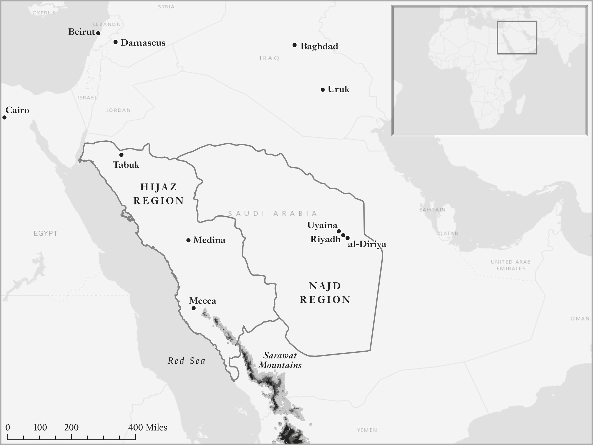
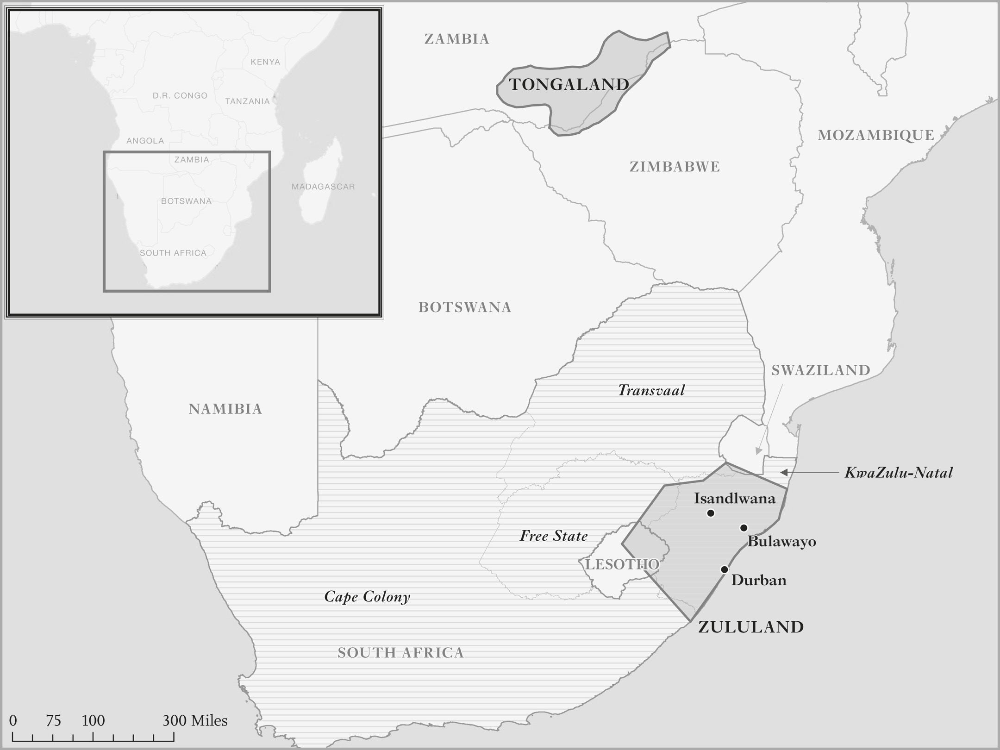
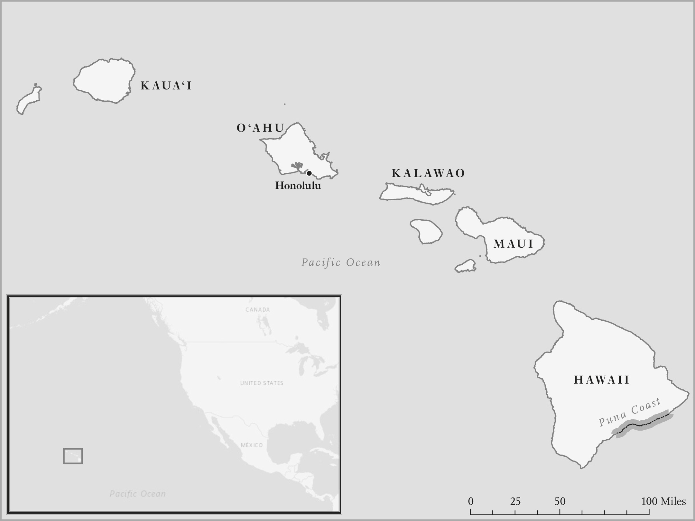

# Will to Power · 第3章　权力意志

## The Rise of a Prophet · 先知崛起

Muhammad was born in Mecca around 570 CE into a merchant family. Brought up by his uncle, he grew up in the vibrant trading hub that Mecca was in this period. The origins of the city seem to have been tied to the Kaaba, the dense black granite cube that was a sacred place for pre-Islamic local gods and later became the holiest shrine of Islam. During part of the year people came to Mecca on pilgrimage, which turned out to be a great opportunity to engage in commerce. The nascent trading community of the town soon spread far and wide to intermediate more broadly between the Arabian Peninsula and Damascus and the Byzantine and Persian Empires.

> 西元五七○年左右，穆罕默德诞生在一个商人家庭中。他由叔叔抚养，成长于当时活力十足的贸易中心麦加──这个城市的起源似乎跟天房（Kaaba）有关。天房是一块厚重的黑色四方体花岗岩，在伊斯兰教出现前，是供奉当地神祇的圣地，后来变成伊斯兰教最圣洁的圣殿。信徒每年都会来麦加朝圣，而他们停留此地的期间就成了从事商业活动的大好良机。麦加新兴的贸易社群很快就四处扩散，到达阿拉伯半岛和大马士革、拜占庭与波斯帝国广大疆域之间。

But the people who settled Mecca and the neighboring town of Medina, 250 miles to the north (see Map 4), were desert nomads, new to sedentary life. Their societies lacked states and centralized authorities, and like many other stateless societies, they were organized around kinship groups known as clans. Muhammad’s clan was the Hashim, part of the Quraysh tribe. Adjusting to life in the new town around the Kaaba wasn’t easy. The clans were used to migrating with their flocks of camels and goats across hundreds of miles of open desert. There were the potential disputes about access to a water hole or good pasture for the flocks, or any of myriad daily conflicts.

> 但是，落脚在麦加和北边四百公里（二五○英里）之遥的隔壁城市麦地那（参阅地图四）的居民，都是新近开始过定居生活的沙漠游牧民族。他们的社会没有国家机器和中央权威，就像许多没有国家的社会一样，根据「部族」这样的亲属团体组织而成。穆罕默德的部族属于古莱希（Quraysh）部落中的哈希姆（Hashim）部族。要适应围绕着天房而建立的城市新生活并不容易，各个部族习惯于驱赶骆驼和羊群，横越几百公里的广大沙漠，彼此可能为了如何利用水源、优良牧场，或为了无数的日常利益冲突，发生争执。

But these were usually handled by the norms and traditions of the nomadic tribes, and when that didn’t work, especially for conflict between different groups, they could just go their own separate ways in the sparsely populated peninsula. When this strategy couldn’t solve the disputes, there was retaliation and feud. The basic principle was an eye for an eye, but in some cases it had evolved into a hundred camels for an eye.

> 在过去，这些争执通常都用游牧部落的规范和传统解决；解决不了时，尤其是发生不同团体之间的争执时，彼此可以在人烟稀少的半岛上各奔前程。如果这种策略不能解决纷争时，就会变成报复和长期争执，基本原则是以牙还牙，但在某些情况下，会演变成以一百头骆驼来消解仇怨。

Life was more complicated around the Kaaba, and not just because of more frequent and varied conflicts that arose when people from different clans settled in the town. The new economic opportunities arising from the pilgrimage and the subsequent spread of trade fostered individualism and generated novel conflicts at the same time as they started to slightly relax the cage of norms and erode previous solidarities and bonds of community that had dominated life in the desert. It was in this social context that a prophet emerged.

> 在天房四周的生活比较复杂，不仅因为不同部族定居在城市里，比较经常引发各式各样的冲突而已；从朝圣之旅而来的新经济机会，以及后续扩大的交易会培养个人主义，产生新的冲突，同时也会开始略微放宽规范牢笼，侵蚀先前主导沙漠生活的团结和社群之间的紧密关系。先知穆罕默德就是诞生在这种社会环境中。

At around the age of forty, Muhammad began to have visions and received revelations that he eventually identified as coming from the Angel Gabriel. These revelations, which formed the beginning of what would come to be the Quran, the holy book of Muslims, were in the form of aphorisms exhorting people to recognize a new monotheistic religion with Allah as the one true God. They proposed not just a new religion, but a new community and new norms that would transcend the clans, such as the Hashim. They also criticized many of the new individualistic behaviors and the focus on making money.

> 穆罕默德大约四十岁时，开始看到异象，得到后来他认定是来自天使加百列的启示，这些启示后来成为穆斯林圣书《古兰经》的开端。《古兰经》以格言的形式，劝诫人们承认以阿拉为唯一真主的新一神教。这些启示不仅是提倡一种新宗教，还提倡一种新的社群，以及超越哈希姆等部族的新规范，还批评很多个人主义新行为和注重赚钱的功利心态。

Muhammad began to preach this new religion and exhort others to swear fealty to this new God. His first converts were his wife Khadija and his close relatives and friends. By 613 he was preaching more broadly in the town. But this wasn’t welcomed by everybody. Other trading clans resented the attacks on their behavior and religious beliefs, and they worried that Muhammad was making a bid for political power in Mecca, which at the time did not have a centralized government. Muhammad’s following gradually grew and the situation became more and more tense. In 622 he fled, along with a group of his followers, to Medina; this was the famous Hegira (“emigration”).

> 穆罕默德开始传播这种新宗教，劝说别人对这位新的真神效忠，最先皈依者是他的妻子赫蒂彻（Khadija）和亲朋好友。到西元六一三年，他开始在麦加扩大布道；然而，并非每个人都欢迎他这样做，从事贸易的其他部族不满他攻击他们的行为和宗教信仰，也担心他要在当时没有中央政府的麦加，争取政治权力。他的信徒逐渐成长，情势也变得愈来愈紧张。到西元六二二年，穆罕默德和一群信徒逃到麦地那，这就是著名的「迁徙」（Hegira）。

This emigration was precipitated not just by the mounting hostility to Muhammad in Mecca, but by a petition from citizens of Medina to come and help them solve their problems. Like Mecca, Medina was suffering the birth pangs of settled life. Unlike Mecca, however, it was not a trading hub but an oasis specializing in highly productive agriculture. Different parts of the oasis had been settled by different clans from two tribes, the Aws and the Khazraj. There were also three Jewish clans. The clans had built small forts as their strongholds, and engaged in incessant conflict that had culminated in 618 in the battle of Bu’ath. Life was starting to resemble Warre.

> 迁徙不完全是由麦加对穆罕默德的敌意升高促成，也由前来麦加、请求穆罕默德到麦地那帮忙解决问题的公民促成。麦地那和麦加一样，正在经历定居新生活的痛苦；但是，麦地那和麦加不同，不是贸易中心，而是善于从事高生产力农业的绿洲。绿洲的不同部分由奥斯（Aws）和卡兹拉吉（Khazraj）两大部落的不同部族定居。此外，还有三个犹太部族，各个部族都建造小型的碉堡，作为据点，彼此之间的冲突无休无止。冲突到六一八年至达高峰，爆发白德尔（Bu’ath）之战，日子开始变得很像战争状态。

Some of the Medinans came up with the idea that Muhammad, as a neutral outsider and with the authority of his new religion, could be the arbiter for disputes and would bring peace and order to the town. In June 622, seventy-five of them went to Mecca to request that he move to Medina; they pledged themselves to protect him and the new religion. Muhammad agreed. The agreement between him and the Medinans is recorded in a document known as the Constitution of Medina. This declares that “wherever there is anything about which you differ, it is to be referred to God and to Muhammad.”

> 有些麦地那人认为穆罕默德是中立的局外人，拥有创立新宗教的权威，可以调解纷争，为麦地那带来和平和秩序。六二二年六月，七十五位麦地那人前往麦加，请穆罕默德迁居麦地那，并保证他们会保护他和这个新宗教。穆罕默德同意了，他和麦地那人之间的协议记录在《麦地那宪章》中，宪章内宣称：「你们之间凡是有歧异之处，都要提交真主和穆罕默德。」

In effect Muhammad was to take on the role of judge in disputes between individuals and clans. But how could he do that if he did not have the power to enforce his laws and make others do what he commanded? Yet the reference to God in the Constitution of Medina made it clear that Muhammad didn’t come just as an individual; he came as a prophet, and part of the package was that the Medinans had to accept his teachings and revelations. Indeed, the Constitution of Medina started thus:

> 实际上，穆罕默德即将在个人和部族之间的纷争中，出任法官。但是，如果他没有权力执行他的法律、不能让别人听命行事，他该怎么办？然而，《麦地那宪章》中提到真主，就清楚表示穆罕默德不仅以个人身分前来麦地那而已，他也是以先知的身分前来，宪章的一部分是麦地那人必须接受他的教诲和启示。实际上，《麦地那宪章》开宗明义就表示：

In the name of God, the Merciful, the Compassionate! This is a writing of Muhammad the prophet between the believers and Muslims of Quraysh and Yathrib and those who follow them and are attached to them and who crusade along with them. They are a single community distinct from other people. This ought to have signaled to the Medinans (the people from Yathrib) that they were perhaps getting more than they bargained for with the new constitution. The constitution didn’t just make Muhammad a judge. It recognized a new sort of society, based not on kin and clan, but on religion and the nascent centralized authority of a prophet. This was the end of statelessness.

> 奉至仁至慈的真主之名！这是先知穆罕默德和古莱希与雅士里布（Yathrib，麦地那原名）穆斯林及其追随、附属和共同奋战者之间的约定，他们是与众不同的单一社群。这样应该向麦地那人（雅士里布人）发出信号，知道自己从新宪章的谈判中，得到的东西可能超过自己的想望。新宪章不只是把穆罕默德变成判官，也承认一种新社会──新社会不是以亲属和部族关系为基础，而是以区域和一位先知初生的中央权威为基础，从此结束了没有国家的状态。

Muhammad didn’t at first have any official position or executive power, but from this modest platform he soon got moving. His approach ought to have been evident from the opening paragraph above, which says “who crusade along with them.” Crusade? By 623, the year after the Hegira, Muhammad started to organize raids on Meccan trade caravans with the people he had brought with him from Mecca, known as the Emigrants.

> 穆罕默德起初并没有任何官衔或执行权，但他很快地就从这个毫不起眼的平台，开始迅速行动。他的方法从上述宪章开端文字「共同奋斗」的说法中，应该已经表示得很清楚，否则为什么需要共同奋斗。到迁徙一年后的六二三年，穆罕默德和他从麦加带来、号称「徙士」的信徒，开始针对麦加的贸易商队发动劫掠。

Engaging in such raids was not unusual among the tribes of Arabia, but they began to take on a new connotation. Instead of just being raids of one tribe on another, they were raids by Muslims against unbelievers. By 624 the raids began to include not just the Emigrants, but also the Helpers, the name for Medinans who had converted to Islam. By March of that year the Emigrants and Helpers together defeated a large Meccan force sent out against them at the battle of Badr.

> 在阿拉伯的部落中，从事这种劫掠，没有什么不寻常的地方；但是，现在劫掠具有了新含义，不再是一个部落劫掠另一个部落，而是穆斯林劫掠不信伊斯兰教的人了。到六二四年，劫掠队员不仅包括徙士，也包括皈依伊斯兰教、通称「辅士」的麦地那人。到这一年的三月，徙士和辅士同心协力，在巴德尔之役中，击败了麦加派出的大军。

Badr and the subsequent battle of Uhud increased Muhammad’s prestige and control over Medina. He proceeded to remove clans that had proved disloyal, particularly the Jews, and he started to use his religious authority to reform local society, changing both marriage and inheritance practices. Muhammad might have been brought in with a limited mandate to resolve disputes, but he was building a new state over which the preexisting clans would have little control. Over time his power grew. One reason for this was that nomadic tribes in the desert heard of his success and came to Medina to swear their loyalty to him.

> 巴德尔之役和后续的乌胡德之役提高了穆罕默德的声望，也强化了他对麦地那的控制，他开始消除对他不忠的部族，尤其是犹太人部族，也开始利用自己的宗教权威，改革当地社会，改变婚姻和继承做法。穆罕默德应邀来解决争执时，别人可能只赋予他有限的权力，但他开始建立一个既有部族几乎毫无控制能力的新国家。久而久之，他的权力成长。原因之一是沙漠中的游牧部落听到他的成就，前来麦地那，对他宣誓效忠。

Another reason stemmed from the fact that part of the benefit of the raids which the Emigrants carried out was booty. Muhammad himself received one-fifth of this. He also stipulated that they make contributions (actually taxes), which had to be paid to the “community of God,” and in addition imposed taxes for protection on Jews and Christians. Growing power and wealth are evident in the number of horses that Muhammad was able to field as cavalry in different raids. At the battle of Badr in 624 he had two horses. By the year 630 he could put 10,000 horses into the field.

> 另一个原因是徙士执行劫掠会有好处，好处之一是得到战利品，其中的五分之一会交给穆罕默德。穆罕默德也规定：徙士要捐献（实际上是纳税）给「真主的社群」；此外，他还对犹太人和基督徒开征保护费。穆罕默德的权势和财富日增，从他派往不同战役的马匹数目，可以清楚看出来：他在六二四年的巴德尔之役时，只拥有两匹马，到六三○年，他可以派一万匹马上战场。

Muhammad capitalized on his growing authority in 628 when he led a large mission of Emigrants and Helpers to Mecca purportedly to engage in pilgrimage. Understandably anxious, the Meccans forced them to stop short of the town and negotiated a deal whereby the Meccans would vacate the town the following year so that Muhammad and his followers could come on pilgrimage. While they waited for the deal to be struck, Muhammad gathered all his people under a tree and made them pledge themselves to him.

> 西元六二八年，穆罕默德利用他日增的权威，领导一大群徙士和辅士组成的大队，声称要到麦加进行朝圣之旅。可以想见，麦加人在焦急之余，强迫他们停在麦加之外，跟他们谈出隔年麦加人会撤出麦加，好让穆罕默德和信徒来朝圣的协议。双方谈判协议时，穆罕默德把所有信众聚集在一棵金合欢树下，要他们向他宣誓效忠。

This pledge, known as the Pledge of Good Pleasure, was one more step in the establishment of the state in Medina. As Hobbes imagined, the Leviathan needs people to submit to its will. This is what the people of Medina did, agreeing to do whatever Muhammad commanded. Though he still had no formal legislative or executive office, he was in effect the ruler of a new state.

> 这项誓约叫做「利达旺誓约」（Pledge of Good Pleasure，又译「喜悦誓约」），把穆罕默德在麦地那建国的过程，再向前推进一步。就像霍布斯所想像的那样，国家巨灵需要人民屈从于国家意志，麦地那人就是这么做，同意接受穆罕默德的命令。虽然他还没有正式的立法或行政机构，其实他已经是新国家的统治者。

His great authority is illustrated by an event that occurred in 630, just two years before he died. Muhammad was set on expanding the scope of his state and converting more people to the new religion. To achieve this objective, he decided to send a military force against the town of Tabuk in the north, and he insisted that all Muslims from Medina take part in this raid as a religious duty. He was now commander in chief.

> 西元六三○年，就在他去世前两年发生了一件事，颇能突显穆罕默德的绝大权威。穆罕默德决心扩大他的国家版图，让更多人皈依这个新宗教。为了达成目标，他决定派兵对付北方的泰布克（Tabuk），而且坚持麦地那的所有穆斯林，把这次劫掠当成宗教义务一样参与其事。他现在是总司令了。

The story of Muhammad’s creation of the new Islamic state encapsulates some of the key ideas of this chapter. Prior to his emergence as a prophet, there were no real states in Arabia, just tribes. Even more urbanized areas, like Mecca and Medina, didn’t really have centralized government. This created a lot of problems, not least violence and insecurity. When they lived in the vast wilderness of the Arabian Desert, there was plenty of room for all the tribes, but in the cramped oasis of Medina or around the sacred Kaaba in Mecca, they had to figure out how to live with one another.

> 穆罕默德创建新伊斯兰国家的故事，涵盖了本章里一些重要的意旨。在他以先知身分出现前，阿拉伯没有真正的国家，只有部落；连麦加和麦地那等比较都市化的地区，其实都没有中央集权式的政府。这样会产生很多问题，尤其是暴力和安全感匮乏。部落住在广大无垠的阿拉伯沙漠上时，空间很大，足够容纳所有部落；但是，住在拥挤的麦地那绿洲里，或是住在麦加神圣的天房四周时，居民必须想出方法，共同生活在一起。

The creation of more centralized authority was one obvious way out. But how to do that without ceding control to another clan or tribe? Then came Muhammad and his revelations from the Angel Gabriel, and the Medinans saw in his teachings a solution to their predicament. They brought him in to resolve conflicts between the clans and tribes. He succeeded in bringing peace, clearly a great service to the people living in Medina.

> 创设比较集中式的权威是明显的解决之道，但要怎么做才能达成目标，又不把控制权交给另一个部族或部落呢？然后，穆罕默德和他得自天使加百列的启示出现。麦地那人看出他的教诲是解决他们困境的好方法，因此请他来解决部族和部落之间的冲突；他成功地带来和平，大大造福住在麦地那的人民。

But it didn’t stop there. Though Muhammad and the Emigrants might have been a small minority to start with, they grew in number and became more powerful and wealthier as people joined them and agreed to contribute to their finances. This was the birth of political hierarchy in Arabia. By 628, with the Pledge of Good Pleasure, Muhammad’s authority in Medina was unassailable. Two years later in the attack on Tabuk, he ordered the entire oasis to march north.

> 不只如此，虽然一开始时，穆罕默德和徙士的人数可能相当少，却在人们开始加入、同意为他们的财务奉献后，人数不断成长，变得更有权势，也变得更加富有：阿拉伯的政治阶级就此诞生。到西元六二八年，信徒对穆罕默德发下「利达旺誓约」后，穆罕默德在麦地那的权威已经屹立不摇。两年后，他下令整个绿洲的人民北伐，攻击泰布克。

The Medinans had come a long way in eight years. They had acceded to a more centralized authority to help resolve their conflicts, but in doing so they had started the process of state formation and got onto the slippery slope. They never got off it. Muhammad was engaged in a state-building project; part of his objective was to centralize authority in his and his followers’ hands, and in the process transform not just conflict resolution but the overall organization of society, its norms, its customs. He succeeded brilliantly. In less than a decade, he created the seeds of a powerful Islamic state, a giant pan–Middle Eastern empire and a new impressive civilization.

> 麦地那人在八年内进展神速，同意加入一个比较集中式的权威，以便解决本身的冲突；但是，他们这样做时，也开始了形成国家的过程，走上滑溜的斜坡，此后一直没有离开这条坡道过。穆罕默德当时是在推动一项建国方略，目标之一是把权威集中在自己和信徒手中；与此同时，他不但改革冲突解决之道，也改革整个社会组织、规范和习俗。穆罕默德的成就非凡，不到十年，就替一个强大的伊斯兰国度，一个巨型泛中东帝国和一个灿烂新文明打下基础。

## What’s Your Edge? · 你有什么优势？

The birth of Islam is an example of what anthropologists call “pristine state formation”—the building of political hierarchy and some type of centralized authority where none existed before. It also illustrates the critical issues and difficulties associated with this. The most important one, which we already highlighted in the previous chapter, is the slippery slope. The reason why centralized authority doesn’t arise easily in many stateless societies is because these societies have developed norms and practices not just to control conflict, but also to prevent anybody from getting too strong.

> 伊斯兰教的诞生是人类学家所说「初发性国家形成」（pristine state formation）的例子，意思是政治阶级和某种中央权威凭空建立起来。这个名词也说明与此有关的关键问题和困难。最重要的问题是我们在前一章强调过的滑坡。在很多无国家社会里，中央权威不容易出现，原因是这些社会不但已经发展出控制冲突的规范和做法，也可以防止任何人变得太强大。

Once an individual or group manages to increase their power sufficiently to be able to adjudicate conflicts and provide security against major threats, it is difficult to stop them from getting even more power and start telling others what to do in every sphere of their lives. This is exactly what happened in Medina. The Medinans thought they could set up a system to redress some of the defects of not having a state, without submitting wholesale to the authority of a state or a charismatic, powerful leader.

> 一旦个人或团体设法增加权力到足以裁决冲突，提供安全保障，对抗重大威胁时，就会难以阻止他们获得更多权力、开始命令别人在生活的每一方面该怎么做。这就是麦地那发生的事情。麦地那人认为，自己可以建立制度，革除没有国家的一些弊病，却不全盘屈服于国家或魅力十足强大领袖的权威。

They failed. Several other societies starting off without centralized authority have similarly failed, sliding down the slippery slope toward a dominating Leviathan. So why do the norms and the other controls that such societies have developed sometimes fail to rein in state builders? To start with, there is what the German philosopher Friedrich Nietzsche dubbed the “will to power”—the desire of men (and sometimes women) and groups to increase their power and authority over others, even if the norms are against it.

> 麦地那人失败了，好几个一开始没有中央权威的其他社会同样失败了，从滑溜的斜坡滑下去，滑向深具宰割力量的国家巨灵。因此，为什么这种社会发展出来的规范和其他控制机制，有时候会无法控制建国元勋呢？首先，其中有着德国哲学家尼采所说的「权力意志」──男性（偶尔也会有女性）和团体即使面对规范的反对，还是渴望提高自己驾驭别人的权力和权威。

For this reason, even in the most harmonious-looking stateless societies, there will be upstart individuals wishing to acquire more power, more wealth, and greater ability to dominate others. There will also be individuals and groups wishing to obtain more power because they have a vision of reorganizing society in a different manner. Many of these upstarts will be prevented from achieving their objectives by the prevailing norms and the actions of others in their societies, and yet some will succeed.

> 因此，即使在看来最和谐的无国家社会里，也会有希望获得更多权力、财富和驾驭别人能力的个人新贵，也会有希望得到更多权力的个人和团体，因为他们有着把社会改造成不同模样的愿景。很多新贵会遭到既有的规范和社会上其他人的行动阻止，无法达成目标，不过还是有一些人会成功

Would-be state builders are more likely to succeed and emasculate the norms meant to restrain them if they have an “edge”—something special, making it possible for them to overcome the barriers in their way. For Muhammad, the edge came from religion. He had a religious ideology that gave him a legitimate authority in his conflict resolution role and also afforded him great influence over his followers, which he used to found a new community. Once unleashed, this religious ideology created an unstoppable drive toward more centralized authority.

> 一心想建国的人如果拥有某种「优势」，比较可能达成心愿，削弱意在限制他们的规范力量。优势是某些特别的东西，使他们可能可以克服挡在路上的障碍。穆罕默德的优势来自宗教，他拥有宗教上的意识形态，让他在解决冲突方面，掌握合法的权威；也让他对信徒有很大的影响力，可以据以建立新的社群。这种宗教意识形态一旦释出，会产生无可阻挡、创建权威更集中体制的动力。

Another powerful edge is organizational, emanating from the ability of a leader to forge new coalitions or more effective organizations to exercise greater command or military force, a possibility illustrated by the formation of the Zulu state in Southern Africa, which we turn to next. Yet another possibility, which we discuss a little later in this chapter, is a technological edge, exemplified by the successful state-building project of King Kamehameha of Hawaii, which heavily relied on his use of guns, a military technology his enemies did not have access to. In all of these cases, personal charisma and other sources of legitimacy, for example, resulting from lineage, past exemplary or heroic behavior, or simply a force of personality, help as well.

> 另一个有力的优势是组织能力，这种能力出自领袖善于建立新联盟或更有效的组织，发挥很大的统率能力或军力；这种可能性表现在南部非洲祖鲁国的建国上，我们接下来就要探讨这件事。本章稍后一点才要讨论的是科技优势的可能性，夏威夷国王卡美哈梅哈（Kamehameha）就是利用枪械、依赖敌人无法取得的军事科技优势，成功推动建国计划的范例。所有这些例子中，个人魅力和其他诸如来自血统、过去的模范或英勇行为，或单纯的个性力量等合法性来源，也都会有帮助。

A final important feature of many examples of pristine state formation illustrated by Muhammad’s rise is the reorganization of society following the emergence of political hierarchy. As we saw in the previous chapter, societies without centralized authority are typically organized by a complex of norms that regulate and control conflict—and in fact every aspect of people’s lives. Once the process of state formation is under way, state builders have an incentive to destroy these norms or at the very least transform them to serve their own objectives.

> 最后，穆罕默德崛起的例子显示，很多初发性国家形成的一个重要特征是政治阶级出现后的社会重组。我们在前一章里已经看到，没有中央权威的社会在组织时，通常是以管制和控制冲突的繁复规范为依据──其实是以管制和控制人民生活中每一个层面的规范围依据。一旦国家形成的程序开始推动，推动建国的人会有摧毁这些规范的诱因，或至少会有改造规范，使之为本身目标服务的诱因。

This is not necessarily because they want to relax the cage of norms and unleash liberty, but because the norms that restrain and limit political hierarchy are standing in their way to greater power. In Muhammad’s case, an important target was to supplant the kin-based relations prevailing in Medina and Mecca, which he could successfully do because his religious teachings elevated a new community over kin. For Shaka, as we’ll next see, the target was the authority of witch doctors.

> 他们这样做，不见得是因为他们希望放宽规范牢笼、释出自由，而是因为约束和限制政治阶级的规范，妨碍他们获取更大的权力。以穆罕默德的例子来说，重要的目标是取代麦地那和麦加盛行的亲属关系，穆罕默德能够做好这件事，是因为他的宗教教义把一个新的社群，提升到亲属关系之上。至于我们在后文中会看到的祖鲁酋长夏卡（Shaka），他的目标是取代巫医的权威。

## The Horns of the Buffalo · 牛角攻势

In his memoirs, British officer Horace Smith-Dorrien recalled the events of January 22, 1879: At about 12 a.m. the Zulus . . . again showed in large numbers, coming down into the plain over the hills with great boldness, and our guns and rifles were pretty busy for some time . . . It was difficult to see exactly what was going on, but firing was heavy. It was evident now that the Zulus were in great force, for they could be seen extending (i.e. throwing out their horns) away across the plain to the south-east, apparently working towards the right rear of the camp.

> 英国军官赫瑞斯．史密斯．杜利恩（Horace Smith-Dorrien）在回忆录中，回想起一八七九年一月二十二日的下述场景：早上十二点左右，大量祖鲁人……现身，抱着绝大的勇气，越过山丘，下到平原上，我们的枪炮相当忙碌地发射了好一阵子……很难看出确实的状况，但战火猛烈，现在祖鲁人显然重兵云集，因为从平原对面一直延伸到东南方（即展开钳形攻势），都可以看到他们的踪影，显然他们打算攻击营地的右后方。

Smith-Dorrien was a member of an expeditionary force under Frederic Thesiger, Lord Chelmsford, that was sent into Zululand, now part of the province of KwaZulu-Natal in South Africa (which is shown in Map 5). Chelmsford’s force was the vanguard of an expanding colonial empire whose aim was to eliminate the independent Zulu state, then ruled by King Cetshwayo. The king’s response to the British invasion was simple. He told his army: March slowly, attack at dawn and eat up the red soldiers.

> 史密斯．杜利恩是祖鲁兰（Zululand）远征军成员，配属切姆斯福德爵士腓特烈．泰思哲（Frederic Thesiger, 2nd Baron Chelmsford）的麾下。祖鲁兰现在是南非夸祖鲁纳塔尔省（KwaZulu- Natal）的一部分（参见地图五）。切姆斯福德的部队是以消灭独立的祖鲁王国、扩张大英帝国殖民地为目标的先锋。当时祖鲁王国由国王塞奇瓦约（Cetshwayo）统治，他对英国侵略的反应很单纯，他告诉手下军队：缓慢进军，拂晓攻击，吃光红衣士兵[〔注1〕](#note-1) 。

That’s what they did on January 22. Chelmsford made the mistake of dividing his force, leaving about 1,300 soldiers, mostly members of the 24th Regiment of Foot, and two artillery pieces camped at the feet of the rock of Isandlwana. Overconfident and underprepared, the red soldiers faced an army of 20,000 Zulu warriors who in the previous sixty years had cut out and consolidated a huge state in Southern Africa. So large was the Zulu state that it had already sent shock waves through the region, into modern-day Botswana, Lesotho, Mozambique, Swaziland, Zambia, and Zimbabwe (see Map 5).

> 一月二十二日这天，祖鲁战士就是这样做。切姆斯福德犯了分散兵力的错误，把大都属于第二十四步兵团的大约一千三百位士兵，和两座大炮，部署在伊散德尔瓦纳（Isandlwana）岩石脚下。英军过度自信却准备不足，要面对由两万名祖鲁战士组成的军队，而且这支军队过去六十年里，占领和巩固了非洲南部一个土地非常广大的国家。祖鲁国大到已经冲击整个非南地区，影响及于今天的波札那、赖索托、莫三比克、史瓦济兰、尚比亚和辛巴威（参见地图五）。

Smith-Dorrien recorded: The advancing Zulus’ line . . . was a marvellous sight, line upon line of men in slightly extended order, one behind the other, firing as they came along, for a few of them had firearms, bearing all before them. The rocket battery, apparently then only a mile to our front, was firing, and suddenly it ceased, and presently we saw the remnants of Durnford’s force, mostly mounted Basutos, galloping back to the right of our position.

> 史密斯．杜利恩的纪录如下：祖鲁阵线的推进……构成一幅绝妙的图景，一排又一排士兵以略微散开的方式，一个跟着一个，一面前进，一面开火，因为有一些人拥有枪械，而且全都把枪端在身体前面。当时显然离我们的前线只有一英里的火箭炮正在发射，然后又突然停止发射。不久之后，我们看到邓福德上校的残部大都骑着巴苏图马，急驰回到我们位置的右侧。

What had actually happened I don’t think we ever shall know accurately. The ground was intersected with “dongas,” and in them Russell with his rocket battery was caught, and none escaped to tell the tale. I heard later that Durnford, who was a gallant leader, actually reached the camp and fell there fighting.

> 实际战况如何，我想我们永远都没法弄清楚了。战场上深沟密布，纵横交错，罗素和他的火箭炮排身陷其中，没有一个人能够逃出生天，说明真相。我后来听说，英勇指挥的邓福德其实已撤回营地，却当场奋战倒地。

By the end of the day the British force had been wiped out. Smith-Dorrien escaped because of his dark blue officer’s uniform. The Zulu soldiers had been told not to kill people in black because they were civilians, possibly priests. Just a few others lived to tell the tale and witness the greatest military defeat suffered by the British in their colonization of Africa.

> 到这一天结束时，英军全军覆灭。史密斯．杜利恩因为身穿深蓝色军官制服，得以幸免。祖鲁士兵被告知不要杀死穿黑衣的人，因为他们是平民，可能是传教士。另外只有少数几个人活下来，叙述和见证英国人在非洲殖民军事史上遭遇最大惨败的事迹。

In watching, apparently quite calmly, the advance of the Zulu army, Smith-Dorrien witnessed one of the great tactical innovations that had helped empower the Zulu state, the “horns of the buffalo.” This was a military formation created by Shaka Zulu, the founder of the state, where the army formed into four main components: the chest of the buffalo at the center, the loins behind it, and two horns on either side that encircled the enemy. Smith-Dorrien also saw some of Shaka’s other innovations in action—the disciplined regiments that were formed when Shaka took traditional ritual associations and militarized them, and the iklwa, a short stabbing spear with which Shaka had replaced the previous weapon of choice, the assegai, a javelin.

> 史密斯．杜利恩显然在祖鲁军队进军之际，相当冷静地观察他们，见证了为祖鲁王国大力加持的战术创新「牛角攻势」。牛角攻势是祖鲁王国建国英雄夏卡．祖鲁（Shaka Zulu）创造的战斗队形，把兵力在战场上分为四个主要部分：水牛的胸部位在中央，胸部的后面是腰部，两支牛角分居两侧，包围敌军。史密斯．杜利恩也看到夏卡的另一些创新付诸实行──包括夏卡接受传统仪式聚会、并加以军事化的纪律部队，以及夏卡用来取代过去首选武器木柄镖枪的刺刀式短矛（iklwa）。

## The Wrong Doer Who Knows No Law · 无法无天的大坏蛋

Shaka was born around 1787, the illegitimate son of the then Zulu chief. At that time the Zulu formed a small chieftaincy among many others spread out over southern South Africa. Something of an outcast because of her illegitimate child, Shaka’s mother took refuge with a neighboring people, the Mthethwa. In 1800 the Mthethwa had a new chief, named Dingiswayo. Dingiswayo anticipated some of Shaka’s subsequent reforms and began a highly successful military and territorial expansion, conquering about thirty surrounding groups, including the Zulu.

> 夏卡大约出生在一七八七年，是当时祖鲁酋长的私生子。当时祖鲁族在散布南非南部的原住民中，自成部落。夏卡的妈妈因为私下生子的关系，变得有点像弃妇，托庇在邻族穆提特瓦族（Mthethwa）之下。一八○○年，穆提特瓦族出了一位新酋长，名叫丁吉斯瓦约（Dingiswayo），丁吉斯瓦约替将来夏卡会推动的一些改革打下基础，也成功展开军事和领土扩张，征服包括祖鲁部落在内的大约三十个邻近部落。

The young Shaka, called into the Mthethwa army, became one of its most effective warriors, soon known for his bravery and unscrupulousness. Dingiswayo tried to behave magnanimously toward defeated enemies; not so Shaka, who was typically in favor of massacring them all. His behavior won him the moniker “the wrong doer who knows no law.” Shaka made his way up through the ranks until eventually he was promoted to be head of the army. In 1816, when Shaka’s father died, Dingiswayo made sure that Shaka became the new chief of the Zulu.

> 年轻的夏卡应穆提特瓦族军队的召唤从军，成为穆提特瓦族最有效能的战士，很快就以勇敢和不择手段闻名。丁吉斯瓦约努力表现宽宏大量的样子，对待遭到他击败的敌人；夏卡却不是这样，夏卡通常赞成全部杀光，他的行为让他赢得「无法无天大坏蛋」的绰号。夏卡在军中出身行伍，一路扶摇直上，升任陆军司令。到一八一六年，夏卡的父亲去世，夏卡在丁吉斯瓦约的全力协助下，成为祖鲁人的新酋长。

Shaka immediately set about reorganizing Zulu society and those that he conquered into a new type of social system. He first called up all of the adult males and separated them into four regiments, which would form his first buffalo’s chest, loins, and horns. Probably only about 400 men appeared at this juncture. He started to train them in the use of the iklwa, the spear that he had blacksmiths forge, and a new type of battle shield. He made them throw away their sandals and walk barefoot, which allowed them to move faster.

> 夏卡立刻着手改造祖鲁族和他所征服部落的社会。他首先召集所有成年男子，把他们分为四个团，形成他第一个牛角战斗队形中的胸部、腰部和双角。当时很可能大约只有四百个男性报到，他开始训练他们使用他请铁匠打造的刺刀式短矛，以及一种新式的战斗盾牌，他也下令众人丢掉拖鞋，改用赤脚走路，以便加速行动。

Then with his first serious military force ready for action, he began to conquer surrounding areas. First were the eLangeni, who quickly succumbed and were incorporated into his rule. Next came the Butelezi, who put up a fight and were massacred. Within one year Shaka’s army grew to 2,000 men. By the next year Dingiswayo was killed and Shaka made himself king of the Mthethwa. His ruthless tactics subdued one tribe after another, incorporating many into the expanding Zulu state. As one oral history records:

> 等到他的第一支严肃认真的武力做好行动准备后，他开始征服附近地区。首先遭到攻击的是宜容格尼（eLangeni）部落，宜容格尼部落迅即投降，被纳入他的统治。接着，他攻击布特雷齐（Butelezi）部落，遭遇反抗，这个部落因此遭到杀戮。一年之内，夏卡的军队增加到两千人。隔年丁吉斯瓦约遭到杀害，夏卡自立为穆提特瓦国王，一个又一个部落屈服于他残忍无情的战术，被纳入不断扩大的祖鲁王国中，就像一段口述历史说的那样：

The Butelezi, amaQungebe, Imbuyeni, amaCunu, Majola, Xulu, Sikakane, are all tribes which were quite close . . . Tshaka attacked and killed off these tribes; he crept up on them in the night. Tribes further off were the amaMbata, Gasa, Kumalo, Hlubi, Qwabe, Dube, Langeni, Tembu, Zungu, Makoba. The phrase “killed off” had different meanings in different contexts. In some cases, like the Butelezi, it seems to literally describe what happened. But in others the tribe was simply incorporated into the expanding Zulu state. Still others stayed more distant but declared themselves tributaries to the Zulus and paid “taxes” in cattle and young women.

> 布特雷齐、昆格比联合（amaQungebe）、因布延尼（Imbuyeni）、库努联合（amaCunu）、马约拉（Majola）、苏鲁（Xulu）、西卡堪（Sikakane）都是相当贴近祖鲁族的部落……夏卡攻击且杀光这些部落，他乘着黑夜发动劫掠。离夏卡比较远的部落有穆巴塔联合（amaMbata）、加萨（Gasa）、库马洛（Kumalo）、何路比（Hlubi）、夸比（Qwabe）、杜比（Dube）、容格尼（Langeni）、谭布（Tembu）、朱恩古（Zungu）和马科巴（Makoba）等部落。在不同的情况下，「杀光」的意义不同，以布特雷齐族为例，杀光似乎就是描述字面上所说的意义；但说到其他部落时，就是指彻底并入正在扩大的祖鲁王国，还有一些部落距离祖鲁国比较远，但自称是祖鲁族的藩属，会以献纳牛只和年轻妇女的方式「纳税」。

By 1819 Shaka had expanded the Zulu territory from about 100 square miles to 11,500, and his army stood at 20,000. Shaka built a new capital at Bulawayo (marked on Map 5), and we have a firsthand description of it from 1824, when a party of English traders from Port Natal, now Durban, visited it. One of them, Henry Flynn, left a written record:

> 到一八一九年，夏卡已经把祖鲁的疆土，从大约一百平方英里，扩大为一万一千五百平方英里，军队员额扩增为两万人。夏卡在布拉瓦约（Bulawayo）建立新都（参见地图五）。一八二四年，一个英国贸易商团从现在叫做德班（Durban）、当时叫做纳塔尔港的地方出发，前去访问时，对新都有过第一手的描述。一位名叫亨利．傅林（Henry Flynn）的英国贸易商留下了下列文字纪录：

On entering the great cattle kraal we found drawn up within about 80,000 natives in their war attire . . . Shaka then raised the stick in his hand and after striking with it right and left and springing out from amidst the chiefs, the whole mass broke from their position and formed up into regiments. Portions of these rushed to the river and the surrounding hills, whilst the remainder, forming themselves into a circle, commenced dancing with Shaka in their midst. It was an exciting scene, surprising to us, who could not have imagined that a nation termed “savages” could be so well disciplined.

> 我们一进入庞大的养牛农庄，发现自己走近大约八万个身穿战袍的原住民……然后夏卡举起手中的权杖，向右和向左点击，而且从众酋长中弹跳出来以后，整个群众脱离原来所在的位置，形成若干团队，一部分团队冲向河流和四周的山丘，剩下的群众整队形成一个圆圈，跟身处群众当中的夏卡一起跳舞。这种景象令人兴奋莫名，让我们惊讶，因为我们想不到一个被人称为「野蛮」的国家，居然可能这么有纪律。

Regiments of girls, headed by officers of their own sex then entered the center of the arena to the number of 8,000 to 10,000 each holding a slight staff in her hand. They joined in the dance, which continued for about two hours. Shaka also started the process of transforming existing norms. Instead of being based on kinship and clan, Shaka’s state was based on two new axes. One was age.

> 然后，少女团队在女性长官率领下，进入场地中央，每一个小组的人数约为八千到一万人，每一个人手上拿着一根小棍棒，加入跳舞阵容，整场舞蹈大约持续了两小时。夏卡也开始改变既有的规范，他的国家不再以亲属关系和部族为基础，而是以两个轴心为基础，轴心之一是年龄。

In many parts of Africa and elsewhere, when boys and girls come of age, they are initiated into the secret lore of the society, a process that typically goes along with circumcision and scarification. It involves staying for long periods in the wilderness and various types of ordeals. In some African societies these initiations became so institutionalized that when a cohort of boys, and sometimes even girls, was initiated, they became inducted into a group known as an “age set” (or “age grade”) to which they would belong for their entire life.

> 在非洲和很多其他地方，男孩和女孩成年时，都要透过秘密仪式的成年礼来进入社会。这个过程通常伴随割礼和疤痕纹身，涉及在野外停留很长一段期间，接受各种磨难考验。在非洲某些社会中，这种加入仪式已经变得极为制度化，以至于一群男孩、甚至偶尔会把一群女孩纳入，引进称为「年龄层群组」（或「年龄层级」）的团体中，成为终身成员。

In many parts of East Africa, whole peoples became organized not around kinship or a state, but around a sequence of these age grades. The grades undertook different functions as their members grew older, for example young men would be warriors, protecting the people or cattle. As they got older and a new cohort came along, they would transition into marriage and economic activities such as farming. Among the Zulu and other related peoples in Southern Africa these social structures were already present, even if in a rudimentary form.

> 在东非的很多地区里，群众组织变成不是以亲属关系或国家为依据，而是以这种年龄层级系列为基础。随着成员的年龄成长，这种层级会承担不同的功能。例如，年轻男性会变成战士，保护人民或牛群；年龄更为成长时，新的群体会出现，他们会过渡到婚姻和从事务农等经济活动。在南非的祖鲁族和其他相关族群中，这种社会结构已经出现，只是还处在很原始的形态。

Shaka took them and militarized them. He turned age grades into military regiments and got them to live together in separate barracks. He also started recruiting the youth of the peoples he conquered. These regiments provided a way of breaking down the ties of family and integrating people into the new state. The role of the age sets in creating a new Zulu identity is revealed by an interchange at the annual harvest festival of Umkosi. At this time it was permissible for anyone to ask any question of the chief, and one impertinent soldier asked Shaka, “Why are outsiders promoted over the heads of Zulus?”

> 夏卡接受这些形态，予以军事化，把年龄群组变成军事梯队，让他们一起住在不同的营房里。他也开始征募他所征服部落的年轻人，这些梯队提供了打破家庭关系，把人民融入新国家的方法。在创造祖鲁的新身分时，年龄群组的角色由称为「芦苇舞」（Umkosi）的丰年祭典中的对话揭露出来，这时是容许任何人问酋长任何问题的时刻。一位莽撞的年轻士兵问夏卡：「为什么提拔别人到祖鲁人的头上去呢？」

To which Shaka supposedly retorted, “Any man who joins the Zulu army becomes a Zulu. Thereafter his promotion is purely a question of merit, irrespective of the road he came by.” The other new axis was geographic. Shaka divided the territory into counties and either left existing chiefs in place, though making it clear they now served at his pleasure, or appointed loyal soldiers of his army as governors.

> 据说夏卡反驳说：「凡是加入祖鲁军队的人就变成祖鲁人，此后他的升迁完全看功绩，跟他的出身来历无关。」另一个新轴心是地理因素。夏卡把领土分成很多县，不是留任现有的酋长，声明他们现在要由他任意发落，不然就是任命部队中忠诚的士兵担任县长。

In the process, Shaka centralized many functions into his own hands. Previously the harvest festival of Umkosi had been celebrated widely in the region, with individual chiefs conducting the ceremony. Now only Shaka presided over the annual rites. He also created a centralized court. Although chiefs could adjudicate disputes and solve local problems, ultimate appeal could be made to Shaka in Bulawayo.

> 夏卡透过年龄与地理这两个轴心，把很多权力集中在自己的手里。过去芦苇舞丰年祭是在一个地区中普遍举行，典礼由个别酋长主持，现在只有夏卡可以主持年度丰年祭。他也创设中央式的法院，虽然酋长可以仲裁纷争，解决本地的问题，人们最后还是可以向布拉瓦约的夏卡上诉。

A primary way in which Shaka maintained his system was tribute and its distribution among his supporters. As he conquered or subdued surrounding peoples, he forcibly demanded huge numbers of cows and women. He endowed his regiments with cattle in reward for their services and organized women into age regiments as well, and segregated them, forbidding the men to marry or have sexual relations with them until he allowed it.

> 夏卡维持这种制度的主要方法是纳贡，以及把纳贡再分配给支持者。他征服或压制附近的人民后，会强迫他们缴交巨量牛只和妇女，再把牛只赐予手下各梯队，奖励他们的服役；妇女也一样，根据年龄，组成梯队，然后隔离开来。除非获得他的允许，否则不得跟男性结婚或发生性关系。

Of course this was a state that was not bureaucratized in the way modern states are. Though Shaka had advisers, the state was run by the army and his appointed chiefs, and in the absence of writing, laws and rules were oral. Bureaucratized or unbureaucratized, Shaka’s state-building project had to break parts of the cage of norms that were inhibiting the emergence of political hierarchy and Shaka’s authority. A pillar of these norms, just as with the Tiv’s norms we saw in Chapter 2, was the complex of supernatural beliefs often used for grinding down anyone getting too big for their boots.

> 这个国家当然跟现代国家不同，还没有官僚化。夏卡虽然有顾问，却是靠军队和他任命的酋长来治国，而且因为没有文字，法律和规则都是靠口头来传递。然而，无论是否官僚化，夏卡要推动建国方略，都必须打破禁止政治阶级和夏卡的权威出现的规范牢笼。这些规范中的支柱之一，像第二章谈到的蒂夫族规范一样，是繁复的超自然信仰，人们经常以此来压制个人的庞大权力欲。

In a famous incident, not long after he became chief of the Zulus, Shaka had to deal with some evil omens. A hammerhead crane flew over Shaka’s kraal; then a porcupine wandered into it; then a crow perched on a fence and began to utter human words. These omens necessitated summoning a team of witch doctors, headed by a woman called Nobela, who indicated the identity of witches by hitting them with the gnu tails the team carried. Not so different from the fly whisk of the Tiv. The parallels with the Tiv didn’t stop there.

> 夏卡成为祖鲁族酋长后不久，就必须在一次著名的事件中，处理一些凶兆，包括一只苍鹭飞过夏卡的大茅屋、一只豪猪闯进这栋大茅屋、一只乌鸦停在篱笆上，开始说人话。出现这些凶兆后，必须召集一群巫医来作法，巫医由名叫诺贝拉（Nobela）的女性率领。诺贝拉表示，必须用巫医携带的牛羚尾巴击打，才能辨认「巫师」的身分，这跟蒂夫族的苍蝇拍没有太大的不同，两者类似的地方还不只这些。

The Zulus were lined up and Nobela and her associates began “smelling out” the witches who had brought on the evil omens. They picked on prosperous people. One had grown rich through frugality. Another had put cattle manure on his lands as fertilizer, producing a bountiful harvest much greater than his neighbors’. Yet another was a fine stock breeder who had picked the best bulls and taken great care of his stock and as a result had seen a prodigious expansion of his herds. But taking down the rich was not enough. Nobela was after the politically powerful too. She started by “smelling” two of Shaka’s trusted lieutenants, Mdlaka and Mgobozi.

> 祖鲁人排起队来，诺贝拉和其他巫医开始「闻嗅」带来凶兆的巫师。她们看上了有钱人：其中一位是靠着节俭致富；另一位是把牛粪放在自己的田里当肥料，种出远比邻人还多收成而致富；还有一位是高明的牲口培育专家，靠着挑选最优良的牛只，花费极多精神照顾自己的牲口，因此牲口的数目惊人增长，从而发了大财。但是，扳倒富人还不够，诺贝拉也盯上有权有势的政治人物，开始「嗅闻」夏卡信任的两位副手穆德拉卡（Mdlaka）和穆戈波济（Mgobozi）。

Anticipating this move, Shaka told them to stand next to him and claim sanctuary if they were accused of being witches. According to eyewitness accounts: With a hideous cackle, imitating the hyena’s demoniacal laugh all five jumped up simultaneously. With lightening speed Nobela struck right and left with her gnu-tail and jumped over Mdlaka’s and Mgobozi’s shoulders, while each of her immediate assistants also struck the man in front of her and vaulted high over his head.

> 夏卡预料到这件事，告诉两位助手站在自己身边，如果遭到巫师的指控，就申请庇护。照目击者的记述：巫医发出桀桀怪笑，声音好似恶魔一般的土狼。五个人全都同时跳起来，诺贝拉犹如闪电一般，飞快地用牛羚尾巴左右击打，跳过穆德拉卡和穆戈波济的肩膀。她的两位亲密助手也敲打她面前的男子，高高地跃起，从他的头上跳过去。

But Shaka wasn’t putting up with this. After all, he was the most powerful person in Zululand, intent on exercising his naked will to power; he might be the next one to be smelled out. He granted Mdlaka and Mgobozi sanctuary and charged Nobela with falsely accusing them of being witches, decreeing that two of the witch doctors must die in compensation. He made them throw divining bones to identify which two should be chosen. This led to panic between the witch doctors, who appealed to Shaka to protect them.

> 然而，夏卡可不想忍受这种事情，毕竟他才是祖鲁兰最有权势的人，他打算发挥自己赤裸裸的「权力意志」；否则他可能是下一个被巫医「闻」出来的人。他庇护穆德拉卡和穆戈波济，并且指控诺贝拉诬告他的两位副手为巫师，裁决两位巫医必须以死亡作为补偿。他下令巫医抛掷神圣的骨头，判明应该选择哪两位巫医；结果众巫医大为惊恐，吁请夏卡保护她们。

He agreed on the stipulation that they “cheat me no more, for on that day you will fail to find sanctuary anywhere.” From that day on, any “smelling out” had to be confirmed by Shaka. He broke the witch doctors’ power. He also banished every rainmaker. It was all part of creating a state. Any part of the cage of norms that stood in his way had to be taken apart.

> 他同意诺贝拉的条件，就是她们「不能再骗我，否则将来会找不到半个庇护所」。从那天起，任何「嗅闻」都必须经过夏卡的证实。他破除了巫医的权力，也放逐了所有的祈雨法师，这些全都是创建国家的一部分，凡是妨碍他的所有规范牢笼都必须被破除。

The longevity of the institutions that Shaka built is best illustrated by the current population of the Zulus. Starting from a clan of possibly 2,000 people in 1816, there are now between 10 and 11 million people who identify themselves as Zulu in South Africa (out of a population of 57 million) and they dominate the province of KwaZulu-Natal. The “Zulu” had originally been the descendants of a single man, but are now a massive society including millions of people who are completely unrelated genetically to the original Zulu.

> 祖鲁族的人口最能说明夏卡所创建制度的悠长寿命。一八一六年，祖鲁族从大概可能有二千人的部族开始，到今天的南非（五千七百万人口中），有一千万至一千一百万人自认是祖鲁族，祖鲁族也是夸祖鲁纳塔尔省的主要种族。「祖鲁族」原本是一个男人的后裔，现在却是包括几百万在遗传上、跟原始祖鲁人完全无关的庞大社会。

## The Red-Mouthed Gun · 红嘴枪

For thousands of years, people spread out from Asia onto the great swath of Polynesian islands. Among the last to be colonized was the Hawaiian archipelago, probably in about 800 CE. Though all the Polynesian islands started with the same culture, religion, language, technology, and political and economic institutions, they gradually diverged as different innovations arose and stuck. Ancestral Polynesian societies, as reconstructed by archaeologists and historical ethnographers, were not that different from the types of kinship-based societies that we saw in pre-Shaka Zululand; they were small-scale chieftaincies organized around kinship, and as usual their suite of norms had evolved to manage conflict and stop would-be strongmen.

> 几千、几万年来，人类从亚洲散布到一大片玻里尼西亚群岛上，其中夏威夷群岛最后遭到殖民，时间大约是西元八百年前后。虽然所有玻里尼西亚群岛开始时，都具有相同的文化、宗教、语言、科技和政经制度，却因为不同的创新出现和运用而逐渐分化。人类学家和历史民族学家重建的古老玻里尼西亚社会，和我们所看到夏卡崛起前以亲属关系为基础的祖鲁社会，在形态上没有太大的不同，都是根据亲属关系组织的小型酋长社会，而且整套社会规范像平常一样，依据管理冲突和阻止有意出头的强人崛起而演变。

By the time the first outsider, Captain James Cook, stumbled on the Hawaiian Islands in January 1778, this traditional system had already started to break down. The islands were by now organized around three competing proto-states, already beyond the stage of pristine state formation. Even though land was not held as private property and its use and control rights were vested in kin groups and lineages, chiefs had already laid claim to all the land.

> 到一七七八年一月，詹姆斯．库克（James Cook）船长以第一个外人身分，偶然发现夏威夷群岛时，这个传统的制度在当地已经开始崩溃。该岛已经超越初发性国家形成阶段，变成由三个具备国家雏形的政权互相竞争。虽然土地不是以私有财产的形式持有，使用和控制权归属于亲属团体和家族，酋长却已经声明拥有所有的土地。

The people who grew the staple crops of taro and sago had access to the land only because the chiefs gave it to them in exchange for tribute and labor services. The historian David Malo, one of the first Hawaiians to receive a Western education and become literate early in the nineteenth century, recorded: The condition of the common people was that of subjection to the chiefs, compelled to do their heavy tasks, burdened and oppressed, some even to death.

> 种植芋头和西米主食的人民能够使用土地，完全是因为酋长把土地交给他们，换取他们的贡献和劳动服务。最早接受西方教育、早在十九世纪初就识字的夏威夷裔历史学家大卫．马洛（David Malo）记录道：老百姓屈从于酋长，被迫承担重责大任，担负重担、受到欺压，有些人甚至因此死亡。

The life of the people was one of patient endurance, of yielding to the chiefs to purchase their favor . . . It was from the common people, however, that the chiefs received their food and their apparel for men and women, also their houses and many other things. When the chiefs went forth to war some of the commoners also went out to fight on the same side with them . . . It was the makaainanas also who did all the work on the land; yet all they produced from the soil belonged to the chiefs; and the power to expel a man from the land and rob him of his possessions lay with the chief. The makaainanas were the ordinary people, the vast mass of society.

> 人民活在无奈忍受、向酋长低头，希望得到酋长青睐的情况中……然而，酋长全家和从人的食衣住和很多其他的东西，却要仰赖老百姓供应；酋长出门征战时，有些百姓也要协同出征……土地上的所有劳动都由老百姓（makaainana ）承担；但是，他们从土地里生产的所有收成，都属于酋长；把人从土地上驱逐和剥夺人民所有财产的权力，都掌握在酋长手中。马洛笔下的「makaainana 」就是社会上绝大多数的老百姓。

The three proto-states in Hawaii at this time were in O‘ahu, Maui, and the “big island” of Hawaii itself ruled by chief Kalani‘ōpu‘u (see Map 6). Cook first visited the island of Kaua‘i, part of O‘ahu. He returned later in the year for more exploration and mapping with his two ships, the Discovery and the Resolution. He landed on Maui, then moved farther east and met Kalani‘ōpu‘u, who was then engaged in a battle to take control of Maui. Kalani‘ōpu‘u came aboard Cook’s ship with his nephew Kamehameha, one of the leaders of his army.

> 当时夏威夷的三个雏形国家分别位在欧胡岛、茂伊岛和卡拉尼欧普巫（Kalaniʻōpuʻu）酋长统治的夏威夷「大岛」（参见地图六）。库克第一次先到访欧胡岛的考艾（Kaua‘i）地区，那一年稍后，他率领「发现号」和「决心号」两艘船，回到夏威夷，从事更多的探险和测绘。他在茂伊岛登陆，然后向东进发，会晤当时正在为茂伊岛控制权开战的卡拉尼欧普巫。卡拉尼欧普巫带着姪儿兼手下部队指挥官卡美哈梅哈（Kamehameha），登上库克的座舰。

Cook then set sail for Hawaii and anchored on the western side of the island. There he was again visited by Kalani‘ōpu‘u and Kamehameha, who saw for the first time something marvelous—the power of firearms. In the photography section we reproduce a painting by John Webber, an artist who accompanied Captain Cook, showing the arrival of Kalani‘ōpu‘u in his war boats. These were on display on February 14, when Cook was killed after leading a shore party trying to recover a cutter, a small boat, which had been stolen from his flagship the previous night.

> 然后库克扬帆航行，前往夏威夷，碇泊在夏威夷岛西侧。卡拉尼欧普巫和卡美哈梅哈再度来访，初次见识枪械的神奇威力。本书相片集插页中，复制了一张利用当时画作制作的雕刻图，画作是陪伴库克船长远航的艺术家约翰．韦伯（John Webber）所画，画中呈现卡拉尼欧普巫光临库克座舰的情景。枪械是在二月十四日展示，当时库克已经因为率领岸勤队，设法找回前一天夜里他旗舰上失窃的一艘小型快船时，遭到杀害。

After the departure of the Discovery and the Resolution, the aging Kalani‘ōpu‘u decided to bequeath his kingdom to one of his sons, but he put Kamehameha in charge of the God of War, which was a significant honor. The two young men quickly fell out. They met in battle in 1782 and Kamehameha won. In the succession struggle that ensued, one of Kalani‘ōpu‘u’s brothers declared an independent polity on the eastern side of Hawaii, while another one of Kalani‘ōpu‘u’s sons declared independence for the south. It was now a three-way fight for who would control the big island.

> 「发现号」和「决心号」离开后，年老的卡拉尼欧普巫决定把王国传给某一个儿子，却让卡美哈梅哈主管敬拜战神的重要职务。两个年轻人很快就失和，一七八二年就在战场上相见，结果卡美哈梅哈获得胜利。在接下来的继位之争中，卡拉尼欧普巫的一位兄弟自立为夏威夷东方的独立政体，同时卡拉尼欧普巫的另一个儿子宣布南部独立，现在情势变成三方角逐大岛控制权。

The outcome would be determined by an edge that Kamehameha acquired. He’d seen the power of gunpowder weapons. From this point onward, all Hawaiian chiefs tried to acquire such weapons via trade. But having them was one thing, knowing how to use them was another. Help arrived for Kamehameha first in the shape of Isaac Davis. Davis was a sailor on the schooner Fair American, which visited Hawaii in early 1790.

> 最后结果要取决于卡美哈梅哈获得的一项优势，他见过火器武器的威力，从这时候起，夏威夷所有酋长都努力透过贸易，取得这种武器。但是，拥有这种武器是一回事，会不会使用却是另一回事。卡美哈梅哈率先得到艾沙克．戴维斯（Isaac Davis）的协助，戴维斯是双桅纵帆船「公平美国人号」（Fair American）上的水手。

It became becalmed off the western coast and was attacked by a local chief who harbored resentments against a previous ship. Only Davis survived the attack, and he was taken under Kamehameha’s protection. Meanwhile another ship, the Eleanor, was dropping anchor in the same place where Cook had died. The boatswain was an Englishman called John Young. He came ashore and was detained by Kamehameha’s men. Both Davis and Young were treated royally and became trusted advisers. Even better, they knew how to maintain and use firearms. Kamehameha now had his edge.

> 他在一七九○年初，坐着这艘船，抵达夏威夷访问，却在因风向而停航于夏威夷西岸外海期间，而遭到怀恨前一艘船的当地酋长袭击，只有戴维斯侥幸存活，被人送交给卡美哈梅哈保护。同时，另一艘叫做「艾丽诺号」（Eleanor）的船舶，在库克船长死亡的地点下锚，水手长是另一位名叫约翰．杨恩（John Young）的美国人，他上岸后，也遭到卡美哈梅哈的人马扣留。戴维斯和杨恩都得到王室级的贵宾待遇，成为备受信任的顾问。更要紧的是，他们知道怎么维护和使用火枪。卡美哈梅哈现在掌握了优势。

With Davis and Young in charge of his firearms, Kamehameha invaded Maui, and then successfully defended Hawaii against several attacks, in the process scoring a famous victory called “the red-mouthed gun,” a name used by the locals to express their awe at the fire and smoke that issued from the new gunpowder weapons. Kamehameha quickly established uncontested control over Hawaii. He then spent the next several years consolidating his rule and developing the institutions of his new state. In 1795 he sailed with Davis and Young and a giant war fleet, overwhelming Maui and finally capturing O‘ahu.

> 得到戴维斯和杨恩帮助负责军火事务后，卡美哈梅哈侵入茂伊岛，然后成功抵抗好几次针对夏威夷大岛的攻击。在攻守过程中，他赢得了一次史称「红嘴枪」的著名大捷。本地人会把新的火器叫做「红嘴枪」，是因为火枪发射时枪口会冒火、喷烟，令人害怕。卡美哈梅哈迅速在夏威夷建立无可挑战的控制权后，随即花了几年时间，巩固自己的统治，发展这个新国家的制度。一七九五年，他跟戴维斯和杨恩率领巨型舰队，征服茂伊岛，最后还夺占欧胡岛。

The westernmost island of Kaua‘i, which had escaped capture thanks to rough seas and diseases stopping Kamehameha’s army, was at last subdued in 1810, completing the unification of all of Hawaii for the first time. Kamehameha proceeded to create a new set of political institutions to govern this massive state of far-flung islands. He appointed governors to each island, and Young was made governor of the big island itself.

> 夏威夷群岛最西端的考艾岛，靠着狂风巨浪的庇佑，卡美哈梅哈军队中又爆发疫病而暂缓进攻，因而没有遭到攻占，但最后还是在一八一○年屈服。卡美哈梅哈完成夏威夷有史以来的第一次统一大业，然后就努力创建新的政治制度，统治这个由距离遥远岛屿构成的大国。他替每一座岛任命行政长官，而且任命杨恩担任大岛长官。

## Breaking Taboos · 打破禁忌

Muhammad and Shaka had to break parts of the cage of norms in their societies since many of these norms limited the emergence and exercise of political authority. Muhammad, for example, fought against kin-based relations while Shaka transformed both kin relations and supernatural beliefs in order to weaken sources of competing power. Kamehameha and his followers would similarly have to break down the norms that stood in their way.

> 穆罕默德和夏卡都必须打破社会中的部分规范牢笼，因为很多规范限制政治权威的形成和运用。例如，穆罕默德要对抗以亲属为基础的关系，夏卡要改变亲属关系和超自然信仰，以便削弱来自对立权力的竞争，卡美哈梅哈和亲信同样必须打破妨碍他们行事的规范。

Central to Polynesian society’s norms were regulations of tapu, or taboos, as they came to be known in English after their first documentation by Captain Cook. Tapu was a common institution throughout Polynesia, and in Hawaii it had evolved into kapu. In English, “taboo” means something forbidden, off limits. In Polynesia, in the words of Edward Handy, the first great modern ethnographer of Hawaii,

> 「禁忌」（tapu ）是玻里尼西亚社会规范中的核心，是库克船长首次记录后，才出现在英文中的字汇（taboo）。「禁忌」是整个玻里尼西亚群岛通行的制度，夏威夷自然也不例外。「禁忌」表示受到禁止、不准接触的东西，借用夏威夷第一位伟大的现代民族志学家爱德华．韩迪（Edward Handy）的说法，在玻里尼西亚：

in its fundamental meaning tapu [kapu] as a word was used primarily as an adjective and as such signified that which was physically dangerous, hence restricted, forbidden, set apart, to be avoided, because: (a) divine, therefore requiring isolation for its own sake from both the common and the corrupt; (b) corrupt, hence dangerous to the common and the divine, therefore requiring isolation from both for their sakes. In essence, tapu meant a prohibition or restriction. These were everywhere in Polynesian society. Tapu was so important because it was supposed to protect mana. Mana was the manifestation of supernatural power in the human world. Handy says:

> 「禁忌」这个字汇的基本意义主要是当成形容词，表示对身体有危险，因此必须受到限制、禁止、隔离、避免，原因包括（甲）神圣，因此为了替本身着想，必须跟平凡和堕落的人分开；（乙）堕落，因而对平凡和神圣的人有危险，因此为了这两种人的好，必须跟他们隔绝。基本上，禁忌表示禁止或限制，这种禁限在玻里尼西亚社会中随处可见，极为重要，因为禁忌应该会保护神力，神力是超自然力量在人类世界上的体现。根据韩迪的说法：

Mana was exhibited in persons, in power, strength, prestige, reputation, skill, dynamic personality, intelligence; in things, in efficacy, in “luck”; that is, in accomplishment. But how did you protect mana, exactly? Notable among the many restrictions was the “eating taboo,” which dictated that men and women could not eat together; their foods had to be cooked in separate ovens and some foods were prohibited to women (such as pork and certain kinds of fish, and bananas). It wasn’t just eating that was controlled. So were clothing and many other aspects of life.

> 神力展现在人身、权力、力量、声望、名誉、技术、动态人格、智慧、事物、器物、「运气」上面，也就是说，表现在成就上。但确切地说，你要怎么保护神力呢？「吃东西的禁忌」在很多禁忌中很明显，这方面的禁忌规定男女不能一起吃东西，他们的食物必须用不同的锅煮，女性禁吃某些食物（如猪肉、几种鱼和香蕉）。不只是吃东西受到控制，服装和生活中的很多层面也一样。

Most famous was the “prostrating taboo,” which required that ordinary people immediately strip off their upper body garments and lie prostrate on the ground in the presence of a chief. The nineteenth-century Hawaiian historian Kepelino recorded: As to the prostrating tapu of the chief, when the chief wished to go forth the announcer went ahead proclaiming the tapu of the chief, thus: “Tapu! Lie down!” Then everyone prostrated himself on the way by which the chief was passing and the tapu chiefs who followed him, all dressed with great splendor in feather cloaks and helmets.

> 最著名的是「匍匐禁忌」，规定酋长一到场，平民必须立刻脱掉上身的衣服，俯卧在地上。十九世纪的夏威夷历史学家凯佩利诺（Kepelino）记道：至于对酋长的匍匐禁忌，在酋长希望前进时，传呼官会走在前面，宣布酋长到场的禁忌：「禁忌！卧倒！」然后每个人俯卧在酋长经过的路上，跟在酋长后面的禁忌酋长们，全都穿戴极为华美的羽毛斗篷和头盔。

Just as our earlier discussion of the cage of norms suggested, the prevailing norms did not necessarily treat everyone equally because they were shaped in part by existing power relations in Polynesian society. Chiefs had a lot more mana than ordinary people—hence all the prostration. In Hawaii it was this power of chiefs that also transformed tapu into kapu. Chiefs were not just protecting the gods and their mana; they came to be regarded as direct descendants of the gods, and kapu was about enshrining this dominance.

> 就像前面讨论规范牢笼时说的那样，盛行的规范不见得会平等对待每一个人，因为在玻里尼西亚社会中，有一部分规范会受现有的权力关系影响，酋长的神力比平民更多，因此所有的人都要匍匐在地。正是酋长的这种力量，使得这种禁忌的名称在夏威夷从「tapu」被改成了「kapu」。酋长不但要保护神祇及其神力，也被人认为是神的直接后代。禁忌就是要把这种宰割力量变得神圣而不可侵犯。

At its root, mana is not so different from the tsav of the Tiv. Remember that tsav, like mana, helped explain different outcomes in life—why it was that some people were more successful than others or behaved in a different way. But with tsav, someone who was very successful could be so because they were intrinsically talented or simply because they were a witch. With mana, instead, success came from being chosen by the gods. Despite this enormous difference, the whole kapu system was still hedged about by myriad regulations and restrictions limiting what the elites could do. Although political hierarchy had already started to form in Hawaii, it was still far from what it would become under Kamehameha.

> 神力的来源跟蒂夫族的「萨夫」相去不远，请记住，萨夫像神力一样，有助于解释生活中不同的结果──解释为什么有些人比别人成功，或是为什么会有不同的行为。但是，就萨夫而言，他们可能是天生才华横溢，或纯粹因为他们是巫师；然而，在神力的情况下，成功则是出于神祇的选择。虽然有这种重大差异，整个禁忌制度却仍然受到无数管制和限制束缚，菁英能够做的事情受到限制。政治阶级虽然已经开始在夏威夷发展起来，但仍和卡美哈梅哈接下来要推行的变革有很大的差异。

The erosion of norms limiting political hierarchy started under Kamehameha. He had named his son Liholiho as his successor, and upon taking over the newly created kingship of Hawaii following his father’s death in 1819, Liholiho, crowned as King Kamehameha II, decided to abolish the kapu system. He felt confident of his power to do something no previous chief had done. So he dissolved the prohibition against eating altogether. Soon after being crowned king, he organized a feast. As a contemporary recalled it:

> 卡美哈梅哈统治时期，开始削弱限制政治阶级的社会规范。他任命儿子利霍利霍（Liholiho）为继承人。一八一九年，利霍利霍在父亲去世后，加冕为卡美哈梅哈二世，接管这个新近创立的夏威夷王国。他决心废除禁忌制度，他觉得信心十足，认为自己可以完成过去酋长无法完成的事功。他想要废除男女不得一起进食的禁令，于是在他加冕为王后，迅即安排一场饮宴。根据当时人的回忆：

After the guests were seated, and had begun to eat, the king took two or three turns round each table, as if to see what passed at each; and then suddenly, and without any previous warning to any but those in the secret, seated himself in a vacant chair at the women’s table, and began to eat voraciously, but was evidently much perturbed. The guests, astonished at this act, clapped their hands, and cried out “Ai Noa,—the eating tabu is broken.”

> 宾客坐定、开始进食后，国王在各桌之间绕行了两、三回，好像是要看看每桌传来的菜色如何。然后，突然间，除了事前秘密说好的人之外，他在毫无预警的情况下，在女性餐桌的空位上停下来，开始大吃大喝，但仍明显能看出他十分不安。这个行动让宾客大吃一惊，纷纷拍手大叫：「自由进食吧（Ai Noa），进食的禁忌被打破了。」

## A Time of Troubles · 麻烦的日子

We have so far focused on the emergence of political hierarchy where none, or very little of it, existed before. How the will to power breaks down the resistance against it and may move a society along the slippery slope is not confined to the distant past. The will to power and its consequences can also be seen in contemporary cases where state institutions are present but unable to exercise control over society, such as in Georgia in the early 1990s. In the late 1980s the Soviet Union was collapsing. Moves were afoot to establish independence in many Soviet republics, including Estonia, Latvia, and Lithuania as well as Georgia.

> 到目前为止，我们都把重点放在过去没有政治阶级，或政治阶级几乎不存在的地方，「权力意志」如何破解人民对政治阶级的抗拒。不过，可能推动社会沿着滑坡前进的状况，并不限于久远的过去，我们也能在类似一九九○年代初期乔治亚等当代的国家制度存在、却无法控制社会力量的地方，看到权力意志发挥的影响。一九八○年代晚期，前苏联崩溃，包括爱沙尼亚、拉脱维亚、立陶宛和乔治亚等构成前苏联的许多共和国，都在推动独立。

Georgia’s first genuine free multiparty elections took place in 1990. A coalition called “Round Table—Free Georgia” got two-thirds of the vote against the Georgian Communists. In May 1991 the country declared itself independent of the Soviet Union, and Zviad Gamsakhurdia, the leader of the Round Table, was elected president with 85 percent of the vote. He took over a country riven by fractures and contesting visions, and without any real consensus about how it should be run. Many minority groups were concerned about being dominated by ethnic Georgians and started to talk about secession.

> 一九九○年，乔治亚举行第一次真正的多党自由选举，一个称为「自由乔治亚圆桌」的联盟跟乔治亚共产党竞选，获得三分之二的选票。一九九一年五月，乔治亚宣布独立、脱离前苏联。圆桌联盟领袖兹维亚德．加姆萨胡尔季阿（Zviad Gamsakhurdia）得到百分之八十五的选票，当选总统，接管这个四分五裂、愿景分歧、对于国家应该怎么治理毫无真正共识的国家。国内许多少数族群担心遭到乔治亚民族宰割，开始讨论脱离。

By January 1992, Gamsakhurdia had fled the country, and the capital, Tbilisi, was mostly in the hands of two warlords, Dzhaba Ioseliani, head of a paramilitary group called the Mkhedrioni, and Tengiz Kitovani, head of the National Guard. At one point in just Tbilisi there were as many as twelve other militias and armed groups (with colorful names like the White Eagles and Forest Brotherhood). Georgia had a state at this point (well, sort of), but things weren’t so far from the condition of Warre.

> 到一九九二年一月，加萨胡尔季阿总统逃离乔治亚，首都提弗利斯大致上落入两位军阀手中，一位是准军事组织武装部队（Mkhedrioni）领袖贾巴．依奥塞里安尼（Dzhaba Ioseliani），一位是国民防卫队（National Guard）领袖田吉兹．基多瓦尼（Tengiz Kitovani）。有一段时间里，光是在提弗利斯，就有多达十二个其他民兵和武装团体（名称多采多姿，例如叫做「白鹰」或「森林兄弟会」）。这时乔治亚徒有国家之名（噢，多少有吧），但情势却跟战争状态相去不远。

Tengiz Segura, a former prime minister dismissed by Gamsakhurdia, managed to have himself reinstated in the job. Gamsakhurdia formed another armed group, the Zviadists. Without an effective state, the capital experienced a wave of violence, looting, crime, and rape. The state lost control of the regions of South Ossetia and Abkhazia, which declared themselves independent, and other places, like Adjara and Samtskhe-Javaketi, remained completely autonomous. A civil war began. Georgians call it the Time of Troubles.

> 这时，曾经遭到加萨胡尔季阿赶下台的前总理田吉兹．塞古拉（Tengiz Segura）设法恢复原职；逃离首都的加萨胡尔季阿为与之对抗，遂组织了另一个武装团体，人们根据他的名字，称呼这个团体为「兹维亚德军」（Zviadists）。乔治亚由于缺乏有效的国家机器，首都经历了一波暴力、抢劫、犯罪和强奸潮，国家也失去对南部奥塞提亚（Ossetia）和阿布哈兹（Abkhazia）地区的控制权，因为这两个地区都宣布独立。而至于阿札尔（Adjara）和萨姆茨赫—札瓦赫季（Samtskhe- Javaketi）等省份，则保持彻底自治的状态。内战就此爆发，乔治亚人管这段期间叫「麻烦的日子」。

By the spring of 1993 the warlords were trying to find a way out of the chaos. Ioseliani and Kitovani had taken over what was left of the Georgian state, but conflict was rife and they weren’t making any progress in bringing order. Just as important, they needed a respectable face to show to the international community to gain legitimacy and access to foreign aid and resources. They hit on the plan to make Eduard Shevardnadze president.

> 到一九九三年春季，各路军阀试图设法控制混乱失序，依奥塞里安尼和基多瓦尼开始掌握乔治亚残留的国家机器。然而，冲突仍频繁爆发，恢复秩序的努力毫无进展。同样重要的是，他们需要一个备受尊敬的人物，面对国际社会，以便得到合法性、取得外国的援助和资源。结果他们想到推出爱德华．谢瓦纳兹（Eduard Shevardnadze）出任总统的计划。

Shevardnadze, a native of Georgia, had been Mikhail Gorbachev’s minister of foreign affairs for six years until resigning in December 1990. By 1992 Shevardnadze had become speaker of the Georgian parliament. It was obvious that with his many contacts and immense international experience, he’d be the ideal face for the new nation. The idea of the warlords was simple. Shevardnadze would be the head of state and they would be behind the scenes pulling the strings.

> 谢瓦纳兹是乔治亚国民，曾经担任戈巴契夫的外交部长六年，到一九九○年十二月才辞职。一九九二年，谢瓦纳兹已经当上乔治亚国会议长，凭着他广阔的人脉和极为丰富的国际经验，他应该是这个新国家的理想代表人物。众军阀的想法很单纯，由谢瓦纳兹出任国家元首，他们则在幕后操纵。

They made him Interim Chairman of the State Council, initially a four-person body including Ioseliani and Kitovani that acted only on consensus. They thus had a veto over Shevardnadze’s actions. He made Kitovani minister of defense and Ioseliani head of the Emergency Reaction Corps, an autonomous part of the armed forces. One of Ioseliani’s cronies became minister of the interior, and Shevardnadze appeared regularly in public with all of them. But then the slippery slope kicked in.

> 于是他们推举谢瓦纳兹担任国务会议临时主席。国务会议起初只是根据共识决、由四个人组成的单位，四个人当中包括依奥塞里安尼和基多瓦尼，因此他们对谢瓦纳兹的作为拥有否决权。谢瓦纳兹任命基多瓦尼担任国防部长、依奥塞里安尼出任在军中享有极大自主权的紧急反应部队的指挥官，依奥塞里安尼的一位亲信担任内政部长。谢瓦纳兹经常和这些人一起在公共场合出现。但接着，滑溜的斜坡出现。

The statute that created the State Council allowed new members to be admitted if two-thirds of the existing members supported it. Shevardnadze started advocating the expansion of the council, which looked innocuous enough. Soon it evolved into a much larger body of warlords and political elites, which Shevardnadze found easier to manage. He then started to promote individuals from the militia to positions within the state apparatus in an attempt to shift their loyalty from Kitovani and Ioseliani to himself.

> 根据创设国务会议的法规，如果三分之二现有国务委员的支持，国务会议容许新委员加入。谢瓦纳兹开始主张扩大国务会议，这是个看来相当无害的建议；很快地，国务会议就变成规模大很多，由军阀和政治菁英组成，同时谢瓦纳兹认为比较容易管理的机构。然后他开始从民兵组织中拔擢个人，担任国家机器中的职位，以便把他们效忠的对象，从基多瓦尼和依奥塞里安尼转向他自己。

He created a web of new military units with overlapping powers and jurisdictions: the Border Guards, the Special Emergency Response Corps, the Tbilisi Rescue Corps, the Government Guard, the Internal Troops of the Ministry of Internal Affairs, the Special Alpha Unit, and the CIA-trained Presidential Guard. By 1995 the Ministry of the Interior had 30,000 people working for it, many appointed from the former militias. This went along with a huge amount of corruption and impunity as the former militia members were given carte blanche to engage in unofficial taxation and bribe extraction.

> 他创设权限和辖区重叠的新军事单位，包括边境警卫队、「特殊」紧急反应部队、国库券救难部队、政府卫队、内政部内部部队、特殊阿尔发单位和由美国中央情报局训练的总统卫队。到一九九五年，内政部拥有三万名员额，很多人都出身原来的民兵。随着过去的民兵成员获得全权，可以从事非正式的课税和榨取贿赂的任务，数量惊人的贪腐和有罪却不罚案例跟着出现。

Shevardnadze’s hand was strengthened by exactly the thing he’d been put in power to do—make the regime respectable internationally so that aid and assistance would come. It did, and it came via Shevardnadze. To be really respectable you had to have a market economy, which meant privatization and regulation, all of which could be manipulated by Shevardnadze to reward his growing cadre of loyalists.

> 别人请谢瓦纳兹出面，希望靠着他的名声，促使乔治亚受到国际尊敬，吸引源源不绝的援助和协助，结果援助确实透过谢瓦纳兹源源而来。当初军阀起用他时希望他能做到的事情，恰好强化了谢瓦纳兹的权力。要真正受到尊敬，你必须推动市场经济，这表示民营化和管制。这一切都是谢瓦纳兹可以操纵，以便奖励手下日渐壮大忠贞干部的事情。

In effect, Shevardnadze engaged in an immensely sophisticated high-stakes version of “divide and rule.” By September 1994 he was powerful enough to use the Mkhedrioni to arrest Kitovani, and the following year, he turned them against their own leader, Ioseliani. Shevardnadze was finally able to use a failed assassination attempt against himself as the pretext to pass a new constitution to solidify his previously mostly informal powers. The Georgian state had reemerged, and the warlords who had counted on controlling the process were swept down the slippery slope.

> 事实上，谢瓦纳兹所做的事情是极为复杂、涉及极大利益的「分而治之」策略。到一九九四年九月，他的权力已经大到可以动用武装部队，逮捕基多瓦尼。隔年，他让武装部队起而对付他们自己的领袖依奥塞里安尼。谢瓦纳兹终于能够利用暗杀他失败的企图作为借口，通过新宪法，巩固他原来大致上属于非正式的权力。乔治亚的国家机器重新出现，原来指望控制这个过程的军阀遭到扫地出门。

## Why You Cannot Shackle the Will to Power · 为什么你不能制约权力意志

We have seen several examples of the will to power obliterating the norms meant to keep the Leviathan down. Muhammad and Shevardnadze were brought in as outsiders to resolve inherent conflicts. They played this role brilliantly, bringing better order, peace, and a firmer hand to resolve disputes. But they also turned out to be much harder to control than their initial allies had bargained for. Shaka successfully exploited his accession to the chiefdom of the Zulu to jump-start the creation of a much more powerful army and expand the power of the state and his own authority, in the process emasculating the norms meant to restrain such state-building efforts.

> 我们已经看到，前面谈的几个例子，清除规范的权力意志目的都是为了要压制国家巨灵。穆罕默德和谢瓦纳兹都是以外人的身分受邀，解决固有的冲突，结果他们在这个角色上表现杰出，带来更好的秩序与和平，更坚定地解决纷争。却也比初期盟友期望的更加难以控制。夏卡成功利用接任祖鲁酋长的机会，创建更壮盛的军队，扩大国家的权力和自己的权威，与此同时削弱意在限制这种建国做法的规范。

Kamehameha managed to use gunpowder technology to subdue his rivals and build a unified and powerful state in Hawaii, unlike anything the island had experienced before. In none of these cases, and in few of the countless others where societies previously living under the Absent Leviathan have seen the emergence of political hierarchy, do we observe a transition to a Shackled Leviathan. Nor was the point of breaking the cage of norms to create liberty; it was to eliminate barriers to greater political hierarchy.

> 卡美哈梅哈设法利用火药科技，令对手臣服，建立夏威夷岛前所未见的统一强国。上述案例中，没有一个成功转型为受到制约的国家巨灵。国家巨灵原本不存在的无数其他社会，在政治阶级出现后，能够转型为受制约国家巨灵的例子非常少。打破规范牢笼的时候也未能创造自由，只是把产生更多政治阶级的障碍消除掉而已。

An exception is of course Dark Age Athens, which as we saw in Chapter 2 managed to build the capacity of its state to resolve conflict, control feuds, and provide public services while at the same time increasing society’s control over it and transforming the prevailing norms. So why couldn’t these other societies achieve the same thing? The answer relates to the nature of the norms and institutions in place when a society starts its process of state building. In many cases, stateless societies succumb to the will to power of a charismatic leader with an edge.

> 第二章中谈到的雅典黑暗时代当然是例外，当时雅典设法建立了国家机器的能力，能够解决冲突、控制纷争、提供公共服务，同时又能够提高社会对国家的控制，改造过去的规范。那么，为什么其他社会不能创造同样的成就？答案跟社会开始建国过程时的规范和制度性质有关。在很多案例中，无国家社会会屈服于拥有优势的魅力型领袖的权力意志。

What motivates many of these leaders is not a desire to create a Shackled Leviathan, to promote liberty, or to redress the imbalance between the powers of the elite and citizens, but to increase their own power and domination over society. Solon in Athens, looked at from this vantage point, was an exception because he came to power to rein in the excessive influence of rich families and elites, so building shackles on the Leviathan was part of his mandate. Not so with our other state builders.

> 这激励了很多这种领袖，造成他们的动机不是创造受制约的国家巨灵、促进自由，或矫正菁英和公民之间的权力失衡，而是增加自己的权力和对社会的主宰。从这个角度来看，雅典的梭伦可说是例外中的例外，因为他上台后，抑制了富有家族和菁英过高的影响力，为国家巨灵加上镣铐。其他建国者们并非如此。

But perhaps even more fundamentally, what set apart Athenian society at the time of Solon was that it had already developed some formal institutions that regulated the distribution of political power and the resolution of conflict. Though imperfect, these institutions provided a foundation on which Solon and then Cleisthenes and others could build to introduce greater popular participation in politics and strengthen existing norms curbing social and political hierarchy. This is how they managed to enact the hubris and ostracism laws, meant to prevent powerful individuals getting too big for their britches (and at the same time they were also able to weaken aspects of existing norms that prevented the development of the Shackled Leviathan).

> 或许更基本的原因是：梭伦时代的雅典社会能够与众不同，是因为雅典已经发展出一些正式的制度，可以规范政治权力的分配和解决冲突。这种制度虽然不完美，却为梭伦和后来的克里斯提尼等人提供了基础，以便加强民众的政治参与、强化现有抑制社会与政治阶级的规范。他们何以能够制定侮慢法和放逐法、防止有权有势的个人变得过于自大（同时也可以削弱现有的、阻止受制约国家巨灵发展的规范），原因就在这里。

No such institutions existed for the Tiv, in Medina and Mecca, among the Zulu, or in Hawaii at the time of Kamehameha. Instead, stacking the cards against the Shackled Leviathan, their methods of preventing would-be strongmen from ascending to power were complex sets of norms, such as witchcraft, kin-based relations, or the kapu system, that regulated conflict and held back political hierarchy. But once the will to power pierced through these norms, not much of them was left to act as an effective counterweight to the power of the newly emerging state.

> 蒂夫族、麦地那和麦加、祖鲁族，或卡美哈梅哈时代的夏威夷，都没有这种制度。相反地，他们为了对抗受到制约的国家巨灵，防止可能的强人掌权，采用巫术、亲属关系或禁忌制度等繁复规范，来管制冲突、抑制政治阶级。然而，一旦权力意志突破这种规范，可以有效制衡新兴国家权力的规范就所剩无几。

State builders were also quick to reconfigure norms for their own agenda, as we have seen. Going back to Figure 1 in Chapter 2, summarizing our conceptual framework, we can see this situation as corresponding to the bottom left where both state and society are weak to start with. Without the norms and institutions of society capable of restraining the process of state building once it’s in motion, there is no corridor. Hence, in the face of the will to power, there is nowhere else for society to go but toward the Despotic Leviathan.

> 就像我们所看到的那样，建国者们也会迅速行动，配合自己的目的，改造规范。我们回头看看第二章的图表一，总结我们的观念架构，就可以看出这种情况符合左下方开始时的状况──国家和社会都相当虚弱无力。一旦建国程序启动，能够抑制这种过程的规范和社会制度又不存在，自由窄廊就不会出现。因此，社会在面对权力意志时无路可走，只能向专制国家进发。

But this wasn’t all bad. The aspiring Leviathan in some of the cases we discussed improved conflict resolution, brought order, and sometimes even destroyed the most pernicious aspects of the cage of norms—even if it also created more hierarchy and replaced the potential for fear and violence in a stateless society with the dominance of its newly forming Despotic Leviathan. Its economic consequences weren’t bad either, because they improved the allocation of resources and made a primitive type of economic growth possible, as we’ll see in the next chapter, by studying the nature of the economy under the Absent Leviathan and its cage of norms and contrasting it to the emerging economy under the Despotic Leviathan.

> 其实，这并非全然都是坏事，在我们探讨的某些案例中，有抱负的国家巨灵会改善冲突的解决之道、带来秩序，有时候甚至会摧毁规范牢笼中最有害的部分；不过，这样也会创造更多的阶级，可能改用新形成专制国家的宰割力量，取代国家社会关系中的恐惧和暴力。专制国家的经济影响也不一定不好。我们会在下一章研究无巨灵国家的经济本质和规范牢笼，比较这种经济状况和新兴专制经济体的差异。我们将看到专制国家也会改善资源的分配，促成原始的经济成长形态。

## 本章插图

Map 4. The Arabian Peninsula: The Origins of Islam and the Saudi State, and the Historic City of Uruk

> 地图四 阿拉伯半岛：伊斯兰教与沙乌地国家的起源，以及历史古城乌鲁克。

Sarawat Mountains from Shuttle Radar Topographic Mission / Consortium for Spatial Information(CGIAR-CSI), http://srtm.csi.cgiar.org .

Map 5. Southern Africa: The Lands of the Zulu and the Tonga, and the Four South African Colonies

> 地图五 非洲南部：祖鲁、东加和南非殖民地四省疆域。

Tongaland and Zululand from Murdock (1959). Provinces of South Africa in 1910 from Beinart (2001).

Map 6. The Hawaiian Islands and the Puna Coast

> 地图六 夏威夷群岛与普拿海岸。

Puna Coast from Evergreen Data Library, https://evergreen.data.socrata.com/Maps-Statistics/Coastlinessplit-4326/rcht-xhew .

## 译注与编注

〔注1〕【编注】十七世纪至十九世纪期间，多数英军士兵皆身着红衣，故时常以「红衣士兵」代指英军。
