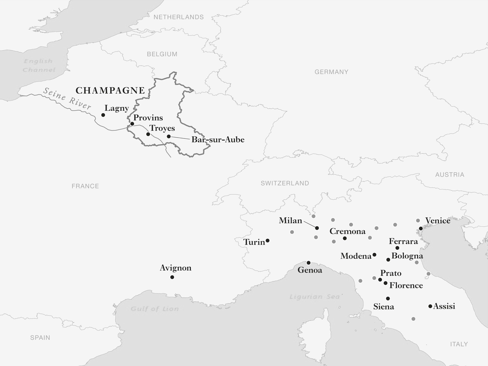

# Allegory of Good Government · 第5章　善政的譬喻

## The Frescoes of Piazza del Campo · 田野广场的壁画

As you enter the famous shell-shaped Piazza del Campo at the heart of Siena, the Palazzo Pubblico looms above you. Construction started in 1297. It was to house Siena’s government, the most powerful body of which was made up of nine consuls. “The Nine” met in a room in the Palazzo, the Sala dei Nove, the Salon of the Nine. The room has windows only on the side that faces the Piazza. On the other walls are three remarkable frescoes, commissioned by the Nine and painted between February 1338 and May 1339 by Ambrogio Lorenzetti. Standing with your back to the light, the first one that comes into focus is the one opposite the windows, the Allegory of Good Government (which you can see in the photography section).

> 当你踏进西恩纳（Siena）市中心著名的贝壳形田野广场时，会看到市政厅高高耸立在眼前，这栋市政厅从一二九七年开始兴建，是西恩纳市政府所在地。市政府由九人执政团组成，是西恩纳的最高权力机构。九人执政团在市政厅的「九人执政团会议室」（Sala dei Nove），这个房间只有面对广场的一侧开有窗户，另外三面墙都画了精美非凡的壁画。壁画是由九人执政团委托安布罗吉欧．罗伦采蒂（Ambrogio Lorenzetti），在一三三八年二月至一三三九年五月间绘成。如果你背对着光线，映入眼帘的第一幅画，是《良善政府的譬喻》（参见书中相片集插页）。

The first detail to catch your eye in this complex work of art is a seated figure to the right who appears to be a ruler or king. He is surrounded by artistic representations of different cardinal virtues: Fortitude, Prudence, and Peace on the left, Temperance, Justice, and Magnanimity on the right. So, a just and magnanimous ruler possibly? It seems odd that the Allegory of Good Government would feature a ruler because Siena didn’t have one in 1338, and the Nine would have undoubtedly disapproved of such a person.

> 这幅繁复的艺术杰作中，最先吸引你注意的是坐着的人，他看来似乎是统治者或国王，他身边围绕着代表不同基本美德的艺术化象征，包括左边的勇敢、明智与和平，以及右边的节制、正义和宽宏。那么，这个人是公正、宽宏的统治者吗？看来很奇怪的是，《良善政府的譬喻》壁画中，居然画了一位统治者。因为一三三八年时，西恩纳并没有统治者，而且九人执政团无疑一定不会赞成这个人的存在。

This mystery is solved by noting that the apparent ruler is wearing black and white, the colors of Siena. At his feet are other symbols of Siena, the wolf and twins, an image appropriated from the founding of Rome by the mythical twins Romulus and Remus, suckled as infants by a wolf. Then look up and above the head of the ruler, and you’ll see the initials C.S.C.V., for the Latin Commune Senarum Civitas Virginis, translated as “The Sienese Commune, the City of the Virgin.” Siena had adopted the Virgin Mary as its patron just before the battle of Montaperti in 1260, when they defeated the Florentines. The ruler in fact represents the commune of Siena.

> 要解开这个谜团，可以注意看看穿着西恩纳代表色──黑白两色──衣服的人，这个人显然才是西恩纳的统治者，他的脚下还有西恩纳的另一个象征──狼和双胞胎，这个象征是借用创建罗马的神秘双胞胎罗穆勒斯（Romulus）和瑞穆斯（Remus）在婴儿时期，是由野狼奶大的意象。此外，擡头看时，你会看到统治者的头上，有C. S. C. V.四个字母的缩写，代表拉丁文的Commune Senarum Civitas Virginis，意思是「西恩纳是圣母之城」，代表西恩纳人在一二六○年的蒙塔佩尔蒂（Montaperti）战役中，击败佛罗伦斯人之前，奉圣母马利亚为保护神的事迹。这位统治者其实就是西恩纳的代表人。

In this fresco we are seeing something very different from the “will to power” and its consequences. Rulers are in the background and the commune, as a representation of society, has come to the foreground. The Sienese also recognized something special about this form of organization as signaled by their emphasis on “good government.” What was distinctive about Siena and the communes that sprang up around the same time all over Italy was a much greater level of liberty. This undergirded a very different economy with broad-based incentives and opportunities paving the way for prosperity.

> 我们在这幅壁画中，可以看到跟「权力意志」及其结果大不相同的东西，统治者放在背景中，代表社会的城市站上前台。西恩纳人也借着对「良善政府」的强调，表示他们承认这种形式的组织具有特殊意义。西恩纳和同期间整个义大利兴起的城市，有一个特别的地方，就是他们的自由程度大为提高，这一点支持一种大不相同、拥有无限诱因与机会、可以为繁荣铺下坦途的经济体。

The notion of a commune seems to have emerged gradually in Italy in the late ninth and tenth centuries as citizens from all over northern Italy began to challenge and overthrow the authority of their ruling bishops, ecclesiastical authorities, and lords (see Map 7). In their place they began to create various systems of republican self-government. We do not have a complete picture of these early days, only fragments. In Modena in 891, for instance, we have a record of a “popular conspiracy” against the bishop. We hear of a similar thing in the same decade in Turin and by 924 in Cremona.

> 第九世纪末叶至第十世纪之间，城市的观念似乎逐渐在义大利出现，起因是整个义大利北部的公民，开始挑战和推翻统治阶层的主教、神职权威和领主（参见地图七），用自己创造的各种共和自治政府起而代之。我们看不到这种早期岁月的全貌，只能看到若干片段；例如，西元八九一年时，我们看到摩德纳（Modena）「聚众反对」主教的纪录。同一个十年里，我们听说杜林发生类似的事情，到九二四年，克雷莫纳（Cremona）重演同样的戏码。

In 997 in Treviso the bishop acted only “with the consent of all the leading men and judges and the whole people of Treviso.” In 1038 the bishop of Brescia made concessions to 154 named men and “the other free men living in Brescia.” The preponderance of ecclesiastical evidence here is probably a consequence of the church’s better record keeping. Lay authority was almost certainly being challenged as well.

> 到了九九七年，特里维索（Treviso）主教行动时，必须「得到所有领导人、法官和特里维索全体人民的同意。一○三八年，布雷西亚（Brescia）主教对一百五十四位有名字的人，以及对「住在布雷西亚的其他自由人」让步。这些事例的证据主要都是教会方面的证据，原因很可能是教会比较善于维护纪录，这时，俗世的权威几乎也一定遭到挑战。

The defining feature of this new form of government was the popular election of consuls to run the city for a given period of time. Pisa in 1085 had twelve such consuls elected by a popular assembly. In Siena we know they were in place a little bit later, in 1125. During this period communes appeared all over northern and central Italy; in Milan in 1097, Genoa in 1099, Pavia in 1112, Bergamo in 1117, and Bologna in 1123.

> 这种新形式的政府有一个明显的特征，就是民选的资政治理本城的时间有一定期限。一○八五时，比萨有十二位由民众大会选举的资政。我们知道，西恩纳的资政在稍微晚一点时就任，时间是一一二五年。在这段期间里，自治城市在整个义大利北部和中部出现，米兰在一○九七年出现，热那亚在一○九九年出现，帕维亚（Pavia）在一一一二年出现，柏加摩（Bergamo）在一一一七年出现，波隆那（Bologna）在一一二三年出现。

Though they were nominally part of the Holy Roman Empire, the de facto autonomy of these communes was recognized by the Peace of Constance in 1183, signed with the emperor Frederick Barbarossa. The treaty even granted the communes the right to build fortifications, perhaps bowing to the inevitable. Barbarossa himself wasn’t too happy about this, but understood the implications of what the communes were attempting for liberty. Bishop Otto of Freising, Barbarossa’s uncle, wrote about Barbarossa’s difficulties in dealing with the communes in The Deeds of Frederick Barbarossa, arguing that

> 名义上，这些自治城市属于神圣罗马帝国，实际上却是皇帝腓特烈一世（Frederick Barbarossa）在一一八三年、签署《康斯坦茨和约》（Peace of Constance）时承认的自治城市。腓特烈一世甚至可能是屈服于不可避免的压力，签署这项合约，授予自治城市兴筑堡垒的权利，他自己对这件事不大满意，却了解自治城市争取自由的涵义。腓特烈一世的叔伯弗莱辛的奥图主教（Otto of Freising），在所撰的《皇帝腓特烈一世史迹》（Deeds of Frederick Barbarossa ）中，谈过腓特烈一世在应付众多自治城市时碰到的困难，认为：

in the governing of their cities . . . and in the conduct of public affairs . . . they are so desirous of liberty that . . . they are governed by the will of consuls rather than rulers . . . And in order to suppress arrogance, the aforesaid consuls are chosen . . . from each of the classes. And lest they should exceed bounds by lust for power, they are changed almost every year. The consequence is that, as practically the entire land is divided amongst the cities . . . scarcely any noble or great man can be found in all the surrounding territory who does not acknowledge the authority of the city.

> 他们在自己城市的治理……在公共事务的运作上，要求极大的自由……以至于各个城市是靠着执政团的意志治理，而非依赖统治者的意志……为了压制傲慢，这些执政官诸公都是从……每一个阶级中甄选，为免他们惑于权力，逾越界限，执政官几乎每年都要换人做。结果是整个领土实际上都由各个城市分据……在所有周遭领土中，难得有什么贵族或大人物不承认城市的权威。

Bishop Otto also understood the connection between the political autonomy and prosperity of the communes since, he continued, from this it has resulted that they far surpass all other states of the world in riches and in power. They are aided in this not only, as has been said, by their characteristic industry, but also by the absence of their princes [i.e., emperors], who are accustomed to remain on the far side of the Alps.

> 奥图主教也了解政治自主和自治市繁荣之间的关系，他继续写道：这样促使这些城市，创造出远超过世界所有国家的财富和权力。正如前文中说过的一样，这些城市不但得到本身特有的勤奋之助，也受惠于天高皇帝远，得到皇帝习于留在远远的阿尔卑斯山脉另一端的好处。

It’s useful to look in detail at what the political institutions of republican Siena looked like at the time of the Nine to get a sense of how communal government worked. The most basic was a popular assembly of all adult male citizens. Though this assembly had atrophied by Lorenzetti’s time, it was still in Siena’s constitution and seems to have met on special occasions, for example, when the new chief magistrate, the Podestà, took office.

> 详细检讨九人执政团时代西恩纳的共和制政治制度，有助于了解自治市政府的运作状况。最基本的政治机构，是所有成年男性公民参加的人民会议，虽然到了罗伦采蒂的时代，人民会议已经萎缩，却仍然揭橥在西恩纳的宪法中，而且似乎在特定场合、例如新的首席执政长官（Podesta）就任时，还会集会。

By the middle of the fourteenth century the role of this assembly had been taken over by a council known as the “Council of the Bell” because it was summoned by the ringing of a bell. This was made up of 300 male citizens, with 100 elected for one year from each of the three main administrative divisions of Siena, known as terzi. The electors for this body were the Nine, the Podestà, and other executive officers of the state including the Chamberlain, the four main treasury officials known as “provisors,” and the state-appointed judges. The main functions of the government were carried out by the Podestà and the Nine, and there were other small groups of consuls representing specific organized interests, particularly the powerful merchant guild and old aristocratic families.

> 到十四世纪中叶，人民会议的角色已经由敲钟召集的「钟声议会」取代，钟声议会由西恩纳的三个行政区各选举一百位、合计三百位任期一年的男性公民组成，选举人团包括九人执政团、首席执政长官、包括内务大臣（Chamberlain）在内的国家其他执政官员、四位称为「供应官」的主要财政官员，以及国家任命的法官。首席执政长官和九人执政团，以及代表特殊利益团体，尤其是强势商人公会和旧贵族家族的其他小型咨议团体，负责执行政府的主要功能。

The Podestà was an interesting institution, common to most of the Italian communes. The title comes from the Latin word potestas, meaning “power.” The office had to be filled by someone from outside Siena, so that he could maintain his independence from the different families and factions of the commune. His duties included judicial functions, and calling and presiding over the Council of the Bell. The Podestà didn’t act alone; he recruited other officials he would need to fulfill his duties.

> 首席执政长官的官衔出自拉丁文的权力（potestas），在义大利大部分自治市很常见，是一种有趣的制度。首席执政长官必须由出身西恩纳以外地方的人担任，以便在西恩纳的不同家族和派系之间保持独立。首席执政长官的职责包括司法功能，以及召集和主持钟声议会，但他并非独自履行职责，因此必须召募他所需要的其他官员。

In 1295, for example, Bernard de Verano came to Siena with seven judges, three knights, two notaries, six squires, and sixty police he brought from his own province. He was initially chosen with a six-month tenure, but by the 1340s the tenure was extended to a year, after which the person was not eligible to act as Podestà again immediately. The next Podestà was selected out of a list of four candidates proposed by the Nine, by a council composed of the Nine, sixty men selected for this purpose, the consuls of the merchant guild, and the knights.

> 以一二九五年的伯纳．戴维拉诺（Bernard de Verano）为例，就是从自己所属的省份，带了七位法官、三位骑士、两位公证人、六位仕绅和六十位警察上任。他最初获选时，任期为六个月，但是到了一三四○年代，任期延长为一年，任期届满后，不能连任。下一任首席执政长官由九人执政团提名四位候选人，交给一个委员会选择，委员会的成员包括九人执政团，以及专为这项选举而选任的六十位男性、商人公会出身的咨议和骑士。

The Podestà was not allowed to receive gifts from citizens or even to eat with them. He could not move more than one day’s travel from the city, and each Podestà in turn had to reside in a different terzo. When his term was over, the Podestà had to remain in Siena for two weeks while an investigation was conducted of his behavior while in office. This often led to heavy fines on the Podestà. The Nine had evolved over time, with the form we now recognize emerging after 1292. Between 1236 and 1271 there had been the “Twenty-Four,” who were followed by the “Thirty-Six.”

> 首席执政长官不得收受公民的礼物，甚至不能跟公民一起吃饭，不能旅行到离开本市超过一天行程的地方。每位首席执政长官都必须轮流住在三个行政区中的一个，任期结束时，必须留在西恩纳两星期，等待西恩纳针对他在职期间的作为进行调查，这种调查经常对首席执政长官科处巨额罚款。九人执政团的制度不断变化，我们现在认得的形式是在一二九二年以后才出现。一二三六年至一二七一年间，出现过「二十四人执政团」，然后又出现「三十六人执政团」。

During the thirteenth century the Sienese had also played with bodies made up of fifteen, nine, eighteen, and six. These numbers always had to be divisible by three because each terzo had to have equal representation. The Nine who commissioned Lorenzetti’s frescoes were chosen at a meeting consisting of the previous Nine, the Podestà, the consuls of the merchant guild, and the Capitano del Popolo (another executive position originally intended to represent the Popolo, the people). After serving in the Nine, which was for a two-month period, a person could serve again only after a break of twenty months.

> 十三世纪期间，西恩纳人也试过十五人、九人、十八人和六人的执政团，这些数字总是必须能够用三除尽，因为每一个行政区都必须拥有平等的代表权。委托罗伦采蒂绘制壁画的九人执政团是在一次会议中选出，与会人士包括前任九人执政团、首席执政长官、商人公会咨议和人民首长（这是原意要代表人民的另一个执行职位）。九人执政团成员的任期为两个月，任期届满后，一定要经过二十个月后，才能再度出任。

What the Nine were supposed to do is summed up by their oath of office. They had to swear to keep the commune of Siena “in good peace and concord,” which sounds very much like a critical aspect of liberty, and also involves the protection of the commune from dominance by the state institutions themselves. Indeed, the oath was quite specific about recognizing that the shackles on the powers of the Leviathan, in this instance represented by the Nine, were crucial for this sort of liberty. Members of the Nine had to make sure

> 九人执政团宣誓就职的誓词可以总结他们的职责，他们必须宣誓保持西恩纳自治市的「良好和平与和谐」，这一点听来非常像自由的一个重要特点，包括免于遭到国家制度宰制的自由。事实上，誓词相当具体地承认，约束九人执政团代表的国家巨灵权力，对维护这种自由至关紧要。九人执政团必须确保：

that law and justice be done and administered to the citizens subject to you and to those persons subject to you without discrimination by your rectors or officials. And that the statutes of your commune and its ordinances be observed for each person who demands it. But there is more. To some degree anticipating our discussion of the role of the Shackled Leviathan in the origins of economic prosperity, the Nine were charged with economic development: You must bring about the increase, growth, and conservation of the city of Siena.

> 法律与正义必须由你的行政主管或官员，一视同仁地施行和适用在受你和手下管辖的公民身上，而且每一位提出这种要求的人，都必须遵守你所治理城市的法规条例。但不只如此，九人执政团也要负责经济发展，这样有点像他们在宣誓时，已经预料到我们会讨论受到制约的国家，必须承担开启经济繁荣的责任那样。你必须为西恩纳市带来增加和成长，必须守护西恩纳。

Compared to dozens of other communes in northern and central Italy, there was nothing special about Siena, except the beautiful frescoes that are so telling about what its institutions were trying to achieve. In some, like Siena at the time of the Nine, the original popular impulse that had created the commune had succumbed to an oligarchic system, with rich families playing an oversized role. In others, more powerful popular assemblies acted as effective counterweights against these oligarchic interests.

> 跟义大利北部和中部的另外几十个自治市相比，西恩纳没有什么特别的地方，特别的地方在于借着他们拥有的美丽壁画，极为有力地说明他们试图透过制度达成的目标。当时西恩纳由九人执政团主政，但是同时期类似西恩纳的某些城市，民众创建自治市的初始冲动，已经屈服在寡头制度之下，富有的家族扮演过度重要的角色。至于其他城市，则有比较强势的民众议会，扮演有效制衡的角色，对抗这些寡头利益团体。

But almost all of these communes had critical features similar to those of Siena. They were republics run by elected consuls or magistrates facing strict limits on their power. Representative bodies, such as popular assemblies and other councils, acted as the shackles on the powers of the state and its executives like the Nine. These bodies were not beholden to any aristocratic or ecclesiastical authority. They were self-governing entities, underpinned by a strong society capable of holding its own against the power of the emerging state, a quality that impressed the traveler Benjamin of Tudela during his passage through Genoa, Lucca, and Pisa around 1165. He noted:

> 然而，几乎所有这些城市都拥有类似西恩纳的关键特征，都是共和国城市，由权力受到严格限制的民选执政官或行政长官治理；人民议会和其他会议等代议团体，扮演制约的角色，制约国家及类似九人执政团等执行官员的权力；这些团体不对任何贵族或教会权威负责，是自治实体，在对抗新出现的国家权力时，得到善于站定脚跟的强大社会支持。这种特性让旅行家图德拉的班杰明（Benjamin of Tudela）在一一六五年前后，旅行路过热那亚、鲁卡（Lucca）和比萨时赞叹不已。他指出：

They possess neither king nor prince to govern them, but only the judges appointed by themselves. You can see exactly this in the Allegory of Good Government. We’ve noted how the ruler to the right is surrounded by six virtues. Interestingly, the one farthest to the left is Peace, putting her right in the middle of the fresco.

> 他们既没有国王，也没有王子治理他们，只靠自己任命的法官治理。你在《良善政府的譬喻》壁画中，看到的就是这种景象。我们曾经指出，画中右边的统治者由六种美德环绕。有趣的是，左边最远处的美德是「和平」，正好放在壁画的正中央。

As the philosopher Quentin Skinner puts it in his discussion of the frescoes, Peace is “at the heart of our common life.” To the left of Peace sits another grand figure, Justice. You can tell because she is holding a scale. From the scale a double rope descends and then passes to the other side of the painting, to the ruler, by way of twenty-four figures representing the Twenty-Four who had previously served as consuls in Siena. The Twenty-Four are given the rope by a seated figure named Concordia—concord—who holds a carpenter’s plane in her lap.

> 哲学家昆丁．史金纳（Quentin Skinner）讨论这幅壁画时表示，和平是「我们日常生活的核心」。和平的左边坐着另一位重要人物「正义」，你可以看出来，是因为她手中拿着天平，天平上垂下一条双股的绳索，然后绳索传过二十四位曾经担任西恩纳执政官的人物，传到壁画的另一边，接上统治者。绳索是由称为「和谐」的坐姿女性，交给这二十四位贤人。

A plane is used to smooth rough edges and create a level surface, possibly signifying the “rule of law”—the fact that in Siena law was supposed to apply equally to everybody. It is significant that the Twenty-Four, who represent society, hold the rope but are not held by it. This seems to signify that rule is granted by society, not to society. Notably, when the double rope gets to the ruler on the other side of the scene, it is knotted around his wrist—the Leviathan is shackled by the rope emanating from Justice.

> 「和谐」的大腿上，放着一具木匠用的刨子，刨子是用来刨平粗糙的边缘，产生平滑的表面，可能意味着「法治」──西恩纳的法律理当一视同仁，适用每一个人的事实。重要的是，代表社会的二十四位贤人拿着绳索，而非被绳索绑住，这样似乎表示统治权是由社会授予，而非获得统治社会的授权。值得注意的是，双股绳索延伸到壁画另一边的统治者时，是在统治者的手腕上打结──代表国家巨灵受到发自正义的绳索绑缚。

Indeed, there were various types of “ropes” to keep the Nine under control. In addition to their very limited two months in office, an official called the maggior sindaco, who like the Podestà was always from outside Siena, could oppose any proposed constitutional change. To pass a measure that the maggior sindaco had opposed required a supermajority of three quarters of the councillors in favor of it and a quorum of at least two hundred councillors.

> 事实上，西恩纳人有各式各样的「绳索」可以控制九人执政团。除了非常有限的两个月任期外，还有一位人称「太上市长」（maggior sindaco），和首席执政长官一样，总是出身西恩纳以外地方的官员，可以反对拟议中的任何宪法修改；要通过太上市长反对的措施，需要至少二百位议员的法定人数出席、得到其中四分之三绝对多数的议员赞成。

It wasn’t just laws and institutions, but also norms that were brought to bear to protect the commune from the Nine and other politically powerful individuals. For example, taking a page from the Athenians who came up with the Hubris Law, you could give politicians that were too big for their britches a “bad name”—literally. Take the Milanese Girardo Cagapisto, who was consul fourteen times in Milan between 1141 and 1180. His name begins with the word caga, or caca, meaning “shit.” Cagapisto means “shit pesto,” as in the Italian pasta sauce.

> 西恩纳不只是靠法律和制度，保护自己不受九人执政团和其他有力政治人士的伤害，也动用到规范。例如，各城市从雅典人推出的《侮慢法》中，学到教训，会为过于自大的政客，加上以文字表示、会遗臭万年的「臭名」。以一一四一年至一一八○年间，在米兰担任过十四次执政官的米兰人吉拉多．卡加匹士德（Girardo Cagapisto）为例，他的姓氏中冠上了表示「狗屎」的caga（卡加）或caca（卡卡）的字头，Cagapisto的意思是「狗屎义大利面酱」。

Other examples of politicians whose names include the word “shit” are the brothers Gregorio and Guglielmo Cacainarca, whose family name means “shit in a box.” Similarly, the name of the consul Arderico Cagainosa, who held office between 1140 and 1144, is translated as “shit in your pants.” Other names of prominent political families include Cacainbasilica, “shit in the church”; Cacarana, “shit a frog”; Cagalenti, or “shit slowly”; and even Cagatosici, which means “toxic shit.” Get too powerful or misbehave, and you risked getting a surname featuring Caca.

> 姓氏中冠上「狗屎」的其他政客包括葛莱格里欧．卡卡伊纳卡（Gregorio Cacainarca）和古格里艾摩．卡卡伊纳卡（Guglielmo Cacainarca）两兄弟，他们的姓表示「盒子里的狗屎」。同样地，一一四○年至一一四四年担任执政官的安德里科．卡加伊诺沙（Arderico Cagainosa）的姓，翻译出来的意思是「拉在你裤子里的狗屎」。其他著名政治家族的姓氏包括卡卡殷巴西利卡（Cacainbasilica），意思是「教会里的狗屎」；卡卡拉纳（Cacarana）表示「拉出青蛙狗屎」；卡加伦蒂（Cagalenti）代表「慢慢拉屎」，甚至还有表示「毒屎」的卡加杜西奇（Cagatosici）。你变得太有权势或行为不当，名字就有冠上「狗屎」的风险。

A few other features of the fresco are noteworthy. At the foot of the ruler, a little to the right, are two kneeling noblemen in armor. They signify the authority of the commune over the aristocracy who too are bound by Justice. Behind them are a group of soldiers carrying lances that may represent the special force that the Nine recruited in 1302 to police the Sienese countryside.

> 这幅壁画还有一些值得注意的其他特点。在统治者脚下略微偏右的地方，有两位穿着盔甲的跪姿贵族，代表自治市的权威超过也必须受到「正义」约束的贵族。两位贵族后面是一群执矛的士兵，可能代表一三○二年时，由九人执政团招募，用来平靖西恩纳乡间的特别部队。

This all sounds very much like liberty from fear (because of Peace), violence (because of Justice), and dominance (because the state and the elite are constrained by laws and popular mandates). At the bottom of the wall are painted words that say as much: Wherever this holy virtue [Justice] rules, She induces to unity many souls; And these, gathered for such a purpose

> 这一切听来非常像（因为有「和平」，因而）免于恐惧的自由，（因为有「正义」，因而）免于暴力的自由，以及（因为国家和菁英受到法律和人民的委任约束，因而）免于遭到宰割的自由。墙壁下方绘制的文字说出了同样的意思：无论此一圣德（正义）统治何方，都会诱引很多人民团结；这些人为了这种目的聚会，

A common good (ben comun) for their master undertake; Who, in order to govern his state, chooses Never to keep his eyes turned From the splendor of the faces Of the virtues which around him stand. For this, with triumph are given to him Taxes, tributes, and lordships of lands;

> 为其主人承担公益；他们为了治理他的国家，选择绝不让他的眼睛移开侍立他身旁众多美德脸庞上的光辉因此，他获得胜利，获得土地的租税、贡品与主权；

For this, without wars, Is followed then by every civil result, Useful, necessary, and pleasurable. There is a significant wordplay in this statement. The common good is associated with the commune. The political form of the commune serves the common good, because the ruler is tied to Justice and indeed it is the citizens who tie together Justice and the ruler. The fresco thus recognizes that it is the rule by society in the commune that makes the commune serve the common good.

> 因此战争止息，带来的内政成果有用、必要而愉悦。这份声明的文字编排具有重大意义，公益和这个自治市结合在一起，因为统治者受到正义的束缚，而且事实上，正是公民把正义和统治绑在一起，自治市的政治形式因此是为公益服务。这幅壁画因此承认，正是自治市受到社会的统治，才使自治市能够为公益服务。

## The Effects of Good Government · 良善政府的影响

In Chapter 2 we stressed how powerful states can provide not only protection against violence and dominance but also public services. We see these critical roles of the state in Siena. The people that the Podestà brought with him were there to enforce laws, resolve conflicts, and provide notary and other business services. In addition, the volumes recording communal expenditures for the first six months of 1257 mention some 860 offices held by the Sienese in the city. These include 171 night watchmen, 114 supervisors of tolls and customs, 103 syndics of the districts, and 90 officials in charge of tax assessments.

> 我们在第二章里强调过，强大的政府不但能够提供保护，对抗暴力和宰割，也能够提供公共服务，我们在西恩纳看到了这种重要的角色，首席执政长官带来的人手到西恩纳来执行法律、解决冲突、提供公证和其他商业服务。此外，记录西恩纳市一二五七年上半年支出的文书提到，市内大约有八百六十个职务，是由西恩纳人担任，其中包括一百七十一位守夜人，一百一十四位收取通行费和关税的官员，一百零三位各区的地方行政官员和九十位负责核课租税的官员。

We also find supervisors of weights and measures, supervisors of grain and salt sales, jailers and hangmen, trumpeters, masons whose job it was to maintain public buildings, and custodians of the fountains. There were also six “good men” who oversaw the taverns and prevented swearing, and another six whose tasks included keeping wild donkeys, swine, and lepers out of the city. Spinning wool in the street was not allowed, and the city imposed a host of other regulations. For example, planning permission was required for any new construction within city walls, and the city even ruled that bricks and tiles had to be made in uniform sizes. We see this proliferation of offices and regulations in other communes as well.

> 我们也发现度量衡监察员、谷物和盐务监察员、典狱官员、刽子手、喇叭手、维护公共建筑的泥水匠和喷泉监督官员。另外也有六位「好心人」，负责监督客栈、防止咒骂，还有六个人负责不让野驴、野猪和痲疯病人进入市内。西恩纳禁止人民在街上纺羊毛，还颁布一堆别的规定，包括城墙内的任何新建筑，都需要取得都市计划上的许可，连要用的砖块和磁砖规格都必须一致。我们发现，这种职官和法规也扩散到其他自治市。

The communes got very good at raising taxes too. After all, someone had to pay for all these officials. They used tax revenues to provide public services as well. Some, like the standardization of weights and measures, are implied by the above list of administrative positions, but there were many others, including a fire department, a stable coinage and monetary system, and the construction and maintenance of roads and bridges. In 1292 Siena had a “judge of the roads” who was soon supplemented by three general road commissioners.

> 这些自治市也变得非常善于征税，毕竟，总是要有人支付所有官员的薪水嘛。自治市也利用税收，提供公共服务，像度量衡标准化等服务，就列在上述行政职务清单中。此外，还有很多其他服务，如消防、稳定的铸币与货币体系、道路桥梁的兴筑与维修，也涵盖在内。一二九二年，西恩纳增设了一位「道路法官」，随后又很快地增加三名一般道路委员作为辅助官员。

To make sure that people could travel in peace, a “scourer of the highways” was appointed, though the office was discontinued as the Nine built a much more elaborate system for the provision of rural order. In order to secure the property and human rights of Sienese merchants wherever they were, the city also organized “reprisals” whereby they retaliated against the merchants and citizens of other polities that had been guilty of infractions against any Sienese. These public services and the support for liberty we see in Siena are unparalleled anywhere outside northern and central Italy during this time. But that wasn’t all that the Sienese state promoted. It provided broad-based incentives and economic opportunities as well.

> 为了确保人民可以安心上路旅行，西恩纳还任命一名「公路清道夫」，但这个职位很快就无疾而终，因为九人执政团创设了复杂得多的制度，提供乡间的秩序。为了保障西恩纳商人到处经商时的财产权和个人权利，西恩纳还组成「报复组织」，针对犯了侵害西恩纳人、但属于其他政体的商人和公民，进行报复。这段期间里，西恩纳的这些公共服务和对自由的支持，在义大利北部和中部以外的任何地方，都无与伦比，但西恩纳的国家机器不仅提倡这些东西，还提供广泛的诱因和经济机会。

To see that you have to turn your gaze toward the right wall of the Sala dei Nove, where Lorenzetti painted another huge fresco, The Effects of Good Government (which is also shown in the photography section). The fresco depicts a panoramic view of city and country life. On the left, the city is teeming with people. In the foreground, a group of women are dancing, but what is most striking is the flourishing economic activity. To the right of the dancers, a shopkeeper is bargaining over some shoes with a man holding a tethered horse.

> 要看出这一点，你得把眼睛转向九人执政团会议室右边的墙壁，罗伦采蒂在上面绘制了另一幅巨大的壁画，名为《良善政府的譬喻》（也请参见相片集插页）。这幅壁画描绘城市和乡间生活的全景，左边是人们熙来攘往的城市，前景中有一群妇女正在跳舞，但壁画中最吸引人的是蓬勃的经济活动，舞者的右边有一位店家，正在跟一位牵着马缰的男性，为一些鞋子讨价还价。

To the right of them a priest gives a sermon and a woman lays out a stall with jars of olive oil, or maybe wine, for sale. A man passes with a mule loaded with firewood. Others are weaving on a loom and tending a flock of sheep. Two women, one with a basket and the other with a bird, are probably on their way to market. Finally, in the far background, two horses laden with goods pass by. At the top of the fresco a construction crew is busy at work adding to the fine towers that stud the skyline.

> 两人的右边有一位教士正在布道，还有一位妇女在摊子上摆放橄榄油罐或葡萄酒，准备贩卖，一个男人牵着一匹担了柴火的驴子走过去，其他人正在纺轮上纺织、照顾羊群。还有两名女性，一位提着篮子，另一位带着一只鸟，很可能是要上市场去。最后，在远处的背景中，有两匹马驮着货物走过，壁画顶端有一名建筑工人，正在指向天际线的精美塔楼上忙着施工。

The right half of the fresco focuses on the effects of good government in the countryside, where we again witness the distinctive economic implications of the Shackled Leviathan and the liberty it creates. Above the depiction of the countryside, the figure of Security holds a scroll that directly links prosperity to liberty: Without fear, let each man freely walk, And working let everyone sow, While such a commune This lady will keep under her rule

> 壁画的右半部把重点放在良善政府在乡间的影响，我们再度看到受到制约的国家巨灵创造的自由，对乡村经济的明显影响，在描绘乡村景象的上方，代表保安的人物拿着一张羊皮纸卷，上面的文字直接把繁荣和自由连结在一起：无畏无惧，人人自由行走，每个人忙于工作和播种，女神会把这种自治市，置于统治之下，

Because she has removed all power from the guilty. The fresco depicts a scene that is consistent with these sentiments. In the foreground, we see peasants hard at work in front of a bountiful field of wheat. A hunting party exits the city gates on a paved road, while in the other direction merchants are bringing their wares and a pig for sale. In the background other people are sowing, harvesting, and threshing grain. All is peaceful and prosperous amid the well-tended fields and houses.

> 因为她移除了所有的威权罪行。这幅壁画描绘的景象和这些情绪十分吻合。我们在前景中，可以看到农夫正在丰收的麦田前面努力工作，一队狩猎队伍从铺平的马路上走出城门，另一端的商人正带着货物和猪只，准备去贩卖。背景处的其他人正在播种、收成和脱壳，一切的一切都在照顾良好的田野和屋宇间，呈现和平、繁荣的景象。

The message is clear: Among the many benefits of good government is economic prosperity. Is that right or was Lorenzetti just making it up? Was there really a connection between communal government and economic development?

> 其中的讯息很清楚：经济繁荣是良善政府众多好处中的一种，这一点是否正确？或者只是罗伦采蒂编造出来的东西？自治市政府和经济发展之间真的有关系吗？

## How Saint Francis Got His Name · 圣法兰西斯如何得名

The life of one of the most famous saints of the Middle Ages, Saint Francis of Assisi, provides some of the answer to this question. Francis, renowned for his love of animals and nature, bequeathed to posterity one of the great images of Christian worship, the Christmas nativity scene. The “of Assisi” bit of his name came from the commune in central Italy where he was born, probably in 1182.

> 中世纪最著名圣徒阿西西的圣法兰西斯（Saint Francis of Assisi，又译圣方济）的一生，为这个问题提供了一部分答案。法兰西斯以热爱动物和自然闻名，留给后世的圣诞节基督诞生景象，是基督崇拜中最伟大的意象之一。他名号中的「阿西西」源自他诞生的义大利中部自治市，出生年可能是一一八二年。

The name Francis is a bit more puzzling. When he was born, Francis was called Giovanni di Pietro di Bernardone. So where did Francis come from? Francis’s father, Pietro di Bernardone, a prosperous silk merchant, was in France on business when Giovanni was born. Pietro had married a woman from Provence, Francis’s mother, Pica de Bourlemont. Upon his return to Assisi, Pietro took to calling his son Francesco (“the Frenchman”), perhaps as a sign of his love for France.

> 法兰西斯的名字却让人有点困惑，他出生时，取名乔凡尼．伯多禄．伯纳多内（Giovanni di Pietro di Bernardone），这么说来，法兰西斯的名字到底从何而来？法兰西斯的父亲叫伯多禄．伯纳多内，是个生意兴隆的丝绸商人，儿子出生时，他正在法国做生意。他太太是出身法国普罗旺斯的庇卡．戴布勒蒙（Pica de Bourlemont），她丈夫回到阿西西时，开始叫儿子法兰西斯可（Francesco，法国人的意思），这点可能代表他对法国的热爱。

That love appears to have been related to Pietro’s business in France. In 1174, a mere eight years before Francis’s birth, Italian merchants had taken part for the first time in the “Champagne fairs” of northern France (see Map 7). These fairs were held six times a year and rotated among four towns in the county of Champagne: Bar-sur-Aube, Lagny, Provins, and Troyes. Each of the fairs usually lasted for six weeks, after which there was a pause that allowed merchants to move to the next town. In consequence, the Champagne fairs turned into a marketplace that was open nearly all year round.

> 这份热爱似乎跟他在法国的生意有关。法兰西斯诞生前才八年的一一七四年，很多义大利商人第一次到法国北部，参加「香槟交易会」（参见地图七）。香槟交易会每年举办六次，轮流在香槟县的奥布河畔巴尔（Bar-sur-Aube）、拉格尼、普罗万（Provins）和特鲁瓦四个城镇举行，每次会期通常是六星期，然后休息，让商人前往下一个城镇，香槟交易会因此变成几乎全年开放的市集。

There were several things that were special about Champagne that made it a magnet for trade. One was its location: it became the meeting point for merchants from all over France and then began attracting merchants from the booming cities of Flanders and the Low Countries. The most important advantage of Champagne came from its economic institutions that massively facilitated trade. For one, counts of Champagne recognized a good thing when they saw one.

> 香槟区有好几个特点，因此善于吸引交易。特点之一是地点适中，变成能够吸引法国全境的商人来这里聚集，然后开始吸引法兰德斯和低地国家繁荣发展城市的商人。香槟区最重要的优势来自极度便于贸易的经济制度，例如历代香槟伯爵看到好东西时，都能辨认出来。

When in 1148 money changers from Vézelay were robbed on their way to the Provins fair, Count Thibault II wrote to the regent of France demanding that the money changers be compensated. “I will not let take place with impunity such an injury, which tends to nothing less than the ruin of my fairs.” Count Thibault liked fairs because he could tax them. No merchants, no tax revenue. By the 1170s the local counts had begun appointing special “fair-wardens” with policing, regulatory, and judicial powers at the fairs to create an attractive institutional environment.

> 一一四八年时，有一位委瑞莱（Vezelay）的汇兑商前往普罗万的交易会时，在路上遭到抢劫；提波伯爵二世（Count Thibault II）致函法国摄政王，要求赔偿这位汇兑商，他写道：「我绝不容许发生这种肆无忌惮的伤害，这种事件的严重性，绝不亚于毁掉我的交易会。」提波伯爵喜欢这个交易会，是因为可以抽税，没有商人，就没有税收。到一一七○年代，本地的几位伯爵开始任命特别的「交易会监察官」，赋予他们维持交易会秩序、管制和司法权限，创造出很有吸引力的制度环境。

It was likely this innovation that induced the Italians, Pietro di Bernardone among them, to venture over the Alps to the fairs. But it wasn’t just the counts that got involved. Three of the Champagne towns, Provins, Bar-sur-Aube, and Troyes, had privileges as communes themselves, entitling them to operate municipal courts during this period. These courts enforced contracts and mediated trade disputes. These initial institutional innovations focused on providing basic order and security, and judicial services such as the resolution of disputes. As the Italians got more involved in the fairs, the innovations stretched all the way to Italy.

> 可能就是这种创新，吸引包括伯纳多内在内的义大利商人，冒险翻越阿尔卑斯山脉，前来参加交易会。但是，并非只有几位伯爵参与其事，香槟区的普罗万、奥布河畔巴尔和特鲁瓦因为是自治市，都有特权，可以在交易会期间，开设市立法院，依法执行合约、调解交易纠纷。起初的制度创新注重提供基本的秩序与安全，以及解决纷争等司法服务，随着义大利人加强参与交易会，这些创新一路传播到义大利。

In 1242–1243, a group of Italian merchants on their way to the Champagne fairs were kidnapped and robbed by Piacenzans. This is not what the count of Champagne wanted to see. He wrote to the Piacenzan authorities threatening to ban all merchants from Piacenza from trading in Champagne unless the victims were paid due compensation. After problems of order and dispute were addressed, the local authorities got more ambitious and started to improve the roads and to build a canal between the Seine and Troyes.

> 一二四二年至一二四三年间，一群义大利商人在前往香槟交易会的路上，遭到皮亚琴察（Piacenza）地方的人绑架和抢劫，香槟伯爵自然不乐见此事，就致函皮亚琴察当局，威胁要禁止皮亚琴察的所有商人，参与香槟区的交易，除非受害者得到应有的赔偿。秩序和纷争的问题解决后，地方当局变得更有雄心壮志，开始改善道路，并在塞纳河和特鲁瓦之间，兴建一条运河。

The Champagne fairs are one of the most famous examples of the so-called commercial revolution of the Middle Ages. The Italian communes were right at the heart of this. That wasn’t a coincidence. The communal system of government created laws and economic institutions that allowed trade and economic activity to take off after the slump that followed the collapse of the Western Roman Empire in the late fifth century. Italy was well placed to benefit from this flourishing. In the east and the south were the Byzantine Empire and the new Muslim states, which we encountered in Chapter 4, supplying Eastern spices and many luxury goods. In the north were England and Flanders. England produced the highest-quality wool, Flanders the most sought-after textiles.

> 香槟交易会是中世纪所谓的商业革命中最著名的例子之一，义大利自治市处在这场革命的中心并非巧合，自治市的政府制度创造了法律和经济制度，促使贸易和经济活动起飞，扭转了五世纪末叶西罗马帝国灭亡以来、经贸活动式微的局面。义大利高高地处在从这种繁荣发展中受惠的地位，义大利的东方和南方，是供应香料和很多奢侈品的拜占庭帝国，以及我们在第四章中看到的穆斯林新国家；义大利的北边是英格兰和法兰德斯，英格兰生产最高品质的羊毛产品，法兰德斯生产最受欢迎的纺织品。

The stage was set for a huge system of exchange: wool and cloth for luxuries and spices. Southern Italy—by the mid-twelfth century ruled by Norman kings—and Spain were also well placed, but did not have communal governments. So neither took over the trade the way that communal northern and central Italy did. This had a lot to do with how the communes promoted the institutions necessary for trade.

> 庞大的交易系统已经灿然大备；毛料和布匹交换奢侈品和香料的交易盛行。十二世纪中叶由诺曼人国王统治的义大利南部和西班牙也据有优越地位，却没有自治市政府，因此都不能像义大利北部和中部的自治市一样，承接这种贸易，这点和自治市提倡推展贸易所需的制度大有关系。

This is obvious when we look at the financial innovation that was so critical for trade. Here the Italian communes led the way. As their economic activities spread around Europe, they set up bases in all the places they traded. More important, they invented the bill of exchange, which became the prime method to organize medieval commerce. Imagine that a Florentine cloth manufacturer wanted to buy high-quality Norfolk wool in England. He could travel to England with some sacks of Italian ducats, find someone in London to exchange them for pounds, buy the wool, and ship it back. Alternatively he could use a bill of exchange.

> 我们看看极为攸关贸易的金融创新，就知道这点十分明白。义大利自治城市在这方面领导群伦，义大利人散布欧洲全境后，在所有从事贸易的地方设立据点，更重要的是，他们发明的汇票变成了安排中世纪商业的主要方法。想像一位佛罗伦斯布匹制造商希望购买英格兰诺福克的高品质羊毛，他可以带着几袋义大利的达克特金币（ducat）前往英格兰，到伦敦找到什么人，把达克特金币换成英镑，购买羊毛，再运回义大利。反之，他也可以利用汇票。

In the standard terminology, there are four parties to such a bill: the remitter, here the cloth manufacturer; the drawer, which would be the remitter’s bank in Florence; the drawee, which would be the corresponding bank of the Florentine bank in England; and the payee, the wool merchant in London whom the cloth manufacturer wanted to buy wool from. In Florence, the remitter would give ducats to the drawer to buy the bill. He would then send the bill to the payee in London, who could take the bill to the drawee and get English pounds for it. Then the payee would ship the wool to Florence. The bill that was bought with ducats in Florence would specify the amount in pounds to be paid in London.

> 在标准的术语中，汇票涉及四方面：一是汇款人──这里的汇款人是布匹厂商；二是开票人，即汇款人在佛罗伦斯的银行；三是受票人，即佛罗伦斯银行的英格兰联行；四是受款人，即布匹厂商希望购买羊毛的伦敦羊毛商人。汇款人会把达克特金币交给佛罗伦斯的开票人，购买汇票，然后把汇票寄给受款人；受款人可以拿着汇票，换得英镑，然后把羊毛运往佛罗伦斯。汇票上会注明在佛罗伦斯用达克特购买的汇票，在伦敦要支付多少英镑。

The Florentine bank didn’t even need to have a branch in London; it just needed to be able to deal with another bank that did. The presence of the international bank and the bill of exchange massively facilitated international transactions. Implicit in a bill of exchange is a loan. The cloth manufacturer had to wait before getting his wool, and he was in effect lending money to the London wool merchant. This was compensated by the payment of “interest,” even if this wasn’t always called interest and implemented instead via the use of different exchange rates. For example, say the cloth manufacturer wanted to buy 100 pounds’ worth of wool in London and at the exchange rate in Florence this involved a payment of 1,000 ducats.

> 佛罗伦斯这家银行甚至不必在伦敦设有分行，只需要能够跟承作这种业务的另一家银行打交道。国际银行和汇票出现，大大促进了国际交易。汇票是一笔暗示性的贷款，布匹厂商必须等待一段时间，才能拿到羊毛；实际上，他等于是借钱给伦敦的羊毛商人，借钱给别人必须靠着「利息」的支付，得到补偿，即使这种补偿并非总是叫做「利息」，即使补偿是透过不同的汇率来支付；例如，布匹厂商希望在佛罗伦斯，以付出一千达克特的汇率，购买价值一百英镑的伦敦羊毛，然后在伦敦以较低的汇率，把汇票换成英镑，这样的补偿仍然是利息。

Then a lower exchange rate was used in London to convert the bill into pounds. Innovative Italians soon created a new credit instrument, the “dry exchange,” wherein the movement of goods became irrelevant and the use of different exchange rates was specified in advance. The notion of a dry exchange sounds innocuous. But it was edgy because lending for interest was viewed as usury and was one of the many economic activities discouraged or even banned by the norms, customs, and beliefs of medieval Europeans. Jesus had said in the Gospel of Saint Luke, “Borrow and lend freely, hoping for nothing in return.”

> 善于创新的义大利人很快地又创造了一种新的信用工具，叫做「虚式汇票」（dry exchange），这种汇票跟货物的运送毫不相关，而且适用的不同汇率会事先注明。「虚式汇票」的观念听来没有不好，却很先进，因为大家认为借钱收利息是放高利贷，是中世纪规范、习俗和欧洲人信仰中劝阻、甚至禁止的多种经济活动中的一种。耶稣在《路加福音》中说过：「借钱给人，也不期望收回。」

Church doctrine therefore interpreted the charging of interest on loans as sinful usury. This was a major problem for the development of an effective financial system. It’s natural that some people possess capital and wealth and others do not. But these others could be the ones who have the ideas or investment opportunities. A functioning financial system would allow the people with money to extend credit to those with the ideas. Interest is the return that encourages such transactions to take place and compensates the lender for forgoing other opportunities and for the risk of nonpayment. Blocking interest on lending on the basis that it was a sin would stall the development of a financial system.

> 因此，教会教义把贷款收取利息视为罪恶的高利贷，这是有效金融体系发展的主要问题。有些人拥有资本和财富，有些人没有，这种事情很自然，但这些人可能很有构想或投资机会，有效的金融体系应该让有钱的人，提供信用贷款给有好构想的人；利息是鼓励这种交易能够发生的报酬，是补偿借方放弃其他机会，甘冒无法收回借款风险的利益。以放款生息是罪恶为名，阻止贷款付息的想法会妨碍金融体系的发展。

Part of the commercial revolution in Italy was to use innovations like dry exchange to enable lending and credit, but without it risking being condemned as sin and usury. The Church still maintained that it was, but such innovations allowed this one important aspect of the cage of norms to be relaxed, opening the way for significant growth in investment and commerce. It wasn’t just the innovative Italians who thought of going around the cage of norms. As life in the corridor evolved, restrictions on social and economic freedoms became harder to sustain. Even the Church began to relax the cage a little.

> 义大利商业革命的一环是利用虚式汇票等创新，促成贷款和信用，却无须冒着遭到谴责为罪恶和放高利贷的风险。教会仍然认为这样是罪恶和放高利贷，但这种创新让规范牢笼中的重要层面得以放宽，开启了投资和商业得以重大发展的坦途。随着自由窄廊中的生活变化，和社会与经济自由有关的限制也变得愈来愈难以维持，不仅善于创新的义大利人想要绕过规范牢笼，连教会也开始略微放宽规范牢笼。

Saint Thomas Aquinas, for example, allowed a debtor to pay “compensation” to a creditor in some circumstances, and this proved to be a flexible justification for interest-like payments. This relaxation of the cage of norms also became a significant source of comparative economic advantage for the Italians, who began to play the role of financial intermediary throughout Europe. The institutional environment of the Italian communes was critical for all of this. Elsewhere, the same activities were not as welcome. In 1394, for example, the king of Aragon was threatening to put on trial all the Italian merchants in Barcelona on the grounds that they were engaging in usury. Italians led the way with other innovations.

> 例如，圣阿奎那（Saint Thomas Aquinas）就容许债务人在某些情况下，支付「补偿」给债权人，事后证明这是以弹性支付利息的好理由。规范牢笼的松绑也成为义大利人在全欧洲扮演金融仲介、获得相对经济优势的重要来源，义大利自治城市的制度环境攸关这一切发展，其他地方却不是这么欢迎同样的行动。例如，一三九四年时，亚拉冈（Aragon）国王就发出威胁，说要把巴塞隆纳的所有义大利商人，以从事高利贷为由，交付审判。

They invented mercantile insurance, allowing a third party to take on the risk of trade. They also developed many different contractual forms that facilitated trade. One was the commenda, a temporary partnership between two people, one who provided the capital for a trading mission and another who undertook the mission. When the mission was over, the two partners split the proceeds. The commenda was another way in which usury laws could be evaded. Italians also invented long-lived organizational forms that were precursors to the joint stock company, allowing people who were not actively involved in the actual business to put up capital and earn returns in the form of dividends.

> 义大利人在其他创新上也领先群伦，他们发明了商业保险，让第三方承担贸易风险；他们也发展出很多促进贸易的不同合约形式，其中一种是称为「康曼达」（commenda）的两人暂时性隐形合伙，其中一人负责为贸易任务提供资金，另一人从事贸易任务，任务结束后，两位伙伴才分配收益。康曼达是规避高利贷法的另一个方法。义大利人也发明了股份公司前身的长期性组织形态，容许不积极参与实际业务的人提供资本，然后以股息的方式，赚取投资报酬。

Also important was a new emphasis on written legal documents defining property rights and the use of notaries. In the 1280s, in cities like Milan or Bologna, there were twenty-five notaries for every thousand inhabitants. All of this trade needed advanced accounting practices. It’s not a coincidence that it was an Italian from Pisa, Leonardo Fibonacci, who revolutionized accounting by adapting the Arabic numerical system in 1202. This made financial calculations much more straightforward. By the middle of the fourteenth century, double-entry bookkeeping appeared in Italy for the first time.

> 同样重要的是，义大利人开始强调界定财产权的书面法律文件、同时开始重用公证人；一二八○年代时，米兰或波隆那等都市里，每一千个居民中，就有二十五位公证人。所有贸易都需要先进的会计做法，推动会计革命的人是比萨居民李奥纳多．费坡纳契（Leonardo Fibonacci）并非巧合。一二○二年，费坡纳契采用阿拉伯数字系统，彻底改革会计做法，使财务计算变得更加简易。到十四世纪中叶，复式簿记首次在义大利出现。

The commercial revolution went along with a great deal of economic growth and stimulated innovation outside the financial sector too. Though we don’t have enough evidence to construct national income accounts for this period of history, we can proxy economic development by the extent of urbanization—the fraction of the population living in cities of at least 5,000 people. Urbanization in Western Europe doubled from about 3 percent in 800 at the start of the commercial revolution to 6 percent in 1300.

> 商业革命在重大经济成长的配合之下，也刺激了金融部门以外的创新。虽然我们没有足够的证据，编制这段历史期间的国民所得帐，却可以拿都市化的程度──住在五千人以上都市的人口比率──代表经济的发展程度；在商业革命开始时的西元八百年，西欧的都市化比率为百分之三；到一三○○年，已经倍增为百分之六。

The rise was much more rapid in the places that were heavily involved in this revolution. For Italy in general it increased from 4 to 14 percent over the same period. But this included the south of Italy, which did not experience the flourishing of commerce and communes. The urbanization rate in northern Italy was undoubtedly much higher and has been estimated at 25 percent in Tuscany. Elsewhere, in Flanders and the Low Countries, urbanization increased from about 3 to 12 percent by 1300 and then to a remarkable 23 percent by 1400. The dynamism of the urban communes is driven home by looking at their relative population size in a wider European context.

> 深入参与这场革命的地方上升速度快得多，同一期间里，整个义大利的都市化比率从百分之四，上升到百分之十四，但其中包括没有经历商业和自治市繁荣发展的义大利南部；毫无疑问的是，义大利北部的都市化速度更高，一般估计，托斯卡尼的都市化程度约为百分之二十五。诸如法兰德斯和低地国家等地方，到一三○○年时，都市化比率已经从大约百分之三，升到百分之十二；到一四○○年，更升到高达百分之二十三之多。在广大欧洲的背景下，观察自治市都市的相对人口规模，更能透彻了解这些自治市的动能。

In 1050 only one of them, Florence, which had a population of just 15,000 people, featured among the thirty largest cities in Europe. By 1200 Florence’s population had increased by 400 percent to 60,000 and it had been joined on this list by Bologna, Cremona, Ferrara, Genoa, Pavia, and Venice. By 1330 fully one-third of all of the thirty largest cities in Europe were Italian communes, with the most populous being Venice with 110,000 people, followed by Genoa and Milan, both with 100,000. Siena had a population of 50,000 at this date. Only Paris and Granada, the capital of the highly urbanized Muslim Spain, had larger populations than Venice, Genoa, and Milan.

> 一○五○年时，只有佛罗伦斯一个自治市的人口，刚刚达到一万五千人，是欧洲第三十大都市；到一二○○年，佛罗伦斯的人口增加了四倍，达到六万人；另外，波隆那、克雷莫纳、菲拉拉、热那亚、帕维亚和威尼斯也加入这张都市清单中。到一三三○年，欧洲三十大城市中，整整有三分之一是义大利的自治市，其中人口最多的自治市是威尼斯，人口达到十一万人；其次是热那亚和米兰，两个城市的人口都是十万人；这时，西恩纳的人口为五万人。只有巴黎和高度都市化的穆斯林西班牙的首都格瑞那达（Granada），人口数超过威尼斯、热那亚和米兰。

Another sign of economic growth can be seen in a critical input of economic activity, education, and skills of the workforce. This seems to have increased dramatically in northern Italy during this period. For example, the New Chronicles, a fourteenth-century history of Florence written by Giovanni Villani, estimates that in early-fourteenth-century Florence there were about 8,000 to 10,000 boys and girls receiving elementary education and another 550 to 600 in higher education, while another 1,000 to 2,000 attended schools designed to impart commercial skills.

> 从劳动力的教育与技术水准这个经济活动的重要投入因素中，也可以看出经济发展的另一个征象。这段期间里，义大利北部的这种水准似乎急剧升高。例如，乔凡尼．卫拉尼（Giovanni Villani）撰写的佛罗伦斯十四世纪历史《新编年史》（New Chronicles ）中，估计十四世纪初期，佛罗伦斯大约有八千到一万名学童，正在接受小学教育，另有五百到六百名学生正在接受较高等的教育，还有一千到二千名学生，正在上意在传授商业技巧的学校。

If this was the typical situation, then as much as half of Florence’s population in this period could have attended some type of formal school. The Florentine Catasto of 1427, a comprehensive survey of the population, suggests that seven out of ten adult males could read and write—a remarkably high number for this era. An estimate for Venice in 1587 suggests that 33 percent of boys were literate.

> 如果这是典型的状况，那么这段期间里，多达一半的佛罗伦斯人口，可能都上过某种形式的正式学校。一四二七年的《佛罗伦斯地籍登记》（Florentine Catasto ）是人口普查报告，报告中指出，十分之七的男性能够读写；以这段期间而言，是高得惊人的数字。一五八七年威尼斯所做的一项估计指出，有百分之三十三的男童识字。

The spread of literacy and economic development is also illustrated by the data on book production. In the ninth century only 10 percent of the 202,000 books produced in Western Europe were from Italy. By the fourteenth century, Italy was Western Europe’s biggest book producer, accounting for 32 percent of the European total of 2,747,000 books. Italy also had more universities than any other part of Western Europe, 39 percent of all European universities by the fourteenth century.

> 从书籍印制资料，也可以看出识字率和经济发展的普及。九世纪时，西欧印制的二十万二千本书籍中，只有百分之十由义大利印制；到了十四世纪，义大利已经变成西欧最大的书籍生产国，在欧洲二百七十四万七千本书的印书总量中，占到百分之三十二。义大利的大学数量也超过西欧所有地方，十四世纪时，欧洲所有大学中，有百分之三十九的大学，设在义大利。

We find broader improvements in technology in this period as well, some of them critical to the commercial revolution, such as improvements in ship design with the spread of the sternpost rudder (whereas before ships were much less effectively steered by oar, as they had been since Roman days). Also produced in Italy were the first pair of spectacles, the first mechanized textile mill, in Lucca, to produce silk cloth, and the mechanical clock of Giovanni de Dondi built in the 1360s, though it is clear from his writings that clocks had existed for quite a while by then.

> 我们发现这段期间里的科技也普遍改善，其中有些科技攸关商业革命，随着船尾舵普及而来的船舶设计就是例子（以前的船舶因为靠着罗马时代以来就有的船桨操纵，效率差得多）。最先在义大利生产的东西也包括第一副眼镜、设在卢卡的第一座机械化丝绸纺织厂，以及乔凡尼．东迪（Giovanni de Dondi）在一三六○年代制造的机械钟，不过从他的记载中可以清楚看出，这些钟这时已经存在相当长的一段时间了。

## The First Cat in the Canary Islands · 加纳利群岛的第一只猫

One of the remarkable achievements of the communes was a high rate of social mobility. A famous example is Francesco di Marco Datini. A story from his hometown, the commune of Prato in Tuscany, gives one account of how he first became commercially successful. In the days—so the legend runs—when the adventurous traders of Tuscany were sailing to far lands, a merchant of Prato came to a remote island called the Canary Isle; and there the king of the island invited him to dinner.

> 自治城市的惊人成就之一是很高的社会流动性，法兰西斯科．达蒂尼（Francesco di Marco Datini）是一个著名的例子，从他的故乡托斯卡尼的普拉托（Prato）自治市传出来的故事，说明了他如何创造第一次的商业成就。传说指出，托斯卡尼贸易商冒险航行到遥远岛屿的时代里，有一位普拉托的商人来到人称「加纳利岛」（Canary Isle）的遥远海岛；岛上的国王邀请他共进晚餐。

And the merchant saw the table laid with napkins, and on each of them a club as long as his arm, and he could not fathom its purpose. But having sat down at the table, and the viands having been brought in, the odour thereof brought forth a great abundance of mice, who must perforce be chased away with those clubs, if the guests wished to eat . . . And the next day, having returned at night to his ship, the merchant came back with a cat up his sleeve. And when the viands came, the mice also appeared; and the merchant brought the cat out of his sleeve, and she speedily killed twenty-five or thirty mice, and the others ran away.

> 这位商人看到餐桌上铺着餐巾，每张餐巾旁放了一支像他手臂一样长的棍棒，他想不出这种棍棒有什么用途。但是，他一坐定，食物送上来后，食物的气味吸引来一大群老鼠，客人如果想吃东西，一定得拿起棍子，把老鼠赶走……晚上他回到船上。隔天，他再去王宫时，就在袖子里藏了一只母猫。食物端上来时，老鼠也成群出现；这位商人把猫从袖子里放出来，猫很快地就捕杀二十五至三十只老鼠，其他老鼠则逃之夭夭。

“This animal is divine!” cried the king. Whereupon the merchant replied: “Sire, your courtesy to me has been so great that I can only return it by bestowing on you this cat.” The king gratefully accepted the gift, but before the merchant left the island, he sent for him again and presented him with jewels worth 4,000 scudi. And the following year the merchant came back again to the island, taking with him a tom-cat—and this time received a further 6,000 scudi. The merchant of Prato came home a rich man; and his name was Francesco di Marco Datini.

> 「这是神兽！」国王喊道。这位商人回答说：「陛下，你的招待盛情之至，我只能献给你这只猫作为报答。」国王感激地接受这份礼物，但在这位商人离开这座岛屿前，国王再度邀他进宫，还送他价值四千盾（scudio）大银币的珠宝。隔年，他带着一只公猫重返该岛，另外获得六千盾银币的报酬。普拉托的这位商人满载而归，变成有钱人，他的名字就叫做达蒂尼。

It’s probably not true that this is how Datini got rich. In fact there is no existing record that he ever went to the Canary Islands. What we do know is that he was born the son of a poor taverner, probably in 1335. When he was just thirteen years old, the Black Death (the bubonic plague) struck Italy, and his mother and father as well as two of his siblings perished. Only he and his brother Stefano were left, and there was a little inheritance, a house, a small piece of land, and 47 florins.

> 达蒂尼致富的故事很可能不大正确，事实上，现存的纪录中，没有他到过加纳利群岛的记载。我们知道的是，他很可能是在一三三五年出生，父亲是贫穷的客栈老板，他才十三岁时，黑死病（鼠疫）侵袭义大利，造成他父母和两位手足去世，只有他和史帝芬诺幸存下来，继承的财产不多，包括一栋房子、一小块地和四十七个佛罗林（florin）金币。

About a year after his father’s death, Datini moved to Florence, got an apprenticeship with a shopkeeper, and began to hear stories about the prosperous city of Avignon in the south of France. Between 1309 and 1376, the pope lived in Avignon rather than Rome because of a succession dispute, and the presence of the papal court created a vibrant market where Italian traders flourished. Most of the luxury trade and banking were dominated by some six hundred Italian families who lived in their own quarter of the city.

> 他父亲去世一年后，他搬到佛罗伦斯，跟着一位商店老板当学徒，开始听到法国南部富庶城市亚维农的故事。一三○九年至一三七六年年间，因为继承纠纷的关系，教宗住在亚维农，而非罗马，教廷的存在创造了活力十足的市场，让义大利贸易商得以大发利市。亚维农的义大利区里，住了大约六百个义大利家族，他们主导了大部分奢侈品交易和银行业务。

Soon after his fifteenth birthday Datini sold his little plot of land in Prato to raise some capital and move there. By 1361, at the age of twenty-six, we find him in partnership with two other Tuscans, Toro di Berto and Niccolò di Bernardo. Initially he dealt mostly in armor and seems to have done well selling to both sides of local conflicts. In 1368, for example, his books record a sale of arms worth 64 livres to Bernard du Guesclin, the French military commander, and in the same year an extensive sale of weapons to the commune of Fontes, trying to protect itself from the same Guesclin.

> 达蒂尼过了十五岁生日后，很快地把他在普拉托的小块土地卖掉，筹到一些资金，搬去亚维农。到一三六一年，他二十六岁时，我们发现他跟另两位托斯卡尼人托洛．贝尔托（Toro di Berto）和尼科洛．伯纳多（Niccolò di Bernardo）合伙，初期以买卖盔甲为主业，而且似乎跟当地互相冲突的双方，都做成不少生意；例如，他的帐簿记载：他在一三六八年时，卖给法国军事指挥官伯纳．盖克兰（Bernard du Guesclin）一笔价值六十四利弗尔银币（livre）的武器；同年里，他也卖出大量武器；给努力自保、防御盖克兰攻击的丰泰（Fontes）自治市。

Before this, in 1363, Datini had his first shop, bought for 941 gold florins, with another 300 paid for the “customers’ goodwill.” In 1367 he renewed his partnership with Toro di Berto, each putting in a capital of 2,500 gold florins, and they now had three shops. In 1376 he began to trade in salt, and launched himself into the money-changing business as well as trading in silverware and works of art. He opened a wine tavern and a draper’s shop, and started to send his people farther afield, for example to Naples, to trade.

> 在此之前的一三六三年，达蒂尼花了九百四十一个佛罗林金币，外加三百佛罗林金币，购买「顾客的商誉」，开设自己的第一家店铺。一三六七年，他和贝尔托的合伙契约重新续约，两人各拿出二千五百佛罗林金币的资本，他们现在拥有三家店铺了。到了一三七六年，他开始交易食盐，也开始投入货币汇兑业务，而且开始经营银器和艺术品贸易。他也开了一家酒馆和一家布店，而且开始派遣员工，前往那不勒斯等更遥远的地方从事贸易。

At this point his main shop in Avignon contained Florentine silver belts and gold wedding rings, leather hides, saddles and mules’ harnesses from Catalonia, household goods from all over Italy, linen from Genoa, fustian from Cremona, and scarlet zendado, a special cloth from Lucca. His store in Florence emerged as an active hub of manufacturing by this time and contained white, blue, and undyed woolen cloth; sewing thread and silk curtains and curtain rings; tablecloths, napkins, and large bath towels; and hand-painted coffers and jewel cases used as part of a bride’s dowry.

> 这时他在亚维农的主要店面里，摆满了佛罗伦斯的白银腰带和黄金婚戒、皮革、卡塔隆尼亚的鞍具和驴子的挽具，全义大利来的居家用品、热那亚的亚麻布、克雷莫纳的绵和亚麻混纺布料、卢卡的特殊布料猩红森达德绢绸（scarlet zendado）。这时，他在佛罗伦斯的商店已经变成业务兴隆的制造中心，放了白色、蓝色和未染色的毛料、缝纫线、丝织窗帘、窗帘环、桌布、餐巾和大浴巾，还有手绘的金库，以及作为新娘嫁妆一部分的珠宝盒。

When he returned from Avignon in 1382, he set up a business enterprise based in Prato and Florence with branches in Pisa, Genoa, Barcelona, Valencia, Majorca, and Ibiza. Between these different emporia sailed iron, lead, alum, slaves, and spices from Romania and the Black Sea; English wool from Southampton and London; wheat from Sardinia and Sicily; leather from Tunis and Córdoba; silk from Venice; raisins and figs from Málaga; almonds and dates from Valencia; apples and sardines from Marseille; olive oil from Gaeta; salt from Ibiza; Spanish wool from Majorca; and from Catalonia oranges, olive oil, and wine. His business documents have letters in Latin, French, Italian, English, Flemish, Catalonian, Provençal, Greek, Arabic, and Hebrew.

> 一三八二年，他从亚维农回到义大利，在普拉托和佛罗伦斯设立实业企业，并在比萨、热那亚、巴塞隆纳、瓦伦西亚、马约卡岛（Majorca）和伊维萨岛（Ibiza）设立分支机构，还在这些不同的商业基地之间，贩运罗马尼亚和黑海的铁、铅、铝、奴隶和香料、南安普顿（Southampton）和伦敦的英国羊毛、萨丁尼亚和西西里的小麦、突尼斯和科多瓦（Córdoba）的皮革、威尼斯的丝绸、马拉加（Málaga）的葡萄干和无花果、瓦伦西亚的杏仁果和椰枣、马赛的苹果和沙丁鱼、加埃塔（Gaeta）的橄榄油、伊维萨岛的食盐、马约卡岛的西班牙羊毛和卡塔隆尼亚的柳橙、橄榄油和葡萄酒。他的商业文件用的文字包括拉丁文、法文、义大利文、英文、佛莱明文、卡塔隆尼亚文、普罗旺斯文、希腊文、阿拉伯文和希伯来文。

He didn’t just trade, he also started a cloth manufacturing business in Florence, buying English and Spanish wool and exporting the finished cloth. Francesco di Marco Datini made a fortune without any background, connections, or capital, and without the advantage of contacts, monopolies, or government help except for the broad institutional context created by the Italian communes. There were of course many beholden to the old elite-dominated order who looked upon these developments with dismay. Francesco di Marco Datini represented exactly the sort of upward social mobility that they feared. This was what Emperor Frederick Barbarossa’s uncle, Bishop Otto, was railing against when he noted of the Genoese:

> 他不只经营贸易，也在佛罗伦斯开设一家布料厂，买进英国和西班牙羊毛，出口布匹成品。达蒂尼是在毫无背景、关系或资本，又没有关系、独占的优势或政府的协助，只靠着义大利自治城市创造的广泛制度性背景支持下白手起家，赚到大钱。很多受惠于菁英主导旧秩序的人，当然会沮丧地看待这些新发展，达蒂尼恰恰代表他们害怕的那种向上升的社会流动性，这点正是腓特烈一世皇帝的叔叔奥图主教写到热那亚人时，所抱怨的事情：

They do not disdain to give the girdle of knighthood or the grades of distinction to young men of inferior status and even some workers of the low mechanical crafts, whom other people bar like the plague from the more respectable and honorable pursuits. Bishop Otto was complaining about the erosion of hierarchy and the norms that had sustained it. But the relaxation of such norms is critical for economic development because they block “nobodies” with talent, like Datini, from rising to the top. Innovation critically rests on empowering talent like this and allowing many nobodies to chart their own paths and experiment with their own ideas.

> 他们不惮于把骑士的腰带或优秀的等级，颁给地位卑下的年轻人，甚至授予从事比较尊荣工作的其他人避之如鼠疫的低下技术工人。令奥图主教不满的是，阶级和维护阶级制度的规范遭到了侵蚀。然而，经济发展正是有赖这种规范的松绑，因为规范会阻挡诸如达蒂尼这样有才的「无名小卒」平步青云，而创新却极度依赖这样的人才获得重用，也极度依赖众人容许很多无名小卒规划自己前途、实验自己的理念。

Francesco di Marco Datini’s isn’t the only famous story of upward mobility in this era. One calculation for Pisa in 1369 suggests that of the 106 Florentine companies using the port, 51 of them belonged to “new men.” A non-Italian example is that of Godric of Finchale (later Saint Godric). Godric was born around 1065 in Walpole, Norfolk, to poor parents. His biographer Reginald of Durham tells us that his “father was named Ailward, and his mother Edwenna; both of slender rank and wealth.”

> 这段期间里，达蒂尼的事迹不是唯一著名的向上流动故事，一三六九年比萨市的一项计算显示，一百零六家利用比萨港的佛罗伦斯公司中，有五十一家属于「新人」拥有的企业，其中芬夏尔（Finchale）的戈德里克（Godric，后来变成圣戈德里克）的公司，是非义大利企业的例子。戈德里克大约在一○六五年前后，出生在诺福克沃尔波（Walpole）的穷苦农人家庭中。替他作传的杜伦人雷吉尔（Reginald of Durham）告诉我们：「他的父亲叫艾里瓦德（Ailward），妈妈叫爱德文纳（Edwenna），都属于财富无几、地位卑下的阶级。」

Godric decided against being a “husbandman,” the natural thing to have done for a lad slender in rank and wealth in Norfolk. He instead decided to become a merchant. Without capital, he had to work his way up from the bottom, so he started by learning the ways of a “chapman,” a peddler, and “he began to follow the chapman’s way of life, first learning how to gain in small bargains and things of insignificant price; and thence, while yet a youth, his mind advanced little by little to buy and sell and gain from things of greater expense.”

> 戈德里克决定对抗出身财富无几、地位卑下的诺福克人必须务农的宿命，决定要当商人。因为没有资本，他得从底层努力向上爬，因此他开始学习充当「走贩」之道，也就是充当叫卖小贩之道，「开始过着走贩的生活方式，先学习怎么靠着金额很小、价格很低的交易赚钱，而且他从很年轻的时候，就立定志向，要靠着买卖较高价的商品，增加获利，逐步向前推进」。

Gradually, Saint Godric accumulated enough capital to launch himself on more ambitious business ventures. Reginald tells us that “he began to launch upon bolder courses, and to coast frequently by sea to the foreign lands that lay around him. Thus, sailing often to and fro between Scotland and Britain, he traded in many divers wares and, amid these occupations, learned much worldly wisdom . . . at length his great labours and cares bore much fruit of worldly gain.” After sixteen years of successful trade and mercantile activity Godric decided to give all his wealth away and become a monk.

> 雷吉纳告诉我们，圣戈德里克逐渐积聚到足够的资金，可以大事拓展业务时，「就开始推动更大胆的路线，经常经由海路，前往邻近的外国领土，因此经常在苏格兰和英国之间来回航行，交易很多潜水用品，还在这些职业中，学到很多俗世间的智慧……最后，他的极度勤劳和爱心，为他带来丰富的世俗利益」。经过十六年成功的贸易和商业活动后，戈德里克决定散尽家财，成为修士。

Returning to Assisi, we noted how Saint Francis’s father was a successful merchant in France, but almost certainly still from a modest background. Later in life Saint Francis asked his religious brothers in the Franciscan order, which he had founded, to humiliate him by calling him “worthless peasant-day laborer,” to which he replied, “Yes, that is what the son of Pietro di Bernardone needs to hear.” Most likely, Pietro had come from the countryside from humble origins to make his fortune in Assisi and then France, in much the same way that Francesco di Marco Datini and Godric had.

> 我们回头看阿西西时，会注意到圣法兰西斯的父亲虽然在法国经商成功，却几乎可以确定还是出身卑微的人，他在后来的日子里，要求他所创立的方济会弟兄，借着叫他「毫无价值农工」的方式羞辱他，他对这种称呼会回答说：「对，伯纳多内的儿子就是要听到这样的称呼。」看来他父亲伯纳多内非常可能的是像达蒂尼和戈德里克一样，在乡下出生，而且出身卑微，却能够先在阿西西，再在法国，赚到大钱。

## The Economy in the Corridor · 自由窄廊中的经济发展

Compared to the economies of stateless societies and under despotism we saw in the previous chapter, we are witnessing something very different in the Italian communes of the late Middle Ages. We see not only greater security and liberty for the citizens of these communes—not only a state providing public services rather than repressing and bullying its people—but also an entirely different set of economic opportunities and incentives created by the Shackled Leviathan. Prosperity and economic growth originate from a few basic principles. These include incentives for people to invest, experiment, and innovate. Without a state such incentives are largely absent because either there is no law to adjudicate disputes and no protection for property rights in the midst of conflict, or because the norms that have emerged to fill that stateless void distort economic incentives and discourage economic activity—lest economic opportunities destabilize the very essence of these societies. As a result, the fruits of any investments are likely to be stolen, wasted, or scattered.

> 比起我们在前一章中所看到的无国家社会与专制国家经济，我们在中世纪末期的义大利自治城市中，看到的是大不相同的东西，我们看到这些自治城邦，不但让公民享受更大的安全与自由，不但提供公共服务、不镇压和霸凌人民，还提供由受制约国家巨灵所创造完全不同的整套经济机会和诱因。繁荣和经济成长起源于一些基本原则，包括激励人民投资、实验和创新的诱因，如果没有国家机器，这种诱因大致都不会存在，原因不是没有裁决纷争的法律，发生冲突时，财产权会得不到保护，就是因为填补无国家真空的规范会扭曲经济诱因、阻挠经济活动──以免经济机会破坏这种社会的本质，因此，任何投资果实都可能遭到偷窃、浪费或分散。

The Despotic Leviathan could enforce property rights and protect people’s investments, but it is often much more interested in imposing high taxes or monopolizing the resources for itself, so economic incentives are often only a little better under his rule than under the Absent Leviathan. Prosperity and economic growth don’t just rest on secure property rights. They critically depend on broad-based economic opportunities. This is the sort of thing that we sometimes take for granted, but it isn’t, and it hasn’t been, the natural way the economy is organized, as we saw in the previous chapter.

> 专制国家可能强制推行财产权，保护人民的投资，却经常对课征高昂税负，或对独占资源、留供自己利用的兴趣更大，因此在专制国家统治下，经济诱因经常只比没有国家的社会稍好一些。繁荣和经济成长不仅取决于财产权的安全，也极度依赖普遍的经济机会；我们偶尔会把这种事情视为理所当然，但实际上并非如此，而且这样一向不是经济自然运作的方式，前一章已经讨论过这一点。

Under the Absent Leviathan, the cage of norms often implies that economic opportunities are constricted for everybody. Under the Despotic Leviathan, the ruler and his entourage may have their property rights secure (indeed excessively secure, as they are victorious in any dispute), but not so for regular people. This sort of unequal distribution of economic opportunities isn’t enough to undergird economic prosperity either. You need opportunities to be widely and fairly distributed in society, so that whoever has a good idea for an innovation or valuable investment gets a chance to carry it out. This is an important and sometimes overlooked facet of liberty.

> 在巨灵并不存在的国家里，规范牢笼经常表示每一个人的经济机会都受到限制；在专制国家中，统治者和手下的财产权可能得到保障（其实是受到过度保障，因为他们在任何争执中，都是获胜的一方），平民却并非如此。经济机会的分配这么不平等，也不足以支撑经济繁荣，你需要经济机会普遍而平等地散布在社会中，这样拥有优异创新构想或宝贵投资理念的人，才会有机会把自己的想法付诸实施，这是自由的各种面向中，偶尔遭到大家忽视的一个重要层面。

Recall that dominance can come from the overwhelming economic power some wield against others or from stifling restrictions imposed by norms. Liberty in the economic domain then necessitates the leveling of the playing field and the lifting of these restrictions. This is exactly what we are seeing with social mobility in the Italian communes. Countless men such as Francesco di Marco Datini and Saint Francis’s father benefited from these opportunities and the liberty that they created to invest, found businesses, experiment with new ideas, innovate, and rise from their “inferior status” to become rich merchants.

> 请回想一下，宰割可能出自某些人施加在别人身上的压倒性经济权力，或是来自规范所施加令人窒息的限制。因此，在经济领域中，需要用自由敉平竞争场所，消除这些限制，这正是我们在义大利自治城市中看到的社会流动性，无数像达蒂尼和圣法兰西斯父亲那样的人，从这些机会和机会所创造的自由中，从事投资、建立企业、实验新构想、推动创新和从「卑微地位」中奋发向上，成为富商。

This bottom-up experimentation and the social mobility it brings are the economic fruits of liberty. These opportunities and incentives also need to be upheld by a fair system of conflict resolution and law enforcement (or Justice, as the Allegory of Good Government emphasized). This in turn requires that the state and political elites aren’t powerful enough to meddle in the administration of justice and attempt to tilt things in their favor (the ropes in the frescoes).

> 这种由下而上的实验带来的社会流动性，就是自由呈现在经济方面的成果。这些机会和诱因也需要靠公平的制度支撑，才能解决冲突、执行法律（或像《良善政府的譬喻》中所强调的那样，推行正义），这样从而需要国家机器和政治菁英的权力，不会大到可以干预司法，也不打算把情势扭转到对他们有利的一面（壁画中的绳索）。

Here we see another critical role of the Shackled Leviathan in laying the groundwork for economic prosperity. If the Leviathan weren’t shackled, how could we make sure that laws applied to it and to politically powerful people? What is sometimes referred to as the “rule of law” also depends on the shackles on the ankles of the Leviathan. And these shackles don’t just come from constitutions and oaths, but as the frescoes emphasize, they are rooted in the ropes that society holds.

> 我们在这里可以看到，受制约的国家巨灵在奠定经济繁荣的基础上，扮演了另一种重要的角色，如果国家巨灵没有受到制约，我们怎么能够确保法律会适用在国家机器和政治上的有力人士？所谓的「法治」，也取决于巨灵脚踝上是否铐有脚镣，这些镣铐不只来自宪法和誓言，也像西恩纳的壁画所强调的那样，植根于社会所抓住的绳索。

Even an abstract commitment to broad-based opportunities and incentives and fair conflict resolution isn’t enough in general. If key infrastructure is missing or if only a few people have access to the knowledge and the skills necessary to thrive in business or in work, then opportunities will still be unequally distributed. So public services are vital, not just because they improve the lives of the citizens who gain access to better roads, canals, schools, and benefit from regulation, but also because they underpin broad-based opportunities. This is what the Italian communes achieved, thanks to their ability to found a Shackled Leviathan, and this is what the Allegory of Good Government so brilliantly explains.

> 一般说来，连创造无限机会、诱因和公平解决冲突的承诺都不够，如果缺少重要的基础建设，或是只有少数人，能够获得在事业或工作上力争上游所需的知识技能，那么机会的分布仍然不平等。因此，公共服务至为重要，原因不只是公共服务可以改善公民生活，让公民可以利用更好的道路、运河、学校，从管制中受惠，也因为这些东西会支撑无限的机会。这就是义大利自治城市所创造的成就，在为他们有能力建立受到制约的国家巨灵；这就是《良善政府的譬喻》极为妥善解释的东西。

The reader who is familiar with our earlier book Why Nations Fail will see strong parallels between what we have just described and the conceptual framework developed in that book. (At least we are not entirely inconsistent with our earlier thinking.) There we referred to institutions that provide broad-based opportunities and incentives for people to invest, innovate, and engage in productivity-enhancing activities as “inclusive economic institutions.” We also stressed that these can only survive in the long haul if they are supported by “inclusive political institutions” that prevent the monopolization of political power by a small segment of society while also enabling the state to enforce laws.

> 熟悉我们旧作《国家为什么会失败》的读者，会看出我们刚刚描述的事情跟本书发展的观念架构之间，有着极为类似的地方（至少我们没有完全背离先前的想法）。我们在旧作中提到，如果制度能够提供无限的机会和诱因，让人民从事投资、创新和提高生产力，就是「具有广纳性的经济制度」。我们也强调，只有在能够防止一小撮人独占政治权力，又能提高国家执法能力的「广纳性政治制度」支持下，这种经济制度才能长久存在。

We emphasized that new innovations, technologies, and organizations, though indispensable for sustained economic growth, will often be resisted because they may destabilize an existing order (what we called “political creative destruction”). The best guarantee that we have to prevent some powerful actors blocking new technologies, and in the process stamping out economic development, is to make sure that nobody, and nothing, is powerful enough to be able to do so.

> 我们强调新的创新、科技和组织在维持经济成长上虽然不可或缺，却可能破坏既有的秩序（我们称之为政治上的创造性破坏），因而经常遭到人们排斥。要防止某些有权有势的人阻碍新科技，从而扼杀经济发展，最好的保证是确保无论何人何事都没有足够的权力，不能这样做。

Looked at from this perspective, our conceptual framework here expands on Why Nations Fail. The Shackled Leviathan is not just the culmination of the inclusive political institutions necessary for inclusive economic institutions. It also critically depends on the Red Queen effect—the ability of society to contend with, constrain, and check the state and the political elites. This brings into focus the central role of norms that help society organize, engage in politics, and if necessary rebel against the state and elites.

> 从这种角度来看，我们在这里扩大我们的观念架构时，是以《国家为什么会失败》为基础。受到制约的国家巨灵，不只是达成广纳性经济制度所需广纳性政治制度的结果，也极为依赖红皇后效应，也就是极为依赖社会应付、约束和抑制国家机器与政治菁英的能力。这点突显了规范的核心角色，亦即规范协助社会推动组织、参与政治，在必要时，协助社会，推动反抗国家机器和菁英的叛乱。

But it isn’t just the shackles that are important. So is the ability of the Leviathan to have the power to enforce laws, resolve conflicts, provide public services, and support the economic institutions that create economic opportunities and incentives. Thus equally essential is the capacity of the state so long as it is matched with society’s ability to control it. Another new element here is our emphasis on the relaxation of the cage of norms. This is rooted in our discussion in the previous chapter, which documented how restrictions based on norms, traditions, and customs could dull economic incentives and opportunities, and need to be loosened for economic growth to flourish.

> 但不只制约很重要，同样重要的是，国家机器必须能够执法、解决冲突、提供公共服务、支持能够创造经济机会和诱因的经济制度，因此，只要社会控制国家的能力足以跟国家的能力匹敌时，这两种能力就同样不可或缺。这里的另一个新因素是我们强调规范牢笼的松绑，这一点起源于我们前一章所说：以规范、传统和习俗为基础的限制，可能抑制经济诱因与机会，需要松绑，以便促进经济发展。

This may happen to some degree by itself as people find ways of going around these norms and the most restrictive norms themselves start losing their relevance. But it gets a powerful boost from the Shackled Leviathan, as we already saw in our discussion of Greece in Chapter 2, and this underscores another major role of state capacity—to relax the cage of norms, both to create conditions for liberty and to remove impediments against society’s political engagement. Critically, this happens even as other aspects of norms (especially those related to society’s organization and willingness to take action against elites) are keeping the Leviathan in check. This observation reiterates the multifaceted interaction between state capacity and norms we saw in the Athenian case in Chapter 2.

> 这种情形多少可能自然发生，因为人们会设法回避规范，而且限制最严格的规范会失去重要性，但我们在第二章里讨论希腊的状况时说过，受到制约的国家巨灵会强力促进松绑，这种情形突显国家能力的另一个重要角色，就是松绑规范牢笼，为自由创造条件，同时移除不利社会参与政治的妨碍。重要的是，即使规范的其他部分（尤其是社会采取行动、对抗菁英时，跟社会的组织和意愿有关的规范）能够约束国家巨灵，这种情形还是会发生。这种说法重申了我们在第二章雅典人的例子中所见，国家能力和规范的互动有很多面向。

## The Effects of Bad Government · 恶劣政府的影响

Now that we’ve considered the implication of two sides of the Sala dei Nove, let’s turn to the left and study the final panel. There we see the Allegory of Bad Government, which illustrates the economic consequences of bad government. This fresco is less well preserved than the others, but the message is clear. It is dominated by a fanged and horned figure called Tyranny (or what we have called despotism). At his feet we see Justice, bound. Flying about, instead of virtues like Magnanimity and Fortitude, we find Vainglory, Treason, Cruelty, Fraud, and Tumult.

> 考虑完九人执政团会议室两面的涵义后，我们要转向左边，研究最后一幅壁画──我们看到的是《恶劣政府的譬喻》，画中描述的是恶劣政府对经济的影响。这幅壁画的保存不如另外两幅，但其中的讯息很清楚。主导画面的是长了獠牙和长角的人物，名字叫做「暴政」（或我们所说的「专制统治」），我们可以看到，在他脚下的是遭到捆绑的「正义」，围绕他四周的不是宽宏和坚毅等美德，而是虚荣、背叛、残忍、诈欺和骚乱。

On the far left we find War with sword upraised. Next to War is Division who, instead of holding a plane, holds a carpenter’s saw to cut an object, suggesting that it is division that tears a community apart and brings war. In the background the fresco vividly captures the economic consequences of Tyranny. To the left, the city is desolate. Piles of rocks litter the floor, houses are ill kept with holes in the walls and balconies. A murder is being committed. There is no trade or commerce. The rural consequences of bad government, desolation and poverty in the countryside, are visible too. An army stalks across the abandoned fields. Houses burn and trees are withered. We see a dramatic description of the economic consequences of a Despotic Leviathan, insightfully blamed on bad government.

> 左边远处可以看到「战争」高举着利剑，「战争」旁边的人代表「分裂」，「分裂」不是拿着刨刀，而是拿着木匠用锯开东西的锯子，显示，撕裂社会、引发战争的是分裂。壁画的背景鲜明地掌握了「暴政」对经济的影响，背景左边的城市荒凉残破，地上散布着一堆堆的岩石，房屋失修，墙壁和阳台上有不少破洞，有人正在杀人，没有贸易与商业。乡下的荒凉和贫穷也清楚可见，突显了恶劣政府对农村的影响，一支军队在废耕的农田里大步前进，房屋遭到烧毁，树木正在枯萎。我们看到的是专制国家对经济影响的戏剧性描述，也看到对恶劣政府意有所指的苛责。

## How Tortillas Were Invented · 玉米饼的发明经过

The Shackled Leviathan and the economic opportunities and incentives it created were not confined to Europe. Another historical example comes from the Valley of Oaxaca in ancient Mexico around 500 BCE. To understand what happened in Oaxaca around this time, let’s start with the staple of the Mexican diet today—the tortilla. The domestication of maize by humans was a key moment in the long-run economic development of the Americas. It occurred in Mexico around 5000 BCE and possibly earlier. There are many ways to eat maize. You can roast it and eat the kernels from the roasted cob, a delicacy available in almost any Mexican city street today.

> 受到制约的国家巨灵不仅止于在欧洲创造经济机会和诱因，另一个历史例证大约在西元五百年前，出现在古代墨西哥的瓦哈卡山谷（Valley of Oaxaca）。要了解瓦哈卡当时的情况，我们得从墨西哥今天的主食玉米饼开始说起。人类驯化玉米是美洲长期经济发展史上的重要时刻，时间大约是西元前五千年或更早。吃玉米的方式很多，你可以烤玉米，再吃玉米棒上的玉米仁，今天墨西哥任何城市的街道上，几乎都会供应这种美食。

Or you can mash it up into porridge. An alternative, which emerged about 500 BCE in Oaxaca, was to turn maize into tortillas. To do this you have to grind the kernels into flour, mix it with water and salt, and cook it on what Mexicans call a comal, a round ceramic plate. A selection of modern comales from Oaxaca is shown in the photography section. We know that the tortillas were invented around 500 BCE because archaeologists discovered that the first comales appeared in the Valley of Oaxaca at that time.

> 你也可以磨碎玉米，吃玉米粥，或是像瓦哈卡大约在西元前五百年时出现的方法那样，把玉米变成玉米饼。要做玉米饼，你必须把玉米仁磨成玉米粉，再跟水和盐混在一起，在称为「comal」的墨西哥式圆形陶瓷烤盘上煎熟，本书相片集插页中展示了一些现代的圆形烤盘。我们知道玉米饼是在西元前大约五百年时发明的，是因为考古学家发现，第一个圆形陶瓷烤盘那时在瓦哈卡山谷出现。

Turning maize into tortillas takes a lot more work than simply roasting the kernels on the cob. But it has the advantage of facilitating the transportation of the maize. Making tortillas keeps only the edible part of the cob, so the rest can be thrown away. Why did the people of the valley, who came to be known as the Zapotec, need to transport maize all of a sudden?

> 比起单纯拿玉米棒去烤，把玉米变成玉米饼需要花费更多功夫，但却有着便利运送的好处；制作玉米饼时，只需要保留玉米棒可以吃的部分，丢弃其他部分。为什么突然之间，我们后来叫做「萨波特克人」（Zapotec）的瓦哈卡谷居民，需要运输玉米？

The answer relates to the political history of the valley. Going back to 1000 BCE, the entire valley’s population was about 2,000 people and the first truly urban area there, San José Mogote, probably had already reached a population of 1,000. San José soon faced competition from newer urban centers, in particular, Yeguih in the eastern Tlacolula arm of the valley, and San Martín Tilcajete in the southern Valle Grande arm.

> 答案跟这个山谷的政治史有关。西元一千年前，这个山谷的总人口大约为二千人，而且第一个真正的都会区就在这里，圣何塞莫戈特（San José Mogote）的人口很可能已经达到一千人，却迅速面临比较新的都会区，尤其是东边附属这个山谷的特拉科鲁拉（Tlacolula）地区的雅贵伊地方（Yeguih），以及南边附属瓦耶格兰德（Valle Grande）地区的圣马丁蒂尔卡赫特（San Martín Tilcajete）的竞争。

Some archaeologists have identified these three places as competing chiefdoms, but they had a lot of culture in common. They all used the symbolism of lightning, earthquakes, and the were-jaguar, and they spoke derivatives of a language we now call Zapotec. The word seems to come from Nahuatl, the dominant language of central Mexico, meaning “inhabitants of the place of sapote,” named after the fruit. In between these three urban centers, where the modern city of Oaxaca stands, was something akin to a no-man’s-land. It was here that the mountain Monte Albán, reaching 400 meters above the valley floor, stood.

> 有些考古学家确定这三个地方是互相竞争的酋长邦，彼此之间却有很多的共同文化，都运用闪电、地震和美洲豹人之神（were-jaguar）的象征，都说我们现在叫做「萨波特克语」的一种衍生语言。萨波特克语似乎源出墨西哥中部主要语言纳瓦特尔语（Nahuatl），名称出自水果马米果（sapote），意思是「马米果产地的居民」。现代都市瓦哈卡所在的这三个都会中心之间的土地，当时似乎是无主之地，耸立着比谷地高出四百公尺的阿尔班山（Monte Albán）。

Monte Albán was a quite desolate place with no natural water sources and it was far from the best farmland in the valley. In 500 BCE it was still uninhabited. Shortly thereafter the three communities of San José Mogote, Yeguih, and San Martín Tilcajete got together and built a city on the mountain that quickly reached a population of 7,000 people. This city was the capital of a new state that came to integrate the whole of the valley into its territory through a hierarchy of settlements and administrative centers.

> 阿尔班山是相当荒凉的地方，没有天然水源，距离山谷中最好的可耕地很远，西元前五百年时，似乎是没有人住的地方。不久之后，圣何塞莫戈特、雅贵伊和圣马丁蒂尔卡赫特三个社区合力，在山上建立城市，人口迅速达到七千人，成为一个新国家的首都；新国家则是透过一系列定居地和行政中心的整合，统一整个山谷而成。

Most of the buildings constructed in the early days, during the epoch archaeologists call Monte Albán Early I, are now buried under later construction. Excavations nonetheless show clear evidence of three distinct barrios surrounding the initial central plaza of the city. It seems plausible that people from the three communities migrated to the different barrios. In this period, before cisterns were dug to catch rainwater, all the water for the settlement had to be man-hauled up the mountain, and so did the maize. This is where tortillas come in.

> 大部分建筑物都是在考古学家所说的「阿尔班山一期早期」的早年建成，现在都埋在后来所建的建筑物底下；不过，考古挖掘证据清楚显示，有三个不同的移民区围绕着城市最初的中央广场，似乎可以解释为三个不同社区的人民，移居到不同的移民区。在挖掘水槽留住雨水前的过去期间里，定居地需要的所有用水，都必须靠人力驮运上山，玉米也一样，这时就是玉米饼出现的时间。

Though a few agricultural terraces were hewn out of the mountainside, they weren’t nearly enough to grow food for 7,000 people or the 17,000 people who came to inhabit Monte Albán in the Late I epoch. So the food, like the water, had to be lugged up the hill, and tortillas made this easier. The creation of Monte Albán by the citizens of San José Mogote, Yeguih, and San Martín Tilcajete is another example of pristine state formation, the setting up of a state where none existed before, which we already discussed in Chapter 3.

> 山坡上虽然开辟了一些梯田，却不足以种植够七千人吃的食物，更不够一期晚期移居阿尔班山的一万七千人食用，因此，食物像饮水一样，必须辛苦运上山丘，玉米饼搬运起来比较轻松。圣何塞莫戈特、雅贵伊和圣马丁蒂尔卡赫特公民合创阿尔班山国，是我们在第三章讨论过原始国家形成、创设过去所不存在国家的另一个例子。

But it was different from the typical pristine state formation. Unlike what Shaka did in Zululand or what we see in the Nile Valley with the emergence of ancient Egyptian civilization, this wasn’t a charismatic leader or a powerful group of political elites imposing their domination over the rest of society. Rather, it has some notable similarities to state building in situations such as Athens and the U.S., where society is already strong and capable of restricting what the state and elites can do. Recall, for example, that after the constitutional convention in Philadelphia and the ratification of the Constitution, the federal government had to decide on a capital city.

> 这种情形跟夏卡在祖鲁兰建国的情况不同，跟古老埃及文明在尼罗河谷出现后的建国情况也不同，不是由一位魅力领袖或有力政治菁英团体主宰社会上的其他人，反而明显地类似雅典或美国的立国，也就是社会已经很强大，能够限制国家机器和菁英的作为。例如，你可以回想一下，在费城制宪会议和宪法获得批准后，美国联邦政府必须决定首都设在哪里的问题。

Initially, Congress met in New York, but there was competition between the Northern and Southern states over a permanent site for the capital. Many different options were discussed. New Yorkers wanted it to stay in New York, while the Southerners wanted it closer to the South. The first president, George Washington, favored a compromise, in neutral territory on the Potomac River, just upstream from his house at Mount Vernon. In 1790 he got his way, thanks to a deal forged by James Madison, Alexander Hamilton, and Thomas Jefferson.

> 起初，美国国会在纽约集会，但北方和南方各州之间，为了永久首都所在地的问题，展开竞争，众人讨论过很多选择──纽约客希望首都留在纽约，南方人希望首都比较接近南方，第一任总统华盛顿赞成折衷，把首都设在波多马克河畔、离他在上游住所佛蒙山庄（Mount Vernon）不远的中立地区。一七九○年，在麦迪逊、汉弥尔顿和杰佛逊等人折冲下，各方达成如华盛顿所愿的协议。

The Southern states had been blocking legislation that would have allowed the newly created federal state to take over and pay all of the debts accumulated by the states. For Hamilton this was a critical issue in the building of a new state with a centralized fiscal system and the ability to borrow. In exchange for an agreement that the capital be on the Potomac, at a specific location to be determined by Washington, the Southern states agreed to let the federal government take over state debts. Washington, D.C., was then built in neutral, underdeveloped territory, between the two big rival groupings of Northern and Southern states.

> 南方各州一直阻拦一项立法，不让新创的联邦政府接管和清偿各州积欠的债务，汉弥尔顿却认为，要建立拥有中央财政制度和有能力举债的新国家，这一点是关键问题。为了交换把首都设在波多马克河畔由华盛顿所指定地点的协议，南方各州同意联邦政府接管各州债务，然后首都华盛顿哥伦比亚特区（Washington, D.C.），才在南北两大对立团体之间妥协的未开发中立地区动工兴建。

Though we don’t have any written records of its history, it is likely that what happened in Monte Albán has many parallels to the U.S. experience. Just like Madison and Hamilton, the citizens or at least the elites of San José Mogote, Yeguih, and San Martín Tilcajete may have recognized the benefits of creating a more effective centralized state. This is what the archaeological record suggests happened. After the founding of Monte Albán we find lower conflict and less evidence of burned houses and surface remains of charred pieces of daub or other materials.

> 阿尔班山国所发生的事情，有很多地方可能跟美国的经验类似，只是我们没有文字纪录的历史可以证明。圣何塞莫戈特、雅贵伊和圣马丁蒂尔卡赫特的公民，或至少这些地方的菁英，就像麦迪逊和汉弥尔顿那样，可能体认到创设比较有效率的中央集权国家机器的好处。考古纪录确实显示这种事情，创立阿尔班山国后，我们发现冲突的程度降低、烧毁的屋子减少，物体或其他材料表面烧焦污迹的证据也减少。

The evidence indicates that this period of state building led to a significant expansion of trade as well. One archaeological site in the Valle Grande area features a large, open, and accessible platform measuring 55 by 38 meters. It is not a temple and is edged by large rocks. There is evidence of specialization in production: misfired pottery, concentrations of chipped chert and quartzite, a mine for quartz, rocks worn in ways suggesting that they were used for grinding or pounding, and there is a bark beater for making paper. In fact, the platform was almost surely a market.

> 证据显示，这段建国期间也造成贸易明显扩张。瓦耶格兰德地区的一处考古遗址中，有一个长五十五公尺、宽三十八公尺的开放式大型无障碍平台，平台四周用大块岩石围着，却不是寺庙，但残存专业化生产的证据，包括烧坏的陶器、集中在一起的燧石和石英岩碎片、一座石英矿、磨损方式显示是用来研磨或敲击的岩石，一支用来造纸的树皮搅拌拍打棒。事实上，这座平台几乎可以确定是市场。

So what sort of political institutions supported greater peace and economic specialization in Monte Albán? Typically, we learn about the political institutions of long-lost polities from their archaeological record, the names and images of their powerful kings, and their tombs full of valuable goods. And yet for the Zapotec we don’t see any of that. We haven’t a clue who the early kings were, or even if they had kings or dynasties. If they did, we don’t know their names, and there are no elaborate tombs, engravings, or palaces. There seems to have been no personalization of power. The religion of the Zapotec, which plays a central role after the foundation of Monte Albán, was the Cojico cult.

> 因此，是什么样的政治制度，促使阿尔班山国获得更高水准的和平和经济专业化？我们通常从考古纪录、掌权国王的名字和图像、充满宝物的坟墓等等，得知早已消失邦国的政治制度；然而，在萨波特克人的遗址中，我们却看不到这些东西，我们不知道早期的国王是什么人，甚至不知道他们是否有国王或王朝；如果他们有这种制度，我们也不知道国王或王朝的名字，遗址中没有精美的坟墓、雕刻或宫殿，似乎没有权力个人化的迹象。阿尔班山国成立后，萨波特克的科吉科（Cojico）宗教扮演核心的角色。

Cojico was the Zapotec representation of “lightning-clouds-rain,” but this imagery was not captured or co-opted by any individuals. There were no “god kings.” That’s not so uncommon in pre-Columbian Mexico. The great city of Teotihuacán northeast of Mexico city, which had a population of 200,000 people at its height, similarly did not have named kings, royal tombs, or palaces. When what appear to be elites are depicted in murals, they are always masked; power was not flaunted in Teotihuacán, as if there were laws and norms against the dominance of rulers and elites—as if the Leviathan was tightly shackled.

> 科吉科在萨波特克语言中的意思是「闪电云雨」，但这个意象并没有由任何个人掌握或吸收，他们没有「神王」，在哥伦布发现新大陆前的墨西哥，这种情形不是太不寻常的事情。墨西哥市东北方的特奥蒂瓦坎（Teotihuacán）是个大都市，全盛时期有二十万人口，同样没有能够指出名字的国王、王家坟墓或宫殿，壁画中描绘的人看来像菁英时，脸上总是戴着面具。特奥蒂瓦坎并不炫耀权力，看来就像有什么法律或规范，反对统治者和菁英的宰制──就像国家巨灵受到严密拘管一样。

Though we don’t know exactly what sort of government either Monte Albán or Teotihuacán had, we do know that at the time of the conquest, there were plenty of states in Mexico that were collectively governed by councils. A well-documented example is the pre-Columbian Tlaxcalan state, which lasted from the middle of the fourteenth century until the Spanish conquest and built sophisticated republican institutions with popular participation. The archaeological evidence makes it likely that the Zapotec were governed in a similar way. So it’s reasonable to assume that the state that emerged in Monte Albán was similarly shackled.

> 虽然我们不完全知道阿尔班山国或特奥蒂瓦坎设立过什么样的政府，却知道白人征服美洲时，墨西哥有很多国家由议会集体治理，特拉斯卡拉国（Tlaxcalan）就是纪录很清楚的例子；这个国家在哥伦布发现新大陆前就已经存在，从十四世纪中期开始立国，到西班牙人征服美洲后才灭亡；他们曾经建立过由人民参与式的复杂共和制度，考古证据显示，萨波特克人可能也是用类似的方式统治。因此，我们可以合理地假设，阿尔班山国的国家机器受到类似的制约。

We also observe that Monte Albán’s institutional arrangements had profound positive economic consequences. We already noted that they seem to have promoted peace and the flourishing of markets, and there is evidence of an important uptick in trade. For one thing, compared to the previous period, people stopped building big storage pits for food, presumably because they could readily buy it in the market and had less need for storage.

> 我们也观察到，阿尔班山国的制度安排对经济产生了深远的良好影响，我们已经指出，这些制度似乎可以促进和平、振兴市场，而且证据显示，贸易也出现重大成长。和前一个时期相比，人们不再兴建大型食物储藏坑，理由可能是可以方便地在市场上买到食物，比较不再那么需要储藏。

We also see a marked improvement in the quality of house construction. Before 500 BCE houses tended to be made of wattle and daub, with few houses built of stone and mud brick. Construction of the latter type became the norm after 500 BCE. Most dramatically, we see a large expansion of the population of the valley after the formation of the state. As we saw, around 1000 BCE the valley housed around 2,000 people and it stagnated at this level until the Early I period. With the foundation of Monte Albán and its expansion to 7,000 people, the population of the valley appears to have increased to 14,000. Later Monte Albán’s population rose to 17,000 and the population of the entire valley exceeded 50,000.

> 我们也看到房屋的建筑品质明显改善，西元五百年前，房子通常是用抹灰篱笆墙壁盖的，只有少数房子是石材和泥砖建筑；西元前五百年后，后者变成了标准建筑。更戏剧化的是，国家成立后，我们看到人口大幅增加；我们已经知道，大约西元前一千年时，整个山谷大约住了二千人，然后停滞在这个水准上，到早期一期为止；阿尔班山国成立后，人口增为七千人，整个山谷的人口似乎已经增加到一万四千人；后来阿尔班山国的人口增为一万七千人，整个山谷的人口增加到五万人以上。

Though Monte Albán grew rapidly, there does not seem to have been a fall in the population of San José Mogote, Yeguih, and San Martín Tilcajete. So while some people may have moved from these places to Monte Albán, their population was soon replenished and the capital city must have benefited from rural-urban migration. There was probably both a marked rise in fertility and a migration of people from outside the valley into the new state as well. Other economic changes included increased production of pottery, the introduction of new types of ceramics, and a notable intensification of agricultural activity. The cultivated areas expanded and there was investment in irrigation for the first time. All the evidence points to increases in agricultural productivity and consumption.

> 虽然阿尔班山国的人口快速增加，圣何塞莫戈特、雅贵伊和圣马丁蒂尔卡赫特的人口却似乎不见减少，因此，虽然某些人可能从这些地方，搬迁到阿尔班山国，这些地方的人口却迅速获得补充，首都一定也从乡村人口迁居都会区的趋势中，得到好处。而且人民的生育率，以及谷外人民移入新国家的潮流，很可能也明显提高。其他经济变化包括陶器产量增加、新式陶器的推出、农业行动明显密集化、栽培面积扩大、灌溉投资第一次出现，所有证据都指向农业生产力和消费增加。

We have witnessed in this chapter something very different from the type of state brought into being by the will to power, and of course also very different from the weak, essentially absent political hierarchy of the stateless societies. We have also seen, as anticipated in Chapter 2, how this early Shackled Leviathan generated much greater levels of liberty and how it brings into existence an entirely different set of economic opportunities and incentives, unleashing powerful forces toward prosperity. But what are the origins of this very different type of state-society relationship? That’s the question we turn to next.

> 我们在这一章里，看到跟权力意志创造的国家大不相同的国家，这种国家当然也和看来虚弱、基本上没有政治阶级的无国家社会大不相同。我们也像第二章中所预测的那样，看到这种受到制约的早期国家，创造了更多的自由水准，带来截然不同的经济机会和诱因，释出追求繁荣的强大力量。但是，这种大不相同的国家与社会关系形态从何而来？下一章就要探讨这个问题。

## 本章插图

Map 7. The Italian Communes and the Champagne Fairs

> 地图七 义大利自治市与香槟交易会。

GADM, https://gadm.org/data.html .
