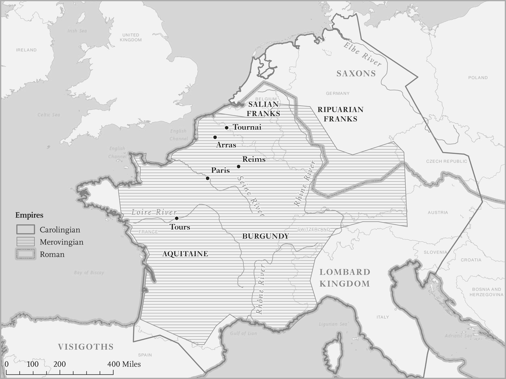
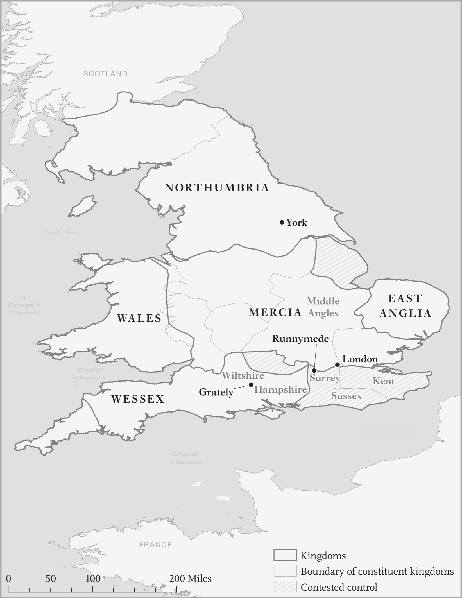

# The European Scissors · 第6章　欧洲剪刀

## Europe Moves into the Corridor · 欧洲移入自由之路

The part of the world that developed the enduring Shackled Leviathans that would shape our recent history was Europe, particularly Western and Northern Europe. The Athenian Shackled Leviathan collapsed as the Macedonian Empire expanded. Similarly the Zapotec state had gone out of the corridor and disappeared by the time the Oaxaca Valley was conquered by the Spanish. As we’ll see, the development of a state that was both capable and constrained by society was a gradual, painful historical process in Europe.

> 欧洲是发展出可长可久的受制约国家巨灵，塑造世界近代历史的例子，西欧和北欧尤其如此。马其顿帝国扩张之际，雅典受到制约的国家巨灵崩溃；同样地，西班牙人征服美洲后，萨波特克人的国家也退出自由窄廊，从瓦哈卡山谷中消失无踪。正如我们所见，欧洲发展出受到社会约制、却又能力高强的国家，是一个渐进而又痛苦的历史进程。

People who were present at its early stages would not have recognized this as the beginning of a process that would transform their liberty, politics, and economy. But as it evolved, it started bringing liberty, transformed the nature of state institutions, and ushered in a period of prosperity of a sort previously unknown in human society. Why did all of this emerge in Europe?

> 欧洲的自由、政治与经济随着此一进程开始改变，只是当时的人还看不出来。此一进程的开展，最终会带来自由、改变国家制度的性质，迎来人类史上前所未见的繁荣时期。我们要问，为什么这一切会在欧洲出现？

The answer is not obvious. Going back in history, there was nothing manifest about the rise of Europe. Agriculture originated not in Europe but in the Middle East and the Fertile Crescent and then in China. When it spread to European lands, it did so through the colonizing activities of people moving from the Middle East, reaching Britain around 4000 BCE, over 5,000 years after it had become established in the Levant. Similarly the first towns and cities emerged not in Europe but in the valleys of the Tigris and Euphrates Rivers in modern-day Iraq.

> 答案并不明显。你回顾历史，看不出欧洲崛起有什么明显的原因。农业并非起源于欧洲，而是先后起源于中东、肥腴月弯和中国；农业在东地中海地区确立不移超过五千年后，才透过中东人民的殖民行动，传播到欧洲；大约在西元前四千年前后，传播到英国。同样地，最早的城镇不是在欧洲出现，而是在现代伊拉克的底格里斯河和幼发拉底河（两河流域）出现。

The Gilgamesh problem, as we have seen, arose first in Uruk, not Uxbridge. To all of the great classical empires, Western and Northern Europe were at best marginal. The Romans built a sophisticated civilization centered around the Mediterranean, but had little interest in much of Western and Northern Europe, except when they ventured to areas that are now part of Germany in order to confront the Germanic tribes, which they viewed as barbarians (though they did conquer Gaul, modern-day France, and part of Britain).

> 我们已经看到，吉尔迦美什难题首先是在乌鲁克出现，而不是在英国的阿克斯桥（Uxbridge）出现。对所有的古代大帝国来说，西欧和北欧顶多只是边缘地区。罗马人以地中海为中心，缔造了复杂的文明，对大部分的西欧和北欧却兴趣缺缺，只有在对抗日耳曼部落时，曾经突入他们视为野蛮人地域、现在属于德国的某些地区〔不过罗马人的确征服了现代法国所在的高卢地区（Gaul）和一部分的英国〕。

Only very late in history do we see Europe coming onto the world stage. All the same, as we discussed in the previous chapter, by the eleventh century, parts of Europe had developed republican governments and were in the middle of a massive economic boom. How did Europe get there?

> 我们一直到非常晚近的历史中，才看到欧洲踏上世界舞台。然而，就像我们在前一章里所讨论的那样，到了十一世纪，欧洲部分地区已经发展出共和制政府，而且出现规模庞大的经济荣景。欧洲怎么走到这一步？

How did these revolutions in government, society, and economy come about and pave the way to an unprecedented rise of liberty and the spectacular technological and economic advances of the eighteenth and nineteenth centuries? What was Europe’s advantage? The answer to these questions lies in a unique series of historical events 1,500 years ago that created a fortuitous balance between the powers of central authority and those of common men (not women, unfortunately). It is this balance that put Europe into the corridor, setting in motion the Red Queen effect in a relentless process of state-society competition.

> 这种政府、社会和经济革命怎么出现，怎么为十八、十九世纪期间前所未见的自由崛起、惊人科技和经济进步铺平坦途的呢？欧洲到底有什么优势？答案在于一千五百年前发生的一系列独一无二的历史事件，在中央权威和平民男性（可惜不包括女性）的权力之间，创造了意外的平衡，这种平衡促使欧洲踏上自由之路，在国家和社会的无情竞争过程中，推动红皇后效应。

The balance was a consequence of two things. First, the takeover of Europe at the end of the fifth century by democratically organized tribal societies centered on assemblies and norms of consensual decision making. Second, the legacy of critical elements of state institutions and political hierarchy absorbed from the Roman Empire and the Christian church, whose centralizing influence continued even after the fall of the Western Roman Empire at the end of the fifth century. We can think of these two elements as the two blades of a pair of scissors. On its own neither would have put Western Europe onto a new path. But hinge them together and the two blades of the European scissors prepared the scene for the rise of the Shackled Leviathan and the economic incentives and opportunities that it unleashed.

> 这种平衡是两大事件造成的结果：一是五世纪末期，欧洲遭到以民主方式组织、注重人民会议和共识决规范的部落社会接管；二是吸收了罗马帝国和基督教会留下来的国家制度和政治阶级关键要素。即使西罗马帝国在五世纪末叶灭亡，这些遗泽的集中化影响仍然长久绵延。我们可以把这两大因素视为剪刀的双臂，单靠任何一只剪臂都不能把西欧推上新的道路，但把这把欧洲剪刀的双臂铰接在一起，就会为受到制约国家巨灵的崛起、为从中释出的经济诱因和机会铺下坦途。

## The Assembly Politics of the Long-Haired Kings · 议会政治和长发国王

To get an inkling of how Europe managed all of this, let’s turn to the depiction of an assembly recorded in 882 by Hincmar, the archbishop of Reims in France. Hincmar’s book, known as On the Governance of the Palace, was written for Carloman II, king of West Francia, on his ascension to the throne. Francia, which was already fragmented by the time Carloman was crowned, was the kingdom created originally by the Franks, a Germanic tribe that had fought against, and sometimes with, the Romans for nearly two centuries. It became one of the beneficiaries of the collapse of the Western Roman Empire, and then played a defining role in the political developments of post-Roman Europe.

> 为了略微了解欧洲怎么设法创造所有这些成就，我们要看辛克马（Hincmar）怎么描述西元八八二年举行的一次会议。辛克马是法国兰斯（Rheims）的大主教，他写了一本书叫做《论宫廷治理之道》（On the Governance of the Palace ），是特地为西法兰克（West Francia）国王卡洛曼二世（Carloman II）登基而写的。法兰克王国当初是由日耳曼部落创立，卡洛曼二世加冕为王时，王国已经四分五裂。法兰克人过去曾经跟罗马人作战，偶尔也曾经并肩作战，历时将近两个世纪，是西罗马帝国崩溃的受惠民族之一，在西罗马帝国灭亡后的欧洲政治发展上，扮演过决定性的角色。

Carloman was part of the Carolingian dynasty that was created by Charles Martel in the early eighth century and greatly expanded by his grandson Charlemagne. By the time of his death in 814, Charlemagne had united into one state France, Belgium, the Netherlands, Germany, Switzerland, Austria, and northern Italy (see Map 8). Hincmar instructed Carloman how to rule over his kingdom by recounting how the kingdom had been run according to Adalhardus, a contemporary of Charlemagne and an eyewitness to how the state functioned then. Remarkably, this rule wasn’t going to involve the king exercising his unbridled wishes, but would be based on popular assemblies. As Hincmar noted:

> 卡洛曼二世系出加洛林王朝（Carolingian dynasty），加洛林王朝是八世纪初期，由铁锤查理（Charles Martel）创立，后来他的孙子查理曼大帝大力扩张这个王国。到西元八一四年查理曼去世时，已经统一法兰西、比利时、荷兰、德国、瑞士、奥地利和义大利北部（参见地图八）。辛克马教导卡洛曼二世统治国家的方式，详细叙述查理曼同时代人阿德拉德（Adalhardus）对查理曼治国之道的纪录，以及他所目睹的王国运作状态。值得注意的是，国王不能肆无忌惮、随心所欲，而是必须根据人民议会的意愿，遂行统治。辛克马指出：

At that time the custom was followed that no more than two general assemblies were to be held each year. The first assembly determined the status of the entire realm for the remainder of the year. No turn of events, saving only the greatest crisis which struck the realm at once, could change what had been established. All the important men, both clerics and laymen, attended this general assembly. The important men came to participate in the deliberations, and those of lower station were present in order to hear the decisions and occasionally also to deliberate concerning them, and to confirm them not out of coercion but by their own understanding and agreement.

> 当时遵循每一年召开全民议会不超过两次的习俗，第一次大会要决定当年剩下时间里整个国土的状态，除了同时侵害整个国家的最重大危机外，任何事件都不能改变已经确立的事项。所有重要人物，不论是神职人员还是一般信徒，都会参加这种大会。重要人士与会是为了参与审议，比较低阶的人参加，是为了听取决定，他们偶尔也参与审议跟他们有关的事情，确认这些事情不是出于胁迫，而是经过他们的了解和同意。

Participation in the second assembly was broader, but in both assemblies a council of “important persons and senior advisers of the realm” played a key role and “proposed questions to the king and received responses,” and as often as those withdrawn in council wished it, the king would go to them and remain with them for as long as they desired. They then in all friendliness told him how they had found individual matters; they frankly related what they had discussed on one side and the other, in disagreement or argument or friendly rivalry.

> 参与第二种会议的人比较普遍，但由「重要人士和领域内的资深顾问」组成的委员会，在两种会议中，都扮演重要的角色，「会对国王提出问题，并且得到答复」，而且：国王经常会像退出委员会的与会人士所希望的那样，去请教他们。国王会尽量满足他们的时间要求，长时间跟他们聚在一起，然后，他们会十分友善地告诉国王，他们在个别事项上有什么发现。他们会坦率陈述他们所讨论事项的正反两方面事宜，有没有歧见、争论，或友善的竞争。

The Frankish elites “in council” also could “summon outsiders, as for example . . . when they wanted to pose questions,” and the king took this opportunity “to interview persons coming from all parts of the realm, to learn if they brought with them information worthy of consideration.” Indeed, before coming to the assembly each participant “was to collect information concerning any relevant matter not only from his own people but from strangers and from both friends and enemies.”

> 例如，「参与委员会」的法兰克人菁英「希望提出问题时……也可以召唤外人」，国王会利用这种机会，「垂询来自国境各地的人，以便了解他们是否带来值得考虑的资讯」。的确如此，每位与会人士来参加会议前，「不但会向自己人，也会向陌生人、敌人或朋友，搜集跟任何重要事务有关的资讯」。

What Hincmar describes was the essence of the assembly politics of Germanic tribes, a remarkably participatory form of government. Charlemagne, and later Carloman, had to play by the rules of these assemblies, consult the wishes of a diverse cross section of (male) society, and secure a degree of consensus for their major decisions. Obviously, the number of people who could appear at such an assembly was limited, but Charlemagne deployed messengers to relate the findings to lower-level meetings so that the whole kingdom was informed. This participation is the first blade of the European scissors.

> 辛克马描述的是日耳曼部落议会政治的精髓，是一种非常特别的参与式政府。查理曼和后来的卡洛曼二世必须遵守这些会议的规则、征询（男性）社会各界驳杂的期望，为他们的决定争取某种程度的共识。出席这种会议的人数显然会有限制，但查理曼会派出使者，向比较低阶的会议，说明有关的发现，以便整个王国都得到照会。这种参与是欧洲之剪的第一只剪臂。

The roots of these assemblies come from the way the Franks were organized. The best description we have comes from Tacitus’s book The Germania, written in 98 CE. Tacitus was a Roman politician, public servant, and historian, and his book reflected the curiosity that Romans had about the Germans, who had imposed upon them several calamitous military defeats and whose customs and institutions looked so different from theirs. To satisfy this curiosity, Tacitus presented an almost ethnographic account of the organization and culture of the German people.

> 这种会议起源于法兰克人的组织方式，最好的说明出自塔西佗（Tacitus）西元九十八年的大作《日耳曼尼亚志》（Germania ）。塔西佗是罗马政治家、公务员和历史家，他的大作反映了罗马人对日耳曼人的好奇心。罗马人曾经惨败在日耳曼人手下很多次，而且日耳曼人的习俗和制度跟罗马人极为不同。为了满足这种好奇心，塔西佗针对日耳曼人的组织和文化，写出了几乎等于民族志般的详细纪录。

He described their political system in the following way: On matters of minor importance only the chiefs debate; on major affairs, the whole community. But even where the commons have the decision, the subject is considered in advance by the chiefs . . . The Assembly is competent also to hear criminal charges, especially those involving the risk of capital punishment . . . These same assemblies elect, among other officials, the magistrates who administer justice in the districts and villages. Each magistrate is assisted by a hundred assessors chosen from the people to advise him and to add weight to his decisions.

> 他用下述文字，描述日耳曼人的政治制度：小事只需要由众酋长之间争辩即可，大事需要整个社区辩论，但即使平民做出决定，主题还是需要经过众多酋长事前考虑……议会也有权听审刑事诉讼，尤其是可能涉及死刑风险的案件……相同的会议选出的各种官员中，有一种是负责在各区和乡村执法的地方治安官，每位地方治安官都有一百位从人民中选出的评估员协助，充当他的顾问，也加重他所决定事项的权威。

One immediately sees the parallel with Hincmar’s description right down to the two sorts of assemblies, one where the political elite met and set the agenda and another one with mass participation. The assemblies had other tasks such as presenting young men with a shield and spear and thus publicly making them citizens. In terms of their leaders,

> 你立刻看出辛克马的描述澄清了两种议会相似的地方，一种是政治菁英开会，决定重大议程，另一种是大众参与的会议。两种会议都有其他任务，例如致赠年轻男子盾牌和矛，从而公开让他们变成公民。以他们的领袖而言，

they choose their kings for their noble birth, their commanders for their valour. The power even of the kings is not absolute or arbitrary. Julius Caesar, who briefly crossed the Rhine during his conquest of Gaul, also observed that the Germans elected their leaders during wartime at assemblies, but had no leaders in peacetime except chiefs with limited powers.

> 他们选择自己的国王时，是根据他们的尊贵出身，选择指挥官时，是根据他们的勇武。连国王都没有绝对或专断的权力。凯撒征服高卢时，曾经短暂地渡过莱茵河，他也观察到，日耳曼人会在战争期间开会，选举领袖，但承平时期却没有领袖，只有权力有限的酋长。

The absence of kings greatly irritated some writers. Gregory of Tours, who wrote his History of the Franks in the late sixth century, is our major source of information about the origins and political development of the Franks. Gregory quotes Sulpicius, from a long-lost book, as mentioning “the royal leaders of the Franks,” but then adds exasperatedly, “When he says ‘regales’ or royal leaders, it is not clear if they were kings or if they merely exercised a kingly function.” Even more annoying for him, when it finally looks like Sulpicius is talking about a Frankish king, “he forgets to tell us what his name was.” Really.

> 没有国王的现象让若干作家大为困扰，六世纪末叶「都尔的额我略」（Gregory of Tours）撰写的《法兰克民族史》（History of the Franks ），是我们获得法兰克人起源和政治发展资讯的主要来源；他引用一本早已佚失书籍中苏尔比修斯（Sulpicius）说的话，提到「法兰克人的王者领袖」，但随即生气地补充说：「他说『国王』或王者领袖时，我们不确定他们到底是不是国王，或者只是发挥国王的功能。」让他更恼怒的是，最后苏尔比修斯看来像在谈论法兰克人的一位国王时，「他却忘了告诉我们他的名字」。真是的！

The people who were to become the Franks, though not mentioned explicitly by Tacitus, inherited the popular assemblies as a central part of their political organization. We first hear of them in 250 and 275, when along with the Alamanni and other German tribes they raided the Roman province of Gaul. The Franks seem to have been an amalgamation of other German peoples such as the Bructeri, Ampsivarii, Chamavi, and Chattuari who later constructed, or invented, a collective identity. There is little archaeological evidence for their origins, but we know from Roman sources that they were settled around the Rhine in the fourth century and were fighting for the Romans in the early fifth century (see Map 8).

> 塔西佗虽然没有明说，但是后来变成法兰克人的人民却继承了民众议会，把这种制度当成自己的政治组织核心。我们在二五○年至二七五年间，初次听到他们的名字，当时他们跟阿勒曼尼人和其他日耳曼部落，劫掠罗马的高卢省，法兰克人似乎是布鲁克特里人（Bructeri）、安普希瓦里人（Ampsivarii）、沙马维人（Chamavi）、沙图亚里人（Chattuari）等日耳曼人混合之后建立或创造的集体认同，没有什么考古证据能够说明他们的起源，但是，我们从罗马的资料来源，可以知道他们在四世纪时，定居在莱茵河四周，在五世纪初期，曾经为罗马人作战（参见地图八）。

Between 400 and 450, the Roman military frontier on the lower Rhine collapsed and the territory became occupied by the Franks. By midcentury, they had spread as far west as Arras and Tournai in France and were still organized in separate kingdoms. The kingdom based in Tournai gained in strength and influence between 450 and 480, first under Chlodio and then his son Merovech, who established what was to be the Merovingian dynasty, lasting for nearly three hundred years. Chlodio and Merovech are partly mythical figures.

> 西元四百年至五百年间，罗马在下莱茵的军事前线崩溃，这片领土改由法兰克人占领。到五世纪中叶，他们已经向西扩散到远达法国的阿拉斯（Arras）和图尔奈，却仍然分别组织成不同的王国。四五○年至四八○年间，以图尔奈为根据地的王国力量和影响力增加，先由克洛迪奥（Chlodio）统治，然后改由他的儿子墨洛维克（Merovech）统治，墨洛维克建立的墨洛温（Merovingian）王朝，延续了将近三百年。克洛迪奥和墨洛维克都是带点神话性质的人。

Indeed, Merovech is fabled to have been conceived when Chlodio’s wife went swimming and encountered a sea monster called the Quinotaur, giving the dynasty supernatural legitimacy. The Franks emerge into clearer historical focus with the reign of Clovis, Merovech’s grandson, who came to the throne in 481. Clovis was the real founder of the Frankish state and he expanded the kingdom to unite nearly all of France by the time of his death in 511. The Frankish kings had a thing about hair. Long hair. For boys, having long hair was a sign of manhood, so important that cutting a long-haired boy’s hair without his parents’ consent was considered a crime equivalent to killing him. Gregory records an instance where

> 事实上，寓言指出，克洛迪奥的妻子去游泳时，碰到牛头鱼身的海怪奎诺陶（Quinotaur），因而怀了墨洛维克，这种寓言为这个王朝带来了超自然的正当性。到了墨洛维克的孙子克洛维（Clovis）统治时，法兰克人在历史上的焦点变得比较清晰，克洛维是在四八一年登上王座，是法兰克国的真正开国君王，还大力开疆拓土，到五一一年他去世时，他的王国几乎已经统一法兰西全境。法兰克王重视头发，对长发十分执着。对男孩来说，留长发是成年男性的象征，重要到人们认为未经男孩父母同意，就剪掉男孩的长发，等于犯了杀害这个男孩的罪。额我略记录了一个例子，显示：

Childebert and Lothar sent Arcadius to the Queen . . . with a pair of scissors in one hand and a naked [unsheathed] sword in the other. When he came into the Queen’s presence, he held them out to her. “Your sons, who are our masters, seek your decision, gracious Queen, as to what should be done with the princes. Do you wish them to live with their hair cut short? Or would you prefer to see them killed?” . . . she answered: “If they are not to ascend the throne, I would rather see them dead than with their hair cut short.” The assembly politics of the long-haired kings and their powerful, assertive societies were the first blade of the scissors that would put Merovingian, Carolingian, and other related European societies in the corridor. The other blade came from the Roman Empire.

> 席尔德贝尔特（Childebert）和洛塔尔（Lothar）派阿卡迪奥斯（Arcadius）去见王后……一手拿着一把剪刀，另一手拿着一把出鞘的剑，阿卡迪奥斯走到王后前面，准备把剪刀和剑都交给王后时说：「仁慈的王后，你的公子、我们的主人，征询你对众王子应该如何处理的意见，你希望他们剪短头发活着？还是希望看到他们被杀？……她回答说：「如果他们不能登上宝座，我宁可看到他们死掉，也不愿看到他们剪成短发。」这些长发国王和他们有力又有自信的社会，是把墨洛温、加洛林王朝和其他相关欧洲社会推进自由窄廊的第一只剪臂，另一只剪臂来自罗马帝国。

## The Other Blade · 另一只剪臂

The Roman Republic was founded in 509 BCE, after the overthrow of King Lucius Tarquinius Superbus. By the second century BCE the republic had to deal with deep conflicts between the rich, aristocratic families and the growing number of Roman citizens. It collapsed for all practical purposes when Julius Caesar declared himself dictator in 49 BCE, though the emergence of its successor state, the Roman Empire, took shape only after a series of civil wars and the accession of Octavian as “Augustus” in 27 BCE.

> 罗马共和国是在西元前五○九年，国王卢修斯．苏佩布（Lucius Tarquinius Superbus）遭到推翻后建立，到西元前二世纪，罗马共和国必须应付富人、贵族家族，和数量日增罗马公民之间的严重冲突。事实上，西元前四十九年，凯撒宣布自己是独裁者时，罗马共和国已经土崩瓦解，但继承共和国的罗马帝国要到西元前二十七年、一系列的内战结束，屋大维（Octavian）登基为「奥古斯都」（Augustus）时才成形。

At this time there was little in the way of an institutionalized state. Rome had been ruled by the Senate and the army, and there were few bureaucrats beyond the slaves and retainers of the elite. Though a more systematic central administration began with Augustus and developed partly to feed the residents of Rome and supply the army, it was not until the second half of the third century that a real bureaucratic administration developed in the empire. The Roman state employed at least 31,000 full-time paid civil servants during the late empire, but this is likely a severe underassessment since it excludes municipal personnel, on whom we have no accurate information.

> 这时，罗马在制度化国家方面，几乎还毫无踪影。过去罗马由元老院和军方统治，在菁英的奴隶和家仆之上，只有少数官僚，虽然从奥古斯都时开始，比较有系统的中央政府出现，目的之一是为了喂养罗马居民、供应军队，但一直到三世纪下半叶，罗马帝国才发展出真正的官僚化政府。罗马帝国晚期，中央政府至少雇用了三万一千个全职有薪公务员，但这个数字可能严重低估，因为其中不包括市政官员，我们也没有这方面的精确资讯。

The basic unit of administration was the province, and at the end of the reign of Diocletian in 305 CE there were 114 of these. Each was run by a governor, whose main responsibilities included taxes and justice, and who usually had 100 civil servants working for him. The provinces were grouped together into larger units called dioceses run by a Roman official, vicarius (vicar), and above them were four praetorian prefects, one in Gaul (including Britain and Spain), one in Italy (which also covered Africa and the western Balkans), one in Illyricum (Greece, Crete, and the rest of the Balkans) and one in Byzantium in the East.

> 政府的基本单位是省，西元三○五年，戴克里先（Diocletian）的统治结束时，罗马帝国一共有一百一十四个省，每个省由省长统治，他们的主要责任是征税和司法，他们通常会得到大约一百名公务员襄助。省再串联起来，变成「省区」（diocese）这个较大单位，由罗马官员都督（vicarius）治理，省区之上有四个大行政区（praetorian prefect），第一个行政区设在高卢（包括不列颠和西班牙），第二个行政区设在义大利（也包括非洲和巴尔干半岛西部），第三个行政区设在伊利里库姆（Illyricum），辖下包括希腊、克里特岛和巴尔干半岛其余部分，第四个行政区设在东方的拜占庭。

These prefects had very large staffs, of up to 2,000 people. Though civil servants were not recruited on the basis of any examination, the great late Roman legal codes promulgated by emperors Theodosius in 438 and Justinian in 529 mention principles of merit and seniority in promotion. The best description we have of how this bureaucracy operated comes from the record left by John Lydus (“the Lydian”), who worked for the Eastern praetorian prefect in Byzantium. John came from the town of Philadelphia in Lydia, now the Turkish town of Alaşehir. He was recruited into the civil service by a fellow Philadelphian praetorian prefect, Zoticus. The Eastern prefect was split into two main departments, one administrative and judicial and the other financial.

> 这些大行政区拥有非常大量的职员，公务员的数目多达两千人，虽然公务员的录用不是根据考试，但到了罗马帝国晚期，皇帝狄奥多西（Theodosius）在四三八年编修、查士丁尼（Justinian）皇帝在五二九年编修的伟大罗马晚期法典中，都提到根据能力和资历晋升的原则。约翰．利多斯（利迪安，John Lydus, “Lydian”）留下的纪录中，有我们所能看到有关这种官僚体系如何运作最好的说明，利迪安出身目前是土耳其阿拉塞席尔市（Alaşehir）、当时叫做费拉德菲亚（Philadelphia）地方的利迪亚（Lydia），录用他当公务员的人是费拉德菲亚大行政区同乡人左提克斯（Zoticus）；东方行政区分为两大主要部门，一个是行政和司法部门，另一个是财政部门。

John was assigned to the former, and his book On the Magistracies of the Roman State lists the senior officials in this department: princeps officii, cornicularius, adiutor, commentariensis, ab actis, cura epistularum, and regendarius. Indeed, a law of 384, subsequently amended by the Code of Justinian, sets out a model for this bureaucracy with 443 different positions, divided into eighteen groups listed in order of seniority. Scrinium exceptorum:

> 利迪安分派到前一个部门，他的大作《论罗马国地方行政长官职务》（On the Magistracies of the Roman State）列出这个部门高级官员的职称：首长（princeps officii）、副首长（cornicularius）、助理（adiutor）、书记长（commentariensis）、书记官（abactis）、幕僚长（cura epistularum）和资深官员（regendarius）。事实上，在后来由查士丁尼法典修正的一项三八四年的法律中，说明当时的官僚体系模式包括四百四十三个职位，再依据资历，分为十八类。判决书记官（Scrinium exceptorum）包括：

One official with the rank of perfectissimus second class, who is the primicerius of the whole schola. One official with the rank of perfectissimus (third class), who is the primicerius of the whole exceptores. Two officials with the rank of ducenarius, who are the tertiocerius and quartocerius. One official with the rank of centenarius, who is the primicerius instrumentorum.

> 一位二等官阶长官，是整个体系（schola）中的最高阶长官。一位三等官阶长官，是整个摘录部门的行政首长。两位官员管辖二百个三等和四等官员。一位首长管辖一百个手下的器械部门。

Two epistulares. Thirty-six exceptores constituting the first grade. And on and on for another nineteen groups of officials. John started as a middle-ranked exceptor in 511.

> 两位秘书处官员。三十六位摘录员构成第一级职员。利迪安就这样继续描述另外十九类官员。他从五一一年起进入官场，最初的官职是中阶书记官。

The bureaucracy ran on, as John put it, a complex set of “customs, forms and language” and members of it wore “distinctive regalia,” uniforms of military origin. They had to deal with regulations and procedures and “registers, titles and duties.” John was also keen to point out that it had an esprit de corps and an identity that separated it from “ordinary people.” Language and writing were particularly important. Only the palatine bureaucrats most closely associated with the emperor were allowed to use the litterae caelestes (literally “heavenly writing”), a specific type of script of restricted use, deployed to help stop forgeries because it was so hard to fake. John recounts in detail the various bureaucratic procedures that had to be followed.

> 正如利迪安所说，这种官僚体系依据一套复杂的「习俗、形式和语言」运作，成员穿着起源于军队制服的「独特官服」，要负责处理法规、程序和「注册、权状和税捐」。利迪安也热心地指出，官僚体系具有团队精神，还有跟「平民百姓」不同的认同。语言文字特别重要，只有跟皇帝关系最密切的宫廷官僚，可以使用「上天赐予的文字」；这是一种限制使用的特殊文字，采用这种文字的目的是防止造假，因为这种文字极为难以伪造。

For instance, everything that came before the prefect’s tribunal had to be summarized twice. One was the responsibility of an official known as the secretarius, while the other was written by the personalium, the most senior judicial official. John was certain that such procedures were critical for a well-functioning government, for example by guarding against fraud or loss. He noted, “And I myself well remember such an occurrence. For although a hearing had been held, the transactions relevant to the case were nowhere to be found. But when the personalium, as it is known, had been brought before the magistracy, the case was completely restored.” What John describes is an extensive bureaucracy with well-defined rules, functioning within an elaborate legal system. Of course it was not immune to personal influence, and it didn’t work out exactly as the rules specified.

> 利迪安详细叙述人民必须遵守的各种官僚程序，例如，所有呈交大行政区长官法庭的东西，都必须摘述两次，一次是秘书处官员摘述，另一次由最高阶的司法官员人员长（personalium）摘述，利迪安肯定这种程序攸关政府的顺利运作，例如可以防止诈欺和灭失，他指出：「我自己对这种事记得清清楚楚，虽然举行过听证会，却找不到跟这个案子有关的交易，但人称『人员长』的长官到庭后，案子就得以重新审查。」利迪安描述的是规则明确、在复杂的法律体系中运作的复杂官僚体系，这种体系当然不能免于个人的影响，而且不完全依照规则的规定运作。

John himself got his job not entirely on the basis of merit, but with the help of his Philadelphian contact Zoticus. Moreover, many of the senior positions were reserved for elites, particularly people from the senatorial class, and there was certainly some corruption. For all these faults, the Romans at least had a bureaucratic state with an elaborate structure and territorial organization. This lay institution was paralleled by the hierarchy of the Church, which had already been integrated with the political institutions by the time the Franks came to interact with Rome.

> 利迪安自己就不完全是靠能力得到工作，而是靠费拉德菲亚同乡左提克斯的提携。此外，很多高级职位会保留给菁英，尤其是出身元老院阶级的人，而且其中确实有贪腐的情事存在。虽然有这些问题，但罗马人至少创设了一个有着复杂结构和领土组织的官僚化国家。这种世俗制度和教会的阶级并行不悖，教会在法兰克人跟罗马互动时，已经和政治制度融合在一起。

## Bringing the Two Blades Together · 结合两只剪臂

The early history of the Franks was a struggle to combine the bottom-up political traditions of the Germanic tribes with the state institutions of the Romans. As Clovis ascended to the throne, it wasn’t clear how these two blades would come together. Imposing a stable political hierarchy on Franks was challenging. Gregory recalls how once after a raid Clovis was greatly taken by a particular vessel, a ewer, and asked his men, “I put it to you, my lusty freebooters, that you should agree here and now to grant me that ewer over and above my normal share,” to which one of his men replied by cutting the vessel in half with his ax, declaring, “You shall have none of this booty except your fair share!”

> 法兰克人的早期历史中，充满了努力结合日耳曼部落由下而上的政治传统、和罗马人国家制度的辛苦奋斗。克洛维登基时，还不确定这两只剪臂是否能够铰合在一起。要把稳定的政治阶级加在法兰克人身上是一大挑战，额我略回想起克洛维在一次劫掠后，对一口大水壶容器十分动容，就问手下：「我雄壮威武的掠夺高手啊，我请你们考虑一下，让我超出应得的份额，把这个水壶送给我。」他一位手下的答复是抽出斧头，把容器砍成两半，然后大声宣称：「你只能得到这个战利品应得的部分！」

Clovis eventually got even with this particular soldier, but this episode highlights the egalitarian, non-hierarchic ethos of the war band, which was one of the foundations of the assembly politics of the Franks. It was also a significant impediment to centralizing power. A major step in the process of state building was the conquest of the last Roman subprovince of Soissons. Clovis took over Roman institutions and seems to have hired Roman administrators. Next, in a skillful move to bring the two blades closer together, Clovis adopted Christianity. He didn’t simply convert himself, he converted en masse with his army.

> 克洛维最后报复了这位士兵。但是，这件事突显这支战斗部队公平、没有阶级的精神，这是法兰克人议会政治的基础之一，也是中央集权化的重大妨碍。法兰克人建国过程中的一个重大步骤，是征服罗马最后一个次级省份苏瓦松省（Soissons），克洛维接收罗马人的制度，而且似乎还聘用罗马人的官员。接着，克洛维采取高明的行动，借着改信基督教，把两只剪臂铰合在一起；他不仅自己改宗，还带着他的军队一起改信基督教。

From that day on, Clovis could appeal to the ecclesiastical hierarchy, which he commanded for the Merovingians. He then proceeded to declare himself emperor. The setting was a very Roman ceremony in the city of Tours, as described by Gregory: In Saint Martin’s church he stood clad in a purple tunic and the military mantle, and he crowned himself with a diadem. He rode out on his horse and with his own hand showered gold and silver coins among the people present . . . From that day he was called Consul or Augustus.

> 从那天起，克洛维可以诉诸教会的阶级，施用在墨洛温王朝中，然后他迳行宣称自己为皇帝，照额我略的描述，在都尔举行的加冕典礼场景非常罗马化：他穿着紫袍，披着军用披风，在圣马丁教堂为自己戴上王冠，再骑着自己的马出去，亲手向到场的人民大洒金币和银币……从那天起，大家都叫他领袖或奥古斯都。

Leaders of Germanic war bands didn’t wear purple or call themselves Augustus, but Clovis did. In doing so, he was bringing the blade of the assemblies and bottom-up norms of Germanic tribes together with the blade of the Roman model of a centralized state. What emerged was something greater than the sum of its parts. The blueprint for bureaucratic organization Clovis got from Rome and the Christian church got embedded in the diametrically different politics and norms of the Germanic tribes. This combination placed the Merovingians at the entryway to the corridor.

> 日耳曼部队领袖不会穿紫袍，也不会自称奥古斯都，但克洛维就是这样做，这一来，就把议会和日耳曼部落由下而上规范构成的剪臂，跟罗马中央化国家机器模式构成的剪臂，结合为一，形成一加一大于二的东西。克洛维从罗马和基督教会得到的官僚组织蓝图，融入日耳曼部落截然不同的政治与规范，这种结合把墨洛温王朝送上自由窄廊的入口。

Apart from wearing purple, the Roman legacy is also seen in the persistence of the basic administrative unit, as in Roman times, called the civitas, or city, along with its surrounding areas. The senior Merovingian official in charge of a civitas was called a comes, literally “companion,” and often translated as “count.” This was a position adapted from the late Roman comites civitatis and its duties seem to have been closely modeled on these—solving legal disputes, administering justice, and commanding military units.

> 除了穿紫袍外，罗马的遗泽也表现在罗马时代基本行政单位──城市和周遭地区──的存续上，统治城市的墨洛温王朝高官叫做「comes」，字面意思是伙伴，但经常翻译成「子爵」（count）。这个职位采自罗马时代晚期的市伴（comites civitatis），职责似乎也是紧密模仿罗马的市伴，必须解决法律纠纷、执行法律、指挥军事单位。

Subordinate officers below the comes were called centenarii, also of Roman origin, and administered a unit called a centenae, or a hundred. The likely origin of the hundred was a German war band comprising a group of fighters who elected their leader, but, as with Roman territorial institutions, the elected warrior leader became an official in the Frankish state. One of Clovis’s defining acts as emperor was the promulgation of a new legal code, the Salic Law, and a picture of a surviving Merovingian copy is included in the photography section. Clovis was part of the Salian Franks, who distinguished themselves from another group of Franks farther east called Ripuarian.

> 「伙伴」管辖的次级官员叫做「百夫长」（centenarii），这个名称也是起源于罗马时代；百夫长管理的单位叫做「百户」，百户的起源可能是由一群日耳曼战士构成、自行选择领袖的日耳曼军队，但就像罗马的领土制度一样，当选的战士领袖变成法兰克人国家的官员。克洛维出任皇帝后采取多种决定性的行动，其中一种行动是颁布新法典《萨利克法》（Salic Law），本书的相片集插页中，刊有一张墨洛温时代幸存下来的法典照片。克洛维是萨利法兰克人（Salian Franks），跟东边很远处的利普里安法兰克人（Ripuarian）差异很大。

The Salic Law formalized existing norms and customs that had governed the behavior of the stateless Franks. These norms included elaborate rules for regulating feuding. Clovis wanted to codify them and ultimately bring them under the control of his new centralized state. From this perspective the first clause of the Salic Law is significant. It read, “If any one be summoned before the Thing by the king’s law, and do not come he shall be sentenced to 600 denarii, which make 15 solidi.” Here “Thing” is the archaic word for the assembly.

> 萨利法把把现有管制无国家法兰克人行为的规范正式化，这些规范包括管制世仇的复杂法规，克洛维希望把这些规定法制化，最后把这些规定纳入他新创立的中央化国家控制中。从这一点来看，萨利法的第一条意义重大，条文指出：「如果有人依据国王的法律，获召参加「事情」（Thing），却没有到场，须罚款六百第纳流斯（denarius），也就是十五索利都斯（solidius）。此处的「事情」是古体文字的「议会」。

The first thing Clovis had to do was to make sure people turned up. In terms of formulating the laws, one of the surviving prologues is particularly telling. It reads: With God’s help it pleased the Franks and their nobility and they agreed that they ought to prohibit all escalations of quarrels for the preservation of enthusiasm for peace amongst themselves . . . Therefore four men, chosen out of many among them, stood out: Their names were Wisogast, Arogast, Salegast and Widogast. They came from the villae of Bothem, Salehem and Widohem, beyond the Rhine.

> 克洛维要做的第一件事是确保人们出席。就法律的制定而言，有一个幸存的序言说得特别清楚：在天神的帮助下，法兰克人和他们的贵族同感欣喜，同意应该禁止所有的争吵升高，以便维持他们之间对和平的热切之情……因此，四名男性从众人当中获选，脱颖而出。他们的名字是威索加斯（Wisogast）、阿罗加斯（Arogast）、萨里加斯（Salegast）和威多加斯（Widogast），他们出身莱茵河以外的凡人世界（Bothem）、尊神世界（Salehem）和畜生世界（Widohem）[〔注1〕](#note-1) 。

Coming together in three legal assemblies, and discussing the origins and cases carefully, they made judgement on each case as follows. So the Salic Law, though introduced by Clovis, was not his imposition on society. It wasn’t even written by him, but by four lawgivers and three assemblies. The lawgivers, Wisogast, Arogast, Salegast, and Widogast, had to deal with all of the usual problems, which included frequent “quarrels.” So “Title XVII. Concerning Wounds” stipulates:

> 他们同来参加三种法律会议，慎重讨论起源和案例，对每个案子做出如下判决。因此，萨利克法虽然是由克洛维推出，却不是他强加在社会之上，甚至不是由他制定，而是由四位立法尊者和三种立法议会制定。威索加斯、阿罗加斯、萨里加斯和威多加斯四位立法尊者必须处理所有的常见问题，包括经常性的「争吵」，因此，《萨利克法》〈第十七章有关伤害专章〉规定：

If any one have wished to kill another person, and the blow have missed, he on whom it was proved shall be sentenced to 2500 denarii. If any person have wished to strike another with a poisoned arrow, and the arrow have glanced aside, and it shall be proved on him; he shall be sentenced to 2500 denarii. If any person strike another on the head so that the brain appears, and the three bones which lie above the brain shall project, he shall be sentenced to 1200 denarii.

> 一、凡是意图杀害别人未遂者，处以罚款二千五百第纳流斯。二、凡是意图以毒箭射击别人，毒箭擦身而过，事证俱全者，处以罚款二千五百第纳流斯。三、凡是攻击别人头部，导致脑部露出、脑部上方三支骨头突出者，处以罚款一千二百第纳流斯。

But if it shall have been between the ribs or in the stomach, so that the wound appears and reaches to the entrails, he shall be sentenced to 1200 denarii. If any one shall have struck a man so that blood falls to the floor, and it be proved on him, he shall be sentenced to 600 denarii. But if a freeman strike a freeman with his fist so that blood does not flow, he shall be sentenced for each blow—up to 3 blows—to 120 denarii.

> 四、但如伤口介于肋骨之间或在胃部之内，以致伤口外露，及于内脏，处以罚款一千二百第纳流斯。五、任何人攻击他人，以致血液流到地上，而且事证俱全者，处以罚款六百第纳流斯。六、但如自由人以拳头攻击另一自由人，未至流血者，每一拳──至多三拳──处以罚款一百二十第纳流斯。

The law covered other areas related to feuds, particularly insults, so that it was illegal to slander someone by calling them a fox or a hare. It also regulated relations between Franks and Romans, though it made it clear who was running the show. For instance, “Title XIV. Concerning Assault and Robbery” stated: If any one have assaulted and plundered a free man, and it be proved on him, he shall be sentenced to 2500 denarii, which make 63 solidi.

> 此一法典也涵盖跟仇怨有关，尤其是跟侮辱有关的其他领域，因此，骂别人是狐狸或兔子的诽谤是违法行为。法典也规范法兰克人和罗马人之间的关系，却清楚显示谁才是老大，例如，〈第十四章有关攻击与抢劫专章〉规定：一、任何人如攻击与抢劫自由人，而且事证俱全者，处以罚款二千五百第纳流斯或六十三索利都斯。

If a Roman have plundered a Salian Frank, the above law shall be observed. But if a Frank have plundered a Roman, he shall be sentenced to 35 solidi. It was obviously worse for Romans to plunder Franks than the other way around. The different treatment of Romans and Franks shows that while the Franks had laws, they did not have “equality before the law”—the notion and the practice that laws applied equally to everybody. This critical aspect of laws under the Shackled Leviathan emerged only slowly as the Red Queen got to work.

> 二、如罗马人抢劫萨利法兰克人，判决如上法。三、但如萨利法兰克人抢劫罗马人，处以罚款三十五索利都斯。显然罗马人抢劫法兰克人的遭遇比法兰克人抢劫罗马人糟糕，罗马人和法兰克人待遇不同，显示法兰克人虽然有法律，却没有「法律之前人人平等」的观念和做法，法律并非一视同仁地对待每一个人。在受到制约国家巨灵统治下，这种至关紧要的法律特性要等红皇后开始运作后，才会慢慢出现。

The Salic Law didn’t resemble Roman law. It was much more like the codification, regulation, and strengthening of existing norms attempted initially by Draco and then Solon in ancient Athens. But in this process, the laws were also bringing the resolution of conflict under the remit of the state. By the late sixth century, legislation was taking a decidedly more Roman turn, incorporating elements of the Theodosian code. The Salic Law was another step in the fusion of Roman state structure with the norms and political institutions of the Franks.

> 萨利克法不像罗马法，比较像古代雅典先由杜雷科开始、然后梭伦继起，把现有规范编纂、规范和强化的做法，但在这种过程中，法律也把冲突的解决，纳入国家的职权范围中。到了六世纪末年，立法决定性的转为更偏向罗马法，纳入狄奥多西法典的要素。萨利克法为罗马国家结构跟法兰克人的规范与政治制度融合为一，踏出了另一步。

The significance of the way the Salic Law was formulated is evident once we get to the reign of Charlemagne, who reached the apogee of the Roman connection by crowning himself emperor in Rome on Christmas Day 800. All the same, Charlemagne did not act like a Roman emperor when it came to his relations with his people. The same assemblies, customs, and expectations that shackled Clovis’s reign constrained Charlemagne too.

> 到了查理曼统治时，萨利克法制定方式的重要性就显而易见。查理曼借着在西元八百年圣诞节那天，在罗马自行加冕为皇帝，把自己跟罗马的关系，推升到最高峰。但是，查理曼在处理自己和法兰克人民的关系时，做法却不像罗马皇帝。限制克洛维统治的相同议会、习俗和期望，也拘限住查理曼。

Two royal edicts issued at Regensburg in 789 indicate that agents of the state were misusing their power and the king received complaints from people that “they do not have their law maintained.” The emphasis on “their law” is critical. It was the law of the people, not of the king, and it was the king’s job to enforce it. Indeed, “if a count or missus or any man has done this, let it be reported to the lord king, for he wishes to set such matters most fully to rights.” Here missus refers to “sent men,” royal agents who linked the provinces with the central court.

> 七八九年在雷根斯堡（Regensburg）发布的两份皇家敕令指出，国家的代理人滥用权力，国王收到的民怨显示，「他们的法律没有维持好」；这句话中强调「他们的法律」至关紧要，显示法律是人民的法律，不是国王的法律，国王的职责是执法。事实上，「如果子爵或外官或任何人做了这种事，就要向国王报告，因为国王希望用最圆满的方式，改正这种事情」；这里的外官指「派到外面」、负责各省和中央宫廷联络的皇家代理人。

What about liberty? Though Clovis and Charlemagne led states that had entered into the corridor, one wouldn’t see many signs of flourishing liberty in their empires. These were turbulent times where few would feel any security from violence. Clovis’s followers were warriors, and martial norms were powerful among the Franks. This can be seen from the fact that it was the gift of a spear and shield by the assembly that made a young Frank a citizen.

> 自由方面的表现如何？虽然克洛维和查理曼领导的国家已经进入自由窄廊，我们在他们的帝国里，却没有看到很多自由勃兴的迹象。这段时间是动荡不安的岁月，很少人觉得自己有点安全、能够免于暴力侵害。克洛维的手下是战士，在法兰克人当中，军事方面的规范强而有力，从议会致赠年轻法兰克人矛与盾，作为赋予公民身分的事实中，可以看出来。

The Franks were also still firmly in the cage of norms, with customs, traditions, and practices severely restricting the economic and social actions of all people, not least because there were many religious and cultural taboos as well as a clear social hierarchy in Frankish society. Slavery was still common, and men and women could voluntarily place themselves into servitude, not unlike what we saw in African societies in Chapter 1, but something that had disappeared in Athens after Solon’s reforms. Torture was routinely used for extracting a confession in court procedures. Feuding remained endemic too, as our excerpts from the Salic Law indicate. All the same, in getting a foothold in the corridor these societies started on a process that would gradually change all of these things.

> 法兰克人也仍然牢牢受到规范牢笼、习俗、传统和实际做法的捆绑，所有人的经济和社会行为因此受到严格限制，尤其是因为法兰克人社会中，还有很多宗教和文化上的禁忌，以及清楚的社会阶级制度，男人和女人可以自愿献身为奴，跟我们在第一章中看到的非洲社会没有两样，但在梭伦的改革后，在希腊社会中已经消失的奴隶制度，在法兰克人社会中仍然很常见。司法过程中，利用刑求取得自白的现象是家常便饭。像我们摘述的萨利克法法条中所见的一样，结仇打斗也仍然很流行。然而，这些社会在自由窄廊中立足后，还是会启动逐渐改变所有这一切的过程。

## Disunited Kingdom · 不联合的王国

While the Franks were trying to unite Western Europe, across the English Channel stood a very disunited kingdom. The Western Roman Empire collapsed most completely in Britain. Money, writing, and the wheel vanished, and cities were abandoned. York, once a major Roman urban center, reverted to marshland in the fifth century. Archaeological evidence from this period shows the fossils of beetles that would have lived in high grass and reeds, and we find the remains of field mice, water voles, shrews, and froghoppers that had taken over the city.

> 法兰克人设法统一西欧之际，英法海峡方面却出现一个非常不统一的王国。西罗马帝国在不列颠崩溃得最彻底，货币、文字和车轮消失无踪，城市遭到废弃。原本是罗马人主要都会中心的约克城（York）在五世纪时，恢复为一片沼泽地。这段期间里的考古证据显示，这里有着活在高草和芦苇中的甲虫化石，我们也发现了接管约克城的田鼠、水鼠、类似老鼠的鼩鼱和沫蝉的遗迹。

They weren’t the only newcomers. Peoples from continental Europe, particularly Germany and southern Scandinavia, identified by the eighth-century historian the Venerable Bede as “Angles, Saxons and Jutes,” had also migrated to the isles. By this time these peoples, along with the survivors of Roman Britain and other migrants such as Celts from Ireland and Scotland, had formed an unstable set of competing polities, many of which are today remembered only in the names of current English counties, like Kent. Nevertheless, these polities gradually coalesced. By 796, at the death of King Offa of Mercia, there were just four left: Wessex in the south, East Anglia in the east, Mercia straddling the center of the country, and Northumbria in the north (see Map 9).

> 这些鸟兽虫鱼不是我们所仅见新来后到的东西，从欧洲大陆，尤其是从日耳曼和斯堪地那维亚半岛南部的居民，也移入英伦三岛，他们就是八世纪历史学家圣比德（Venerable Bedeas）所说的「盎格鲁人、撒克逊人和朱特人」移民，他们和罗马帝国辖下不列颠地方的幸存者，以及来自爱尔兰和苏格兰的凯尔特族等地方其他移民，在这里形成不稳定、又互相竞争的众多政体，其中很多政体今天变成只是英国郡县的名称，肯特郡就是一个例子。然而，这些政体逐渐合并，到七九六年，麦西亚王国（Mercia）的奥法王（Offa）去世时，只有四个政体还存在，包括南部的威塞克斯（Wessex）、东部的东盎格利亚（East Anglia）、横跨中部的麦西亚，北部则是诺桑比亚（Northumbria）（参见地图九）。

In 871 the twenty-two-year-old Alfred succeeded his brother Æthelred as the king of Wessex. This succession was probably agreed to in a witan, the assembly of the Anglo-Saxons. In the words of abbot Ælfric of Eynsham: No man can make himself king, but the people has the choice to choose as king whom they please; but after he is consecrated as king, he then has dominion over the people.

> 西元八七一年，二十二岁的艾佛瑞（Alfred）大帝继承兄长埃塞尔雷德（Aethelred），即位为威塞克斯国王，他的继承很可能得到盎格鲁撒克逊议会的同意。根据艾恩撒姆（Eynsham）地方艾弗利克（Ælfric）修道院长的说法：任何人不能自行加冕为王，但可以选择他们中意的人为王；然而，他被人奉为神圣的国王后，他就可以宰制人民。

The best surviving description of a witan from this period comes from the monk Byrhtferth of Ramsey. He describes the second coronation of King Edgar (“the Peaceful”) at Bath in 973: At that time it was the holy season when, in accordance with custom, the archbishops and all the other distinguished bishops and the glorious abbots and religious abbesses, and all the ealdormen, reeves and judges . . . were all to assemble. From “the sun’s rising in the east, from the west, from the north, and from the sea” went out the king’s edict, that all these persons should assemble in his presence.

> 这段期间里，对盎格鲁撒克逊议会最好的描述出自兰姆齐（Ramsey）地方的修士伯费尔特（Byrhtferth），他用下述文字，描述九七三年艾德加国王（Edgar，又称和平王）在巴斯（Bath）的第二次加冕：当时这段期间是神圣的季节，大主教与其他著名的主教、光荣的男女修道院长、所有郡长、地方长官和法官……全都依照习俗，聚在一起开会。从「太阳升起的东方、从西方和北方、从大海之滨」，国王的敕令都布达出去，要求所有的人都到他面前开会。

This splendid and glorious army of his realm did not assemble thus in order to depose him, or to take the decision to put him to death or hang him . . . but rather they came for the entirely plausible reason . . . that the venerable bishops should bless, anoint, and consecrate him. This remarkable account makes it clear that the assembly, composed of people like the ealdormen, high-ranking royal officials usually in charge of a shire, and reeves who were their subordinates, could have deposed Edgar rather than crowned him. Then the king vowed:

> 他的国土辖下这群光辉灿烂的群众开会，目的不是为了要罢黜他……而是为了完全合理的原因……就是尊贵的主教应该祝福、祝祷、祝圣，奉他为圣王。这份绝佳的纪录清楚指出，议会通常由负责各郡行政的王室高官──郡长，和他们辖下的地方长官等人构成，拥有可以罢黜艾德加、而非为他加冕的权力。接着国王宣誓：

I promise in the first instance that the Church of God and the entire Christian populace shall under my authority keep true peace at all times; I also promise that I shall proscribe theft and all manner of wickedness for persons of all stations; and thirdly, that in all judgements I shall enjoin justice and mercy. Shortly after this, bishop Dunstan placed a crown on his head.

> 我首先承诺我辖下的上帝的教会和所有基督教人口，随时都会保持真正的和平。我也承诺我会禁止所有阶层人民的窃盗和所有形态的恶行；第三，我做所有判断时，会以正义与宽容为依归。宣誓后不久，邓斯坦（Dunstan）主教就为他戴上王冠。

The crown was a Roman symbol of royal authority, imported to Britain by Germans. But even more important than that, Saxons brought their assemblies, on which the witan was based. In his Ecclesiastical History of the English People, Bede reports: Old Saxons have no king, but several lords who are set over the nation. Whenever war is imminent, these cast lots impartially, and the one on whom the lot falls is followed and obeyed by all for the duration of the war, but as soon as the war ends, the lords revert to equality of status.

> 王冠是不列颠从日耳曼引进的罗马王权象征，但更重要的是，萨克森人引进自己的议会，作为盎格鲁撒克逊议会的基础。圣比德在大作《英吉利教会史》（Ecclesiastical History of the English People ）中指出：古萨克森没有国王，而是由几位领主管理国家，战争迫在眉睫时，这些领主会公正无私的抽签，听从中签的人指挥，所有的人在战争期间都服从他，但战争一结束，这些领主会恢复平等地位。

Apart from such direct influences, Anglo-Saxon leaders traveled in Europe and borrowed freely from the institutional models they encountered. Alfred even had a Carolingian adviser, Grimbald of Saint-Bertin. Byrhtferth of Ramsey mentions another assembly held in 965, also attended by “an incalculable number of the populace” in addition to “all the important leading men, and the outstanding ealdormen, and powerful thegns from all the boroughs and towns and cities and territories.”

> 除了这些直接影响外，盎格鲁撒克逊领袖会到欧洲游历，随意借用他们碰到的制度模式，艾佛瑞大帝甚至有一位加洛林王朝的顾问，名叫圣伯廷的葛林柏德（Grimbald of Saint-Bertin）。兰姆齐的伯费尔特提到，九六五年举行的另一次议会，除了「所有重要的领袖、杰出的郡长、所有自治镇、城镇和领地有权有势的大乡绅外，还有无数的民众」参加。

When Alfred ascended to the throne, he had his hands full. Since 865 the British Isles had been occupied by what the Anglo-Saxon Chronicle, a collection of annals instituted by Alfred, refers to as the Great Heathen Army. This army was a massive force of Scandinavians, mostly Danes, who had come not simply to raid, but to conquer the island. Alfred had already fought them a number of times as they rampaged around the four kingdoms. Alfred’s army then suffered a series of defeats, and it is likely that Alfred had to pay the Danes to retreat.

> 艾佛瑞大帝登基为王时非常忙碌，根据他主持编修的《盎格鲁撒克逊编年史》（Anglo-saxon Chronicle ），不列颠群岛从八六五年起，就被这本编年史中所说的「异教徒大军」占领，这支军队以丹麦人为主，是斯堪地那维亚半岛人组成的庞大武力，他们不只是来劫掠，还征服了这个岛屿。他们在不列颠四个王国之间横冲直撞时，艾佛瑞大帝的军队已经跟他们交战过很多次，遭到一系列的挫败，艾佛瑞大帝可能被迫赔款，才能让丹麦人离开。

By 878 three of the kingdoms had been conquered, and Wessex, beleaguered, stood alone. By that summer, however, Alfred had reorganized his forces and inflicted a severe defeat on half of the Great Heathen Army commanded by the Danish king Guthrum at the battle of Edlington, in what is now Wiltshire (see Map 9). This victory resulted in a peace treaty with Guthrum, which entailed the Danes retreating into the Danelaw territories (where Danish law held), roughly the former kingdoms of East Anglia and Northumbria along with eastern Mercia. This relative peace allowed Alfred to reorganize his kingdom and rationalize taxation and the military, yet another step in the state-building process.

> 到八七八年，四个王国中的三个已经遭到丹麦人征服，剩下威塞克斯一国岌岌可危。然而，到了这一年夏天，艾佛瑞大帝重整部队，在现在叫做威尔特郡（Wiltshire）的艾德灵顿（Edlington）之战中（参见地图九），重重挫败丹麦王古思伦（Guthrum）指挥的半数异教徒大军，促成威塞克斯和古思伦签订和约，造成丹麦人退回丹麦法（Danelaw）疆域（即实施丹麦人法律的领土），大致上就是退回过去东盎格利亚、诺桑比亚两个王国和麦西亚王国东部。相对的和平让艾佛瑞大帝可以整顿自己的王国，推动税务与军事合理化，在建国过程中再向前推进一步。

His successors, his son Edward (“the Elder”) and three grandsons, Æthelstan, Edmund, and Eadred, gradually conquered the Scandinavian kingdom. Eadred finally expelled the last Scandinavian king of York, Eric Bloodaxe, in 954. England was unified. From this period we have detailed evidence of the nature and actions of assemblies. We discover that in 992 military expeditions against the Danes and a subsequent treaty were made by “the king and all his councillors (witan).” The Anglo-Saxon Chronicle records how defense measures were discussed after “all the councillors (witan) were summoned to the king.” But the witan didn’t just discuss defense and military matters.

> 他的继承人儿子「长者爱德华」和三个孙子埃塞尔雷德、艾德蒙和埃德雷德（Eadred）逐渐征服这个斯堪地那维亚人的王国，埃德雷德最后在九五四年，把约克的最后一个斯堪地那维亚国王血斧艾力克（Eric Bloodaxe）赶走，统一英格兰。我们从这个时期开始，拥有议会性质与行动的详细证据。我们发现威塞克斯在九九二年，对丹麦人发动军事远征，后来由「国王和他手下的所有议员」，负责跟丹麦人签订条约。《盎格鲁撒克逊编年史》中，记录了「国王召集所有议员开会」后，讨论防御措施。但是，盎格鲁撒克逊议会不仅讨论防御和军事事务，也负责立法。

It also legislated. The major legal text from the reign of Æthelstan noted, “All this was established at the great assembly at Grately, at which Archbishop Wulfhelm was present, with all the nobles and councillors who King Æthelstan had assembled.” Of the twenty-two law codes that exist from the period between 899 and 1022, nineteen include similar clauses. Byrhtferth’s “incalculable number of the populace” notwithstanding, just as in the Frankish kingdom, the number of people who could attend such meetings was relatively small.

> 埃塞尔雷德国王统治时期留下的主要法律文件指出：「所有这一切都是在格拉特利（Grately）召开的议会大会中商定，大主教伍夫海姆（Wulfhelm）和所有贵族与议员，都出席埃塞尔雷德国王召集的会议。」现存八九九年至一○二二年间的二十二项法律中，有十九项包括类似的条文。虽然伯费尔特说「无数的民众」与会，但实际情形就像法兰克人的王国那样，能够参加这种会议的人相当少。

Nevertheless, as in Francia, the Anglo-Saxons made systematic attempts to consult more broadly and disseminate decisions. During the reign of Edgar, we learn, “many documents are to be written concerning this, and sent both to Ealdorman Ælfhere and Ealdorman Æthelwine, and they are to send them in all directions, so that this measure may be known to both the poor and the rich.” These assemblies, together with the law they helped formulate and enact, formed the basis of two critical institutional features of the corridor—the English parliament and the notion that kings were constrained by law.

> 然而，盎格鲁撒克逊人就像弗朗西亚那样，有系统地致力于扩大咨询和传播决策。我们知道艾德加王统治期间，「撰写很多跟这件事有关的文件，送去给埃塞尔菲尔（Ælfhere）郡长和埃塞尔外因（Æthelwine）郡长，由他们向各方发送，好让穷人和富人都知道这种措施」。这些议会和他们协助制定和立法的法律，构成了自由窄廊的两大重要制度特点，即英国国会和国王须受法律拘束观念的基础。

King Alfred’s law code is reminiscent of the surviving fragment of Draco’s and Clovis’s Salic Law. On the one hand, it represents a transition from a society without a state where conflicts and disputes were resolved via feuding, to centralized state authority. On the other, it is meant to work with and strengthen existing norms, not to repudiate them. So it spends quite a lot of time institutionalizing punishments to stop feuds from breaking out and escalating. It begins,

> 艾佛瑞国王的法条让人想起杜雷科所制定法律残存的片段，也想起克洛维的萨利克法。一方面，这些法条代表从没有国家的社会转型为国家权威集中化的状态，冲突和争执不再靠着复仇解决。另一方面，这也表示要运用和强化既有的规范，而不是予以否定。因此这些法条花了相当多的时间，把惩罚制度化，以便阻止仇怨爆发和升高。这些法条开宗明义就指出：

I, then, Alfred King of the West Saxons, have shewn these to all my councilors, and they have declared that it met with the approval of all, again invoking the role of the witan. A central concept in the laws is that of wergeld. The wergeld of a person was the amount of money that his life was valued at if he was killed. Paying wergeld stopped a feud.

> 然后，身为西萨克森人艾佛瑞国王的我，把这些法条示知我所有的议员，他们再度动用盎格鲁撒克逊议会的角色，宣称法条得到所有人的批准。这些法律中的核心观念是抚恤金。抚恤金假设一个人如果遭到杀害，生命应该值多少钱，偿付抚恤金的目的是停止结仇。

For example, clause 10 reads, “If anyone lies with the wife of a man whose wergeld is 1200 shillings, he shall pay 120 shillings compensation to the husband; to a husband whose wergeld is 600 shillings, he shall pay 100 shillings compensation; to a commoner he shall pay 40 shillings compensation.” Thus higher-status people, like ealdormen, had higher wergeld, and this status influenced how other violations of the laws were dealt with.

> 例如，第十条规定：「任何人跟抚恤金为一千二百先令的他人妻子睡觉，必须赔偿丈夫一百二十先令；跟抚恤金为六百先令的他人妻子睡觉，仍然必须赔偿丈夫一百先令；跟平民的妻子睡觉，必须赔偿四十先令。」因此，像郡长这样地位较高的人，抚恤金就比较高，而且这种地位会影响其他违法行为的处理。

As in the Albanian Kanun, if someone was wronged in a society based on feuding, then his relatives were responsible for retribution, and liability for wrongs was collective. Clause 30 states, “If anyone who has no paternal relatives fights and kills a man, his maternal relatives, if he has any, shall pay one-third of the wergeld and his associates shall pay one-third. In default of payment of the [remaining] third, he shall be held personally responsible.” Other clauses outlined how specific conflicts can be handled without feuds.

> 就像阿尔巴尼亚的《卡农法典》一样，如果有人在以仇怨为基础的社会中受到冤屈，他的亲戚必须负责报仇，冤屈则是集体责任。第三十条规定：「凡是没有父系亲戚的人在打斗中杀人，如果他有母系亲戚，母系亲戚必须赔偿三分之一的抚恤金，他的同伙必须赔偿三分之一，他个人必须负责剩下的三分之一。」其他法条概述了怎么不靠结仇，处理特定的冲突。

We further declare that a man may fight on behalf of his lord, if his lord is attacked, without becoming liable to vendetta. And A man may fight, without becoming liable for vendetta, if he finds another [man] with his wedded wife, within closed doors or under the same blanket. The law code also introduced a detailed specification of fines for the loss or wounding of different body parts, fingers, toes, eyes, the jaw, etc.

> 我们进一步宣布，如果有人的领主遭到攻击，他可以代表自己的领主战斗，不必为仇杀负责。而且：如果有人发现，有人跟自己结婚的妻子闭门共处，或是睡在同一张毯子下，他可以打斗，不必为仇杀负责。这些法规也为身体不同部位、手指、脚趾、眼睛、下巴的伤损和丧失，推出详细的罚款规定。

But the similarities with the Kanun are less striking than the differences. Alfred’s law code didn’t just codify and rationalize existing norms for dispute resolution; it also brought these under the authority of the newly emerging state (recall that the Albanian Kanun wasn’t written down, and wasn’t even recorded until the early twentieth century). This is significant for at least two reasons. First, it underscores the distinction between the feud in an environment without state authority and the beginning of a process of conflict resolution managed by the state.

> 但是，艾佛瑞国王的法条跟《卡农法典》的类似之处，反而没有两者之间的差异那么大。艾佛瑞国王不仅把现有解决纷争的规范条文化和合理化，也把这些法规，纳入新出现国家的权威之下管理（请回想一下，阿尔巴尼亚的《卡农法典》没有写成文字，甚至到二十世纪初期才记录下来）。这种情形具有重大意义，其中原因至少有两个：第一，这些法规强调这种仇怨跟没有国家权威之环境中的仇怨不同，也强调开启由国家管理解决冲突程序的先河。

Once the king’s law code asserts how various conflicts are to be resolved, the next step is for the state to start doing the resolving, which is exactly what eventually happened after Alfred. Second, the law code reminds us again that Alfred, as a leader shackled by existing institutions and norms, wasn’t so much imposing his laws upon society as he was working with society and its assemblies to rationalize existing norms. This is all in evidence in Edgar’s coronation oath at Bath, which forms the basis for the modern British coronation ceremony. Edgar promised to judge with justice and mercy.

> 一旦国王的法律主张各种冲突如何如何解决，下一步就是国家开始负责解决，这一点正是艾佛瑞国王之后终于发生的事情。第二，法律再度提醒我们，身为领袖的艾佛瑞受到现有制度和规范的约束，而不大像是他把自己的法律强加在社会上，因为他一直跟社会和议会合作，致力于把现有的规范合理化。这一点在艾德加国王在巴斯的加冕典礼上，承诺要根据正义和宽容做出判断的誓词中，说明得很清楚，这项誓词也形成现代英国加冕典礼的基础。

It is also clearly visible in key moments in post-Alfredean England, particularly the reigns of Æthelred (“the Unready”), Cnut, and Edward (“the Confessor”). Æthelred suffered a series of military defeats at the hands of the Danes and took refuge in Normandy in France. He was recalled by “all the councillors (pa witan ealle) who were in England,” but on terms that were clearly imposed by the witan involving reforms of his laws and behavior.

> 在艾佛瑞死后的英格兰重要时刻上，尤其是在「无准备者埃塞尔雷德国王」（Athelred the Unready）、克努特大帝（Cnut）和「忏悔者爱德华国王」（Edward the Confessor）统治期间，这一点更是清楚可见。埃塞尔雷德在军事上，多次惨败在丹麦人手中，还逃到法国的诺曼地避难；后代所记得的关于他的事迹，无非是「所有议员都在英格兰」，跟他谈好（回国恢复王位）的条件，以及涉及他的法律改革和行为，显然都要由议会负责推行。

The British historian Sir Frank Stenton pointed out that it was a moment of “great constitutional interest as the first recorded pact between an English king and his subjects.” Yet it was not a rupture with the past, but a continuation of Anglo-Saxon and Germanic political norms. Indeed, the witan made a similar constitutional deal with the Danish king Cnut when they accepted him as king in 1016. And in 1041 when Edward, who had also been in exile, returned to England from Normandy, “the thegns of all England” met him where he landed at Hurst Head on the Hampshire coast and told him they would only accept him to be king if he swore to uphold Cnut’s laws.

> 英国历史学家法兰克．史丹顿（Frank Stenton）爵士指出，这是具有「重大宪政意义」的时刻，「因为这是英国国王和臣子之间，第一份有纪录可查的协议」。但这样做其实是延续了盎格鲁撒克逊和日耳曼的政治规范，而非是与过去断绝。事实上，一○一六年，盎格鲁撒克逊议会接受丹麦国王克努特（Cnut）大帝为国王时，也跟他达成了类似的宪政协议。一○四一年，也流亡在外的爱德华从诺曼地回国，「全英国的大乡绅」到他登陆的汉普郡海岸的赫斯特岬（Hurst Head）接他时，就曾经告诉他，他必须发誓维持克努特的法律，他们才能接受他为王。

## 1066 and All That · 一○六六年的一切

In 1066, England was invaded by William “the Conqueror” and his Norman army, which decisively defeated the English forces at the battle of Hastings in Sussex, killing their leader, Harold Godwinson, in the process. William expropriated the Anglo-Saxon aristocracy and implemented the feudal system created by the late Carolingian kings in France. To head off dissent, he claimed to be the legitimate king of England because Edward the Confessor supposedly named him as his heir during Edward’s years of exile in Normandy.

> 一○六六年，「征服者」威廉（William the Conqueror）和他的诺曼军队入侵，在苏塞克斯（Sussex）的哈斯丁斯（Hastings）之战中，彻底击败英军，杀死英军领袖哈罗德．高文森（Harold Godwinson）。威廉废除盎格鲁撒克逊的贵族制度，推行已故法国加洛林王朝国王创造的封建制度；为了消除异议，他宣称自己是英格兰的合法国王，因为据说忏悔者爱德华在流亡诺曼地期间，指定他为继承人。

In the photography section we include a scene from the Bayeux Tapestry, woven by the women of the Norman court to celebrate 1066, that shows Edward instructing Harold Godwinson to travel to Normandy and confirm that William is his successor. Hence one of William’s first acts was to reconfirm Edward’s law codes. But this act also reaffirmed the shackles that existed before the Conqueror had arrived, ensuring continuity between the two regimes.

> 我们在书中的相片集插页中，我们放了一张贝叶挂毯（Bayeux Tapestry）上的一个场景；贝叶挂毯是由诺曼宫廷的妇女编织，用来庆祝一○六六年的作品，挂毯上的某一段织的是爱德华把王国赠与威廉的场景。因此，威廉最早的行动包括重新确认爱德华的法规；但是这样做时，也重申了征服者威廉来到英国前就已经存在的枷锁，确保了两个政权的延续性。

The feudal order that the Normans had adopted in France and William exported to England was a consequence of the fragmentation of the Frankish state after Charlemagne. The central state weakened in the face of the power of local lords, and a new state structure based on a series of hierarchical relationships emerged. All land, at least in principle, was owned by the king, who granted it as a fief to his vassals in exchange for “council and aid,” particularly military aid.

> 封建秩序是由法国的诺曼人先采用，再由威廉出口到英格兰的制度，是查理曼死后法兰克人的国家分崩离析的结果；中央的国家机器在面对地方领主的势力时，遭到削弱，以一系列阶级关系为基础的新国家结构出现。所有的土地至少在原则上，属于国王拥有，国王再以采邑的形式，分封给封臣，换取他们的「咨询议会和援助」，尤其是军事上的援助。

At the time of the Domesday Book, the great census that William collected in 1086 to catalogue the assets of his new realm, there were 846 “tenants in chief” in England who were the first-line vassals. These men then engaged in what is called subinfeudation, granting land to lower-level vassals in a cascade of “council and aid.” Thus, if William needed aid in the form of military service, or maybe money, he first called on his tenants in chief, who then went to those they had subinfeudated, and so on.

> 一○八六年，威廉进行全国土地大普查，登录他新疆域资产的时候，英格兰共有八百四十六位「首要租户」，都是威廉的一等封臣，这些人再进行所谓的「分封」，把土地赐给较低阶的封臣，形成阶层性的「咨询和援助」关系。因此，如果威廉需要军事服役的援助，或可能需要金援时，他首先会找他的首要租户，再由首要租户去找他们分封的人，这样一路找下去。

This feudal organization strengthened the elites, especially the barons, and weakened the ability of common folk to participate in politics. For example, open opposition to the king, such as that targeted at Edward the Confessor on his return from France, was now impossible as it would have been construed as breaking feudal oaths. Perhaps a step out of the corridor? But in the context of deeply rooted assemblies, society’s participation in politics couldn’t be easily cast aside.

> 封建组织会强化菁英，尤其是会强化贵族，削弱平民参与政治的能力。例如，反对忏悔者爱德华从法国回国此等公开反对国王的事情，现在就变成不可能，因为这样做会构成背弃封建誓言。这样或许会变成踏出自由窄廊的问题吧？但是，在议会基础根深柢固的情况下，没有人能够轻易地抛弃社会的政治参与。

The influence of assemblies was soon re-created under the requirement to give “council and aid.” Like the assembly politics of Germanic tribes, this involved meetings between the king and the leading elites, both lay and religious, and in some contexts much broader segments of society. Moreover, vassals’ obligation to give counsel turned out to be not so different from the right to give counsel, especially since this right had been exercised under the old system of government, ratified when William came to power.

> 在提供「咨询和援助」的要求下，议会的影响力很快地就重新创造出来。英格兰的议会像日耳曼的议会政治那样，涉及国王和僧俗两界主要菁英之间，以及在若干大为扩大的解释下，涵盖社会各界的会议。此外，封臣提供议会的义务变成跟提供建议的权利之间，没有太大的差别；根据威廉掌权前批准的旧政府制度下，动用这种权利时，尤其如此。

There was still the latent right of freemen to be consulted too. By the time of the reign of Henry II, William the Conqueror’s great-grandson, who ascended the throne in 1154, a number of factors coalesced to make councils even more powerful in shackling the emerging state, particularly in the way they interacted with the legal system. The law had been in transition since the early days of William’s reign. A notable feature of the laws of Clovis and Alfred is that they specify compensation to the victims, not state punishments, like prison sentences or fines paid to the state.

> 自由人获得征询的潜在权利也仍然存在，到一一五四年，征服者威廉的曾孙亨利二世登基、开始统治时，很多因素汇合在一起，使议会在制约新出现的国家机器上，变得更有力，在约束国家和法律制度的互动方式上，尤其如此。法律从威廉统治初始就处于转型期，克洛维和艾佛瑞的法律有一个值得注意的特点，就是规定犯过者要赔偿受害者，而非受到国家的惩罚，遭到徒刑判决或对国家缴交罚金。

In Alfred’s laws, if you struck off someone’s ear, you had to pay 30 shillings (you had to pay 60 shillings “if the hearing is stopped”). But this wasn’t a fine that you gave to the state; it was compensation to the person whose ear you had struck off. Under William there was a movement toward punishments with fines being payable to the state. The most famous example was the crime of murdrum, whereby a whole community (usually a “hundred” or village) was fined if a Norman was killed and the community did not bring forth the perpetrator. A related institution was the tithing.

> 在艾佛瑞制定的法律中，如果你击打别人的耳朵，你必须缴纳三十先令的罚金（「如果造成听力丧失」，要缴纳六十先令）。但是，这笔钱不是你缴纳给国家的罚金，而是赔偿耳朵遭到你击打的人。威廉统治英格兰时，曾经推动罚款要缴给国家运动。最著名的例子是无头杀人罪的罚款，就是在诺曼人遭到杀害，社区交不出罪犯时，整个社区（通常是一个「百户」或村庄）会遭到罚款。

The tithing, a group of ten or twelve men who had to take an oath to keep the law, was responsible for catching and bringing forward any one of its members who committed an offense. If a crime took place in a particular community and nobody was caught, then the whole community could be fined. This system was often called frankpledge and those pledged in effect became the local enforcers of the law.

> 十家联保是一种相关的制度，十家联保是由十或十二位男性组成并宣誓要维持法律的团体，他们必须负责抓捕和提交团体中的任何一位犯罪行为人。如果犯罪行为发生在特定社区，又没有抓到犯人，那么整个社区可能遭到罚款。这种制度经常叫做「十家联保」，参与联保的人实际上会变成地方上的执法人员。

The idea of collective responsibility and punishment probably comes from feuding codes that identify groups of people, usually extended kin, as being responsible for avenging wrongs. But there is a big difference between kin groups and a geographically based village community being held responsible, especially when it comes to the implications of this for the cage of norms. In fact, William removed the legal right of vengeance and continually attempted to discourage kin groups and clans from dispensing justice themselves and engaging in feud and vendetta. A consequence was the disintegration of kin relations. The French historian of feudalism Marc Bloch pointed out that in this period

> 责任和惩罚集体化的概念很可能出自报仇的规矩，这种规矩认定一群通常是亲属的人，要负责为含冤者受屈报仇雪恨。但是，把责任放在亲属团体上，和放在以地理为基础的乡村社区上，两者之间有着非常大的差别；碰到这种事情在规范牢笼上的涵义时，尤其如此。事实上，威廉取消了报仇的合法权利，还进一步设法阻止亲属团体和部族自行伸张正义，从事仇杀行为。后果之一是亲属关系的解体。法国研究封建制度的历史学家马克．布罗克（Marc Bloch）指出，在这段期间：

the vast kindreds of not so long before were slowly being replaced by groups much more like our small families of today. This began to show up in the practice of naming. In the early Norman period people might have a single name, often associated with the name of a broader kin group or clan. But by the twelfth century they began to add a surname of some sort. This was at first an individual decision which seems to have started with the aristocracy and spread through society.

> 不久以前，亲属关系还很庞大，后来慢慢由非常像我们今天小家庭的团体所取代。这点开始表现在取名字的做法上；诺曼人时代初期，人们可能只有一个单名，而且名字经常和比较广大的亲属团体或部族有关；到了十二世纪，人们开始加上某个姓氏，这种事起初只是个人的决定，似乎起源于贵族阶级，再蔓延到社会上。

Non-aristocrats often took craft surnames, like Smith, Baker, or Cooper, which reflected their occupation. Bloch emphasizes the fundamental role of the state in this process, or as he put it: The permanent family name, which today is held in common by men often devoid of any feeling of solidarity, was the creation not of the spirit of kinship, but of the institutions most fundamentally opposed to that spirit—the sovereign state.

> 非贵族者经常取跟匠师职业有关的姓氏，如史密斯（Smith，即铁匠）、贝克（Baker，即面包师）或库柏（Cooper，即箍桶匠），以便反映他们的职业。布罗克强调国家在这种过程中的角色时表示：今天男性常见的姓经常没有团结的意味，不是依据亲属关系的精神创造出来的，而是依据最根本反对这种精神的主权国家制度创造出来的。

The state was reconfiguring the nature of society, and in the process slowly dismantling myriad restrictions on behavior, obligations, and social hierarchies. The nature of the law took a dramatic new form during Henry II’s reign. England had been plagued by succession disputes and civil war during the reign of Henry’s predecessor Stephen. Henry needed to rebuild the country and wanted to recover territory that had been lost in Scotland, Wales, and especially France. Furthermore, he wanted to help sustain the Crusader states in the Holy Land.

> 国家重新界定社会的本质，在这样的过程中，慢慢化解了对行为、义务和社会阶级的重重限制。法律的性质换了一种跟亨利二世统治时截然不同的新面貌，亨利二世的前任史蒂芬统治期间，英格兰一直受困于继承纠纷和内战，亨利需要重建国家，希望收复苏格兰、威尔斯、尤其是法国的失土。此外，他希望协助维持在圣地建立的十字军国家。

To do all this he needed money, and in 1166 he levied a tax on revenues and moveables. Until then the king had survived on revenues from his own lands, feudal dues, and fees from judicial actions. The new tax was controversial and Henry levied it in a council of the archbishops, bishops, and magnates of his French fiefs “with the counsel and assent of all.” For taxes that fell on everyone like this, Henry needed consent from society.

> 这些事情在在都需要钱，于是到了一一六六年，他对营业收入和动产课税。到当时为止，国王都靠自己土地上的收入、封建税费，和司法行动规费过日子。新税项具有争议性，亨利是在大主教、主教和他的法国封地里的大亨会议中，「得到议会和所有人的同意下」开征新税。像这样对每一个人课税一事，亨利需要得到社会的同意。

While Henry began to raise taxes, he also implemented a series of legal reforms that greatly increased the power of royal government over the judicial system. The most famous was the creation of the “eyres,” instituted sometime around 1176. This was a system of itinerant royal judges who toured the country with broad authority to judge different types of cases. But Henry’s reforms also triggered the Red Queen. Society came to participate in conflict resolution in new ways because judges now would have to create a type of court called assizes, and would summon “twelve lawful men” to aid them.

> 亨利开始加税之际，也实施了一系列的司法改革，大大提高了皇家政府在司法制度方面的权力。最著名的做法是，大约在一一七六年前后创设巡回法庭的制度；这种制度的做法是派出拥有广泛授权的皇家巡回法官，巡回国内，判决不同形态的案件。但是，亨利的改革也引发了「红皇后效应」：社会开始用新的方式，参与冲突的解决，因为法官现在必须创设一种叫做「巡回审判」的法院，召集十二位「守法的人」帮忙。

This had already been anticipated in the Assize of Clarendon in 1166, a law that stated: Inquiry shall be made throughout every county and every hundred, through twelve of the more lawful men of the hundred and through four of the more lawful men of each village upon oath, that they will speak the truth, whether there be in their hundred or village any man accused or notoriously suspect of being a robber or murderer or thief, or any who is a receiver of robbers or murderers or thieves.

> 一一六六年的《克拉伦登诏令》（Assize of Clarendon）已经预测到这种事，这项法令规定：每个郡和每个百户进行审讯时，都必须透过百户中十二位比较守法的人，并透过每个村庄中四位比较守法的人进行，他们必须宣誓自己会说出真相，无论他们的百户或村庄里，是否有人遭到指控或明显涉嫌强盗、凶手或小偷，或是遭到抢劫、谋杀或盗窃。

This was significant in establishing the jury system, even if it was to a large extent anticipated by the tithing system. It is also noteworthy that it emphasized the collection of evidence as opposed to determining guilt. The assize did not yet give the “jury” the right to pronounce guilt or innocence, just provide information. The right to give verdicts would come later.

> 这一点在建立陪审团制度上具有重大意义，即使这种做法大致上在有「十家联保」制度中早已经出现若干端倪，还是一样重要。这件事之所以值得注意还有一个原因，就是强调判定罪名时，必须依靠证据的搜集。巡回审判尚未赋予「陪审团」宣布有罪或无罪的权力，只是要陪审团提供资讯，判决权还要期诸来日。

The notion of trial by a “jury of your peers” is a key part of the emergence of what came to be known as the “common law” in England. The other major part associated with Henry II’s reforms is the idea that judges made laws. When judges ruled on cases, they had to interpret existing laws that were vague and often open-ended. Their rulings set precedents for how laws were to be interpreted and these cases themselves became a basis for new laws.

> 由「同侪陪审团」审判的观念，后来成为新出现英格兰「民法」的关键部分；跟亨利二世改革有关的另一个主要部分，是法律由法官制定的观念。法官裁决案子时，必须解释现有的法律，然而，既有的法律却含含糊糊，又经常海阔天空，没有什么限制。法官的裁决为法律应该如何解释，定出了前例，这些案例本身变成了新法律的基础。

The emerging autonomy of what was to become a legal profession in England, whose rulings accumulated into the common law, was another significant step in the development of a new way of resolving conflicts. It ensured that the ruler could not impose arbitrary laws on society, because the norms working through the power of the legal profession would constrain it. The Red Queen was now in action, with yet more sweeping consequences.

> 这种自主权的出现后来演变成英格兰的一种法律专业，他们的裁决加在一起后，变成了英国民法；这一点在解决冲突新方法的发展上，是另一个重要的步骤，确保统治者不能把武断的法律，强加在社会头上，因为透过法律专业运作的规范会约束统治者。红皇后现在开始行动，产生更大的影响。

For one, in a significant step toward equality before the law, the rising authority of the legal profession also meant that laws could be applied to everybody, and even to the king. For another, it empowered the legal profession to start relaxing the cage of norms, ruling against practices that were most restrictive and most inconsistent with the spirit of the laws that were developing. As we’ll see shortly, this power was most significantly manifested in the collapse of the feudal system.

> 其中一个影响是法律专业的权威升高，就是往法律之前人人平等踏出重要的一步；也表示法律可以适用于每一个人，甚至适用于国王。另一个影响在于，这赋予法律专业有权做出松动规范牢笼的判决，对抗最具限制性也最不符合法律精神的惯习。如同我们接下来所见，这种力量在封建制度的瓦解过程中，将会最明显地展现出来。

That equality before the law was on people’s minds is evident in the writings of Richard FitzNigel, one of Henry’s itinerant judges. As he put it in his famous treatise about the exchequer, The Dialogue Concerning the Exchequer, published in 1180: The forest has its own laws, based, it is said, not on the common law of the realm, but on the arbitrary decree of the king; so that what is accordance with the forest law is not called “just” absolutely, but “just” according to the forest law. The king could make laws. But these were “arbitrary,” not “just”!

> 「法律之前人人平等」的想法打进了人民心里的现象，于亨利二世的巡回法官理察．费兹尼格尔（Richard FitzNigel）在一一八○年的大作《关于英国财政的对话》（Dialogue Concerning the Exchequer ）中，清楚地显现出来：森林自有法律，据说森林的法律不是以本国的民法为基础，而是以国王武断的敕令为基础；因此，符合森林法的东西，不能称为绝对「公正」，只能称为根据森林法而来的「公正」。国王可以制定法律，但这种法律只是「武断」的法律，而非「公正的」法律！

Stepping back we can see these measures as playing a defining role in the strengthening of the central state at the expense of society—for example, by taking judicial authority away from local courts controlled by barons. However, this process of centralization was still subject to two major limitations. First, Henry’s reforms were constrained by norms, and the common law meant that decisions by the judges in local communities created precedents for future decisions, whether the ruler liked it or not. This ensured that the implementation of laws could not deviate too much from prevailing norms.

> 我们退后一步，就可以看出这些措施──从贵族控制的地方法院中，夺走司法权威，就是一个例子──在强化中央政府、牺牲社会上，扮演了决定性的角色。然而，这种中央化的过程仍然有两种重大的限制：第一种限制是亨利二世的改革应到规范约束，民法主张地方社区法官的决定──不管统治者喜不喜欢，会为未来的决定创造判例；如此一来，可确保法律的实施不会过于背离通行的规范。

Second, the ability of courts to impose the state’s will on society was highly circumscribed. For example, nearly all legal actions and prosecutions were initiated by ordinary people. The judges who sat in the assizes had no independent investigatory power. They had to wait for people to bring cases so the demand for justice was critical. That society helped to summon this greater state capacity made it no less real. Underscoring the nature of state building in the corridor, there was a simultaneous increase in the enforcement of laws (often with society playing a critical role in the process), in various public services, and in the bureaucratic capacity of the state.

> 第二，法院把国家意志强加在社会上的能力予以严重限制；例如，所有司法诉讼和起诉都由平民发动，巡回法院的法官没有独立调查权，必须等待人民提出案子，因此公正的要求至为重要。社会协助把能力更高强的国家召唤出来的事实，并没有使国家变得比较不真实。执法能力的提高（社会在此时经常扮演重要角色）、各种公共服务的增加，以及国家官僚体系的能力提高，都突显了在自由窄廊中建立国家的性质。

This last point can be seen from the estimates of the increase in the amount of wax used to seal letters by the English chancery, the personal staff of the lord chancellor, one of the king’s most important advisers and the “keeper of the king’s seal.” Between the late 1220s and the late 1260s, the amount of sealing wax increased from 3.6 to 31.9 pounds per week. This ninefold increase reflects a ninefold increase in letters that needed sealing, itself the result of a large expansion of recorded state business. State capacity was growing by leaps and bounds.

> 最后一点从英国御前大臣秘书用来封缄信函的封蜡数量增加中，可以看出来。御前大臣秘书是御前大臣的个人幕僚，御前大臣是国王最重要的顾问之一，也是「掌玺大臣」。一二二○年代末期至一二六○年代末期之间，每周信函封蜡的用量从三．六磅，增加到三一．九磅，增加了十倍，反映需要封缄的信函增加十倍，代表需要记录的国家事务大幅扩张，国家的能力也突飞猛进。

## The Red Queen Effect in Action: The Magna Carta · 大宪章象征红皇后效应发挥作用

The reaction of society to the strengthening of the state continued after Henry II’s centralizing reforms and after his son John ascended to the throne in 1199. Antagonized by what they saw as King John’s endless demands for taxation and attempts to break free of the constraints imposed by law and norms, a group of barons rebelled and captured London. John met them at Runnymede on the river Thames, just west of London, to negotiate a peace on June 10.

> 社会对国家强化权力的反弹，在亨利二世的中央集权改革，以及他儿子约翰王在一一九九年登基后，仍然持续。一群贵族认为约翰王在税收方面需索无度，又试图挣脱法律和规范的拘限，因此起而叛变，攻陷伦敦。约翰王在一二一五年六月十日这天，和叛军在伦敦西边不远处泰晤士河上的兰尼米德（Runnymede）展开和谈。

The place for the negotiation was significant. The name Runnymede seems to be derived from the Anglo-Saxon words runieg (“regular meeting”) and mede (“meadow”), and indeed Runnymede was one of the places where the witan had met during Alfred’s reign. At this assembly the barons started by proposing what came to be known as the Articles of the Barons. Over the next ten days they negotiated the Magna Carta, the Great Charter.

> 和谈的地点很重要，兰尼米德的地名似乎起源于盎格鲁撒克逊文字中的runieg（意思是例行会议）和mede（草地）。事实上，兰尼米德是艾佛瑞王统治期间，盎格鲁撒克逊议会开会地点中的一个。贵族在这次会议中，提出了后来被称为《贵族章程》（Articles of the Barons ）的文件；接下来的十天里，贵族和约翰王持续为《大宪章》（Magna Carta ）进行谈判。

The Magna Carta became the foundation of England’s political institutions. It focused on many things: the role of the Church; the hostages held to control the Welsh and Scottish kings; and John’s French officers (the charter insisted they should be fired). But its key clauses focused on the issues of taxation without consent and on how to constrain the king by laws and institutions. Critically, though the Magna Carta might have been negotiated by some rebellious barons, it was conceded by the king “to all the free men of our kingdom,” and “the whole community of the land” could be called on to enforce it. With respect to the issues of taxation and “illegal” charges levied by John, paragraph 12 read:

> 变成英格兰政治制度基础的《大宪章》有很多重点，包括教会的角色、控制威尔斯王和苏格兰王所需的人质，以及约翰王在法国的官员（宪章坚持应该开革他们）。但是，关键条款放在未经同意不得课税，以及如何用法律与制度约束国王的问题上。重要的是，虽然《大宪章》可能是由某些反叛的贵族谈判出来的，其实却是国王对「我们王国中的所有自由人」让步，而且可以召请「这块土地上的整个社区」都执行这个协议章程。至于课税和约翰王征收的「非法」规费问题，章程协议的第十二条写道：

No “scutage” or “aid” may be levied in our kingdom without its general consent. “Scutage” was a sum of money that a feudal vassal could pay to the king in exchange for exception for military service. “Aid” included other feudal payments that a vassal owed to his lord. But the charter didn’t just limit the aid that vassals had to give to the king. Paragraph 15 stipulated, “In future we will allow no one to levy an ‘aid’ from his free men” unless it is “reasonable.” More startling, the charter protected non-free people, that is, serfs or villeins. The next paragraph read:

> 朕除下列三项税金外，不得征收代役税（scutage）或贡金，惟全国公意所许可者，不在此限。「代役税」是封臣为了豁免服兵役而缴交给国王的税金，「贡金」包括封臣积欠领主的其他封建费用。但是，这份宪章不仅止于限制封臣必须交给国王的「贡金」，第十五条还规定：「朕不得准许任何贵族嗣后征收自由民任何贡金。惟……不在此限。为以上目的所征贡金之定额，务求适当。」更令人惊骇的是，这份宪章也保护非自由人，也就是农奴或隶农；下一条规定：

No man shall be forced to perform more service for a knight’s fee, or other free holding of land, than is due from it. This meant that villeins were protected from increases in labor services. Moreover, in judicial fines a “villein” would be spared the “implements of his husbandry.” Villeins were also directly protected from arbitrary behavior by royal officials since paragraph 28 stated, “No constable or other royal official shall take corn or other movable goods from any man without immediate payment.” The words “any man” are significant.

> 对于凡服务于骑士采地或其他自由保有地之人，不得强其服额外之役务。这表示农奴受到保护，可以豁免于增加劳务。此外，在司法罚款上，农奴犯罪者，应同样科以罚金，惟不得没收其「农具」。农奴也受到直接保护，得豁免于皇家官员的强制行为；因为有一段条文[〔注2〕](#note-2) 规定：「凡监军保安官或其他执行吏，不得强取任何人之五谷或其他动产，惟各该官吏即刻出资购买或依出售者之意准其延期付款时，不在此限。」条文中的「任何人」一词意义重大。

Everywhere the Magna Carta tried to uphold the participation of the people in the implementation of the law and a broadly, even if not perfectly, equal standing in front of the law. Paragraph 20 noted that fines could not be imposed “except by the assessment on oath of reputable men of the neighborhood,” and 18 said that inquests . . . shall be taken only in their proper county court. We ourselves . . . will send two justices to each county four times a year and these justices, with four knights of the county elected by the county itself, shall hold the assizes in the county court.

> 《大宪章》处处设法维持人民参与法律的实施，维持即使不完美却普遍的法律之前人人平等精神。第二十条指出，「上述之罚金，除有邻居正直之人宣誓证明外」，否则不得科处罚金。第十八条规定：陪审裁判……除在土地所在地之郡法院外，不得举行之。每郡应由朕遣派法官二人，每年四次，如朕不在国内，则由大法官代派，会同每郡所推举之骑士四人，于郡法院指定之日及地点举行前项审判。

Paragraph 38 stated, “In future no official shall place a man on trial upon his own unsupported statement, without producing credible witnesses to the truth of it,” while the next one stipulated: No free man shall be seized or imprisoned, or stripped of his rights or possessions, or outlawed or exiled, or deprived of his standing in any way . . . except by the lawful judgment of his equals or by the law of the land.

> 第三十八条声明：「凡执行吏嗣后如未经提出可靠之证据，不得单凭本人之主张将任何人置之于法。」接下来的一条规定：凡自由民除经其贵族依法判决或遵照内国法律之规定外，不得加以扣留、监禁、没收其财产、褫夺其法律保护权或加以放逐、伤害、搜索或逮捕。

The final remarkable piece of the charter was the mechanism it set up to make sure that the clauses were implemented. It called for the creation of a council of twenty-five barons, and if four of them became aware that the king or his officers were violating any clause, they could “assail us in every possible way . . . by seizing our castles, lands, possessions, or anything else saving our own person.” Everyone could get into the action since this clause went on to note, “Any man who so desires may take an oath to obey the commands of the 25 barons for the achievements of these ends.”

> 《大宪章》令人注目的最后一部分是设立机制，确保所有条文能够实施。《大宪章》要求创设由二十五位贵族构成的委员会，如果其中四位知悉国王或其官员违反任何条款，得以用任何可能方式，「与全国人民以其权力对朕施抑制与压迫（即夺取朕之城堡、土地与财产）」。每一个人都可以参与行动，因为条文进一步指出：「英国任何人民愿与诸男爵取一致行动时，应宣誓服从上述二十五名男爵之命令，并尽其权力与彼等共同施压制。」

This monitoring mechanism was never set up, and the barons and John were soon at war. Nevertheless, the power of the Magna Carta as a statement of some critical political principles was continually reaffirmed by subsequent kings and assemblies that came to be called Great Councils. By 1225, taxes at the Great Council were formally conceded by “archbishops, bishops, abbots, priors, earls, barons, knights, free tenants and everyone in our kingdom.”

> 这种监督机制从来没有建立过，而且约翰王和众多贵族旋即开战。然而，《大宪章》作为若干至为重要政治原则声明的力量，却由后续的国王和后来叫做「大理事会」（Great Council）的议会继续重申。到一二二五年，大理事会订定的税项获得「大主教、主教、大修道院长、小修道院长、伯爵、贵族、骑士、自由租户和全国每一个人」的承认。

It was significant that taxes were agreed not just by the usual elites but also by “knights and freemen.” Moreover, the magnates and knights were making decisions “on behalf of themselves and their villeins,” suggesting a notion of representation for the wider community. By April 1254 this representation was taken one step further. For the first time two knights were chosen from each shire, initiating a system that would last until the Representation of the People Act of 1918.

> 重要的是，税项不但得到一般菁英的同意，也得到「骑士和自由人」的同意。此外，权贵和骑士「代表自己和手下农奴」做出决定，显示比较广大社区代表性的观念出现。到一二五四年，这种代表性进一步扩大，每一个郡第一次各自选出两位骑士，创设一种制度，一直沿用到一九一八年《人民代表法》立法为止。

The word “parliament” seems to have been used for the first time in a legal case from November 1236 when an action was delayed until the next meeting of Parliament in January 1237. During the parliament convened without the king’s permission by the rebel Simon de Montfort in 1264, two burgesses were summoned from each urban borough for the first time. Though Montfort was defeated, the structure he initiated became the norm, and the knights and burgesses started to become known as “the Commons,” from the same root as “commune,” a word we met in the previous chapter.

> 英国「国会」（parliament）这个词似乎是从一二三六年十一月开始，首次用在一件司法案件中，当时一件诉讼要延后到一二三七年一月英国国会下次会议后才处理。一二六四年，由反叛的西蒙．德孟福尔（Simon de Montfort）召集未经国王许可的国会集会期间，每个都会首次有两位自由人获得召唤，参加国会会议。虽然德孟福尔遭到击败，他所创始的结构却变成标准，骑士和自由人开始被人称为「下议员」（Commons），这个名字的字根和我们在前一章里看到的「自治市」（commune）相同。

It was in this period that the knights and burgesses also began to be elected rather than appointed by the king’s sheriff. By the middle of the fourteenth century the Commons were meeting separately from the House of Lords, marking the beginning of the bicameral system that came to define English democracy. The fingerprints of the Red Queen are everywhere in the evolution of the English parliament. Though initially based on the popular assemblies that the Anglo-Saxons had brought to the island, Parliament had now become a more powerful institution. This took place despite the rise of feudalism, which could have increased the despotism of the king and elites greatly, as in other parts of Europe.

> 就在这段期间里，骑士和自由人也开始以选举产生，而非由国王的郡县司法长官任命；到十四世纪中期，下议院和上议院分别开会，象征决定英国民主制度的两院制就此开张。在英国国会的演进中，红皇后的痕迹无所不在：虽然英国国会起初起源于盎格鲁撒克逊人带到英格兰的人民会议，现在却变成更有权力的机构；虽然英国像欧洲其他地方一样，让国王和菁英专制主义可以发扬光大的封建主义兴起，国会制度却继续勃兴。

Even more notably, this was all happening as the capacity of the state was growing, as witnessed by its much greater role in codifying and enforcing laws, in the reorganization of the administrative structure of the realm, and in its increasing bureaucratic footprint, for example, with the usage of sealing wax. Of course, Parliament in the fourteenth century wasn’t a democratic institution as we understand it today (even if we leave aside the fact that it was only for men).

> 更值得注意的是，这一切跟国家能力的成长同时发生，证据可以见诸于国家在制定和执行法律上的角色大为扩大，以及国家的行政结构改组和官僚体系足迹的增加上──封缄信函用蜡大增，就是这种事实的征象。十四世纪的国会当然不是我们今天所了解的民主制度（即使不谈国会只限男性参与的事实，情形还是一样）。

Even after the 1290s, when members of Parliament began being elected, the franchise was restricted to adult males who were quite well off. Parliament continued to be a body for the more aristocratic and privileged part of society. All the same, society’s further mobilization and the institutionalization of its power during this period support our interpretation that England was already in the corridor and traveling toward greater state and societal capacity, albeit with major ups and downs. And this balance of power wasn’t simply rooted in Parliament, but rather emerged from how society was structured, how it was playing a critical role in the implementation of laws and provision of public services, and how it was initiating change.

> 即使是到了一二九○年代后，国会议员开始从选举中产生，这个机构的成员仍然只限于相当富裕的成年男性，继续代表社会上比较权贵的部门。总之，这段期间里的社会进一步动员和权力的制度化支持我们的下列解释：也就是英格兰已经踏入自由窄廊，向着国家和社会能力扩大的道路前进，只是偶尔会出现重大的起伏。而且，这种权力均衡的基础与其说是根基于国会，不如说是植根于社会的建构方式中，植根于社会在法律的实施、公共服务的提供和改革的发动中所扮演的重要角色上。

To see one of the most significant changes, note the language of “knights” and “villeins” in the clauses of the Magna Carta we reproduced. Feudal society was a society of relatively rigid and highly hierarchical orders; one either fought, prayed, or worked. Those who worked—the villeins or serfs—were decidedly at the bottom and were trapped into hereditary servitude. Contemporary attitudes toward such people have lingered on in the modern use of the word “villain.”

> 要看出最重要的一种变化，可以注意我们所引用《大宪章》条文中的「骑士」和「隶农」（villeins）这两个字。封建社会是相当僵化和具有高度阶级化的社会，你若不是负责打仗或祷告，就是得负责做工。负责做工的人──农奴或隶农──确确实实地困在最下层的世袭奴隶制度中。我们可以从隶农这个字的现代版本「恶人」（villain），看出当时人对隶农的态度。

In practice this meant they and their descendants were tied to the lands of particular lords and were subject to various types of social and economic restrictions as well as fines. In fourteenth-century England these included “merchet,” which meant that a villein could not marry without the lord’s permission. Permission was usually granted in exchange for a payment of money. Another, “millsuit,” was a charge on the wheat grown by villeins, which had to be ground in the lord’s mill. “Tallage” was a more ad hoc charge that was periodically levied on villeins who farmed the lord’s land.

> 实际上，这个字表示他们和后代被绑在特定领主的土地上，受到各式各样的社会和经济限制和罚款的拘限。在十四世纪的英格兰，这些限制和罚款包括「婚嫁费」（merchet）──这表示农奴未经领主允许不能结婚；农奴通常必须缴交一笔钱，才能换到领主的允准。另一种罚款叫做「碾磨税」（millsuit），是因为农奴所种小麦必须在领主的磨坊碾磨收取的费用。「地租」（Tallage）则是比较临时性的费用，是定期向耕作领主土地的佃农收取的费用。

Landless villeins weren’t exempt; they got hit with “chevage.” Perhaps most onerous of all, villeins had to provide free labor services all year round on the land of the lord. This nexus of feudal institutions choking the liberty of villeins crumbled away in the second half of the fourteenth century. Their demise happened in the wake of the Black Death, the catastrophic spread of the bubonic plague that wiped out at least one-third of Europe’s population between 1347 and 1352. The collapse of population created a severe shortage of labor and a general disorganization of rural society.

> 没有土地的农奴则会被要求缴交人头税（chevage），未能豁免剥削。最沉重的打击可能是农奴必须全年无休，在领主的土地上免费提供劳务。到了十四世纪下半叶，扼杀农奴自由的这种封建制度关系开始崩溃，原因是一三四七年至一三五二年间，欧洲爆发惨烈的黑死病；这种灾难性的鼠疫传开后，至少屠灭了欧洲三分之一的人口，人口崩盘造成劳工严重短缺和农村社会普遍解体。

Villeins started to refuse to undertake labor services and obey the whole gamut of feudal regulations. They refused to grind their corn in the lord’s mill. They didn’t bother asking permission to marry. Courts of law refused to enforce the old rules. Highlighting the critical role of the state in modifying and shaping norms, villeins could now appeal to the new systems of courts and judges established by Henry II. Lords were forced to offer new types of tenancy and leasing arrangements for land, which by 1400 had replaced most of the old hereditary tenures based on villeinage. The cage of norms of the feudal order was disintegrating bit by bit.

> 农奴开始拒绝承担劳务，拒绝服从整个封建规律，拒绝在领主的磨坊中碾磨自己的小麦，不再请求领主准许他们结婚；法院则拒绝执行旧有的法规。突显国家在修改和塑造规范上重要角色的是，农奴现在可以诉诸于亨利二世建立的新法院和法官制度。领主被迫提供新形态的土地租约，到一四○○年，新租约已经取代大部分以农奴制为基础的世袭阶级制的旧租约，封建秩序的规范牢笼开始一点、一点地土崩瓦解。

## The Grumbling Hive · 《喧嚣的蜂群》

In 1705 the Anglo-Dutch philosopher and satirist Bernard Mandeville published a poem, “The Grumbling Hive,” in which he compared English society to a colony of bees. People lived in “luxury and ease” and there was a balance between the state and society. They were not Slaves to Tyranny, Nor ruled by wild Democracy; But Kings, that could not wrong, because Their Power was circumscrib’d by Laws.

> 一七○五年，英荷裔哲学家伯纳德．曼德维尔（Bernard de Mandeville）出版诗作《喧嚣的蜂群》（Grumbling Hive ），把英国社会比拟为蜜蜂群体，指出人们活在「奢侈和闲适」中，社会和国家之间形成平衡。他们不是暴君的奴隶，也不受疯狂的民主制度统治；只是因为不会犯错的国王权力受到法律限制。

But yet the bees were discontented, and while “No bees had better government,” it was also true that no bees had “More Fickleness, or less Content.” But why was this society “Grumbling”? Let’s look at a famous case, the village of Swallowfield in Wiltshire. In December 1596 a number of inhabitants of the village got together to write a little constitution. It was made up of twenty-six different resolutions. Resolution 25 stipulated, “The whole company promesethe to meete once in every monethe,” so there were to be regular meetings with clear protocols. The first resolution read:

> 只是蜜蜂却不满意，虽然「没有一种蜜蜂拥有比较好的政府」；同样正确的是，也没有一种蜜蜂会「比较浮躁不安或比较不心满意足」。但是，为什么这个社会会「扰攘不安」？我们可以看看威尔特郡燕田村（Swallowfield）这个著名的例子：一五九六年十二月，这个村子的一些居民聚在一起，制定一种小小的宪法；这部小宪法由二十六种不同的决议构成，第二十五项决议规定「整个群体承诺每个月要开会一次」，以便建立含有清楚仪典的定期会议。第一项决议指出：

ffirst it is agre[e]d, That every man shal be h[e]ard at o[u]r metynge quyetly one after an other, And th[a]t non shall interrupte an other in his speeche, And th[a]t every man shal speake as he is fyrste in accompt, & so in order, th[a]t therby the depthe of every mans Judgment w[i]th reason may be concedered. People were to be respectful and not interrupt others when they were speaking so that the depth of everyone’s judgment could be considered. Resolution 11 required that there was to be proper record keeping of the meetings in a paper book.

> 首先大家同意，每一个人都可以在我们的会议上，先后安静地发言，任何人不得打断他人的言词。每一个人发言时，重要性和层级都好比王子，因此每一个人的判断和理由的深度，都可以获得考虑。要尊重别人，不能打断别人说话，这样才能考虑每一个人的判断深度。第十一项决议规定，会议必须保持适当的纸本文字纪录。

What were the substantive resolutions about? They were in effect customary laws for controlling misdemeanors, as resolution 25 put it, “wilffull & vyle synns.” These included petty theft, malicious gossip, wood stealing, pride, dissent, and arrogance (resolution 18); insubordination and disturbance of the peace (resolution 15); fornication and illegitimacy (resolutions 8, 13); improvident marriage (resolution 20); harboring inmates (resolution 21); profanation of the Sabbath (resolutions 22, 24); and drunkenness (resolution 23). It’s clear from the resolutions that the residents of Swallowfield thought of their community as self-governing. If they waited long enough, they might get help from the central state in terms of indictment and punishment.

> 有什么实质决议吗？事实上，这些决议是管制轻罪的习惯法，就像第二十五项所决议那样，是为了要处理「恣意妄为和恶劣行径」，包括：偷鸡摸狗、恶意造谣生非、偷窃木材、骄傲、异议和傲慢（第十八项决议）；不服从和扰乱和平（第十五项决议）；私通与私生（第八和第十三项决议）；即兴式婚姻（第二十项决议）；窝藏犯人（第二十一项决议）；亵渎安息日（第二十二和第二十四项决议）；以及酗酒（第二十三项决议）。从这些决议可以清楚看出，燕田村居民认为，他们的村子是自治社区，如果他们等得够久，或许在起诉和惩罚方面，可以得到中央政府的协助。

But even after Henry II’s massive expansion of state capacity, most state activity was voluntarily conceived and implemented by local communities. For example, though there were one or two constables for each “hundred” and usually a petty constable in each village, these had to be jacks of all trades. Petty constables were responsible for controlling any disturbances and for enforcing most types of economic, social, and military regulations and obligations. They had to collect local taxes, maintain roads and bridges, and attend the quarter sessions and twice-yearly assizes. Existing legal records show the extent to which it was left to individuals and the community to catch criminals and bring them to law enforcement officials.

> 即使在亨利二世巨幅扩张国家的能力后，大部分的国家活动仍然是由地方社区自行构思和实施。例如，虽然每一个「百户」有一、两位警察，而且每一个村庄通常会有一位小警察，但他们都必须是万事通，小警察要负责控制任何骚乱，执行大多数类型的经济、社会和军事法规与义务，必须征收地方税，维修道路桥梁、参加每季一次的会议和每年两次的巡回审判。现存的法律纪录显示，在逮捕罪犯和把罪犯送交执法官员方面，依赖个人和社区的程度有多大。

Take the case of George Wenham of Penhurst in Sussex in the early seventeenth century. He woke up one morning to find that a hog had disappeared from the pen next to his house. He started to search the vicinity, and half a mile from his house he found a spot which recently had been used for slaughtering. There was blood on the ground and he found entrails thrown over a hedge along with the prints of a horse’s hoofs. Wenham followed the hoof marks and drops of blood, but had to stop when night fell. The tracks were leading in the direction of John Marwick’s house.

> 以十七世纪初期苏塞克斯（Sussex）朋赫斯特（Penhurst）地方的乔治．文恩（George Wenham）的案子为例：某天早上他醒来后，发现屋旁猪圈里有一只猪不见了，他开始搜寻附近地区，在离家半英里处，发现有一个地方，最近被人用来屠宰过，地上有血迹，树篱上有被人抛弃的内脏，地上有一些马蹄印。文恩跟着马蹄印和血滴走，天黑时，他被迫停下脚步，踪迹通向约翰．马威克（John Marwick）的房子。

At this point Wenham went to the local petty constable and asked him to search Marwick’s house. Although eventually law enforcement officials got involved, it was the victims who had to do the legwork of identifying and often even catching the criminals. If people decided not to enforce a law, the wheels of justice would grind to a halt.

> 这时，文恩去找本地小警察，请他搜查马威克的屋子。虽然执法官员最后参与其事，指认罪犯的外勤工作，甚至逮捕罪犯的工作，经常都要由受害者自行负责。如果人们决定不执法，正义之轮就会陷入停顿状态。

Returning to Swallowfield, who were these people who wrote the resolutions? They were not closely related kin (kin groups had long ceased to play such roles in England). They were not the local elites or the clergy. There were two large landowners in the neighborhood, Samuel Blackhouse and John Phipps, but neither was present. Nor was the local priest.

> 回到燕田村，我们要问：写就这些决议的是什么人？他们并非关系密切的亲属（英格兰的亲属团体早就不扮演这种角色了）。他们不是本地菁英或神职人员，村子里有两位大地主，一位是萨姆尔．布雷克豪斯（Samuel Blackhouse），一位是约翰．菲立普斯（John Phipps），但两人都没有来开会，本地牧师也没有与会。

Rather, the drafters of Swallowfield’s constitution were what British historians call the “middling sort of person,” likely the same people that the Assize of Clarendon referred to as the “more lawful men of each village.” None of them had enough income to be among the eleven taxpayers listed in the parliamentary tax return for Swallowfield of 1594. These were the people who ran the local state even in the late sixteenth century. They were the people who served in local administrative positions as jurors, churchwardens, overseers of the poor, and in the new position of local constable.

> 起草燕田村宪法的人，反而是英国历史学家所说的「中等人民」，就像一一六六年的《克拉伦登诏令》所说「每个村庄中比较守法的人」，这些人没有一个拥有足够的所得，没有列在一五九四年议会所编燕田村报税表上的十一位纳税人名单里。就算是在十六世纪晚期，推动地方性国家机器运作者，就是这些人，他们在本地担任陪审员、教会执事、穷人监督官等地方官员，也担任新设的地方警察。

This bustling civic engagement did not escape the notice of contemporaries such as Sir Thomas Smith, a scholar, diplomat, and member of the English parliament. In 1583, a little before the Swallowfield constitution, Smith published De Republica Anglorum: The Maner of Governement or Policie of the Realme of England, which became one of the most famous political analyses of Elizabethan England. He noted, “We in England divide our men commonly into foure sortes, gentlemen, citizens or burgesses, yeoman artificers, and laborers.”

> 公民参与这么热络，并没有逃过汤玛斯．史密斯（Thomas Smith）爵士这样的当代人的注意。史密斯是学者、外交官和英国国会议员，一五八三年，他在燕田村制定宪法前不久，出版了《论英伦共和国》（De Republica Anglorum: The Maner of Governement or Policie of the Realme of England ），成为伊莉莎白女王时代最著名的政治分析作品；他指出：「我们英格兰通常把人民分成四种：绅士、公民或自治市民、自耕农工匠和劳工。」

The fourth sort of person was made up of “day laborers, poore husbandmen, yea merchants or retailers which have no free lande, copiholders, all artificers, as Taylers, Shoomakers, Carpenters, Brickemakers, Bricklayers, Masons etc. . . . And in villages they be commonly made Churchwardens, alecunners, and manie times Constables, which office toucheth more the common wealth.” Even laborers played an extensive role in running local government and so did yeomen who “hath his part” in the “administration in judgementes, corrections of defaultes, in election of offices . . . and in making laws.” With respect to the popular administration of justice Smith stated, “Every English man is a Sergeant to take the thief.”

> 第四种人由「按日计酬工人、贫穷农民、没有自由土地的『小贩』（yea merchant）或零售商、长租农户、裁缝、鞋匠、木匠、砖匠、石匠等等所有工匠……而且他们在村子里，通常会担任教会执事、啤酒检查官、多次出任比较常接触公民的警察职务。」连劳工都在地方政府的运作上，扮演多方面的角色；自耕农也一样，在「判决执行、矫正违约、公职的选举……以及制定法律」方面，「都负有责任」。史密斯谈到人民执行司法时表示：「每一个英国人都是都是抓贼的警佐。」

This example and many others like it show that, just as the Red Queen effect implies, there was a huge amount of participation at the bottom of the English state. Participation and representation didn’t just take place in Parliament. They happened at all levels and through many channels. One estimate suggests that in 1700 there might have been 50,000 parish officers at any one time in England, representing around 5 percent of adult males. Since there was frequent rotation of offices, the number of people who had held office must have been considerably larger. In 1800 the figure was probably more like 100,000.

> 这个例子和很多其他例子都显示，就像红皇后效应所暗示的那样，英国国家机器底层的参与规模十分惊人，参与和代表性不只表现在英国国会中，也透过很多管道，表现在所有阶层中。有人估计，一七○○年的任何时候，英格兰可能都有五万个教区官员，大约占所有成年男性的百分之五。因为官员经常轮调，官员的实际数目一定更多。到一八○○年时，官员的数目很可能有十万人。

This popular participation in the operation of the state had major consequences. It was very difficult for the central state and the national elites to implement policies that were not consistent with what local people wanted. Indeed, the early modern state couldn’t completely ignore existing norms, because its legitimacy originated from its claim to deliver justice and improve social welfare, even if its ability to do either of these things was dependent on the cooperation of ordinary people.

> 人民普遍参与国家机器的运作具有重大影响，政策如果不符合地方人民的需求，中央政府和国家菁英会很难推动下去。事实上，早期的现代国家不能完全忽略既有的规范，因为国家的合法性起源于国家宣称可以推行法治、改善社会福利，连国家做这些事情的能力，都要取决于一般人的合作。

Exactly as in Athens we are seeing the multifaceted relationship between laws and norms in the corridor. On the one hand, norms mobilized society, constrained what the state could do and how far state building could go. On the other hand, state centralization and new laws gradually and little by little relaxed some aspects of the cage of norms, especially as the growing clout and presence of the courts and the legal profession weakened the feudal order, its social hierarchy, and its role in conflict resolution.

> 如同雅典人的情况那样，我们在自由窄廊中，可以看到法律和规范之间的多层次关系：一方面，规范会动员社会，限制国家的作为，也限制建国的过程可以前进到什么程度。另一方面，国家权力的集中化，加上新的法律，会逐渐一点一滴地放宽规范牢笼的某些部分；法院和法律专业的力量和影响成长，削弱封建秩序、封建社会阶级及其解决冲突的角色时，更是如此。

Finally, local communities didn’t just decide whether or not to implement national policy, they also initiated it. Before the early twentieth century, the English social safety net for the destitute and the poor, such as it was, consisted of the Poor Laws. The first of these laws was enacted in 1597. Yet even before this, there were many similar local initiatives: in 1549 in Norwich, 1550 in York, and then in Cambridge, Colchester, and Ipswich in 1556–1557. The Poor Laws were not some inspired policy by Queen Elizabeth or her advisers. They were local initiatives that the state picked up and rolled out nationally.

> 最后，地方社区不仅决定是否推行国家的政策，还率先推动国家政策。二十世纪初期以前，英国为赤贫穷苦人民所设的社会安全网由多项《济贫法》构成，这种法律最初是在一五九七年立法；但是，早在该法制定前，地方就有很多类似的先期行动；例如，诺维奇（Norwich）在一五四九年立法，约克（York）在一五五○年立法，接着剑桥、柯尔切斯特（Colchester）和伊普斯维奇（Ipswich）在一五五六年至一五五七年间立法。《济贫法》不是伊莉莎白女王或她的顾问发想出来的，而是由地方率先推动，国家才接手，然后才推展到全国。

There are many other examples of the central state following the local lead. For instance, a 1555 act stipulated that the parish be responsible for the appointment of surveyors to coordinate the repair of local roads, but such surveyors are documented from at least 1551 in Chester. Why then were people grumbling? Because, inside the corridor as they were, they wanted more, expected more, and demanded that the state deliver more. At the same time they were competing with the state, competing for authority, contesting its power.

> 还有很多其他的例子，显示国家其实是追随地方的领导；例如，一五五五年的一项法律规定，教区要负责任命测量人员，负责协调地方道路的修补，但至少早在一五五一年，切斯特（Chester）就有测量人员的记载了。这么说来，为什么人民还会抱怨？因为人民虽然已经置身自由窄廊，却还要求更多、期望国家提供更多东西。同时，人民还要跟国家竞争，争夺权威、争夺国家的权力。

## A Profusion of Parliaments · 国会纷纷出现

The story we are telling in this chapter is not confined to England; it is a European one as well. England was politically distinctive in a few small senses, for example in the extent of continuity between Anglo-Saxon assemblies and subsequent parliaments, in the territorial way in which parliamentary representation was organized, and in the various events that further strengthened assemblies, such as the critical role they played in legitimizing successions of new kings. But other parts of Europe weren’t all that different from it, and also experienced the fusion of Germanic assembly politics with Roman state institutions (even if, as we’ll see in Chapter 9, once you look more closely at Europe there is plenty of interesting diversity that our theory can help explain as well).

> 我们在本章里说的事情不仅仅只在英国发生，也在整个欧洲出现。英国在政治上有一些小小的差别，盎格鲁撒克逊议会和后来的英国国会之间的延续性，就是一个例子；国会代表依据地域性安排的方式，以及进一步强化议会权力的各种事件，如在国王继承人的合法化方面，扮演重要角色，又是另一些例子。但是，欧洲其他地方跟英国并没有这么大的不同，而且也经历过日耳曼式议会政治和罗马国家制度的融合（我们在第九章里会更清楚地看到，其中有很多有趣的差异，也可以用我们的理论来解释）。

One way to see this is to return to the Magna Carta. How unique was it? Answer: not at all. Later, in 1356 in Brabant, subsequently partitioned between the Netherlands and Belgium, a parliament extracted from the new duke the “Joyous Entry,” a charter that the duke had to swear an oath to obey and implement. The duke agreed that the assembly had to consent to war, taxation, and the minting and debasement of the coinage.

> 回头看《大宪章》，是了解这一点的方法。《大宪章》有多独特？答案是一点也不独特。到了一三五六年，在后来分别划归荷兰和比利时的布拉班特（Brabant）地区，某种形式的国会从新公爵「欢乐访问」（joyous entry）宣誓遵守和实施的宪章中，衍生出来；新公爵在誓词中，表明交战、课税和货币的铸造和贬值，必须得到议会的同意。

One can find similar documents and joyous entries all over Europe, and more or less at the same time as the Magna Carta. These include a charter by Peter I, king of Aragon, given to Catalonia in 1205; the Golden Bull granted by Andrew II of Hungary in 1222; and a charter by Frederick II in Germany in 1220. These entries all focused on many of the same issues, particularly making sure that rulers had to consult citizens and get agreement to raise taxes.

> 我们在整个欧洲，都可以发现类似的文件和「欢乐访问」，包括：一二○五年，亚拉冈（Aragon）国王彼得一世对卡塔隆尼亚（Catalonia）宣誓时颁发的宪章；一二二二年，匈牙利的安德鲁二世宣誓时所发的「金玺诏书」（Golden Bull）；以及一二二○年，日耳曼的腓特烈二世所发的宪章。这些统治者的第一次正式访问全都聚集在很多相同的问题上，尤其是确保统治者在加税前，必须征询公民的意见，得到公民同意的问题上。

There weren’t just “great charters,” there were also parliaments everywhere in Europe. They started in Spain, with the Cortes of León in 1188 and then spread to the Crown of Aragon, which was a merger of Aragon, Catalonia, and Valencia, all of which had their own parliaments. Parliament-like assemblies subsequently developed in the Iberian kingdoms of Navarre and Portugal. In France, even if the development of a national assembly, the Estates General, was slower, there was a great proliferation of regional estates. Farther east in Switzerland, the rural cantons had their own assemblies, which then merged into the Swiss Confederation in 1291.

> 欧洲各地并非只有很多种「大宪章」而已，每个地方也都有国会。国会首先在西班牙出现，时间是一一八八年，称为「李昂的国会」（Cortes of Leon）；接着，散布到由亚拉冈、卡塔隆尼亚和瓦伦西亚（Valencia）合并而成的亚拉冈王国（Crown of Aragon），这三国全都有自己的国会。类似英国国会的议会后来也在伊比利亚半岛的纳瓦拉（Navarre）和葡萄牙王国发展出来；法国的全国性议会「国民议会」的发展虽然比较慢，地区性的议会却蓬勃发展；在更东边的瑞士，乡村省份拥有自己的议会，后来在一二二一年合并为瑞士联邦。

To the north, German principalities making up the Holy Roman Empire typically had assemblies, called Landtage. In the West in what was to become Belgium and the Netherlands, Flanders, Holland, and Brabant all had vibrant assemblies. Moving north, there were parliaments in Denmark starting in 1282 and in Sweden from the middle of the fifteenth century. Both of these, along with that of West Friesland in the Netherlands and Tyrol in Austria, also granted representation to peasants. Scotland had a parliament from the thirteenth century, and in Poland there was, and still is today, the Sejm.

> 北边组成神圣罗马帝国的日耳曼公国，通常都设有议会，西边则是后来变成比利时和尼德兰的法兰德斯、荷兰和布拉班特，这三个地方也都设有活跃的议会。再往北过去，丹麦从一二八二年起，就开始有国会，瑞典是从十五世纪中期起，开始设立国会；这两国，和荷兰的西菲士兰（West Friesland）及奥地利的提洛尔（Tyrol），也都把代表权赋予农民。苏格兰从十三世纪起设有国会，波兰当时称为「众议院」（Sejm）的国会也一直延续到今天。

Northern Italy of course had its own version of charters and parliaments in the context of the communes as we saw in the previous chapter. These too had their roots in assemblies. In fact, the north of Italy was a perfect mixing ground for the state institutions of the Roman Empire and the tradition of assembly politics brought first by another Germanic tribe, the Lombards, and then later by the Carolingians. This in fact distinguished the north from the south of Italy, which did not have a history of assemblies, and neither developed charters and parliaments nor experienced the same flourishing of liberty.

> 北义大利在前一章所见的自治市结构下，当然有自己版本的宪章和国会，这些国会也是从议会中衍生出来。事实上，北义大利是罗马帝国国家制度和传统议会政治完美的融合场所，议会政治先由另一个日耳曼部落伦巴底人（Lombard）引进，后来由加洛林王朝再度引进。这一点，其实让义大利北部和南部有所不同──义大利南部没有议会的历史。义大利北部和南部到现在虽已发展出宪章和国会，但也没有经历过自由的勃兴。

When we look around the continent in the medieval and early modern periods, we see not just joyous entries and parliaments but also the same vibrant community life administering its own affairs, engaged in sustained attempts to influence and shape the more centralized political institutions. A well-documented example is the German territory of Hesse, where an assembly called a diet was convened by the ruler. The diet comprised nobles and elites but also delegates from towns, and it emerged as a forum to approve demands for taxation.

> 我们环顾中世纪和现代初期的欧洲大陆时，不仅可以看到「欢乐访问」和国会的发展，也可以看到同样活跃的自治市管理本身的事务，从事和持续尝试影响和塑造比较集中式的政治制度。日耳曼人的领土黑森邦是拥有十分明确纪录的例子；黑森邦统治者会召集一种名为「公会」（diet）的议会，这种议会由贵族和菁英组成，却也包括各城镇的代表，是批准征税要求的论坛。

Unlike the English parliament, the Hesse Diet did not have the right to draft legislation, but it had considerable influence through a process of formulating gravamina (grievances), which it presented to the ruler of Hesse. This process was related to a more general pan-European approach of “petitioning” rulers, particularly prevalent in the English case. In Hesse, by the end of the sixteenth century, the state was receiving 1,000 petitions a year, and this increased to 4,000 a year by the end of the eighteenth century.

> 黑森邦的议会和英国的国会不同，前者没有起草立法案的权限，却透过搜集民怨以呈交黑森邦统治者的过程，发挥相当大的影响力。这跟泛欧洲向统治者「请愿」这种比较常见、在英国特别盛行的方法有关。到十六世纪结束时，黑森邦每年收到一千件请愿案；到了十八世纪末期，每年收到的请愿案增加到四千件。

It’s clear that the gravamina and initiatives of the diet had a large impact on legislation and policy in Hesse. Many prologues of princely edicts acknowledge the role of local initiatives and record that the impetus for a policy came from the diet. In 1731, for example, at least fifteen different initiatives from the diet are mentioned as impulses for government policies. Between 1764 and 1767 these “initiatives from below,” as they were actually referred to, influenced tithes, brewing, taxation, urban jurisdiction, and fire insurance, among many other things.

> 显然民怨和议会的做法对黑森邦的立法和政策，产生了很大的影响力。很多公侯教旨的序言中，都承认地方提案的角色，记录政策的推动力量出自议会。例如：一七三一年的纪录提到，至少有十五项不同的议会提案，是政府推行政策的动力；一七六四年至一七六七年间的纪录中则提到，实际上叫做「出自下层的提议」，影响了十一税、酿酒、课税、都会管辖权和火险等事项。

They also involved a request for a common law code covering all parts of the Hessian territory, suggestions for the improvements of schooling, in 1731, 1754, and 1764, and measures to promote manufactures in 1731 and 1764. The diet also called for more “open government,” including measures such as the publication of all current ordinances, court sentences, and resolutions agreed to in the diet.

> 这些提议也涉及要求民法法条涵盖黑森邦全邦的请求，以及一七三一年、一七五四年和一七六四年提议改善教育的建议，还有一七三一年和一七六四年提议推展制造业的建议。议会也呼吁推动更「开放的政府」，包括所有现行法令、法院判决和议会决议事项的发布。

The gravamina emerging from the diet did not only address the concerns of urban dwellers and elites. We see complaints about Kontribution, the heaviest form of taxation, which fell primarily on peasants, and also complaints about the damage caused by deer and other wild beasts. There were persistent complaints about land laws that interfered with traditional inheritance customs as well. In the end, the ruler relented and revoked the laws. The Hessian experience is not exceptional. One sees similar things in the territories of Lower Austria, Hohenlohe, and Württemburg.

> 出自议会的请愿不仅处理都会居民和菁英的问题，我们也看到，有的请愿和最沉重的税负──主要由农民负担的「贡献税」（Kontribution）有关，有的请愿跟鹿群和其他野兽所造成损害有关。跟土地法干扰传统继承习俗有关的请愿持续不断，最后统治者大发慈悲，废止土地法。黑森邦的经验不是特例，我们在下奥地利、荷恩洛赫（Hohenlohe）和符腾堡（Wurttemburg）等地，也都看到了类似的事情。

At the root of the remarkable clustering of great charters, parliaments, and popular participation in politics in medieval Europe is the Red Queen, and the impulse she generated both for the emboldening of society and the increase in state capacity. Indeed, the amount of wax use didn’t just increase in England; throughout Western Europe states became more bureaucratized and more centralized. Society didn’t just respond by demanding representation, it organized in lots of other ways too, including in the form of communes, as in Italy.

> 中世纪欧洲《大宪章》、国会和民众参与政治纷纷崛起、蔚为潮流的惊人现象背后，是红皇后和她所激发强化社会和国家能力的激励力量。事实上，不仅英格兰的信函封蜡用量增加，整个西欧国家全都变得愈来愈官僚化和集中化。社会的反应不仅止于要求拥有代表权，还用很多其他方式组织起来，包括像义大利那样，形成自治市等组织方式。

Also present were many kinds of “leagues,” alliances that asserted their authority against rulers and tried to influence their policies. Some, like the famous Hanseatic League, were groups of city-states that began to coalesce around the shores of the Baltic Sea after the 1240s. Another, the Rhenish League, which formed in 1254, consisted of over one hundred members that included towns, churches, and even princes, all within the bounds of the Holy Roman Empire. In Spain there were various “brotherhoods,” such as those in Castile and León and the Hermandad General, which formed in opposition to King Alonso X of Castile in 1282.

> 此外，很多种「同盟」也出现，形成宣称拥有自己的权威，对抗统治者，并设法左右统治者政策的联盟。像著名的汉撒同盟（Hanseatic League），就是一二四○年代后，由波罗的海沿岸的城邦开始合并后组成的联盟。另一个莱茵同盟（Rhenish League）在一二五四年成立，成员超过一百个，包括城镇、教会，甚至还包括王子，所有成员都是在神圣罗马帝国的国境内。西班牙则有各种「兄弟会」，例如卡斯提尔（Castile）、莱昂（Leon）和一二八二年为了反对卡斯提尔国王阿隆索十世（Alonso X）而成立的总兄弟会（Hermandad General）。

But life in the corridor is never tranquil, and it wasn’t easy to reach a peaceful balance between the demands of the state and the reaction of society. One consequence in the fourteenth century was a wave of popular revolts driven by the expanding authority of the state. People revolted against tax payments and they revolted against what they perceived to be abuses by their governments.

> 但是，自由窄廊中的日子从来不都不平静，国家的需求和社会的反应之间，也不容易达成和平的平衡。十四世纪国家扩大权威的后果之一是一波波的人民起义，人民起义反抗纳税、反抗他们认定的政府滥权。

The Flemish revolt of 1323–1328 reacted to the reintroduction of a “transport tax”; the Jacquerie of 1358 in northern France was partly a response to increased taxation in the 1340s and 1350s; so was the Tuchinat, which convulsed Languedoc and southern France in the 1360s and 1380s; and the English Peasants’ Revolt of 1381 was a reaction to the imposition of a series of new poll taxes starting in 1377, in addition to attempts by lords to maintain feudal restrictions. Interestingly, these revolts targeted political centers, such as Paris or London, which they were trying to influence. This was because people felt they were part of a political community, even if they didn’t like the way this community worked, and they revolted to influence politics and improve the way things functioned.

> 一三二三年至一三二八年间的法兰德斯（Flemish）起义，是对政府重新开征「运输税」的反应；一三五八年法国北部的札克雷起义（Jacquerie），部分原因是反应一三四○年代至一三五○年代的加税；一三六○年代至一三八○年代之间，震惊法国南部朗格多克省（Languedoc）和图钦纳（Tuchinat）起义也是这样；一三八一年英国的农民起义是对政府从一三七七年起，开征一系列新的人头税，加上领主试图维持封建限制而激起的反应。有趣的是，这些起义的目标都对准诸如巴黎或伦敦等他们试图影响的政治中心，这点是因为人民觉得自己是政治社群的一分子，即使他们不喜欢这个社群的运作方式；仍然如此，他们起义是为了影响政治，改善事情的运作方式。

## From Thing to Althing: Europe Outside the Corridor · 从集会到冰岛议会：自由窄廊以外的欧洲

Do we see the beginnings of the Shackled Leviathan everywhere in Europe? No, for the simple reason that the requisite balance of power between state and society wasn’t present everywhere. Some parts, like Iceland, were outside the influence of Roman institutions, making it much more likely for them to remain under an Absent Leviathan. Iceland was settled by Vikings sailing from Norway sometime in the ninth century and had previously been uninhabited.

> 受到制约的国家巨灵是否在欧洲各地都开始出现了呢？答案是否定的。原因很简单，国家和社会之间的必要权力均衡并非处处可见；像冰岛这样的地方不在罗马制度的范围之内，因此大有可能留在国家巨灵并不存在的地方。冰岛原本是没有人迹的地方，大约在九世纪时，才有从挪威扬帆而至的维京人定居。

What we know about this early period comes from the famous Sagas, oral stories, that were passed from generation to generation before being written down in the thirteenth and fourteenth centuries. Archaeological and linguistic research suggests that after the end of the last Ice Age, starting in the third millennium BCE, Scandinavia and northern Germany received waves of migrants speaking Indo-European languages. Out of this emerged the Germanic branch of Indo-European that includes German and all of the Scandinavian languages (except Finnish).

> 我们对于这么早期的一切所知，都是从一代代口耳相传，到十三、十四世纪才写成文字的著名英雄故事而来。考古和语言研究显示，从西元前三千年冰河期开始结束后，斯堪地那维亚半岛和日耳曼北部出现好多波说印欧语系的移民，从这些移民中分出的印欧日耳曼语分支，包括日耳曼语和所有斯堪地那维亚语言（芬兰语除外）。

It seems likely that the sorts of political institutions described by Tacitus characterized not just the German tribes but also the peoples of Scandinavia. The fact that the lower region of Sweden was called Götaland is suggestive of close cultural connections between the settlers of this area and another one of the major Germanic tribes, the Goths. When Scandinavians, usually in the guise of Vikings or Norsemen, come more into recorded history, their political organization is similar to those of earlier Germanic tribes described by Julius Caesar and Tacitus. They held things, which all free men participated in, they were not unified into states, and their chiefs had very limited powers.

> 塔西佗描述的政治制度可能不单是日耳曼部落的特征，还可能是斯堪地那维亚人民的特征；瑞典较南部地区叫做约塔兰（Götaland）的事实，显示这个地区的定居者和另一个日耳曼主要部落哥德人（Goth）之间，可能有着密切的文化关系。斯堪地那维亚人通常装扮成维京人或古代挪威人（Norseman），他们逐渐纳入历史纪录时，政治组织类似凯撒和塔西佗所描述的早期日耳曼部落，他们会召集议会，所有的自由人都会参加，但他们并没有统一为国家，他们的酋长的权力很有限。

The first settlers of Iceland had similar institutions too. To start with, Iceland was divided between possibly fifty or sixty different chiefs, and by 900 CE things were meeting regularly. In 930 an assembly for the whole of Iceland, the Althing, was established at Thingvellir, now a national park just east of Reykjavík. Though the chieftains agreed to the establishment of the Althing, they did not agree to the creation of a state. There was no centralization authority, just the office of “law speaker,” who had to recite one-third of the laws annually (he had a three-year term), though this became less important after 1117, when the laws were written down.

> 冰岛的第一批定居者也有着类似的制度：首先，冰岛可能分成五十至六十位酋长，到西元九百年，他们会定期召开会议。到九三○年，整个冰岛在雷克雅未克东边不远处、现在是国家公园的辛格韦德利（Thingvellir），召开冰岛议会（Althing），与会的酋长虽然同意建立冰岛议会的制度，却没有同意创设国家，他们没有成立具有中央化权威的机构，只有建立「法律说明人」（law speaker）办公室，每年必须负责朗读三分之一的法律（他的任期为三年）。不过，到一一一七年法律用文字写定后，「法律说明人」这种官署就变成比较不重要了；然后，冰岛议会仅剩下承担法律上的功能罢了。

The Althing then took on only legal functions. During the subsequent Icelandic Free State, there was no centralized authority and independent chieftains fought each other and amalgamated, ultimately creating a set of territorial lordships in charge of “realms.” Rather than the things’ evolving and strengthening over time as in England and Western Europe, they weakened and lost their ability to choose their chieftains. Iceland, without a Leviathan of any sort, became famous for endless feuding.

> 在后来的冰岛自由邦期间，冰岛没有中央化的权威，独立的酋长各自为战，互相兼并，最后创造了一群负责「领域」的地域领主。冰岛议会并没有像英格兰和西欧议会那样，逐渐演变和强化，反而日渐削弱，失去选择酋长的能力。没有国家巨灵存在的冰岛，因此变成以无休无止的争斗闻名于世。

Iceland had the Germanic shackles, but not the Roman bureaucracy and centralizing institutions. Its early history shows that there is nothing straightforward about moving into the corridor; it’s certainly not the natural outcome of the deliberations of stateless societies or a direct consequence of the cultures and customs of Germanic tribes, thing or no thing. It’s not enough to have only one blade of the scissors.

> 冰岛具有日耳曼式的镣铐，却没有罗马式的官僚体系和集中式的制度。冰岛的早期历史显示，冰岛不具备直接走进自由窄廊的因素。冰岛确实不是无国家社会深思熟虑后的自然结果，也不是日耳曼部落文化和习俗带来的直接结果，不管有没有议会，只有剪刀的一只剪臂的确不够。

## The Dollar of the Middle Ages: The Byzantine Leviathan · 中世纪的美元：拜占庭国家巨灵

Though the Western Roman Empire did fall in the fifth century, the Eastern Roman or Byzantine Empire survived and occasionally thrived for another ten centuries. By the fifth century, Byzantium was already embodying almost all of the Roman institutions, so one of the blades of the European scissors was faithfully represented in this powerful empire. Indeed, our account of late Roman bureaucracy, composed by John Lydus, comes from Byzantium.

> 西罗马帝国在五世纪时殒落，东罗马或拜占庭帝国却继续存活了十个世纪，而且偶尔还好生兴旺。到五世纪时，拜占庭已经表现出几乎所有的罗马制度，因此这个强大的帝国已经忠实地体现欧洲之剪的一只剪臂。事实上，我们对罗马帝国晚期官僚体系的说明，出自拜占庭官员利多斯的著作。

One indicator of the strength of the state was its ability to maintain a stable and widely circulated coinage. As Cosmas Indicopleustes, a contemporary of Emperor Justinian, put it, the Byzantine gold coin, the nomisma, “is accepted everywhere from end to end of the earth. It is admired by all men and in all kingdoms, because no kingdom has a currency that can be compared to it.” The economic historian Robert Lopez dubbed it “the dollar of the Middle Ages.”

> 国力的指标之一是维持稳定而广泛流通的货币，如同查士丁尼皇帝同时代的科斯马斯．印第科普尔斯茨（Cosmas Indicopleustes）所言：「从天涯到海角，地球上的每一个地方都接受」拜占庭的金币诺迷斯玛钱（nomisma），「所有王国的所有人民都欣赏这种钱，因为没有一个王国拥有堪与比拟的通货」。经济史学家罗伯．罗培兹（Robert Lopez）把这种钱称之为「中世纪的美元」。

Byzantium faced more challenges after the collapse of the Western Roman Empire, particularly the Justinian plague of 541–542, which devastated the population, and the loss of half its territory during the Arab conquests of the seventh century. Nevertheless, the Byzantine state maintained its coherence, and Justinian even kept the fiscal system functioning in the teeth of the plague. In the words of the historian Procopius: When pestilence swept through the whole known world and notably the Roman Empire, wiping out most of the farming community and of necessity leaving a trail of desolation in its wake, Justinian showed no mercy towards the ruined freeholders. Even then he did not refrain from demanding the annual tax, not only the amount at which he assessed each individual but also the amount for which his deceased neighbors were liable.

> 西罗马帝国灭亡后，拜占庭面临更多的挑战，五四一年至五四二年爆发查士丁尼大瘟疫时，尤其如此。大瘟疫摧残人口，七世纪阿拉伯征服期间，又丧失半数领土，然而，拜占庭国家机器仍然维持凝聚力，查士丁尼甚至在瘟疫为害时，仍然维持财政体系的运作。用历史学家普罗科匹尔斯（Procopius）的话来说：瘟疫席卷整个已知世界，尤其是罗马帝国时，大多数农业社区遭到摧毁，留下一片荒凉景象，查士丁尼对备受摧残的有产阶级自由人没有显示一丝怜悯，即使是这种时候，他仍然不忘课征年度税款，不只课征每一个人查定的税额，还要课征个人已故邻居应纳的税额。

The Byzantines inherited this fiscal system from Rome, and implemented it much more faithfully than did the Merovingians or the Carolingians; Clovis wasn’t able to levy land taxes, but the Byzantine emperors were. They even had a rural cadastre that valued land and was updated every thirty years. The tax rate was set at around one twenty-fourth of the value of land per year. There were other taxes too, including on animals and even bees, and in the 660s a household tax was introduced. There were also various types of labor corvées for the construction of roads, bridges, and fortifications.

> 拜占庭继承罗马的财政制度后，比墨洛温或加洛林王朝更忠实地执行；克洛维无法课征土地税，拜占庭皇帝却有办法课征，他们甚至拥有农村地籍图，每隔三十年查价和更新一次，年度税率大约订为土地价值的二十四分之一。拜占庭还有其他税项，包括动物税，甚至还有蜜蜂税；西元六六○年代，还开征户税。此外，也有各式各样修桥铺路、加强防御工事的强迫劳役。

The state didn’t just tax wealth or production, it was a producer itself. In the eighth century it was the biggest landowner in the empire and marketed the produce. It owned mines, quarries, and workshops for weaving and dyeing, and arms factories. It also regulated the economy. In the eighth century there was a list of “forbidden goods” that nobody was allowed to export. These included cereals, salt, wine, olive oil, fish sauce, precious metals, and strategic commodities like iron, weapons, and high-quality silks.

> 国家不仅对财富或生产课税，国家本身就是生产者。八世纪时，国家是帝国境内最大的地主，行销各种农产品，还拥有矿山、采石场、织染厂和武器厂。国家也管理经济体系。八世纪时，拜占庭有一张任何人都不得出口的「禁止出口产品」清单，清单上所列商品包括谷类、盐类、葡萄酒、橄榄油、鱼露、贵金属和铁、武器、高级丝等战略商品。

The state provided free food and even tried to regulate profits in Constantinople. All of this speaks to a state with a great deal of capacity, more than the Merovingian or Carolingian states in the West. Yet what was completely missing in Byzantium was the other blade of the scissors—the participatory politics of German tribes. There were no assemblies, no institutionalized representation, and subsequently no great charters or parliaments.

> 国家会提供食物，甚至设法管制君土坦丁堡的利润。这一切说明：拜占庭帝国是能力高强的国家，其能力远远超过西方的墨洛温或加洛林王朝，但它本身却完全缺乏剪刀的另一只剪臂──也就是没有日耳曼部落的参与式政治，没有议会，没有制度化的代表性，因此也没有后来的《大宪章》或国会。

Byzantium thus provides us with a perfect European exemplar of the evolution of the Despotic Leviathan. Indeed, the concentrated nature of state power allowed Alexios Komnenos to take over the state in 1081 and create dynastic dominance over Byzantium. Komnenos privatized the state to his family, even reorganizing the system of honors and titles so that they applied to his family, rather than more generally. He used the Byzantine state to cow his enemies and took control of the Church hierarchy.

> 拜占庭因此为我们提供了欧洲式专制国家演变的完美范例。事实上，国家权力集中化的特性让阿历克塞一世（Alexios Komnenos）在一○八一年接管国家，创造出宰割拜占庭帝国的科穆宁（Komnenos）皇朝。阿历克塞一世把国家收归他的家族所私有，甚至重整荣誉和头衔制度，以便制度可以适用于他的家族，而非普遍适用。他用国家的力量，恐吓敌人，控制教会阶级。

It’s true that the capacity of the state was already on the decline, and the nomisma was only 30 percent fine gold at this point. As it happened, Komnenos laid the seeds for the final collapse of the state. In 1082 he gave the Venetians their first commercial privileges and in 1095 he tried to use the First Crusade as a way to retake territory that had been lost to the Seljuk Turks in Anatolia. By 1204 the Fourth Crusade had sacked Byzantium, an event from which the empire would never recover.

> 这时这个国家的能力确实已经开始衰退，诺迷斯玛钱这时的黄金成色只有百分之三十。阿历克塞一世其实埋下了导致国家最后灭亡的种子。一○八二年，他赐给威尼斯人第一项商业特权；一○九五年，他设法利用第一次十字军东征，作为夺回丧失给安纳托利亚（Anatolia）塞尔柱（Seljuk）土耳其人失土的手段；到一二○四年，第四次十字军东征洗劫拜占庭，从此拜占庭帝国走上永远无法复原的不归路。

## Moving On in the Corridor · 在自由窄廊中前进

The relationship between state and society we described in Swallowfield in late Tudor England didn’t stand still. In fact the Red Queen effect implies that just to stay where it was, Swallowfield would have to keep running, developing greater organizational capacity, trying to keep the fearsome face of the state at arm’s length. When the Stuart dynasty in the seventeenth century attempted to assert the “divine right of kings,” society did not take it lying down. Conflict came to a head with the English Civil War and the execution of Charles I in 1649 and the overthrow of James II with the Glorious Revolution in 1688.

> 在英格兰都铎（Tudor）王朝末期的燕田村，前文描述过的国家和社会之间的关系并没有静止不动；事实上，红皇后效应暗示：燕田村光是为了维持现状，就必须继续奔跑，发展更大的组织能力，设法跟国家狰狞的脸孔，保持一定的距离。十七世纪的斯图亚特王朝试图主张「君权神授」时，社会并没有俯首听命，到了紧要关头，冲突出现，英格兰内战爆发，英王查理一世在一六四九年遭到处死，一六八八年的光荣革命则推翻了詹姆斯二世。

The seventeenth century was certainly not a time one would associate with liberty. Hobbes, as we have seen, was compelled to turn to an all-powerful Leviathan because of the chaos and carnage created by the English Civil War. But the journey of English society in the corridor during the century ended up securing the preconditions for liberty, and the Red Queen was again in the middle of the action. The Glorious Revolution brought in a host of changes in political institutions, most importantly asserting the sovereignty of Parliament, which now became the unchallenged executive authority, replacing the king.

> 十七世纪绝对不是我们能够跟自由联想在一起的时代，我们在前文中已经看到，霍布斯因为英格兰内战引发的混乱和屠杀，被迫转而求助于无所不能的国家巨灵。但是，在这个世纪里，英国社会在自由窄廊中的旅程，最后确保自由的先决条件安全无虞，而且红皇后再度从中发挥作用。光荣革命带来众多政治制度的改革，最重要的改革是确认国会的主权，国会取代了国王，变成无可挑战的行政权威。

This wasn’t the end, because Parliament was mostly constituted of elites who wanted to exert their own control over society. After 1688 they had new tools to do so because they rapidly ramped up the capacity of the English state. Most notably, the excise tax system created a fiscal administration that penetrated into every nook and cranny of English society. Professional state officials such as excisemen, previously a rare sight in the English countryside, were suddenly everywhere, and quite threatening to the locals. To maintain its position, society had to “up the ante.” The way it did this was studied by Charles Tilly in his book Popular Contention in Great Britain, 1758–1834.

> 这样不是结束，因为国会大致是由希望控制社会的菁英组成，一六八八年后，他们掌握到控制社会的新工具，因为他们迅速提升国家的能力。最值得注意的是，货物税制度创造出的财政机关，渗透了英格兰社会每一个角落。在英格兰乡下，税务官这样的专业国家官员原本难得一见，现在突然间变得随处可见，让地方上的人倍感威胁。社会为了维持自己的地位，被迫「提高赌注」，查尔斯．堤利（Charles Tilly）在大作《英国近百年民众抗争》（Popular Contention in Great Britain, 1758-1834 ）中，就是研究社会的因应之道。

Tilly was interested in the changing nature of what he called “popular contention,” the way in which common people organized collectively to try to influence the government. He noted that in the middle of the eighteenth century contention was about “local people and local issues, rather than nationally organized programs and parties.” Yet “between 1758 and 1833 a new variety of claim-making had taken shape in Britain . . . Mass popular politics had taken hold on a national scale.”

> 堤利对他所说「民众抗争」方式的质变深感兴趣，换句话说，他对民众组织起来、试图影响政府方式的变化深感兴趣。他指出，十八世纪中期，抗争跟「本地人和本地问题有关，而非关乎全国性的计划和政党」，但是到一七五八年至一八三三年间，新的诉求形式在英国形成……大众政治在全国性的水准上占有一席之地。」

Completely new forms of collective action emerged in this period. Among these he emphasizes the “open meeting,” which had become “a kind of demonstration . . . a coordinated way of publicizing support for a particular claim on holders of power. Frequently a special-purpose association, society or club called the meeting. What is more, meetings recurrently concerned national issues, emphatically including issues that the government and Parliament were on their way to deciding.” He points out that

> 这段期间里，全新的集体行动形式出现，他所强调的其中一种「公开集会」，已经变成「某种示威……变成公众协调一致，向当权派公开表达支持特定诉求的方式。召集集会的经常是特定目的的协会、社团或俱乐部。此外，集会经常涉及全国性议题，而且无疑包括政府和国会正要决定的议题」。他指出：

the means by which ordinary people made collective claims . . . underwent a deep transformation: increasingly they involved large-scale, coordinated interaction [and] direct contact between ordinary people and agents of the national state. What drove all of this was the intensification of the process of state building in Britain, which had begun after the Glorious Revolution. Tilly argued that the “state’s size” and “weight” increased, and in the process Parliament—critical to every decision concerning government revenue, expenditure, and personnel—occupied ever more space in political decisions. These changes . . . promoted a shift towards collective action that was large in scale and national in scope.

> 民众做出集体诉求的方法……经过深刻的转变：愈来愈涉及民众和国家机器代理人之间经过协调的大规模互动，以及直接的接触。推动这一切的力量，是英国在光荣革命后，加紧建立国家机器的过程。堤利认为，「国家机器的规模」和「份量」都已经增加，而且在这种过程中，攸关政府岁入、岁出和人事问题的每一个决定──在政治决定的领域中──所占的空间愈来愈大，这些变化促使民众转向推动规模庞大、涵盖全国范围的集体行动。

Particularly significant was the way people stopped focusing on parochial issues since “the expansion of the state pushed popular struggles from local arenas and from significant reliance on patronage towards autonomous claim-making in national arenas.” The continued expansion of the state’s capacity and presence after 1688 had raised the stakes for English people, and Tilly notes: The increasing importance of Parliament and national officials . . . for the fates of ordinary people generated threats and opportunities. Those threats and opportunities in turn stimulated interested parties to attempt new sorts of defense and offense: to match association with association, to gain electoral power, to make direct claims on their national government.

> 特别重要的是，民众不再关注狭隘的问题，因为「国家机器的扩张，逼迫民众把斗争从十分依赖赞助的地方舞台，转移到在全国性的舞台上，进行自主性的诉求」。一六八八年后，国家能力的持续扩张和表现提高了英国人民的兴趣。堤利指出：国会和国家官员……对民众的命运日益重要，产生了威胁和机会，这种威胁和机会进而刺激利益团体尝试新的攻守之道，例如以结社对抗结社，争取选民的力量，向中央政府直接诉求。

Through long, strenuous interaction with authorities, enemies, and allies, those ordinary people fashioned new ways of acting together on their interests and forced their interlocutors to change their own ways of making and responding to claims. Cumulatively, struggles of ordinary people with powerholders wrought great changes in the British structure of power. The expansion of the state generated a reaction from society and this in turn fed back onto the process of state building, exactly as the Red Queen effect suggests. In response to all this newfound contention, by the end of the eighteenth century the state started to finally root out corruption.

> 民众跟主管机关、敌人和盟友经过漫长、艰苦的互动后，塑造出根据自己的利益共同行动的新方法，迫使和他们对话的人改变提出和因应诉求的方式。总而言之，民众跟当权派的斗争促使英国的权力结构出现重大变化。国家机器的扩张激起社会的反应，正如红皇后效应所显示的那样，这些反应进而回馈到建立国家机器的过程中，国家机器为了因应这种新出现的抗争，终于从十八世纪末期开始铲除贪腐。

The process set in motion by popular contention picked up speed with a series of major institutional changes in the nineteenth century. The First Reform Act of 1832 extended voting rights from about 8 percent to 16 percent of the adult male population, and reallocated representation away from the countryside and unrepresentative “rotten boroughs” toward industrial cities with much larger populations. This process continued with the Second Reform Act of 1867 and the Third Reform Act of 1884, when the electorate reached about 60 percent of the adult male population.

> 红皇后效应在民众抗争推动下加速展开后，引发了十九世纪的一系列重大制度改革。《一八三二年改革法》把拥有选举权成年男性的比率，从百分之八，提高到百分之十六，而且把代表权从乡下地区和没有代表性的「没落自治城镇」，重新分配给人口大得多的工业城市。这个过程一直持续到制定《一八六七年改革法》和《一八八四年改革法》为止，这时选民大约已经占到成年男性人口的百分之六十。

Another set of crucial steps in the corridor was taken in 1918 when all men over the age of twenty-one obtained the right to vote (while political rights for women came later, as we discuss next). All of these major reforms were a response to societal organization and demands. For example, universal suffrage, equal constituencies, annual parliaments, and payments to members of Parliament so that common folk could also serve were central demands of the Chartist movement of the mid-nineteenth century.

> 一九一八年，英国采行自由窄廊中的另一套重要步骤：所有年龄超过二十一岁的成年男性都获得投票权（女性后来才得到政治权利，我们接下来就会谈这一点）。所有这些重大改革，都是为了因应社会的组织和要求。例如，普选权、选区平等、年度国会集会等要求，发给国会议员薪给，以便一般人也可以担任国会议员的要求，则是十九世纪中叶宪章运动的核心诉求。

Together with this greater institutionalized power of society against elites came greater state capacity, but now very much along the lines of society’s demands. The first in a series of reforms was the Saint Helena Act of 1833, which incorporated the East India Company into the administrative structure of the state. The Northcote-Trevelyan Report of 1854 picked up what the Saint Helena Act started and recommended a professional civil service with meritocratic selection.

> 社会对抗菁英的制度化力量增强，国家的能力也随之增强，只是现在变成从极度配合社会要求的方向来加强。一系列改革中的第一项是在一八三三年制定《圣赫伦那法》（Saint Helena Act），把东印度公司纳入政府行政结构中。一八五四年的诺斯科──崔威廉报告（Northcote- Trevelyan Report）从《圣赫伦那法》的做法谈起，建议以考选菁英的方式，建立专业文官制度。

Even though the report faced opposition, its main recommendations were gradually implemented in the next two decades, ultimately leading to the establishment of competitive examinations for selection into the civil service. Simultaneously, the state also moved in the direction of providing a broad range of public services, including mass schooling, which became effectively free of charge in 1891; health insurance; and unemployment insurance and pensions, all financed by redistributive taxes. This process culminated in the Beveridge Report of 1942 and its implementation, which we’ll discuss in Chapter 15.

> 虽然这份报告遭到多方反对，接下来的二十年里，其中的主要建议却逐渐实施，最后促成英国建立公务员考选的竞争制度。同时，国家也向着提供广泛公共服务的方向前进，包括提供从一八九一年起实际上免费的大众学校教育，以及健保和全部用再分配税支应的失业保险和退休金。这最后造成一九四二年的《贝佛里奇报告》（Beveridge Report）的发表和实施，这一点要在第十五章中讨论。

## The Next Cage to Be Broken · 有待打破的下一个牢笼

In the same way that a movement into the corridor doesn’t put an end to violence and feuding in one fell swoop, it doesn’t break down the cage of norms all at once. The evolution of liberty is a protracted process, especially for groups, such as women, who have been systematically discriminated against and suffer heavy restrictions on their social and economic behavior. Caroline Sheridan experienced the full reality of this in 1830s England. Born in 1808, she married a lawyer, George Norton, in 1827 and took his name.

> 踏进自由窄廊无法一举结束暴力和仇怨，同样也无法在突然之间，打破众多规范牢笼。自由的演进是旷日持久的过程，对妇女之类一直遭到有系统地歧视、社会和经济行为一直受到严苛限制的群体尤其如此。一八三○年代内，卡洛林．谢立丹（Caroline Sheridan）经历了所有这一切实际状况。她一八○八年出生，一八二七年嫁给律师乔治．诺顿（George Norton），因此冠上夫姓，变成卡洛林．诺顿。

Caroline Norton was a talented author and poet, but her husband was abusive and violent. In 1836 she finally decided to leave him. However, under English law she had few rights. The income from her writings went to her husband. Her property was his. As a 1632 compilation, The Lawes Resolutions of Womens Rights, stated baldly, That which the husband hath is his own. That which the wife hath is the husband’s.

> 她是才华横溢的作家兼诗人，却也是其丈夫经常暴力施虐的对象。到了一八三六年，她终于决定离开他。然而，根据英国的法律，她几乎没有什么权利──她的写作所得归属丈夫，她的财产是丈夫的财产。一六三二年的《女性权益决议法律》汇编（Lawes Resolutions of Womens Rights ）说得很露骨：丈夫所有的一切都是他自己的，妻子所有的一切都是丈夫的。

She had no right to either. William Blackstone, the great British legal scholar, summarized the common law situation in his Commentaries on the Laws of England, published in 1765: By marriage, the husband and wife are one person in law: that is, the very being or legal existence of the woman is suspended during the marriage. Everything was under the control of the husband “under whose wing, protection, and cover, she performs everything.”

> 她对这两种东西都没有任何权利。著名的英国法律学者威廉．布雷克史东（William Blackstone）在一七六五年出版的杰作《英国法律评论》（Commentaries on the Laws of England ）中，摘要说明了英国民法的状况：婚姻使丈夫和妻子在法律上变成一个人：也就是说，在婚姻存续期间，女性的存在或法律上的存在进入暂停状态。一切都由丈夫控制，「她做的所有事情，都要托庇于他的卵翼、保护和庇荫之下」。

In 1838 Caroline Norton wrote a pamphlet, The Separation of Mother and Child by the Laws of Custody of Infants Considered. She pointed out that under English law a father could give his children to a stranger, and the mother could do nothing about it. The dramatic publicity generated by her case helped induce Parliament to pass the Infant and Custody of Infants Act in 1839, which gave mothers some say for children under the age of seven. Caroline Norton wasn’t finished there. In 1854 she published English Laws for Women, brilliantly outlining the inequity and hypocrisy of the legal status quo. She followed it a year later with A Letter to the Queen on Lord Chancellor Cranworth’s Marriage and Divorce Bill. She pointed out:

> 一八三八年，卡洛林写了一本题为《婴儿监护法迫使母子分离之思考》（Separation of Mother and Child by the Laws of Custody of Infants Considered ）的小册子，指出根据英国法律，父亲可以把子女交给陌生人，母亲对这种事却无可奈何。她这起戏剧性且耸动的案子，有助于促使英国国会通过一八三九年的《婴儿与婴儿监护法》（Infant and Custody of Infants Act），让做妈妈的妇女对七岁以下的子女得到一点发言权。卡洛林没有就此罢休，一八五四年，她发表了《英国妇女法律》（English Laws for Women ），精辟地描述法律现状的不公正和伪善。一年后，她发表〈致女王的一封信：畅论大法官柯兰渥斯的婚姻与离婚法〉（Letter to the Queen on Lord Chancellor Cranworth’s Marriage and Divorce Bill），她在文中指出：

A married woman in England has no legal existence: her being is absorbed in that of her husband. Years of separation [or] desertion cannot alter this position . . . the legal fiction holds her to be “one” with her husband, even though she may never see or hear of him. She has no possessions . . . her property is his property . . . An English wife has no legal right even to her clothes or ornaments; her husband may take them and sell them if he pleases, even though they be the gifts of relatives or friends, or bought before marriage.

> 英国已婚妇女在法律上并不存在：她的生命遭到丈夫的生命吸收，多年的分居或抛弃不能改变这种地位……法律虚构的情势主张她必须跟丈夫合为「一个人」，即使她可能从来没有看过他或听过他的消息，仍然如此。她没有财产……她的财产都是他的财产……英国的妻子在法律上，甚至对自己的衣服或饰品都没有主张的权利；她丈夫如果高兴，可以把这些东西拿去出售，虽然这些东西可能是亲友的赠予，或是婚前所购。

An English wife cannot make a will . . . An English wife cannot legally claim her own earnings. Whether wages for manual labour, or payment for intellectual exertion, whether she weed potatoes, or keep a school, her salary is the husband’s . . . An English wife may not leave her husband’s house. Not only can he sue her for “restitution of conjugal rights,” but he has a right to enter the house of any friend or relation with whom she may take refuge, and who may “harbour her,”—as it is termed,—and carry her away by force, with or without the aid of the police.

> 英国妻子不能预立遗嘱……英国妻子不能合法地索求自己赚到的钱，不论是体力劳动的工资，或是知识工作的报酬，不论是为马铃薯除草，还是经营学校，她的薪资都是丈夫的……英国妻子不能离开丈夫的房子，他不但可以控告她，要求「恢复婚姻权利」，还有权进入她可能寻求庇护、而且像法律术语所说「窝藏她」的任何亲友房舍，把她强行带走，不论有无警察的协助。

In 1857 Parliament passed the Matrimonial Causes Act, establishing grounds for which women could sue for divorce. In 1870 came the Married Women’s Property Act. Norton and others began to bring into focus the fundamentally discriminatory nature of English law, which had been identified clearly in 1792 by Mary Wollstonecraft’s A Vindication of the Rights of Woman. Wollstonecraft’s powerful book argued that women “are treated as a kind of subordinate beings, and not a part of the human species.”

> 一八五七年，国会制定《婚姻案件法》（Matrimonial Causes Act），确定女性可以诉请离婚的理由；一八七○年，《已婚妇女财产法》（Married Women’s Property Act）立法完成。卡洛林和其他人开始带动众人，把焦点放在英国法律根本的歧视性质；其实一七九二年时，玛丽．沃斯通克拉夫特（Mary Wollstonecraft）就在大作《为女权辩护》（Vindication of the Rights of Woman ）中，清楚指出这一点。沃斯通克拉夫特在这本强而有力的书籍中指出，女性被人「当成一种附属生物对待，不是人类物种的一分子」。

Much of her book was a call to action for women to assert their individuality and throw off the binds that held them. She continued, “To account for, and excuse the tyranny of man, many ingenious arguments have been brought forward to prove, that the two sexes, in the acquirement of virtue, ought to aim at attaining a very different character . . . How grossly do they insult us who advise us only to render ourselves gentle, domestic brutes.”

> 她书中的大部分内容都在呼吁女性采取行动，主张自己的个性，抛弃绑住她们的枷锁。她继续写道：「有人为了替男性的暴虐解释或找借口，提出很多巧妙的论证，希望证明两性在学习美德时，应该以学到非常不同的性格为目标……他们要我们只当温柔、驯服畜生的建议，是多么严重地侮辱我们。」

Wollstonecraft clearly recognized that this discrimination was rooted in norms and customs as well as laws, and pointed out that the dominance wielded by men over women and these norms of “outward obedience, and a scrupulous attention to a puerile kind of propriety” stunted women’s development. She powerfully rejected them by stating: Gentleness, docility, and a spaniel-like affection are . . . consistently recommended as the cardinal virtues of the sex . . .

> 沃斯通克拉夫特清楚地讨论到，这种歧视植根于规范、习俗和法律。她指出，男性对女性的宰制和这些「表面上服从、一丝不苟的注意一种幼稚的礼仪」，妨碍了女性的发展。她强力拒绝这些东西，宣称：大家一贯推崇温柔、顺从和西班牙猎犬般的可人……是女性至高无上的美德……

I love man as my fellow; but his scepter, real, or usurped, extends not to me, unless the reason of an individual demands my homage; and even then the submission is to reason, and not to man. The cause of liberty for women subsequently acquired an influential supporter in the British philosopher John Stuart Mill, whose 1869 book, The Subjection of Women, was a powerful call for complete equality for women in legal, economic, and political life.

> 我喜爱男性当我的同伴，但不喜欢他确实拥有或篡夺而来的王权，加诸于我身，除非原因是个人的理性值得我尊敬，而且即使是这样，也是屈从于理性，而不是屈从于男性。女性追求自由的大业，后来获得深具影响力的英国哲学家约翰．史都华．弥尔（John Stuart Mill）的支持。弥尔在一八六九年的大作《妇女的屈从》（Subjection of Women ）中，强力呼吁在法律、经济和政治生活中，赋予女性彻底的平等。

Mill, echoing Wollstonecraft, compared the subjection of women to slavery and argued that “in the case of women, each individual of the subject class is in a chronic state of bribery and intimidation combined . . . All women are brought up from the earliest years in the belief that their ideal character is the very opposite to that of men; not self-will, and government by self-control, but submission, and yielding to the control of others.” For Mill, too, it was clear that the norms that were at the root of this subjugation had to be broken, especially when he argued that

> 弥尔回应沃斯通克拉夫特的呼唤，把妇女的屈从比喻为奴隶制度，指出：「以妇女而言，每一位属于屈从阶级的妇女个体，都处于揉合贿赂和恐吓的长期状态中……所有妇女从最幼年时，就被人教育成相信自己的理想性格正好跟男性的性格相反，没有自我意志，不是用自我控制来管制自己，而是必须屈从、屈服于别人的控制。」弥尔也很清楚，必须破除屈从源头所在的规范，因此他特别主张：

human beings are no longer born to their place in life, and chained down by an inexorable bond to the place they are born to, but are free to employ their facilities, and such favourable chances as offer, to achieve the lot which may appear to them most desirable. He continued: We ought . . . not to ordain that to be born a girl instead of a boy, any more than to be born black instead of white, or a commoner instead of a nobleman, shall decide the person’s position through all life. . . . The social subordination of women thus stands out an isolated fact in modern social institutions; a solitary breach of what has become their fundamental law.

> 人类不再天生就该受到自己的出生地位所限制，不该被无情的枷锁固锁在自己诞生的地方，而是应该应用自己的才能，利用这么有利的机运提供的能力，达成他们可能最想达成的目标。他继续指出：我们不应该……因为注定生为女孩而非男孩，就和注定生为黑人而非白人，或是注定生为平民而非贵族一样，就以之决定整个人生的个人地位……因此女性在社会上的附属地位，是现代社会制度中突出的孤立事实，是唯一违反社会基本法的事实。

In short, the oppression of women grossly violated liberty. Norton’s victories and the support of figures such as Mill signaled a fundamental change in norms. But they still left women without the right to vote and political representation. Women still suffered massive economic discrimination. This started to change in 1918, when women over the age of 30 got the vote, and finally in 1928, all adult women were enfranchised.

> 简单地说，压迫女性严重侵犯自由。卡洛林的胜利和弥尔等人的支持象征规范的根本变化，但女性仍然没有投票权和政治代表权，在经济上仍然受到严重歧视。这种情形从一九一八年开始改变，年龄超过三十岁的女性从这一年起，开始有投票权；到一九二八年，所有成年女性终于都获得选举权。

These political fruits came after intense mobilization and protests by the suffragettes as we saw in the Preface. Predictably, norms and economic relations changed more slowly. The Equal Pay Act of 1970 establishing the legal principle of gender equality in the workplace was an important step, but equal economic opportunities and pay for women is still a work in progress in Britain as elsewhere. The photography section includes a picture of a woman holding out her bra, something that became a symbolic act of emancipation during the 1960s.

> 这些政治成果就像我们在序言中所看到的那样，是争取女性选举权人士经过激烈动员和抗议后产生的结果。可想而知，规范和经济关系的变革落实的较慢，一九七○年的《同工同酬法》确立了职场性别平等的法律原则，是这方面重要的一步，但在英国和其他地方，女性的经济机会和薪酬平等，仍然是有待努力推动、追求进步的工作。书中相片集插页中有一张女性举着胸罩的照片，已经变成一九六○年代女性解放运动的象征性行动。

## The Origins of the Industrial Revolution · 工业革命的源起

The emergence of the Shackled Leviathan starting in the fifth and sixth centuries was a political and social revolution, even if it took place with gradual, sometimes tentative, steps. The Industrial Revolution, which got under way in the middle of the eighteenth century in Britain, was its economic offshoot because, just as in the Italian communes we saw in the previous chapter, it was produced by the liberty, opportunities, and incentives that the Shackled Leviathan made possible. In the course of a few decades, technology and the organization of production were transformed in a number of key industries.

> 五、六世纪之间，受到制约的国家巨灵开始出现；这种现象是一种政治和社会革命，即使革命踏着渐进式、甚至犹豫不决的脚步前进，实际上仍然如此。从十八世纪中期开始的英国工业革命，是这种革命在经济方面的一脉分支，因为就像我们在上一章所看到的义大利自治城市那样，工业革命会诞生，是靠着受制约国家巨灵创造的自由、机会和诱因的催生，以至于短短几十年内，一些重要的产业中出现科技和生产组织的重大转变。

Leading the way were textiles, where a series of innovative breakthroughs in spinning, such as the water frame, the spinning jenny, and the mule revolutionized productivity. Similar innovations occurred in weaving, with the introduction of the flying shuttle and various types of power looms. Equally transformative were the novel forms of inanimate power starting with Thomas Newcomen’s atmospheric engine and then James Watt’s steam engine. The steam engine not only made mining much more productive by enabling the pumping of water out of mines, but also changed transportation and metallurgy.

> 领导群伦的是纺织业，纺纱业中出现一系列的创新突破：例如，推动生产力革命的水力纺纱、珍妮纺纱机和骡子；梭织也出现类似的创新，例如推出飞梭和各种动力织机。没有生命的创新动力形式同样造成重大转变，首先出现的是汤玛斯．纽科门（Thomas Newcomen）的大气引擎，接着是瓦特的蒸汽机。蒸汽机可以抽出矿坑中的积水，不但使矿业的生产力大为提高，也改变了运输和冶金。

The landscape for transport was reconfigured both because of steam trains in the nineteenth century and because a series of canals and new roads linked up major cities starting in the late seventeenth century. Many other industries, including machine tools and agriculture, were also revolutionized because of cheaper and higher-quality iron, made possible thanks to the replacement of charcoal by coke in iron smelting and the production of pig iron in blast furnaces and then steel with the Bessemer process.

> 运输业的版图会重新配置，有两个原因：一是十九世纪出现的蒸汽火车，二是一系列的运河和新道路从十七世纪末期起，开始连结主要城市。很多其他产业，包括工具机和农业，也出现革命性的变化，原因是比较低廉、比较高品质的钢铁推出；这种钢铁能够生产出来，要归功于生铁的熔冶和制造时，用焦炭取代木炭，然后改用贝塞麦（Bessemer）制程生产钢铁。

The conditions for the Industrial Revolution were prepared by the progress of British society in the corridor. After the end of the Middle Ages the center of gravity of economic activity in Europe had started moving north toward the Netherlands and England. This was intimately connected with the discovery of the Americas and the impact of the new economic opportunities this created on the race between state and society.

> 英国社会在自由窄廊中的进步，已经为发生工业革命的条件做好准备。中世纪结束后，欧洲经济活动的重心开始向北移动，移到荷兰和英格兰；这种现象跟美洲的发现关系密切，跟发现美洲创造的新经济机会对国家和社会之间竞争造成的冲击，也有密切的关系。

Countries that were better poised to take advantage of these opportunities in ways that strengthened state and society were able to move ahead institutionally and then economically. In England, the existing balance of power favored society so that the Tudor state in the sixteenth century was unable to exert monopoly control over access to trade. As a result there was broad-based participation in trade with the Americas, fostering a new class of dynamic and assertive mercantile interests. These new groups didn’t look kindly upon the Stuart monarchs’ attempts to increase their dominance over the economy and social life, and soon got into a prolonged conflict with the crown. Their demands centered not just on greater access to opportunities that were monopolized by the crown’s allies but also on broader institutional changes that would further strengthen them and weaken the elites.

> 比较善于利用这种机会强化国家和社会的国家，能够先在制度上、然后在经济上向前进。英格兰既有的权力均衡对社会有利，因此十六世纪都铎（Tudor）王朝时期的国家无法垄断贸易通路，人民普遍参与对美洲的贸易，创造出一种充满活力和自信的新商业利益阶级，这些新团体敌视斯图亚特王朝君主加强宰制经济与社会生活的企图，很快地就跟王室爆发长期冲突，他们的要求不只集中在加强利用国王盟友霸占的机会，也注重可以进一步强化自己、削弱菁英阶级的更广泛制度变革。

The Glorious Revolution of 1688 was a result of this struggle between the crown and new groups. The sweeping implications of this revolution included the emergence of Parliament as the primary executive body in England and greater economic opportunities and incentives for most in English society, as well as a reenergized Red Queen effect. Society’s mobilization deepened and its power became more firmly institutionalized via the legislative process while the state’s capacity also increased. Equally critical were the changes in the judicial landscape. The Statute of the Monopolies of 1624 had created the patent system, which made the wave of innovations defining the Industrial Revolution possible. Domestic monopolies were subsequently completely dismantled during the English Civil War of the 1640s, undergirding much more broadly distributed economic opportunities.

> 一六八八年的光荣革命是王室和新团体斗争的结果，这场革命的全面影响包括国会变成英国的主要执行机构，英国社会的大多数人得到更多的经济机会和诱因，以及红皇后效应获得重新激发，社会的动员变得更为深入，社会的权力靠着立法程序的制度化，变得更为稳固，国家的能力也同时提高。同样重要的是司法领域的变革，一六四二年的独占法创造了专利制度，引发了决定工业革命的创新浪潮。到了一六四○年代的英国内战期间，国内的独占事业彻底崩溃，促成经济机会的分配大为扩大。

The Glorious Revolution finally established the independence of the judiciary with the Act of Settlement of 1701, a significant further step toward equality before the law, unbiased enforcement of laws and contracts, and secure property rights. The state did not simply remove impediments to economic activity and start providing crucial public services. It also actively encouraged and aided industry (and in this, it had no problem in impinging on the liberty of others; for example, it supported and benefited from English slave traders, and its Navigation Acts made it illegal for foreign ships to carry goods to England or its colonies, helping English merchants and manufacturers monopolize trade).

> 光荣革命最后确立了司法独立，一七○一年制定的和解法意义重大，促使英国更进一步走向法律之前人人平等、法律和合约必须公正执行、财产权获得保障的境界。国家机器不仅移除经济活动的妨碍，还开始提供重要的公共服务，积极鼓励和协助产业（以这一点来说，国家没有侵犯他人自由的问题；例如，国家支持英国的奴隶贩子，也从中受惠，英国的航海法禁止外国船只载运货物到英国或英国殖民地，有助于英国商人和制造业垄断贸易）。

All these economic and social changes unleashed a tremendous amount of experimentation and innovative energy. Thousands from all walks of life started pursuing their own ideas and paths to improve technology, solve outstanding problems, start businesses, and make money. Critically, this experimentation was not just decentralized, but it was unrestrained by political authority. So different people could pursue distinct approaches in order to innovate better, succeed where others failed, and perhaps more important in the process, formulate completely new problems and ideas. We see the significance of this type of experimentation in some of the iconic technologies of the Industrial Revolution, such as the steam engine.

> 所有的经济与社会变革释出了巨量的实验和创新能量，成千上万的各界人士开始推动自己的构想、开拓自己的前途，以便改善科技、解决现在的问题、创业和赚钱。重要的是，这种实验不但分散实施，而且也不受政治权威的限制，因此不同的人可以采用不同的方法，以便得到更好的创新，汲取别人失败的教训，获得成功；更重要的可能是过程中会形成新问题和新构想，我们可以在蒸汽机之类工业革命的一些代表性科技上，看出这种实验的意义。

Innovators and entrepreneurs such as Robert Boyle, Denis Papin, Thomas Savory, Thomas Newcomen, John Smeaton, and James Watt all approached the problem of using steam power differently and experimented in their own ways in a cumulative process that ultimately led to much more efficient and powerful steam engines. Both the nature of experimentation, with plenty of false starts and a multitude of disparate approaches, and its critical role in innovative breakthroughs are perhaps best illustrated by the quest for a way for ships to tell their longitude at sea. Latitude could be calculated from the stars, but longitude was a bigger challenge. Ships frequently got lost at sea and the problems this caused became all too obvious in October 1707 when four out of a fleet of five British warships returning from Gibraltar miscalculated their longitude and sank on the rocks of the Isles of Scilly. Two thousand sailors drowned.

> 诸如罗伯．波义尔（Robert Boyle）、丹尼斯．帕潘（Denis Papin）、汤玛斯．萨伏依（Thomas Savory）、纽科门、约翰．史密顿（John Smeaton）和瓦特等发明家或企业家，都用不同的方法，处理利用蒸汽动力的问题，实验自己的方法，借着这种累积过程，创造出效能和力量都高出很多的蒸汽机。实验会有众多错误的开始和不同方法的性质，以及实验在创新突破中扮演关键角色这两点，或许在设法为船舶在海上找出经度的探索中，可以说明得最清楚──纬度可以依据星星计算出来，要计算经度却难得多，船舶经常在海上迷航，迷航造成的问题在一七○七年十月突然变得极为明显，因为这个月里，有五艘英国战舰从直布罗陀回航，其中四艘因为算错经度，沉没在夕利群岛（Isles of Scilly）的礁岩上，造成二千名水兵溺死。

The British government established the Board of Longitude and offered a series of prizes in 1714 to encourage a solution to this problem. It was known that one solution was to have two clocks on board a ship. One set to, say, Greenwich mean time, and another that could be reset to noon each day by the sun at sea. Then one would know the time in Greenwich, and the time where you were. The difference between these times allowed you to calculate longitude.

> 一七一四年，英国政府设立经度委员会，提供一系列的奖金，鼓励人们提出这个问题的方案。人们已经知道，其中一种解决方案是在船上放两座时钟，其中一座按照格林威治时间定时，另外一座可以在每天下午，依据海上的太阳重新定时，这样就会知道格林威治时间和船舶当时所在位置时间的差异，再利用这种时间差，计算经度。

The trouble was that clocks were inaccurate, based on pendulums which got hopelessly out of whack at sea, or made of metals which expanded or contracted under different climatic conditions. The great physicist Isaac Newton, charged by the government to advise them on ways to calculate longitude, was deeply committed to the idea that this must come through astronomy and star positions. Though he agreed that in principle the clock solution worked, in practice it was dead in the water because by reason of the motion of the ship, the Variation of Heat and Cold, Wet and Dry, and the Difference of Gravity in different Latitudes, such a watch hath not yet been made.

> 问题是时钟并不精确，时钟依靠的钟摆在海上会极度不正常，制造钟摆所用的金属在不同气候状况中会膨胀或收缩。伟大的物理学家牛顿获得政府的委任，负责向政府提出计算经度的建议；他十分执着地认为，要靠天文学和星星的位置来解决这个问题，虽然他原则上同意利用时钟的解决之道可行，到了海中实际上却行不通，因为会碰到船舶运动、冷热、干湿和重力的差异问题，这样的钟表还没有制造出来，而且极可能永远也做不出来。

And most probably never would be. People experimented with all sorts of solutions, some of them very wild. Galileo himself had invented a type of mask, called a celatone, designed to calculate longitude by looking at Jupiter and using the timing of the eclipses of its moons. (A reconstruction of this machine is shown in the photography section.) Another proposal involved wounded dogs and a mysterious substance called the “powder of sympathy.” This powder allegedly had the capacity to heal at a distance if it was sprinkled on something belonging to a wounded person or animal. Critically, this healing involved pain. The idea was to keep a wounded dog on board, and at noon every day in London someone would apply the powder to a bandage that had been used on the dog.

> 人们试过各式各样所有想得出来的解决之道，有些解决方法非常疯狂：伽利略本人就发明过一种面罩，叫做「塞拉通」（celatone），意在借着观测木星，利用木星卫星日蚀的时间，计算经度（书中照片集插页中，有这种机器的重建图）。另一个提案要动用到受伤的狗和一种叫做「同情粉」的神秘物质，据说如果把同情粉洒在受伤的人或动物身上，就会有远距治愈的能力；重要的是，这种治疗和疼痛有关，其中的构想是把一只狗放在船上，每天到了伦敦时间上午时，有人会把这种粉末洒在包过那只狗的绷带上，那只狗就会吠叫，显示这时是伦敦的正午时分（听来像完全疯了，除非你想到牛顿本人是炼金术士，花了大半辈子的时间，想把「贱金属」炼成黄金，那你就会见怪不怪了）。

The dog would yelp, indicating that it was noontime in London. (Sounds completely nutty until you recall that Newton himself was an alchemist and spent much of his life trying to turn “base metals” into gold.) Another idea involved mooring large numbers of ships in open water with huge cannons being fired at appropriate times so that other ships within earshot could tell the time. John Harrison, an uneducated carpenter from Barrow upon Humber in the North of England, finally came up with the breakthrough. Harrison successfully tackled all the problems that Newton outlined. He got rid of the pendulum.

> 另一个想法涉及在开放水域中，系泊大量船只，然后在适当时间，发射巨型火炮，这样其他船舶听到时，就可以知道时间。最后，没有受过教育的木匠约翰．哈里森（John Harrison）终于找出突破之道。哈里森出身英格兰北部亨伯河畔的巴罗地方（Barrow upon Humber），他解决了牛顿描述的所有问题。

He eliminated the use of lubricants that expanded or contracted depending on the climate, relying instead on a tropical hardwood, lignum vitae, that emits its own grease. To solve the problem of expanding metals he put strips of brass and steel together so that the expansion of one was counteracted by the other. Harrison didn’t get there right away. It took him a series of prototypes and thirty years to arrive at his so-called H-4 in 1761.

> 他摆脱钟摆，停止使用会热胀冷缩的润滑油，转而依靠一种称为「愈创木」（lignum vitae）的热带硬木，它会自行释出油脂。为了解决金属热胀冷缩的问题，他把铜条和钢条排列在一起，以便两种金属互相抵消胀缩。他并没有立刻达到目标，而是经过三十年、制作出一系列原型后，才在一七六一年，做出他称为H4的经度仪。

Along the way he made many profound innovations, for example, using ball bearings for the first time, a technology still used for reducing rotational friction in most machines today. The obsessive search for a solution to longitude and all of the whacky ideas it engendered was was satirized by William Hogarth in a series of paintings called The Rake’s Progress. The last in the series depicts the infamous mental asylum in London, Bedlam, filled with those driven mad by the search for a way to calculate longitude.

> 他在研发过程中，创造了很多十分重要的创新；例如，他首次采用滚珠轴承，今天大部分的机器仍然采用这种科技来降低旋转时的摩擦力。威廉．贺加斯（William Hogarth）在一系列取名《浪子历程》（Rake’s Progress ）的画作中，讽刺追寻经度测量方法的沉迷，以及从中产生的所有疯狂想法，系列画作中的最后作品取名《疯人院》，刻画伦敦精神病院中住满为了追寻经度计算方法而发疯的人。

A consequence of all of this bustling experimentation was greater social mobility. As people from modest backgrounds succeeded in their efforts, they not only made money, but gained greater social recognition. Consider Richard Arkwright, who invented the water frame and set up arguably the world’s first modern factory at Cromford, Derbyshire, in 1771. Arkwright was the youngest of seven children whose father was a tailor, poor enough that he was unable to send Richard to school. But Arkwright ended up with a knighthood, ascending to the heights of English society.

> 所有这一切热络的实验产生的后果是社会流动性提高，出身卑微的人靠着努力功成名就，还赚到财富。看看理察．阿克莱特（Richard Arkwright）的例子：阿克莱特发明水力纺纱机，还于一七七一年，在德比郡（Derbyshire）的克罗姆福德（Cromford），创设可以说是世界第一座的现代工厂。阿克莱特是家中七个子女中的幼子，父亲是裁缝，穷到不能送他去上学，但阿克莱特最后获封爵士，晋身英国社会的上流阶级。

Or take the case of James Watt, the inventor of the Watt steam engine, who came from a middle-class Scottish family. Within ten years of his death in 1819 James Watt had a statue of himself in Westminster Abbey (and there is also a memorial tablet there for John Harrison). The Abbey houses the tombs of many English kings and queens and famous people, such as William Wilberforce, the man who spearheaded the campaign to abolish the slave trade in the eighteenth and early nineteenth centuries.

> 我们也可以看看瓦特的例子：发明蒸汽机的瓦特出身苏格兰中产阶级家庭，他去世不到十年后的一八一九年，雕像就供奉在西敏寺，供人瞻仰（西敏寺中也有一块木匠哈里森的纪念碑）。西敏寺是存放很多英国君主、女王和名人坟墓的地方，率先在十八世纪和十九世纪初期，推动英国废除奴隶贸易的威廉．威尔伯福斯（William Wilberforce），也是长眠在这里的名人之一。

No cage of norms blocked experimentation or the ability of these men to succeed. The Industrial Revolution started in Britain for the same reason that Italian communes started underpinning innovation and economic growth in the Middle Ages—the Shackled Leviathan blossomed in the corridor and this brought people greater liberty and economic opportunities. Powered by the Red Queen, the British state became more effective and built greater capacity during this process, but did not throw off its shackles.

> 没有什么规范牢笼，能够妨碍成功人士的实验或能力。工业革命会从英国开始发动，原因和中世纪义大利自治城市开始支持创新和经济成长相同，都是受到制约的国家巨灵在自由窄廊中蓬勃发展，为人民带来更多的自由和经济机会。英国的国家机器靠着红皇后力量的推动而变得更有效率，也建立了更强大的能力，却没有摆脱掉枷锁。

The expanding capacity of the shackled state then helped rather than hindered the progress of liberty. In this, Britain was ahead of other parts of Europe. But this chapter has also shown that many European societies were moving inside the corridor, albeit each with its own ups and downs and limitations. As the Leviathans of France, Belgium, the Netherlands, and Germany became more shackled and acquired greater capacity, the liberty, economic opportunities, and incentives of their populations also improved and industrialization spread to these areas.

> 加强受到制约国家机器的能力有助于推展自由，而非妨碍自由，英国在这方面领先欧洲其他地方。然而，本章也说明欧洲很多其他社会在自由窄廊中前进，只是每个地方都出现自己特有的起伏、碰到许多限制。法国、比利时、荷兰和日耳曼的国家机器都变成受到更多的限制，获得更强大的能力，同时人民的自由、经济机会和诱因也获得改善，工业化也扩展到这些地方。

## Why in Europe? · 为什么是在欧洲发生？

The history of Europe is of course rich, complex, and variegated, something to which we cannot do justice in this chapter. Our focus, instead, has been on showing how our conceptual framework provides a different interpretation of this history and the origins of the distinctive set of institutions and political and social practices that emerged in Europe over the last 1,500 years. Theories that see something distinctive in Europe long before the Middle Ages—its Judeo-Christian culture, its unique geography, its European values, whatever they were—making its subsequent political developments and economic ascendancy inevitable, are plentiful. Our account disagrees sharply with these theories.

> 欧洲历史当然很丰富、很复杂、很多元化，我们在这一章里无法给一个公正地评断。我们的重点反而是放在提供不同的解释，说明我们的观念架构如何针对这种历史、针对过去一千五百年欧洲所出现不同类型的制度、不同政治和社会做法的起源。很多理论认为，早在中世纪以前，欧洲就有很多与众不同的特点──例如犹太／基督教文化、独特的地理状况、随人解释的欧洲式价值观，促使欧洲后来出现必不可免的政治发展和经济升级现象。我们的看法跟这些理论截然不同。

There wasn’t anything unique in early European history that preordained the rise of the Shackled Leviathan, other than the fortuitous balance of power created by the two blades of the European scissors—state institutions from the Roman Empire and participatory norms and institutions from Germanic tribes. Neither was sufficient by itself to bring forth the Shackled Leviathan. When only the former blade was present, as in Byzantium, a typical Despotic Leviathan emerged. When only the latter blade was present, as in Iceland, there was little political development and no state building.

> 早期欧洲历史中，没有一样独一无二的地方，可以据以预测受到制约的国家巨灵将来会在欧洲崛起，唯一的例外是欧洲有幸出现权力均衡的观念；这种观念是由欧洲之剪的两只剪臂创造出来的──其中一只剪臂是从罗马帝国承袭而来的国家制度，另一只剪臂是日耳曼部落的参与规范与制度。任何一只剪臂都不足以促使受到制约的国家巨灵崛起：像拜占庭帝国那样，只有第一只剪臂存在时，崛起的通常是专制国家；像冰岛这样，只有第二只剪臂存在时，政治发展和建立国家机器的进程几乎就不会有什么进展。

During another epoch with different circumstances, with different contingencies at critical points and perhaps with less skillful political actors than Clovis and Charlemagne attempting to fuse them, even the two blades together might have failed to balance each other in the same way. But during the tumultuous fifth and sixth centuries following the collapse of the Western Roman Empire, together they created a precarious balance, which placed Europe in the narrow corridor and enabled the rise of the Shackled Leviathan. Placement in the corridor did not immediately create liberty. Violence, murder, and mayhem continued, sometimes very intensively, for more than a millennium.

> 在情势不同、关键时刻突发事件不同、试图把两只剪臂均衡结合起来的政治要角，技巧可能不如克洛维和查理曼的另一个时代里，或许都无法用同样的方式，达成两者之间的平衡。但是，在西罗马帝国灭亡后动荡不安的第五和第六世纪里，这两大要素结合在一起，创造了一种不稳定的平衡，把欧洲推进自由窄廊中，从而促成受到制约国家巨灵的兴起。踏上自由之路不会立刻创造出自由，随后的一千多年里，暴力、谋杀和混乱状况继续存在，偶尔还会出现非常严重的状况。

Nevertheless, this placement was the beginning of a process that limited despotism and very gradually led to the development of the preconditions of liberty. Being in the corridor is no guarantee for the rise of the Shackled Leviathan in all its glory either (as we’ll see in Chapter 9 when discussing how large shocks can throw a society out of the corridor, and in Chapter 13 when witnessing how the race between state and society can get out of control). But the remarkable point, from the viewpoint of global history, was that a handful of polities did find themselves in the corridor and continued to evolve there, increasing the capacities of their states and societies with the full force of the Red Queen.

> 不过，踏上自由之路却是限制专制主义、逐渐导向自由先决条件发展的滥觞。踏进自由窄廊，也不保证受到制约的国家巨灵会十分光荣地崛起（我们在第九章里就会看到，巨大危机的冲击如何把国家震离自由之路；在第十三章里，也会看到国家和社会之间的竞争可能失去控制的情形）。但是，从全球历史的角度来看，值得注意的地方是，少数政体发现自己确实留在自由窄廊上继续演进，在红皇后全力推动下，提高国家和社会的能力。

The implications of Europe entering the corridor and the Red Queen dynamics that this unleashed have been nothing short of spectacular. It was in Europe that liberty most clearly took the form that we recognize today (even if this was a long, painful, and at times patently violent process). It was also in Europe that this liberty, and the economic and social environment shaped by the Shackled Leviathan, produced broad-based economic opportunities and incentives, supported functioning markets, and created an environment in which experimentation, innovation, and technological breakthroughs could blossom and pave the way for the Industrial Revolution and sustained prosperity.

> 欧洲踏进自由窄廊的意义和红皇后释放的变革动力确实大有可观，我们今天所谓的自由，其成形的过程在欧洲可以看得最清楚（即使过程漫长而痛苦，有时候还显然充斥暴力）。同样地，受到制约的国家巨灵也是在欧洲，塑造出这种自由和经济与社会环境，进而产生广泛的经济机会和诱因、支持运作顺畅的市场，创造出实验、创新和科技突破可以蓬勃发展的环境，为工业革命和永续繁荣奠定坦途。

Our theory underscores that these lessons are applicable beyond Europe. If there was something uniquely European, something manifest in the rise of Europe, then we couldn’t derive lessons based on the European experience for societies struggling with the same problems today. But not so with our theory. The Romans’ centralized institutions and the norms and popular assemblies of Germanic tribes were of course unique to Europe in the fifth and sixth centuries. But the general principle here—that to move into the corridor a nation needs a balance between powerful, centralizing state institutions and an assertive, mobilized society able to hold its own against the state’s power and shackle its political elites—is more broadly applicable.

> 我们的理论强调，这些教训也可以适用于欧洲以外的地方。因为如果欧洲的崛起是什么独一无二的欧洲专属现象，那么我们就无法从欧洲经验中学习，并用在今天试图解决同样问题的社会上，我们的理论并非如此。虽然欧洲在第五和第六世纪之间的罗马帝国集中式制度和日耳曼部落的规范与人民议会，当然是欧洲经验的独道之处，但这突显了一个普遍适用的通则：要踏进自由窄廊，国家必须在强而有力、中央集权的国家制度，以及能够对抗国家权力、有自信约束国家政治菁英、善于动员的社会之间，求得平衡。

Indeed, we’ll see in the rest of the book that the absence of institutions that simultaneously increase the state’s capacity and uphold the liberty of its citizens is almost always related to the absence of such a balance of power between state and society. This balance is not a uniquely European affair either and has emerged under different circumstances and in different geographies and cultural milieus, as we saw already in the previous chapter and will see again later.

> 的确，我们会在后面几章里，看到那些无法同时提高国家能力与维护公民自由的制度，几乎都是因为国家和社会没有达成权力均衡。这种均衡不是欧洲独享，它曾经在过往不同地理和文化环境中出现过。我们在前一章已经看过这种例子，在后文也还会再度看到。

## 本章插图

Map 8. The Empires of the Franks: The Merovingian and Carolingian Empires and the Boundaries of the Roman Empire

> 地图八 法兰克人的帝国：加洛林帝国、墨洛温帝国与神圣罗马帝国疆域。

Shepard (1911).

Map 9. Disunited Britain: The Kingdoms During the Ninth Century

> 地图九 不联合的不列颠：九世纪期间的众王国。

Falkus and Gillingham (1987).

## 译注与编注

〔注1〕【译注】法兰克人有三个世界：人道、神道、畜道。四名男性应指神人。

〔注2〕【编注】指第二十八条。
