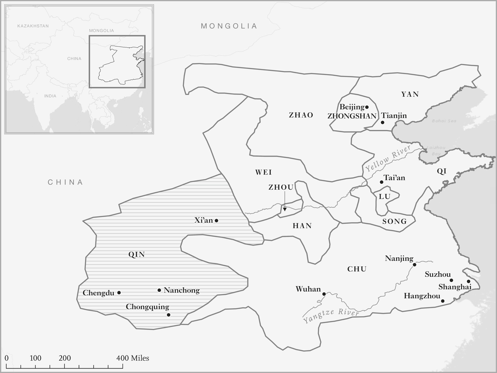
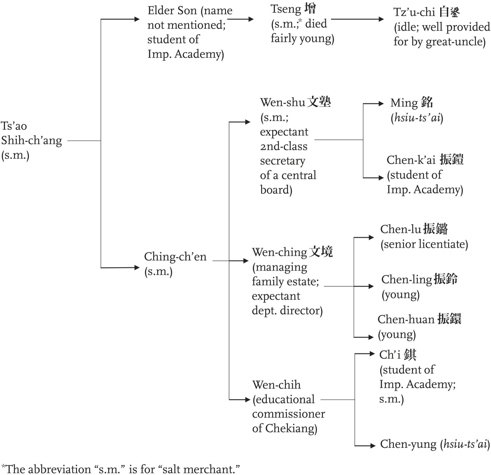

# Mandate of Heaven · 第7章　受命于天

## Capsizing the Boat · 水能载舟，亦能覆舟

Chinese history took a very different path from that of Europe and one that created far less liberty. But it didn’t start out that way. To see this let’s turn to an era in Chinese history known as the Spring and Autumn period, which began in the eighth century BCE. The Spring and Autumn period gave birth to Confucius, whose philosophy has been a mainstay of Chinese society and state institutions ever since. Confucianism placed great importance on the welfare of the people and argued that this was to be promoted by a virtuous ruler. As Confucius put it:

> 中国史的进程和欧洲史大不相同，创造的自由少得多，但起初并非如此。要看出这一点，我们要回到中国的春秋时代。春秋时代始于二千七百多年前，孔子就是在这个时代诞生的人，他的思想后来变成中国社会和国家制度的支柱。孔子重视人民福祉，认为明君应该提升人民的福祉，他说：「为政以德，譬如北辰，居其所而众星共之。」

One who rules through the power of virtue is analogous to the Pole Star: it simply remains in its place and receives the homage of the myriad lesser stars. His most famous disciple, Mengzi (often called Mencius), stated, “The people are the most esteemed,” and he reproduced an earlier document that argued that “Heaven sees through the people’s seeing, Heaven hears through the people’s hearing.” Such views were common in this period. Confucius himself noted that “a state cannot stand once it has lost the confidence of the people.”

> 意思是圣王要以类似北极星一般的崇高道德使较下层的人民臣服。他最著名的弟子孟子说过：「天视自我民视，天听自我民听。」这种认为天意透过人民来呈现的观念在春秋时代很常见，孔子本人就说过：「自古皆有死，民无信不立。」

Evidence that these ideas were relevant to the period’s politics comes from the ancient chronicle of Zuo Zhuan (Commentary of Zuo). It quotes Ji Liang, who was employed by the state of Sui. He advised the emperor that “the people are masters of the deities. Therefore, sage kings accomplished the people’s affairs first, and then attended to the deities.” Why were the people “masters of the deities” and “the most esteemed”? Most likely this was because society was sufficiently well organized to have some say in politics in this period.

> 《左传》记载的证据显示，这些观念跟春秋时代的政治状况有关。《左传》引述随国大夫季梁的话，说他建议随国国君：「夫民，神之主也，是以圣王先成民，而后致力于神。」为什么「夫民，神之主也」？为什么「民为贵」？最可能的原因是：春秋时代的社会组织相当良好，因而在政治上有发言权。

Indeed, during this era political power in China was so fragmented that scholars refer to the competing societies as “city states,” even comparing them to the Greek city-states. In Athens politics turned around the capital city, and the citizens could make or break political careers and ambitions. The Zuo Zhuan documents at least twenty-five instances where the dwellers of capital cities actively influenced internal power struggles, including conflicts over who was to become lord.

> 事实上，这个时代中国的政治权力极为分散，以至于学者把互相竞争的社会比喻为「城邦」，甚至拿来跟希腊的城邦相比。雅典的政治运作以都城为中心，公民可以造就或打断政治生涯与野心。《左传》记载了至少二十五个例子，说明春秋时代都城的居民积极影响内部权力斗争，包括影响立君之争。

Just as in Athens, in the state of Zheng the people were meeting to discuss and critique the policies and behavior of the government. A famous prime minister from this era, Zichan, is reported saying: The people at morning and dusk retreat and meet together in order to debate the goodness or badness of the power-holder. If I implement whatever they consider good and correct whatever they consider bad—then they are my teachers.

> 例如当时的郑国就像雅典一样，人民聚在一起，讨论和批评政府的政策和施政。根据记载，当时著名的贤相子产说过：夫人朝夕退而游焉，以议执政之善否。其所善者，吾则行之，其所恶者，吾则改之，是吾师也。

He goes on to note that trying to exclude the people would be “like obstructing the river: when it overwhelms the dam, more people will be hurt.” Mengzi agreed with the sentiment, writing: There is a way to attain the people: when you attain their hearts, you attain the people. There is a way to attain their hearts: gather them at what they desire, do not do whatever they detest, and that is all.

> 子产继续指出，想把人民排除在外，「然犹防川，大决所犯，伤人必多」。孟子赞同子产的看法，说道：得天下有道，得其民，斯得天下矣。得其民有道，得其心，斯得民矣。得其心有道，所欲与之聚之，所恶勿施尔也。（《孟子·离娄上》）

A later philosophical treatise known as the Xunzi summed up the politics of this period: The ruler is a boat; people are the water. The water can carry the boat; the water can sink the boat. In the photography section we reproduce a version of the original page of the Xunzi that includes this saying in Chinese characters.

> 后来荀子在〈王制篇〉中，总结这个时代的政治状况：君者，舟也；庶人者，水也。水则载舟，水则覆舟。我们在相片集插页中，放了一张有荀子这段话的中文书页照片。

## All-Under-Heaven · 受命于天，统治万民

The intellectual ferment of the Spring and Autumn period was followed by political consolidation and the emergence of seven large territorial states, and a few smaller ones, locked in incessant warfare (see Map 10). This Warring States period gave rise to a new and highly despotic political philosophy called legalism. This turned into a key pillar of the domination of the Chinese state over society. Shang Yang, also known as Lord Shang, was one of its most influential thinkers and practitioners. Born in 390 BCE, in the middle of the Warring States period, he was acutely aware of the chaos that state weakness could create.

> 百家争鸣的春秋时代结束后，继起的是政治巩固、战国七雄和几个小国征战不休的战国时代（参见 十）。主张高度专制政治哲学的法家新思想在这个时代里出现，后来还变成中国国家机器宰制社会的重要利器。受封为「商君」的商鞅是这个时代最有影响力的思想家和实行家。商鞅于西元前三九○年生于卫国，这时正是战国时代中期，因此他深切感受到国家羸弱可能造成的混乱。

Like Hobbes, who almost two millennia later would come up with a similar solution, Lord Shang saw the way out in building up the power of a Leviathan, because “the greatest benefit to the people is order.” If society were to be further weakened in the process, all the better, since Shang thought that when the people are weak, the state is strong; hence the state . . . strives to weaken the people.

> 他和将近二千年后出生、提出类似解决之道的霍布斯一样，认为建立国家巨灵的权力是解决方法，因为「夫利天下之民者，莫大于治」。如果能在这过程中进一步削弱社会，只会更好，因为商鞅认为：民弱国彊，民彊国弱，故有道之国，务在弱民。

He did not just think and write these thoughts, but proceeded to implement them. From his birthplace in the state of Wei, Shang Yang moved to Qin in order to become an adviser to its ruler, Lord Xiao. Under Xiao’s auspices Shang Yang proposed a radical series of reforms, which formulated a new legal approach, restructured land relations, started the reform of the administrative structure of the state, and set up more professional state institutions. By the next century, the centralizing reforms had turned Qin into an economic and military powerhouse that went on to conquer all the other states and found the first Chinese empire and recognized dynasty.

> 商鞅不仅思考和著书立说，写出《商君书》而已，还努力奉行自己的思想。他从出生地卫国，前往秦国出仕，担任秦孝公的宰相，并在秦孝公的支持下，推动一系列激进的改革：制定新的法律制度，整顿土地关系，同时改革国家机器的行政结构，设立更专业化的国家机构。到了下一个世纪，这种中央集权式的改革把秦国变成经济与军事强国，灭掉其他国家，创立了中国的第一个帝国和皇朝。

That this was already Shang Yang’s aim from his early days is evident from the first chapter of The Book of Lord Shang, the record of his ideas that has come down to us. The chapter titled “Revising the Laws” sets out a debate between Lord Xiao and three advisers, including Shang Yang. The lord was worried that institutional innovations would lead to the criticism of “All-Under-Heaven.” Xiao wasn’t just concerned about the opinion of the people in Qin, but All-Under-Heaven, meaning the whole world.

> 从《商君书》第一篇就可以清楚看出，这一点是他早年就已经设定的目标。把他的思想记录下来流传后世的《商君书》第一篇篇名叫做〈更法〉，其中记载秦孝公和包括商鞅在内的三位谋士辩论，秦孝公担心制度创新会遭到「全天下人」的批评；孝公不只担心秦国人民的意见，也担心全天下人的抨击。

The Lord of Qin thought this way because he had appropriated an earlier concept from the previous state of Zhou, whose rulers had developed the notion that they had been given a mandate to rule from Heaven. From that point on, emperors of China would claim that they too had received the “Mandate of Heaven.” But how can society constrain a ruler whose mandate comes directly from the heavens?

> 秦孝公会这样想，是因为他借用了过去周天子的观念，认为天子受命于天，统治万民。从那时起，中国的皇帝都会宣称自己也「受命于天」。但是，社会要怎么约束直接受命于天的皇帝呢？

Shang Yang didn’t think that such constraints were desirable. His aims were simple: “a rich state and a strong army.” Only such a powerful state could bring order and make sure that society did not get any ideas about participating in politics. Without this type of order, discord would result, and that had to be prevented. The Xunzi argues in strikingly Hobbesian language:

> 商鞅认为这种约束不足为训。他的目标很单纯，就是「富国强兵」，只有强大的国家才能带来秩序，确保社会不起参与政治的念头；没有这种秩序的话，混乱会随之而来，因此国家必须防止这种问题。荀子以极为类似霍布斯文字的语言，在荀子〈礼论篇第十九〉中指出：

Humans are born having desires. When they have desires but do not get the objects of their desires, then they cannot but seek some means of satisfaction. If there is no measure or limit to their seeking, then they cannot help but struggle with each other. If they struggle with each other then there will be chaos, and if there is chaos then they will be impoverished.

> 人生而有欲，欲而不得，则不能无求。求而无度量分界，则不能不争；争则乱，乱则穷。

It was natural to search for order and the institutions that could achieve it. But how was Qin to do it? The main tool would be the law—but not in the way that law came to develop from society’s norms and constrain rulers in the European context as we saw in the previous chapter. In Shang Yang’s vision, law and state power had to be used to turn everyone into either farmers or warriors. They would be rewarded for farming or fighting, and punished otherwise.

> 寻找能够实现秩序和制度的方法，是自然不过的事情，但秦国是怎么达成目标的呢？主要的工具是法律，却不是我们在上一章里所见欧洲式从社会规范发展出来、限制统治者的那种法律。商鞅认为，法和国家机器必须用来把每一个人变成农民或战士，为从事农作或战斗而获得奖励，否则就会遭到惩罚。就像《商君书》中说的那样：

The people can be induced to till and fight . . . it all depends on how superiors grant them [ranks and emoluments] . . . Those who do not work but eat, who do not fight but attain glory, who have no rank but are respected, who have no emoluments but are rich, who have no office but lead—these are called “villains.” In other words, the state and only the state gets to decide who and what is valued. Without the recognition of the state you are a villain.

> 故民，可令农战……（视乎）在上所与。上以功劳与，则民战……人之欲贱爵轻禄，不作而食，不战而荣，无爵而尊，无禄而富，无官而长，此之谓奸民。换句话说，只有国家可以决定什么人或什么东西的价值，你得不到国家的认可，就是奸民。

The people had to be controlled “as the metalworker controls metal and the potter clay.” To ensure that people focused on farming, it was critical to not “let the people shift locations on their own initiative,” and to penalize any other sort of economic activity. One way to accomplish this was to structure—or in fact distort—markets to make farming very attractive. Shang Yang proposed:

> 人民必须「若冶于金，陶于土也」一样，受到控制。为了确保人民专心务农，重要的是「使民无得擅徙」；为了惩罚任何其他经济活动，方法是改造──实际上是扭曲──市场，使务农变得更有吸引力。商鞅建议：

If you can cause merchants and peddlers and crafty and tricky people not to prosper, then even if you do not want to enrich the state, you will not but attain that. Hence, it is said: “He who wants the farmers to enrich the state makes food within the borders expensive. He must impose multiple taxes on those who do not farm and heavy levies on profits from the markets.”

> 苟能商贾技巧之人无繁，则欲国之无富，不可得也。所以曰却农富其国者，境内之食必贵，而不农之征必多，市利之租必重。

Those who did not farm were “crafty and tricky people.” It was a sentiment that would have profound consequences for China’s economic future as legalist thought came to shape both how the state approached business, and how merchants, industrialists, and peasants came to fear the state and withhold their cooperation from it. In the legalist model, order was the priority and it was to be achieved by an all-powerful ruler crushing society with the weight of the state and its law.

> 不务农的人就是「技巧之人」。这种情结会对中国的经济前途产生深远的影响，因为法家思想后来会塑造国家怎么对待企业，以及商、工、农怎么害怕国家、怎么拒绝跟他们合作。在法家的模式中，秩序最重要；必须靠着无所不能的统治者，运用国家的力量和法律镇压社会，才能实现秩序。

Even if the Confucian model disagreed with the heavy-handed approach of legalism and recommended moral precepts and earning “the people’s trust,” there was agreement between the two approaches on the basic tenet of despotism—that common people would have no say in politics and would certainly not become a counterweight against the power of the state and the emperor. It was only the moral behavior of the ruler that would make him take into account his subjects’ well-being. As Confucius put it: Commoners do not debate matters of government.

> 即使儒家的模式不赞同法家的高压手段，建议利用道德观念，赢得「人民的信任」，但儒家与法家都同意专制主义的基本信条。也就是说，人民在政治上没有发言权，而且绝对不能成为对抗国家权力和皇帝的平衡力量，只有统治者的道德行为会让他考虑臣民的福祉。就像孔子说的那样：天下有道，则庶人不议。

## The Rise and Fall, and Rise Again, of the Well-Field System · 井田制度的兴衰与再起

Shang Yang’s achievement was proposing a model of despotic state building that allowed the Qin to overwhelm the other six warring states over the next hundred years, bring an end to that chaotic epoch, and set up the Qin Empire. The details of how the state should be organized changed over the subsequent centuries as successive dynasties experimented with different versions. The reason for this was that while Shang Yang’s model was good at eliminating competitors, it didn’t provide an effective template for how to govern the new unified territories.

> 商鞅的成就是提倡一种建立专制国家的模式，让秦国在随后的一百年里，得以灭掉六国，结束混乱的战国时代，建立秦帝国。随后的两千年里，国家应该如何组织的细节多所变化，因为后续的朝代会实验各种模式；个中原因在于，商鞅的模式善于消灭竞争者，却不能提供有效的模式，治理新近统一的天下。

The version that the first Qin emperor, Qin Shi Huang, and his main adviser, Li Si, came up with involved very tight control. The empire was divided into thirty-six, and subsequently forty-two, commanderies, each headed by a governor, a military commander, and a superintendent. Beneath these appointees was an elaborate hierarchy of officials that exercised a suffocating grip over society, just as Shang Yang would have advocated. The nature of this control is illustrated by administrative documents published by the historian Enno Giele.

> 秦始皇和宰相李斯提出了非常严格控制的模式，把秦帝国先分为三十六郡，后来再分为四十二个郡县；郡设郡守，作为军政长官，下设复杂的官僚阶级，对社会实施极其严苛的控制，就像商鞅所倡导的那样。从史学家纪安诺（Enno Giele）大作中刊布的行政文件，可以看出这种控制的本质。

These show how an overseer of a sub-county unit wrote to the head of the county to approve the appointment of a new village chief and postman in a local hamlet. Four days after the request was filed, he got a negative response. The request was refused because the hamlet had only twenty-seven households and was deemed too small to have such officials. These documents reveal the intricate web of centrally appointed officials and the efficiency with which they dealt with requests, not to mention the extent of their knowledge (the precise twenty-seven households).

> 这些文件显示，某个郡县以下组织的首长发文呈请郡守，请求批准在地方上的一个小村子，任命一位新村长和驿站官员，四天后申请遭到驳回，理由是这个小村子只有二十七户人家，小到不需要设置这种官员。这些文件揭露了中央所任命官僚网络的绵密，以及官僚处理申请案的效率，更遑论官僚的所知极为深入（精确了解二十七户人家的事实）。

The Qin state also imposed a uniform system of weights and measurements, a unified coinage, and a calendar, and it standardized the script in which Chinese would be written. It also constructed an elaborate system of roads emanating from the capital, Xianyang. One of the most important and durable innovations was the “well-field system,” named after the Chinese character for a water well, a visual representation of nine equally sized plots of land required for the provisioning of a soldier-warrior.

> 秦朝也推动统一的度量衡制度、统一的钱币、历书，同时规定「书同文」，还以首都咸阳为中心，铺筑复杂的驰道系统。最重要、最悠久的创新是创设「井田制度」，按照「井」字形，平均分为九块大小相等、足以供养一个士兵的土地。

The well-field system emphasized the equal distribution of land along with the fiscal and military burden. It first appears in the writings of Mencius, who argued that benevolent government must begin with surveying and allocating lands. When boundaries are not drawn properly, neither the division of land according to the well-field system nor the levy of grain reserved for the ruler’s emoluments will be equitable.

> 井田制度强调土地、财政与军事负担的平等分配，最先出现在《孟子》一书中。孟子主张仁政始于测量和分配土地，如果不能正确地划定地界，那么根据井田制度分配的土地，以及统治者征收的谷禄都不会公平。夫仁政必自经界始。经界不正，井地不均，谷禄不平。

At this point a drawback of the Shang Yang model became evident. To support such an intrusive system it was not enough to have a “rich state,” it was also necessary to have a heavily taxed society. After all, someone had to provide the resources and the labor commissioned to build the 8,000 life-size terra-cotta warriors that Qin Shi Huang had commissioned for his mausoleum.

> 这时，商鞅模式的缺点开始变得明显。要支持这种侵入性的制度，光靠「富国」还不够，还必须创造出税负沉重的社会。毕竟，总是要有人提供资源和劳力，制造出秦始皇皇陵中八千个真人大小的兵马俑吧？

One consequence of heavy taxation was an upsurge of popular revolts that, shortly after the death of Qin Shi Huang, led to the overthrow of the Qin dynasty after a mere fifteen years of existence and only two emperors. The ultimate winner in the political instability that ensued was a peasant from the conquered state of Chu, Liu Bang, who founded the new Han dynasty under the title of Emperor Gaozu. Gaozu suspended the collection of taxes, eventually reducing them to one-fifteenth of the agricultural crop. He also reduced the extent of compulsory labor services that the Qin state had imposed.

> 重税的后果是秦始皇死后不久，人民就纷纷揭竿而起，以至于秦代只存续了十五年，只经历两个皇帝就遭到推翻；在随之而来的政治不稳定中，最后的赢家是出身遭到秦国灭亡的楚国农民刘邦。刘邦建立汉朝，是为汉高祖。汉高祖暂停征收税负，最后把税负降低为农作收成的十五分之一，他也缩小秦朝强征民力、从事义务劳动的范围。

The adjustments made by Gaozu were attempts to move in a more Confucian direction. He built on the legalist precepts and combined them with the ideas of Confucianism. Subsequent Chinese governments and laws, right up to the present, can be interpreted as a fusion of and oscillation between these two philosophies, each falling somewhere between Shang Yang and Confucius. Wherever they happened to be on the spectrum, they agreed on some basic principles. The most critical was the core tenet of the Despotic Leviathan—that of monarchical rule with an omnipotent emperor, providing the people with no role or say in government. The emperor was always above the law.

> 高祖所做的调整是试图偏移向儒家思想，他以法家思想为基础，结合儒家的理想，建立国家。此后一直到现在的中国政府和法律，都可以解释为在这两种思想之间的融合和摆荡，每个朝代都会落在商鞅和孔子之间的某一点。但是，不管落在什么地方，各朝都同意一些基本原则：最重要的原则是专制国家的核心理念──皇帝无所不能、皇权至高无上，人民在政府中没有地位，也没有发言权，皇帝总是高于法律。

Then came the idea that the state should be staffed and run by people of talent, which was necessary for the emperor to rule society in the way he wished. It also had roots in Confucian philosophy, which maintains that “one who excels in learning should devote himself to official service” and one should “promote those who are worthy and talented.” The final key principle was that the emperor should be concerned with the welfare of the people and constrained by moral precepts. This even included the idea that the emperor should promote citizens’ economic prosperity or, using a term from later dynasties, that he should “store wealth among the people.”

> 其次的原则是国家应该利用贤才推动施政，贤才也是皇帝根据自己的希望统治社会所需要的臣子，这一点也是从儒家「学而优则仕」和「荐举贤才」的思想而来。最后一个重要原则是皇帝应该关心人民福祉，受到道德观念约束。这个原则甚至包括皇帝应该提升公民的经济荣景的观念，用后代的说法来说，皇帝应该「藏富于民」。

These three principles amounted to a sort of social contract that gave the state some legitimacy. If they were violated, then people could rebel. It took some time for the Chinese emperors to come up with a working institutional model that would satisfy these three principles. The turning point came with the realization that it was difficult to micromanage society in the way that Shang Yang or the Qin emperors envisaged. It was just too expensive. To fund it you had to levy heavy taxes, either in kind or with money or labor services, and that was inconsistent with the last principle.

> 这三个原则等于某种社会契约，让国家获得若干合法性，如果国家违背这些原则，人民可以揭竿而起。中国的皇帝花了一些时间，想出能够满足这三大原则的可行制度模式，转捩点出在了解用商鞅或秦始皇设想的方式，会难以微管理社会，因为这样做的成本实在升高了：要融通这种做法，必须靠着横征暴敛和征用民力，才能得到所需的资源，这样做会违反第三项原则。

Without any way of allowing people to have a say in the government and how taxes were spent, high rates of taxation caused discontent and ultimately helped foment rebellion. As we’ll see, rebellion didn’t go away, but subsequent emperors decided to mitigate rebellion and discontent by reducing taxes, even though this also meant less state capacity to provide public services and even stable law enforcement.

> 不让人民在治理和税款怎么花用上拥有发言权时，高税率会引发民怨，最后会有助于酝酿反叛。我们已经看到，叛乱不会消失，但后来的皇帝决定利用减税，减少叛乱和民怨，即使这表示国家提供公共服务、甚至稳定执法的能力会降低，也仍然必须这样做。

Organizing authority to satisfy these three principles was tricky and it never worked perfectly. In fact, there was a constant struggle between the Shang Yang model of micromanagement and coercion, and the more relaxed Confucian strategy of greater withdrawal from society and a reliance on setting an example of good governance. The Han, though they reduced taxes and labor dues, initially kept much of the Qin vision.

> 组织政府机关，以便满足这三大原则很不容易，而且绝对无法顺畅地运作。事实上，商鞅无事不管理的强制模式，和比较宽松、减少介入社会、树立仁政榜样的儒家策略之间，斗争始终持续不断。汉朝虽然减少税负和劳役，却保持秦代的大部分看法。

The Qin had asserted direct control over the most productive assets, which included mines, forests, and even manufacturing processes such as foundries and workshops. So did the Han. However, with fewer tax revenues they were forced to temper their control of society and gradually retreated from the implementation of the Qin model. Over time the well-field system went into reverse and large landowners appeared in the countryside. But in the absence of any constraints on the power of the omnipotent ruler, these movements could always be reversed.

> 秦朝直接控制大部分的生产性资产，包括矿山、森林，甚至包括铸造厂和小型工场，汉代也是如此。然而，因为税收减少，汉朝被迫放松对社会的控制，逐渐从秦代的施政模式中退却。久而久之，井田制度向反方向发展，大地主在乡下出现，但因为统治者至高无上的威权没有任何约束，这种潮流总是可以逆转。

Over the next 2,000 years China was periodically rocked by various attempts to reassert the model of Shang Yang, the most recent being the rise to power of the Communists after 1949 who implemented their own version of the well-field system in the form of collectivized agriculture. The contemporary incarnation of the Confucian model is what we have seen since 1978 under Deng Xiaoping when collectivization went into reverse and Chinese leaders started attacking corruption, since this violated Confucian principles of virtuous rule. To know what’s likely to happen in the future in China, it is important to understand this historical oscillation between legalism and Confucianism.

> 随后的两千年里，中国总是定期受到回归法家模式的意图冲击，最近的一次是一九四九年共产政权的崛起后，以集体农业的方式，实施自己的井田制度。我们所看到在邓小平的领导下，集体共有制逆转，中共领袖开始反贪腐，因为这样违反孔子以德服人的原则，则是儒家模式在当代的体现。要知道中国未来可能有什么变化，重要的是了解这种在法家与儒家思想之间的历史性摆荡。

The first attempt to reintroduce strict state control over the economy after the demise of the Qin came from the Han emperor Wu, who ruled for fifty-four years, between 141 and 87 BCE. Wu started a royal monopoly on the production of iron and salt, and asserted control over most industries and commercial activities. The contemporary historian Sima Qian observed that “the wealth of the whole world was exhausted to serve the ruler, and yet he was not satisfied.” Wu’s reforms did not last.

> 秦朝灭亡后，首次试图重新对经济施加严格的国家控制的人，是从西元前一四一年至西元前八十七年，统治中国达五十四年之久的汉武帝。汉武帝开始实施国家垄断盐铁产销，坚持控制大部分工商活动。当时的史家司马迁指出：「古者尝竭天下之资财以奉其上，犹自以为不足也。」汉武帝的改革并没有延续下去。

The next person who tried the same thing was Wang Mang, who became regent to a Han child emperor in 1 BCE and declared himself emperor five years later when the child died. Wang launched a concerted attempt to reassert control over the economy and society which had been gradually slipping away. He decreed that all land belonged to the state, confiscated the estates of many large landowners, and created more state monopolies. In 23 CE a popular insurrection against his policies broke out, culminating in the capture of the imperial palace and Wang’s death. Thereafter the well-field model went into reverse once again, and by 30 CE universal military service had been abolished, so society was no longer based on the farmer-solider complex.

> 王莽继之以试行改革。西元前一年，王莽立年仅两岁的孺子刘婴为皇太子，自称「摄皇帝」；五年后孺子婴去世，王莽称帝，改国号为「新」。他推行协调一致的新政，试图重新掌握逐渐流失的经济与社会控制权；他还下令土地收归国有，没收很多大地主的土地，创造更多国有独占事业。西元二十三年，反对王莽新政的民众揭竿而起，攻陷京师长安，王莽败亡。此后井田制度的模式再度逆转，到西元三十年，全面兵役制度废除，社会不再以兵农合一制为基础。

The Han dynasty ended in 220, to be replaced by a series of short-lived regimes. In the north these were dominated by nomadic tribesmen from inner Asia, while in the south various offshoots of Han power sprang up. Prior to the reunification of China under the Sui dynasty in 581, there were again attempts to reassert the Shang Yang model, including during the Northern Wei dynasty that lasted from 386 to 524 in northern China. In 485 the Wei came up with their “equal-field system,” which was maintained after 581 by the Sui and then by the Tang dynasty when they took over in 618.

> 西元二二○年，汉朝灭亡，代之而起的是一系列的短命政权，北方由出身内亚的游牧民族宰制，不同的汉人分支政权则在南方纷纷崛起。西元五八一年，隋朝统一中国前，有些统治者再度试图施行法家的模式，包括从三八六年至五二四年统治北方的北魏。西元四八五年，北魏孝文帝推行「均田制」，五八一年后继起的隋朝，和六一八年创立的唐朝，都维持均田制。

What sealed the fate of this new version of the well-field system was the An Lushan rebellion, which broke out against the Tang in 755. Though it was finally suppressed in 763 after it sacked the capital, Chang’an, the rebellion cost the lives of hundreds of thousands of people and devastated the Tang state. With the state’s ability to control society in tatters, the equal-field system collapsed and private ownership of land became the norm.

> 七五五年爆发的安史之乱，叛军攻陷京师长安，终结了均田制这种新版的井田制度。虽然唐朝最后在七六三年平定安史之乱，这场变乱却造成数十万人死亡，唐朝元气大伤。随着国家控制社会的能力破碎不堪，均田制也跟着崩溃，土地私有制变成新的标准。

In 960 a new dynasty, the Song, replaced the Tang and initiated another restructuring similar to the initial Qin-Han transition. Though there were major continuities, the mode of governance shifted from legalism toward Confucianism. One fruit of this restructuring was the more definitive consolidation of bureaucratic control, with the examination system for entry into the civil service replacing the prior recruitment system based primarily on recommendations. (Another fruit was economic growth, as we’ll discuss a little later.) Meritocracy in the civil service, however, was later systematically undermined both by the selling of offices, which took off in the seventeenth century as the state’s fiscal resources declined, and by continual government meddling.

> 西元九六○年，宋朝建立，结束了五代十国的乱局，重启类似当初秦汉过渡时期的改革。虽然改革中存在着连续性，但统治模式却从偏向法家思想，变成偏向儒家思想。这种改革的成果之一是明确巩固官僚的控制，考试用人、拔擢官员的制度，取代了过去主要以推荐为基础的征召制度（另一个成果是经济成长，这一点稍后会讨论）。然而，到了十七世纪时，文官制度中的菁英主义却因为国家财力衰微，买官鬻爵风气兴起，加上政府的持续干预，因而遭到有系统地破坏。

In 1127 the northern part of Song China was conquered by the Jurchen people from inner Asia, who formed a new dynasty, the Jin. The Song moved their capital south in response, but then both the Jin and the rump Song Empire were conquered by the Mongols, led by Qubilai Khan, who set up the Yuan dynasty. After Qubilai died in 1294, there were another ten emperors before the Yuan dynasty also collapsed in the midst of mass revolts in the 1350s.

> 西元一一二七年，出身内亚的女真人征服北宋，建立金朝；宋室南迁，建都临安。然而，随后金国和南宋都被忽必烈所领导的蒙古人灭掉。忽必烈建立元朝后，于一二九四年去世。元朝再经历十位皇帝后，在一三五○年代的大规模民变中灭亡。

In the meantime they had reconfigured the previous organization of the Chinese state, imposing a personalized model based on the hierarchy of their Mongol tribes and organizing the Chinese into hereditary occupational castes. Labor service was introduced as were a plethora of new taxes. Artisans were carted off en masse to the Mongol capital, Dadu, now Beijing, to meet the demand for goods and labor. The Yuan were overthrown by Zhu Yuanzhang, who founded the Ming dynasty in 1368 after two decades of civil war. Taking the title Emperor Hongwu, he set off the Ming on the Shang Yang end of the spectrum.

> 不过，元朝时却改组了中国过去的国家组织，根据蒙古部落和国家的阶级制度，实施个人化的模式，把中国人划分为不同的世袭职业种姓阶级（四等人制），推行劳动服务，开征众多新税，把工匠大规模载送到现在是北京的首都大都，以便满足商品和劳力的需求。一三六八年，明太祖朱元璋经历了二十年内战后，推翻元朝，建立明朝，建号「洪武皇帝」，开启明朝偏向法家思想的统治。

Hongwu quickly moved to concentrate more power in his hands, for example by abolishing the position of prime minister, which had until then acted as the voice for the civil service. In 1373 he abolished the examination system because he disliked the results, and he heavily and violently purged the civil service several times. Hongwu then attempted to return China to a new version of the well-field system. During his thirty-year reign, Hongwu strove to reverse the marketization of the economy and even went back to collecting taxes in kind rather than in money. In 1374 he banned overseas trade with an edict known as the “sea ban,” a prohibition that would last until close to the end of the sixteenth century (only to be reimposed periodically thereafter).

> 明太祖迅速把更多权力集中在自己手里，例如，废除到当时为止文官体系之首的宰相位置；更在一三七三年，因为不满考试的结果，废除考试制度；还多次大力残暴迫害官员，然后试图让国家恢复新版的井田制度。他在统治国家的三十年间，还力图扭转经济的市场化趋势，甚至恢复课征实物税，而非课征税款的做法。一三七四年，明太祖颁布「海禁」，禁止海外贸易，禁海令一直延续到十六世纪末年（此后还定期重新颁布实施）。

Starting in 1380, Hongwu initiated a massive expropriation of land from large landowners and by the end of his reign perhaps half of the land in the core province of Jiangnan, around the Yangtze delta where his capital, Nanjing, was, had been seized by the state. Despotic state power remained palpable throughout the Ming dynasty. In the 1620s Confucian-inspired criticism of the state emerged with the founding of the Donglin faction around the Donglin Academy in Wuxi County, about 50 miles west of Shanghai. This group even had the effrontery to compose a memorial they called the “Twenty-Four Crimes” (of the state).

> 明太祖从一三八○年起，开始大规模没收大地主的土地，到他统治结束时，首都南京所在长江三角洲周围的核心省份江苏省中，大约有一半的土地遭到国家没收。整个明朝期间，专制国家的痕迹清晰可见。到一六二○年代，以上海西方大约五十英里的无锡县东林书院为根据地的东林党成立，由儒家思想启发的批评国家言论开始出现；东林党人甚至肆无忌惮地上书，弹劾魏忠贤的二十四大罪。

The response of the Tianqi emperor was to execute twelve of the leaders, while a thirteenth committed suicide. Hundreds more accused of being sympathizers were purged. Their supporters persisted along with other groups inspired by them, such as the Restoration Society (Fushe), only to be ruthlessly repressed by the Qing in the 1660s. Criticism was not allowed. The Song-Ming transition, taking China back toward legalism, reminds us that an unbridled state doesn’t spell liberty for the citizens. On the contrary, it is typically the basis of dominance in the hands of the state, which is what Lord Shang recommended and the Ming quite happily followed.

> 天启皇帝（明熹宗）的反应是诛杀十二位主事者，第十三位主事者自杀，数百位被控同情东林党的人遭到迫害。但是，他们的支持者和受他们启发的团体如复社，始终坚定不移；不过，这些团体却在一六六○年代，遭到清朝的无情镇压，因为清朝不能容忍清议。宋明交替的过渡期间，法家思想在中国重现，提醒我们一件事：不受约束的国家不会为公民带来自由。情形正好相反，这种情形通常是国家所掌控宰制权的基础，也是商鞅所推崇、明朝相当乐于遵行的东西。

## Cutting the Queue · 留发不留头

The intensifying despotism of the Ming state led to a series of uprisings, such as the Red Turban rebellion in the 1620s, underscoring one of the key drawbacks of the legalist model. The dynasty was finally swept away by internal dissent and the opportunism of another expansionary inner Asian people, the Manchus, who formed the Qing dynasty. A firsthand account of the expansion of Manchu power comes from a local history of T’an-ch’eng County, situated close to the coast roughly halfway between Beijing and Shanghai:

> 明朝愈来愈严苛的专制主义引发一系列的起义，包括一六二○年代的红巾贼之乱，这些起义突显了法家模式的缺点。最后，明朝终于亡于内争，遭到内亚适时壮大、建立清朝的满族所灭亡。满族势力扩张的第一手纪录，出自北京到上海大约半途处近海的《郯城县志》：

It was on 30 January 1643 that the great army invaded the city, slaughtered the officials, and killed 70 or 80 per cent of the gentry, clerks and common people; inside the city walls and out they killed tens of thousands, in the streets and the courtyards and alleys the people all herded together were massacred or wounded, the remnants trampled each other down, and of those fleeing the majority were injured. Until 21 February 1643 the great army pitched its camps in our county borders . . . They stayed for twenty-two days; over the whole area many were looted and burned, killed and wounded. They also destroyed Ts’ang-shan-pao, killing more than ten thousand men and women there.

> 一六四三年元月三十日，大军侵入县城，屠杀官员，杀害七成到八成仕绅、职员和平民；他们在城里、城外杀害数万人，街巷、广场的人群全都被他们赶在一起，集体屠杀和伤害，其余军队人蹂躏每一个乡镇，逃走的人大部分都受到伤害。到一六四三年二月二十一日，大军在我县境内扎营……停留二十二天，在整个县境内烧杀掳掠，伤害人民。他们也摧毁了长山堡，杀害上万男性和女性。

By 1644 the Manchus, even if they didn’t seem intent on “winning hearts and minds,” had taken Beijing and established what would be the last Chinese dynasty. Before they could get there, a bandit leader, Li Zicheng, created another dynasty that lasted six weeks. His improvised regime graded elites, eunuchs, merchants, great landlords, and high officials by income levels and took some 20 to 30 percent of their wealth. Li himself accumulated a fortune of 70 million taels of silver. He even started to talk about the equal-field system, before he was ejected from the throne by a Manchu army.

> 到一六四四年，看来似乎无意「赢取民心」的满洲人已经占领北京，建立后来的清朝，也是中国最后一个王朝。但是，在满清攻进北京前，流寇首领李自成建立了另一个只延续六个星期的王朝，他的临时政权根据所得水准，将菁英、太监、商人、大地主和高官分等，拿走他们百分之二十至三十的财产。李自成本人大约聚敛了七千万两白银的财富，甚至在满洲人把他赶下宝座前，还放言要建立均田制。

The Manchus, like the Mongols, were outsiders and had to bring the indigenous Chinese under control. One interesting strategy was the “tonsure decree” which stipulated that all men had to adopt the hairstyle of the Manchus with shaved forehead and a pigtail. The Qing decided that this was a way to force all Chinese to conform to the new dynasty. In March 1647, three years after the Manchus had first occupied Beijing, Chang Shang, the governor of Kansu Province, was on an inspection tour. By March 4 he had reached Yung-ch’ang, a county lying just within the Great Wall. Assembled to greet him was the entire student body of the county school.

> 满族像蒙古人一样，是外来政权，必须驯服汉人。满族采用的「薙发令」是个有趣的策略，薙发令规定，所有男性都必须留满族发式，剃掉额头上方的头发，留着辫子。清朝认定这是强迫所有中国人配合新朝代的方法。一六四七年三月，满清入关、占领北京三年后，汉军旗人出身的甘肃巡抚张尚巡察辖内，三月四日，他巡察到长城内侧不远处的永昌县，县学所有生员都聚集在一起迎接他。他指出：「中有一人，臣默窥其蓄发。

He noted, “I espied one man who seemed to have retained the hair on the front of his head. After I reached the county yamen [the residence of the local magistrate], I summoned all of the students for academic examination” and “I personally went over to the man in question and removed his cap. Indeed, his hair was totally unshaven.” Local officials assured Chang that posters reporting the tonsure decree had been posted and that the culprit, Lü K’o-hsing, had no excuse. Chang had Lü thrown into jail and wrote to the emperor requesting that he be immediately executed “to uphold the laws of the ruling dynasty.”

> 及至公署，随唤通学进试，亲自去帽验看。本生吕可兴，果然全发未剃。」（我瞥见有一个人额头上方似乎仍然留着头发。我到县衙后，召集所有生员参加考试，亲自走到有问题的那个生员旁边，摘下他的头巾，他的头发确实没有剃掉。）地方官员向他保证，宣布剃发令的布告确实已经贴出，违抗命令的生员吕国兴无法狡辩。张尚下令收押吕国兴，并呈报皇帝，请求立刻处死吕国兴──「立刻枭首，以彰国法」。

The reply quickly came, “Let him be executed on the spot. But what about the local officials, the household head, the local headman, and the neighbors?” The outcome was that Lü’s unshaven head was cut from his body and displayed in public to “warn the masses.” The patriarch of Lü’s household, along with the local headman and neighbors, were all beaten and the county magistrate was fined three months wages.

> 圣旨迅速传来，批准「吕可兴即就彼正法。这不剃头的该管、地方官并家长、乡约地保、邻佑，应得罪名，又有成例，如何不遵？」结果没有剃发的吕国兴遭到斩首示众，以便「警告百姓黎民」。吕氏族长、保甲领袖和邻人遭到杖打惩处，知县罚俸三个月。

The Qing dynasty’s anxiety about hairstyles persisted throughout their reign. In 1768 a mass scare of “soul stealing” gripped the empire. There was a rash of cutting men’s queues, supposedly to steal their souls. A captured soul would allow one to exert power over others. The Chinese government, under the Qianlong emperor, reacted vigorously to accusations of queue cutting. One technique they regularly used to get to the bottom of a case was the chia-kun, or “pressing beam,” which was applied to extract a confession.

> 清朝的发式焦虑一直延续到灭亡为止。乾隆三十三年（一七六八年），「叫魂」妖术的群众恐慌席卷大清帝国全境。据传当时发生多起剪掉男人辫子，据以作法、盗取辫子主人灵魂的案子，被人叫走的灵魂可以让施法者获得操纵别人的法力。乾隆皇帝统治下的满清政府对剪掉辫子的指控反应激烈，政府查明案子真相常用的手法，包括动用「夹棍」刑求，获取认罪供词。

This could either be an “ankle-press,” a device for slowly crushing the ankles, or an alternate instrument that created multiple fractures of the shinbones. One accused of soulstealing in 1769 was a monk, Hai-yin. When arrested he was found to be carrying some short lengths of hair, which he claimed he had obtained years before, and indeed he was carrying them on a pole in full sight. He was interrogated and the local authorities decided that torture was required to get to the truth.

> 夹棍分两种：一种是「踝夹」，可以慢慢地夹碎脚踝；另一种是会造成胫骨多重破裂的夹棍。乾隆三十四年（一七六九年），海印和尚遭到涉嫌叫魂的指控，他被捕时，带了一些发辫，他声称多年前就已经取得这些发辫，而且事实上，他是把发辫挂在人人清楚可见的禅杖上。他因此遭到审问，地方主管官员认定必须刑求，才能得到真相。

But the monk was resilient, and after a few days, the local authorities remarked, “If we torture him more just now, he might die, and then we would be unable to uncover anything.” “Right,” the Qianlong emperor jotted in the vermilion-colored ink he used when annotating official documents. Hai-yin resisted further and the emperor was informed that unfortunately the prisoner “had contracted a prevalent illness of the season” and was also suffering from infected torture wounds.

> 但是，海印很有韧性，经过几天后，地方官员表示：「若急用刑夹，恐或致毙，反至无可根究。」乾隆皇帝在地方官员呈上来的奏折上用御笔朱批：「是。」海印继续对抗刑求，地方官员上奏乾隆皇帝，说犯人不幸「适患时气病症」，同时受刑的伤口也遭到感染。

In fact, the situation got so frustrating that the local magistrate decided that it would be “better to publicly execute him in order to dispel the suspicions of the crowd,” since rumors had started to fly around after Hai-yin’s arrest. Therefore the authorities “had the criminal taken to the public square and beheaded and the head exposed to show the crowd.” Another monk, Ming-yuan, was similarly accused. Within a week of being arrested he was dead. “Noted,” the Qianlong emperor added in vermilion. So it wasn’t just the Franks who were obsessed with hair, even if the Qing showed their obsession in quite a different manner.

> 事实上，情势变得令人极为困扰，因此知县决定，「宜显戮以释众疑」，因为海印被捕后，谣言开始疯传，因此主管官员「将该犯押赴市曹正法，悬首示众」。另一位和尚明元也遭到类似罪名指控，却在被捕一周内死亡。乾隆的朱批是：「知道了。」因此，不仅法兰克人对头发很执着，连清朝也用大不相同的方式表现他们对头发的执着。

Enforcement of the tonsure decree wasn’t the only way the Qing signaled to their newly conquered people that they meant business. In May 1645 elites in the Yangtze delta rebelled against the new state and Qing generals massacred about 200,000 men, women, and children. An eyewitness account, A Record of Ten Days in Yangzhou by Wang Xiuchu, makes for harrowing reading. After Qing forces had destroyed the city of Yangzhou, the survivors were sent on a forced march:

> 清朝不是只靠执行薙发令的方式，告诉新征服的人民他们很重视统治。清顺治二年（一六四五年），长江三角洲的菁英反叛清朝[〔注1〕](#note-1) ，清军将领大约屠杀了二十万男女老幼。王秀楚亲眼目睹后，写下《扬州十日记》，读来令人痛苦万分。清军攻破扬州城后，幸存的人民被迫踏上强迫行军之路，下面是王秀楚写的一段纪录：

Some women came up . . . they were partially naked, and they stood in mud so deep that it reached their calves. One was embracing a girl, whom a soldier lashed and threw into the mud before driving her away. One soldier hoisted a sword and led the way, another leveled his spear and drove us from behind, and a third moved back and forth in the middle to make sure no one got away. Several dozen people were herded together like cattle or goats. Any who lagged behind were flogged or killed outright.

> 二妾皆散发露肉，足深入泥中没胫，一妾犹抱一女，卒鞭而掷之泥中，旋即驱走。一卒提刀前导，一卒横槊后逐，一卒居中，或左或右以防逃逸。

The women were bound together at their necks with a heavy rope—strung one to another like pearls. Stumbling with each step, they were covered with mud. Babies lay everywhere on the ground. The organs of those trampled like turf under horses’ hooves or people’s feet were smeared in the dirt, and the crying of those still alive filled the whole outdoors. Every gutter or pond that we passed was stacked with corpses, pillowing each other’s arms and legs. Their blood had flowed into the water, and the combination of the green and red was producing a spectrum of colors. The canals, too, had been filled to level with dead bodies.

> 数十人如驱犬羊，稍不前，即加捶挞，或即杀之；诸妇女长索系颈，累累如贯珠，一步一蹶，遍身泥土；满地皆婴儿，或衬马蹄，或藉人足，肝脑涂地，泣声盈野。行过一沟一池，堆尸贮积，手足相枕，血入水碧赭，化为五色，塘为之平。

## Despotism on the Cheap · 廉价的暴政

Being outsiders, the Qing felt their reign was more precarious than their predecessors’, and were concerned that taxation would incite opposition against their rule. This was, as we have seen, a familiar theme going back to the founding of the Han dynasty. One scare was the Ma Ch’ao-chu conspiracy of 1752.

> 满清因为是外来异族，觉得统治比过去的朝代危殆，担心征税会激发人民反抗他们的统治。我们已经看到，这是回溯到汉朝建立时就已经开始出现的熟悉主题。乾隆十七年（一七五二年）的马朝柱之乱是这种恐惧中的一次。

Ma was a peasant from Hupei who fell under the influence of a monk who convinced him that he had a grand destiny. Ma began to assert connections with the remains of the Ming regime that now inhabited the “Kingdom of the Western Sea” and was ruled by a Ming “Young Lord.” The kingdom supposedly contained 36,000 armed warriors as well as the Ming general Wu San-kuei. Ma gathered followers, claiming that he was a general in this kingdom and that magic flying machines would bring the kingdom’s army to attack the Yangtze valley at any moment.

> 马朝柱是湖北省农民，受到一位和尚说他是「天命神授」的影响，开始声称当时流落到「西洋」的南明「出有幼主」，以此拉上关系，说南明大将统兵三万七千人[〔注2〕](#note-2) ，还得到明朝降将吴三桂之助。马朝柱聚众宣称自己是南明将军，神秘的飞行机器随时会载运兵将，进攻长江三角洲。

As Ma’s movement gained momentum, officials fortuitously discovered newly forged swords at what turned out to be one of his camps. Ma fled, but some of his relatives were captured. A manhunt was launched which led to the arrest of hundreds of suspects and went on for years even though Ma was never found. Captured disciples related how, upon joining the group and entering one of Ma’s bases, people “smeared their mouths with blood and swallowed paper charms. Also they let their hair grow long and didn’t shave their foreheads,” a clear anti-Qing gesture.

> 马朝柱的匆忙起义得到响应后，清朝官员在他的一处军营中，发现新铸的「神剑」。马朝柱起义失败后逃走，但一族却遭到逮捕后就地正法。清朝发动大索天下，逮捕数以百计的嫌疑犯；搜捕多年，却根本没有找到马朝柱。被捕的马朝柱从众供称，他们加入这个团体时，曾进入马朝柱的某一个基地，大家「歃血吞符，也留起长头发，并不薙发」，明显反清。

Those arrested were “tortured with extreme severity” and their lives were only spared if they confessed. The Qianlong emperor noted in vermilion, “A single spark can start a prairie-fire.” The Qing state was always anxious about rebellion (and for good reason), though this did not mean that they refrained from arbitrary actions. These included the reimposition of the Ming sea ban and Emperor Kangxi’s forceful removal in 1661 of essentially all people who lived along the entire southern coast of China to ten miles inland to control trade and piracy.

> 被捕的犯人遭到「极为严酷的刑求」，只有供称涉案，才能免死。乾隆皇帝在朱批中指出「星火可以燎原」。清朝总是（理由十足地）对叛乱感到焦虑，不过这样并不表示他们不会任意行动，这些行动包括重申明朝的海禁，而且顺治皇帝在顺治十八年（一六六一年）[〔注3〕](#note-3) 下达「迁界令」，强迫中国东南沿海所有居民，向内陆迁移三十至五十里，以便控制贸易和海盗。

To deal with the threat of rebellion, the Qing decided in 1713 to take a step toward the Confucian end of the legalist-Confucian axis and freeze the major source of income for the state, land taxes, in nominal terms. From then on everyone paid a fixed sum of money per mou (conventionally taken to be approximately 0.15 acres). Since prices rose substantially during the century, the real value of tax revenues available to the state fell dramatically. There wouldn’t be much public service provision under the Qing.

> 清朝为了应付叛乱威胁，于康熙五十二年（一七一三年），决定采取行动，向儒、法两家治道主轴中的儒道方向踏进一步，冻结国家岁入主要来源的土地税。从当时开始，每亩土地（约六．六七公亩）只要缴纳固定的租税，因为这个世纪里，物价大幅上涨，国家收到的税收价值剧烈下降，有清一朝，政府都无力提供多少公共服务。

Indeed, the few public services that the state provided, such as the granary system of famine relief and large infrastructure projects such as the Grand Canal, withered away. The state could no longer afford to buy the grain needed to stock the granaries, and by 1840 the Canal had fallen into disrepair and was impassable. Between 1824 and 1826 the whole system for controlling the waters of the Yellow River collapsed as a consequence of the lack of maintenance of the locks and dikes, and the absence of dredging necessary to stop silting. Devastating floods followed.

> 事实上，国家提供的公共服务少之又少，赈济灾民的粮仓制度和大运河等基础建设项目逐渐毁损，国家再无能力购买储存在粮仓中的赈粮。道光二十年（一八四○年），大运河残破不堪，已经不能通航。一八二四年至一八二六年间，控制黄河河水的河堤系统崩溃，起因是水门和堤坝年久失修，又缺少施作防止淤积的疏濬工程，结果就是洪水横流。

It’s worth understanding how the Chinese state was organized at this time, and why it was unable to support commercial and industrial activities or supply many public services. At the top were six ministries or boards—personnel, revenue, rites, war, works, and punishment. The terminology was long-lasting and interesting; not justice, but hsing pu, translated as “punishment.” In fact, the oldest known legal codes inscribed on bronze vessels were called not law books or legal codes, but “Books of Punishment,” very much consistent with how Shang Yang thought about the law. The Tang code of 653 is the oldest surviving complete legal code that we have (only fragments of the Qin code remain).

> 中国的国家机器是如何建构，又为什么无法支持，或提供很多公共服务？这值得我们了解。政府机构的最上层是吏、户、礼、兵、刑、工六部。六部的名称历史悠久，相当有趣，例如，不叫「法部」而叫「刑部」，意思就是「刑罚」。事实上，刻在青铜器上最古老的中国法规不叫法典或法条，而是叫做「刑书」，非常符合商鞅对法律的想法。西元六五三年的唐律，是现存最古老的整套法律规章（秦律只剩断简残编）。

It was modified significantly over the years, and the Qing produced their definitive version in 1740. These codes reaffirm that Chinese laws weren’t there to provide justice and certainly not to support liberty, but to administer and regulate society. They were not interested in defendants’ rights against the state. Any law could be modified or nullified by the emperor, who was above the law. The treatment of defendants in judicial procedures suggests that the defendant was guilty until proven innocent. Just in case they had forgotten something, statute 386 of the Qing penal code allowed for a severe beating to be administered to someone “doing what ought not to be done.”

> 这么多年来，中国的律法经过重大修正，清朝在乾隆五年（一七四○年）时修订《大清律例》，推出最后的定版时，目的不是为了提供正义公理，更绝对不是为了支持自由，而是为了管理和规范社会。律例无意伸张被告对抗国家的权利，任何法律都可以由皇帝修改或废除，皇帝高于法律之上。司法程序中对被告的处理方式，表示法律对被告的态度是在证明被告无罪前，先做有罪推定。为免犯人遗忘，《大清刑律》第三八六条容许官衙严刑拷打「做了不当行为」的被告。

As we have seen, one of the great claims to fame of the Chinese state was that they chose civil servants through a system of competitive examinations. The aspiration for meritocracy was present even in the days of the Qin, though it only became more systematic with the Song and perhaps reached its zenith with the Qing. There were three layers to the exam. At the lowest level people could attempt to qualify as licentiates. By 1700, some 500,000 people had qualified at this lowest level. Twice every three years several thousands of them were certified to gather in their provincial capital for a test that took three days and two nights. About 95 percent failed. The stakes were very high.

> 我们已经知道，中国的国家机器声名鹊起，主因是政府透过竞争性的考试制度，拣择官员。早在秦代，国家就有着用人唯才的志向；只是到了宋朝，才变得更为制度化；到了清朝，科举制度可能发展到了最高峰。科举考试分为三级，考过最低级的乡试后，就变成「生员」（俗称秀才）。一七○○年时，清朝大约有五十万人取得生员的资格。每隔三年，数万考生会聚集到各省省会，参加时间为三天两夜的两次会考，大约百分之九十五的生员会名落孙山，考试涉及的利益极大。

Passing the provincial exam guaranteed permanent elite status and important tax and legal exemptions. Members of officialdom could not be arrested, investigated, or tortured without permission of the emperor, and if found guilty, the usual punishments inflicted on commoners, such as bambooing, exile, or death, were commutable to monetary fines. There was the chance to get an official position as well. There was still one more rung to go, however. In the year after the provincial examination, those who had passed gathered in Beijing for the metropolitan exam.

> 通过省级乡试的人叫「举人」，举人保证会得到终身菁英的地位，重要的是，还会获得税务和法律上的豁免。未得皇帝的允许，不得逮捕、调查和刑求官僚集团中的成员；如果举人被判有罪，用在平民身上的鞭笞、流放或死亡刑罚，通常可以易科罚金；举人也有机会当官。然而，科举制度中还有一个阶梯要爬，在两次乡试放榜后，通过乡试的人要聚集北京，参与会试。

There were only 300 slots to be filled, and 90 percent of the candidates failed. These 300 winners were then personally graded by the emperor with the highest chosen for work in the central ministries and the lowest assigned as subnational officials, such as the magistrates. In the Qing period there were about 1,300 counties, grouped into 180 prefectures, which were in turn combined into eighteen provinces, each with a governor. Each county had a magistrate, the executive arm of the Qing state in the county.

> 会试的录取名额只有三百人，百分之九十的考生都会落榜，这三百位赢家之后要在殿试中，由皇帝亲自打分数，分数最高的人会获选留在中央部会任职，分数最低的下放到地方机关，出任知县等职位。清朝时期大约有一千三百个县，几个县组成一百八十个府，再组合成为十八个行省，每个省设总督，每个县设知县，等于朝廷派到各县的行政长官。

Because the population of the empire by the end of the seventeenth century was around 300 million, this meant that on average a magistrate was in charge of around 230,000 people. Large counties could easily have one million people in them. Each magistrate had a staff working for him, but these were not state employees; either the magistrate had to pay them himself out of his own stipend or they had to live off what scholars of China translate into English as “squeeze,” what they could extract from ordinary people.

> 因为到十七世纪结束时，清朝人口已经增加到大约三亿人，表示一位知县大约要治理二十三万人，大县人口轻易可达一百万人。每个知县都有幕僚协助施政，但幕僚不算国家公务员，他们的薪资不是靠知县的俸给支付，就是要靠着「压榨」百姓的所得来为生。

When it came to his judicial functions, the magistrate was the detective, prosecutor, judge, and jury all rolled into one. In addition, he was in charge of public works, defense, and policing. What did these very difficult civil service exams ask? In 1669 the examiners of Shantung asked the aspirants of T’an-ch’eng County to ponder and explain three passages of text.

> 知县在司法上身兼探长、检察官、法官和陪审团；此外，还要负责公共工程、国防和维持治安。这种非常困难的公务员考试考些什么问题？一六六九年，山东省考官要求有志应考的郯城县考生，思考和解释经书上的三段文字。出自《论语》的一题是「子曰：『知之者不如好之者，好之者不如乐之者。』（试申其义）」。

From the Analects of Confucius there was, “They who know the truth,” and then, “The Master said, ‘Man is born for uprightness. If a man lose his uprightness, and yet lives, his escape from death is the effect of mere good fortune.’ The Master said ‘They who know the truth are not equal to those who love it, and they who love it are not equal to those who delight in it.’” They also had to reflect on the man of sincerity: “Shall this individual have any being or anything beyond himself, on which he depends? Call him man in his ideal, how earnest he is! Call him an abyss, how deep he is! Call him Heaven how vast is he!” There was also a passage from Mencius.

> 然后，第二题是「子曰：『人之生也直，罔之生也幸而免。』（试申其义）」。此外，考生也必须思索：仁者「夫焉有所倚？肫肫其仁，渊渊其渊，浩浩其天」。第三个考题出自《孟子》。

All the students failed. In fact not one student from T’an-ch’eng passed the exam between 1646 and 1708. Though the examination system was competitive, it did not test or encourage any technical knowledge or for that matter any skills that would be relevant for running a bureaucracy or governing the country. Magistrates were supposed to enforce the law without any legal training, and there were no private lawyers or law practitioners.

> 结果所有生员全都没有考过。事实上，一六四八年至一七○八年间，郯城县没有半个考生通过这种考试。）虽然科举制度竞争激烈，却不测试或鼓励任何科技知识，或跟管理官僚体系或治理国家有关的任何技术。知县理当可以在没有任何法律训练下执法，而且全国没有私人律师或执业法务人员。

Many nonmeritocratic elements had also crept into the system. As many as one-third of magistrates were appointed at the recommendation of governors. Perhaps most important, the whole system was immensely personalized in the hands of the emperor, who could appoint, promote, and demote people at will. As the Qianlong emperor put it himself, “The evaluation and selection [of high officials] will be daily borne in Our breast.”

> 很多非属菁英领导的因素也掺入这种制度。高达三分之一的知县是靠着总督的推荐，才获得任命。或许最重要的是，整个制度极为个人化地掌握在皇帝手中，皇帝可以任意任命、升贬官员。如同乾隆皇帝所言：「〔高官〕评选常在朕心。」。

In response to the lack of tax revenues, starting in the 1680s with the Kangxi emperor, the Qing began selling examination certificates en masse, in effect auctioning off membership to the elite. By 1800 there were an estimated 350,000 holders of purchased degrees. Since the Qing state was unable to pay people properly, there developed an orgy of corruption that reached its peak in the late eighteenth century during the “reign” of Heshen.

> 为了因应税收短绌，清朝从一六八○年代康熙皇帝统治时起，开始大规模贩卖考试及格证书，这样其实是拍卖晋身菁英阶级的台阶。估计到一八○○年，一共有三十五万人持有买来的学历证书。因为清朝无法适度地发放官僚薪资，贪腐之风大兴，到十八世纪末叶和珅「统治」期间，贪腐发展到最高峰。

Born around 1750, Heshen was a mere palace guard who in 1775 caught the eye of the Qianlong emperor. Supposedly, the emperor saw in him a concubine with whom he had been in love in his youth. He quickly heaped twenty bureaucratic appointments on Heshen, including presidency of the Board of Revenue. Heshen soon built up a massive network of corruption, bringing in appointees who were dependent on his favors. He also developed a veto power over all appointments within the state. He demanded kickbacks for every position and favored people whom he considered loyal to him.

> 和珅大约生于一七五○年，原本只是御前侍卫，一七七五年时，获得乾隆皇帝的青睐，据说是因为乾隆看他神似自己少年时爱恋的父皇宠妃。乾隆迅速为和珅加官晋爵，赐给和珅一、二十个官衔，包括户部尚书。和珅很快就建立起庞大的贪腐网络，引进依赖受他之惠的官员。他也发展出任命全国所有官员的否决权，每个官位的任命他都要求送礼，还偏爱任命他认为忠心耿耿的人。

In the course of his twenty-year rule over the Chinese civil service, he seems to have systematically undermined the functioning of the Qing state at all levels. As soon as the Qianlong emperor died, his son, the Jiaqing emperor, had Heshen arrested and forced him to commit suicide. He was presented with a list of twenty crimes, including riding a horse and going by sedan chair in the Forbidden City. Most damning, though, was his accumulation of assets and possessions.

> 在他统治清朝官场二十年期间里，他似乎有系统地破坏清朝所有阶层的运作。乾隆皇帝一过世，乾隆的儿子嘉庆皇帝立刻逮捕和珅，并且逼迫和珅自杀。和珅遭到二十大罪的弹劾，包括在大内骑马和乘坐椅轿。但最大的罪状是聚敛极多资产和财物，包括：「钦赐花园一所，亭榭楼台二十座，新添十六座。

These included, among others, “Twenty original pavilions and kiosks; Sixteen newly added pavilions; One main residence with thirteen sections and 730 rooms; One eastern residential wing with seven sections and 360 rooms; One western residential wing with seven sections and 360 rooms; One Huizhou-style new residence with seven sections and 620 rooms; One counting house with 730 rooms; One garden with sixty-four pavilions and kiosks; [About 120,000 acres] of farmland.” In addition to all this property Heshen was found to have 58,000 ounces of pure gold, 54,600 silver ingots, one and a half million strings of copper cash, huge amounts of jade, ginseng, pearls, and rubies, 380 silver teaspoons, and 108 silver mouthwashing bowls.

> 正屋一所十三进共七百三十间，东屋一所七进共三百六十间，西屋一所七进共三百五十间，徽式新屋一所七进共六百二十间 私设档子房一所共七百三十间，花园一所亭台六十四座，田地八千顷 （大约五万甲）。」除了这些不动产外，官方还抄查出和珅有纯金五万四千六百英两（一千八百零四公斤），银锭五万四千六百锭，一百五十万串铜钱，巨量的玉、人参、珍珠和红宝石，三百八十支银汤匙，一百零八个银制漱口杯。

Heshen became a symbol of the rapid decline of the Qing state. Significantly, however, though Heshen was eliminated, the Jiaqing emperor did not implement a broader purge of the civil service. Nor were there serious reforms to the institution of the Censorate, which was supposed to investigate magistrates and lower-level civil servants. By Qing times it was present only in Beijing and hardly able to police such a huge empire. The lack of state capacity and public services continued.

> 和珅变成清朝迅速衰微的象征；然而，重要的是，嘉庆皇帝虽然清除了和珅，却没有对官僚体系进行更广泛的整顿，理当调查知县和较低阶官员的都察院，也没有进行认真的改革。到清朝时，都察院的活动范围只限于北京，几乎无法监察这么庞大的帝国。国家机器和公共部门能力缺缺的情况仍然持续不变。

The discontent bred by the corruption and ineffectiveness of the civil service, and the arbitrary nature of Qing rule, having no other forum for expression, again fed into rebellion. Between 1796 and 1804 the White Lotus sect started a massive uprising, probably organized in response to arbitrary extortion instigated by Heshen’s collaborators in the state. In 1850 the empire was rocked by the Taiping Rebellion, possibly started by disgruntled examination holders who were unable to find official positions due to all the corrupt practices. It devastated the country for fourteen years, caused the deaths of millions of people, and bankrupted the state.

> 官僚贪腐无能引发的民怨，加上清朝统治的专制本质，没有其他途径可以表达，再度激起民变。一七九六年至一八○四年间的白莲教开始大规模叛乱，白莲教会起事，很可能是为了反应和珅同伙的巧取豪夺、需索无度。一八五○年，太平天国之乱震撼了整个帝国，起因可能是落第秀才无法在贪腐体系中求得一官半职，不满之余，起而造反的。太平天国祸乱清帝国十四年，造成数千万到上亿人民死亡，清帝国因此破产。

## A Dependent Society · 依赖的社会

The defining feature of despotism is its ability to deny a society the means of participating in political decision making. This is exactly what happened in China where any element of popular participation in government was snuffed out by the rise of the Qin state. It never reappeared. Could it be that society had other ways of controlling and shaping the Chinese Leviathan? Rebellion was certainly a live option, one that created a great deal of anxiety for Chinese emperors.

> 专制主义的明确特征是能够否定社会参与政治决定的管道，中国的情形就是这样。清帝国崛起后，扼杀了社会参与政府的任何可能性，以致社会参与因素再也没有重新出现。社会是否可能用其他方式，控制和塑造中国的国家巨灵呢？叛乱的确是明确的选项，也是造成中国皇帝极为焦虑的选项。

Nevertheless, the threat of rebellion was not a constant presence and did not translate into a systematic influence on political decision-making. What about autonomous societal organizations (what is sometimes referred to as “civil society”), capable of articulating demands and making suggestions to the Chinese state? Was there such societal organization in China, even if the popular assemblies and other institutionalized means of societal control over government were absent?

> 不过，叛乱的威胁并非经常存在，也不能转化为对政策决定的有系统影响。自主性的社会组织（偶尔有人称之为「公民社会」）是否能够对中国的国家机器提出要求和建议呢？即使中国没有人民议会和社会控制政府的其他制度化工具，中国是否有这种社会组织呢？

One place where we might expect to see such societal organization and mobilization is the commercial city of Hankou on the Yangtze River, now part of Wuhan. In the late eighteenth and nineteenth centuries, Hankou was a bustling metropolis, active with merchants and artisans. Guilds and other voluntary associations started springing up in the city. The most powerful business interests were the two hundred or so salt merchants who chose their own “head merchant.” A charge on salt transactions was put into the “coffer funds” and used for famine relief and militia costs for the protection of the businesses. There were also associations for other merchant groups. This might be viewed as the beginning of an autonomous societal organization.

> 我们或许可以期望在一个地方，看到这种社会组织和动员，那就是位在长江中游、现在属于武汉的商业城市汉口。十八世纪末叶至十九世纪期间，汉口是个繁华的大都市，商人和工匠在这里十分活跃，商会和其他自愿性的协会开始兴起；最有力的商业团体是大约二百位盐商组成的商会，盐商会选择自己的「总商」。针对食盐交易抽取的费用会放在「保险基金」中，用来赈济饥荒，也用来聘请民勇，保护各家盐商企业。此外，还有其他商人团体组成的商会，这些团体或许可以视为自主性社会组织的滥觞。

But appearances can be deceptive. There was little autonomy and little local solidarity in this society. The merchant groups all had their roots in “native-place associations” that came from different parts of China; the salt merchants were from Huizhou, while the tea merchants came from Canton and Ningpo, and they didn’t even live in Hankou for most of the year. The tea guild was a branch of the one set up in Shanghai. These associations consisted of groups of families from specific regions or towns, who banded together to share capital or information, and often lived together in separate neighborhoods. Different groups of merchants did not cooperate with each other and had little interest in investing in public services and organizations in Hankou.

> 但是，表象可能骗人，社会几乎毫无自主性和地方团结可言，商会的根源都是来自中国各地的「同乡会」；例如盐商是徽州人，茶商来自广东或宁波；一年的大部分时间里，他们甚至不住在汉口，茶商商会是上海茶商商会的分支。这些协会由特定地区或城镇出身的家族团体组成，他们结合在一起，是为了分享资本或资讯，而且经常一起住在相邻的社区。不同的商人团体彼此并不合作，对于投资汉口的公共服务和组织毫无兴趣。

In fact, a clear sign of a lack of local solidarity was that merchants from different parts of China, rather than working together, engaged in incessant conflict. In 1888 Anhui and Hunan guildsmen got into a conflict over a pier, and when the local magistrate ruled in favor of the former, the latter attacked the Anhui merchants. The annual dragon boat races became so violent, with Cantonese fighting people from Hubei, that they had to be banned. So the nature of mercantile activity in China made it difficult for local society to organize or develop its own identity.

> 事实上，来自中国不同地区的商人彼此互不合作，反而发生持续不断的冲突，正是地方并不团结的明显迹象。一八八八年，安徽帮和湖南帮商会人员为了一座码头发生冲突，当地知县的判决偏向徽帮商人时，引发湖南帮商人攻击徽帮商人。一年一度的龙船竞渡变得极为暴力，广东帮商人攻击湖北帮，以致两省遭到禁止出赛。因此，中国商人的活动造成本地社会难以组织，或发展出自己的身分认同。

More significant than the local squabbling was the nature of the most important business in the city, salt. This wasn’t the sort of endeavor wherein aspiring entrepreneurs competed to expand their business. Salt was a state monopoly, and the power and wealth of the salt merchants was a consequence of the state’s grant. The head merchant was typically a rising member of the imperial bureaucracy who had passed the lower levels of the civil service examinations and owed his position to official appointment.

> 盐业是汉口最重要商业，盐业的本质比地方上的争吵还重要。盐业可不是有志企业家竞相扩展事业的行业，而是国家垄断的独占事业，盐商会有权有钱，是国家赐予的结果；总商通常是皇帝手下官僚体系中的后起之秀，通过较低阶的仕宦考试，职位是官派的。

This made salt merchants quasi-governmental officials, and their warehouses and salt markets were considered part of the public domain. Even the coffer funds were not under the collective control of the salt merchants, nor were they typically used for providing public services for the city or the merchants. Rather, they were controlled by the head merchant and often used for hiring friends and relatives in the salt administration. In the nineteenth century, we see the proliferation of new types of business bureaus, including the Official Ferry Bureau, the Telegraph Bureau, and the Lijin Bureau (which was in charge of new taxes). Yet appointments at these bureaus were vetted by provincial officials.

> 这种情形使盐商变成准政府官员，大家认定他们的仓库和盐市是公领域的一环，连保险基金都不是由盐商共同控制；这些基金通常也用来提供汉口或盐商的公共服务，却不是由总商控制，经常拿来聘雇亲友担任盐业行政人员。十九世纪时，很多新型的商业官僚机构纷纷出现，包括官渡局、电报局和厘金局（负责课征新税）。但是，这些官僚的任命是由省级官员负责审查。

Notable in its absence is any description of the activities of bureaus, guilds, or organized merchants trying to influence local officials or the functioning of the state. No doubt this went on behind the scenes, but it was not tolerated publicly, which meant that it did not emerge as a vehicle for popular participation in policy making. After 1863 the salt monopoly was reorganized and about six hundred merchants were allowed to buy tickets to trade in salt. Thereafter, official control of trade became even more intense.

> 值得注意的是，找不到任何纪录可以描述官僚、公会或有组织的商人设法影响地方官员或国家运作。这种事情无疑是在台面下进行，不容见光，表示这种做法不会变成公众参与政策决定的管道。一八六三年后，食盐专卖业遭到重新整顿，大约只有六百位盐商获准购买食盐交易的许可证，此后官方对交易的控制愈形严密。

Other guilds were active in maintaining streets, opening fire lanes, and building bridges, but these actions were initiated by the state. In 1898 when a Hankou chamber of commerce was set up, it was in response to an imperial edict. None of this looks like Swallowfield, in the previous chapter, where it was the local community that instigated its own organization, initiated new public services, and made demands for more and better governance from the state.

> 其他公会积极从事维护街道、辟建防火巷和兴筑桥梁，但这些行动都是由国家主动发起。一八九八年，汉口二百二十种商业成立总商会，还是为了回应圣旨所采取的行动；一切都不像上一章谈到的燕田村那样，是由地方社区敦促自己的组织、启动新的公共服务，要求国家提供更多、更好的治理。

In Europe, at least since the seventeenth century, free media played a critical role in the organization of an active, assertive society. This had no parallel in China either. There seems to have been no widely available newspaper in Hankou until the Shenbao in the 1870s. But the Shenbao was published in Shanghai by an Englishman, Ernest Major, and though it did carry news about Hankou, it seems unlikely to have provided a tool for a more mobilized society. So on closer examination, even where we would expect the most autonomous, assertive society to emerge, we see something quite different—a society subservient to and dependent on the state.

> 欧洲至少从十七世纪开始，自由媒体就在组织积极又有自信的社会上，扮演重要的角色，中国同样没有类似的情形。上海《申报》在一八七○年代发行到汉口之前，汉口似乎没有广泛流通的报纸；但是，《申报》是在上海，由英国人安纳斯脱．美查（Ernest Major）发行的，虽然会刊登汉口的新闻，却似乎不可能担负起加强动员社会的功能。因此，在比较深入地评估后，即使我们期望出现最有自主性、最有自信心的社会，实际情形却大不相同，我们看到的是臣服和依赖国家机器的社会。

Dependent or not, perhaps Chinese society benefited from the state’s powerful control as this relaxed the cage of norms and created greater room for social and economic freedoms. We have seen that other state-building efforts, such as those of Mohammed and Shaka in Chapter 4, break stifling norms and disrupt kin-based alliances that stand in their way, loosening the cage of norms a little in the process. But in the Chinese context, kin groups appear to play a major role despite the state’s despotism. For example, native place associations were based on lineages. This and other kin relations were in fact encouraged and supported by the state as part of its strategy of managing society.

> 无论依赖与否，中国社会却可能从国家的强力控制中获益，因为国家的控制会放松规范牢笼，为社会和经济自由创造更大的空间。我们在第四章里，看过诸如穆罕默德和夏卡那样的例子：他们在建立国家的过程中，打破妨碍建国的极为僵固规范和亲属关系的连结、略微放宽规范牢笼。但是，中国的情形不同，虽然国家推动专制政治，亲属团体似乎却扮演重要的角色，例如，同乡会就是以血统为基础；国家其实也会鼓励宗亲和其他亲属关系，作为社会管理策略的一环。

To see the importance of lineage in China, consider the New Territories, the part of mainland China inland from Hong Kong island. In 1955 this region was still governed by the British, and the commissioner sent out a questionnaire seeking to determine when particular surnames settled in a village and the number of generations since settlement. In the Ping Shan area thirty-four villages were surveyed. Among these, twenty-seven consisted of people who all had the same surname. Of these, one could cite a genealogy stretching back 29 generations, another 28 generations, eight of 27, one of 26, one of 25, two of 23, two of 22, one each of 16, 15, and 14, and so on.

> 要了解宗亲关系在中国的重要性，可以看看香港新界的情形。新界位在跟香港岛一海之隔的中国大陆上，一九五五年时，新界仍由英国人统治，主政官署发出一份问卷，希望判定某一个姓的居民什么时候开始定居在新界的村子里、定居了多少代，问卷调查涵盖屏山地区的三十四个村子，其中二十七个村子的居民都同姓，有一个村子的家谱可以上溯二十九代，另一个村子可以上溯二十八代，有八个村子可以上溯二十七代，一个村子可以上溯二十六代，一个村子可以上溯二十五代，两个村子可以上溯二十三代，两个村子可以上溯二十二代，可以上溯十六、十五、十四代的村子各有一个……但这件事还不是最让人惊奇的地方，八个可以上溯二十七世祖先的村子里，有七个村的居民都姓唐。

But that’s not the most amazing thing. Of the eight villages that could cite their ancestry back 27 generations, seven of them had the surname Tang. Now, it could be that Tangs just like hanging out with other Tangs (even though neither of us has friends called Robinson or Acemoglu or lives anywhere near any of our relatives). But that’s not the primary reason for this homogeneity. It comes about because the Tangs owned lineage land collectively and have ancestral halls and temples where they honor the Tang ancestors through rituals and ceremonies. In one county in Guangdong Province, close to the New Territories, lineage groups owned 60 percent of total land before the Communist revolution. In another Guangdong county the proportion was 30 percent.

> 噢，这种情形可能是唐家人就是喜欢跟同姓的人住在一起（不过两位作者都没有同姓的人住在我们的亲戚家附近），但这点不是这种同质性的主因，主因是唐氏拥有共同的祖籍地、堂号和祠堂，而且透过仪式和典礼，在家庙里祭祀唐氏列祖列宗。一九四九年中共政权成立前，在靠近新界的广东省某一个县里，宗族团体拥有全县百分之六十的土地；在广东的另一个县里，这种比率达到百分之三十。

Lineages were not therefore just a group of individuals, they were organized corporatively, and these institutions, their halls and lands, have a deep history in China. Lineages imposed their own rules and tight norms. They dealt with disputes and disagreements. They were in turn fostered and encouraged by the Chinese state because they were deemed to be useful for controlling society and managing disputes, especially given how thin on the ground magistrates were and their limited ability to govern society, resolve conflicts, or provide basic services.

> 因此，宗亲不仅是由个人组成的团体，也是由众人合组的社团，这种宗亲团体、堂号和土地在中国的历史悠久。宗亲团体规定自己的法则和严格的规范，处理争执和歧见，从而受到中国国家机器的扶持和鼓励；因为国家认为这种团体有助于控制社会、管理纷争，在知县稀少、治理社会、解决冲突或提供基本服务能力有限的情况下，更是有用。

From the Song state onward, the Chinese state came up with the idea of delegating these tasks to lineage groups. As early as 1064, the Song passed an edict encouraging the creation of charitable estates, which were the basis of lineage land. Lineages then took on many functions. If you got into a dispute, you were far more likely to encounter the lineage elder than the county magistrate. These elders often didn’t arise spontaneously, however; the state legislated them into existence. An order of 1726 stipulated: In villages and walled rural communities with lineages with more than one hundred or more, members dwell together . . . A tsu-cheng [lineage head] is established in each lineage.

> 从宋代以降，朝廷就提出把这些任务授权宗亲团体办理的构想。早在一○六四年，宋朝就通过法令，鼓励创设义田，作为宗族义庄土地的基础，宗族团体从而承担多种功能。如果你跟别人发生纠纷，你接触族中长辈的可能性，远高于知县；然而，这些长辈经常不是自发出现的，而是依据国家法令规定而产生的。一七二六年的一项命令规定：在超过一百位同宗居住的村庄或围墙圈住的农村社区……每一个宗族须设置一位族正（族长）。

The lineages were thus integrated into the local state. The Ming built on the Song initiatives, which encouraged the construction of ancestral halls and the institutionalization of the family structures. In exchange for providing state-like services, lineages got rights and perquisites, like the opportunity to take part in the salt monopoly. The Tangs were “masters of the market” with the monopoly right to hold a market in their area, and only they had the right to build shops in the vicinity of a market. They also had their own militia.

> 宗族因此纳入地方上的国家机器中，明朝根据宋代的开创性做法，继续鼓励兴建祠堂，把家族结构制度化。宗族因为提供类似国家所提供的服务，换得有机会参与食盐专卖等权利和特权。唐氏宗亲是「市场之主」，独占所居住地区的专卖权，只有唐氏宗亲有权在一个市场区域里，兴建商店，唐氏宗亲也拥有自己义勇武力。

## A Reversal of Chinese Fortune · 中国的命运逆转

The history of state despotism we have sketched had clear implications not just for liberty, but also for the Chinese economy. Compared to the Warring States period, the emergence of a centralized state with its ability to maintain order, impose laws, raise taxes, and invest in infrastructure likely had major positive effects on economic activity, securing an era of despotic growth. But the limitations of such growth are obvious. As we have seen, starting with the well-field model of agriculture, there were periodic attempts to closely regulate and control society, whereupon the despotic power of the state erased economic opportunities and incentives for most Chinese. The resulting economic hardships and discontent then triggered movements away from Lord Shang’s vision of a tightly controlled economy toward a Confucian approach with a more relaxed grip and lower taxes.

> 我们简要说明的国家专制主义不但对自由有着明显的影响，也对中国经济有着明显的影响。和战国时代相比，有能力维持秩序、推行法律、征收税赋和投资基础建设的中央集权式政府出现，对经济活动可能有正面的影响，显然可以确保一段专制式经济成长期间。但是，我们已经看到从农业上的井田模式开始，朝廷都会定期设法严密规范和控制社会，国家的专制力量会消除大部分中国人的经济机会和诱因；随之而来的经济困境和民怨，会激发摆脱商鞅式严格控制经济的想法，趋向控制比较宽松、税负比较低落的儒家做法。

Though these relaxations improved private incentives to some degree, they created a state bereft of tax revenues and the capacity to provide law and order or public services necessary for greater private investments. As these different approaches to the economy came and went, Chinese economic fortunes ebbed and flowed. But they never went beyond despotic growth. There was no liberty, no broad-based opportunities, few incentives. So there would be no industrial revolution, no economic takeoff.

> 虽然宽松多少会改善民间的诱因，却会造成国家税收短绌，无力提供法律与秩序，或无法提供促进民间投资所需要的公共服务。随着这种不同的经济策略反反复复，中国的经济命运也就起起伏伏，却从来没有走出专制性成长的范围；没有自由，没有基础广泛的机会，诱因极少，因此不会发生工业革命，不会看到经济起飞。

The implications of the change from one phase of despotic growth to another are clear from the collapse of the Qin and emergence of the Han. They come into even clearer focus in the later transition between the Tang and Song states. The An Lushan rebellion, itself a clear reaction to the overbearing control of the Tang state, destroyed the equal-field system. The Tang state’s onerous compulsory labor services were no longer enforceable, and the decline of other types of servile labor soon followed. The web of market regulations was similarly eroded. Commerce had been restricted to designated markets, and merchants had been actively discriminated against.

> 从一段专制成长期间转变到另一段专制成长期间的影响，可以从秦代的灭亡和汉朝的兴起中清楚看出端倪；在后来唐、宋两朝的改朝换代期间，这种影响表现得更清楚。安史之乱是对唐朝朝廷专制控制的反动，也摧毁了均田制；唐朝再也无法推行繁重的强迫劳务，其他类型的奴役劳动很快地就跟著式微，市场网络的规范管理同样遭到侵蚀，商业限于在指定的市场中运作，商人遭到主动积极的歧视，国家自己负责所有远程交易，还经营一千处国营农场，但整个制度还是逐渐萎缩。

The state itself undertook all long-distance trade and ran 1,000 state farms. This entire system gradually atrophied. Out of this undoing came not just a more Confucian organization of society, but also a new and more extensive market economy and a less despotic brand of growth. As the An Lushan rebellion pushed the population to the south, the economy refocused around the Yangtze River floodplain. This was followed by increased investment in land reclamation and the building of dikes, and expanded cultivation of rice as well as tea, which became a common beverage for the first time.

> 从这种式微状况中出现的不只是比较偏向儒家的社会组织，也出现范围比较庞大的新式市场经济，以及比较没有那么专制式的经济成长。因为安史之乱把人口赶向南方，经济重新在长江三角洲冲积平原上找到重心；随之而来的是增加投资土地的新生和堤防的兴筑、扩大稻米和茶叶的种植，茶叶也首次成为日常的饮料。

We also see during this period the emergence of national markets for luxury goods such as fine silks, lacquer, porcelain, and paper. Other goods, like textiles, were now organized around production for the market. Trade wasn’t just within China. Overseas trade with Japan and all over South Asia boomed. The Song introduced the world’s first paper money, facilitating the expansion of trade that was already on the rise and created an environment that led to the invention of an array of new and fascinating technologies, including the movable-type printing press, gunpowder, the water clock, the compass, windmills, smelting technology for iron, various astronomical instruments, and an early form of spinning wheel.

> 这段期间里，我们也看到国营的奢侈品市场出现，交易标的包括精美的丝绸、漆器、瓷器和纸张。纺织品等其他商品现在根据产销为中心，集结成市场，交易不再限于国内贸易，跟日本和南亚的国际贸易也蓬勃发展。宋朝推出世界上的第一种纸钞，有助于促进已经兴起的贸易更进一步扩张，也创造出有助于发明一系列惊人新科技的环境，包括活版印刷、火药、指南针、风车、铁矿熔冶科技、各式各样的天文仪器，和早期形式的纺车。

There was also a significant improvement in agricultural productivity, partly due to extensive irrigation. Nevertheless, these technologies were driven by the state’s demand and under its control. The famous water clocks were built by and for government officials. Agricultural innovations and irrigation were state projects, and so were the advances in metallurgy.

> 农业生产力也大大改善，原因之一是采用密集式的灌溉。虽然如此，这些科技的发展还是靠着国家需求的推动，也受到国家的控制。著名的滴漏是为了政府官员的需要，而由政府官员制造出来的；农业创新和灌溉是国家的计划项目，冶金术的进步也一样。

Whatever their sources, the increase in agricultural productivity was more than sufficient to support the doubling of the population of Song China, and expanding markets and innovation meant that around 1090, when we have reliable information, China had the highest level of average living standards in the world, about 16 percent above England’s. This enormous achievement of the Song dynasty showcases the potential power of despotic growth, particularly in an era when technology was simple by modern standards and could be shepherded by the state. While Europe was staggering in the corridor, with the state and society struggling with each other, China could get ahead, because the despotic state could do things by fiat that nascent Shackled Leviathans could not.

> 不管农业生产力的提高是从何而来，都足以支持宋朝的人口倍增还绰绰有余。同时市场的扩张和创新表示，大约在我们有可靠资讯的一○九○年前后，中国享有世界最高的平均生活水准，大约比英格兰高出百分之十六。宋朝的这种惊人成就突显了专制式成长的潜在力量，在根据现代标准来看科技还很简单、可以由国家培养的时代，更是如此。当时欧洲正在自由窄廊中蹒跚前进，国家和社会互相斗争，中国能够超前，是因为专制国家可以透过法令，做到受到制约的新生国家做不到的事情。

But it didn’t last. Despotic growth never does. The Yuan dynasty that followed the Song undermined the meritocratic civil service, introduced a system of hereditary occupations, reversed the expansion of trade and industry, and generally curtailed economic opportunities and incentives. The reversal was completed with the Ming accession to power, which brought their own version of the well-field system, sea bans, and a great deal of insecurity for all private businesses. Commerce and urbanization contracted and incentives to innovate vanished. China started falling behind Europe.

> 但是，这种情形不能恒久远，专制式成长从来都不长久。灭宋后兴起的元代破坏了菁英导向的官制，推出阶级式职业导向的制度，扭转了贸易和产业的扩张，大致上削减了经济机会和诱因，而且在明朝消灭元朝时，完成这种翻转。这时明朝推出自己的井田制度和海禁，为所有民间企业带来高度的不安全感，商业和都市化萎缩，创新的诱因消失无踪，中国开始落在欧洲之后。

An illuminating example of how the Ming emperors further stifled economic development comes again from the organization of the salt trade. The government began to mortgage the right to have the salt monopoly in exchange for transporting grain to troops in border regions. Someone got the right to produce salt if they shipped the grain for the government. When the grain was delivered, the merchant received a certificate to be redeemed in the capital, Nanjing, for another certificate that allowed him to sell a certain amount of salt.

> 盐业组织再度提供鲜明的例子，说明明朝皇帝如何进一步扼杀经济发展：朝廷开始把食盐专卖权当成抵押，交换盐商运粮到边防部队驻地，如果有人替政府运送粮食，就可以得到生产食盐的权利。粮食交货后，商人会拿到一纸证明，让他可以在首都南京，换赎可以出售一定数量食盐的另一纸证明。

Some merchants started specializing in moving the grain to the frontier and then selling the certificates for having transported grain to others who subsequently sold the salt. The price of these certificates fluctuated since the government also granted the right to sell salt to members of the royal family, palace eunuchs, and senior officials in the bureaucracy. In 1617 the emperor decided to scrap the certificates, making the outstanding ones worthless and effectively expropriating the property rights of those who had them.

> 有些商人开始从事专门运粮到前线，然后出售运粮证明给别人，让别人有权出售食盐。因为朝廷也把食盐专卖权赐给皇族成员、宫廷太监和政府高官，因此这种证明的价格起伏不定。明万历四十五年（一六一七年），朝廷决定废除这种证明，流通在外的证明变成一文不值，实际上剥夺了证明所有人的财产权。

He then sold the monopoly to trade in salt to a few different select merchant houses. This initiated a system that came to be known as “government supervision, merchant management,” which in practice meant connected individuals making money because of government grants. In 1832 the system the Ming had set up was changed once more, this time to attract small investors. Yet as we saw earlier, in 1863 it was altered again in Hankou, further tightening the state’s grip. Participation in the salt monopoly was a risky business.

> 然后皇帝把食盐交易的独占权，卖给经过选择的一些商行，开创了后来叫做「官民合营」的制度，这种制度实际上表示有关系的个人靠着政府的赏赐赚钱。到一八三二年，明朝设立的制度再度改变，目的是为了吸引小投资人。但是，就像前面说过的那样，一八六三年时，汉口的盐业制度再次改变，国家进一步加强管制，参与食盐专卖变成高风险的事业。

The transition between the Ming and Qing created yet more chaos, including the reimposition of the sea ban in 1662. Even though the international trade ban was lifted by 1683, trade with Europeans was severely restricted. After 1757 Europeans could trade only in Canton and the right to trade with them was given to a monopoly called the Cohong. It wasn’t just overseas trade; the Yunnan copper mines were similarly granted to a monopoly.

> 明清改朝换代之际，混乱益发严重，包括清康熙元年（一六六二年），重新实施海禁。即使国际贸易禁令在康熙二十二年（一六八三年）解除，对欧洲的贸易仍然受到严格限制。乾隆二十二年（一七五七年）后，欧洲人只限于在广州贸易，和欧洲人贸易的权利由「公行」垄断，不仅海外贸易如此，云南的铜矿产销同样也交给一家企业独占。

All the same, the Ming-Qing transition seems to have led to some economic revival. The Qing allowed trade as long as it was under their control and deemed to benefit the welfare of rural society. They continued at first to provide some basic public services, most notably the “ever normal granary system” to counteract famine. The Qing also unwound the leftover hereditary occupation system from the Ming by 1683 and abolished bonded and servile labor after 1720. This relaxation led to yet another period of flourishing domestic trade and population expansion. But this revival was still no more than despotic growth, with all of its limitations.

> 然而，明清交替之际，经济似乎出现某种程度的复苏。清朝认为贸易可以造福农村社会，因此有条件地容许贸易继续进行，前提是贸易能够受到政府的控制。清朝创建之初，继续提供若干基本公共服务，最值得注意的是建立「常平仓」制度，用来对抗饥荒。清朝也从康熙二十二年起，取消明朝留下的职业世袭制度。康熙五十九年（一七二○年）后，更废除奴役和奴工制度，促成另一段国内贸易勃兴和人口扩张的时期。但是，这种经济振兴仍然不脱专制式成长的范围，所有的限制仍然存在。

There were several reasons for this. The most obvious was that the history of arbitrary state actions in China, for example in the case of the salt monopoly, still meant fairly insecure property rights and undermined incentives for investment or innovation. Affirming the absence of any shackles on the powers of the Chinese Leviathan, there was nothing, short of a wholesale rebellion, that could stop the imperial state expropriating the fruits of people’s labors except Confucian moral precepts to “store wealth among the people.” Yet the history of the Ming or the early Qing showed that even if the spirit was willing, the flesh was often weak. Only the very optimistic or the foolhardy could trust these moral guarantees in Ming-Qing China.

> 其中的原因有好几个，最明显的原因是国家恣意妄为的历史，例如食盐专卖表示财产权仍然相当不安全，还会削弱投资或创新的诱因，证明中国的国家巨灵的权力没有任何束缚，在全面叛乱之余，除了儒家藏富于民的道德观念之外，没有任何事情能够阻止帝制国家剥夺人民努力的成果。但明朝或清初的历史显示，这种观念还是心有余而力不足，只有非常乐观或非常愚蠢的人，才可能相信明清时代的这些道德保证。

It wasn’t just lack of incentives in the form of insecure property rights. A general resistance, starting from the very top, toward mercantile activities, new technologies, and social mobility blocked economic prosperity. Fearing that economic activity, especially outside the purview of the state, would destabilize the status quo, all Chinese dynasties, not least the Qing, were suspicious of commerce and industry. This was one of the main reasons why sea bans were periodically reintroduced. It was also the reason why Chinese authorities were lukewarm toward new technologies.

> 无法保障财产权不仅表现在缺少诱因，中国从上到下，莫不弥漫着反商、反新科技、反对社会流动性的气氛，这种息气会妨碍经济繁荣。不只是清朝，中国历朝历代也都害怕经济活动，尤其是境外的这种活动，会危及现状的安稳，因而怀疑商业和工业。这是海禁定期一再实施的主要原因，也是中国主管机关对新科技不热衷的主因。

In the 1870s the first railway in China, the Wusong line linking the port of Wusong to Shanghai, was built by the British company of Jardine, Matheson and Co. It was bought up by the Qing government and duly destroyed. This suspicious, often hostile attitude to new technology and practices had significant consequences. In contrast, we saw in the previous chapter how the European industrial revolutions and dramatic improvements in living standards from the late eighteenth century onward were based on the embrace of new technologies.

> 一八七○年代，由英商怡和洋行（Jardine, Matheson and Co）辟建、从吴淞通往上海的吴淞铁路，是中国的第一条铁路，结局是由清廷买下后，予以摧毁；这种怀疑、甚至经常敌视新科技的态度和做法影响深远。相形之下，前一章里提到，从十八世纪末年开始的欧洲工业革命和生活水准急剧改善，基础就是拥抱新科技。

Even more important was the inability or the unwillingness of the Qing state to construct the infrastructure necessary for modern economic institutions and economic activity. The civil component of the Qing legal code was mostly focused on the family and provided no guidelines for commercial contracts. Instead, the Qing let individuals write whatever contracts they liked outside any legal framework, perhaps to be enforced by lineages (again that cage of norms). This created a patchwork of contracts and arrangements, with crucial elements such as limited liability remaining absent until the early twentieth century.

> 更重要的是，清廷无力或不愿兴建现代经济制度和经济活动所需的基础建设。大清律例中，跟民法有关的部分，重点几乎完全放在家庭上，却没有提供跟商业合约有关的任何指引；反而是让个人在法律架构之外，随心所欲地订定契约，然后由宗族（又是规范牢笼）负责强制执行，造成契约和各种安排破碎不堪。缺少有限责任等重要因素，一直到二十世纪初期才有所改善。

The Qing government did not even enforce a uniform system of weights and measures. According to H. B. Morse, a Canadian serving in the Chinese Maritime Customs House between 1874 and 1908, weights and measures varied by locality and even at the same place, and they were different in different trades. The dou, for example, was a measure of capacity, but depending on where you were, it varied between 176 and 1,800 cubic inches. Then there was the foot, chi, but what this meant depended on whether you were a tailor or a carpenter, and on where you tailored.

> 清廷甚至不推行统一的度量衡制度，照一八七四年至一九○八年间、在中国海关服务的加拿大人马士（H. B. Morse）的说法，度量衡因地而异，甚至同一个地方都有所不同，还会因为行业不同而有异；例如，斗是计量单位，但看你身处什么地方，一斗的量会在一百七十六立方英寸至一千八百立方英寸之间变化。此外，还有尺的问题，一尺有多长，要看你是裁缝还是木匠而定，还要看你在哪里做裁缝而定。

So according to Morse, a chi could be anywhere between 8.6 and 27.8 inches. The common measure of area, a mou, showed the same variability. It could be anything between 3,840 and 9,964 square feet. Local guilds and business associations adopted and recognized these different standards, but the state did nothing to systematize them.

> 因此，根据马士的说法，一尺的长度可能介于八．六英寸到二七．八英寸之间（二一．八五公分至七十．六公分）。面积常用的单位亩也变化多端，大小可能介于三千八百四十平方英尺至九千九百六十四平方英尺之间（一○七．九坪至二百八十坪）。地方同业公会和商会采用和承认这些不同的标准，但国家丝毫没有推动统一度量衡的打算。

More generally, the Qing state, located at the Confucian end of the Lord Shang–Confucius pendulum, collected very little in taxes and was incapable of providing many of the public services necessary for economic activities to flourish. The legal system was so inadequate partly because the state had such a small number of magistrates charged with resolving the disputes and disagreements of 450 million Chinese. With few resources in the hands of the state, not only the administration of justice but also the infrastructure and the famed granary system started withering away.

> 更常见的是，清廷在儒家和法家两极摆荡的施政中，偏向儒家的一面，因此税赋很轻，无力提供很多振兴经济活动所需的公共服务。法制会这么不适当，原因之一是负责解决全国四亿五千万人口纷争和歧异的县官太少，国家掌控的资源极少，不但司法行政逐渐衰微，连基础建设和赈灾所需的粮仓制度也逐渐残破不堪。

All of these problems were rooted in the basic political deficiencies of the Chinese system. The Qing state was despotic, even if it chose not to impose high taxes or follow Lord Shang’s imprint. Despotism meant that society and the business community were unable to make demands and influence state policies, for example, in the form of better contract enforcement, more secure and predictable property rights, improved infrastructure, or support for investment and innovation. The contrast with the European experience is once again stark.

> 所有这些问题都起源于中国政治制度中的基本缺陷，清朝虽然不课征重税或遵循法家的路线，却还是专制政体。专制表示社会和企业社群在更好的合约执行、更安全、更可以预测的财产权、改善基础建设、支持投资和创新等方面，无法提出要求，也不能影响国家政策。这种情形和欧洲经验相比，又是截然不同。

Most European states around the same time started playing a critical role in standardizing measures and providing a legal framework to support economic relations. European citizens were also rapidly developing a voice in politics. Britons, for example, could vote and petition Parliament to pass the laws that they wanted, and they did so with gusto. In China, all that a businessman could hope for was to get the right contacts, benefit from state-granted monopolies, and enjoy the security that connections would bring. This was one of the main reasons why the merchant families of the Qing era were so keen on getting a foothold in the civil service.

> 大约同时间的欧洲大部分国家，在度量衡的标准化和提供支持经济关系的法律架构方面，都开始扮演重要的角色，欧洲公民也快速发展出政治上的声量；例如，英国人可以投票和向国会请愿，以便通过人民想要的法律，英国公民也热烈地这样做。中国的商人却只能希望找到正确的门路、从国家给予的独占权中得到好处，享受关系良好带来的安全。清朝商人家族这么热衷于在政治上站定脚跟，这一点是其中的主因之一。

These pressures and machinations are well illustrated by the history of the biggest and wealthiest merchant group of the Qing period, a native place association from Anhui. The Anhui merchants, based at Hankou, Suzhou, and Yangzhou, traded salt, textiles, tea, and various other items all along the Yangtze River. But illustrating a more general pattern among leading merchants, their families rarely stayed in business, and instead poured their resources into preparing their children for the civil service examinations. One family that exemplified this pattern was the Ts’ao in the eighteenth and nineteenth centuries.

> 清朝最大、最富有的安徽商人团体的历史，清楚说明其中的压力和谋略，以汉口、苏州和扬州为根据地的徽商沿着长江流域，交易食盐、纺织品、茶叶和各式各样的其他物品，但徽商显示了主要商家中比较常见的形态，就是他们的家族难得一直留守在企业界，反而是倾注资源，培养子弟参加科举考试。十八、十九世纪期间的徽商曹家就是这种典型的显例。

Initially they focused on the salt trade, but they soon merged business with education and government office holding. Ts’ao Shih-ch’ang, who started the prosperity of the family, was a salt merchant. His elder son became a student in the imperial academy, while the other son, Ching-ch’en, stayed in the salt trade. In the next generation, one son went into the salt trade, while all other offspring of Ching-ch’en were in the government.

> 曹家起初专注于食盐交易，开创家族财富基础的曹世昌就是盐商，他的长子曹景廷曾经进入为了参加科考的学校，次子曹景宸留下来经营盐业。第三代中，有一个人从事盐业，曹景宸的其他儿子都出仕为官。

By the early nineteenth century only one branch of the whole extended family was still involved in any type of business. The rest had imperial degrees and had merged with the gentry and state elites (as the family tree of the Ts’ao in Map 11 shows). This transition was common. In Hankou, for example, Anhui merchants created what would become a famous academy for preparing their children, and those of others, for the imperial examinations.

> 到十九世纪初期，整个大家族中，只有其中一支仍然经营所有形态的商业，其他后代全都科场得意，融入仕绅和国家菁英阶级（如地图十一的曹家族谱所示）。这种转变很常见，以汉口为例，徽商创立培养子孙进学和参加科举的书院，后来成为著名的学府。

If this academy had provided education for workers and businessmen, it could have been useful for economic activity. Yet its focus was not imparting useful knowledge but preparing scions of privileged families for the arcane civil service examination. It wasn’t unsuccessful; between 1646 and 1802 the large salt merchant families managed to produce 208 scions who succeeded at the provincial level, and 139 more qualified at the metropolitan level. Of course, if they couldn’t pass the exams, then they could always buy the positions, and during the same period 140 members of these families did so.

> 如果这种书院也能用来教育工人和商人，对经济活动可能很有用；然而，书院的重点不是传授有用的知识，而是培育特权家族的后裔准备艰深的科举考试。这种努力不能说不成功，从一六四六年至一八○二年间，最大的几家盐商家族后代中，有二百○八人在省级的乡试中中举，另外有一百三十九人在京师举行的会试中金榜题名。当然，如果他们通不过层层考试，也总是可以捐官来做，整个期间里，这些家族中，有一百四十人捐官任职。

Why were salt merchants so keen on leaving the business and moving into the civil service? Salt was as profitable as you would expect from a Chinese state monopoly. Since it was so important to the Qing state as a source of revenue, the merchants who had the monopoly enjoyed their fair share. That makes it even more puzzling that these families were so eager for their children to get out. Could it be because of the prestige of becoming part of the Chinese bureaucracy?

> 为什么盐商这么热衷于离开企业界，转进政府部门？你从中国中央政府实施盐业专卖，应该可以看出，贩卖食盐是获利丰厚的行业。盐业是清廷至为重要的岁入来源，垄断市场的盐商也享受到应有的利润，这些家族这么急于把自家子弟推出这个行业，反而让人更加困惑。原因可能是成为中国官僚体系一环的荣耀吗？

The real reason was a little different. Even the salt monopoly wasn’t secure, for the state could turn against you at any moment, as we have seen with the Ming emperors. So it was not a bad idea to get out while you could. What’s more, having part of the family in the imperial bureaucracy meant greater security. And the imperial bureaucracy itself wasn’t a bad business during this period, as a contemporary novel, The Scholars, by Wu Jingzi, illustrates.

> 真正的理由略微有点不同：其实连盐业专卖都不安稳，因为国家随时可能背弃你，就像我们在前文中看到的明朝皇帝那样；因此，在你能够退出时早早脱身不是坏主意。此外，家族中有人成为朝廷官僚体系的一环，表示更大的安全感。在这段期间里，朝廷官僚体系本身不是差劲的事业，就像当时吴敬梓所写《儒林外史》描述的那样。

In one passage, he relates how one Fan Jin has unsuccessfully dedicated his life to passing the lowest level of the examination hierarchy. At the age of fifty-four, Fan Jin has failed the exam more than twenty times over a period of thirty-four years. A new commissioner of education takes pity on him and decides to let him pass. Fan Jin is now able to take the next level of the exam at the province levels. The reaction of his relatives, though, is disbelief.

> 吴敬梓在这本书的第三回中，叙述范进穷其一生，参加最低阶的科举考试，到了五十四岁，范进考了二十多次，却屡试不中。主考官新学道可怜他，决定录取他，现在范进可以参与省级的下一阶段考试了，他的亲戚的反应却是不相信。

Undeterred, Fan Jin decides to take the exam, but when he returns home his family has not eaten for two days and he has to go to the market to sell their only chicken to buy rice. While he’s there, mounted heralds arrive at his house to announce he has passed the provincial exam. He is immediately visited by a member of the elite to which he has now been admitted:

> 范进不为所动，决定到城里参加乡试，考完回家时，他的家人已经两、三天没吃东西了，他只好抱了妈妈养的一只鸡，到市场上去卖了，换钱买米，煮粥给饿得看不见的妈妈吃。他走到市场时，三批骑着马来的报录人闯到他家门前，恭喜他乡试高中，立刻就有一位比他更早晋身菁英阶级、当过一任知县的张老爷来拜访他：

Mr. Zhang alighted from the [sedan] chair and came in. He was wearing an official’s gauze cap, sunflower-colored gown, gilt belt and black shoes . . . He took from his servant a packet of silver, and stated “I have brought nothing to show my respect except these fifty taels of silver, which I beg you to accept. Your honorable home is not good enough for you, and it will not be very convenient when you have many callers. I have an empty house on the main street by the east gate, which has three courtyards with three rooms in each . . . Allow me to present it to you.” The gifts to his family keep pouring in:

> 只见那张乡绅下了轿进来，头戴纱帽，身穿葵花色员领、金带、皂袍靴……随在跟的家人手里拏过一封银子来，说道：「小弟却也无以为敬，谨具贺银五十两，世先生权且收着。这华居，其实住不得，将来当事拜往，俱不甚便。弟有空房一所，就在东门大街上，三进三间……就送与世先生。」礼物不断涌进他家：

Many people came to Fan Jin after that and made him presents of land and shops; while some poor couples came to serve him in return for protection. In two or three months he had menservants and maidservants, to say nothing of money and rice . . . he moved into the new house; and for three days he entertained guests with feasts and operas.

> 自此以后，果然有许多人来奉承他：有送田产的，有送店房的，还有那些破落户，两口子来投身为仆，图庇荫的。到两三个月，范进家奴仆、丫鬟都有了，钱、米是不消说了……搬到新房子里，唱戏、摆酒、请客，一连三日。

Passing such an exam didn’t just make you rich, it made you above the law. This is well illustrated by another Chinese novel of the eighteenth century, The Dream of the Red Chamber, written by Cao Xueqin. The book tells the story of a new magistrate dealing with a murder case. But the murderer is a powerful man in the community, his name appearing in Mandarin’s Life Preserver, the book that lists rich and powerful families in the area. The magistrate has to let him go, because if you were rich or you passed the exam and became established in the community, the laws didn’t apply to you. You could get away with murder.

> 通过这种考试不仅能让你变得富有，也让你高于法律之上，这点在十八世纪另一本著名小说《红楼梦》中说得很清楚。《红楼梦》是曹雪芹写的，书中叙述新上任的知府贾雨村处理一件人命官司的故事，但杀人嫌犯在地方上很有权势，列名「护官符」中。《红楼梦》是这么说的：「如今凡是作地方官者，皆有一个私单，上面写的是本省最有权有势、极富极贵的大乡绅名姓。」贾雨村因此被迫放手，胡乱判了这件官司。因为如果你很有钱，或是通过科举，成了既有体制中的一环，法律就不适用在你身上，连你把人打死，都可以逃脱罪名。

## The Mandate of Marx · 受命于马（克思）

Today China is no longer an empire. The imperial state collapsed in 1912, and the brief period of Republican rule was followed by the reign of warlords and the autocratic Kuomintang government. The ensuing civil war concluded in 1949 with the triumph of Communists led by Mao Zedong. There would be no more mandate of heaven. Lord Shang’s legalism and Confucius’s moral precepts were to be supplanted by Communist ideology. A rupture with the past. Except that it wasn’t. The continuities were as strong as the differences. The mandate of heaven was to be replaced by the mandate of Marx. The defining characteristic of the Chinese state since the Qin times had been its overwhelming dominance over society.

> 中国今天已不再是帝国。清帝国在一九一二年灭亡，开启短短的共和时期后不久，接着就是军阀割据和国民党的专制政府，随后爆发的内战于一九四九年结束，毛泽东领导的共产党获胜，赢得政权，从此不再受命于天；商鞅的法家和孔子的儒家道德观失势，取而代之的是共产党的意识形态，中国的现状看似就似跟过去完全断绝关系。实则不然。共产中国的延续性就和差异性一样强而有力，从受命于天变成受命于马（克思）。从清朝以降，中国国家机器的明确特征就是极度宰割社会，这一点并没有变。

That did not change. In fact, it got worse under the rule of the Communist Party because of Mao’s insistence on securing a greater presence for the party and the state throughout the country. Despite its despotic posturing, the Qing state was absent in much of the country, and particularly in the countryside. Coming to power at the head of a peasant revolution, Mao intended to change that right away. As we saw in Chapter 1, by the time of the Great Leap Forward, party organizations and members were everywhere.

> 事实上，在共产党的统治下，情形变得更糟，因为毛泽东坚持要在全中国展现更明确的统治。清廷虽然貌似专制，但在全国大部分地方，却看不到国家机器的踪影，在乡下尤其如此。毛泽东在农民革命的浪头上起家，刻意立刻要改变这一切。就像我们在第一章里所看到的那样，到大跃进时期，党组织和党员已经散布到全国每一个地方。

What created continuity with the imperial period was the essence of despotism—the inability of society to organize and influence policy making outside the hierarchy of the state. Mao wanted the only medium for political participation to be the Communist Party, which effectively meant control of the state and the political elite over citizens, with no reciprocal influence. This became painfully clear when during the Cultural Revolution there would be periodic calls for bottom-up criticism, which were then violently stamped out. There would be no voice for society under Communism.

> 现代中国和帝制时期绵延不断的因素是专制的本质──社会无法组织起来，在国家机器的阶级之外，影响政策的制定。毛泽东希望共产党变成政治参与的唯一媒介，这样实际上是表示国家机器的宰制，以及政治菁英对公民的宰割，公民却毫无相对的影响力。这一点在文化大革命期间表现得一清二楚，当时国家定期会要求由下而上的大鸣大放，随后却对下面的批评极力镇压。在共产党的统治下，社会没法有半点声音。

Mao’s approach to the economy, too, reveals a lot of continuity with the earlier periods, and especially with Lord Shang’s blueprint for tight control and regulation of economic activity. Under a veneer of Marxist ideology, the collectivization of agriculture attempted what the well-field system had tried to do millennia earlier. Its consequences were much worse. Agricultural collectivization, combined with the drive toward industry under the auspices of the Great Leap Forward, led to famines that killed as many as 36 million people.

> 毛泽东在经济层面上，也显示很多延续过去的地方，在商鞅严密控制和管制经济活动的策略上，尤其如此。共产中国以马列主义为名，推动农业集体化，试图达成千百年前井田制度设法完成的目标，后果却惨痛得多。农业集体化，加上打着大跃进旗号的强力工业化发展，造成大饥荒，饿死的人高达三千六百万之多。

Nor were the attitudes of Mao and the Communist Party toward private businesses dissimilar to those of Lord Shang, who dubbed them “crafty and tricky.” Confucius similarly observed that “the gentleman understands rightness, whereas the petty person understands profit.” Merchants and industrialists were treated pretty much the same way as they were under the imperial state, and were only allowed to become members of the party in 2001. It was not until 2007 that a law governing private property rights was passed that made their assets more secure.

> 毛泽东和共产党对民间企业的态度，跟商鞅也没有什么不同。商鞅把民间企业主说成是「技巧之人」，孔子同样说过：「君子喻于义，小人喻于利。」共产党大致上和帝制时期一样，把商人和实业家当成小人对待；一直到二○○一年，才准许工商人士入党；到二○○七年，才通过规范私有财产权的法律，让工商人士的财产比较有保障。

## Growth Under Moral Leadership · 道德领导下的成长

Things changed after Mao’s death in 1976. A bitter power struggle at the top of the Communist Party concluded with Deng Xiaoping’s dominance over the party and the state in 1978. Deng initiated a radical transformation of the economy, preparing the ground for the subsequent massive boom of the Chinese economy. Should we see a rupture with the past in this transition? Though there are undoubtedly many new elements in the post-1978 Chinese economy and politics, and it is critical to recognize these, there are remarkable continuities too.

> 一九七六年毛泽东死亡后，情势有了变化，共产党最上层的激烈权力斗争结束；一九七八年，邓小平变成主导党和国家机器的领袖。邓小平发动经济的激烈转型，为后来中国经济的长足发展奠定基础。我们会在这种改革中，看到中国跟过去彻底断绝关系吗？虽然一九七八年后的中国经济和政治出现很多新因素，而且承认这一点很重要，但其中依旧有惊人的连续性。

There is much in the Mao-Deng transition that resembles the Tang-Song and Ming-Qing transitions, which had previously stimulated economic growth by loosening the grip of the state over the economy and allowing elbow room for the market and private businesses. Just as in the earlier transitions, the economic transformations resulted from a combination of spontaneous eruptions of society that had been buckling under economic hardships and the elite’s decision to replace Lord Shang–style control with a more Confucian approach to the economy.

> 毛邓的转型跟唐宋和明清之间的改朝换代相似，都是放宽国家对经济的管制，刺激经济成长，让市场和民间企业有足够的活动空间。就像先前的改朝换代那样，经济转型的起因是社会在经济艰困之余的自发性爆发，加上菁英决定用比较倾向儒家精神的经济策略，取代比较偏向法家的控制。

We see the former in the first part of China to experience rapid industrial growth in the 1980s, Wenzhou in Zhejiang Province, just south of Shanghai. As early as 1977, before Deng’s reforms, the People’s Daily, the newspaper of the Communist Party, complained that there was “an alarming case of Counterrevolutionary Restoration in Wenzhou.” The paper went on: Collectivization had been turned into private farming, black market emerged, collective enterprises had collapsed and been replaced by underground factories and underground labor markets.

> 我们在一九八○年代中国工业快速成长的第一段经验中，看到前者的痕迹。温州位于上海正下方的浙江省，早在邓小平推动改革开放前的一九七七年，中共机关报《人民日报》就不满「温州出现惊人的反革命复辟现象」。该报接着指出：集体化变成了私有耕作，黑市出现，集体化企业崩溃，被地下工厂和地下劳工市场取而代之。

Indeed, de facto rural reforms had preceded Deng Xiaoping’s liberalization of agriculture in 1978. In 1986 Wenzhou was granted the status of an “experimental zone,” giving it freedom from “current rules and regulations, and policies of the nation.” By that time 41 percent of industrial production was already by the private sector (up from 1 percent in 1980). Alarmed by these developments, the party instructed local cadres to emphasize Communist leadership in economic matters, and news coverage and visits from outside the region were restricted.

> 的确如此，实质农村改革走在邓小平一九七八年的农业自由化之前，到一九八六年，温州获得「全国金融体制改革试点城市」的地位，得以不受「现行法令规章和国家政策的管制」，这时民间的工业生产已经（从一九八○年的百分之一），升高到百分之四十一。共产党对这种发展深感震惊之余，训令当地党干部强调党在经济事务上的领导权，区外的新闻报导和参访受到限制。

If the Communist Party could not stop what was going on in Wenzhou, it did not want that being broadcast. And it attempted to stop it. Local cadres actively tried to restrain private sector development, for example in the 1986–1987 “anti-bourgeois liberalism” campaign. It was only in 1988 that the Chinese Communist Party recognized private businesses with more than seven employees. Before then it had maintained the fiction that all nonstate production was by “households.”

> 虽说共产党无法阻止温州的发展，却也不希望这种事情传播开来，而且共产党打算予以遏阻这种事情；例如，在一九八六年至一九八七年间的「反小资产阶级自由主义」运动中，当地干部曾经积极设法限制民间部门的发展。一直到一九八八年，中国共产党才承认员工人数超过七人的民间企业；在此之前，共产党一直维持所有非国家产值都是由「家户」生产的鬼话。

As the Communist Party withdrew from trying to control every aspect of the economy, there was a huge upsurge of entrepreneurship (much of this control had already collapsed during the Cultural Revolution, making some of the later loosening inevitable). In 1990 Wenzhou started its own export processing zone and built its own airport. The real initiative in Wenzhou came from society, not the state. Nevertheless, the top-down element subsequently came to define the direction of the Chinese economy. Deng’s vision was one in which political power would remain in the hands of the Communist Party, which was supposed to be ruled in a more moral manner than under Mao.

> 随着共产党从控制经济所有层面撤退后，企业精神出现惊人的爆发（这种控制在文化大革命期间大都已经崩溃，以致后来势难避免放宽若干控制）。到一九九○年，温州创设自己的加工出口区，自行兴建机场，温州的主动精神来自社会，而非来自国家。然而，后来由上而下的因素仍然决定了中国经济的方向；邓小平的愿景是政治权力仍然抓在共产党手中，共产党应当以比毛泽东时代更有道德的方式统治。

In fact, there is a striking parallel between the meritocratic Communist Party tapping the best talent to rule the country and the imperial bureaucracy of the earlier empires recruiting the best Chinese minds. Under the tutelage of the party, this system would create enough room for the market economy to flourish. In some ways, it worked brilliantly. China has become the second-largest economy in the world, and its spectacular growth, averaging about 8.5 percent since 1978, is the envy of every leader in the world.

> 事实上，秉持菁英主义的共产党召集全国最高明的人才统治国家，和帝制时代考选中国最优秀人才、组成朝廷官僚体系的方法之间，相似度高得惊人，在共产党的指导下，这种制度会提供足够的空间，让市场经济繁荣发展。从某个角度看来，这种制度的运作十分良好，中国已经变成世界第二大经济体，从一九七八年以来，平均每年GDP大约有百分之八．五的可观成长，正是世界上每一个领袖欣羡的地方。

It’s also undeniable that economic opportunities and incentives have improved. China has become an entrepreneurial society, and several of the founders and managers of the most successful Chinese corporations, including Jack Ma of Alibaba, come from modest backgrounds in provincial cities (nine of the ten wealthiest Chinese businessmen come from provincial cities, and only one originates from one of the six major cities, Beijing, Shanghai, Guangzhou, Shenzhen, Chongqing, and Chengdu). Indeed, it would have been impossible for China to achieve what it has over the past four decades without such an expansion of opportunities and incentives.

> 不容否认的是，经济机会和诱因也已经改善，中国已经成为企业家的社会。中国多家最成功企业的创办人和经理人，包括阿里巴巴公司的马云，都从省级城市平凡的背景出身（十位最富有中国企业家中，有九位出身省级城市，只有一位出身北京、上海、广州、深圳、重庆和成都等六大城市之一）。事实上，如果机会和诱因不是这么巨幅扩张，中国应该不可能达成过去四十年的这种成就。

This is still despotic growth, however, under the auspices of the state and subject to the whim of the state, and one cannot take for granted that the moral leadership of the Communist Party will always point in the direction of continued economic growth. There is always the potential that unshackled power will be abused for private gain and destroy the potential for economic growth. How the use of despotic power for private gain can undermine incentives is illustrated by the closing down of the Xiushui market in Beijing in 2004.

> 然而，这种成就仍然是在国家机器的监督下、看着国家机器眼色的专制式成长，人们不能理所当然地认为，共产党的道德式领导总是会指向经济继续发展的方向；不受约束的力量总是可能遭到滥用，以便谋求私人的利益，摧毁经济成长的潜力。专制权力用来谋求私人利益、可能破坏诱因的事例，可以拿二○○四年年北京秀水市场遭到关闭的例子清楚说明。

This was a thriving outdoor marketplace that had started spontaneously in 1985 as the government deregulated trade and markets. By 2004 it had become one of the most lively retail outlets in the city, with between 10,000 and 20,000 visitors doing around US$12 million of business per day. In that year local government officials decided to close the market down, relocating it to a new indoor space. The new space was built and controlled by a new entrepreneur with the right political connections who then proceeded to auction off the priviledge to operate in the new market. One bid was as high as US$480,000.

> 秀水市场是一个蓬勃发展的户外市场，是在政府解除贸易和市场管制后，在一九八五年由人民自动自发创建的市场；到二○○四年，这里已经变成北京最热络的零售通路，每天有一、两万顾客来交易一千二百万美元的生意。这一年里，北京政府官员决定关闭这个市场，再把市场迁移到新的室内空间去；新的空间由一位政治关系良好的新企业家兴建和控制，他迳行拍卖在新市场中营运的特权，有一张标单的出价高达四十八万美元。

In effect, not unlike what the Ming emperors did to salt merchants, the government expropriated the property rights of the old stallholders and transferred them to somebody completely different. It’s not too far-fetched to believe that some of the benefits were shared with people in the local government. Another recent example of political factors blocking economic activity comes from the Township Village Enterprises (TVEs). TVEs were an innovation of the 1980s and were essentially private businesses, but often owned by local governments.

> 事实上，这种做法跟明朝皇帝对待盐商的方式没有两样，政府剥夺了老摊商的财产权，然后转移给完全不同的别人，认为地方政府中，有人分到一些好处的想法，不能说是太牵强。乡镇企业计划是政治因素妨碍经济活动的新例子。乡镇企业计划是一九八○年代的创新构想，基本上就是民间企业，但经常是由地方政府所拥有。

The explanation favored by economists as to why this arrangement was so successful is that, with the imperfect institutions of China, forging a coalition with local government officials was a way for entrepreneurs to protect their property rights. Starting in the mid-1990s, however, TVEs started to decline and by the next decade, they had vanished completely. The reason for this appears not to be some natural transition to a more efficient economy, but reflects the fact that national politicians decided to favor large state-owned enterprises that did not want to face competition from the largely rural TVEs. TVEs were ordered to focus on rural areas and were starved of credit.

> 经济学家解释这种安排这么成功的原因时，偏爱说因为中国的制度不完美，和地方政府官员结盟，是企业家保护本身财产权的方法。乡镇企业从一九九○年代中期开始成立，然而，到了二○○○年代却已经开始没落，消失得无影无踪。这种现象会出现，原因似乎不是自然转型成更有效能的某种经济形式，而是反映大型国营企业不希望面对大致上是农村乡镇企业的竞争，在得到中央官员的支持后，由中央下令乡镇企业，把经营重点放在农村地区，而且抽干他们的信用贷款；这样等于用政治决定排挤他们，让他们无法生存。

They were squeezed out of existence by political decisions. This is just one facet of a more general problem—property rights are heavily dependent on political favors in China, and there is neither an independent judiciary nor any attempt to apply laws equally to political elites, just as during imperial periods. One has to hope that the moral leadership of the Politburo of the Communist Party, or better, the connections with the right officials, won’t disappear too abruptly. So the way for entrepreneurs to maintain their property rights is to enter the state and stay on good terms with it in the same way that businesspeople did in the Qing dynasty.

> 这种情形只是比较常见问题中的一个面向──财产权极度取决于政治上的好恶。中国既没有独立的司法制度，又像帝制时代一样，不打算把法律平等适用在政治菁英身上，人民只能把希望，寄托在共党政治局的道德领导上；更好的是，寄望跟得势官员建立的良好关系不会突然消失。因此，企业家要维持自己财产权的方法，是像明代的清朝的商人那样，进入国家机器中，维持良好的关系。

This can help explain the enormous expansion of the Communist Party in the past twenty years. Many leading businessmen, including Jack Ma, are members of the party. In another parallel with the past, the Communist state continues to be worried about revolt and political instability. In 2005, when rural discontent rocked the countryside, the Communist Party responded by abolishing land taxes—a similar impulse that led the Qing to freeze the nominal value of land taxes in 1713.

> 这点有助于说明为什么过去二十年内，共产党员会巨幅扩张，包括马云在内的重要企业家，现在都是党员。还有一个跟过去类似的例子，共产党的国家机器继续担心反叛和政治动荡。二○○五年农村民怨震撼了乡下时，共产党的反应是废除土地税──同样的冲动促使清朝在一七一三年，冻结土地税的名目价值。

A major problem for the Qing state was its inability to raise enough taxes to provide public services. So far rapid economic growth has solved this problem and allowed the Chinese state to build massive anounts of new infrastructure. But what happens when economic growth slows down? The Communist Party has defined its legitimacy around continued economic growth and its moral leadership. Its current leader, President Xi, is fond of quoting Confucius and comparing himself to the Pole Star.

> 清廷的主要问题是无法征收足够的税收，以便提供公共服务，到目前为止的快速经济成长解决了共产党的这个问题，让中国政府能够兴建大量的新基础建设。但是，经济成长放慢下来时，要怎么办？共产党已经把政权的合法性，定义在经济继续成长和道德式的领导上，目前的国家主席习近平喜欢引用孔夫子的话，把自己比喻为北极星（北辰）。

But things can change, especially if the homage that Xi and the Chinese leadership expect ceases. It is not such a far-fetched possibility that any economic growth and social transformation can come to be perceived as politically destabilizing and the party can turn against economic change because it deems it to be politically threatening. For example, Deng Xiaoping’s reform agenda almost went into reverse after the 1989 Tiananmen Square protests as Communist elites blamed economic reforms and the social changes they induced for the pro-democracy movement.

> 但是，情势可能会有变化；如果习近平和中国领导阶层期望的敬仰消失时，更可能会出现变化。任何经济成长和社会转型，都可能被共产党视为政治动荡，在政治上具有威胁性，因而可能转而反对经济变化。例如，一九八九年天安门抗议事件爆发后，共党菁英把原因归咎于经济改革和社会变化，认为这两件事引发了争取民主化的运动，以至于邓小平的改革开放方针差一点遭到翻盘。

Of course, one could hope that China would ultimately transition toward a society with less anxiety about growth and order, more liberty, and greater security. A famous argument in social science, sometimes referred to as “modernization theory,” maintains that as a nation becomes richer, it becomes freer and more democratic. So can we expect such a transformation from China? That’s unlikely. Almost two and a half millennia of travel along the despotic path, away from the corridor, means that any change of direction is unlikely to be seamless and any hope of a swift “end of history” in China is likely to remain a fantasy. (Evidence from other countries does not support the optimistic premise of modernization theory either.)

> 人们当然可以希望中国最后会变成对成长和秩序的焦虑比较少、比较自由、比较安全的社会。社会科学中有一个偶尔被叫做「现代化理论」的著名说法，认为国家富起来以后，就会变得比较自由民主。因此，我们是否能够寄望中国出现这种转变呢？答案是不大可能。将近二千五百年来，中国走在专制之路上，远离自由窄廊，表示任何的方向改变，都不可能一帆风顺，寄望中国快速走到「历史终结的尽头」，也可能仍为虚无飘渺的幻想（其他国家出现的证据，也不支持现代化理论的乐观假设）。

If modernization will not automatically bring liberty, can we hope that the model forged by the Chinese Communist Party will secure vibrant innovation in an economy organized along despotic lines? Can it cultivate innovation without liberty? Can it pour resources into areas such as artificial intelligence in order to gain an innovative advantage? Historical evidence suggests the answer is no, at least so far as diverse and ongoing innovation is concerned.

> 如果现代化理论不能自动带来自由，我们是否可以寄望中国共产党打造的模式，能够在根据专制路线安排的经济体系中，确保强而有力的创新呢？中共是否可能倾注资源在人工智慧等领域中，以便争取创新优势呢？历史证据显示，答案是不能──至少到目前为止，在多元化和持续不断的创新方面，答案是否定的。

The lack of an autonomous society and broad-based opportunities and incentives doesn’t mean no growth; China has achieved rapid growth, even if this has been driven by investment and industrialization based on existing technology. It doesn’t mean no innovation and no technological progress, as China’s own experience during the Song dynasty and the Soviet Union’s early successes attest to. The Soviet Union not only produced some of the world’s best mathematicians and physicists, but made important technological breakthroughs in a number of areas, not least in military technology and the space race. Even North Korea today, despite its Shang Yang–style control over the economy and society, has managed to produce advanced weapons.

> 缺少自主性的社会和基础广泛的机会与诱因，不代表没有成长，中国已经达成快速的成长，即使这种成长是靠以现有科技为基础的投资推动，仍然如此；这同样不表示没有创新和科技进步，因为中国本身在宋朝的经验和前苏联早期的成就就是证明，前苏联不但产生了世界上最高明的数学家和物理学家，还在很多领域中创造了很多科技突破，在军事科技和太空竞赛方面尤其如此。连今天的北韩虽然采用法家的方式，控制经济与社会，却也制造出先进的武器。

Yet in all of these cases successes came as a solution to well-posed problems in narrow areas and in response to government demands (and not in small part from transferring and copying existing advances from elsewhere). Diverse and ongoing innovation in a range of fields, essential for future growth, depends not on solving existing problems but on dreaming up new ones. That requires autonomy and experimentation. You can provide massive amounts of resources (and data for artificial intelligence applications), you can order individuals to work hard, but you cannot order them to be creative.

> 但是，在所有这些例子里，成功都是出于解决狭隘领域中的适定问题，出于因应政府的要求（而且有不少比率来自移转和仿照其他地方现有的进步）。攸关未来成长的广泛领域中的多元化和持续创新，不但取决于解决现有的问题，也取决于梦想出新问题，这样就需要自主性和实验。你可以提供巨量资源（和人工智慧应用的资料），可以命令个人努力工作，却不能命令众人生出创意。

Creativity is the essential ingredient for sustained innovation and critically depends on a large number of individuals experimenting, thinking in their own different ways, breaking the rules, failing, and sometimes succeeding, which is exactly what we saw in Chapters 5 and 6 among the bustling, unruly, and socially mobile people of Italian city-states and the entrepreneurs of the Industrial Revolution. But how can you replicate that without liberty? What if you got in the way of somebody powerful or ran against ideas sanctioned by the party?

> 创意是持续创新的要素，极度依赖大量的个人实验、然后用自己与众不同的方式思考，打破成规，经历失败，而且偶尔碰到成功，这正是我们在第五、六两章里所见到义大利城邦不墨守成规、高度流动性社会中的人，以及工业革命时期的企业家。但是，如果没有自由，你怎么可能复制这一切？如果你妨碍了有权有势的人，或是抵触了党所批准的理念，你该怎么办？

What if you broke the rules? Better not to experiment. Indeed, it was exactly this type of innovation based on experimentation, taking risks, and breaking rules that eluded the Soviet planners for seventy years, and the Chinese economy has not yet cracked it either. One can pour resources into patents, universities, new technologies, and even create huge rewards for success (for some Soviet scientists, the reward was to stay alive).

> 要是你打破了成规，你该怎么办？还是不要实验好了。事实上，前苏联计划人员七十年来无法掌握的东西，恰好正是以实验、冒险和打破成规为基础的这种创新，中国经济也还没有打破这种桎梏。你可以倾注资源在专利权、大学、新科技上，甚至可以为成功创造极大的奖励（对前苏联某些科学家而言，奖励是能够继续活下去）。

But it’s not enough if you cannot replicate the rambunctious, disorderly, and disobedient nature of true experimentation, and no society outside the corridor has so far managed that. Chinese growth is not likely to peter out in the next few years. But as with other episodes of despotic growth, its existential challenge lies in unleashing large-scale experimentation and innovation. Like all previous instances of despotic growth, it is unlikely to succeed in this.

> 但是，如果你不能复制真正实验中不受控制、紊乱和不服从的本质，这样做仍然不够，到目前为止，在自由窄廊之外，还没有一个社会曾经这样做成功过。未来几年，中国的成长不可能退散，但中国的情形和其他专制式成长一样，既存的挑战在于释出大规模的实验和创新。中国像所有专制式成长的前例一样，在这项任务上不可能成功。

## Liberty with Chinese Characteristics · 具有中国特色的自由

Liberty doesn’t easily germinate under despotism. It is no different in China today. While Hong Kong and Taiwan, so close to China and cut from the same cultural cloth, have created societies that have demonstrated the powerful demand for liberty, China has gone in a different direction. As we write, the Chinese government is piloting its “social credit system.” Each Chinese citizen will be monitored and given a social credit score. Monitoring is done of all online activities, but the government is also erecting 200 million face recognition cameras throughout the country, as the image from Tiananmen Square, in the heart of Beijing, in the photography section illustrates. In his dystopian novel 1984, George Orwell famously wrote, “Big Brother is watching.”

> 自由在专制政体中不容易萌芽，今天的中国也不例外。和中国极为贴近的台湾和香港，虽然跟中国承袭相同的文化，却创造出强力要求自由的社会，中国则走向不同的方向。本书写作之际，中国政府已经开始推动「社会信用制度」计划，每一个中国人都会受到监视，获得一个社会信用分数，政府会监视所有的线上活动。政府还要在全国各地，架设二亿台人脸辨识照相机，就像本书相片集插页中所示北京心脏地带天安门广场的情形那样，就像乔治．欧威尔在反乌托邦小说《一九八四》中说的那样：「老大哥正在监视你。」

Technologically this was a dream (or nightmare) in 1949, when the book was published. It isn’t anymore. A person with top social credit scores will get special treatment at hotels and airports, easier credit from banks, and preferential access to elite universities and top jobs. As the propaganda has it: It will allow the trustworthy to roam freely under heaven while making it hard for the discredited to take a single step.

> 《一九八四》这本名著一九四九年出版时，上述做法在科技上是一种梦想，现在却再也不是梦想了。拥有最高社会信用分数的人，在旅馆和机场里会得到优遇，比较容易从银行中取得贷款……优先进入菁英大学、找到最好的工作。如同这个计划的宣传文件所言：守信者畅行天下，失信者寸步难行。

But how freely? Buy alcohol in the supermarket—bad idea, you lose a few points. Points will also be subtracted if a relative or friend does something the authorities don’t like. Whom you date or marry will influence your score as well. If you make decisions the Communist Party doesn’t like, you’ll be locked out of society, unable to travel, rent a car or apartment, or even get a job. This all sounds like a cage, created not by norms but by the state’s watchful eye.

> 但是，究竟有多顺畅自由呢？到超市买酒是馊主意，你会失去几分。如果亲戚朋友做了当局不喜欢的事情，你也要扣分。你跟谁约会或结婚，也会影响你的分数。如果你做了共产党不喜欢的决定，你会被排除在社会之外，不能旅行、租车或租屋，甚至找不到工作，这种事情听来全都像牢笼，不是由规范创造的牢笼，而是由国家机器的监视器创造的牢笼。

A vivid application of the social credit mentality and what it means for liberty is on view in western China in Xinjiang, home of millions of Muslim Uighur people. The Uighurs have faced constant discrimination, repression, and mass imprisonment, as well as the most intensive use of the state’s surveillance techniques. Now they have to tolerate “big brothers and sisters” in their homes, monitoring their every word and deed. The first wave of these social monitors was dispatched in 2014, when about 200,000 Communist Party members were sent to Xinjiang to “Visit the People, Benefit the People, and Bring Together the Hearts of the People,” even if they were as welcome by the Uighurs themselves as the city dwellers sent down to the countryside by Mao during the Cultural Revolution.

> 社会信用心态及其对自由的意义，鲜明地表现在中国西部数百万维吾尔族穆斯林家乡的新疆省中，维吾尔族一直面对持续不断的歧视、镇压、大规模囚禁，以及最严密的国家机器监侦技术的监视。现在他们必须忍受装在自己家里、监视自己一言一行的「老大哥和老大姐」们。第一波这种社会监视器在二○一四年至达，当时中共大约派出二十万共产党员，前往新疆，「探视人民、造福人民、收揽民心」，连他们也和文化大革命期间毛泽东下放到乡下的都市居民一样，受到维吾尔族的欢迎。

In 2016, a second wave of 110,000 monitors was sent as the vanguard of the United as One Family campaign, which placed them in the homes of Uighurs whose family members had been imprisoned or killed by the police. A third wave of one million cadres was sent out in 2017. In the mornings, brothers and sisters sing together in front of the Chinese Communist Party local headquarters, and they studiously attend information sessions on the “New China” vision of President Xi.

> 到了二○一六年，第二波的十一万台监视器送到，作为「民族团结一家亲」运动的先锋，架设在有家人遭到警察监禁或杀害的维吾尔族人家里。第三波一百万个共党干部于二○一七年抵达。这些老大哥、老大姐早上会在地区中共党部前面唱歌，勤奋地参加探讨习主席「新中国」美梦的学习会。

Uighurs are constantly being watched to check their loyalty. Do they speak Chinese well? Any signs of a prayer mat or kneeling toward Mecca? Did I overhear an Islamic greeting (such as Assalamu alaikum)? Do they own a copy of the Quran? What happens on Ramadan? For most, liberty with Chinese characteristics is no liberty at all.

> 维吾尔族不断地遭到监视，为的是查验他们忠诚与否，国语说得好不好？有没有任何伊斯兰拜垫或朝麦加跪拜的迹象？我是否听到他们用阿拉伯语「祝你平安」（Assalamu alaikum ）之类伊斯兰式问候语，跟别人打招呼？他们是否拥有一本《古兰经》？斋月有没有发生什么事情？对大部分人而言，具有中国特色的自由其实毫无自由。

## 本章插图

Map 10. China in the Warring States Period, 475–221 BCE

> 地图十 战国时代的中国，西元前四七五年至西元前二二一年。

Feng (2013).

Map 11. From Salt Merchants to Government Officials: The Ts’ao Family in the Eighteenth Century

> 地图十一 盐商晋身仕宦之路：十八世纪徽商曹家族谱。

Ho (1954).

## 译注与编注

〔注1〕【编注】原文的「反叛说」应有误，当时满清尚未控制中国全境，扬州尚属南明势力范围，由兵部尚书史可法驻守。

〔注2〕【译注】原文误植为三万六千人。

〔注3〕【译注】原文误植为康熙元年。
