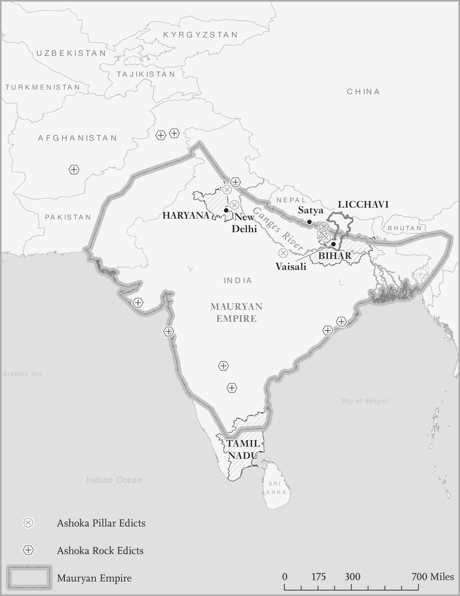

# Broken Red Queen · 第8章　红皇后毁坏

## A Hate Story · 恨的故事

Manoj and Babli made a terrible mistake in 2007: they fell in love. They were from Karoran, a small village in the state of Haryana in northwest India. Manoj had dropped out of school and got a job as an apprentice in an electronics repair shop. Babli attended the local girls’ school across the road. They met in the shop, and if it wasn’t love at first sight, it was soon afterward. She took in her perfectly functioning cell phone for him to repair, and when he questioned her, she replied, “Of course there was nothing wrong with it. I just wanted to see you again.”

> 二○○七年时，马诺吉（Manoj）和芭布莉（Babli）犯了可怕的错误：他们坠入爱河。他们出身印度西北部哈里雅纳邦开索县（Kaithal）的卡洛兰（Karoran）小村，马诺吉辍学后，在电子产品修理店，找到学徒的工作；芭布莉在马路对面的女校上学。他们在店里认识，即使这次碰面不是一见钟情，却也很快就变成一见钟情。她把运作完美的手机送去给他修理，马诺吉问她时，她回答说：「手机当然没有故障，人家只是想再见你一面嘛。」

Both Manoj and Babli were from the same caste, or jati. They were both Banwala Jats. The Jats are what is known as an “Other Backward Class” in India. In itself that wasn’t an issue. In fact, in the Indian caste system there are strict rules of caste endogamy, meaning that people have to marry within their caste. But within a caste there are further restrictions and the fatal problem was that Manoj and Babli were from the same gotra, or clan. A clan is a kinship group. There was no legal reason why Manoj and Babli could not marry according to Indian law, but some things in India are more powerful than the law.

> 马诺吉和芭布莉出身自相同种姓，两人的迦提（jati，又译亚种姓）也相同，也都是班瓦拉（Banwala）地方的贾特人（Jat）。贾特人属于印度的「其他落后阶级」，这种阶级本身不是问题。事实上，印度的种姓制度对于同种姓的婚姻，有着严格的规定，也就是人们必须跟同种姓的人结婚。但是，在一种种姓中，还有进一步的限制，要命的问题是马诺吉和芭布莉出身相同的宗族，也就是两人属于同宗，属于同一种亲属团体。根据印度的法律，马诺吉和芭布莉在法律上没有不能结婚的理由，但在印度，有些力量高于法律。

When they decided to elope and marry, Babli and Manoj violated a rule of the caste system so ancient that it is actually stated in the famous treatise on statecraft, the Arthashastra, written by Kautilya sometime around 324 BCE. Kautilya was an adviser to Chandragupta Maurya, the ruler who created the great Mauryan Empire that spanned northern India. In a section outlining the different duties and responsibilities of the distinct castes, Kautilya stipulates that “the duties of a householder are: earning his livelihood by pursuing his own profession; marrying a woman from the same varna but not of the same gotra.”

> 芭布莉和马诺吉决定私奔和结婚时，违反了种姓制度中的一条规定。种姓制度极为古老，实际上起源于一本跟治国术有关的论著《政事论》（Arthashastra ）。《政事论》大约是西元前三二四年时，由考底利耶（Kautilya）所着。考底利耶是首次统一印度北部、创建伟大孔雀王朝帝国的国王旃陀罗笈多．孔雀（Chandragupta Maurya）的国师。考底利耶在一节文字中，说明不同种姓的不同义务和责任，规定：「一家之主的义务是从事自己的职业，赚钱养家，跟相同瓦尔那（varna，种姓）但不同宗族的人结婚。」

By varna Kautilya means one of the four great social distinctions that divide the Hindu population: Brahman, Kshatriya, Vaishya, and Shudra. These are four distinct subsets into which most Indians are divided, with the identity being passed on from parents to children. Kautilya was also very clear on what the different varnas were supposed to do: The duties of the Brahman are: study, teaching, performing the rituals prescribed for him, officiating at others people’s rituals, giving and receiving of gifts.

> 考底利耶所说的「瓦尔那」，意思是把印度人口划分为婆罗门、刹帝利、吠舍和首陀罗四大阶级的种姓制度，大多数印度人都分属这四大瓦尔那，瓦尔那的身分代代相传。考底利耶对不同瓦尔那的本分也说得非常清楚：婆罗门的义务是从事研习、教授和执行指定的祭典，主持别人的祭典、施舍和接受奉献。

The duties of a Kshatriya are: study, performing the rituals prescribed for him, living by [the profession of] arms and protecting all life. The duties of a Vaishya are: study, performing the prescribed rituals, agriculture, cattle-rearing and trade. The duties of a [Shudra] are: service of twice-born [i.e., the three higher varnas] [or] an economic activity [such as agriculture, cattle-rearing and trade] the profession of an artisan [or] entertainer [such as actor or singer].

> 刹帝利的义务是研习、执行指定的祭典，从事战士的职业，保护所有生命。吠舍的义务是研习、执行指定的祭典，从事农业、畜牧和交易。首陀罗的义务是服务再生族（即另三种较高的瓦尔那），或从事（农业、畜牧、交易、工匠或如演员与歌手等娱乐事业等）经济活动。

Only the first three were “twice-born” and entitled to take part in particular religious ceremonies. At the bottom of this hierarchy were the Shudras, who were destined to serve the higher varnas and undertake menial tasks, such as being an entertainer. It is possible that the Shudras were originally composed of peoples who had been conquered by the Indo-Aryans as they migrated into India in the distant past and merged into their society.

> 只有前三种瓦尔那是「再生族」（twice-born），有资格参加特定宗教典礼。首陀罗是最下等的阶级，天生注定就要为较高级的阶级服务，承担如娱乐人员之类卑下的工作。首陀罗可能是远古时代印度—阿利安人入侵印度时遭到征服、并入阿利安社会的民族。

Top of the heap were the Brahmans, the priestly varna that specialized in education as well as religious ceremonies. Next came the Kshatriyas, who were primarily warriors and soldiers, and after them the Vaishyas, who engaged in commerce, manufacturing, and agriculture. Outside this system, and at the very bottom of the social hierarchy, were the people known historically as “untouchables” or Dalits, now more formally referred to as being from Scheduled Castes.

> 婆罗门是最上等的族群，是祭司级的瓦尔那，专门负责教育和宗教仪式。次等的阶级是刹帝利，这个瓦尔那的人主要是战士和士兵，第三等人是吠舍，是要从事商业、制造业和农业的瓦尔那。在这种制度外，处在社会阶级最底层的人民过去叫做「贱民」或达利特，现在比较正式的名称叫做「表列种姓」。

Jatis, nested within the varnas, are the groups that are most properly called castes. The Jats are a jati. It is useful to think of the caste system as being composed of these jatis, of which there are about 3,000 in India, with each jati embedded within one of the varnas. Hence the Banwala Jats to whom Manoj and Babli belonged were members of the Jat jati, who were in turn part of the Shudras, now considered to be part of the more modern Other Backward Classes.

> 迦提归属瓦尔那之内，是最适于称为种姓的族群，贾特人是一种迦提，把种姓制度想成由这些迦提（亚种姓）组成，会很有帮助，因为印度大约有三千种迦提，每一种迦提都属于上述四种瓦尔那（四大种姓）。因此，马诺吉和芭布莉所属的班瓦拉贾特人是属于贾特人亚种姓的成员，贾特人又属于首陀罗种姓的一环，首陀罗现在则属于比较现代所称「其他落后阶级」的一环。

This historical societal organization is not unique to India. As we have seen, Medieval England was also a society of “orders,” and historians often make a tripartite distinction between those who prayed, those who fought, and those who worked. These roughly correspond to the Brahmans, the Kshatriyas, and the Vaishyas/Shudras. People also took the name of their job which, as we’ll see, is a key part of the Indian caste system.

> 这种历史性社会组织并非印度所独有，前面说过，中世纪的英格兰也是「阶级」社会。历史学家经常把英格兰人分为三等人，分别负责祷告、战斗和工作，这三等人大致上等同于印度的婆罗门、刹帝利、和吠舍／首陀罗。英格兰人民也根据自己的工作取姓氏，这一点也是印度种姓制度的重要一环。

If you were a blacksmith in thirteenth-century England, you were probably called Smith; if you made barrels, you were a Cooper; if you made bread, then a Baker. Likely the son of a Smith was also a blacksmith. The British historian Richard Britnell even used data on last names to develop measures of how economically diverse Medieval England was. He didn’t have actual data on the economy, only on people’s names from tax records, but that turned out to be the same thing.

> 如果你是十三世纪的英格兰打铁匠，那你很可能姓史密斯（Smith），如果你是箍桶匠，那你很可能姓库柏（Cooper），如果你做面包，那你很可能姓贝克（Baker），史密斯的儿子可能也是铁匠。英国历史学家理察．布里聂（Richard Britnell）甚至用姓氏的资料，发展出中世纪英格兰经济多元化程度的指标，他没有当时经济的实际资料，只有税务纪录上人民的姓名，但结果两者是同一件事。

If you knew people’s names, you knew what their economic occupation was, and hence you knew how the economy was organized. These names have persisted over time, but as we saw in Chapter 6, their connection to occupation has been eroded by economic and social change. One of the reasons for the breakdown of name and occupation is that this relationship never got institutionalized in the same way it did in India. In particular, it never got embedded in religion and the nature of the state.

> 如果你知道人们的名字，就知道这个人当时的职业，因此也知道经济的形态。这些姓氏长久留传下来，但我们在第六章中已经看到，经济与社会变化已经侵蚀掉姓氏和职业的关系，姓氏和职业的关系断裂，原因之一是这种关系从来没有像印度那样，变成制度化，尤其是从来没有融入宗教和国家机器的本质中。

The persistence of caste identities and norms in India is vividly illustrated by the fact that a norm recorded by Kautilya almost 2,500 years ago is still enforced today. Enforced how? Manoj and Babli had to present themselves in court at Kaithal because Babli’s family accused Manoj of kidnapping her. They had to attest to the fact that they were legally married and no kidnapping had taken place. To Babli’s surprise, her brother Suresh and cousin Gurdev appeared. How did they know that the court hearing was to take place?

> 印度种姓身分和规范极为坚韧耐久，鲜明表现在考底利耶记录下来将近二千五百年后，今天仍然继续执行的事实中。怎么个执行法？因为芭布莉的家人控告马诺吉绑架她，两人被迫在开索县的法院出庭。他们必须证明两人是合法结婚，没有发生绑架案。让芭布莉惊讶的是，她哥哥束瑞希和堂兄戈代夫也现身法院，他们怎么知道法院要听审的事情？

Two other cousins were there too. Still, Manoj and Babli had anticipated that there could be trouble so, at the suggestion of their lawyer, they had asked the court for police protection. After the court hearing the police took them in a car to the bus to go back to Chandigarh, where they had gotten married and were hiding from their disapproving relatives. They got down from the car at Pehowa bus stand to catch the bus to Chandigarh. The relatives had followed them.

> 另两位堂兄也到场。马诺吉和芭布莉预期可能有麻烦，因此他们在律师的建议下，向法院申请警察保护。听审结束后，警察用汽车载他们去搭巴士，回他们结婚的昌迪加尔（Chandigarh）和躲避不赞成婚事亲友。他们在佩后瓦巴士站下了汽车，改搭开往昌迪加尔的巴士，亲戚跟着他们。

The police seemed to recognize the problem. Two were sent with Manoj and Babli on the bus to make sure nothing happened. Two cousins boarded the bus. More were in a car. The bus moved off, but when it reached the town of Pipli, the two policemen declared that this was the boundary of their jurisdiction and that they had to leave. Manoj and Babli were alone. In their desperation they jumped on a bus bound for Delhi; the cousins followed.

> 警察似乎看出其中有问题，就派了两位警察跟着马诺吉和芭布莉上巴士，希望确保他们平安无事。两位堂兄上了巴士，还有更多亲戚坐在一部汽车里跟着。巴士开出去，开到皮普利（Pipli）镇后，两位警察说，这里是他们管辖权的界限，他们必须离开。马诺吉和芭布莉陷入孤立无援的境地。他们在绝望之余，跳上开往德里的巴士，堂兄弟仍然紧紧跟随。

At a toll plaza shortly before the town of Karnal a silver Mahindra Scorpio SUV swerved in front of the bus and blocked it. Manoj and Babli were forced out of their seats and into the Scorpio. They vanished and were never seen alive again. Their bloated, mutilated bodies, with their feet tied together, were pulled out of the Balsamand Minor canal. Though you might have thought Manoj and Babli were the victims, the local caste council decided to ostracize Manoj’s family. Nobody in the village was allowed to talk to them or sell them anything. If anyone broke this rule, they would be fined 25,000 rupees (about US$350) and ostracized by the rest of the village.

> 到卡纳尔镇之前不远的一处收费广场时，一辆马亨达公司（Mahindra）生产的银色天蝎座车款休旅车在巴士前急转，挡住巴士，马诺吉和芭布莉被人从座位上拉下车，上了休旅车，从此消失无踪，再也没有生还。后来，别人把他们从巴尔斯曼小运河（Balsamand Minor canal）中打捞上来时，他们已经变成臃肿的尸体，残缺不全、脚部被人绑着。你可能认为马诺吉和芭布莉是受害者。结果，村里的种姓委员会却决定排斥马诺吉的家人，不准村里的人跟他们说话，不准卖东西给他们，要是有人坏了规矩，要罚款二万五千卢比（大约三百五十美元），同时受到其他村人的排挤。

## India in the Cage of Norms · 印度的规范牢笼

In the evolution of Indian state and society, the cage of norms is the big story. While in Athens and Europe the Red Queen not only spawned the development of both state and society but also started relaxing the cage of norms in the process, that didn’t happen in India. The consolidation of the caste system and the subservience of the state to its rigid hierarchy fragmented society and made it turn against itself. Society is never a monolithic entity, and its internal conflicts and the inequalities that these engender play a central role in a nation’s politics.

> 在印度国家和社会的演变中，规范牢笼是大事，虽然在雅典和欧洲的发展过程中，红皇后不但孕育国家和社会的发展，也开始放宽规范牢笼，印度却没有出现过这种事情。种姓制度的巩固和对国家的臣服，加在僵硬、阶级化又支离破碎的社会中，使社会变成自己对抗自己的东西。社会从来没有变成单一的实体过，在印度政治中，这样产生的内部冲突和不平等扮演十分重要的核心角色。

The Red Queen reshapes these divisions through state-society competition and cooperation, as we saw for instance in late-eighteenth-century Britain, where expanding state capacity induced society to develop new identities, new organizations, and more general demands. In contrast, the fragmentation and divisions that the caste system fomented meant that none of this could take place in India; society couldn’t organize and monitor the state and there would be no Red Queen dynamics reshaping society’s identities, even though the peninsula, like Europe, has a deep history of popular participation in government. Instead, because political participation was based on caste and the state itself supported and was bulwarked by the caste system, caste-based identities got repeatedly reconfirmed—with abominable consequences for liberty.

> 红皇后透过国家和社会的竞争与合作，重新塑造这些分裂，就像我们所看到十八世纪末叶英国的情形那样，英国国家机器能力的扩增，引发社会发展出新的身分、新的组织和更广泛的需求；相形之下，种姓制度孕育得破碎和分歧，却表示这种事情不可能在印度发生，社会不能组织起来监视国家机器，因此不会产生红皇后的力量，重塑社会的身分，即使印度次大陆像欧洲一样，有着民众参与政府的深厚历史，情形也是这样。相反地，因为政治参与是以种姓为基础，国家机器获得种姓制度的支持和保障，以种姓为基础的身分一再得到重新强化，因而对自由产生了恶劣的影响。

The caste system doesn’t just explain the lack of liberty in India. It also helps explain the country’s poverty. The fact that people are locked into occupations by their inherited status puts a huge impediment in the way of social mobility and innovation. But this is just the visible tip of the massively unequal opportunities and incentives generated by a system based on a rigid social hierarchy and dominance in every nook and cranny of society.

> 种姓制度不但可以解释印度缺少自由的原因，也有助于说明印度贫穷的原因：人民遭到继承而来的身分地位，被锁定在某种职业中，会对社会流动性和创新构成极大的妨碍；但这一点只是冰山上可以看到的一角，底下机会与诱因不平等大得惊人。这种不平等却是以僵固的社会阶级为基础，以对社会无所不在的宰割为基础。

Even while India has been a democracy since January 26, 1950, and “liberalized” its economy in the 1990s, the dominance of caste and the gamut of restrictive, divisive, and hierarchical norms have persisted and bred a state devoid of real capacity or much interest in helping its poorest citizens. To understand all this better, let’s begin at the bottom of the caste hierarchy, with the Dalits.

> 即使印度从一九五○年一月二十六日起，建立了民主政体，从一九九○年代起，推动经济「自由化」，种姓的宰割和限制性、分裂性的种种阶级规范却打死不退，孕育出的国家缺少实际能力、对协助最贫穷的公民也漠不关心。要更了解这一切，可以从种姓阶级最底层的达利特人（Dalit）谈起。

## The Broken People · 残破的达利特

What does “Dalit” mean exactly? The word doesn’t appear in Kautilya but has much more recent origins. The Dalits used to be called the “untouchables.” The great Indian statesman B. R. Ambedkar, who after independence in 1947 helped draft the first version of the Indian Constitution, coined the term “Dalits.” It means literally “broken people.” But where does “untouchability” come from?

> 达利特到底是什么意思？考底利耶的《政事论》中没有这个词，因此起源新近得多。达利特人过去叫做「贱到不可接触的人」，是一九四七年印度独立后，协助制定印度第一部宪法的伟大政治家安贝卡（B. R. Ambedkar，原来姓安贝伽尔）创造出来的，字面上的意思是「残破的人民」。但是，「贱到不可接触」的说法从何而来？

Untouchability means what is says: you cannot be touched. For a higher-caste person to touch a Dalit causes “pollution” which can only be eradicated by ritual cleansing. As a Dalit worker interviewed by Human Rights Watch in Ahmedabad district, Gujarat, in 1998 put it: When we are working, they ask us not to come near them. At tea canteens, they have separate tea tumblers and they make us clean them ourselves and make us put the dishes away ourselves. We cannot enter temples. We cannot use upper-caste water taps. We have to go one kilometer away to get water . . . When we ask for our rights from the government, the municipality officials threaten to fire us. So we don’t say anything.

> 贱到不可接触的意思是不能碰触你，比较高等种姓的人要是碰触了达利特人，就会遭到「污染」，只能靠着清洗仪式来消除。一九九八年，古吉拉特邦（Gujarat）第一大城阿迈达巴德（Ahmedabad）一位达利特工人，接受人权观察组织（Human Rights Watch）专访时指出：他们要求我们工作时，不要靠近他们，在茶馆里，他们有不同的茶杯，他们要我们清洗自己的茶杯，要我们放好自己的盘子。我们不能进入庙宇，不能使用较高种姓所用的自来水龙头，必须走到一公里以外的地方取水……我们向政府要求我们的权利时，市政官员威胁要开除我们，因此我们什么都不能说。

It’s not just a matter of physical touching. If a Dalit casts a shadow on a Brahman, that can require ritual cleansing. Dalits should not wear shoes in the presence of the “twice-born.” Ambedkar, who was himself a Dalit, didn’t like the notion of untouchability and he made sure that the Indian Constitution outlawed it. Article 17, “Abolition of Untouchability,” states in no uncertain terms:

> 还不仅止于身体接触而已。如果达利特人在婆罗门身上投射了阴影，就可能要进行清洗仪式；达利特人在「再生族」面前不应该穿鞋子。安贝卡自己是达利特人，不愿接受贱不可触的观念，而且希望确保印度宪法把这种观念宣布为非法。宪法第十七条「贱不可触之废止」条文明确规定：

Untouchability is abolished and its practice in any form is forbidden. The enforcement of any disability arising out of Untouchability shall be an offence punishable in accordance with law. Yet it is estimated that there may be as many as 200 million Dalits in India today. How is that possible? Ambedkar’s most famous statement about untouchability came in a lecture he prepared to give in 1936. He never presented it because when he circulated a draft, it was deemed so outrageous that he was quickly disinvited. He printed it at his own expense and called it “The Annihilation of Caste.”

> 废除贱不可触，禁止以任何形式加以实行，凡是因为贱不可触而造成的任何强制性不便行为，都构成可以依法惩处的犯行。但是，根据估计，今天印度的达利特人可能多达二亿人，这怎么可能？安贝卡跟「贱不可触」最有名的声明，出自他为一九三六年一次演说准备的演讲稿；他根本没有发表这场演讲，因为他把演讲稿散发出去后，大家认为他的说法离谱之至，演讲的邀请也迅速取消。他后来自费出版这份讲稿，取名为《种姓的灭绝》。

Ambedkar knew what he was talking about; as a child he was allowed to go to a school for “touchables,” but he had to sit apart from the rest of the children on a sack so as not to pollute the floor for them. He couldn’t drink all day because the only tap was for higher castes. Ambedkar starts by outlining what it was like to be an untouchable: The Untouchable was not allowed to use the public streets if a Hindu was coming along, lest he should pollute the Hindu by his shadow.

> 安贝卡知道自己要谈的是什么东西，因为他自小就以「贱民」身分，获准上小学，却必须跟其他学童分开来，坐在一个袋子上，以免污染其他学生的地板；他整天都不能喝水，因为学校只有一个让较高种姓喝水的水龙头。安贝卡在讲词中，大略描述了贱民的惨状：如果印度教徒走在街道上，贱民就不准走这条公共道路，以免阴影污染了印度教徒。

The Untouchable was required to have a black thread either on his wrist or around his neck, as a sign or mark to prevent the Hindus from getting themselves polluted by his touch by mistake. In Poona . . . the Untouchable was required to carry, strung from the waist, a broom to sweep away from behind himself the dust he trod on, lest a Hindu walking on the same dust should be polluted. In Poona, the Untouchable was required to carry an earthen pot hung around his neck wherever he went—for holding his spit, lest his spit falling on the earth should pollute a Hindu who might unknowingly happen to tread on it.

> 贱民必须在手腕或脖子上系一条黑线，作为标记，以免印度教徒误触，而遭到污染。在浦纳地方……贱民必须在腰间挂一把扫把，以便扫掉身后他自己踩过的灰尘，以免印度教徒走在相同的尘埃上，受到污染；还有，不管贱民去哪里，都必须在脖子上挂一个陶壶，好承接他自己吐的痰，以免他的痰落在地上，污染无意间踩在上面的印度教徒。

But Ambedkar’s agenda wasn’t just abolishing untouchability. Ambedkar wanted to overthrow the entire caste system because he understood its wide-ranging pernicious effects. He attacked this from an economic point of view. It made no sense to him (and makes no sense to us either) that castes, varnas, and jatis have specific occupations. He of course knew it was based on dominance and was a powerful source of illiberty. But even more important, he understood that caste made society turn against itself and stand divided and disorganized. He wrote that

> 安贝卡的使命不仅止于废除贱民，他也希望推翻整个种姓制度，因为他知道这种制度的有害影响。他从经济角度攻击这种制度，说他觉得（我们也觉得）种姓、瓦尔那和迦提从事特定职业毫无道理。他当然知道这种情形出于宰割，是不自由强而有力的起源，但更重要的是，他了解种姓制度造成社会自相对抗，陷入分裂和毫无组织的乱局。他写道：

the caste system is not merely a division of labor. It is also a division of laborers. Civilized society undoubtedly needs division of labor. But in no civilized society is division of labor accompanied by this unnatural division of laborers into water-tight compartments. The caste system . . . is a hierarchy in which the divisions of laborers are graded one above the other . . . In one of its aspects, it divides men into separate communities. In its second aspect, it places these communities in a graded order one above the other in social status.

> 种姓制度不仅是劳动分工，也是劳动者分工。文明社会无疑需要劳动分工，但没有一个文明社会的劳动分工，会伴随着这种水密隔舱式的不自然劳动者分工。种姓制度……是一种阶级，其中的劳动者分工把一个人置于另一个人之上……从某个角度来说，是把人分成不同族群；从第二个个角度来说，是把这些族群中某个族群的社会地位，放在另一个族群之上。

Elsewhere he used a different metaphor, likening the caste system to “a multi-storeyed tower with no staircase and no entrance. Everybody had to die in the story they were born in.” The division of labor created by the caste system is economically irrational because “it involves an attempt to appoint tasks to individuals in advance—selected not on the basis of trained original capacities, but on that of the social status of the parent.” You couldn’t build a modern economy on the “dogma of predestination,” and any attempt to do so was like trying to build “a palace on a dung heap.”

> 他在别的地方利用不同的比喻，把种姓制度比做「没有楼梯、也没有门的多层高塔，每一个人都会死在出生的那一层里」。种姓制度创造的劳动分工在经济上很不合理，因为「涉及意图事先指定个人的任务──选择人才的基准不是受过教育的创意能力，而是依据父母的社会地位」。你不能在「宿命的教条」上，建立现代经济，这样做的所有意图都像是想在「粪堆上兴建宫殿」。

Ambedkar was very clear, too, on the dreadful consequences of the caste system for liberty and for politics. Not only was a caste society fundamentally illiberal, but Ambedkar stressed that caste created a highly fragmented, disorganized, and prostate society. “Caste has . . . completely disorganized and demoralized the Hindus,” he wrote, and this was because “Hindu society as such does not exist. It is only a collection of castes.”

> 安贝卡也把种姓制度带给自由和政治的可怕影响，说明得一清二楚，安贝卡不但表示种姓社会基本上就是不自由的社会，而且强调种姓会创造高度支离破碎、杂乱无章的「前国家社会」。他写道：「种姓已经……彻底扰乱和瓦解了印度人的民心士气」，原因在于「这样的印度社会并不存在，印度只是各种种姓的集合」。

Except when they might unite against an outside foe, “each caste endeavors to segregate itself and to distinguish itself from other castes . . . the ideal Hindu must be like a rat living in his own hole, refusing to have any contact with others . . . The Hindus, therefore, are not merely an assortment of castes, but are so many warring groups, each living for itself and for its selfish ideal.” The overwhelming role of caste in people’s identities is why “the Hindu cannot be said to form a society.” This is fundamentally because

> 除了对抗外敌时可能团结一致之外，「每一种种姓都致力于自我解离和隔离其他种姓……理想的印度教徒必须像老鼠一样，住在自己的洞里，拒绝跟其他人接触……因此，印度教徒不只是各种种姓的综合体，也是极多交战团体的综合体，每一个团体都为自己和自己自私的理念而活」。种姓在人民认同上占据绝大的角色，是「别人不能说印度人已经形成一个社会」的原因。这点基本上是因为：

a Hindu’s . . . responsibility is only to his caste. His loyalty is restricted only to his caste. Virtue has become caste-ridden, and morality has become caste bound . . . There is charity, but it begins with caste and ends with caste. There is sympathy, but not for men of other castes. What about the illiberal nature of caste society? This is perhaps obvious given the restrictions on occupation, lifestyle, residence, and many other things that go along with caste.

> 印度教徒……只对自己的种姓负责，只对自己的种姓效忠。品德已经受到种姓凌驾，道德已经受到种姓束缚……善心确实存在，却始于种姓，也终于种姓；同情心确实存在，却不为其他种姓的人而发。种姓社会有什么不自由的特质吗？从职业、生活形态、居住地点和伴随着种姓而来的许多限制来看，这一点可能很明显。

But Ambedkar wanted to make a deeper point; the caste system could only be maintained by dominance and the threat of violence. He points out that in the great Hindu epic the Ramayana, King Rama beheads a Shudra he finds meditating. Shudras are not twice-born, they are not meant to meditate. India’s oldest law code, the Laws of Manu, is adamant that the king enforce the caste system and specifies very heavy sanctions for breaking with varna. For example, a Shudra who recites or even listens to the Vedas, the ancient holy literature of Hindus, can be punished by having his tongue cut off or having molten lead poured into his ears.

> 但是，安贝卡希望提出更深入的论点，种姓制度只能靠着宰割和暴力威胁来维持。他指出，在印度两大史诗之一的《罗摩衍那漂泊历险记》（Ramayana ）中，国王罗摩把他发现正在冥想的一位首陀罗斩首，因为首陀罗不是再生族，不可以冥想。印度最古老的法典《摩奴法论》（Laws of Manu ）坚持国王必须负责种姓制度的执法，也规定必须非常严厉地惩处破坏瓦尔那的罪行。例如，朗诵或甚至听印度古代神圣文学经典《吠陀经》（Vedas ）的首陀罗，可能遭到的惩罚是割掉舌头，或是把熔解的铅灌进耳朵里。

The most menial of tasks were reserved not for Shudras but for Dalits. These include jobs as manual scavengers, tasks such as the removal of dead animal carcasses and human waste (see the photography section for an illustration of one of these jobs). Among other Dalit occupations are cobblers, leatherworkers, and street sweepers. Dalit children are sold off to upper-caste creditors to pay off debts and Dalit girls are sold to temples in the Devadasi system, in effect a form of institutionalized prostitution. Dalit men, women, and children work in appalling conditions for a pittance as agricultural workers.

> 最卑下的工作并非保留给首陀罗，而是保留给达利特人，这些工作包括从事清除动物尸体、人类粪便之类事物的清洁工（参见相片插页中这种工作的照片）。达利特人的其他职业包括补鞋匠、皮革匠和清道夫，达利特人的小孩会卖给较高种姓的债权人抵债，达利特人的小女孩会以称为「德瓦达西」（Devadasi）制度的敬献神祇方式，卖给寺庙，实际上却是制度化卖淫行为的一种形式。达利特男女老幼充当农工时，工作条件都非常可怕，却只能换取极为微少的报酬。

Human Rights Watch reproduces government statistics suggesting that there are at least one million, and probably far more, Dalits who work as manual scavengers. One of the scavengers interviewed in the state of Andhra Pradesh reported: In one toilet there can be as many as 400 seats which all have to be manually cleaned. This is the lowest occupation in the world, and it is done by the community that occupies the lowest status in the caste system.

> 人权观察组织重现的政府统计显示，从事清洁工的达利特人至少有一百万人，实际上可能远超过这个数字。安得拉邦（Andhra Pradesh）一位清洁工接受专访时指出：一间厕所里可能有多达四百个位置，每一个位置都必须以手工的方式清洁，这是人世间最低贱的职业，都由种姓制度中地位最低下的族群负责。

The demeaning nature of the work they have to do is part of their domination by the upper castes, and it is supported by norms and the threat of violence. Many of the scavengers are told by the community that they have no choice but to do this work. When the Rashtriya Garima Abhiyan, or National Campaign for Dignity, started informing manual scavengers in the state of Madhya Pradesh that they could leave this work if they wanted to, 11,000 of them did so right away.

> 被迫从事卑微的工作，是他们受到较高种姓任意宰割的一环，背后还获得规范和暴力威胁的支持。社会告诉很多清洁工，他们别无选择，只能做这种工作。全国尊严运动（Rashtriya Garima Abhiyan）起初通知中央邦（Madhya Pradesh）的清洁工说，如果他们有愿意就可以离职时，立刻就有一万一千人这样做。

But the pressure and threats on them continued. One scavenger reported that “one of the people I cleaned for warned me, ‘Now, if you come to my farm, I’ll cut off both of your legs.’” The nature of the caste system and the cage of norms it creates undermines the ability of Indian society to act collectively. Just as Ambedkar pointed out, society is divided against itself. The Red Queen is broken.

> 但是，压力和威胁继续压在他们身上，有一位清洁工回报说：「有一位雇用我的人警告我：『如果你去我的田地上，我会砍断你的两只脚。』」种姓制度的性质和创造出来的规范牢笼，破坏了印度社会集体行动的能力，就像安贝卡所指出的那样，社会分裂，自相对抗，红皇后陷入残破不堪的状态。

## Those Who Dominate · 宰割别人的人

Those who dominate were often the highest varna in the caste hierarchy, the Brahmans. Historically, even in villages with multiple castes, the Brahmans dominated local politics and political institutions such as the local village assembly, the panchayat, an institution we’ll return to later in the chapter. An autobiography published in 1903 by Thillai Govindan records several meetings of local panchayats to adjudicate legal cases in the village in Tamil Nadu where he lived. In one, of the 25 people who met, 18 were Brahmans. In the course of his fieldwork in the same state in the early 1960s, the anthropologist André Béteille found that the Brahmans, though they made up only one quarter of the village population, had traditionally completely dominated the panchayat.

> 在种姓阶级中，宰割别人的人经常属于最高的婆罗门种姓。历史上，即使在拥有多种种姓的村庄里，婆罗门一向都主宰地方政治和村民代表会。我们在本章稍后，会回头谈论村民代表会这种地方政治机构。帝来伊．戈文丹（Thillai Govindan）一九○三年出版的自传中，记录了很多次村民代表会集会，裁决他所住泰米尔纳德邦（Tamil Nadu）小村子的法律案件，某次会议有二十五人出席，其中有十八人是婆罗门。人类学家安德烈．贝泰尔（André Béteille）一九六○年代在同一个邦，进行田野调查时，发现婆罗门只占该村人口的四分之一，却一向完全主导村民代表会。

Yet by the time Béteille started to study the community, things had started to change. This was both because the Brahmans had migrated to urban areas where their better education allowed them access to higher-paid professions and government employment and because democratic politics had empowered the more populous castes. In the village Béteille studied, this caste was the Kallas, a Shudra jati. They emerged as the most powerful group not just because they were the numerically dominant varna in the village. It was also, as Béteille notes, because

> 但是，贝泰尔开始研究这个社区时，情势已经开始改变，原因有两个：一是婆罗门已经搬到都会地区，凭着受过比较好的教育，找到待遇较高的专业和公务员的工作；二是民主政治已经赋权给人口较多的种姓。在贝泰尔研究的村子里，这种种姓是属于首陀罗迦提（Shudra jati）种姓中的卡拉斯（Kallas）次种姓。贝泰尔指出，他们会变成力量最强大的团体，不只是因为他们是村子里人数上占优势的种姓，也是因为：

Kallas have a tradition of violence which makes the Adi-Dravidas hesitant in challenging their authority. The term Adi-Dravidas (meaning literally “Original Dravidians”) is used specifically in Tamil Nadu as a label for Dalits. This term came into usage in the early twentieth century as a way of destigmatizing the Paraiyar community, an untouchable group. From the Paraiyars, we get the English word “pariah,” which the Oxford English Dictionary defines as outcast, persona non grata, reject, outsider, leper. The Dravidians were the first people to populate southern India before the Indo-Aryan migrations, which seem to have originally brought the caste system, so the description Original Dravidians was intended to raise their status.

> 卡拉斯次种姓具有暴力传统，使达罗毗荼（Adi-Dravidas）人要挑战他们的权威时会犹豫不决。「达罗毗荼」字面上的意思是达罗毗荼原住民，这个名词专门用在泰米尔纳德邦。作为达利特人的名称，这个名称是二十世纪初才开始采用，作为消除贱民团体「帕莱雅尔」（Paraiyar）种姓污名的方法；英文中的「贱民」（pariah）一词，就是从「帕莱雅尔」这个名称中衍生出来的。在《牛津英语字典》中，pariah的意思是社会弃儿、不受欢迎的人物、遭到抛弃的人、外来者、遭到排斥的人。印欧阿利安移民侵入印度，而且似乎带来原始的种姓制度前，达罗毗荼人是最先定居印度南部的民族，因此达罗毗荼原住民的说法意在提升他们的地位。

This antagonism between what the Indian sociologist M. N. Srinivas called the “dominant caste” of a village and the Dalits is common and is often steeped in violence. Human Rights Watch studied this in Tamil Nadu in the context of the conflict between the Dalits and another Shudra jati, the Thevars. As one person they interviewed put it: The Thevars are opposed to the Dalits. They themselves are not an advanced community. They are landlords but not in a big sense. They are not advanced in education, but still employed the Dalits as laborers.

> 印度社会学家史瑞尼瓦斯（M. N. Srinivas）所说村庄「统治个案」和达利特人之间的敌意很常见，而且经常伴随暴力。人权观察组织曾经在泰米尔纳德邦，以达利特人和另一个首陀罗迦提亚种姓的悉瓦人（Thevar）之间的冲突为题做过研究。一位曾接受他们访谈的人表示：悉瓦人可以跟达利特人形成对比，他们不是高级的族群，他们是地主，却不是大地主，他们的教育程度不高，但仍然雇用达利特人当劳工。

So there were economic reasons for keeping the Dalits under control, but Human Rights Watch uncovered a much more pervasive system of hierarchy and dominance. As a Thevar politician told them, without any hint of irony: In the past, twenty to thirty years ago, harijans [Dalits] enjoyed the practice of “untouchability.” In the past, women enjoyed being oppressed by men . . . Most . . . Dalit women enjoy relations with Thevar men. They enjoy Thevar community men having them as concubines. It is not done by force. Anything with Dalits is not done by force. That’s why they don’t react.

> 因此，继续控制达利特人具有经济上的理由。但是，人权观察组织揭发了一种更为普遍的阶级和宰割体系，一位悉瓦人政客告诉他们的话丝毫没有讽刺意味：二、三十年前，哈里扬人（harijan，达利特人）喜欢「贱民阶级」的习惯做法；过去的女性喜欢被男性欺压……大部分达利特女性喜欢跟悉瓦人男性发生关系，喜欢悉瓦人社群的男性纳她们为妾，这种事不是强迫行为。跟达利特人有关的事情都不必动用武力，这就是他们不会反动的原因。

They cannot afford to react, they are dependent on us for jobs and protection . . . Without Dalits we cannot live. We want workers in the fields. We are landholders. Without them we cannot cultivate or take care of our cattle. But Dalit women’s relations with Thevar men are not out of economic dependency. She wants it from him. He permits it. If he has power, then she has more affection for the landlord.

> 他们承担不起反动的代价，他们依靠我们得到工作和保护……如果没有达利特人，我们会活不下去，我们的田里需要工人。我们是地主，没有达利特人的话，我们不能种植作物和畜养牲口。但是，达利特女性和悉瓦人男性的关系不是基于经济依赖，才想跟悉瓦人男性建立这种关系，她想建立关系，他则准许建立这种关系，如果他有权有势，她会更爱这位地主。

These dominating relationships not only obliterate liberty for the dominated but also poison the functioning of local political institutions. Supposedly there are seats on the panchayat reserved for Dalits. These reservations challenged the previous hegemony of the dominant castes. In 1996, in the Tamil Nadu village of Melavalavu, the majority caste community, including the Thevars, let it be known that no Dalit should run for the panchayat. A story in the Times of India reported that “they were warned that they would lose their jobs as farmhands and not be allowed to graze cattle or draw water from wells located on patta [unutilized] land held by the dominant castes.”

> 这种宰制关系不但抹煞被宰割者的自由，也戕害了地方政治机构的运作。假设村民代表会中有达利特人的保障席次，这种保障名额会挑战主导种姓先前的霸权。一九九六年，泰米尔纳德邦包括主导种姓悉瓦人村民在内的梅拉瓦拉夫（Melavalavu）村，告知村民，达利特人不应该竞选村民代表会代表的席次。《印度时报》的一篇报导指出：「达利特人得到警告，说如果他们不听从，就会失去农务工作，不准在主导种姓所拥有未曾利用的土地上牧养牲口，不准从这种土地上的水井中打水。」

Elections were scheduled for October, but in the face of this intimidation they had to be canceled because all the Dalit candidates withdrew. In February a Dalit, Murugesan, had the temerity to run. As the dominant castes boycotted the election, he won. Thereafter, however, he needed police protection and he was not able to enter the panchayat buildings because the Thevars prevented him. Murugesan was the target of constant threats, and in June 1997 he was murdered. A firsthand account relates:

> 选举预定在十月举行，但在这种恐吓之下，选举被迫取消，因为所有达利特人候选人都退出选举。到了隔年二月，一位名叫穆鲁吉桑的达利特人居然莽撞地出来竞选。由于主导种姓杯葛选举，穆鲁吉桑就当选了。然而，后来他却需要警察的保护，而且因为悉瓦人的阻止，不能进入村民代表会所在的建筑物，还经常成为受到威胁的目标；他在一九九七年六月遭到杀害。一篇第一手纪录指出：

There were nearly forty of them. They were all Thevars. They stabbed Murugesan on the right side of his belly. It was a very long knife. From outside the bus Ramar [the leader] instructed the Thevars to kill all the Pariahs. Among twelve, six were murdered on the spot. They pulled all six out of the bus and stabbed them on the road with bill hooks more than two feet long . . . Five Thevars joined together, put Murugesan on the ground outside the bus, and chopped off his head, then threw it in a well half a kilometer away.

> 他们有将近四十个人，全都是悉瓦人，他们刺破穆鲁吉桑的右腹，那把刀很长。带头的人在巴士外面，下令悉瓦人杀死所有贱民，十二位受害者中，有六位当场惨死。他们把六个人全都从巴士中拖下来，在马路上用长度超过两尺的开山刀刺他们……五个悉瓦人合力把穆鲁吉桑放在巴士外的地上，砍断他的头，然后把头丢进半公里外的水井里。

After this massacre, outside intervention allowed five Dalit women to be elected to the panchayat. In response the Thevars fired Dalit workers and prevented others from hiring them. Dalit children were afraid to go to school. One of the elected women told Human Rights Watch: The office is in the caste Hindu area. I am not allowed in the office. So we have to hold our meetings in our TV room here; it is a makeshift office.

> 这场大屠杀后，外力的干预促使五位达利特女性当选村民代表会代表，悉瓦人的反应是开除达利特劳工，还阻止别人雇用他们，达利特儿童都怕得不敢去上学。一位当选的女性告诉人权观察组织：村民代表会会场位在印度教徒种姓地区，他们不准我进入会场，因此我们只好在这间电视间开会，这里是临时会场。

They are still threatening us. They are watching and following me . . . If the elected Dalit women go there, the upper caste would do some harm. If the women insist on going into the office, they will hit them. There is one police guard for me. He has a gun, but he puts it inside his bag . . . Everything is paralyzed.

> 他们现在还在威胁我们，也在监视和跟踪我……如果当选的达利特女性去会场，较高的种姓可能会伤害我们。如果这些女性坚持要去会场，他们一定会打她们。我有一位警察保护我，他带了一把枪，但他把枪放在包包里……一切都陷在瘫痪状态中。

At another Tamil village, a woman called Veludavur told Human Rights Watch about the endemic sexual violence against Dalit women: In the village, the Thevars entered the house and had sexual intercourse with the Dalit women. They used force and committed rape. My husband died, so if I had stayed then the same things would happen to me . . . I left all the lands. This is the regular lot of the dominated persons.

> 在另一个泰米尔人的村子里，一位叫做维鲁达芙尔的女士，告诉人权观察组织说，达利特妇女经常遭到性暴力侵害：悉瓦人会闯进村里的家屋，跟达利特妇女性交，他们会暴力强奸女性。我丈夫已经过世，因此，如果我留下来，那么我应该会碰到同样的事情……我离开所有这样的地方，这是受到宰割的人常见的命运。

## The Caged Economy of Caste · 种姓的牢笼经济

Even if Dalits are at the base of a caste system that segregates people socially and economically, you may be skeptical that this ancient social hierarchy could be so rigid as to determine people’s occupations in recent times. Who would enforce that? It is certainly not part of Indian law. But we’ve already seen the power of caste norms in enforcing caste regulations and even encouraging the murder of people who violate them. Could these norms have created a durable association between a person’s name and their caste and their occupation?

> 即使现在达利特人处在社会和经济隔离种姓制度中的最底层，你可能还会怀疑这种古老的社会阶级制度是否可能这么僵化，到了决定人民未来职业的程度。谁要负责执行这种制度呢？这种制度确实不是印度法律的一环，但我们已经看到，在种姓规则的实施上，种姓规范威力十足，甚至在鼓励杀害违反规则的人上面，看到规范的十足威力。这些规范是否可能在一个人的姓名和种姓与职业之间，创造出持久的关系呢？

The first person who systematically investigated this question was a British colonial administrator, E. A. H. Blunt, who published The Caste System of Northern India in 1931. Using data about caste and occupation from the British colonial censuses, Blunt estimated the extent to which different jatis undertook their traditional occupations. He first sorted the different jatis into twelve broad categories starting with agriculture, laborers and village menials, pastoral occupations, learned professions and going all the way through trade and industry, dealers in food and drink, and even beggars.

> 率先有系统地调查这个问题的人，是英国殖民官员布仑特（E. A. H. Blunt），他在一九三一年出版的大作《印度北部种姓制度》中，利用英国殖民地人口普查中的种姓和职业资料，估计不同亚种姓担任本身传统职业的程度。他首先把不同的亚种姓，分为以农业为首的十二大类，然后是劳工和农村奴仆、畜牧业、学术专业，一直分到贸易与产业、饮食经销商，甚至还分出乞丐这种大类。

Within these broad classes were much more specialized occupations. For instance, in agriculture there was the growing of flowers and vegetables, poppy cultivation, and water-nut cultivation. Within learned professions there was astrology, writing, and of course the priesthood, which mapped onto the Brahmans. Within trade and industry Blunt identified thirty-five different specializations that were matched almost one for one to different jatis. For example, the Lohar jati were blacksmiths, the Sonar goldsmiths, and the Pasi toddy drawers (toddy is the sap used to make palm wine).

> 在这些大类中，再细分为专业程度较高的职业，例如在农业大类中，就包括花卉和蔬菜种植、罂粟种植和菱角种植。在学术专业大类中，包括天文学和写作，神圣人员业当然也包括在内，这些职业当然也全都映照到婆罗门种姓上。在贸易和产业大类中，布仑特找出三十五种不同的专业，每一种专业几乎都一对一地对应一种不同的亚种姓（迦提）。例如，罗哈（Lohar）亚种姓的人是铁匠，索纳（Sonar）亚种姓是金匠，帕西（Pasi）亚种姓是抽取棕榈汁、制作棕榈酒的工人。

Obviously agriculture was by far the largest occupation, the vocation of 90 percent of all the castes in this category. Yet agriculture was less interesting than the others because it was also a much more general occupation, water-nut cultivation notwithstanding. More astonishing were the results for specific occupations. Blunt found that 75 percent of the sweeper jati followed their profession, and so did 75 percent of goldsmiths (Sonars), 60 percent of confectioners and grain parchers, 60 percent of barbers and washermen, and 50 percent of carpenters, weavers, oil pressers, and potters.

> 如果种植菱角不算在内的话，农业显然是最多人从事的职业，属于这一大类职业的多种种姓中，有百分之九十的人都务农，因此农业是普遍得多的行业，也比其他职业无趣。跟特定职业有关的结果比较令人惊异，布仑特发现，百分之七十五的清道夫亚种姓承袭自己的职业，百分之七十五的金匠（索纳亚种姓）、百分之六十的糕饼师、谷物干燥工、理发师和洗衣工人、百分之五十的木匠、织布工人、榨油工和制陶工人，自己职业都是承袭而来的。

But this segregation doesn’t mean that the different castes are autarkic. They are linked by the Jajmani system, which specifies a network of services and favors that different castes have to provide for one another. On the face of it, it is a vast system of in-kind mutual gift giving. Some people’s gifts are much more valuable than others’, however. The first detailed description of how this worked was made by a missionary, William Wiser, in the 1930s in Karimpur, a village in northern India close to the confluence of the Ganges and Yamuna Rivers in the state of Uttar Pradesh. Wiser, along with his wife, Charlotte, subsequently wrote an ethnography of Karimpur, documenting the intense dominance in the village:

> 但是，这种隔离不表示不同的种姓能够自给自足，他们靠着「迦吉马尼制度」（Jajmani system）这种庇护制度结合起来。这种制度是专门为不同种姓互相提供服务和协助，而建立的服务网络。从表面上看来，这是一种互相赠予实物的庞大互惠制度，然而，有些人的赠予比别人的赠予有价值得多。传教士威廉．怀瑟（William Wiser）是第一位详细描述这种制度运作状况的人，他在一九三○年代，在印度北部北方邦（Uttar Pradesh）恒河和亚穆纳河汇流处附近的卡林姆普尔村居留，后来和妻子夏绿蒂合写了一篇卡林姆普尔村的民族志，记录这个村子中严重的宰割现象。

The leaders of our village are so sure of their power that they make no effort to display it. The casual visitor finds little to distinguish them from other farmers . . . And yet when one of them appears among men of serving caste, the latter express respect and fear in every guarded word and gesture. The serving ones have learned that as long as their subservience is unquestioned the hand which directs them rests lightly.

> 我们村里的领袖对自己的权力极为确定，以至于不需要刻意表现这种权威。偶尔一见的访客几乎看不出他们和其他农民有什么不同……但是一位这样的人现身在专门为人服务的种姓前时，受奴役种姓的一言一行都会十分小心慎重，表现出敬畏之意。受奴役种姓已经学到，只要自己的卑躬屈膝没有遭到质疑，指挥他们的手就会轻轻垂下。

But let there be any move towards independence or even indifference amongst them, and the paternal touch becomes a strangle-hold . . . in every detail of life have the leaders bound the villagers to themselves. Their favour may bring about a man’s prosperity and their disfavour may cause him to fail. There were 754 people in Karimpur, divided into 161 families. Brahmans made up 41 of the 161 families, and Wiser identified 24 different jatis in total, 2 types of Brahmans, 2 types of Kshatriyas, 12 different Shudra jatis and 8 untouchable categories.

> 但是，如果他们表现任何独立或甚至漠然的举动，父权般的权威就会变成扼杀手段……村民生活中的每一样细节都遭到领袖的牢牢约束，领袖的欢心可能让人发迹，领袖的不快可能害人下地狱。卡林姆普尔村住了七百五十四人，分为一百六十一户，其中四十一户是婆罗门，怀瑟一共找到二十四种不同的迦提（亚种姓），两种婆罗门，两种刹帝利，十二种不同的首陀罗迦提和八种贱民阶级。

He mapped an intricate system of customary services that different jatis had to do for one another. Let’s start with the Brahmans. In principle Brahmans were priests who tended to the religious needs of the rest of the castes. The most prestigious of the Brahman families acting as priests served only the other Brahman families and received religious services from an even more superior family from outside the village. The next Brahman families in the hierarchy tended to the religious needs of the Kshatriyas and Shudras.

> 他描绘了不同迦提必须互相提供的一种惯用复杂服务体系。我们先从婆罗门谈起。原则上，婆罗门是祭司，负责满足其他种姓的宗教需求。最尊贵的婆罗门家庭以祭司的身分，只为其他婆罗门家庭服务，同时接受村外更高级家庭提供的宗教服务。阶级中次一等的婆罗门家庭负责满足刹帝利和首陀罗的宗教需求。

Brahmans, who owned most of the land in the village, were owed services by other castes. A carpenter, born into the Barhai jati, had to remove and sharpen his plow blades once or twice a week. When it was harvest season, he had to keep sickles sharp and renew handles as often as required. If a cart was broken, he had to mend it and do other errands that required his skills. Other castes, such as ironworker, barber, water bearer, and potter, had similar fixed tasks that they had to undertake for different people.

> 婆罗门家庭拥有村中的大部分土地，其他种姓都必须为他们服务。例如：生为巴海伊贾特人（Barhai jati）的木匠，一星期要去婆罗门那里一、两次，为他们卸下犁头刀，再加以磨利；碰到收获季节，他必须尽量维护镰刀的锋利度，视需要而定，经常更换镰刀把手；要是推车坏了，他必须修理好，还要完成需要他所拥有技术的其他任务。铁工、理发师、运水人、陶匠等其他种姓，也有必须为不同人承作类似的固定任务，换取事先说定、通常是实物的特定给付。

In exchange there were prespecified payments, normally in kind, which differed according to caste. For example, a Brahman would give the carpenter and ironworker 10.5 pounds of grain each season for every plow owned. Non-Brahmans would give 14 pounds of grain per plow. Such differences were the norm even when monetary payments were involved. The seamster, for example, received from a Brahman half of what non-Brahmans would pay for the same piece of clothing. When a Brahman bought milk it cost 50 percent less than it did for non-Brahmans.

> 给付的多少会因种姓的不同而有差别。例如，一位婆罗门每季会为自己拥有的每一具犁头，付给负责维修的木匠和铁匠十．五磅的谷物；非婆罗门会为每具犁头，给付十四磅的谷物。即使是用金钱给付，这种差异也是正常状态。例如：裁缝做同样的一件衣服，婆罗门付的工钱，只有非婆罗门付款的一半。婆罗门买牛奶时，也只要付非婆罗门付款的一半。

Fixed amounts of village land were set aside for the higher castes; Brahmans got the most, but land was also allocated to the carpenter, the sweeper, the oil presser, the seamster, and the washerman. The most onerous service of all occurred in the fields owned by the Brahmans, where lower-caste families were required to work at fixed rates of remuneration. At the bottom of the social hierarchy, of course, were the untouchables. There were eight families of Chamars, leatherworkers who had a number of fixed tasks such as skinning animals, making leather, and using it to repair shoes, baskets, and bags. The Wisers noted about a Chamar:

> 村子里的土地要拨出一定数量给较高的种姓，婆罗门会分到最多，但土地也会分配给木匠、清洁工、油品压榨工、裁缝和洗衣工人。最繁重的服务全都出现在婆罗门所拥有的土地上，比较低阶种姓的家庭必须在上面工作，换取固定比率的报酬。社会阶级中最底层的人当然是贱民，村子里有八户恰马尔人（Chamar），他们是要担负一些固定工作的皮革工人，例如为动物剥皮、制造皮革、修理皮鞋、篮子和包袋。怀瑟夫妇谈到恰马尔人时指出：

In the village he is regarded not as an individual, but as so-and-so’s chamar. Outside of the intimate affairs of family life, his time and services and his sons’ time and services are in the hands of his master. His wife too must be ready to help in the fields or at the heavier tasks in the house of the patron, whenever sent for. The patron’s work and interests come first. If there is any time left over, the chamar and his sons spend it on the plot of land granted him as payment for his services. He makes no plans and undertakes nothing that requires time or money without the consent of his patron.

> 村里的人不把恰马尔人当成人看待，而是当成某某恰马尔。在恰马尔人的家庭私生活之外，他和他儿子的时间和服务，都掌握在主人手里；他太太也必须做好准备，随叫随到，好下到主人的田里帮手，或在主人屋里帮忙做最繁重的工作。主人的工作和利益总是最重要。要是恰马尔人和他儿子还有剩余的时间，就会到主人为了支付他的服务报酬而送给他的土地上。除非先得到主人的同意，否则他不做计划，也不会做任何需要时间和金钱的事情。

In effect, then, the Jajmani system was an intricate web of services with fixed customary payments that people were obliged to make, based on the hereditary division of labor embodied in the caste system. This might remind you of the Tiv’s economy, regulated and constricted by rigid norms, from Chapter 4. But while the Tiv imposed these norms on economic relations in order to preserve equality, especially political equality, the Indian caste system was deliberately anti-egalitarian. Not everyone served everyone else. For instance, thirty-eight of the Brahman families didn’t serve anyone, but they received services from others, and the terms of service always favored the higher castes.

> 事实上，当时迦吉马尼制度是错综复杂的服务网络，人们有义务根据以种姓制度表现出来的遗传分工，支付固定的习惯性给付。这种情形可能让你想到第四章中，根据严格规范管制和建构的蒂夫族经济体。但是，蒂夫族是为了维护平等，尤其是为了维护政治平等，才把这些规范强加在经济关系上；印度的种姓制度却是刻意反平等的制度，不是人人为我，我为人人。例如，三十八户婆罗门家庭就不为任何人服务，却接受别人的服务。而且，服务条件总是对比较高的种姓有利。

Exactly as Ambedkar put it, people were trapped into “water-tight compartments,” blocking their incentives and opportunities. Talent and ability are widely misallocated, wasted. Not only liberty but economic efficiency was sacrificed at the altar of India’s cage of norms. No wonder the country has suffered from endemic poverty and underdevelopment. (And we might add that none of this was made better by 150 years of East India Company and British colonial rule and before that the hegemony of the Mughal Empire, both of which built on and reinforced the caste system.)

> 就像安贝卡说的那样，人们陷入阻碍诱因和机会的「水密隔舱」里，才干和能力遭到普遍的错误配置和浪费。不是只有自由才变成印度规范牢笼神坛上的牺牲品，经济效能亦然，难怪印度常年承受贫困和低度发展的情况（我们或许可以补充说，东印度公司和英国一百五十年的殖民统治，以及先前蒙兀儿帝国的霸权，完全没有改善这种状况，反而全都建立在种姓制度之上，强化了种姓制度）。

But if India is so hierarchical and so riven with divisions, why has it also sustained democratic elections since independence and is it often held up to be the world’s largest democracy? Why has this democratic system failed to mobilize anything like the Red Queen? The answer to the first question, as we’ll see next, is related to India’s history of popular political participation, in many ways similar to those of the Germanic tribes we discussed in Chapter 6. The answer to the second is again related to the factors Ambedkar identified, which shaped the democratic politics of India along the lines of the caste system.

> 但是，如果印度的阶级化和分裂这么严重，为什么印度从独立以来，一直能够维持民主选举，还常常被人视为世界上最大的民主政体？为什么这种民主制度无法动员红皇后效应？接下来我们会看到：第一个问题的答案和印度民众政治参与的历史有关，这段历史有很多地方和我们在第六章中讨论过的日耳曼部落政治参与史有关。第二个问题的答案又跟安贝卡看出来的因素有关，这些因素根据种姓制度的路线，塑造印度的民主政治。

## Ancient Republics · 古老的共和国

Before there was writing, much history was recited orally and passed down from generation to generation of historians. These oral histories were often employed by governments to preserve dynastic traditions, partly to legitimate their power. But they were also preserved by bards and storytellers, as much for pleasure as for legitimation. This is the origin of the great works of Greek literature, the Iliad and the Odyssey, attributed to Homer, which told the history of the Trojan Wars and their aftermath.

> 文字出现前，历史大都由历史学家用口头叙述的方式，代代相传。各国政府经常利用口述历史，维护朝代传统，目的之一是为了要替自己的权力合法化。但是，吟游诗人和说书人也会维护口述历史，达成同时兼顾娱乐和合法化的目的。口述历史是希腊伟大文学作品《伊里亚德》和《奥德赛》的起源，据说这两本杰作是荷马的作品，述说特洛伊战争及其后续发展的历史。

These wars occurred around 1200 BCE, but the stories about them were written down at least six hundred years later. In between they were preserved orally. India too has its versions of the Iliad and the Odyssey, most notably the Mahabharata and the Ramayana, which were composed sometime between 400 BCE and 400 CE. Even earlier, and more useful for our purposes, are the so-called Vedas. There are four of these, preserved orally by the Brahmans, the priests of the Hindu religion, and first written down as early as 1000 BCE.

> 这些事情大约在西元前一千二百年前发生，但至少要在六百年后才用文字记录下来。在这段期间里，故事都是靠着口头保存。印度也有本国版本的《伊里亚德》和《奥德赛》，最著名的著作是《摩诃婆罗多》（Mahabharata ）和《罗摩衍那漂泊历险记》，两者的成书时间，都是介于西元前四百年至西元四百年之间。对我们的目的比较有用的更早作品是所谓的《吠陀经》，吠陀经有四部，都由印度教祭司婆罗门用口头保存，大约早在西元前一千年时，就用文字记录下来。

One of them, the Rig Veda, contains over a thousand hymns and poems. The Vedas are thought to be the literature of Indo-Aryan peoples who migrated into India over a long period of time, probably in many waves. The Rig Veda contains descriptions of society, warfare, and politics. But any interpretation of these requires care, since it is often unclear if they represent history or fiction.

> 其中一部叫《梨俱吠陀》（Rig Veda），内容有超过一千首的圣诗和诗歌。一般认为，吠陀经是长久以前，很可能分很多波侵入印度的印欧民族文学，内容包括社会、战事和政治的描述。但任何解释都要小心慎重，因为人们经常不清楚诗歌的内容属于历史还是虚构。

What we do get, however, is a pretty clear picture of what political institutions looked like. There were chiefs, called rajas, but they were elected, or at least selected, and their power was heavily circumscribed by assemblies called vidatha, sabha, and samiti, though there is uncertainty about the exact way these institutions worked with one another. The sabha seems to have been smaller, perhaps including only elites, while the samiti was large, perhaps including all free adult male citizens. The importance of the assemblies is illustrated by a passage from another of the Vedas, the Atharva Veda, where a king asserts:

> 然而，我们却可以相当清楚地了解当时的政治制度，那时有称为「王者」（raja）的首领，但首领是选举出来的，或者至少是人们选择出来的，他们的权力受到战士团体维达哈（vidatha）、萨布哈（sabha，代表会之意）和萨米堤（samiti，大会之意）的严格限制。然而，我们并不确知这些机构真正运作和彼此互动的方式。代表会的规模似乎比较小，可能只包括菁英，大会的规模相当大，可能包括所有成年男性自由公民。这些会议的重要性，从另一部吠陀经《阿闼婆吠陀》（Atharva Veda）中的一段可以看出来，有一位国王在这部吠陀经中宣称：

In concord may Prajapati’s two daughters sabha and samiti protect me. May everyman I meet, respect and aid me. Fair be my words, oh, my fathers, at the meetings. We know thy name, oh, sabha, thy name is interchange of talk. Let all the company who join the sabha agree with me. Of the men seated here, I make the splendor and lore my own. Indra make me conspicuous in all this gathered company.

> 但愿主神普拉加帕第（Prajapati）的两个女儿萨布哈和萨米堤，会在和谐中保护我，但愿我遇到的一切尊敬我、协助我。啊，我的列祖列宗，但愿我在各种会议中的发言公允。噢，萨布哈，我们知道你的名字，你的名字是人们谈话的焦点，但愿所有加入萨布哈团体的人，同意我的看法。我为在这里坐着的诸君发扬光大，因陀罗（Indra）让我得到所有聚会人员的注目。

Prajapati, the creator god, is seen as the source of the assemblies, which are presented as bodies for deliberation and discussion. The passage makes it clear that the king needs their support. In fact, the rajas look quite a lot like the war leaders of Germanic tribes described by Tacitus. The vidatha, for example, seems to have been an assembly where war booty was divided. “Tribe” is also the word used by Indian historians to describe social organization in this period. The Rig Veda mentions thirty different tribes. Society appears to have been based on kinship and clans.

> 人们把造物主普拉加帕第（Prajapati）视为各种会议的起源，把会议当成考虑和讨论的机构，上面这段文字清楚指出，国王需要与会成员的支持。事实上，王者看来很像塔西陀描述的日耳曼部落战争领袖，以「战士团体」维达哈为例，似乎是为了分配战利品而召开的会议。印度历史学家也用「部落」这个词，描述这段期间的社会组织。《梨俱吠陀》提到三十个不同的部落，社会似乎是以亲属关系和宗族关系的基础。

In the later Vedic period, probably around 600 BCE, we see a divergence between different types of states. In some parts of northern India, chiefs began to evolve into kings and hereditary monarchies sanctioned by religion, and the varna system overseen by Brahmans started to play a pivotal role in legitimizing the authority of a hereditary monarchy. In other parts, assembly politics persisted and even intensified. These latter states are called gana-sanghas by historians.

> 后来，到了大约西元前六百年的吠陀时代，我们看到众多不同形态的邦国纷纷出现，在印度北部的某些地区里，酋长开始晋级为国王和宗教认可的世袭君主，在婆罗门的监督下，种姓制度开始在世袭君主权威的合法化上，扮演重要的角色。在其他地区，议会政治持续发展，甚至更形强化，历史学家把后来的这些国家称为「僧伽体制」（gana-sanghas）。

The best documented of the gana-sanghas is the Licchavi state based at Vaisali, now called Basarh, in the state of Bihar, just north of the river Ganges (see Map 12). One contemporary source states, “In that city [Vaisali] there are always 7,707 kings [rajas] to govern the kingdom and a like manner of viceroys, generals and treasurers.” Another source reports that there are “the Licchavis of the ruling family to the number of 7,707 and their abode at Vaisali. And all of them given to argument and disputation.”

> 记录僧伽体制最清楚的地方，是在恒河北边不远、现在叫做比哈尔邦（Bihar）巴萨罗村（Basarh）、以前叫做吠舍离（Vaisali）地方建立的尼波罗国（Licchavi，参见地图十二）。一位当时的人表示：「在〔吠舍离〕那个城市里，总是有七千七百零七位王者管理王国，还有类似的总督、将军和财政官。」另一位消息来源报导说：「尼波罗国的统治家族人数达到七千七百零七人，他们住在吠舍离，所有的人都获得辩论和争论的权利。」

Historians interpret these numbers to suggest that the citizen body of Vaisali was probably 4 x 7,707, or 30,828, and perhaps one quarter of these, the “kings,” had special political rights and formed the assembly. This was at the heart of the Licchavi state, which might have comprised 200,000 or 300,000 people. As a proportion of the total population, if the total number of citizens was 30,000, then this would be quite similar to the proportion of citizens in ancient Athens or the late Roman Republic. The assembly elected a council of nine, which did most of the routine administrative work, and one of these was elected as the chief king with executive authority.

> 解释这些数字的历史学家认为，吠舍离的公民总数很可能是七千七百零七人的四倍，也就是三万零八百二十八人，其中可能有四分之一是「国王阶级」，拥有特别的政治权利，可以组成议会。这里是尼波罗国的中心，总人口大约为二十万至三十万人，如果占人口总数一部分的公民有三万人，那么这样就相当类似古代雅典或后来的罗马共和国，议会会选举一个九人理事会，负责执行大部分的日常行政管理工作，九人中有一个人会获选为首席国王，拥有执行权威。

It is possible that this position, once filled, was held for life. The Buddha himself in one text is recorded as saying that the Licchavis “held full and frequent public assemblies” and they came together, debated “in concord,” and “rose in concord,” Decisions were taken by majority rule and officers who had to undertake specific tasks, like one called the salaka-gahapaka, were elected. Five qualities were stipulated for this position. A man had to be “one who does not walk in partiality . . . in malice . . . in folly . . . in fear and one who knows what votes have been taken and what have not been taken.”

> 一旦登上这个位置，可能就是终身据有。有一份经文记载释迦牟尼本人的话，说他说过尼波罗国民「经常举行全民公共会议」，他们聚集在一起，「和谐地辩论和上台」。决议采多数决，必须承担特定任务的官员；例如，有一种叫做「计筹官」（salaka-gahapaka）的人，必须经过选举产生，担任这种官职的人必须具有五种美德，必须「不偏不倚、不生恶意、不生愚蠢、不生惊怖，知道什么票已经领取、什么票还没有领」。

The title salaka-gahapaka was derived from salaka, meaning a wood chip, which, like our modern ballot papers, was used for recording votes. The Licchavis had other remarkable institutions, including a judicial structure that supposedly had eight layers with a hierarchy of appellate courts that had a great deal of popular participation, just as in ancient Athens. Though our information about the Licchavis is the best, other contemporary states, such as Sakya, where the Buddha was from, appear to have had similar republican and democratic political institutions.

> 「计筹官」的职衔出自意思是木筹的（salaka），就像现代的计票纸一样，用来记录票数。尼波罗国还有其他可观的制度，包括据说有八层的司法结构；上诉法院的阶层中，有一层像古雅典一样，有很多的民众参与。虽然我们所知跟尼波罗国有关的资讯最为完美，但当时诸如释迦牟尼出身的释迦（Sakya）这样的国家，似乎有着类似民主共和的政治制度。

The importance of the gana-sanghas can be judged by the way that Kautilya refers to them in the Arthashastra. Kautilya was the closest Indian equivalent of Lord Shang and similarly attempted to compose a manual of statecraft and set of instructions for would-be rulers on how to organize their state. When considering the construction of an ideal state, Kautilya pays no attention to assemblies and has in mind a monarchical, highly hierarchical system.

> 考底利耶在《政事论》中，曾经提到「计筹官」，这种官员的重要性由此可见一斑。考底利耶是印度人中最接近商鞅的人，他同样打算写一本探讨国事的手册，同时制定一套法规，以便教导未来的统治者组织国家。考底利耶考虑建立理想国时，毫不注意议会，想的是高度阶级化的制度。

Yet in the part of the book that deals with foreign policy, Kautilya explicitly considers gana-sanghas, for which he uses the term sanghas. He notes: Because sanghas are cohesive entities, enemies cannot break them [easily]. The chief of a sangha shall endear himself to his people by just behavior, being self-controlled and diligent in pursuing activities which are liked by the people and are of benefit to them.

> 但是，在《政事论》处理外交政策的部分中，考底利耶明白考虑利用他称之为「僧伽」的僧团。他指出：因为僧伽是具有凝聚性的实体，敌人不能（轻易）破坏他们。僧伽的首长应该借着公正的行为、自我控制和勤奋，推动人民喜爱又能获益的活动，亲近人民。

More remarkable, the gana-sanghas also developed the idea that people collectively agreed to create the institutions of government. This was best articulated in Buddhist writings such as the Digha Nikaya. The Buddha’s birthplace, Sakya, was as we noted one of the gana-sanghas, and according to this text there had been a long period of perfection and happiness before rottenness set in. With this rottenness came differences in colors, sexes, and suddenly food, drink, and nourishment were required. Life in heaven gave way to life on earth. People started to create institutions such as the family and property, and disputes and even theft followed.

> 更值得注意的是，僧伽制度也发展出人民集体同意创设政府制度的概念。这一点在南传巴利文大藏经《长部经典》（Digha Nikaya ）中，说得很清楚。前面已经指出，释迦牟尼的出生地迦毘罗卫城蓝毗尼园是一处僧院，根据南传大藏经的记载，人类在开始堕落前，已经过了很长一段幸福美满的岁月，堕落带来了颜色、性别的差异。突然间，人类变得需要食物、饮水和营养。天堂般的生活变成俗世生活，人们开始创造家庭和财产等制度，甚至开始争执和偷窃。

As a result, the people assembled to choose a ruler who was “the best favored, the most attractive and the most capable.” Once chosen, the person agreed “to be indignant at that where one should rightly be indignant, to censure that which should be rightly censured, to banish him who deserves to be banished.” To compensate him the people agreed to give rice. The Digha Nikaya records that the ruler was elected and held three titles: mahasammata, khattiya, and raja. The first means “chosen by all the people,” the second “lord of the fields,” and the third “one who charms the people by means of dharma.”

> 因此，人们开会选择一位「最受欢迎、最有吸引力、最能干」的统治者，选定后，获选的人同意「愤恨理当让人义愤填膺的人、谴责理当谴责的人、赶走应该赶走的人」。为了补偿这个人，人们同意用稻米供养他。巴利文大藏经《长部经典》记录道，统治者保有摩诃三摩多（王）（mahasammata）、刹帝利和王者三种头衔，第一个头衔表示「全民之选」，第二个头衔表示「战场之主」，第三个头衔表示「用佛法吸引人民的人」。

The word dharma used in the Digha Nikaya is significant; it comes from the Dharmashastra, a group of texts, the earliest of which date back to between 600 and 300 BCE. Dharma is the proper conduct of a person living in society and the word can be translated as “righteous conduct.” The benefit of such moral conduct was the accumulation of spiritual merit that bodes well for one’s future lives after reincarnation. Dharma was the Indian version of Chinese Confucian ethical principles, supposed to induce the ruler to rule in a moral way, for the benefit of the people.

> 巴利文大藏经《长部经典》中用的达摩法（Dharma）意义重大，达摩出自《法论》（Dharmashastra ）。《法论》是一套法学汇编，最早的部分可以回溯到西元前六百年至西元前三百年成书，达摩是人在社会中生活的正确言行，可以翻译成「正道」。这种合乎道德的行为有一个好处，就是累积有益于转世到来生的精神美德。达摩法好比印度版的中国儒家伦理原则，意在促使统治者以合乎道德的方式统治，造福人民。

We saw in the previous chapter that even though Chinese emperors all claimed to be adhering to Confucian principles, these did not always effectively constrain their behavior. The same was true for dharma in India. When monarchies appeared, they developed a very different rationale to justify the new structure of authority. Critically, this was heavily influenced by the varna system. In many texts, the justification for state power is tied to the need to maintain a social order based on the varnas. This is clear in Kautilya when he notes about the varna system that

> 我们在前一章看过，虽然所有中国皇帝都声称遵守儒家原则，但儒家原则并非总是能够有效地限制他们的行为，印度的达摩法也一样。君主出现时，会发展出大不相同的道理，证明新权威结构的道理。重要的是，这种结构受到种姓制度的严重影响，在很多经典文字中，国家权力的正当性，跟需要维持以种姓制度为基础的社会秩序有关。考底利耶谈到种姓制度时，清楚地指出这一点：

when it is violated, the world will come to an end owing to confusion of castes and duties. Hence the king shall never allow people to swerve from their duties; for whoever upholds his own duty, ever adhering to the customs of the Aryas, and following the rules of caste and divisions of religious life, will surely be happy both here and hereafter. So the king had to focus on making sure people stuck to their duties according to their varna and caste. In turn the varna system, in the guise of the Brahman rituals, legitimized the state.

> 违反制度时，世界会因为种姓和责任的混乱而走到末日，因此国王绝不容许人民偏离其责任，凡是坚守本身职责、遵循阿利安人习俗、遵循种姓与宗教生活划分的人，今世和来生一定都会快乐。因此，国王必须致力确保人民根据自身的种姓，坚守自己的职责，种姓制度从而会以婆罗门仪式的方式，证明国家机器的合法化。

This is evident from the most famous coronation ritual of the time, the ratnahavimsi. The king went to the house of each ratnin, or jewel-holder, and made prayers there. Different authors list different numbers of ratnins, between eleven and fifteen, but they all agree on one thing: the Brahman was first. This ceremony signified who held power and to whom the king was responsible for his authority. This relationship between the varnas and the state is another critical reason that the Red Queen was broken in India. The state was supposed to support and honor the varna system, not break it up. The caste system, in turn, preserved hierarchy and prevented society from challenging the state.

> 这一点从当时最著名的祝圣（ratnahavimsi）加冕仪式中，可以清楚看出来：国王要去拜访每一户拥有珠宝的人家，在那里祈祷。不同的作者列出的珠宝持有人数目不同，介于十一家到十五家之间，但所有作者都同意一件事，就是婆罗门最优先。这种仪式象征什么人拥有权力，国王对什么人的权威负责。种姓制度和国家机器之间的关系，是红皇后在印度遭到破坏的另一个重要原因，国家机器理当支持和尊重种姓，而不是拆解种姓制度；反之，种姓制度理当维护阶级制度，防止社会挑战国家。

The Mauryans, guided by Kautilya, managed to create an empire of a scale previously unknown in India (see Map 12). One way to get a sense of its expanse is from the location of the so-called Rock Edicts of Ashoka, Chandragupta’s grandson, the most famous of the Mauryan emperors. Ashoka ruled from 268 to 232 BCE. He had various laws and guiding principles carved onto rocks and stelae throughout his kingdom, presumably so that they were readily available to people.

> 孔雀王朝在考底利耶的指导下，努力在印度创建了一个空前庞大的帝国（参见地图十二）。要了解这个帝国的疆域有多大，看看所谓的阿育王（Ashoka）石刻诏书的散布范围，就会一清二楚。阿育王是旃陀罗笈多王的孙子，也是孔雀王朝最著名的皇帝，从西元前二六八年统治印度，至西元前二三二年为止。他把各种法律和指导原则，刻在全国各地的岩石和石碑上，想来是为了让人民随时可以利用。

His Major Rock Edicts were carved in Kandahar, all the way in the west in what is now Afghanistan; in Yerragudi, south of Hyderabad in modern Andhra Pradesh; in Dhauli in the east in modern Odisha (Orissa); and far in the north in Shahbazgarhi, Pakistan. This gives a sense of the extent of Ashoka’s empire, and the text of the edicts presents us with a window into how he ruled. Though the Arthashastra suggests that the Mauryan Empire had a dense bureaucracy which penetrated right down to the village level, modern historians believe this is highly unlikely.

> 他的重要石碑敕令散布到远达今天印度西边的阿富汗坎达哈（Kandahar），南到现代印度安得拉邦（Andhra Pradesh）首府海德拉巴（Hyderabad）南边的叶拉古迪（Yerragudi），东达今天印度奥里萨邦（Odisha或Orissa）东南方的陶里（Dhauli），北到巴基斯坦的沙巴兹加里（Shahbaz-garhi），从这一点可以看出阿育王的幅员多广，敕令石碑让我们了解他怎么统治。虽然《政事论》显示，孔雀王朝拥有绵密的官僚体系，甚至延伸到乡村层级，现代历史学家却认为非常不可能。

On this point, Kautilya’s book was more about what was desirable rather than what actually happened and would have been feasible. To compensate for the absence of such control, Ashoka converted to Buddhism and propagated dharma as a philosophy of rule; the Edicts capture what this was supposed to be about. In Major Rock Edict 6, Ashoka asserts: Reporters have to report to me the affairs of the people at any time (and) anywhere, while I am eating, in the harem, in the inner apartment, at the cowpen, in the palanquin, (and) in the park. And everywhere I shall dispose of the affairs of the people.

> 就这点来说，考底利耶的《政事论》偏重国家期望的施政状况，而不是实际发生的可行国情咨文。阿育王为了弥补控制的不足，皈依佛教，宣扬佛法的统治哲学，他的政治领导掌握了其中的道理。阿育王在第六块大石碑敕令中声称：呈报者随时随地，都必须向朕呈报人民的事务，无论朕在吃饭、在后宫、内廷、牛棚、轿子上，或在御花园中。朕在任何地方都会处理人民的事务。

And also, if in the council (of Mahāmātras) a dispute arises, or an amendment is moved, in connexion with any donation or proclamation which I am ordering verbally, or (in connexion with) an emergent matter which has been delegated to the Mahāmatrās, it must be reported to me immediately, anywhere, (and) at any time. Thus I have ordered. For I am never content in exerting myself and in dispatching business.

> 而且，如果（正法官）会议上出现争执，或有人针对朕口谕的任何捐赠或宣示有关的事宜，提议修正，或就授权正法官会议处理之紧急事项有关事宜，动议修正，都必须随时随地呈报朕。即此谕令。朕从不满足于躬亲政事、处理政务。

Here Ashoka is projecting the image of a highly accountable ruler concerned with the welfare of his people. The last line of this edict is interesting. Ashoka wryly observes, “But it is difficult to accomplish this without great zeal.” Indeed, and great zeal was mostly lacking. The Mauryan Empire collapsed in 187 BCE, less than fifty years after Ashoka’s death.

> 阿育王在敕令中，展现统治者高度负责、关心人民福祉的形象。这项敕令的最后一句话很有意思，阿育王语酸酸地表示：「但是，如果没有绝大热诚，此一目标难以达成。」的确如此，绝大热诚大致上都很缺乏。西元前一八七年，孔雀王朝就土崩瓦解，离阿育王驾崩还不到五十年。

The gana-sanghas survived the rise of the Mauryans and persisted for a long time. Though a series of lesser states waxed and waned in northern India in the thousand years after the collapse of the Mauryan Empire, it was perhaps only with the rise of the Delhi Sultanate in the thirteenth century and subsequently the creation of the Mughal Empire after 1526 that more despotic state institutions were constructed throughout India.

> 僧伽制度在孔雀王朝的崛起中继续存活，而且存续了很长的一段时间。虽然在孔雀王朝崩溃后的一千年中，一系列比较小的国家在印度北部兴兴衰衰，或许要到了十三世纪德里苏丹国兴起，以及一五二六年后，蒙兀儿帝国创建后，比较专制的国家制度才在整个印度建立起来。

Before then we find, for example, the Chauhans—one of the main Rajput clans that ruled Rajasthan prior to the creation of the Delhi Sultanate—having to obtain the agreement of a village assembly to raise new taxes. In the same context we also find the word panchayat being used for “assembly”; as we’ve seen, the word is still used in India for local caste and political assemblies. Even when more despotic institutions started developing, they often did not penetrate local society everywhere, particularly in the south, to which we now turn.

> 在此之前，以乔汉王朝（Chauhan）为例，这个王朝是德里苏丹国成立之前，由统治拉贾斯坦（Rajasthan）的主要宗族拉杰普特人（Rajput）所建。我们发现，这个王朝在开征新税前，已经得到村民议会的同意。我们在同样的情况中，也发现用来代表「议会、村代会」的「潘查亚特」（panchayat）这个词，一直到今天，这个词仍然用在印度的地方种姓和政治性会议中。即使比较专制的制度开始发展，却经常无法渗透到每个地区的地方社会中，尤其是我们即将讨论的印度南部。

## Land of the Tamils · 泰米尔人的国度

Assemblies and representative systems were not the monopoly of northern India. They were everywhere, probably more so in the south of the peninsula. Here even the Mughals did not consolidate their control and there was a great deal of autonomy up until the British colonial period, which began with the rule of the East India Company (lasting until 1857) and then continued with direct control by the British government until independence in 1947.

> 议会和代表制度不是印度北部的专利，而是遍布印度各地，印度南部很可能更是如此。连蒙兀儿帝国当时都不能在印度南部，巩固自己的控制，以至于英国东印度公司开始统治印度（统治到一八五七年），然后由英国政府直接控制，到一九四七年印度独立前的英国殖民时代里，印度南部一直都保有很大的自主权。

Let’s examine the Chola state, which illustrates not only the vibrant assemblies in southern India, but also how centralized states emerged from a bottom-up process where autonomous polities voluntarily came together. The Chola state ruled large parts of southeastern India from its base in Tamil Nadu, the “land of the Tamils” (see again Map 12). It likely started in the eighth or ninth century and lasted until the end of the thirteenth century. The early capital was at Thanjavur, southwest of modern Chennai in Tamil Nadu; later capitals included Kanchipuram and Madurai.

> 我们要看看朱罗王朝（Chola）的例子，这个国家不仅说明印度南部活力十足的议会，也说明自主性的政体如何在由下而上的过程中，自动汇聚在一起，创建中央集权式国家的状况。朱罗王朝以今天号称「泰米尔人国度」的泰米尔纳德邦（参见地图十二）为根据地，统治印度南部大片领土。朱罗王朝始于八、九世纪，一直存续到十三世纪结束；早期的首都设在现代泰米尔纳德邦大城清奈（Chennai）西南方的坦贾武尔（Thanjavur），后来的首都包括甘吉布勒姆（Kanchi-puram）和马杜赖（Madurai）。

At the local level their administration was based on village assemblies. In villages dominated by peasants these assemblies were called ur, while in villages where Brahmans held power they were called sabha, a term we’ve seen before. The ur seems to have included all adult males of a village, as did the sabha. But there is also some evidence suggesting that the members of the sabha were chosen by lot from the eligible people. A remarkable inscription from a temple in Uttaramerur, a Brahman-controlled village, records a large number of details about how these institutions functioned:

> 这个国家在地方层级上，是以村议会为行政基础；在以农民为主的乡村里，这种议会叫做「乌尔」（ur）；在婆罗门掌权的村子里，这种议会叫做「萨布哈」（代表会），前文已经提到这个名称。乌尔的成员似乎像萨布哈一样，包括村中所有成年男性；但是，也有证据显示，萨布哈的成员是从合格村民中抽签选出来的。由婆罗门控制的乌蒂拉梅鲁尔（Uttaramerur）村一座庙宇中的雕刻铭文值得注意，上面记录了这种制度运作的大量细节：

There shall be thirty wards. In these thirty wards those that live in each ward shall assemble and shall select each person possessing the following qualifications for inclusion for selection by lot: He must own more than one quarter of the tax-paying land. He must live in a house built on his own site. His age must be below seventy and above thirty-five. He must know the mantras and the Brahmanas [from the Vedic corpus]. Even if he owns only one-eighth of the land, his name shall be included provided he has learned one Veda and one of the four Bhashyas.

> 应该分为三十个区，住在这三十个区里的居民应该集会，选出每一个拥有下列资格的人，纳入抽签名单中。这个人必须拥有四分之一以上应税土地，必须住在自己土地上盖的房子里，年龄必须低于七十，高于三十五，必须通晓（吠陀经文中的）梵颂和梵书。即使他只拥有八分之一的土地，如果他已经学会一部吠陀经和四部文学文本（Bhashya）中的一本，他的名字也应该纳入。

This was followed by a long list of relatives who could not be considered at the same time. A person was also not eligible for the assembly if he was “one who has stolen the property of others. One who has taken forbidden dishes.” Also ruled out was anyone who had been on a committee for any of the last three years or who had been on a committee prior to that but had never submitted his accounts. Excluding all these, names shall be written on tickets for thirty wards and . . . put into a pot. When the tickets have to be drawn a full meeting of the great assembly including the young and old members shall be convened.

> 接下来是一长串无法同时考虑的亲戚名单，个人如果「犯了偷盗他人财物、取走禁盘中食物」的罪行，也不符合参加议会的资格；凡是过去三年中的任何一年里，曾经任职委员会或先前曾经任职委员会却未呈交纪录的人，也会排除在外。排除所有这些人后，名字应该会登录在三十个区的选票上……投入盆子里。抽签（票）时，必须召开议会全体大会，年轻和年老成员都必须出席。

There then came a detailed list of instructions for drawing the tickets that made sure nobody could cheat. By lot, thirty men, one per ward, were chosen. These men sat on various committees, such as the Garden Committee, the Tank Committee, and the Annual Committee. We don’t know exactly what the Garden Committee did, but the Tank Committee likely organized water tanks and critical public services for drinking water and irrigation. Irrigation is often mentioned in inscriptions. For example, one records:

> 接着是跟抽签有关的详细指示表，作用是确保没有人能够作弊。会议借着抽签的方式，为每一区选出一位代表，这些代表要加入不同的委员会，如花园委员会、水槽委员会和年度委员会。我们并不确知花园委员会负有什么任务，但水槽委员会可能负责安排水槽，提供饮水和灌溉用水等重要公共服务。灌溉经常会刻在铭文中，例如，某一块碑铭上的纪录如下：

The brahmana assembly . . . makes an agreement with two brothers . . . Because water does not reach the canal flowing to the lake of the brothers’ village, the assembly shall desilt their own lake, provide half the labour on a connecting canal, and allow runoff water from their own lake to travel through that canal to the lake of the neighbouring village. An inscription from a different village discusses “two small canals” where a meeting of the local brahmana assembly and the larger nadu assembly determines land boundaries of these canals in relation to surrounding fields, without lowering the water level in canals going to a neighbouring village.

> 婆罗门议会经常提到……跟两兄弟达成协议……因为水没有流到通往两兄弟所住村庄用水湖泊的运河里，议会会清理他们自己湖泊中的污泥，为连接的运河提供一半的人工，容许从他们自己用水湖泊流出的水，经由那条运河，流到隔壁村庄的湖泊里。另一个不同的村庄里，有一则讨论「两条小运河」问题的铭文指出：本地婆罗门议会和比较大的地方议会（nadu），为这些运河和四周土地之间，决定了土地界线，却没有降低流向邻村的运河水位。

Other villages also had the Fivefold Committee and the Gold Committee. While in Siena, Italy, assemblies were convened by the tolling of a bell, in one Tamil village it was by the beating of a drum. The ur and the sabha were also in charge of collecting taxes, some of which they kept themselves and some of which they remitted to the Chola state. They also resolved disputes over land and other legal issues.

> 其他村子也设有五倍委员会和黄金委员会。义大利西恩纳的议会是靠着敲钟召集的，在泰米尔的某一个村子里，议会是靠着打鼓来召集。乌尔和萨布哈一类的议会也负责征税，部分税收留供自用，部分税款上缴朱罗王朝的国家机器。这些议会也负责解决土地纠纷和其他法律问题。

Here’s where it gets really interesting. The urs and sabhas were collected together into a larger unit, called a nadu, mentioned above in the inscriptions about canals. The individual urs and sabhas seem to have elected representatives to the nadu, which made collective decisions. One key feature is that the geographical pattern of nadus is very irregular, and some were quite small. For instance, an inscription records that the nadu of Adanur-nadu contained just two villages. Another records that four villages collectively made up the nadu of Vada-Chiruvayil.

> 下面是其中一个有趣的地方，乌尔和萨布哈可以集合起来，组成比较大的地方议会单位，这一点在前面跟运河有关铭文中提到过。个别的乌尔和萨布哈似乎会选举代表，参加做成共同决定的地方议会。地方议会有一个重要的特点，就是地理形态很不规则，有些地方议会相当小。例如，有一份铭文纪录指出，阿达努尔（Adanur-nadu）的地方议会只涵盖两个村子；另一份铭文指出，华达奇鲁华伊尔（Vada-Chiruvayil）的地方议会由四个村子构成。

However, some nadus had as many as eleven or fourteen villages. The historian Y. Subbarayalu used hundreds of inscriptions, mostly on temples, to draw maps of the nadus for the Chola mandalam, the heart of the kingdom around the Kaveri River valley. These show that the shapes and areas of the different nadus varied widely, even in the river valley, which likely had quite uniform population density. This was because, rather than being imposed by some central government on the territory, the Chola state was an amalgam of previously autonomous villages.

> 然而，有些地方议会的组成分子会多达十一或十四个村子。历史学家苏拔拉雅鲁（Y. Subbarayalu）利用神庙中的几百份铭文，画出位在高韦里河（Kaveri River）河谷中朱罗王国中心朱罗曼陀罗地区（Mandalam）众多地方的地图。这些地图显示，不同地方的形状和幅员差异很大，即使是在人口密度可能相当一致的这条河谷里，情形也是这样。会有这种情况，是因为朱罗王国不是由中央政府划定领土幅员，而是由先前的自主性村庄联合起来，再变成国家的。

The state was constructed from the bottom up, a bit like the Swiss state we’ll encounter in the next chapter. This inference is confirmed by another inscription from the twelfth century emphasizing that the consent of the nadu had to be obtained to install Rajadhiraja II on the Chola throne. It is significant too that the region came to be called Tamil Nadu, nowadays translated as “Land of the Tamils,” so that the very word for the village groupings, nadu, ended up describing the bigger region of the Tamils.

> 这种情形有一点像我们下一章要讨论的瑞士，是由下而上建立的国家。这项推论得到十二世纪另一项铭文的证实，这项铭文强调，王者之王二世（Rajadhiraja II）要登基为朱罗王国国王，必须得到地方的同意。今天，这个地区会叫做「泰米尔纳德邦」（Tamil Nadu，意思是泰米尔人的领土）同样具有重大意义，因此用来形容村庄组合的字眼「nadu」（地方），最后变成了描述比较大的泰米尔人家邦的用字。

## From Gana-Sangha to Lok Sabha · 从僧伽制度到人民院

We’ve now seen that the word sabha has deep roots in India. It dates back at least to the assemblies of the gana-sangha states of northern India, over 2,500 years ago. Today the lower house of the Indian parliament is called the Lok Sabha, meaning the Assembly of the People. But how real are these continuities? The answer: Pretty real. India is a large and heterogeneous country and there is no doubt that there was a lot of variation in the operation of sabhas, even though they appear to have been everywhere.

> 我们已经看出，「萨布哈」这个词在印度的渊源很深，至少可以回溯到二千五百年前印度北部僧伽制度国家的议会。今天印度国会的下议院叫做「人民代表院」（Lok Sabha），意思是人民的议会。但是，其中的延续性有多少真实性？答案是相当真实，印度是异质性很高的大国，即使各地似乎都有称为「萨布哈」的代表会或议会，但代表会的运作中，无疑还是有很大的差异。

The states of northern India, especially the Mughal Empire, were constructed by outside invasion and were certainly not a bottom-up innovation in the same way that the Chola state was. Nevertheless, the Mughals did not construct the type of state bureaucracy that would have been necessary to replace the sabhas and their village republics. Instead, they were happy to tolerate local autonomy as long as land taxes got paid. The main method for this was a system of tax farming; the Mughals gave an individual known as a zamindar the right to collect taxes in a specified area, and he could keep a share, usually 10 percent.

> 印度北部的很多国家，尤其是蒙兀儿帝国，是由外来侵略者所建立，跟朱罗王国由下而上的创新建国方式截然不同。然而，蒙兀儿帝国并没有建构取代代表会及其村庄共和制度所需的国家官僚体系，反而是只要地方缴纳土地税，就乐于容忍地方自治，这种做法中的主要方法是课征农作税负的制度。蒙兀儿帝国赐给被称为「札明达尔」（zamindar，意思是土地所有人）的个人，在特定地区课税的权利，而且他可以保留一定比率的税收，比率通常是百分之十。

The Mughals did have revenue officials who were able to collect accurate information about local production and productivity, but they did not create a bureaucratic system of tax collection. How did the zamindars collect the taxes? In some situations they were armed pre-Mughal elites who had their own coercive resources, but often they collected the taxes in collaboration with village authorities. In other cases there were no zamindars, and the Mughals dealt directly with village authorities who were collectively responsible for taxes.

> 蒙兀儿帝国的确设有财政官员，这些官员能够搜集精确的地方生产和生产力的资讯，但蒙兀儿帝国没有创建税务官僚体系。「札明达尔」怎么收税呢？在某些情况下，这些人是蒙兀儿帝国建立前拥有武力的菁英，自己拥有威吓别人的力量，但他们经常配合农村中的权威人士收税。另一种情形是没有设立「札明达尔」，蒙兀儿帝国直接跟村里的权威人士打交道，由这些权威人士共同负责课税。

There was a lot of continuity in these village institutions too. They were recognized by officials of the British East India Company in the eighteenth century, especially after 1765 when the company was granted the right to collect taxes in Bengal and Bihar by the Mughal emperor. The situation was nicely summarized in the famous Fifth Report from the Select Committee on the Affairs of the East India Company presented to the British parliament in 1812. The report focused on the institutional innovations of the company since 1765, particularly with respect to the collection of tax revenues.

> 这种村庄的制度也有很多连续性，得到十八世纪时英国东印度公司官员的承认，一七六五年，该公司获得蒙兀儿帝国皇帝的授权，得到在孟加拉和比哈尔邦收税的权利后，更是如此。一八一二年，该公司向英国国会呈报著名的《东印度公司事务专题委员会第五次报告》，妥善地总结这种状况，报告把重点放在一七六五年后该公司的制度创新，尤其是征税方面的创新上。

But it records an interesting evaluation of Indian village life as well. A village . . . politically viewed . . . resembles a corporation or township. Its proper establishment of officers and servants consists of the following. The potail, or head inhabitant, who has the general superintendence of the affairs of the village, settles the disputes of the inhabitants, attends to the police, and performs the duty . . . of collecting revenues within his village, a duty which his personal influence and minute acquaintance with the situation and concerns of the people renders him best qualified to discharge.

> 但是，这份报告也针对印度的乡村生活，提出有趣的评估。从政治角度来看，一座村庄类似一家公司或行政区，适当建置的官员和公仆包括村长（potail），村长负责总管村中事务、解决居民的纷争、照顾警察、征收村中税课收入，他凭着个人的影响力，以及精熟地方状况与民情，因而成为最适合执行这种职责的人选。

The report then lists a large number of village officials undertaking different tasks, including “the superintendent of tanks and water-courses,” and notes, “Under this simple form of municipal government the inhabitants of the country have lived from time immemorial.” In the 1830s Sir Charles Metcalfe would write that Village Communities are little Republics, having nearly everything that they want within themselves, and almost independent of any foreign relations . . . The union of the Village Communities, each one forming a separate little State in itself, has, I conceive, contributed more than any other cause to the preservation of the people of India through all revolutions and changes which they have suffered.

> 然后报告列出大量承担不同任务的村庄官员，包括「水槽与水道监督」，报告接着指出：「从远古时代开始，乡村居民就在这种简单的村政府管理下过日子。」到一八三○年代，查尔斯．梅特卡夫（Charles Metcalfe）爵士写道：村里社区是小小的共和国，几乎能够自给自足，而且几乎独立于任何对外关系中……我认为，每一个村里社区的联盟形成个别的小邦国，是全印度人民能够经历所有革命和变化，仍然能够履险如夷的最大原因。

The Fifth Report does not use the word panchayat, but it appears soon after in other contemporary sources and colonial documents. For example, Henry Sumner Maine’s Village Communities in the East and West, published in 1871, refers to the existence of “village councils” in India with elected functionaries, while B. H. Baden-Powell’s The Origin and Growth of Village Communities in India, published in 1899, has extensive discussion of panchayats, though he seems to regard them as largely oligarchic.

> 《东印度公司事务专题委员会第五次报告》没有提及「潘查亚特」（议会）这个词，但「议会」很快地就在当时的其他消息来源和殖民地文件中出现。例如：亨利．梅因（Henry Sumner Maine）爵士一八七一年出版的《东方和西方村里社区》一书中，就提到印度的村代会具有选举功能；同时，一八九九年贝登—鲍尔（B. H. Baden-Powell）出版的《印度村里社区的起源与成长》，曾经深入探讨「潘查亚特」，却似乎认为这种机构大致上具有寡头的性质。

By 1915 John Matthai was observing that “the most characteristic feature of the government of a village community was the panchayat or village council,” which “might denote either a general meeting of the inhabitants or a select committee chosen from among them.” In fact, by 1880 British authorities were already trying to tap into these village institutions. The Report of the Indian Famine Commission of that year records:

> 到一九一五年，约翰．马泰（John Matthai）表示：「村里社区政府最大的特性是潘查亚特或村代会，村代会可能表示村民的全体大会，或从村民中选出的委员会。」事实上，到了一八八○年，英国主管官署已经试着要利用这种乡村制度，那一年的《印度饥荒委员会报告》指出：

In most parts of India some village organization exists which offers a ready and natural . . . machinery . . . for village relief. For the future progress of the country, the encouragement of the principle of local self-government by which business of all kinds should be left more and more to local direction. In 1892 an act stipulated that panchayats should be elected by the people “in any manner convenient,” while an act of 1911 passed in Madras allowed for the election of panchayats and listed a large number of tasks that they should undertake, including the lighting of public roads, cleaning public roads, drains, tanks, and wells, and establishing and maintaining schools and hospitals.

> 印度大部分地方都有某种村庄组织，便于当成自然的……乡村救济机制。为了追求国家未来的进步，应该鼓励地方自治原则，所有事务都应该愈来愈加强交付给地方管理。一八九二年，一项法律规定，村代会应该由人民「以任何方便的方式」选举。一九一一年马德拉斯通过的一项法律准许村代会的选举，也列出他们应该承担的一大堆任务，包括提供公用道路的照明、公用道路、下水道、水槽和水井的清洁、学校和医院的建立和维护。

It’s no coincidence then that Mahatma Gandhi’s vision of an ideal India was based on autarkic villages, what he called Hindu Swaraj, or Indian Home Rule. British colonial authority tried to tap into the same traditions. After independence, these village institutions were strengthened. Clause 243 of the Indian Constitution allows for the creation of a Gram Sabha, a village assembly consisting of adults qualified to vote who would democratically elect a panchayat to govern village affairs. These institutions were further empowered by the Panchayati Raj Act of 1992, which created a hierarchy of three sorts of panchayats and institutionalized them in the Indian political system.

> 因此，圣雄甘地心中理想的印度是以自给自足的乡村为基础，是以他称之为「印度自治」的乡村为基础，这一点并非巧合，英国殖民当局也曾经设法利用同样的传统。印度独立后，这种村庄制度得到强化，印度宪法第二百四十三条容许人民创设村民大会，由村中合格成年选民组成，再以民主方式，选出村代会，管理村中事务。一九九二年的村代会制度法（Panchayati Raj Act）为这种体系进一步加持，创设三种等级的村代会，而且正式纳入印度的政治制度中。

## No Honor Among Varnas · 种姓中没有荣誉可言

So democracy in India has deep roots. But deep-rooted or not, democratic politics doesn’t work too well in a society turned against itself, discombobulated by an even deeper hierarchy. This can be seen in the northern state of Bihar (which is also shown on Map 12), where local democracy has created an additional impetus toward divisions in society and in the process undermines rather than builds state capacity, in contrast to what we would have expected from the Red Queen.

> 因此，印度的民主制度源远流长，但不管是否源远流长，在自相对抗的社会中，民主政治的运作不会太顺利，会遭到更深层的阶级制度扰乱。这点可以从印度北部比哈尔邦（请参见地图十二）的情况看出来，当地的民主政治反而助长了社会的分裂，并在推行民主的过程中，破坏而非建立起国家的能力，违反我们预期会带来红皇后效应的期望。

And this time it wasn’t the twice-born ganging up against those below them, but lower castes undermining higher castes, especially between 1990 and 2005, when the chief minister of the state was either Lalu Prasad Yadav or his wife, Rabri Devi. Bihar is one of the poorest states in India. In 2013 about one-third of its 100 million people lived in poverty. This is one of the highest poverty rates in India. In contrast, only 11 percent of the population of Tamil Nadu is poor, and only 7 percent in Kerala.

> 这次不是再生族团结起来，对抗比较低下的种姓，而是比较低下的种姓破坏比较高阶的种姓。一九九○年至二○○五年的情形尤其如此，这段期间里，比哈尔邦的首席部长不是拉鲁．亚达夫（Lalu Prasad Yadav），就是他的妻子黛薇．亚达夫（Rabri Devi）。比哈尔邦是印度最穷的省份之一，二○一三年内，比哈尔邦的一亿人口中，有三分之一生活贫困，是印度贫穷比率最高的省份之一。相形之下，泰米尔纳德邦的贫穷人口只占百分之十一，喀拉拉邦（Kerala）更是只有百分之七而已。

Bihar also has the lowest rate of adult literacy of any Indian state, 64 percent according to the 2011 census, far below a state like Kerala, at 94 percent. Poverty and illiteracy are pervasive in Bihar because of its crumbling state capacity. The neighboring state of Jharkhand, which was part of Bihar until 2000, when it was split off, shows alarming rates of teacher absenteeism, with 40 percent of teachers who ought to be in school nowhere to be found. The situation in Bihar is similar.

> 比哈尔邦的成人识字率也堪称印度各邦中的最低水准，根据二○一一年的人口普查，这个邦的识字率为百分之六十四，远低于喀拉拉邦的百分之九十四。比哈尔邦的贫穷和文盲很普遍，原因是这个邦的国家机器能力瓦解。原本属于比哈尔邦的邻邦贾坎德邦（Jharkhand）在二○○○年分割出去时，教师的出缺比率高得惊人，学校应有而没有到职的教师高达百分之四十，比哈尔邦的情况也很类似。

Bihar’s local state has so little capacity, in fact, that it cannot collect the payments that the central government is supposed to give it. Indian states receive a large fraction of their revenues from the central government, and to get these, they have to apply for them and complete a number of bureaucratic procedures. This of course requires (a little bit of) capacity. You need to be able to fill in the forms in time, track what’s available, make budgets, and approve spending plans. But huge amounts of money earmarked for Bihar never get allocated or spent.

> 事实上，比哈尔邦政府的能力差劲之至，差到不能接收中央政府应该给予地方的经费。印度各邦的岁入中，有一大部分来自中央政府，要取得这些经费，各邦必须提出申请，完成一堆官僚程序，这样当然需要有（少少的一点能力），以便及时填完表格，查询可用资金，制作预算，批准支出计划，但拨给比哈尔邦的巨额经费却根本没有拨出或动用。

Take for instance Sarva Shiksha Abhiyan, a prominent program to improve primary education, something Bihar sorely needs. Between 2001 and 2007, 52 billion rupees were earmarked for Bihar, but only half of this, 26 billion, was actually spent. At the same time, in the period between 2002 and 2006, 40 billion rupees were allocated for the state under a program known as Rashtriya Sam Vikas Yojana. This was money that could be used to fund different sorts of investments in physical and social infrastructure in backward areas.

> 以全民义务教育普及计划（SSA）为例，这个改善基础教育的计划很有名，正是比哈尔邦迫切需要的项目。二○○一年至二○○七年间，中央政府拨给比哈尔邦五百二十亿卢比，但实际动用的经费只有一半──二百六十亿卢比。同时，二○○二年至二○○六年间，中央政府根据国民技能发展贷款计划（Rashtriya Sam Vikas Yojana），原定拨给比哈尔邦四百亿卢比，这些钱可以用在落后地区，融通兴建各种实体和社会基础建设的投资。

The Bihar state government was able to secure only 10 of the 40 billion and of that, just 62 percent got spent. Even worse was the implementation of the flagship program to boost rural roads, the Gram Sadak Yojana. Here Bihar managed to spend only 25 percent of the money allocated to it. Meanwhile, half of the 394 projects approved under the national government’s Integrated Child Development Scheme were never started. The state systematically claims less than it could from the national government and it massively underspends even what it manages to claim.

> 比哈尔邦政府争取到四百亿卢比中的一成，而且只动用一成经费中的百分之六十二。提升农村道路的国家村村通公路旗舰计划（GSY）的执行率更糟糕，中央政府拨下经费后，比哈尔邦只动用了其中的百分之二十五。同时，国家级综合儿童发展计划项下批准的三百九十四个计划中，有一半计划根本没有开始推动。比哈尔邦从中央政府争取到的经费，总是低于应有的额度，就算是争取到经费，动用的比率也低得惊人。

This is all due to the inefficient structure of the local state in Bihar. It was centralized in an absurd way; any spending decision that involved more than 2.5 million rupees (US$55,000 in the mid-2000s) had to be approved by the state cabinet. This caused huge delays, and because 60 percent of any initial installment of money from Delhi has to be spent before other installments are released, it was often too late to request or use anything other than the first installment. According to a World Bank report in 2005:

> 这一切都是比哈尔邦政府毫无效能造成的，邦政府的集权程度到了荒谬的程度，超过二百五十万卢比（二○○○年代中期等于五万五千美元）的任何支出决定，都必须得到邦政府内阁的批准。这样就造成惊人的延误，因为新德里规定，拨发的任何头期款中，必须用掉百分之六十款项，中央政府才会拨发后续期数的款项，比哈尔邦因此除了申请和动用头期款外，经常来不及请求和动用任何经费。根据世界银行二○○五年的报告：

The existing civil service rules envisage a merit-based system of recruitment, placement, promotion, sanctions and rewards. However, the system operates in an ad hoc, non-transparent and non-meritocratic manner. Problems related to the work environment (including those faced by women employees), infrastructure, and accommodation, local tensions and delayed salaries together affect staff morale. . . . The district magistrates appear to be frustrated by centralization, absence of support and understanding from their superiors, and inaction on reports of malfeasance and inefficiency at subordinate levels.

> 现行公务员规则设想的是以功绩为基础，召募、任职、擢升和奖惩的制度。然而，这种制度却是以临时、不透明和非功绩导向的方式在运作。跟工作环境（包括女性员工面临的问题）、基础建设、住宿、地方性紧张和薪水延误有关的问题，全都影响员工士气。集权化、长官的不支持和不了解、上级拒不处理跟下级官员渎职和无效能有关的报告，似乎在在都使地方行政长官觉得沮丧。

This assessment suggests a complete failure in the institutions of the state, but there is more to it than that. It was not just that “the system operates in an ad hoc, non-transparent and non-meritocratic manner”; in many cases there was actually nobody there at all to work the system. In the 1990s, there were vast numbers of unfilled vacancies in the government, including an acute shortage of engineers. The main reason for this was not the absence of qualified people, but the fact that the departmental promotion committee did not hold meetings, and even when meetings were held, the committee’s recommendations were not approved.

> 这种评估显示，比哈尔邦的制度彻底毁坏，但问题并不仅仅止于此，问题不仅在于「这种制度却是以临时、不透明和非功绩导向的方式在运作」而已，实际情况经常是根本没有人在推动这种制度。一九九○年代内，政府的职位中，有大量职位没有人补上，包括工程师严重短缺。其中的主因不是缺少合格的人选，而是部门擢升委员会没有开会；即使开了会，委员会的建议也没有得到批准。

The consequence was that the positions of engineer in chief in the two principal engineering departments, the Road Construction Department and the Rural Engineering Organisation, were vacant for long periods of time. All 15 posts of chief engineer in those two departments, as well as 81 out of the 91 superintendent engineer positions, were similarly vacant. Lower down in the bureaucracy, of the 6,393 positions for executive, assistant, and junior engineers, 1,305 were vacant. This failure to appoint people was endemic. A 2006 document published by the government of Bihar itself directly connects the problem of vacancies with the inability to access funds from the national government.

> 结果，道路建设部门和乡村工程组织两大工程部门的总工程师长期悬缺，这两大部门一共十五个总工程师的职位，以及九十一个监督工程师职位中的八十一个，都同时悬缺。在比较下层的官僚体系中，六千三百九十三个执行、助理和初级工程师的职位中，有一千三百零五个职位悬缺待补。这种悬缺无法补人的现象很流行，比哈尔邦政府二○○六年发布一分报告，把悬缺不补的问题，直接归咎于无法从中央政府取得资金。

There has been an acute shortage of technical personnel at all levels in the Road Construction Department and Rural Engineering Organisation. There has not been any significant recruitment at entry levels and promotions have not materialized. The Quality Control Organisation in the Road Construction Department is non-functional for want of equipment, chemicals and personnel. Advance Planning Wing is also non-functional. There has been a total collapse of technical administration. This is a serious constraint not only for implementation of works but also for preparing project proposals for getting more funds from the Central Government or other sources.

> 所有层级的道路建设部门和乡村工程组织都严重缺少技术人员，初级工程师层级已经很久没有大量召募，升职的做法也很久没有实施了。道路建设部门的品质管制委员会因为短缺设备、化学品和员工，目前处在无法运作的状态中，先进规划局处也不能运作，技术行政管理彻底崩溃，这样不但严重限制工程的施作，也严重限制准备工程计划建议、向中央政府或其他来源争取更多经费的作业。

Failure to fill vacancies, the underclaiming and underspending of resources, and the general lack of state capacity in Bihar are not just consequences of disorganization. They result from political strategies rooted in the division and fragmentation of society. In fact, the lack of state capacity, though always present in Bihar as in much of India, significantly intensified after 1990, when Lalu Prasad Yadav became the chief minister. The Yadavs are a jati that are part of the Shudra varna and they are the most populous caste in the state. Like most places in India, historically higher castes, particularly Brahmans, had dominated politics in Bihar. But the Shudras displaced the Brahmans and took control of local politics under Lalu Yadav.

> 比哈尔邦的遇缺无法补足、请款和资源的动用十分不足、政府机器普遍无能，不只是组织解体的结果，更是政治策略植根于社会四分五裂造成的后果。事实上，虽然比哈尔邦和印度大部分地方总是有着政府机器无能的问题，但这个问题是在一九九○年亚达夫出任首席部长后，才严重恶化。亚达夫夫妻属于首陀罗种姓中的迦提人（亚种姓），迦提人是比哈尔邦中人数最多的种姓。比哈尔邦像印度大部分地方一样，历史上政治都由比较高的种姓把持，尤其是由婆罗门把持，但在亚达夫的领导下，比哈尔邦的首陀罗取代了婆罗门，控制了当地政治。

To gain power, the Yadavs forged a new political coalition with the castes below them as well as the Muslims who were outside the caste system. Their explicit aim was to replace the high castes in power. This is key for understanding all the vacancies. The people who were primarily qualified to be engineers or fill other high-skill jobs were from the upper castes. Lalu Yadav refused to appoint them. Even though the resulting state incapacity meant he lost resources and was unable to provide public services his supporters sorely needed, Lalu Yadav downplayed the impact of “development,” claiming that this benefited only high-caste people.

> 亚达夫夫妇为了掌权，跟比他们低的种姓和不在种姓制度之内的穆斯林，组成新的政治联盟，他们的目标很明确，就是要取代掌权的较高种姓。这点是了解所有职位出缺的关键，合格的工程师或能够填补其他高级技术工作的人，主要都出身比较高的种姓，亚达夫拒绝任用他们，即使随之而来的政府机器失能，表示他会丧失很多资源，无法提供他的支持者理当迫切需要的公共服务，他仍然照做不误。他对「发展」遭到的冲击轻描淡写，宣称发展只会嘉惠较高种姓的人。

## The Broken Red Queen · 红皇后毁坏

India is an enigma. A very poor country with endemic state failure and political dysfunctionality, it is at the same time the world’s largest democracy, with intense political competition. What explains this puzzling assortment? We have argued that the roots of India’s democracy go back to its history of popular participation in politics, resembling the assembly politics of the Germanic tribes we discussed in Chapter 6. But the parallel with the European path stops there. While the Red Queen got to work in Europe and simultaneously expanded state capacity, institutionalized and strengthened society’s mobilization, and in the process dissolved the cage of norms in Europe, no such thing happened in India. This is because of the nature and legacy of the caste system.

> 印度是个谜样的国家，非常贫穷、国家机器失效、政治失调，同时又是世界最大的民主政体，政治上的竞争很激烈。要怎么解释这个谜团？我们认为，印度民主制度的根源可以回溯到人民参与政治的历史，类似我们在第六章中讨论过的日耳曼部落的议会政治。但是，印度和欧洲政治历程相似之处仅止于此。红皇后在欧洲发挥作用，同时扩大国家能力，促成社会动员制度化和强化，且同时拆解欧洲的规范牢笼之际，印度却没有发生这种事情，原因出在种姓制度的性质和遗祸。

Caste divisions not only manufactured ingrained hierarchies and inequities in society, but they distorted the nature of politics. Society, fragmented and at war with itself, failed to monitor state institutions and singularly lacked the ability to push the state to build further capacity. The Brahmans at the top were too busy dominating the rest and the rest were too preoccupied with their position in the social hierarchy. Everybody was too trapped in the cage of norms.

> 种姓分裂不但在社会上造成根深柢固的阶级制度和不平等，也扭曲了政治的本质。四分五裂、忙于自相交战的社会疏于监督国家的制度，而且特别没有能力督促国家，建立更进一步的能力。顶层的婆罗门太忙于宰割其他种姓，其他种姓太专注自己在社会阶级中的地位，每个人都困在规范牢笼中。

Historically, at least, the state saw it as its duty to enforce and reaffirm the caste system, strengthening the cage of norms at every turn. When democracy arrived after independence, castes defined the battle lines for political competition and sapped the energy of democratic competition. As the anthropologist Béteille observed, “The weakness of the village panchayat seems to arise from the imposition of a democratic formal structure on a social substratum which is segmented and hierarchical in nature.”

> 至少在历史上，国家认为加强和重申种姓制度是自己的职责，时时刻刻都在强化这种规范牢笼。印度独立后，民主制度来临时，种姓界定了政治竞争的战线，削弱了民主竞争的能量。如同人类学家贝泰尔所言：「村代会会弱势，似乎是因为在四分五裂的阶级化社会基础上，强制加上民主的正式结构。」

The same was true of democratic politics at the state and national level. The Red Queen remained broken as caste divisions made it impossible for society to get organized beyond the existing social hierarchy, keep politicians accountable, or induce the state to serve the people. Instead, caste politics often further eroded state capacity, as we have seen in Bihar. The broken Red Queen had predictable consequences in terms of poverty. But more fundamentally it meant that even if situated in the context of democratic politics, liberty has been absent not just for Dalits but for all Indians, who collectively continue to be dominated by social hierarchy and the cage of caste norms.

> 中央政府和各邦层级中的民主政治也有同样的状况，红皇后继续处在残败无力的状态中，因为种姓分歧，社会不可能超越既有的社会阶级重新组织，也不可能促使政客负起责任，或劝诱各邦为人民服务，种姓政治反而像我们在比哈尔邦看到的情形一样，经常进一步侵蚀国家机器的能力。可想而知，残废的红皇后会造成贫穷的后果，但更重要的是，这表示即使处在民主政治的环境中，不只是达利特人得不到自由，所有的印度人同样得不到自由，会继续受到社会阶级和种姓规范牢笼的宰割。

## 本章插图

Map 12. Indian Empires and the Cradles of Participatory Politics

> 地图十二 印度帝国和参与式政治的摇篮。

Mauryan Empire from Keay (2000). Ashoka Pillar and Rock Edicts from Geonames, https://www.geonames.org/ .
