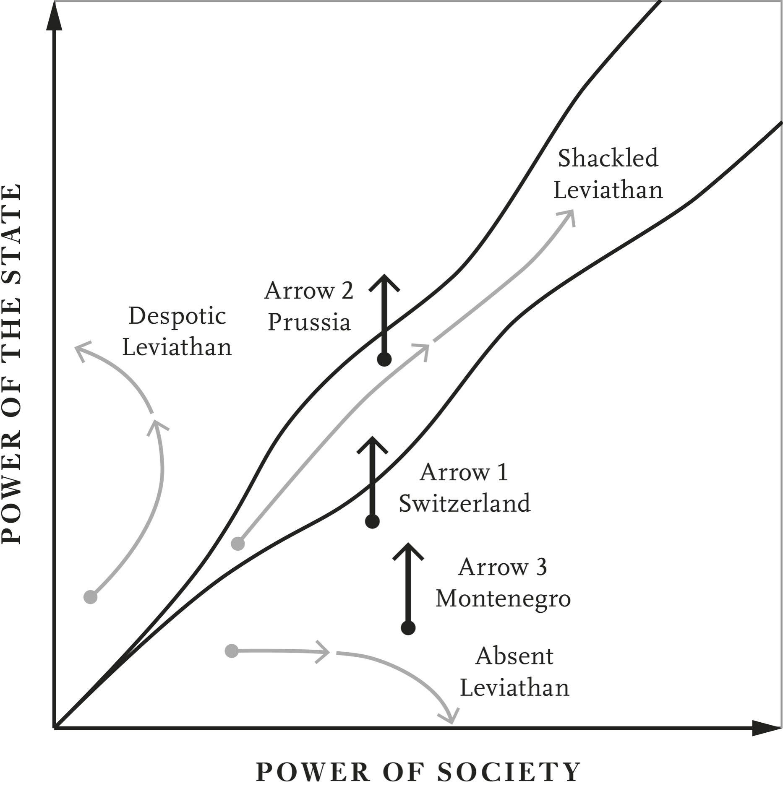
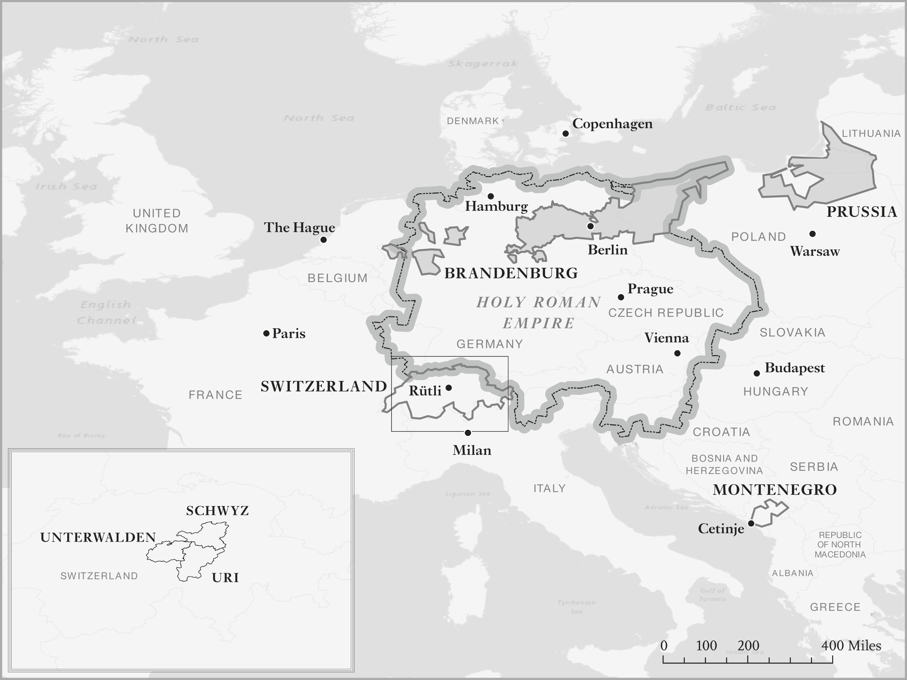
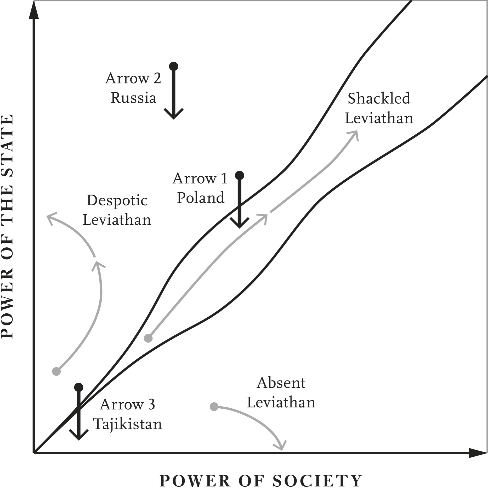

# Devil in the Details · 第9章　魔鬼藏在细节里

## European Diversity · 欧洲的多样性

Though as we have seen in Chapter 6 the two blades of the European scissors put much of the continent near or inside the corridor, quite a bit of diversity remained and developed over the next several centuries. England was moving in the corridor toward a much more participatory form of government overseeing the deepening of the state’s capacity. The Swiss Confederation, squeezed between France, Italy, southern Germany, and Austria, was likewise already inside the corridor and had created both a “citizen army” to defend itself against the Habsburgs and a powerful assembly controlling politics. In the words of Niccolò Machiavelli in The Prince, written in 1513:

> 我们在第六章里，虽然曾看到欧洲之剪的两只剪臂，把大部分欧陆国家推向自由窄廊，但欧洲大陆在随后的数百年里，却维持着多元化的发展态势。英格兰在自由之路上，继续大力拓展参与式政治，政府监督着国家进一步强化能力。瑞士联邦则夹在法国、义大利、南德和奥地利之间，同样已经踏进自由的窄廊，创造出抵抗哈布斯堡王朝的「公民军队」，以及可以控制政治的强大议会。照马基维利一五一三年所着《君王论》的说法：

Rome and Sparta for many centuries stood armed and free. The Swiss are extremely well armed and are very free. Indeed, Tom Scott’s summary of the consensus among historians is that Swiss peasants were “free of feudal servitude and, as a sign of their liberty, these mountain peasants bore arms and demanded ‘honour’ even from nobles . . . Their medieval clan structures had little to do with our images of democratic forms but these peasants were ‘free.’” Farther north, however, Prussia developed a very different type of state, whose despotic character is epitomized by the French philosopher Voltaire’s quip that while

> 很多个世纪以来，罗马和斯巴达都拥有武装和自由，瑞士的武装非常精良，也非常自由。的确如此，汤姆．史考特总结历史学家的共识后表示，瑞士农民享有「免于封建奴役的自由，为了象征他们是自由人，这些山地农民甚至带着武器，向贵族要求『荣誉』，这一点象征他们的自由……他们的中世纪部族结构跟我们想像中的民主形式，几乎毫不相关，但这些农民却很『自由』。」然而，北边较远处的普鲁士却发展出大不相同的国家形态。

other states possess an army, Prussia is an army which possesses a state. A little farther south the situation was completely different in Albania and Montenegro, which lacked any centralized authority and continued to experience uncoordinated violence well into the twentieth century. The Montenegrin writer and intellectual Milovan Djilas described the extent of feuding in the 1950s by writing about his own family history:

> 法国哲学家伏尔泰的讽刺说法：「其他国家拥有军队，普鲁士却是军队拥有国家」，具体而微地说明了普鲁士的专制性质。南边稍微远处的阿尔巴尼亚和蒙特内哥罗，又是完全不同的情况。这两个国家缺少任何中央化的权威，持续经历不协调的暴力，一直到二十世纪开始之后很久，还是这样。蒙特内哥罗作家和知识分子米洛万．吉拉斯（Milovan Djilas）借着描述自己的家族史，说明一九五○年代蒙特内哥罗的仇怨程度。

The men of several generations have died at the hands of Montenegrins, men of the same faith and name. My father’s grandfather, my own two grandfathers, my father, and my uncle were killed, as though a dread curse lay upon them . . . generation after generation, and the bloody chain was not broken. The inherited fear and hatred of feuding clans was mightier than fear and hatred of the enemy, the Turks. It seems to me that I was born with blood in my eyes. My first sight was of blood. My first words were blood and bathed in blood.

> 好几个世代的男性都死在信仰相同、名字相同的蒙特内哥罗男性手中。家父的祖父、我的祖父和外祖父、家父和一位叔伯都遭到杀害，就好像有一个可怕的诅咒加在他们身上一样……一代又一代，血腥的锁链无法打破。承袭而来的部族宿仇造成的恐惧和仇恨，比我们对土耳其族敌人的害怕和仇恨还严重。看来我出生时，眼中就带着血迹，我第一眼看到的东西是血，第一次开口说的字是「血」，而且我沐浴在血泊中。

What explains these differences? Why did these European polities diverge so sharply starting from broadly similar conditions? In this chapter we explain how our conceptual framework is useful for answering these questions and in the process show how it sheds light more broadly on the effects of political, international, economic, and demographic changes, sometimes referred to as “structural factors.”

> 要怎么解释这种差异？这些欧洲政体都从大致相同的情况起家，为什么会有这么大的差别？本章要解释我们的观念架构为什么有助于解答这些问题，而且在解答的过程中，会更广泛地显示政治、国际、经济和人口变化等通称「结构性因素」的影响。

The most common way in which social scientists have discussed the implications of different structural factors is by arguing that they create natural affinities for certain types of economic and political development—for example, war and military mobilization are argued to induce greater state capacity, while certain types of crops, such as sugar and cotton, lead to despotism and others, such as wheat, prepare the conditions for democratic politics. Our framework shows why this is not necessarily so. The same structural factor can have very different impacts on a polity’s political trajectory depending on the prevailing balance of power between state and society.

> 社会科学家在讨论不同结构性因素的影响时，最常用的方法是主张这些因素对某种形态的经济与政治发展具有天然的密切关系。例如，主张战争与军事动员会诱发更大的国家能力，主张糖或棉花等特定作物会带来专制主义，而小麦则会准备好民主政治的条件。我们的观念架构会说明何以不见得如此。相同的结构性因素对政体的政治走向，可能有大不相同的影响，实际情形要取决于当时国家和社会之间的权力均衡。

The key ideas can be seen in the context of Figure 1 from Chapter 2 summarizing our conceptual framework, which is replicated here as Figure 2. It makes clear that broadly similar conditions in terms of the power of state and society are no guarantee that two different polities will follow very similar trajectories. That depends on whether they are on the same side of the boundaries demarcating the regions of the Despotic, Shackled, and Absent Leviathans. This figure also highlights the fact that the effects of structural factors will be quite distinct depending on the initial positions of different nations.

> 我们的核心概念可以从第二章的图表一中看出来。图表一的图文摘要说明了我们的观念架构，现在我们把这些图文复制过来这里，变成图表二。这些图表广泛地说明，即使国家和社会力量状况类似，也不保证两个不同的政体会遵循非常相似的路线，这点取决于他们是否同属专制、受约束和无巨灵三种国家中的一种。这张图表也突显结构性因素的影响会不会大不相同，要取决于不同国家最初所在的位置。

Take an increase in the state’s capacity, which in the figure corresponds to a vertical move up as the state’s power increases (while society’s power remains unchanged). This could be just the shift that puts a polity inside the corridor, as Arrow 1 in the figure indicates. But it could also be the force that moves a society that was lodged in the corridor away from it and toward the Despotic Leviathan, as Arrow 2 illustrates. Or it might be not so consequential at all because it moves a society with the Absent Leviathan a little bit closer to the corridor, but leaves its long-run destination unaltered, as shown with Arrow 3. So when it comes to the effects of structural factors the devil is decidedly in the details.

> 举例来说，同样是提高国家的能力，产生的变化可能如同图表二中的箭头一那样，把一个国家推进自由窄廊；却也可能像箭头二所示，把已经停留在走廊中的国家推出走廊，往专制前进；甚至可能是像箭头三，只是把巨灵并不存在的国家，略微向自由窄廊推近一点，却无法根本地改变这个国家长期所处的位置。因此，谈到结构性因素的影响时，魔鬼的确是藏在细节里。

In the rest of this chapter, we develop these ideas, first focusing on European history and the contrast between Switzerland, Prussia, and Montenegro, and a very specific type of structural factor—the increase in the capacity and power of the state brought forth by military mobilization and war. These ideas and their applications are not confined to European history. We show that they are also useful in understanding how more recent big shocks have led to highly diverse responses, for example, in the context of the collapse of the Soviet Union, which opened the way to the birth of all kinds of states in Eastern Europe and Asia. We finally discuss how the first wave of economic globalization in the second half of the nineteenth century differentially impacted individual postcolonial societies, focusing in particular on the divergence between Costa Rica and Guatemala.

> 我们要在本章的其他部分里，发展这些概念。首先，我们要把重点放在欧洲历史上瑞士、普鲁士和蒙特内哥罗之间的对比，以及一个非常特别的结构性因素──会提高国家能力和权力的军事动员和战争。这些理念及其应用并非只限于欧洲史，我们要证明这些理念也有助于了解比较新近的重大变局，如何引发高度不同的反应；例如，前苏联的崩溃，开启了东欧和亚洲各式各样国家的诞生之路。我们最后要讨论十九世纪下半叶的第一波经济全球化，怎么对后殖民时代的各个社会，造成各不相同的冲击，特别是把重点放在哥斯大黎加和瓜地马拉的差异上。

## War Made the State, and the State Made War · 战争会建立国家、国家会制造战争

This title is a direct quote from the political sociologist Charles Tilly, who formulated one of the most famous theories about the role of a specific structural factor—increased incidence and threat of interstate warfare—on state building. He applied this idea to Western Europe in the early modern period arguing that the threat of increased warfare following the “military revolution” in the seventeenth century led to the creation of modern states. The military revolution introduced more portable and powerful firearms, new military tactics, and improved fortifications. Standing armies and intensified interstate competition followed.

> 本节标题直接引用政治社会学家查尔斯．堤利的话，堤利针对一项特定结构性因素──国际战争发生率与威胁提高──在建立国家机器上的角色，提出一个最有名的理论。他把这个概念用在现代早期的西欧，主张十七世纪的「军事革命」后，由于战争的威胁增加，促成了现代国家的创立。军事革命推出了更多火力强大的手持枪械、新的军事战术和经过改良的防御工事，随之而来的是常备部队和更严重的国际竞争。

Tilly argued that it revolutionized politics too because it forced states to create much more effective systems for raising taxes and providing infrastructure so they could pay for, equip, and transport larger militaries. In terms of our theory, this corresponds to an induced increase in the state’s power in order to deal with the necessities of war. Tilly was right that such a change can fundamentally alter the dynamics of political development, as Arrow 1 in Figure 2 illustrates, but it can have quite different implications as well.

> 堤利主张这种情形也造成了政治革命，因为这样会迫使国家创造出更有效的制度，以便提高税负、提供基础建设，负担军队规模扩大后的装备和运输费用。从我们所提理论的角度来看，这等于诱导国家提高力量，以便因应战争所需的一切。堤利说得很对，这种变化会像图表二中的箭头一所示，根本改变政治动态，但同时也可能还有大不相同的其他影响。

Switzerland provides the perfect illustration of Tilly’s argument, even if state building in this case predates the military revolution. Switzerland was historically part of the Holy Roman Empire, the successor institution to the eastern part of Charlemagne’s Carolingian Empire. The empire still had an emperor, but it had fragmented into many small and relatively independent polities, and the emperor was actually elected by some of them. We have already seen how in northern Italy, which was quite far from the core of the empire centered on Germany, these polities asserted their independence.

> 瑞士早在军事革命之前就已经建国完成，却仍然可以为堤利的主张提供完美的说明。历史上，瑞士是神圣罗马帝国的一部分，神圣罗马帝国则是查理曼大帝所开创加洛林帝国东部的继承者。神圣罗马帝国仍然有皇帝，却已经四分五裂，分成很多相当独立的小型政体，皇帝实际上是由其中若干小政体选出来的。我们已经看到，这个帝国核心所在地是日耳曼，在离日耳曼相当远的义大利北部，很多政体都已经宣称独立。

Switzerland was also on the periphery of the empire, even if not separated and isolated by the Alps like Italy. The Holy Roman Empire’s imperfect control over this area allowed the component Swiss polities, the cantons, to develop their own systems of assemblies. These cantons, some rural, some largely urban, thus came to reflect the broader pattern of assembly politics inherited from Germanic tribes, which had reemerged as the empire had weakened. The Swiss Confederation started in 1291 with the cantons of Uri, Schwyz, and Unterwalden taking oaths and signing the Bundesbrief (Federal Charter) at Rütli, a meadow above Lake Lucerne (see Map 13).

> 瑞士也位在这个帝国的外围，即使瑞士不像义大利，没有被阿尔卑斯山脉隔离在外，神圣罗马帝国也无法完全控制这个地区，因此组成瑞士政体的各州得以发展出自己的议会制度。这些州有些是乡村省份，有些大致上是都会省份，因此能够从帝国削弱后重新出现的日耳曼部落中，承袭了议会政治的主体形态。一二九一年，乌里（Uri）、施维茨（Schwyz）和下特瓦尔登（Unterwalden）等州在琉森湖（参见地图十三）上方的鲁特里（Rütli）草原上宣誓，并签订联邦宪章，成立瑞士联邦，开始立国。

The charter was an attempt toward centralization of authority and was particularly concerned with public order and lawlessness. The first substantive clause read: Thus, all people of the valley community of Uri, the entirety of the Schwyz valley and the community of people from the lower Unterwalden valley recognize the malice of the times and for their own protection and preservation they have promised to assist each other by every means possible with every counsel and favor, with persons or goods within their valleys and without against any and all who inflict on them or any among them acts of violence or injustice against persons or goods.

> 这份宪章旨在集中权力，特别关注公共秩序和无法无天的状况。宪章第一条实质的条文规定：因此，乌里山谷社区所有人民、施维茨山谷全体人民，以及下特瓦尔登社区人民承认时代的险恶，为了自保与自我维护，承诺透过一切咨商与互惠，动用他们山谷内外所有人力或物力，采取一切可能手段，互相帮助，对抗任何人或所有人，以所有或任何不利人身或物品的暴力行动或不公不义，施加在他们或其中任何人身上。

It was in effect a pact committing the three cantons to come to one another’s aid and providing a framework for resolving disputes, stating that “should disputes arise among any of the people bound by this oath, the most prudent among the confederates shall settle the conflict between the parties. All other confederates shall defend this verdict against anyone who rejects it.” It didn’t specify who the “most prudent” was, but this clause is interpreted as stipulating arbitration by one of the cantons if two others, or the citizens of two others, got into a dispute. Might we have here the roots of the fabled Swiss ability to find compromises?

> 事实上，这是约束三州互助的公约，这项公约也提供解决纷争的架构。公约中规定：「受此誓言约束的任何人如发生纷争，联邦中最谨慎的一州必须解决双方之间的冲突，联邦所有成员必须维护此一裁决，对抗拒绝此一裁决的任何人。」公约中没有指明谁「最谨慎」，但人们的解释是这条条文规定：其中一州要在另两个州或其公民发生纷争时，负责仲裁。我们是否可能在这里，找到瑞士人善于找到妥协传说的起源呢？

Uri, Schwyz, and Unterwalden were all part of the Holy Roman Empire. They were supposed to be subservient to the Habsburg Duke of Austria. They had no business signing pacts. The Habsburgs didn’t approve of such autonomous organization, and they certainly didn’t like the clause that read: We have further unanimously vowed and established that we in these valleys shall accept no judge who has gained his office for money or for any other price and who is not our resident or native.

> 乌里、施维茨和下特瓦尔登都是神圣罗马帝国的一部分，理当服从奥地利的哈布斯堡公爵，无权签订公约。哈布斯堡王朝不会批准这种自治组织，一定也不会喜欢下列条文：我们进一步一致宣誓，确定我们这些山谷居民，绝不接受靠金钱或任何其他代价谋得职位却又不是我们的居民或本地人的法官。

No Habsburg judges were to be tolerated anymore. In 1315 the first Habsburg army was driven off after the battle of Morgarten. More pacts followed and what came to be known as the Swiss Confederation spread. Lucerne joined in 1332. The League of Zurich of 1351 specifically stipulated that everyone who signed would come to the aid of any other threatened by the Habsburgs. Glarus joined in 1352 and Bern in 1353.

> 这个联邦不再容忍哈布斯堡王朝的任何法官。一三一五年，哈布斯堡的第一支军队在莫尔加滕（Morgarten）战役中遭到逐退后，接着，更多的公约出现，名为瑞士联邦的组织扩大，琉森（Lucerne）在一三三二年加入。一三五一年的苏黎世联盟公约还特别规定：每一个签约成员在任何其他成员遭到哈布斯堡王朝威胁时，必须提供援助。格拉鲁斯（Glarus）于一三五二年加入，伯恩于一三五三年加入。

Duke Leopold II of Austria finally decided to put a stop to this Swiss recalcitrance, but his army was routed at the battle of Sempach in 1386 by the combined forces of the confederation. Leopold himself was killed along with a lot of the local nobility who had been fighting with him. This didn’t exactly free the Swiss from Habsburg dominance. That had to wait until a final war in 1499, followed by the Treaty of Basel, which recognized the confederation’s de facto autonomy. Undeterred, the bottom-up construction of the Swiss state continued throughout the fifteenth century.

> 神圣罗马帝国皇帝、奥地利李奥波德二世公爵（Duke Leopold II）最后决定制止瑞士人的顽抗，但他的军队在一三八六年的森帕赫（Sempach）之役中，遭到瑞士联邦联军击溃，李奥波德二世和跟他一起上战场的当地贵族战死。这样并没有让瑞士完全脱离哈布斯堡王朝的宰制，要等到一四九九年的最后一战结束，签署巴塞尔条约，实质承认瑞士联邦的自主后，才完全脱离。但是，由下而上组成的瑞士联邦不屈不挠，在整个十五世纪里，都继续奋斗。

As part of this process, rural people bought themselves out of any residual feudal obligations, and as that happened, what was left of the Swiss nobility slowly withered away. By this time the transformation going on among the Swiss had been noticed throughout the empire and the expression “schweytzer werden”—“going Swiss”—was coined. It meant peasants trying to become autonomous. After 1415 an assembly made up of delegates from all the cantons in the confederation began to meet regularly. Fribourg and Solothurn were admitted in 1481, Basel and Schaffhausen in 1501, and Appenzell in 1513.

> 与此同时，乡村人民买回自己残余的任何封建义务，瑞士贵族残存的权利逐渐萎缩。这时，整个神圣罗马帝国的人，都注意到瑞士人之间出现的转变，创出「跟着瑞士走」（schweytzer werden）的说法，意思是农民努力追求自治。一四一五年后，由瑞士联邦所有各州代表组成的议会开始定期集会，弗莱堡（Fribourg）和索洛图恩（Solothurn）于一四八一年获准加入联邦，巴塞尔和沙夫豪森（Schaffhausen）于一五○一年加入，亚本塞（Appenzell）于一五一三年加入。

Consistent with Tilly’s theory, this all happened in the context of rising military threats from the Habsburgs, which made it more beneficial for the cantons to come together and increase the Swiss state’s capacity. The victory at Sempach had shown the power of Swiss infantry even over armored knights. As early as 1424 Florence asked the Assembly of the confederation for mercenaries, and for the next few centuries the Swiss specialized in providing such troops for warring countries all over Europe.

> 这种情形是在军事威胁升高的情况下发生，符合堤利的理论，也对瑞士各州团结，提高瑞士的国家能力更为有利。森帕赫之役的胜利显示，瑞士步兵的威力甚至胜过装甲骑士。佛罗伦斯早在一四二四年，就要求瑞士联邦议会，准许他们雇用佣兵；随后的几个世纪里，瑞士专门为全欧洲的交战国，提供这种军队。

At first the recruitment of these mercenaries was decentralized, organized by private entrepreneurs and various cantonal bodies. But it became apparent that the mercenary activity posed a threat to security and to the state’s authority. So the Assembly passed a law in 1503 stipulating that a majority of the body had to approve any recruitment. One reason for this was to avoid the possibility of two Swiss armies facing off against each other, as had happened in Novara in 1500 with one in the employ of France, the other fighting for Milan.

> 起初佣兵的招募分由地方负责，由民间企业和不同的州级机构安排，但佣兵的活动显然对安全和国家的权威构成威胁，因此一五○三年，联邦议会通过法律，规定任何招募必须经过议会过半数议员批准。会这样做，原因之一是要避免两支瑞士军队对决的可能性，以免像一五○○年在诺瓦拉（Novara）发生的状况那样，一支由法国雇用的部队和另一支为米兰作战的军队，在战场上遭遇。

The final peace with the Habsburgs didn’t stop further threats from France, Milan, and the Dukes of Württemberg, and the military exigencies facing the Swiss state continued, as did the process of state building. In the Swiss case the threat of warfare, in particular the persistent threat from the Habsburgs to reinstate the overlordship of the Holy Roman Empire, seems to have been an important incentive for the otherwise individualistic cantons and cities to unite into a larger confederation, centralize authority, and increase their state’s capacity.

> 瑞士跟哈布斯堡王朝最后虽然谈和，却没有阻止来自法国、米兰和符腾堡公爵（Dukes of Württemberg）的进一步威胁，瑞士继续面对军情紧急的状况，建国过程也一样。对瑞士来说，战争的威胁一直持续存在，哈布斯堡王朝意图恢复神圣罗马帝国霸权的威胁尤其如此，这一点似乎变成了重要诱因，促使原本各自为政的州和城市，团结为更大的联邦，以便集权中央，提高国家的能力。

Before this centralization, the Swiss cantons were arguably outside the corridor, relying on clan structures rather than laws or state authority for resolving disputes or enforcing laws. But this inheritance also meant that Swiss peasants were free and society already mobilized. The centralization that began in 1291 came in the context of a society that was strong enough to withstand and counterbalance the increasing power of the state, engendering a transition into the corridor and spearheading a process of gradual expansion of the capabilities of both state and society.

> 瑞士各邦在这次中央集权之前，可以说是处在自由窄廊之外，依靠部族结构，而非依赖法律或国家权威，解决纷争或执行法律；但这种传统也表示瑞士农民是自由人，而且社会已经动员起来。一二九一年，瑞士开始中央集权时，社会已经强大到足以承受和抵销国家机器日益增加的权力，催生瑞士过渡进入走廊、带领国家和社会踏上逐渐扩大能力的过程。

The movement of state and society along the corridor created not just the conditions for liberty but also, predictably, incentives and opportunities for economic prosperity. The Swiss became famous first for their watches and subsequently their machine tool industry, and then they took over the world pharmaceutical industry. They used their comparative advantage in cows and milk to become a major producer of chocolates. Switzerland has the highest income per capita of any European country (not counting the small enclaves such as Luxembourg and Monaco).

> 可想而知，国家和社会沿着自由窄廊前进，不但为自由创造了条件，而且可以预见的是，也为经济繁荣创造了诱因和机会。瑞士最先以制造手表出名，后来以工具机产业出名，然后接管了世界制药业，也利用自己在乳牛和牛奶上的比较优势，成为重要的巧克力生产国。瑞士的人均所得高过欧洲任何国家（不计卢森堡和摩纳哥等小型飞地国家）。

War made the state in Switzerland, as Tilly would have it, but it also made society. Switzerland went on to build one of the most vibrant democracies in Europe. Yet as Figure 2 emphasizes, such a process is by no means preordained. The threat of war can unleash very different dynamics too.

> 就像堤利所说的那样，战争促使瑞士立国，却也助成瑞士社会的建立。瑞士继续前进，建立了欧洲最有活力的民主政治。但是，如同图表二所强调，这种过程绝非上天注定，战争的威胁也可能释放出大不相同的改变力量。

## The Sort of State That War Made · 战争会造成各式各样的国家

You don’t have to look far within Europe to see that if war made the state, it made very different types of states in different circumstances. The prime example is Prussia. Though Prussia was never part of the Holy Roman Empire, in 1618 it merged through marriage with Brandenburg, which was (see Map 13). The ruling family of Brandenburg, the Hohenzollerns, became the ruling family of Brandenburg-Prussia, with the ruler known as the elector.

> 如果说战争会创造国家，那么你在欧洲不必远望，就能看出战争会在不同的状况下创造出大不相同的国家，普鲁士就是最好的例子。虽然普鲁士从来都不是神圣罗马帝国的一部分，却在一六一八年，借着联姻，跟神圣罗马帝国境内的布兰登堡合并（参见地图十三）。统治布兰登堡的霍亨索伦（Hohenzollern）家族，变成了统治布兰登堡—普鲁士的家族，只是统治者称为「选侯」。

These were difficult times, as the Thirty Years War was afoot and invading armies crisscrossed Central Europe. The elector Georg Wilhelm desperately tried to stay out of the conflict, but had to cave in when told by the king of Sweden, Gustavus Adolphus, that neutrality was not an option. “What can I do? They’ve all the big guns,” was how Georg Wilhelm famously reported the incident. Brandenburg was particularly devastated, losing as much as half of its population.

> 这时时局艰难，因为三十年战争正在进行，外国入侵的军队纵横中欧，盖欧格．威廉（Georg Wilhelm）选侯极力设法避开冲突，却在瑞典国王古斯塔夫．阿道夫（Gustavus Adolphus）告诉他中立并非选项时，被迫让步。威廉说明这件事时，说了句非常有名的话：「我能怎么办？他们拥有所有的大炮。」布兰登堡遭受的蹂躏特别严重，丧失了多达半数的人口。

In 1640 Frederick William I came to the throne as the new elector. He ruled for forty-eight years and charted a new course for Brandenburg-Prussia, and in the process came to be known as the Great Elector. The Prussian experience during the Thirty Years War convinced Frederick William that he too needed “big guns.” As he put it: I have experienced neutrality before; even under the most favorable circumstances, you are treated badly. I have vowed never to be neutral again as long as I live.

> 一六四○年，腓特烈．威廉一世（Frederick William I）登基，担任新选侯，他在长达四十八年的统治期间，为布兰登堡—普鲁士规划了新局，也在统治的过程中，获得「大选侯」的名号。普鲁士在三十年战争期间的经验，让威廉一世认定自己也需要「大炮」，如同他所言：我以前经历过中立，即使在最有利的状况下，你都会遭到恶劣的对待。我曾经发誓，只要我活着一天，我绝对不会再采取中立。

This all meant greater state capacity. With big guns, the state could control more. But to get big guns, it needed more tax revenues. More tax revenues would be easier to raise if Frederick William could increase his power over society, and that’s what he did. Previously taxes had to be negotiated with various representative bodies, such as the Estates of Kurmark in Brandenburg. He started out by trying to get permanent grants of taxation, which would free him from the need to endlessly seek the approval of the estates.

> 这种情形全都表示需要更大的国家能力，有了大炮后，国家机器可以控制更多东西。但是，要得到大炮，国家需要更多的税收。如果威廉一世能够提高控制社会的能力，应该更容易提高税收，他就是这样做。以前要课税，必须跟布兰登堡的库尔马克庄园（Estates of Kurmark）等不同代表性团体谈判，他开始设法取得课税的永久授权，以免必须无尽无止地寻求各庄园的批准。

In 1653 he negotiated the so-called Brandenburg Recess, which gave him 530,000 thalers over a period of six years. Crucially, he, rather than the Estates of Kurmark, got to collect the taxes. In exchange he gave the nobility, which made up a chamber in the estates, tax-exempt status. This was a clever strategy of “divide and rule,” which successfully separated the different chambers of the estates and made sure they would not form a unified force against him. He went on to extract similar concessions from the Prussian estates.

> 一六五三年，他谈判出所谓的「布兰登堡决议」（Brandenburg Recess），让他可能在六年期间，得到五十三万塔勒（thaler，德国旧货币名称）。至为重要的是，要负责收税的是他，而非库尔马克庄园，交换条件是赐予构成庄园议院中一院的贵族免税地位。这是巧妙的「分而治之」策略，成功地分离了各庄园不同的议院，确保他们不会团结起来，形成反对他的统一力量。他还继续从普鲁士的庄园争取到类似的让步。

Frederick William then overrode the authority of the estates and started to tax without their agreement, something he could do because the 1653 decision allowed him to initiate the building of a tax administration. In 1655 he founded the Kriegskommissariat (“war commissary”), which covered both tax collection and military organization. By 1659 the estates had already atrophied and retreated to just dealing with local issues. Frederick William also transformed the royal council, previously made up of a few aristocrats, into an administration staffed by professional officials. Between 1348 and 1498, 16 universities were founded within central Europe and by 1648 another 18 opened.

> 然后，威廉一世否决各庄园的权威，开始不经庄园的同意就课税；他可以这样做，是因为一六五三年的决议让他可以创建税务机关。一六五五年，他成立战争委员会，主管课税和军事组织；到一六五九年，各个庄园已经萎缩，变成只能处理地区问题。他也改革过去由贵族组成的皇家理事会，改成由专业官员负责的政府机构。一三四八年至一四九八年间，中欧共创设了十六所大学；到一六四八年，又新创设了十八所。

This meant that there was a large pool of well-qualified graduates trained in Roman law who could be attracted to staff a meritocratic bureaucracy. Governors were appointed to run the various territories under the elector’s control. After 1667 he introduced indirect taxes on trade. The administration of the royal estates was also reconfigured and the land was let out to private farmers for money, dramatically increasing government revenues. By 1688, Brandenburg, Prussia, and Kleve-Mark, the largest territories, were paying one million thalers a year in taxes, with about another 600,000 coming in from the other regions under Frederick William’s control.

> 这表示有大量研习罗马法、资格十分符合的毕业生可以召募，担任菁英官僚体系的官员。威廉一世任命多位总督，治理选侯控制下的领土。一六六七年后，他推出贸易间接税，皇家庄园的管理也经过改革，土地租给民间农民，收取租金，急剧提高了政府的岁入。到一六八八年，威廉一世辖下最大的领土布兰登堡、普鲁士和克莱韦马克（Kleve-Mark），每年共收取一百万塔勒的税金，他控制的其他地区合共另外可以收到六十万塔勒。

In 1701 Frederick William’s son Frederick III changed Brandenburg-Prussia to the Kingdom of Prussia and crowned himself King Frederick I. His son King Frederick William I (not to be confused with the Great Elector of the previous century with the identical name) ruled between 1713 and 1740, and his grandson Frederick II, known as Frederick the Great, ruled from 1740 to 1786. Father and son intensified the project that the Great Elector had started.

> 一七○一年，威廉一世的儿子腓特烈三世把布兰登堡—普鲁士的国名，改为普鲁士王国，自己加冕为腓特烈一世国王；他的儿子腓特烈威廉一世国王（不要和上一世纪同名的大选侯混为一谈）从一七一三年统治到一七四○年；他的孙子腓特烈二世号称「腓特烈大帝」，从一七四○年统治到一七八六年。威廉父子一起强化了大选侯开始推动的大业。

In 1723 the bureaucracy was restructured again with the creation of the General Directory, merging the previous war commissary with the administration of the royal estates and putting everything at the service of the military. In 1733 Frederick completely reorganized the basis of military recruitment. He divided the territory into cantons of 5,000 households with a regiment assigned to each for recruitment. At the age of ten every male child was included in the recruitment rolls. Though some occupations and people were exempted, at least a quarter of the male population was included in the rolls. This dramatically increased the potential size of the army.

> 一七二三年，官僚体系再度改组，战争委员会和皇家庄园管理部门合并，创设战争暨财政总署（General Directory of War and Finance），以便一切政务都为军事服务。一七三三年，腓特烈大帝彻底改革募兵制的基础，把领土划分为以五千户为一单位的行政区，每个行政区配属一个团，以便募兵。每一个男孩年满十岁时，要列入募兵名册中，虽然若干职业和人民豁免列入，但至少四分之一的男性人口都纳入名册中，急剧增加了军队的潜在规模。

In 1713 the army had about 30,000 soldiers in peacetime. By 1740, when Frederick the Great took over from his father, the figure was 80,000. In the meantime his father had managed to increase tax revenues by almost one half. Frederick the Great had a new strategy for further expanding Prussia’s tax base and military machine: he launched an aggressive strategy of territorial expansion.

> 一七一三年，军队在承平时期的员额大约有三万人；到一七四○年，腓特烈大帝继承父亲的王位时，军队有八万兵员。同时，腓特烈大帝的父亲已经设法把税收提高了将近一半。腓特烈大帝有一个积极扩张领土的新策略，要进一步扩大普鲁士的税基和军事机器。

War might have made the state in Prussia, but it made a famously despotic one. That’s certainly how its rulers thought about it. The Great Elector himself observed, “So long as God gives me breath, I shall assert my rule like a despot . . .” Frederick the Great agreed, remarking: A well-run government must have a firmly established system . . . in which finance, policy and military all combine to promote the same end, the strengthening of the state and the expansion of its power. Such a system can only derive from one brain.

> 战争或许有助于普鲁士的立国，却协助建立了一个以专制闻名的国家。这一点确实是普鲁士统治者心中的想法，大选侯自己就说过：「只要上帝继续让我呼吸，我一定会像暴君那样，坚持我的统治……」腓特烈大帝欣然同意说：运作良好的政府必须建立牢靠的制度……财政、政策和军事必须合一，以便推展共同目标，促进国家的强大、扩张国家的权力，这种制度只能出自一个人的大脑。

In the sixteenth century Prussia, like many other parts of the Holy Roman Empire, was inside the corridor with the powerful estates constraining the monarchy. Warfare, by increasing the state’s power, pushed it out of the corridor, as Arrow 2 in Figure 2 illustrates—a very different outcome from the one that warfare helped create in Switzerland. Prussia didn’t look back and rapidly progressed along the despotic path.

> 普鲁士在十六世纪时就和神圣罗马帝国的很多其他属地一样，都走在自由窄廊里，有强大的庄园约束着君主。然而，战争借着提高国家机器的力量，把普鲁士推到这条走廊外，就像图表二中的箭头二所显示的那样──这种结果跟战争在瑞士创造的国家大不相同。普鲁士没有回头，而是迅速的沿着专制之路前进。

This had predictable consequences for liberty, which far from flourishing as in the Swiss case, was completely snuffed out. In the assessment of the British envoy Hugh Elliot: The Prussian monarchy reminds me of a vast prison in the center of which appears the great keeper occupied in the care of his captives.

> 这种情形对自由的影响可以想见，以瑞士而言，自由在这条走廊中勃然兴起，普鲁士却和瑞士大不相同，自由遭到彻底扼杀。英国公使休伊．艾略特（Hugh Elliot）的评估如下：普鲁士君主让我想到一座强大的监狱，壮硕的狱长似乎占据监狱中心，照管他的囚犯。

## Freedom on the Heights · 高地上的自由

The impact of warfare isn’t confined to creating Shackled or Despotic Leviathans. Montenegro had a large number of similarities to Switzerland. It too had been part of the Roman Empire, even if more peripherally, and it shared a mountainous ecology and an economy based on herding. The great historian Fernand Braudel emphasized how European terrain created particular types of societies, arguing that “mountains are mountains: that is, primarily an obstacle, and therefore a refuge, a land of the free.”

> 战争的影响不限于会创造受到制约的国家或专制国家。蒙特内哥罗跟瑞士有很多相似的地方，它过去也是罗马帝国的一部分，只是处在更外围而已。蒙特内哥罗和瑞士一样，拥有同样的山地生态、同样的畜牧业经济。伟大的历史学家费尔南．布劳岱尔（Fernand Braudel）强调欧洲地形如何创造特殊社会形态时曾指出：「山就是山。也就是说，基本上，山是一种障碍，因此也是避难所、是自由之地。」

Free, like the Swiss. But in some sense people were pretty free in Montenegro and Albania too. Edith Durham, one of the first Western Europeans to systematically study the Balkans, starts her famous book High Albania with a line from a poem by Lord Tennyson, “Of old sat freedom on the heights.” Yet the connection between freedom and the state is complex. As we’ve seen, the expansion of the state is often resisted because people want to preserve their freedom from its authority. That’s exactly what happened in Montenegro even though it continually experienced the pressure of warfare.

> 换句话说，蒙特内哥罗应该像瑞士一样自由；从某些角度来说，蒙特内哥罗和阿尔巴尼亚的人民也相当自由。率先有系统研究巴尔干半岛国家的英国学者伊迪斯．杜伦（Edith Durham）在她的名著《至高的阿尔巴尼亚》（High Albania ）一书中，就以英国诗人丁尼生爵士（Lord Tennyson）诗作〈从前自由神坐在高山上〉（Of old sat freedom on the heights）的一句诗文，作为开端。但是，自由和国家之间的关系错综复杂，前文说过，国家力量的扩张经常遭到抗拒，原因是人民希望维护自己的自由不受权威干扰，蒙特内哥罗虽然持续承受战争的压力，实际情势的发展却正好就是这样。

Prior to 1852 Montenegro was in effect a theocracy, but one wherein the ruling bishop, the vladika, could exercise no coercive authority over the clans that dominated society. After a visit to Montenegro in 1807, the French general Marmont observed, “This Vladika is a splendid man, of about fifty-five years of age, with a strong spirit. He conducts himself with nobility and dignity. His positive and legal authority is unrecognized in his country.”

> 一八五二年前，蒙特内哥罗实际上是一个神权政体，由一位主教负责统治，但是主教不能对宰制社会的部族发挥强制力。一八○七年，法国的马尔蒙（Marmont）将军访问蒙特内哥罗后表示：「这位主教人很杰出，年龄大约五十五岁，意志坚强，言行高贵而尊严；但他的地位和法律权威在国内却不受承认。」

The key to understanding why this was so and why no state formed in Montenegro is that it was further from the corridor than Switzerland was. It was made up of kinship groups, clans, and tribes, and lacked the elements of centralization that the Swiss had inherited from the Carolingians. There are many similarities between Montenegro and other societies, such as the Tiv, that have steadfastly refused centralized state authority. As one scholar put it for Montenegro, “Continued attempts to impose centralized government were in conflict with tribal loyalty.”

> 要了解为什么会这样、为什么蒙特内哥罗没有成立国家，关键在于蒙特内哥罗跟自由窄廊的距离比瑞士还远。蒙特内哥罗由亲属团体、部族和部落构成，缺少瑞士从加洛林王朝承袭而来的集权因素。蒙特内哥罗和蒂夫族之类坚决拒绝集权国家权威的其他社会之间，有很多相似的地方。有一位学者谈到蒙特内哥罗时说：「设立集权化政府的持续尝试，跟忠于部落的忠心冲突。」

Warfare with the Ottomans did induce the clans to try to coordinate more. Just before a key battle at Krusi in 1796 an assembly of Montenegrin tribal chiefs met at Cetinje and adopted a measure called Stega, or “fastening,” which proclaimed the unification of the Montenegrin heartlands. Two years later they met again and agreed to convene a “council” of fifty members, in effect the first time there had been any institutionalized structures of government above the tribe. The first attempt at a legal code in 1796 by Vladika Peter I reflected the fact that order in society was regulated by the institution of blood feuds and included the clauses:

> 和奥图曼人作战，没有促使蒙特内哥罗各部族设法加强协调。就在一七九六年重要的克鲁西（Krusi）之战前不久，蒙特内哥罗的部落酋长在大城市策提涅（Cetinje）集会，采取一项名为「团结」的措施，宣布蒙特内哥罗心脏地带的统一。两年后，这些酋长再度集会，同意召集由五十人组成的「理事会」，实际上，这是蒙特内哥罗首次出现高于部落的制度化政府结构。一七九六年，彼得一世主教首次试图制定法规，反映了社会秩序是靠血仇制度和下列条文规范的事实：

A man who strikes another with his hand, foot, or chibouk, shall pay him a fine of fifty sequins. If the man struck at once kills his aggressor, he shall not be punished. Nor shall a man be punished for killing a thief caught in the act. If a Montenegrin in self-defense kills a man who has insulted him . . . it shall be considered that the killing was involuntary.

> 如果一名男子用拳打脚踢或长烟管攻击另一名男子，必须赔偿五十金币（sequin）；如果该名男子立即杀害攻击者，则无须受惩罚。当场杀害行窃失风窃贼者也不须受惩罚。如果蒙特内哥罗人因为自卫而杀害侮辱者……杀人行为应当视为非自愿杀人。

This looks more like Clovis’s Salic Law or King Alfred’s law code than a modern legal system. But there was little of the subsequent state-building effort of Clovis or Alfred in this case. The feud continued with centralized state authority nowhere in sight. The lack of state authority and dominance of the feud lasted sufficiently long that the anthropologist Christopher Boehm was able to reconstruct it in great detail in the 1960s. Boehm captures the essential difficulty of central authority in Montenegro when he writes, “It was only when their central leader attempted to institutionalize forcible means of controlling feuds that the tribesmen stood firm in their right to follow their ancient traditions. This was because they perceived in such interference a threat to their basic political autonomy.”

> 这种法规看来比较像是克洛维的萨利克法或艾佛瑞国王的法典，比较不像现代法律制度。但是，在蒙特内哥罗的例子里，几乎看不到像克洛维或艾佛瑞那样的后续建国行动，仇怨制度继续实施，集中权力的国家权威不见踪影。缺少国家权威和仇怨主导社会的时间够久，以至于到一九六○年代时，人类学家克里斯多福．薄姆（Christopher Boehm）还能极为详细地重建这种状况，薄姆抓住了蒙特内哥罗中央权威的基本问题，写道：「要到他们的中央领袖试图制定控制仇怨的强力手段时，部落人民才牢牢坚持他们遵循古老传统的权利，因为他们认为，这种干预威胁他们的基本政治自主权。」

Boehm is referring to the attempts of Vladika Njegoš to establish the state’s authority in Montenegro in the 1840s. Djilas analyzed the same situation in the following terms: It was a clash between two principles—the state and the clan. The former stood for order and a nation, and against chaos and treason; the latter stood for clan freedoms and against the arbitrary actions of an impersonal central authority—the Senate, the Guard, the captains.

> 薄姆说的是一八四○年代时，倪格斯（Njegoš）主教试图建立蒙特内哥罗国家权威的事情。吉拉斯（Djilas）后来用下列说法，分析同样的状况：这是国家和部族两大原则的冲突，前者代表秩序与国家，反对混乱与叛逆，后者代表部族自由，反对没有人情味的中央权威──参议院、自卫队和首领──的任意行为。

Djilas records that Njegoš’s reforms were immediately confronted by the revolt of the Piperi and Crmnica clans because “the imposition of government and a state was putting an end to the independence and internal freedom of the clans.” Njegoš was succeeded by his nephew Danilo, who made himself the first secular prince of Montenegro in 1851, but his project to build something resembling a state ran into fierce opposition too. An attempt to raise taxes in 1853 triggered clan revolts with the Piperi, Kuči, and Bjelopavlići declaring themselves independent states. A member of the Bjelopavlići assassinated Danilo in 1860.

> 吉拉斯写道：「倪格斯一开始改革，皮佩里（Piperi）和柯姆尼卡（Crmnica）地区的部族立刻起而反叛，因为成立国家和政府，等于结束部族的独立和内部自由。」倪格斯的职位后来由姪儿丹尼罗（Danilo）继任。丹尼罗于一八五一年，自立为蒙特内哥罗第一位世俗王子，但他建立类似国家之类机构的计划同样遭到激烈反对；一八五三年，他试图提高税负，结果引发了反叛，皮佩里、库奇（Kuci）和碧罗帕弗里奇（Bjelopavlici）宣布独立；到一八六○年，丹尼罗遭到碧罗帕弗里奇部族的成员暗杀身亡。

War did make states of different sorts in Switzerland and Prussia, but not so in Montenegro or, for that matter, in neighboring Albania, where society remained highly fragmented and suspicious of centralized power. Montenegrins fought the Ottomans not by creating a powerful centralized authority but by using their tribal structures. Any pressure to increase state capacity, just as with Arrow 3 in Figure 2, was not sufficient to bring Montenegro or Albania close to the corridor. They would stay with the Absent Leviathan.

> 战争的确使瑞士和普鲁士变成两种不同的国家，却没有在蒙特内哥罗和邻近的阿尔巴尼亚，造成同样的结果。阿尔巴尼亚的社会仍然极度四分五裂，怀疑集权式的权力。蒙特内哥罗和奥图曼人作战时，不是靠着创立强而有力的集权式权威，而是依赖自己的部落结构。就像图表二中箭头三所显示的那样，提高国家能力的任何压力，都不足以把蒙特内哥罗或阿尔巴尼亚，拉到接近自由窄廊，这两国继续处在无巨灵国家的状态中。

Our theory also highlights the ironic implications of this resistance for liberty. Even though they remained free from state control, and maintained their egalitarian clan structures, Montenegrins were still subject to dominance and insecurity due to endemic feuding. For them this was better than being dominated by the Ottomans or the vladika, but it was still very far from liberty. Society was armed and violent.

> 我们的理论也强调：对自由的这种抗拒具有讽刺性的影响：虽然蒙特内哥罗人免于受到国家机器的控制，维持自己平等的部族结构，却仍然受到地方性的仇怨宰割，陷在不安全的状态中。他们认为这样胜过受到奥图曼人或主教的宰割；但是，这样离自由仍然很远，社会处在必须自行武装、暴力横行的状态中。

An interesting question is, Why, in contrast to many other stateless societies, such as the Asante, the Tiv, and the Tonga, whom we have seen in Africa, did Montenegro or Albania not develop norms to control feuds and recurrent violence? One possibility is that this was in fact because of the incessant wars. Violence had to be part of any order in these societies, and this made it difficult to create any type of nonviolent social order.

> 这样会产生一个有趣的问题：跟前面谈过的非洲阿散蒂、蒂夫族和东加人之类很多没有国家的社会相比，为什么蒙特内哥罗或阿尔巴尼亚没有发展出能够控制仇怨和暴力的规范？一个可能的原因是与奥图曼的长期战争。在这样的社会里，暴力是维持秩序不可或缺的一环，很难不仰赖暴力来创造任何类型的社会秩序。

## Differences That Matter · 差异很重要

Readers familiar with our earlier book Why Nations Fail will see some parallels between our discussion of the divergent implications of structural factors here and the role of small institutional differences during critical junctures in our earlier work. Our discussion in Why Nations Fail emphasized how large shocks can lead to very different responses depending on prevailing institutions. Our theory here goes further both because it distinguishes between societies under the control of despotic states and those without any centralized state, and also because it explicitly focuses on the dynamics of the state’s capacity and society’s ability to control the state and the elites.

> 熟悉我们前一本书《国家为什么会失败》的读者，会看出我们在这里所说结构性因素的不同影响，和前书所说关键时刻的微小制度性差异之间，有一些相似的地方。我们在《国家为什么会失败》中的讨论，强调为什么大规模危机可能因当时通行的制度有所不同，而导致大小不同的反应。基于两个原因，本书会针对我们的理论进行进一步探讨：原因之一是这里区分了受到专制国家控制的社会，以及没有任何集权式国家社会之间的差异；第二个原因是本书把重点明确地放在国家能力的发展，也放在社会控制国家与菁英的能力上。

This enriched framework leads to a more nuanced discussion by clarifying the sources of divergent behavior—changes in various structural factors can move us into different parts of Figure 2. This framework highlights the dynamic implications of such differences in a way that goes considerably beyond our earlier book. For example, Prussia, like Switzerland, was able to build considerable state capacity in the face of increasing threats of interstate warfare, but this ushered in a very different type of evolution of the state.

> 这种经过强化的架构会借着厘清不同行为的起源，促成更加细致的讨论──不同结构性因素的变化可能推动我们，进入图表二中的不同部分，这种架构会以大幅超越我们前一本书的方式，突显这种差异的动态影响。例如，普鲁士像瑞士一样，在面对邦与邦之间的战争威胁日增之际，仍然能够建立相当大的国家能力，却引发了形态大不相同的国家演变。

Indeed, consistent with our theory here, Prussia ultimately ended up with less state capacity than Switzerland. This may at first appear paradoxical. Shouldn’t all of that emphasis on controlling society, raising revenues, and fighting wars lead to a huge amount of capacity? The fact that it doesn’t is one of the distinctive implications of our theory as already emphasized in Chapter 2. In the absence of the Red Queen effect, the development of state capacity will remain incomplete.

> 确实，普鲁士的情形符合本书的理论，其国家能力最终是不如瑞士的。这一点乍看之下似乎有点矛盾──重视社会控制、提高收入和作战等行为，不是应该会催生巨量的国家能力吗？答案是否定的，这正是我们在第二章介绍红皇后效应时强调过的独特涵义之一，也就是在没有红皇后效应的情况下，国家能力的发展会不完全。

Take one of the most basic public services a state is supposed to provide—dispute resolution and justice. Though Prussia created a despotic state, it did this without the cooperation of society. As a result, state institutions were built on preexisting feudal structures. The new merit systems were merged with an older structure described by one historian as being “sustained by aristocratic patronage, social heredity, amateurism, and, often, proprietary tenure.” This tenure was evident in the prominence of several aristocratic families, for example, the Heinitzes, von Redens, von Hardenbergs, von Steins, Dechens, Gerhards, and their kinsmen dominating bureaucratic offices. As they filled the positions at the top, they intensively repressed the serfs at the bottom, who made up 80 percent of the labor force in agriculture.

> 以国家应该提供的最基本公共服务──解决纷争和提供正义──为例，普鲁士虽然创造了专制国家，却没有得到社会的合作；因此，国家制度是建立在既有的封建结构上，是把新的功绩制和一位历史学家所说「靠着贵族赞助、社会继承、业余主义和常见的特权任职」维持的老旧结构合而为一。几个贵族家族，如海因尼兹（Heinitze）家族、冯雷登（von Reden）、冯哈登伯格（von Hardenberg）、冯史坦因（von Stein）、德兴（Dechen）、葛哈德（Gerhard）等家族权势熏天，家族成员和他们的亲属主宰众多官位，明显地表现出特权任职的现象；在他们塞满高阶职位之际，他们严格压榨最底层的农奴──农奴占农业人口的比率却高达百分之八十，他们靠着控制庄园法院，由庄园法院判定和执行惩处的方式来达成目的。

They achieved this through their control of manorial courts, which could administer punishments ranging from small fines for minor misdemeanors to corporal punishments, including whippings and imprisonment. So there was little provision of justice, but instead a systematic use of courts to impose the feudal order. Although it looked impressive, this despotic state had a hard time enforcing most of its policies. An obvious consequence of this lack of capacity, despite all the tax revenues and military expenditures, was the shattering defeat of Prussian armies at Jena in 1806. A big French advantage came from the fact that three different people were nominally in charge of the Prussian army and they had five different battle plans which they couldn’t agree on.

> 惩处的方式很多，从微罪处以小额罚款，到包括鞭打和监禁的人身处罚都有，因此国家几乎没有提供司法正义。虽然这种专制国家的表现令人印象深刻，大部分的政策却难以推动。这种能力不足的问题有一个明显的影响，就是普鲁士虽然在税课收入和军事支出上大幅增加，普鲁士军队却在一八○六年耶拿（Jena）会战惨败给法军。法国的重大优势来自普鲁士军队名义上由三个人统率，这三个人有五套作战计划，却没有在任何一套计划上达成一致意见。

The situation in Switzerland was very different. The Swiss confederacy was founded in 1291 on a demand for the objective resolution of disputes, which Habsburg courts did not deliver. Magistrates were elected at the local level and the state was built up from the bottom by a series of oaths, covenants, and pacts that recognized the autonomy and self-governance of local society. Feudal dues lapsed or were negotiated away. Manorial courts were gradually replaced by equality before the law. The Swiss eradicated the type of local despotism that Prussian peasants had to put up with (and did not cooperate with if they could get away with it).

> 瑞士的情况大不相同。一二九一年，瑞士联邦会成立，是因为人民需要客观的解决纷争之道，哈布斯堡法院却无法提供。瑞士联邦的法官都在地方上遴选，国家是由下而上，根据一系列承认地方社会有权自主和自治的誓言、契约和协约创造的，封建规费不是失效，就是经过谈判后，予以取消，庄园法院逐渐由「法律之前人人平等」取代。瑞士消除了普鲁士农民必须忍受的那种地方专制主义（如果他们能够逃脱，他们就不会合作）。

Armed with this general framework, we now revisit several iconic turning points in European history, some of which were discussed in Why Nations Fail, but now with additional insights about the dynamics that they imply for European states and societies. One important turning point in Europe in the fourteenth and fifteenth centuries was the huge collapse of the population following the Black Death. As we saw in Chapter 6, the feudal order, even if it could not completely obliterate the balance between state and society in England, had created a significant edge for elites in their control over peasants and society in many parts of Europe.

> 我们建立这种整体架构后，现在要重新检讨欧洲史上的几个代表性转捩点。我们在《国家为什么会失败》中，讨论过其中几个，但我们现在对这些转捩点如何影响欧洲的国家和社会，有了更多新体悟。欧洲在十四、十五世纪之间的一个重要转捩点，就是黑死病造成的人口惊人减少。而就像本书第六章中所说，封建秩序即使没有完全抹煞英格兰国家和社会之间的平衡，也在欧洲很多地方，替菁英创造一种重大优势，使他们得以控制农民和社会。

With declining populations and society getting emboldened as a result of the greater scarcity of labor, feudal elites became less able to control and obtain taxes and servile labor obligations from their serfs. Serfs asked for their obligations to be reduced and, despite feudal restrictions on labor mobility, started leaving manors. In our framework, this change corresponds to an increase in the power of society, and in many parts of Western Europe the result was a further move away from despotic control of the state and elites over society. This was a significant step up in the corridor.

> 然而，人口减少使得劳力更加缺乏，社会因此能够与菁英对抗，因为封建菁英愈来愈难以控制奴工，也愈来愈难以从农奴身上取得租税和劳动；农奴纷纷要求减少自己的义务，甚至开始离开贵族领地──即便封建制度限制劳工的流动性。在我们的架构中，这种变化等于社会力量提高，而且在西欧很多地方，造成社会进一步脱离国家和菁英的专制控制，这种情形是进入自由窄廊重要的一大步。

But in Eastern Europe, where, by the fourteenth century, landowners and elites were already more dominant, things worked out quite differently. In this case any mobilization of peasants was more limited and insufficient to move these areas closer to the corridor, and there was no lasting damage to the power of the Despotic Leviathan. Then the subsequent act of this confrontation played out with the “second serfdom,” significantly increasing the dominance of elites over society.

> 但是，在十四世纪的东欧，走廊里和菁英的宰割能力却已经加强，情势的演变大不相同，在这种情况下，农民的流动比较有限，不足以把这些地方推的比较接近自由窄廊，专制国家的力量没有遭到持久性的削弱。这种对抗反而造成「二度奴役」，菁英宰割社会的能力大为提高。

In the context of the declines in the population throughout Europe and growing demand for agricultural produce in the West, the East’s powerful landlords were incentivized to increase their demands from the peasants, which they achieved by tightening their grip over them. By the end of the sixteenth century a much more intense exploitation of serfs had emerged in the East. So while England, France, and the Netherlands moved up in the corridor, Poland, Hungary, and other parts of Eastern Europe launched deeper into the lands of the Despotic Leviathan.

> 在整个欧洲人口减少、西欧对农产品需求成长的情况下，东欧强而有力的地主受到鼓励，借着加强控制农民的方式，提高对农民的要求。到十六世纪结束时，东欧已经出现大大加强剥削农奴的现象。因此，在英格兰、法国和荷兰在走廊中前进之际，波兰、匈牙利和东欧其他地方在专制国家的领地中却愈陷愈深。

Potentially divergent influences on a nation’s political development come not only from military threats or demographic shocks but also from major economic opportunities. Such a change reconfiguring European trajectories arrived with the discovery of the Americas by Christopher Columbus and the rounding of the Cape of Good Hope by Bartolomeu Dias. Once again, the different balances between state and society produced divergent responses.

> 对国家政治发展可能产生不同影响的情势，不仅止于军事威胁或人口危机，也包括重大的经济机会。在哥伦布发现美洲、狄亚士航行绕过好望角后，欧洲历史的发展轨迹就此改变。我们会再一次看到，国家与社会之间的不同权力平衡，在各个国家产生了不同的结果。

In England, as we mentioned in Chapter 6, the tight limits on what the crown and its allies could do in terms of monopolizing overseas trade meant that it was new groups of merchants that benefited most from these economic opportunities. This fueled a rise in the power and assertiveness of society in its protracted struggle against the crown. Merchants who had already profited from trade with the New World were looking to continue doing so and became some of the chief supporters of Parliament in the English Civil War between 1642 and 1651 and then later constituted major segments of the opposition to Charles II and James II in the run-up to the Glorious Revolution.

> 我们在第六章中说过，英国国王和他的盟友在独占海外贸易方面，受到严格限制，这表示新的商人团体从这些经济机会中受惠最大，这样就在社会对抗王室的长期斗争中，助长了社会力量和信心的升高。已经从对新世界贸易中获利的商人希望继续获利，在一六四二年至一六五一年间英国内战中，变成国会的主要支持者，然后在光荣革命前对抗国王查尔斯二世和詹姆斯二世的斗争中，继续充当反对阵营中的主力。

While in England these new economic opportunities tilted the balance between state and society in favor of the latter, they did no such thing in Spain and Portugal, where the monarchies had been able to create overseas monopolies. This difference was largely due to the initial balance of power, which favored the elites in these countries. Roman Iberia had been conquered by a German tribe too, the Visigoths, who left a legacy of assembly, later institutionalized as the Cortes of Castile, León, or Aragon (see Map 8 in Chapter 6).

> 英国国家和社会为这些新经济机会掀起权力斗争时，情势偏向对社会有利；西班牙和葡萄牙的情形却不是这样，两国君主能够创造垄断海外贸易的独占地位。这种差异会出现，主要原因在于最初的权力均衡有利于两国的菁英。罗马人辖下的伊比利亚半岛也遭到日耳曼部落征服过，西哥德人留下的议会遗泽后来经过制度化，变成卡斯提尔（Castile）、莱昂（León）或亚拉冈（Aragon）的议会（参见第六章中的地图八）。

But these survived only in the north of the country after the Arab invasions starting in the eighth century pushed Iberia out of the corridor. The “reconquest” of the penninsula from the Arabs greatly intensified the despotic instincts of the Iberian state. The more despotic Spanish and Portuguese monarchies and their allies could then more successfully control the economy and monopolize Atlantic trading opportunities. As a result, rather than facing emboldened opposition, they themselves got richer, more powerful, and even more despotic, and society became more crippled. There would be no respite from despotism in the Iberian Peninsula.

> 但是，在八世纪阿拉伯人开始入侵，把伊比利亚半岛推出自由窄廊后，议会只剩下在西班牙北部幸存下来。阿拉伯人「再征服」大大强化了伊比利亚半岛国家的专制本能，西班牙和葡萄牙国王和他们的盟友愈专制，愈能成功地控制国家经济，独占大西洋的贸易机会。因此，他们没有面对比较强力的反对，因而变得更富有、更有权势，甚至变得更专制，社会变得更为瘫痪无力，伊比利亚半岛没有机会脱离专制主义，以便稍微喘一口气。

The next big economic opportunity played out similarly. We have seen in Chapter 6 how the pace of societal transformation in Britain got a lot more intense and the Red Queen effect more fervent after the Industrial Revolution. These changes offered a multitude of new economic possibilities, and in most cases it was people from every nook and cranny of society who took advantage of these. But there would be no such Red Queen effect in parts of Europe that had already diverged quite considerably.

> 下一个重大贸易机会也出现同样的情形。我们在第六章里已经看到，英国在工业革命后，社会的转型变得更激烈，红皇后效应变得更强烈，这些变化提供了许多经济上新的可能性。利用这种优势的人，大致上是出身社会各个角落。但是，欧洲有很多地方走上了大不相同的道路，没有出现这种红皇后效应。

In the Habsburg Empire or in Russia, as we recounted in Why Nations Fail, the Despotic Leviathan tightened its grip and even resisted the introduction of new industrial technologies and railways, lest this reawaken their submissive societies. So it is the same pattern we see in all of these examples. The outlines of European history, very much like the history of other parts of the world, are heavily shaped by the impact of big shocks but critically, this happens on a canvas drawn by the balance of power between state and society.

> 哈布斯堡帝国或俄罗斯就像我们在《国家为什么会失败》中所探讨的那样，专制国家加强控制，甚至拒绝引进新的工业科技和铁路，以免这些东西削弱顺从他们的社会。上述所有例子都让我们看到相同的模式，欧洲的历史轮廓就和世界其他地方的历史一样，都受到重大危机冲击的形塑。但重要的是，这些事件都发生在国家力量和社会力量相互平衡所勾勒出来的画布上。

## In the Lenin Shipyard · 列宁造船厂的起义

Divergent effects of big shocks have characterized other iconic episodes, including the collapse of the Soviet Union in 1991. The Soviet state was a perfect specimen of the Despotic Leviathan at home in Russia, and acted as the fountainhead of despotic power in Eastern Europe and in the Soviet republics it controlled in Asia. Its collapse in 1991 thus corresponded to a sharp decline in the state’s power. As Czech playwright and dissident, and soon-to-be president, Václav Havel put it in his essay The Power of the Powerless:

> 其他代表性事件也表现出重大危机造成的不同影响，包括一九九一年的苏联崩溃。在俄罗斯本土的苏维埃国家机器是专制国家的完美典范，也是欧洲和前苏联控制下亚洲各个共和国专制国家机器的源头。因此，一九九一年苏联解体，等于国家机器的权力急剧下降。就像捷克剧作家兼异议人士、很快就会出任总统的哈维尔（Václav Havel），在他的论著《无权者的力量》（Power of the Powerless ）中说的那样：

Not only is the dictatorship everywhere based on the same principles and structured in the same way . . . but each country has been completely penetrated by a network of manipulatory instruments controlled by the superpower center and subordinated to its interests. But now there was a disintegration of not just the Soviet “manipulatory instruments” and the state’s capacity to control society. The newly independent countries were also left without tax systems and many other aspects of modern administrations.

> 每个国家的独裁政权不但以相同的原则为基础……而且都每个国家全都遭到彻底渗透，遭到超级强国中心和从属其利益的机构所控制的操纵工具网络彻底渗透。但是，现在不只前苏联的「操纵工具」和国家控制社会的能力解体，新独立的很多国家也陷入困境，没有税制，也没有现代政府应该具备的很多其他事物。

All of this didn’t happen at once, of course. When Mikhail Gorbachev came to power in 1985, his plan was to revitalize, not destroy, the Soviet Union. He launched the joint policies of glasnost (“openness”) and perestroika (“restructuring”). It was mostly perestroika that Gorbachev was interested in, so that he could reconfigure the institutions and incentives of the stagnating Russian economy. But he feared that hard-liners within the Communist Party would never accept these reforms, so he complemented them with a political opening that was designed to weaken the hard-liners.

> 这一切当然不是在一夕之间发生。一九八五年戈巴契夫上台掌权时，他的计划是振兴苏联，而非摧毁苏联，他推动兼顾开放和改革的政策。戈巴契夫有兴趣的主要是改革，这样他才能够再造已经陷入停滞的俄罗斯经济制度和诱因；但是，他担心共产党内的死硬派绝对不愿接受这些改革，因此他在改革之上，添加了政治开放，希望削弱死硬派。

It’s not clear if he foresaw the risks, but his strategy ended up unearthing massive discontent, particularly in regions that resented the centralized control of Moscow. Nowhere was this discontent larger than in Eastern Europe and the Baltic States that had been occupied by the Soviet Union at the end of World War II. Anti-Soviet protests had flared up before, in Hungary in 1956 and in the Prague Spring of 1968, where Havel cut his political teeth, but had been crushed.

> 人们不知道他是否预见到其中的风险，但他的策略最后激发了大规模的不满，在痛恨莫斯科极权控制的区域尤其如此。不满最严重的地方是东欧和波罗的海国家，都是苏联在二次大战结束时占领的国家。过去这些地方曾经爆发反苏联的抗议，包括一九五六年的匈牙利抗议，和一九六八年哈维尔在政治上初试啼声的「布拉格之春」，但这些抗议都遭到镇压。

By January 1990 the Polish Communist Party was voting to disband itself, and by December of the next year Mikhail Gorbachev was forced to declare the Soviet Union extinct. Russia was soon flooded with Western economists and experts to help the new government forge a transition to a market-based liberal democracy. Poland was too, but the two countries ended up on remarkably different paths.

> 到一九九○年一月，波兰共产党投票通过自行解散的决定。隔年十二月，戈巴契夫被迫宣布苏联冰消瓦解。西方经济学家和专家迅即涌入俄罗斯，协助打造新政府，转型为以市场为基础的自由民主政体，波兰也是这样，但两国最终却踏上极为不同的道路。

The fall in the state’s power brought about by the Soviet collapse had very different effects depending on where a country was relative to the corridor. Though there were many similarities between them, Russia was much deeper into the territory of the Despotic Leviathan. Poland, when Gorbachev rose to power, was under the iron fist of general Wojciech Jaruzelski, but was still closer to the corridor because its state, propped up by Soviet power, had less dominance over society and its civil society was less emasculated than in Russia. In fact, Jaruzelski’s rise to power was a response to the reawakening of Polish civil society in 1980–1981. The collapse of the Soviet Union pushed Jaruzelski from office and pushed Poland into the corridor.

> 苏联解体造成国家机器权力降低，结果对很多国家产生大不相同的影响，影响的差异要看国家和自由窄廊的相对位置而定；虽然这些国家之间有很多相似的地方，俄罗斯深入专制国家领域的程度，却比其他国家大得多。戈巴契夫崛起掌权时，波兰正在贾鲁塞斯基（Wojciech Jaruzelski）的铁腕控制下，却仍然比较靠近自由窄廊，因为波兰的国家机器虽然得到苏联力量的支持，对社会和公民社会的宰制却比苏联无力。事实上，贾鲁塞斯基能够崛起掌权，是因应一九八○年至一九八一年间波兰公民社会重新苏醒的反应，苏联解体把贾鲁塞斯基推下台，也把波兰推进自由窄廊中。

There were other, deeper differences too. For one, the mass collectivization of agriculture that Stalin had engineered in Russia and Ukraine never happened in Poland. People were mostly left with their land; there was some respite, some breathing space for civil society to grow under the shadow of the hammer and sickle. Ironically enough, it was in the Lenin Shipyard in Gdańsk that Polish society really got organized. Led by Lech Wałęsa, an independent trade union, Solidarity, emerged in September 1980. One year later it had mushroomed throughout Polish society with ten million members, perhaps two-thirds of the labor force.

> 另外还有更深层的其他差别，例如，史达林在俄罗斯和乌克兰推动的大规模农业集体化，从来没有在波兰实施过，人民大致上仍然拥有自己的土地，在铁锤和镰刀的阴影下，波兰的公民社会仍然能够稍稍喘息，仍然有一些可以成长的呼吸空间。讽刺的是，波兰社会真正能够组织起来，还要感谢在格但斯克（Gdansk）列宁造船厂发生的事情。由华勒沙领导的独立工会「团结工联」在一九八○年九月诞生，一年后，已经在波兰社会开花结果，会员人数达到一千万人，大概占到波兰劳动力总数的三分之二。

The government responded with martial law and the appointment of Jaruzelski. But by this time Solidarity was too big to be easily put down and a stalemate ensued. By January 1989, Jaruzelski had reconciled himself to a power-sharing arrangement. In April 1989, Solidarity signed the Round Table agreement with the government that allowed for elections to be held in June of that year.

> 政府的因应之道是实施戒严法，同时任命贾鲁塞斯基，但这时团结工联已经变得太大，大到无法轻易打压的程度，僵局因而出现。到一九八九年一月，贾鲁塞斯基只好妥协，同意一项分享权力的安排。一九八九年四月，团结工联和政府签署圆桌协议，同意在当年六月举行选举。

But everything was rigged so that the Communists, who had reserved seats, would have a majority and Jaruzelski would be elected president. He hoped that Solidarity would be mollified by this vote. This was exactly how the German playwright Bertolt Brecht characterized the East German state’s attitude toward elections in the 1950s: Would it not be easier In that case for the government To dissolve the people

> 然而，由于选举遭到政府操纵，因此拥有保留席次的共产党徒应该能获得多数，贾鲁塞斯基应该会当选总统，他希望利用这次投票，安抚团结工联。这种情形正是日耳曼剧作家贝托尔特．布莱希特（Bertolt Brecht）在下文中，所描述东德国家机器对一九五○年代多次选举所抱持的态度：对政府而言，解散人民，

And elect another? But Jaruzelski had miscalculated. The Communist Party lost every single seat where there was free competition, completely undermining the legitimacy of the whole agreement. Solidarity pushed for more, and by August had taken over the government and appointed Tadeusz Mazowiecki prime minister.

> 再选举别人，岂不是比较容易吗？但是，贾鲁塞斯基失算了。只要在有自由竞争的地方，共产党每一个席位都彻底大输特输。整个协议的正当性完全遭到破坏，团结工联施加压力，提出更多要求。到了八月，团结工联接管政府，任命塔德乌斯．马佐维耶茨基（Tadeusz Mazowiecki）为新总理。

Mazowiecki was now faced with the unenviable task of masterminding the transition from socialism. First in line was economic restructuring and he appointed Leszek Balcerowicz to come up with a plan. The plan turned out to be a famous instance of what became known as “shock therapy,” a dramatic “leap” to a market economy. Balcerowicz removed price controls, allowed state-owned businesses to go bankrupt, and taxed wages in state-owned enterprises to deliberately make them noncompetitive with the new private sector. And they did go bust! National income fell sharply and there were mass layoffs from the state-run industries that were allowed to wither away.

> 马佐维耶茨基现在面临一个艰巨的任务，就是要策画怎么从社会主义转型。第一步工作是重整经济，他任命莱谢．巴塞罗维茨（Leszek Balcerowicz）负责推出计划；结果这个计划变成以「休克疗法」为人所知的著名案例，目标是要急剧「跃进」到市场经济中。巴塞罗维茨取消物价管制，容许国营事业破产，课征国营事业工资税负，刻意让国营事业变成无力跟新兴的民间部门竞争，结果国营事业果然纷纷倒闭！国民所得急剧下降，政府放任倒闭的国营事业大量裁员。

Society reacted and protested. Instead of democracy pacifying the labor movement, it led to an incessant wave of strikes as incomes fell and unemployment mounted. From 250 strikes in 1990 there were 305 in 1991, then over 6,000 in 1992 and over 7,000 in 1993. Protests, demonstrations, and strikes provided an important source of pressure on the government to build social consensus around its agenda. After Wałęsa’s election as president, Balcerowicz conceded to bringing trade unions into the discussion over wage policies and particularly the contentious tax on wage increases in state-owned enterprises.

> 社会的反应是起而抗议。所得降低、失业增加之际，社会没有迎来安抚劳工运动的民主制度，反而掀起无休无止的罢工浪潮。罢工次数从一九九○年的二百五十次，增加到一九九一年的三百零五次，到一九九二年，竟然增加到超过六千次，一九九三年增加到七千次以上。示威、抗议和罢工变成工会施压政府，希望政府根据政务目标建立社会共识的重要手段。华勒沙当选总统后，巴塞罗维茨让步，同意在工资政策的讨论，尤其是讨论对国营企业的加薪课税这种争议时，把工会纳入。

By the end of 1991, Balcerowicz was fired, but the transition had already mobilized society. By 1992 there were twenty-eight different political parties in the Polish parliament, the Sejm, and of course a lot of disagreement about how to move forward. Despite these divisions the Sejm managed to negotiate the “Little Constitution,” which was a mixed system of parliamentarianism and presidentialism set in place until a new constitution was finally introduced in 1997. In the meantime, Wałęsa tried to increase his own power at the expense of the Sejm, but couldn’t.

> 到一九九一年底，巴塞罗维茨遭到撤职，但是转型已经造成社会动员，到一九九二年时，波兰国会众议院中共有二十八个政党，众议院中对于国家何去何从，当然有很多的歧见。但众议院虽然歧见多多，却仍然会商出「小宪法」，一九九七年新宪法推出前，作为综合国会制和总统制的宪政基础。同时，华勒沙设法牺牲众议院，提高自己的权力，却未能如愿。

The resulting political compromise led to an adjustment in the economic transition of the country. The government started to allocate more resources to the state sector and tried to cushion the pain of shock therapy. A new broad-based personal income tax was introduced. In February 1993, Minister of Labor Jacek Kuroń proposed the formation of a tripartite commission wherein the government, management, and trade unions could discuss economic policy making. Some in the West fulminated at how this was undermining the transition to a market economy, but it provided legitimacy to the reforms and got society at large on board, without which a transition into the corridor had no hope, as we’ll now see in Russia.

> 因此而来的政治妥协促使波兰政府，推动经济转型的调整，政府开始分配更多资源给国家部门，并设法减轻休克疗法造成的痛苦。政府也推出基础广泛的个人所得税新制。一九九三年二月，劳工部长雅塞克（Jacek Kuron）建议成立三方委员会，以便政府、经营阶层和同业公会可以讨论经济政策的制定。这项提议遭到若干西方人士严词谴责，指称这样做会破坏转型为市场经济的计划，实际上却为改革提供了合法性，而且促成社会的充分参与；如果不是这样，波兰会像下面要讨论的俄罗斯那样，根本没有希望过渡到自由窄廊中。

Moving into the corridor created the conditions for liberty in Poland, which rapidly built a vibrant democracy on the back of its highly mobilized civil society. Its track record on democratic politics and civil rights persuaded the European Union to accept Poland into its club. However, moving into the corridor does not immediately generate liberty, which only emerges after the Red Queen gets into operation. In 2015 the Law and Justice Party came to power in Poland and had to be sanctioned by the European Union for attempting to undermine the independence of the Supreme Court. Liberty is always a work in progress, not least in nations that have suffered decades of despotic rule.

> 踏进这条走廊为波兰创造了自由的条件，因此波兰在高度动员的公民社会支持下，迅速建立了一个活力十足的民主制度，并且靠着民主政治和民权的纪录，说服欧盟接纳波兰，成为欧盟会员国。然而，踏进自由窄廊不见得立刻会产生自由，一定要等到红皇后效应发挥作用后，自由才会出现。二○一五年，波兰法律正义党上台后，因为试图破坏最高法院的独立性，遭到欧盟制裁。自由总是不进则退，在遭到数十年专制统治的国家中尤其如此。

## The Un-Taming of the Russian Bear · 俄罗斯大熊野性不驯

As General Jaruzelski began negotiating with Solidarity in the spring of 1989, Gorbachev proposed his own carefully crafted version of democratization for the Soviet Union. As part of this process, Boris Yeltsin was elected chairman of the Russian Supreme Soviet in May 1990. By August, Yeltsin was famously announcing to other regional leaders that they should “take as much sovereignty as you can swallow.” Soviet hard-liners next attempted a coup to stop the inevitable, arresting Gorbachev.

> 一九八九年，贾鲁塞斯基将军开始跟团结工联谈判时，戈巴契夫提出自己精心策画的苏联民主化版本。民主化过程的一环是在一九九○年五月，选举鲍利斯．叶尔钦担任俄罗斯最高苏维埃主席。到了这一年八月，叶尔钦因为对其他区域领袖宣布，他们应该「尽你们所能地吞下最多的主权」而一举成名。接着，苏联死硬派发动政变，逮捕戈巴契夫，试图力挽狂澜。

Yeltsin bravely defied the coup by standing on the turret of a tank. He survived and the coup failed. By Christmas the Soviet Union had fallen and in the summer of 1991 Yeltsin was elected to the newly created position of Russian president. His platform, on the basis of which he beat four Communists and a hardcore nationalist, included a radical program of market reform just like the one in Poland. Democracy, economic reforms—it looked like the Russian despotic state was getting tamed.

> 叶尔钦站在坦克炮塔上，勇敢地反抗政变，结果他活下来，政变失败了。到这一年的耶诞节，苏联已经垮台；到一九九一年夏季，叶尔钦当选新创设的俄罗斯总统。他赖以打败四位共产党徒候选人和一位死硬派民族主义分子的政见，包括一项类似波兰正在进行的激烈市场改革计划。民主制度加上经济改革同时并进，一时之间，俄罗斯的专制国家巨灵似乎已被驯服。

Yeltsin picked Yegor Gaidar to run the economic reform program, and Gaidar in turn nominated Anatoly Chubais to spearhead the privatization of state-owned industry. Gaidar and Chubais had to come up with a strategy to put the main assets of the Soviet Union into private hands. Starting in the spring of 1992, the government began to sell off small firms such as stores and restaurants. People could take ownership of their own apartments for free, or almost for free.

> 叶尔钦挑选叶戈．盖达（Yegor Gaidar）出任总理，负责推动经济改革计划。盖达随即任命安纳托利．丘拜斯（Anatoly Chubais），主导推行国营工业的民营化计划。盖达和丘拜斯必须提出策略，以便把苏联的主要资产，放在民间人士手中。俄罗斯政府从一九九二年春天，开始出售商店和餐厅等小企业，人民可以免费或近乎免费的方式，取得自己所住公寓的所有权。

In late 1992 Chubais started on the big firms. Large and medium-sized enterprises were required to sell 29 percent of their shares in “voucher auctions,” and in October 1992, each Russian adult was issued vouchers with a nominal value of 10,000 rubles that could be acquired at the local branch of Sberbank for just 25 rubles. By January 1993 almost 98 percent of Russians had claimed their vouchers. These vouchers could be sold or used to bid for the shares of specific companies when they were privatized.

> 一九九二年下半年，丘拜斯开始出售大企业，要求大型和中型企业必须以「产权凭证拍卖」的方式，出售百分之二十九的股权。而且，俄罗斯政府在一九九二年十月，发给每一位俄罗斯成年人名目价值一万卢布的产权凭证，成年人只要拿出二十五卢布，就可以到本地的俄罗斯联邦储蓄银行（Sberbank）分行，购买产权凭证。到一九九三年一月，将近百分之九十八的俄罗斯人都已经认领产权凭证；产权凭证可以出售，也可以用来在特定企业民营化时，换领该公司的股票。

The first auctions were held in December 1992. About 14,000 enterprises held such auctions. Most of the assets from these firms went to their workers and managers, however. A law allowed for workers and managers to buy 51 percent of the voting shares of a firm at a discount and using the firm’s own funds. In effect the majority of privatizing firms’ assets were handed to insiders at huge discounts. Even shares that had been distributed more widely re-concentrated. In 1994 workers owned 50 percent of the average Russian enterprise; by 1999 this was down to 36 percent. By 2005, 71 percent of medium and large industry and communications enterprises had a single shareholder who owned half the stock.

> 第一次拍卖在一九九二年十二月举行，大约一万四千家企业举办这种拍卖，这些公司的大部分资产都落入公司员工和经理人手中。然而，有一项法律规定，员工和经理人可以用公司的自有资金，折价购买公司百分之五十一有投票权的股份。事实上，民营化公司大部分的资产，都变成以极大的折扣，交给内线人士，连先前比较广泛发行的股票，都重行集中在一起。一九九四年时，工人平均拥有俄罗斯企业百分之五十的股权；到一九九九年，此一比率降到百分之三十六；到二○○五年，单一股东拥有公司半数股权的中大型工业和通讯企业比率，高达百分之七十一。

The most controversial stage of the privatization was the “loans for shares” deal in 1995 in which the most valuable state assets in the energy and resource sector were given to a group of politically connected people who promised to finance Yeltsin’s reelection campaign. Here’s how the details worked. State shares in twelve highly profitable enterprises concentrated in the energy sector were used as collateral for bank loans. If the loans were not paid off, the banks would have the right to sell the shares.

> 一九九五年的「以债换股」计划，是民营化行动中争议最大的阶段。在这个阶段中，政府把能源与资源部门中最有价值的国家资产，交给政治关系良好，承诺要出钱资助叶尔钦竞选连任的一群人。下面要说明这种做法的细节：政府以集中在能源部门的十二家高度获利企业当作担保品，向银行贷款，如果贷款没有清偿，银行就有权出售作为担保品的股票。

In fact, the government never had any intention of paying off the debts. Between November 1996 and February 1997 the government sold shares of the energy giants Yukos, Sidanko, and Surgutneftegas, and in each case banks themselves bought the shares in auctions where outside bids were ignored or disqualified. After Yeltsin’s reelection two of those closely involved in this deal, Vladimir Potanin and Boris Berezovsky, were brought into the government. Berezovsky and another oligarch, Vladimir Gusinsky, dominated the media by controlling two national television stations.

> 事实上，政府本来就不打算还债，于是一九九六年十一月到一九九七年二月间，政府出售尤科斯（Yukos）、西丹科（Sidanko）和苏尔古特石油天然气（Surgutneftegas）三家能源巨擘的股票，而且在每一家公司的案例中，贷款银行都在拍卖中买下股票，不理外界的投标，或判定外界的投标失格，不能参与投标。叶尔钦当选连任后，深入参与这项交易的弗拉基米尔．波塔宁（Vladimir Potanin）和鲍利斯．贝瑞佐夫斯基（Boris Berezovsky）两人都进入政府任职，贝瑞佐夫斯基和另一位寡头企业家弗拉基米尔．古辛斯基（Vladimir Gusinsky），借着控制两家国家电视台，主宰了媒体业。

In the meantime Yeltsin had pushed for, and got, a constitution with strong presidential powers. Nobody was able to oppose him, and unlike in Poland, the Russian transition had not involved the mass mobilization of society. Nobody organized en masse against the “loans for shares deal,” and people voted Yeltsin back into power with the help of money he raised from his new backers. But the new Russian elite used its power to extract all sorts of concessions from the state.

> 同时，叶尔钦推动、制定了一部宪法，让总统拥有大权。没有人能够反对他，而且俄罗斯的转型和波兰不同，没有涉及社会的群众动员，没有人推动大规模反对「以债换股」计划。人民还投票给叶尔钦，让他利用向新支持者筹募的资金，重新掌握大权。俄罗斯新菁英则利用自己的权力，从国家手中取得各式各样的好处。

In 1996 the Ministry of the Economy declared that beer was a nonalcoholic beverage so that Russia’s largest brewers could avoid a tax hike. But they were living in a system with a lot of potentially despotic power at the top, and after Yeltsin left the scene, they fell prey to Vladimir Putin. Rather than the “liberal democratic” state that Westerners had hoped would emerge in the 1990s, after 2000 a new type of despotism was busy consolidating itself using the playbook of the old Soviet state.

> 一九九六年，俄罗斯经济部宣布啤酒为非酒精性饮料，好让俄罗斯最大的各家酿酒商可以避免加税。但是，这些菁英活在最高层可能掌握很多专制权力的制度中，因此，叶尔钦下台后，他们就成了普亭的猎物。一九九○年代内，西方人士原本希望俄罗斯能出现一个「自由民主」国家；但是，二○○○年后，一种新形态的专制主义正忙于利用前苏联时代的旧剧本，巩固自己的地位。

Someone who saw it from the inside was Alexander Litvinenko. Litvinenko was an operative in Russia’s FSB (Federal Security Bureau), the successor to the Soviet-era KGB (the Russian abbreviation for “Committee for State Security”). It was even housed in the same building in Lubyanka Square. Litvinenko and the FSB were heavily involved in the war against separatists in Chechnya starting in 1994. In that conflict, as Litvinenko put it, “secret services enjoyed generous operational freedom: they could detain, interrogate and kill without legal constraints”—just like the good old days, and all during Russia’s “transition to a market economy.”

> 亚历山大．李维年科（Alexander Litvinenko）从内部看出端倪，李维年科是俄罗斯联邦安全局的特工，联邦安全局是继承前苏联时代KGB（国家安全委员会）的机构，连总部都设在卢比扬卡广场（Lubyanka Square）的同一栋建筑物里。李维年科和联邦安全局从一九九四年起，就极常介入对抗车臣分离主义者的战争。就像李维年科所说，在这场冲突中，「特情人员享有宽松的运作自由，可以扣留、审讯和杀人，毫无法律限制」，就像美好的往日时光，也像俄罗斯「过渡到市场经济」期间那样。

The government decided to start a new top-secret unit with the acronym URPO. The URPO soon got involved in all sorts of “activities,” and Litvinenko was assigned to work for them. He explained: My unit was ordered to plan the assassination of Boris Berezovsky, the entrepreneur-turned-politician who was close to President Yeltsin. No one told us of the reason, but there was no need to: Berezovsky was the most visible of oligarchs.

> 政府决定新设一个简称URPO（绝密暗杀小组）的绝对机密单位，绝密暗杀小组迅即涉入所有形式的「行动」。李维年科获派跟这个单位合作，他解释说：我的单位收到命令，计划暗杀企业家转行政客的贝瑞佐夫斯基，他是叶尔钦总统的密友。没有人告诉我们原因，但这件事不需要原因，贝瑞佐夫斯基是最碍眼的寡头。

It wasn’t quite the shock therapy that Western economists had envisioned, but it showcased the new activities of the security services. They didn’t stop at proposing to kill the president’s friends. They also accumulated vast personal fortunes. This was done via a coalition with drug lords and involved massive extortion rackets. Litvinenko remembered how

> 这种情形和西方经济学家想像的休克疗法大不相同，却突显特情机构的新活动，他们不仅建议杀害总统的朋友，还积聚了庞大的个人财富。方法是透过跟大毒枭结盟，同时利用大量的敲诈勒索手段。李维年科记得这样的一件事：

a local shopowner had been visited by a man claiming to be a police officer and demanding protection money. The demands went up and up from $5,000 a month to $9,000 then to $15,000 and more. Next the shopowner received a visit at his home—he was beaten up and threatened.

> 有一个人跑去本地一家商店，自称是警官，要索保护费。索讨的金额不断提高，从一个月五千美元，提高到九千美元，再提高到一万五千美元以上。接着有人跑到店家的家里，把店家毒打和威胁一番。

Litvinenko watched horrified, and took notes. But whom to trust? In July 1998 he thought he had caught a break. Yeltsin appointed a relative outsider to head the FSB, Vladimir Putin, a former lieutenant colonel in the KGB. Litvinenko went to him and put his cards on the table, detailing all of the crime and rackets he had documented. He recalled, “Before our meeting, I spent all night drawing up a chart with names, places, links—everything.” Putin listened pensively and the same day opened a “file” on him. Litvinenko was fired from the FSB.

> 李维年科看得十分惊恐，还记录了下来。但是，谁才可以信任呢？一九九八年七月，他认为自己走运了。叶尔钦任命外人普亭主持联邦安全局，普亭是旧国安会的中校，李维年科跑去找他，把所有的牌摊在桌上，详细说明自己记录下来的所有犯罪和非法勾当。他回忆说：「我们会面前，我花了一整晚的时间，画了一张图，一一列出所有姓名、地点和关系。」普亭听着、听着，若有所思。同一天里，普亭打开了一个他的「档案」，李维年科就此遭到联邦安全局开革。

A friend told him, “I do not envy you, Alexander. There is common money involved.” A mutual acquaintance said, “Putin will squash you . . . and no one can help you.” In October 2000, Litvinenko fled the country with his family and was granted political asylum in the United Kingdom. He wrote two books documenting what he had learned about the corruption and violence of the Russian state. But the arm of the FSB is long. On November 1, 2006, Litvinenko fell ill in London after meeting with two former KGB agents. They had put poison in his teacup, and he died three weeks later of polonium-210-induced acute radiation syndrome.

> 一位朋友告诉他：「李维年科，我不羡慕你，其中涉及共同的钱财。」共同的钱财？这表示普亭也参与其中。李维年科一位也认识普亭的朋友说：「普亭会让你粉身碎骨……没有人可以帮忙你。」二○○○年十月，李维年科跟家人一起逃出国，获得英国的政治庇护；他写了两本书，记录俄罗斯国家机器的贪腐和暴力。但是普亭道高一尺，魔高一丈。二○○六年十一月一日，李维年科在伦敦和两位前KGB特工见面后病倒，他们在他的茶杯里放了毒药，三周后，他死于钋二一○引发的急性辐射症候群。

When Putin took over, the oligarchs were finished; they were exiled or jailed, and their assets were expropriated—unless they were Putin’s loyal allies. Any modicum of liberty that had emerged since 1989 was next. Today in Russia independent media is suppressed and journalists are murdered. Politicians who dare to oppose Putin, most recently Alexei Navalny, are jailed or banned from politics. Despotism is back, untamed.

> 普亭接任总统后，除非寡头是普亭的忠实盟友，否则他们的好日子就结束了──不是遭到流放，就是关进监牢，资产遭到没收。一九八九年以来出现的少许自由是普亭的下一个目标。今天，俄罗斯的独立媒体遭到打压，新闻记者遭到谋杀，胆敢反对普亭的政客──最近的一位是亚历塞．纳瓦尼（Alexei Navalny），都关在牢里或禁止参政，专制主义重返俄罗斯，依然桀骜不驯。

Why did the Russian “transition” fail so spectacularly? The most basic reason is that Russia was too far outside the corridor. After the Soviet Union collapsed, though state institutions were reconstructed, there wasn’t much of an attempt to reform the security apparatus. Indeed, politicians thought they might be able to use it to their advantage, as in Chechnya.

> 为什么俄罗斯的「转型」失败得这么凄惨？最基本的原因是俄罗斯在自由窄廊之外太远的地方。苏联解体后，虽然国家制度经过重建，却没有怎么设法改造情报机构。事实上，政客认为，他们或许可以像在车臣那样，把情报机构收归己用。

At the root of the problem was lack of popular mobilization or even independent private interests that could stop the unrestrained exercise of power of the state and limit the sort of high-level discretion that Yeltsin enabled. Privatization and economic reform on their own could not create the broad and legitimate distribution of assets that might have formed the economic underpinnings of a Shackled Leviathan. This allowed Putin to reverse the gains of the 1990s and consolidate a new despotism.

> 这个问题的根源在于缺少人民动员，甚至缺少独立的民间利益团体，无法阻止国家机器不受限制地施展力量，或是限制叶尔钦赋予大权的高层官员独断独行。光靠民营化和经济改革，无法创造普遍而合法的资产分配，变成受到制约国家巨灵的潜在经济基础。这种情形让普亭逆转一九九○年代的成就，巩固新的专制主义。

Indeed, the inequality that resulted from privatization, particularly the “loans for shares” deal, not only re-concentrated the ownership of key assets in Russia, but also completely delegitimized the reform process. This made it very easy for the reenergized KGB, under Putin’s leadership, to grab control of the economy and society. Russia was too distant from the corridor. Though the collapse of the despotic Soviet state pushed it in the right direction, it wasn’t enough to tame the Russian state, which just picked up where the Soviet one had left off and reconstituted its despotic control over society.

> 事实上，民营化，尤其是「以债换股」交易引发的不平等，不但造成俄罗斯的重要资产重新集中，而且彻底摧毁了改革程序的合法性。在普亭的领导下，这种情形使KGB非常容易恢复活力，掌握经济与社会的控制权。俄罗斯离这条走廊太远，虽然专制的苏联国家机器崩溃，把俄罗斯推向正确的方向，却不足以驯服俄罗斯的国家机器，俄罗斯正好捡拾前苏联留下的东西，重建自己对社会的专制控制。

## From Despotism to Disintegration · 从专制主义到土崩瓦解

Even if the decline in the power of the state and Communist Party elites was insufficient to move Russia away from the orbit of the Despotic Leviathan, it was more than enough to completely change the trajectory of a state that had a more precarious hold on society, such as the former Soviet Republic of Tajikistan on the border with Afghanistan and China. As the Soviet Union crumbled, Tajikistan had to decide on its future. First Party Secretary Kakhar Makhkamov initially supported the putschists who briefly imprisoned Gorbachev in August 1991. When the putsch failed, mass demonstrations in the capital, Dushanbe, forced Makhkamov to resign. Tajikistan was independent by the next month and Rakhamon Nabiev was elected president shortly thereafter.

> 即使国家和共产党菁英的力量衰微，不足以把俄罗斯推离专制国家的轨道，要彻底改变社会比较不稳定的国家轨迹，却绰绰有余。位在阿富汗和中国边界，过去是前苏联旗下国家的塔吉克共和国，就是这样的例子。前苏联瓦解时，原来属于前苏联的塔吉克必须决定自己的命运。一九九一年八月，塔吉克的共产党第一书记卡哈．马赫卡莫夫（Kakhar Makhkamov），起初支持短暂拘禁戈巴契夫的政变领袖；政变失败后，塔吉克首都杜尚别（Dushanbe）的民众示威，迫使马赫卡莫夫辞职；到了下一个月，塔吉克变成了独立国家，不久之后，拉卡蒙．纳比耶夫（Rakhamon Nabiev）当选总统。

To follow what happened next in Tajikistan you have to understand the avlod. In the words of the Tajik sociologist Saodot Olimova, “An avlod is a patriarchal community of blood relatives who have a common ancestor and common interests, and in many cases shared property and means of production and consolidated or coordinated household budgets.” Sounds a bit like the cage of norms we saw with stateless societies, except that this system survived under the despotic reign of the Russian and then the Soviet state.

> 要了解塔吉克的后续发展，你必须了解宗亲关系。照塔吉克社会学家沙欧德。欧利莫拉（Saodot Olimova）的话：「宗亲是拥有共同祖先和共同利益的同宗亲戚构成的父系社会，而且他们经常分享财产和生产工具，整合或协调家庭预算。」听起来有点像我们在无国家社会中看到的规范牢笼，只是塔吉克的这种制度先后熬过了俄罗斯和前苏联的专制统治。

Tajikistan was conquered by the Russians in the second half of the nineteenth century and then ruled by the Soviets until 1991, but the underlying social structures, the clans, persisted relatively unchanged. In a 1996 nationwide survey 68 percent of Tajiks said they belonged to an avlod. It is useful to think of the clans as regionally based aggregations of these avlods. Political scientist Sergei Gretsky describes how in the 1940s the clans from Khujand were allowed to take over much of the local Soviet state administration:

> 十九世纪下半叶，塔吉克遭到俄罗斯征服，然后由苏联人统治到一九九一年，但宗亲这种基本社会结构很有韧性，大致没有改变。一九九六年的全国性调查中，百分之六十八的塔吉克人说，他们属于某个宗亲。把这些部族当成这些宗亲的区域性组合，可能会有帮助。政治学家谢尔盖．格瑞茨基（Sergei Gretsky）在下文中，说明出身苦盏（Khujand）的部族，怎么获准接管当地的苏联国家机器的管理：

When the Khujandis ascended to top party and government positions in Tajikistan . . . they endorsed localism as the corner stone of their policy, and kept regional rivalries boiling, while preserving for themselves the role of arbiter . . . In Tajikistan the popular wisdom put it in the following way: “Leninobod governs, Gharm does business, Kulob guards, Pamir dances, Qurghonteppa ploughs.” Leninobod is the capital of the Khujand region in the northwest of the country. Despotic though its rule was, the Soviet state controlled Tajikistan indirectly via the regional clans. Much of the arbitration was through clan relations and alliances, and outside the formal state institutions.

> 苦盏人升到塔吉克党和政府的最高职位时……他们支持地方主义，以之作为政策基石，维持激烈的区域性竞争，同时把自己当成仲裁者……塔吉克人的智慧表现在下面的说法中：「列宁纳巴德（Leninobod）人负责统治，盖尔姆人（Gharm）做生意，库洛布（Kulob）人负责治安，帕米尔（Pamir）人负责跳舞，库尔干秋别（Qurghonteppa）人负责犁田。」列宁纳巴德位在塔吉克西北部，是苦盏地区的首府，前苏联国家机器虽然实施专制统治，却是透过区域性的部族，间接控制塔吉克。大部分仲裁是透过部族和联盟关系推动，在正式的国家机构之外进行。

President-elect Nabiev was from one of the traditional ruling families of the Khujand. He faced immediate opposition from other parts of the country, particularly from the Gharm and Pamir who began to organize demonstrations. In response, Nabiev handed out 2,000 machine guns and formed irregular forces to repress the opposition. His opponents managed to take the capital and the Khujandis withdrew to start a guerrilla war that they eventually won. In the process, the state completely collapsed and Tajikistan was plunged into five years of horrific civil war between the clan-based regional alliances. The death toll is uncertain with estimates ranging from 10,000 to as many as 100,000. More than one-sixth of the population was displaced and national income fell by 50 percent.

> 纳比耶夫出身苦盏一个传统的统治家族，当选总统后，立刻面临国内其他地区的反对，盖尔姆和帕米尔地区的反对尤其激烈，当地人开始发动示威。纳比耶夫的反应是发出二千挺机枪，组成非正规部队，镇压反对力量。结果反对者攻占首都，苦盏人撤出后，开始进行游击战，赢得最后胜利。国家机器在这期间彻底崩溃，塔吉克人陷入以部族为基础的区域性恐怖内战中，时间长达五年之久。死亡人数难以确定，估计死亡人数从一万人至高达十万人，全国超过六分之一的人民流离失所，国民所得暴跌百分之五十。

The difference between Tajikistan and Poland or Russia is clear: Tajikistan, ruled by the Soviets through regional clans and alliances, started the transition process with a weak state and a society without any institutionalized means of participating in politics. Once the despotic power of the Soviet rule melted down in 1991, the country had no easy way of mediating disputes between the clans, which were now intensified with the prospect of taking control of the assets of the country and the vestiges of the Soviet state. The clans armed themselves and fought while the state disintegrated.

> 塔吉克跟波兰或俄罗斯的差别很明显。塔吉克过去是由苏联人透过区域性部族和联盟统治，转型过程开始时，国家和社会虚弱无力，没有任何制度性的方法可以参与政治。一九九一年时，苏联统治的专制权力一旦冰消瓦解，国家就没有方法可以直接调解部族之间的纷争，众人为了争夺国家资产和残存苏联国家机器的控制权，反而陷入更为严重的纷争。各个部族在国家解体之际，纷纷自行武装、争战不休。

So we see an even richer tapestry of divergence following the collapse of the Soviet Union. The decline in the power of the state wasn’t enough to dislodge Russia away from despotism, but just enough to open a door into the corridor for Poland, and more than enough to hurl Tajikistan into a situation wherein the state completely collapsed and civil war and clan conflicts ensued. Figure 3 sketches how in our framework these different responses may come from the same impulse: the collapse of the Soviet Union leading to a decline in the power of the state. Arrow 1 is the hopeful scenario where the reduction in the power of the state moves the country into the corridor, as was the case for Poland.

> 因此，苏联解体后，我们看到差异更大的景象：国家权力衰微不足以让俄罗斯脱离专制主义，却正好足以替波兰开一扇走进自由窄廊的门，还足以把塔吉克丢进国家机器彻底崩溃，引发内战和部族冲突的状况中。图表三显示在我们的架构中，这些不同的反应可能出自相同的脉动：苏联崩溃造成国家权力衰落。箭头一是人们期望的情境，就像波兰的情形，国家权力的衰微把国家推进这条走廊。

Arrow 2 is the case, as in Russia, where a country starts so far from the corridor that even after the decline in the power of the state, the Despotic Leviathan has commanding control. Finally, Arrow 3 illustrates the possibility that, starting with a sufficiently weak state and society, the same change can cause the state’s control to wither completely, moving society toward the Absent Leviathan. This richness of outcomes underscores that even after decades of the state gaining power at the expense of society, big enough shocks—in this case the collapse of the Soviet Union—can completely reconfigure the subsequent trajectories of state and society. The evolution of a Leviathan is always subject to myriad influences and disruptions.

> 箭头二所示是俄罗斯的例子，国家一开始就离这条通道太远，以至于就算国家权力已经衰微，专制国家机器却仍然掌握控制权。最后，箭头三所示，国家和社会可能在一开始都虚弱无力，以至于同样的变化可能造成国家的控制权彻底萎缩，国家因此走向没有国家机器的状态。结果这么多变，显示就算国家牺牲社会，取得控制权数十年后，只要发生够大的危机冲击──这里指的是苏联崩溃──仍然可以彻底重划国家和社会未来的路径，国家机器的演变总是受到众多因素的影响和破坏。

## Because We Have To · 因为我们别无选择

Economic opportunities created by new technologies haven’t just influenced the development path of European nations. They have also shaped the pattern of colonial divergence, as illustrated by the contrasting trajectories of Costa Rica and Guatemala in the nineteenth century. Institutions of Central American neighbors Costa Rica and Guatemala were initially similar. Both countries were still under the despotic control of the Spanish colonial state until 1821. But in the next hundred years they diverged as sharply as any of the examples we have discussed in this chapter.

> 新科技创造的经济机会不仅影响欧洲国家的发展路线，也塑造了不同样态的殖民地。十九世纪内，哥斯大黎加和瓜地马拉正好走向相反的发展轨迹，就清楚说明了这一点。中美洲哥斯大黎加和瓜地马拉两个邻邦起初拥有类似的制度，两国在一八二一年前都还受到西班牙殖民国家机器的专制统治。但在随后的一百年里，两国所走路线的差异程度，就跟本章讨论过的任何例子一样严重。

Costa Rica gradually witnessed the strengthening of society and moved into the corridor over the course of the late nineteenth century. By 1882, Costa Rica was holding regular and peaceful elections, and the role of the military and general repression had started to wane. These changes meant not only much greater security and lower violence for Costa Ricans, but a very different social and economic world. For example, by 1900, 36 percent of adults were literate, and by 1930, two-thirds of all adults could read and write.

> 哥斯大黎加在十九世纪下半叶，社会逐渐强化，走进自由窄廊；到一八八二年，哥斯大黎加定期举办和平的选举，军方的角色和普遍的镇压开始退潮。这些变化不但代表哥斯大黎加的安全程度大为提高、暴力程度大为降低，而且代表大不相同的社会和经济天地。例如，到一九○○年，有百分之三十六的成年人识字，到一九三○年，三分之二的成人都能够读书写字。

Guatemala looked very, very different. A sense of how different and why can be gleaned from the life of Nobel Peace Prize winner Rigoberta Menchú. Menchú is from the Quiché indigenous people of Guatemala, a country made up of “twenty-two indigenous groups . . . twenty-three including the mestizos, or ladinos.” The ladinos are those of Spanish descent, or at least mixed Spanish and indigenous descent. Menchú’s grandmother

> 瓜地马拉看来非常、非常不同。为什么不同？怎么不同法？从诺贝尔和平奖得主里戈韦塔．曼朱（Rigoberta Menchú）的一生中，可以略知端倪。曼朱出身瓜地马拉原住民族中的基切族（Quiché），瓜地马拉是由「二十二种原住民族……如果加上混血儿或拉丁裔，就是由二十三种民族」构成的国家。拉丁裔是西班牙人的后裔，或至少是西班牙人和原住民族混血的后裔。曼朱的祖母：

got work as a servant to the town’s only rich people. Her boys did jobs around the house like carrying wood and water and tending animals. But as they got bigger, her employer said she didn’t work enough for him to go on feeding such big boys. She had to give away her eldest son, my father, to another man so he wouldn’t go hungry. By then he could do heavy work like chopping wood or working in the fields but he wasn’t paid anything because he’d been given away. He lived with the ladinos for nine years but learned no Spanish because he wasn’t allowed in the house . . . They found him repulsive because he had no clothes and was very dirty.

> 在镇上唯一的富人家里当仆人，她儿子在屋里打杂，做些搬木柴、提水和照顾动物的事情。但是，他们愈长愈大后，她的雇主说，她做的工作不够他继续养活这么大的男孩，她只好把她的长子，也就是我爸爸，送给另一个人，以免他挨饿。这时他已经会砍柴或在田里做农事了，却因为我祖母把他送人，因而拿不到半点工钱。他跟拉丁裔在一起合住了九年，却没有学会西班牙文，因为主人不准他进房子里……他们讨厌他，因为他没有衣服穿，全身又脏兮兮。

Eventually Menchú’s father left and found work on the coffee estates, the fincas, along Guatemala’s Pacific coast. He brought his mother and “got her away from that family as soon as he could. She’d sort of become her employer’s mistress although he had a wife. She’d had to agree because she’d nowhere else to go.” The fincas became their life. Menchú was born in 1959. “From when I was very tiny, my mother used to take me down to the finca, wrapped in a shawl on her back.”

> 最后，曼朱的爸爸离开，在瓜地马拉太平洋滨的咖啡园找到工作。他带着他妈妈一起走，「让她尽快脱离那个家庭，虽然她的雇主有太太，她却已经变成有点像雇主的情妇，她不得不同意，因为她没有地方可去」。咖啡园变成他们的生活天地。一九五九年，曼朱出生。「从我还非常弱小时，我妈妈就习惯用背巾包着我，揹在背上，到咖啡园去。

Trucks would pick them up from the highlands. Menchú recounts, “I remember the journey by lorry very well. I didn’t even know what it was . . . [It] holds about forty people. But in with the people, go the animals (dogs, cats, chickens) which the people from the Altiplano take with them when they are in the finca.” The trip took two nights and a day during which time people soiled the truck and vomited. “By the end of the journey, the smell—the filth of people and animals—was unbearable . . . we were like chickens coming out of a pot . . . we could hardly walk.”

> 「货卡会从高原上接我们，」曼朱回忆说：「我非常清楚地记得货车之旅，我甚至不知道那是什么东西……〔货车〕大约载了四十个人，但人在车上跟动物（猫、狗、鸡）混在一起，这些动物是阿尔蒂普拉诺高原（Altiplano）上的人要带去咖啡园的东西。」这趟旅程要花上两夜一天，大家在旅程中弄脏货车，还会呕吐。「旅程结束前，人和动物秽物的臭味已经让人受不了……我们像从锅里走出来的鸡……几乎走不动了。」

From the age of eight Rigoberta worked on the coffee plantation, and then on a cotton plantation; she never went to school. (The photography section shows a contemporary scene of Guatemalan women and children on a coffee finca.) The workers were given tortillas and beans to eat but the cantina of the finca had other things too, especially alcohol. “Every finca in Guatemala has a cantina, owned by the landowner, where the workers get drunk . . . and pile up debts. They often spend most of their wages. They drink to get happy and to forget the bitterness.” But Rigoberta was taught to be very careful.

> 曼朱从八岁起，就开始在咖啡园里工作，后来又转去棉花田工作，从来没有上过学（书中相片集插页所示，是现在瓜地马拉妇女和小孩在咖啡园中的景象）。工人得到玉米饼和豆子吃，但是咖啡园的小酒馆也有别的东西，特别是有酒。「瓜地马拉的每一座庄园都有地主开的小酒馆，工人会在里面喝得醉醺醺的……因此负债累累。他们经常把大部分的工钱花掉，他们喝酒是为了得到快乐、忘掉痛苦。」但是，妈妈教曼朱必须非常小心。

“My mother used to say: ‘Don’t touch anything or we’ll have to pay for it.’ . . . I used to ask my mother, ‘Why do we go to the finca?’ And my mother used to say, ‘Because we have to.’” Rigoberta recalled the first time she saw the landowner. “He was very fat, well dressed and even had a watch. We didn’t know about watches then.” Rigoberta didn’t have shoes, let alone a watch. When the landowner arrived,

> 「我妈妈常说：『别碰任何东西，不然我们就要付钱。』……我曾经问妈妈：『为什么我们要去咖啡园？』，妈妈说过：『因为我们别无选择。』」曼朱记得第一次看到地主时的情形。「他很胖，穿着体面，甚至戴了一只手表，那时我们不知道手表是什么东西。」曼朱没有鞋穿，更不用说手表了。地主来时：

he was accompanied by about fifteen soldiers . . . The overseer said, “Some of you have to dance for the owner” . . . The landowner was speaking, and the overseer started translating what he was saying. They told us we all had to go and make a mark on a piece of paper . . . We all went to make our mark on the paper . . . I remember that the paper had some squares with three or four drawings on it . . . He warned us that anyone who didn’t mark the paper would be thrown out of work [and] not paid.

> 大约有十五个士兵陪着……工头说：「你们当中有些人必须跳舞给主人看。」……地主说话时，工头开始翻译他的话。他们告诉我们，我们全都必须过去，在一张纸上按戳记……我们全都去了，全都在那张纸上按了戳记……我记得纸上有一些方格和三、四张图画……他警告我们，不在纸上按戳记的人会被赶走，还拿不到工钱。

The landowner left, but afterwards . . . I dreamed about him over and over again . . . it must have been the fear, the impression made on me by that man’s face . . . All the children there ran away . . . and cried when they saw that ladino, and even more at the soldiers and their weapons. They thought they were going to kill their parents. I thought so, too. I thought they were going to kill everybody.

> 地主离开了，但后来……我一再梦到他……这样一定是因为害怕的缘故，害怕那个人的脸带给我的印象……那里的所有小孩都跑走了……他们看到那位拉丁裔男人时都会哭，看到士兵和他们的武器时，会哭得更厉害，认为他们会杀掉他们的父母。我也这样想，我想他们会把我们全部杀掉。

Finally the “election,” Guatemalan-style, took place. “They came to the finca and told us that our President had won, the one we had voted for. We didn’t even know that they were votes they’d taken away. My parents laughed when they heard them say, ‘Our President,’ because for us he was the President of the ladinos, not ours at all.” The state of Guatemala was distant, alien. It was not even a state for the majority of the population; it was a state for the ladinos.

> 最后，瓜地马拉式的「选举」完成了。「他们来咖啡园，告诉我们，我们投票的总统获胜了，我们甚至不知道他们带走的东西是选票。我父母听到他们说：『我们的总统』时，都会哈哈大笑，因为我们觉得他是拉丁裔的总统，根本不是我们的总统。」瓜地马拉的国家机器天高皇帝远，又很陌生，国家甚至不是大部分人民的国家，而是拉丁裔的国家。

The first time Rigoberta went to the capital, Guatemala City, she had to be careful. Her father had been called to the INTA (the National Institute for Agrarian Transformation) and explained that “there was a prison for the poor people and if you didn’t go to that office, that’s where they put you . . . My father said the people there didn’t let you in unless you showed respect. ‘When you go in, keep still, don’t speak,’ he said.”

> 曼朱第一次去首都瓜地马拉市时，必须小心翼翼。她爸爸曾经被人叫去国立农业改良学院，还跟她解释说：「那里有一座穷人监狱，如果你不去那间办公室，他们会把你丢到那里去……我父亲说，除非你毕恭毕敬，否则那里的人不会放你进去。他说：『你进去后，要站定不动，不要说话。』」

Back in the countryside the Quiché people had to deal with a hierarchy of government officials, starting with the military commissioner, then the mayor and then the governor, all ladinos. Rather than provide public services, the officials extracted bribes: “To get to see the Military Commissioner, you first have to give him a mordida, that’s what we call a bribe in Guatemala.” A mordida, literally “a bite.” Rigoberta ruefully concluded, “In Guatemala if it’s to do with the Government, there’s no way we can defend ourselves.” They tried. Rigoberta’s father and brother started to organize the local village. On September 9, 1979, her brother was murdered by the army.

> 基切族原住民回到乡下时，必须跟一级又一级的政府官员打交道，先是军方长官，然后是县市长，再来是省长，他们全都是拉丁裔。官员不但不提供公共服务，反而要收红包。「要见军方长官，你首先要让他咬一口〔蛋糕，mordida〕，我们瓜地马拉人把贿赂叫做咬一口。」咬一口实际意义是「送一个红包」。最后，曼朱懊恼地做出结论：「在瓜地马拉，如果事情跟政府有关，我们根本没办法保护自己。」他们试过自保，曼朱的爸爸和弟弟开始推动地方乡镇的组织，一九七九年九月九日，他弟弟遭到军方杀害。

They took him over rough ground where there were stones, fallen tree trunks. He walked about two kilometers being kicked and hit all the time . . . His whole face was disfigured with beating, from striking against stones, the tree trunks; my brother was completely destroyed . . . They tied him up, they tied his testicles . . . they left him in a hole with water and a bit of mud in it, they left him naked there all night. There were a lot of corpses there in the hole with him . . . My brother was tortured for more than sixteen days. They cut off his fingernails, they cut off his fingers, cut off his skin, they burned parts of his skin.

> 他们带着他走过崎岖不平的地面，地上有石头和倒落的树干。他大约走了两公里的路，他们一直对他又打又踢……挨打、撞到石头和树干，害得他整个脸孔都变形了，我弟弟遭到彻底摧残……他们把他绑起来，还绑住他的睾丸……他们把他丢在有一点泥巴的水坑里，让他赤身裸体地留在那里一整夜，跟水坑里的很多尸体在一起……我弟弟遭到超过十六天的拷打，他们切掉他的指甲，切掉他的手指，切掉他的皮肤，还烧他的一部分皮肤。

Many of the wounds, the first ones, swelled and were infected. He stayed alive. They shaved his head, left just the skin, and also they cut the skin off his head and pulled it down on either side and cut off the fleshy part of his face. My brother suffered tortures on every part of his body. Not content with this barbarism, the army then brought the captives back to the village as a lesson to the people.

> 很多伤口，尤其是最早的伤口肿了起来，已经发炎。他还活着，他们剃他的头，剃到只剩下头皮，还割开他的头皮，从两边往下拉，又割掉他脸上的肌肉。我弟弟身上的每一处都遭到酷刑摧残。军队对这种野蛮行为还不满意，随后又把俘虏带回村里，对村民杀鸡儆猴。

“The captain gave a panoramic description of all the power they had, the capacity they had. We, the people, didn’t have the capacity to confront them.” The captives, including Rigoberta’s brother, were then covered in gasoline and set on fire. This was brutal, violent dominance over society. A world apart from neighboring Costa Rica. So why this savagery in Guatemala while Costa Rica had already brought violence under control, built a democracy supported by a fairly well-organized society, and created the preconditions for liberty? How did they diverge so completely? The answer is related to coffee.

> 「队长完整地说明他们拥有的所有权力和能力，我们人民没有能力对抗他们。」军队在包括曼朱弟弟在内的俘虏身上浇汽油，然后点火。这么残酷、暴力的宰割社会，跟邻邦哥斯大黎加相比，真是天差地远。因此，为什么瓜地马拉会发生这么野蛮的暴行，哥斯大黎加却已经控制住暴力，还在组织相当良好的社会支持下，建立了民主制度，为自由创造了先决条件呢？两国为什么会有这么天差地别的差异？答案跟咖啡有关。

## Grounds for Divergence · 差异的起源

The rapid growth of Western Europe and North America in the nineteenth century did more than transform their economies. By creating a huge demand for tropical crops, such as sugar, tobacco, cotton, and coffee, and the technological opportunities for transporting them across the world, this growth also reconfigured postcolonial societies. Steamships came early in the century, and by 1838 the SS Great Western, designed by British entrepreneur Isambard Kingdom Brunel, was the first constructed for regular service between Bristol and New York. The Great Western was made of wood and used steam-driven side paddle wheels. By 1845 Brunel had launched the Great Britain, which had an iron hull and used a steam-powered screw propeller.

> 十九世纪里，西欧和北美快速成长，这种成长不仅改变了他们的经济，也重新改造了后殖民时代的社会；因为经济成长创造了诸如砂糖、烟草、棉花、咖啡等热带作物的惊人需求，还在科技上，创造了把这些东西运输到全世界的机会。轮船在十九世纪初期出现，到一八三八年，英国企业家伊桑巴德．布鲁内尔（Isambard Kingdom Brunel）设计的「大西方号」货轮，是第一艘建来航行英国布里斯托（Bristol）和纽约之间的定期货轮。「大西方号」是木壳船，利用蒸汽驱动的舷侧明轮航行。到一八五四年，布鲁内尔建造的「大不列颠号」下水，这艘船是铁壳船，利用蒸汽驱动的螺旋桨航行。

Iron hulls were cheaper and could be used to build much larger ships, and propellers were far more powerful than sails or paddle wheels. After these technological changes, it became profitable to export crops like coffee in large quantities to distant parts of the world. Central America was at the epicenter of this trade not only because of its great climate for growing coffee, but also because it was situated close to the booming markets of the United States, where coffee imports doubled between 1830 and 1840 and then increased by another 50 percent by 1850. This was followed by steadily rising prices of coffee in the rest of the century.

> 铁壳船建造起来比较便宜，可以用来建造吨位大得多的货轮，螺旋桨则比风帆或明轮更加有力。这些科技变化出现后，大量出口咖啡等作物到世界各地变得有利可图，中美洲是这种贸易的中心，不仅因为其气候非常适合种咖啡，也是因为中美的地理位置接近蓬勃发展的美国市场。一八三○年至一八四○年间，美国进口的咖啡增加一倍，然后到一八五○年，又成长了百分之五十，随后在十九世纪剩下的岁月里，咖啡价格稳定上涨。

To take advantage of this growing demand, some basic public services were needed. Roads and enough infrastructure had to be built to export the crops, and property rights in land had to be sorted out so that people would be willing to undertake the necessary investments to plant coffee (since it takes three to four years after planting before a coffee bush bears fruit). All of this required an expansion of state capacity. It was this demand for increased state power and capacity that underpinned the subsequent developments in Costa Rica and Guatemala.

> 要利用这种需求成长，需要一些基本的公共服务，必须修筑道路和足够的基础建设，以便出口咖啡作物。土地财产权必须厘清，人们才会愿意从事种咖啡的必要投资（因为咖啡树种下后，要经过三、四年才会结果），这一切都需要国家机器扩大能力。这种对国家权力和能力的需求增加，就是支持哥斯大黎加和瓜地马拉后续发展的因素。

Costa Rica was part of the Kingdom of Guatemala during the colonial period and both briefly unified with Mexico after gaining independence in 1821 and then joined the Federal Republic of Central America. Costa Rica seceded in 1838 and finally became an independent nation. It had been peripheral throughout colonial times, and it escaped the Bourbon reforms aimed at strengthening colonial states and increasing tax revenues. There were few indigenous peoples left after imported diseases had undermined their population in the sixteenth century, and it had no precious metals or minerals worth mining. At independence it had a population of 60,000 to 70,000 people, most of whom lived in the highland central valley.

> 殖民统治时代里，哥斯大黎加是瓜地马拉王国的一部分：一八二一年墨西哥独立后，两国曾经短暂跟墨西哥统一，然后加入中美洲联邦共和国；哥斯大黎加在一八三八年退出，最后成为独立国家。整个殖民时代里，哥斯大黎加都是处在边缘地带，还逃过意在强化殖民地国家和增加税收的西班牙「波旁（王朝）改革」。十六世纪的输入性疾病害死很多哥斯大黎加原住民族后，原住民已经所剩无几。哥斯大黎加也没有值得开采的贵金属或矿物，哥斯大黎加独立时的人口大约为六万到七万人，大部分都住在中央高原山谷里。

The colonial economy was largely underdeveloped except for a brief boom in cocoa on the Caribbean coast in the seventeenth century. Guatemala, which controlled the colonial monopoly, had blocked the development of tobacco growing in Costa Rica. Costa Rica therefore lacked both powerful elites and a dominant city or town at independence. The four main population centers, Cartago (the colonial capital and center of conservative groups), San José, Alajuela, and Heredia, were fierce rivals. Each town conducted its own foreign policy and sought alliances with powerful factions in neighboring countries, such as Colombia.

> 殖民地经济大致上都处在低度开发的状态中，只有十七世纪时加勒比海沿岸的短暂可可热潮是例外。瓜地马拉因为控制了殖民地的独占权，过去曾经阻止哥斯大黎加烟草种植业的发展，因此哥斯大黎加独立时，缺乏有力的菁英和主导国家的城市或市镇；卡塔哥（Cartago，殖民时代的首都和保守派的中心）、圣荷塞（San José）、阿拉胡埃拉（Alajuela）和埃雷迪亚（Heredia）四大人口中心彼此激烈竞争，每个市镇都推行自己的外交政策，跟哥伦比亚等邻国有力的派系结盟。

As the Argentine politician and intellectual Domingo Sarmiento put it, “the South American republics have all, more or less, passed through the propensity to decompose into small fractions, attracted by anarchical and rash aspirations to ruinous, dark independence . . . Central America had made a sovereign state out of every village.” In 1823 and 1835 this “propensity to decompose” led to civil wars and San José subsequently established itself as the capital city. But while the towns might compete, they could also cooperate.

> 如同阿根廷政客兼知识分子多明哥．萨米恩托（Domingo Sarmiento）所言：「南美共和国受到无政府主义式、渴望毁灭性、黑暗、躁进的独立风潮所吸引，全都或多或少地经历过解构成小型派系的倾向……中美洲的每一个村子，都曾经产生过一个主权国家。」一八二三年至一八三五年间，这种「解构倾向」导致内战，圣荷塞后来自立为首都。但是，各市镇之间虽然可能互相竞争，却也能够协调合作。

In 1821 as Latin American independence beckoned, the council (ayuntamiento or cabildo) of Cartago, the colonial capital, invited the councils of the other towns to discuss how they should declare independence. In October of that year the four main towns, along with Ujarrás, Barba, and Bagaces, jointly issued the “act of the ayuntamientos,” declaring independence from Spain. By December they had signed the Pacto de la Concordia, which created a governing junta made up of seven popularly elected members. The location of the body would rotate between the four main towns. These towns made heavy use of the cabildo abierto, a type of open council meeting that allowed for much broader political participation.

> 一八二一年，拉丁美洲独立运动兴起后，殖民地首都卡塔哥市议会邀请其他市镇议会开会，讨论如何宣布独立。这一年十月，四大市镇加上乌哈拉斯（Ujarrás）、巴巴（Barba）和巴加塞斯县（Bagaces）联合发表「市政厅行动」宣言，宣布脱离西班牙独立；到十二月，这些市镇已经签署《协和公约》，创设由七位民选成员组成的治理政府。政府的地点要在四大市镇之间轮换，这些市镇大量利用开放式的议会，容许大为扩大的政治参与。

Though Costa Rica was gradually unraveling itself from the Spanish Empire, it remained poor and underdeveloped. The one asset it had was a lot of unexploited land. The first wave of politicians after 1821 understood this very well. Just as the United States had passed the Northwest Ordinances as early as 1787 to govern the expansion of the Union, Costa Ricans did the same thing. By 1821 San José was giving away land for free to anyone who could fence it and grow and export crops. Laws granting title and subsidies to smallholders for coffee were then passed by the central government in 1828, 1832, and 1840.

> 哥斯大黎加虽然逐渐脱离西班牙帝国的摆布，却仍然相当贫穷，开发程度不足。然而，未开垦的土地很多，却是哥斯大黎加的一大资产。一八二一年后，第一波的政客非常了解这一点，就像美国早在一七八七年就通过西北边疆法（Northwest Ordinances）、扩大国家的疆土那样，哥斯大黎加也这样做；到一八二一年，哥斯大黎加已经免费赠送土地，给能够圈地种植和出口作物的任何人；然后中央政府分别在一八二八年、一八三二年和一八四○年，通过赠予和补贴咖啡小农的法律。

By 1856 all public lands had been sold off. These laws opened up the lands of the central valley that were previously state owned. Individual towns tried to attract labor and migrants by selling them land at low prices and by encouraging coffee production. A measure of 1828 induced settlement and agricultural exploitation outside the four townships by granting up to 110 acres of land for free in underpopulated areas.

> 到一八五六年，所有公地都已经出售完毕，这些法律开放了原本属于国有的中央谷地，各个城镇也以低价出售土地、鼓励种植咖啡的方法，努力吸引劳工和移民。一八二八年，哥斯大黎加还实施另一项措施，就是最多赠送一百一十英亩人口稀少地区的土地，以便吸引众人，到四大市镇以外的地区定居和推动农垦。

Costa Rica was in fact the first Central American nation to start exporting coffee, and during the 1840s, after independence, exports increased fivefold to 3,800 tons. At this point, coffee represented 80 percent of Costa Rica’s exports. That decade saw the construction of the first road from the central valley to the Pacific port of Puntarenas so that coffee could be shipped by ox carts rather than on the backs of mules.

> 事实上，哥斯大黎加是第一个开始出口咖啡的中美国家。哥斯大黎加独立后的一八四○年代里，出口增加五倍，增至三千八百吨；这时，咖啡代表哥斯大黎加出口值的百分之八十。这个十年里，从中央谷地通往太平洋滨蓬塔雷纳斯港（Puntarenas）的第一条道路开始铺筑，方便咖啡用牛车运输，不必再靠骡子驮运。

It was this early dynamic for the distribution of land that was responsible for the absence of a large class of landowners in Costa Rica. Instead, the economic elites of Costa Rica, such as they were, concentrated on the control of finance, purchase, and export of the crop. Thus there was never any coalition in favor of the type of labor coercion that was so prevalent in Guatemala. Even rich families who went into the coffee business were generally well diversified.

> 早期这种分配土地的机制，是哥斯大黎加没有规模庞大地主阶级的主要原因。实际上，当时哥斯大黎加的经济菁英反而是集中力量，控制咖啡的融资、购买和出口。因此哥斯大黎加从来没有像瓜地马拉那样，出现极为盛行、支持强制劳工劳动的联盟，连从事咖啡业的富裕家族通常也很多元化。

There certainly were attempts by the Costa Rican elite to reduce the prices at which they bought coffee from smallholders, and they profited from high prices for loans and finance, which they fought to protect. The most famous example of this is the overthrow of President Juan Rafael Mora by the Montealegre family in 1859 because Mora proposed to create a bank to lend directly to smallholders, thus breaking the market power of financiers. But none of this derailed the smallholder coffee economy. The historian Ciro Cardoso summed up the state of the Costa Rican economy as “there was an absolute predominance of small farms, both of numbers and of the total land occupied.”

> 瓜地马拉菁英向小农购买咖啡时，的确试图降低进价，而且他们从贷款和融资的高价中获利，因此他们努力奋斗，希望保护这方面的利润。最著名的例子发生在一八五九年时，蒙泰亚莱格雷家族（Montealegre）推翻胡安．莫拉（Juan Rafael Mora）：起因是莫拉总统提议创设一家银行，直接贷款给小农，从而打破银行家的市场力量。但是，这些事情当中，没有一件能够造成小农咖啡经济脱离正轨。历史学家齐罗．卡多索（Ciro Cardoso）总结哥斯大黎加的经济状况后表示：「无论是数量还是所占有的土地总面积，小农都拥有绝对的优势。」

The coffee business required institutional support. For one thing, land had to be surveyed and property rights defined and enforced. After independence, president Braulio Carrillo began to build a state capable of performing these duties. He promulgated civil and criminal codes and constructed a state bureaucracy for the first time. He also reorganized the national militia and created a national police force. Though he considered himself a dictator for life, he made little effort to create a large military and had an army of no more than 500 soldiers.

> 咖啡业需要制度的支持，例如土地需要测量、界定和执行财产权。哥斯大黎加独立后，总统布劳利奥．卡里约（Braulio Carrillo）开始建立能够履行这些职责的国家机器，他颁布了民法和刑法，创设国家级官僚体系，也整顿国家的民兵部队，创设国家警力。虽然他自认是终身独裁者，却丝毫没有把心思放在建立强大的军方上，因此哥斯大黎加的军队兵员不超过五百人。

The most likely explanation for Carrillo’s policies is that, like the Federalists of the United States, he recognized that without a central authority it would be difficult to provide the basic public services that the new country needed to take advantage of the new economic opportunities and maintain order in the face of the competition between the four main towns. But like the Federalists, he was also probably wary of the Gilgamesh problem—how to control a very powerful state—and refrained from building a large military.

> 卡里约会推动这些政策，最可能的原因是他和美国的联邦党人一样，认清如果没有中央权威，新国家会难以提供利用新经济机会所需的基本公共服务，而且在面对四大市镇的竞争下，会难以维持秩序。但是，他很可能也像联邦党人那样，担心吉尔迦美什难题──担心怎么控制力量非常强大的国家机器──因此避免建立庞大的军队。

After Carrillo was deposed in 1842, the increasing power of coffee elites became evident, since different families and factions backed separate candidates for president and elections were marred by military involvement. Some presidents, like Mora, were overthrown in revolts, and others, like Jesús Jiménez in 1870, were cast aside by coups. At the urging of the Montealegre family, Jiménez was replaced by Tomás Guardia, the first military man to serve as president in nineteenth-century Costa Rica. He stayed in power for twelve years, and in the process professionalized the military with the help of Prussian advisers and reduced its size so that in 1880 there were a mere 358 professional soldiers (though there was a militia that could be called upon in emergencies).

> 一八四二年，卡里约遭到罢黜后，咖啡菁英权势日增的情形清楚可见，因为不同的家族和派系支持不同的总统候选人，导致军方的干预，以致选举遭到破坏；有些像莫拉一样的总统，结局是在叛乱中遭到推翻；另一些总统──如一八七○年时担任总统的杰苏斯．吉米尼兹（Jesús Jiménez），则是在政变中下台，而且吉米尼兹是在蒙泰亚莱格雷家族的敦促下，由汤玛斯．贾地亚（Tomás Guardia）取而代之。贾地亚是十九世纪内，第一位出任总统的军人，在位时间长达十二年，他在任职期间，于普鲁士顾问的协助下推动军队专业化，而且削减军队的规模；因此，到了一八八○年，哥斯大黎加只有三百五十八位职业军人（不过也有紧急时可以召集的民兵部队）。

As a result of these reforms, the military remained out of politics. It was after Guardia’s death in 1882 that Costa Rica started holding regular elections, though it did take until 1948 for electoral fraud to be brought under control. Like Carrillo, Guardia expanded state capacity, increasing the size of the civil service by close to 40 percent. He also organized the construction of the first railway linking the central valley to the coast. Instead of the military, Costa Rica invested in education. A major educational reform of 1888 started increasing literacy.

> 因为这些改革的缘故，军方一直维持远离政治的状态中。到一八八二年贾地亚去世后，哥斯大黎加才开始定期举行选举，但一直要到一九四八年，选举舞弊才受到控制。贾地亚像卡里约一样扩大国家的能力，把公务员人数增加将近百分之四十，他也推动铺筑第一条连接中央谷地和海岸的铁路。哥斯大黎加没有把投资投入军队，而是投资在教育上，一八八八年的重大教育改革促使识字率开始提升。

By this point, Costa Rica was already in the corridor, moving along in it. In 1948 the slow transition toward democracy was finally consolidated after a fraudulent election led to a brief civil war where rebels led by José Figueres were victorious. Figueres led a junta for eighteen months before giving way to the legitimate winner of the 1948 election.

> 这时，哥斯大黎加已经走进自由窄廊，并且沿着走廊前进。到一九四八年，选举弊端造成短暂的内战，何塞．费格雷斯（José Figueres）领导的叛军获胜后，缓慢过渡到民主制度的过程终于获得最后的巩固。费格雷斯领导的军事执政团执政一年半后，把政权移交给一九四八年大选获胜的合法赢家。

In that period he oversaw some dramatic changes, not least the abolition of the army. Costa Rica is the largest country in the world that doesn’t have an army (others include Andorra, Liechtenstein, and a group of small island nations, like Mauritius and Grenada). The junta also created a constitutional convention and passed a series of laws to develop a meritocratic bureaucracy, introduce compulsory public education, and enfranchise women and illiterates. Since then Costa Rica has been democratic and peaceful, a rather remarkable achievement in a region where every other country has been a dictatorship at some point since the 1950s, often for long periods of time.

> 费格雷斯在执政期间，监督推动若干激烈的变革，尤其是监督废除军队之类变革的执行，哥斯大黎加现在是世界上没有军队的最大国家（这些国家包括安多拉、列支敦斯登和模里西斯、格瑞那达等小岛国）。军事执政团也创造了一项宪政惯例，通过一系列法律，以便发展菁英领导的官僚体系，还推动义务公共教育，赋予妇女和文盲投票权。从这时开始，哥斯大黎加一直都是民主而和平的国家。同一期间里，这个地区的其他国家，从一九五○年代以来，都曾经出现独裁统治，而且经常是沦落在长期的独裁统治中；就这种情况而言，哥斯大黎加的确创造了相当可观的成就。

## Repression on the Finca · 镇压咖啡园

While a smallholder coffee economy, and together with it a type of Shackled Leviathan, developed in Costa Rica, coffee expanded in Guatemala too, but in a very different, repressive direction. The reason why Rigoberta Menchú was witnessing such savagery can be traced to the edifice of labor coercion surrounding coffee cultivation in Guatemala. The logic was that anything that could threaten this machine would have to be stamped out with extreme force.

> 哥斯大黎加发展小农咖啡经济、约束国家巨灵之际，瓜地马拉却以截然不同的镇压方式，拓展咖啡事业。曼朱会在瓜地马拉看到这么野蛮的行为，原因可以追溯到这个国家胁迫农工种植咖啡的复杂体系，其中的逻辑是：凡是可能威胁这种机器的任何事情，都必须以极端的暴力扑灭。

Guatemala had been the seat of colonial power in Central America, and unlike Costa Rica, it had a strong conservative merchant guild and powerful big landowners. It had a much more developed economy as well. The Indigo Growers Society had been founded as early as 1794. Guatemala also had a dense population of indigenous people. After Guatemala became independent it was ruled by a dictator, Rafael Carrera, who was in power either de facto or de jure for much of the period between 1838 until his death in 1865. As Carrera’s biographer Ralph Lee Woodward put it:

> 瓜地马拉曾经是中美洲殖民政权的所在地，和哥斯大黎加不同的地方是：瓜地马拉拥有强大的保守商会和有力的大地主，经济发展也更加进步，靛蓝种植者协会（Indigo Growers Society）早在一七九四年就成立了。瓜地马拉的原住民人口也稠密得多。瓜地马拉独立后，由独裁者拉斐尔．卡雷拉（Rafael Carrera）统治，从一八三八年至一八六五年卡雷拉去世为止的期间内，卡雷拉在实际上或法理上，都是统治者，卡雷拉传记作者洛夫．伍华德（Ralph Lee Woodward）指出：

Notwithstanding the importance of Carrera’s army as the base of power for the dictator, it was the consolidation of the conservative elite of the capital that gave the regime its character and was important in establishing policies that made Guatemala the “citadel of conservatism” . . . While Carrera always reserved the right to make final decisions . . . he usually allowed a small clique of well-educated and aristocratic advisers to make and execute policy. The consolidation of this conservative elite in Guatemala and its control of the capital’s society, economy, and political structure is what so clearly distinguishes the period 1850–1871.

> 独裁者卡雷拉权力基础是军队的事实虽然重要，赋予这个政权特性的东西，却是首都保守菁英的整合，整合在制定政策，促使瓜地马拉变成「保守主义堡垒」上也很重要……虽然卡雷拉总是保留最后决定权……通常却让一小撮受过良好教育、带有贵族风格的顾问，负责制定和执行政策。瓜地马拉保守菁英的整合，以及这批菁英对首都社会、经济和政治结构的控制，正是一八五○年至一八七一年期间，和其他时期极为明显大异其趣的地方。

During this period Guatemala maintained colonial-era policies including various types of monopolies. In marked contrast to Costa Rica, little attempt was made to develop agricultural exports. All the same, the growth of markets led to a gradual expansion of coffee production. In 1860 exports had been negligible but they expanded rapidly as the decade went on. By 1871 coffee exports made up half of Guatemala’s total exports. In that year the government of Vicente Cerna y Cerna, one of Carrera’s conservative successors, was overthrown by a revolution that brought the “Liberals” to power, first Miguel García Granados and soon after the more enduring figure of another military caudillo, Justo Rufino Barrios, who ruled until 1885.

> 这段期间里，瓜地马拉维持殖民时代的政策，包括维持各式各样的独占权。瓜地马拉和哥斯大黎加截然不同的是，几乎不曾尝试发展农产品出口。虽然如此，市场的成长还是促使咖啡出口逐渐扩增；一八六○年内，出口尚极为微小，然后在这十年里迅速扩大，到一八七一年，咖啡出口已经占到出口总值的一半。这一年里，卡雷拉的保守派继承人之一的比森特．塞纳（Vicente Cerna y Cerna）政府遭到革命推翻，「自由派人士」出面掌权，第一个掌权的人是米格尔．格拉纳多斯（Miguel García Granados）；不久之后，随即由比较持久的另一位军人元首胡斯托．巴里奥斯（Justo Rufino Barrios）统治到一八八五年。

The new regime had the explicit goal of developing the agricultural export economy. To achieve this, it sought to privatize landholdings. Among other things, this involved the expropriation of land from indigenous people. Between 1871 and 1883 nearly one million acres of land were privatized. One of the key problems was that much of the indigenous population was in the highlands, while the prime coffee-growing areas were lower down toward the Pacific coast.

> 新政权发展农业出口经济的目标很明确，为了达成目标，新政权诉诸于推动土地私有化。这样做涉及没收原住民所拥有的土地，在一八七一年至一八八三年间，将近一百万英亩的土地遭到私有化。关键问题之一是大部分原住民人口住在高原上，主要的咖啡种植地区却向下延伸到太平洋滨。

Barrios used the coercive power of the state to help large landowners gain access to labor. There was a long tradition of coerced labor in Guatemala, going right back to the early colonial days, when indigenous people had been divided up in grants of encomienda and entrusted to Spanish conquistadors. The onset of large-scale coffee production induced the state to recodify and increase the intensity of coercion by reintroducing or reinventing colonial-era institutions such as the mandamiento and also through debt peonage, much in evidence in Rigoberta’s description of the finca’s cantina.

> 巴里奥斯利用国家的强制力量，协助大地主获得劳动力。瓜地马拉强制劳动的传统历史悠久，可以追溯到西班牙殖民早期的监护征赋制（encomienda）、把原住民划分开来，再拨交委托西班牙征服者监护的做法。开始大规模生产咖啡促使国家修改法令，提高胁迫的强度，重新推出殖民时期的制度，包括利用诫律和债务控制。这些手段在曼朱对咖啡园中小酒馆的描述中，清楚地表现出来。

Mandamiento (literally “commandment” or “order”) was a system in which employers could request and receive up to 60 workers for 15 days of wage work. These workers could be forcibly recruited unless they could demonstrate from their personal workbook that such service had recently been performed satisfactorily. Land policies were designed not just to allocate land to politically connected people; they were also intended to facilitate labor coercion by undermining the subsistence economy of the highland indigenous people. Without access to subsistence, they would be easier to incorporate into the wage economy at low pay or by coercion if necessary.

> 诫律（Mandamiento）（字面意思是「诫条」或「命令」）制度让雇主可以要求和得到最多六十个工人，从事十五天的有薪工作，工人可以强制召募，除非工人能够展示个人的工作日志，证明自己最近提供的这种服务令人满意。政府设计土地政策时，不仅打算把土地分配给政治关系良好的人，还有意借着破坏高原住民自给自足的经济，协助推展强迫劳动；原住民无法自给自足后，会比较容易纳入低薪，或必要时加以胁迫的工资经济体系中。

The way to do this was to eliminate traditional communal lands and deprive people of the possibility of a subsistence life. To live, you had to go down to the finca. Nothing much had changed by the time Rigoberta was describing it. This strategy was complemented by other legislation such as laws to “prohibit vagrancy,” another pretext for coercing people to work. While the Guatemalan government focused on “land privatization” and other related policies, it failed to provide much in terms of public services. There was a reason why Rigoberta did not attend school.

> 要做好这件事，方法是消除传统的共有土地，剥夺人民自给自足生活的可能性，这样你会为了活命，下到咖啡园所在的地方。到曼朱描述现状时，瓜地马拉的情况没有改变多少，这种策略还得到其他立法，如「禁止游荡」法的辅助，但该法只是胁迫人民工作的另一个借口。瓜地马拉政府专心推动「土地私有化」和其他相关政策之际，却没有提供多少公共服务，曼朱没有上小学其实是其来有自。

As her memoir documents, child labor was widespread in the 1960s; children’s nimble fingers were just too useful not to be put to work picking coffee. The lack of interest in providing any sort of public services shows up in data on education and literacy in Guatemala. In 1900 a mere 12 percent of adults could read and write. As late as 1950 this was only 29 percent, while nearly every adult in Costa Rica could read and write.

> 就像曼朱的回忆录所记载的那样，一九六○年代时，童工很普遍，孩子灵巧的手指真是太有用了，不用来采摘可可豆太可惜了。从瓜地马拉的教育和识字率资料，可以看出政府对提供任何类别的公共服务兴趣缺缺。一九○○年时，瓜地马拉的成人中，只有百分之十二会读书写字；到了一九五○年，识字率也仅提升至百分之二十九；这时候哥斯大黎加的每一个成人全都能够读写了。

The Guatemalan state wasn’t content to expropriate people’s lands in the nineteenth century. It was still doing it in the 1960s and 1970s when Rigoberta was growing up. One day around 1967 people turned up and started surveying the land that Rigoberta’s village farmed in the highlands. She recalled, “The Government says the land belongs to the nation. It owns the land and gives it to us to cultivate . . . we could either stay and work as peónes [sic] or leave our land.”

> 瓜地马拉国家机器对十九世纪内没收的人民土地还不满足，到了一九六○年代和一九七○年代曼朱成长时，还继续这样做。一九六七年前后的某一天，一群人出现，开始丈量曼朱所住村子里村民耕作的高原土地。她回忆说：「政府说，这些土地属于国家，国家拥有这片土地，而且交给我们种作……我们可以留下来，当受到控制的工人，不然就得离开。」

Work for whom? The politically connected families. She names the Martínez, García, and Brols families, who had been handing out “big bites” to get the government to allocate the land to them. Though they tried to complain, we didn’t realize then that going to the Government authorities was the same as going to the landowners . . . They turned us out of our houses, and out of the village.

> 替谁工作？当然是替政治关系良好的家族工作。她点名马丁尼兹、贾西亚和布洛尔斯家族，他们交出「大笔贿赂」给政府，好让政府把土地分配给他们。虽然村民曾经设法诉愿：当时我们不明白，去找政府主管机关就跟去找地主一样……他们把我们赶出我们的房子和我们的村子。

The Garcías’ henchmen set to work with ferocity . . . First they went into the houses without permission and got all the people out. Then they went in and threw out all our things. I remember that my mother had her silver necklaces, precious keepsakes from my grandmother, but we never saw them again after that. They stole them all. They threw out our cooking utensils, our earthenware cooking pots . . . they hit the ground and broke into pieces. They fled.

> 贾西亚家族的党羽开始拚命努力……他们首先不经过准许，就闯进屋里，把所有的人都赶出去。然后他们进屋，把我们所有的东西都丢出来。我记得我妈妈有些银项链，是我祖母留下来的宝贵纪念品，但此后我们再也没有见过那些东西，他们把那些东西全部偷走了；他们把我们的锅碗瓢盆全都甩出来，在地上砸个粉碎。曼朱一家只得逃走。

The staggering divergence that took place in Costa Rica and Guatemala over the past 150 years was not something that was preordained. The two countries had similar histories, similar geographies and cultural inheritance, and were faced with the same economic opportunities in the nineteenth century. But it is once again in line with the implications of our conceptual framework. The same impulse to increase state capacity, brought about by international economic changes, had hugely different consequences because it was coming in the context of different balances between state and society.

> 过去一百五十年里，哥斯大黎加和瓜地马拉出现的惊人差异，并不是命中注定的事情。两国的历史、地理状况、文化传承类似，十九世纪时，还面对相同的经济机会。但是，两国的情况再度符合我们观念架构的涵义：由国际经济带来的相同脉动会提高国家机器的能力，但却产生极为不同的结果，原因就在于国家和社会之间的平衡状态并不相同。

Compared to Costa Rica, Guatemala had more of a history of militarized labor coercion and a significantly larger indigenous population, and had inherited the despotic state institutions of the Kingdom of Guatemala. The state-building incentives of the coffee boom at the end of the nineteenth century thus created a powerful Despotic Leviathan there. In Costa Rica, the collapse of the Spanish Empire meant that there were no powerful central state institutions at all and four towns vied for control.

> 和哥斯大黎加相比，瓜地马拉具有更多军事化胁迫劳工的历史，原住民人口也明显更多，还继承了瓜地马拉王国的专制国家制度。因此，十九世纪结束时，咖啡热潮造成的建国诱因，在瓜地马拉创造了一个强而有力的专制国家。在哥斯大黎加，西班牙帝国的崩溃使哥斯大黎加再也没有强大的中央式国家机器制度，四大市镇竞相争夺控制权。

Coffee helped them to stave off collapse and pushed Costa Rica into the corridor. The Red Queen effect was most evident in the emergence of a smallholder coffee economy bolstered by public services and improved property rights in land. Within a few decades, this process forged the social basis for a functioning democracy.

> 咖啡帮助这些市镇阻止了崩溃，把哥斯大黎加推进自由窄廊中。红皇后效应表现最明显的地方，在于小农咖啡经济出现，还得到公共服务和土地财产权改善的支持。几十年内，这种程序打造了民主制度顺利运作的社会基础。

## How History Matters · 历史有多重要？

We have seen several examples of the same impetus for building a stronger state, or in some instances the same forces reducing the despotic control of the state, having very different implications for the subsequent path of states and societies. This is the most important lesson of the current chapter. In contrast to the prevailing emphasis in much of social science, structural factors do not create strong dispositions for one type of economic, political, or social template to emerge. Rather, they generate “conditional effects”—meaning that their consequences are very much dependent on the existing balance of power between state and society.

> 我们已经看到好几个例子，显示相同的动力有助于建立比较强大的国家；但在若干例子里，同样的力量却也降低了国家的专制控制，对国家和社会未来所走的道路，产生大不相同的影响。这点也是本章最重要的启示：不同于大部分社会科学普遍强调的重点，结构性因素并没有为一种形态的经济、政治或社会范例的出现，创造强而有力的影响力。这些因素反而产生了「条件效果」，也就是这些因素的影响如何，有极大部分要取决于国家和社会现有的权力均衡。

This point is general and helps us understand certain key turning points in European as well as world history, and it has some very novel implications going beyond the scope of this chapter. Most important, such structural factors, especially those related to the nature of economic relations and the tendencies created by international relations, not only shift the position of a nation in Figure 2 and Figure 3, but can also alter the shapes of the different regions in these figures. Most crucially, the lines demarcating the boundaries of the Despotic, Shackled, and Absent Leviathan change as these factors change. This, as we will see in Chapters 14 and 15, has a lot to tell us about what types of societies are more likely to build and maintain a Shackled Leviathan because they have a wider corridor.

> 这一个概括性的说法，协助我们了解欧洲史和世界史上某些关键的转捩点，而且对本章以外的领域，有着一些非常新颖的意义。最重要的是，这种结构性因素，尤其是跟经济关系本质，以及国际关系所创造倾向有关的结构性因素，不但会改变国家在图表二和图表三中的地位，也可能改变不同区域在这些图表中的形状。最重要的是，这些因素改变时，区隔专制国家、受制约国家和巨灵并不存在国家之间的界线，也会跟着改变。就像我们要在第十四章和第十五章中讨论的那样，这一点会清楚地告诉我们，什么类型的社会因为拥有比较宽广的走廊，因此比较可能建立和维持受到制约的国家。

Our discussion in this chapter also clarifies why history matters in our framework. Once a society is in the corridor, it behaves very differently from when it is in the orbit of the Despotic Leviathan or living under the Absent Leviathan, so historical differences tend to persist. It is for this reason that the balance of power between state and society often endures. But of course, this balance in turn depends on certain economic, social, and political relationships and it is in this sense that the structure of the economy or politics in a country not only determines the width of the corridor but also shapes its future path.

> 本章的讨论也厘清了历史为何在我们的架构中很重要，因为社会进入自由窄廊的表现会跟还置身专制国家或无国家社会时大不相同；因此，历史的差异通常会延续下去，国家和社会之间的权力均衡经常长久存续，原因就在这里。但是，这种平衡当然会进而取决于若干经济、社会和政治关系，而且就这点而言，国家的经济或政治结构不但会决定自由窄廊的宽度，也会塑造国家未来的走向。

For example, a history of labor coercion renders the state and elites more powerful against an emaciated society, and this makes labor coercion more likely to persist and intensify, as our discussion of Guatemalan history illustrates; or past collectivization of agriculture makes despotism more likely to endure because it emasculates society, as our discussion of recent Russian history emphasizes. Indeed, it is this persistence that belies any simple tendency for there to be an “end of history,” where all nations eventually converge toward the same types of states, societies, or institutions.

> 就像我们讨论瓜地马拉历史所显示的那样，胁迫劳工的历史会造成国家和菁英在面对遭到削弱的社会时，变得更强大，以至于对劳工的胁迫会变得更持久、更为加强；或者像我们讨论俄罗斯近期的历史时所强调的那样，过去的农业集体化削弱了社会，因此专制主义更可能长久延续下去。的确如此，就是这种延续性，掩盖了出现单一「历史终结」倾向的可能性，以至于所有国家最后无法向相同形态的国家、社会或制度汇流为一。

History does persist and does generate divergences that aren’t easy to erase or undo. More interestingly, different historical evolutions of the relationship between state and society can have momentous implications when confronted with changes in structural factors and big shocks like those discussed in this chapter. This is both because, as we have just noted, such things as a history of labor coercion, industrialization, or deep-rooted social hierarchy impact the shape of the corridor, but also because countries with different pasts will find themselves with different balances of power between state and society, laying the groundwork for divergent consequences of the same structural factors.

> 历史的确会延续，的确会造成分歧，不容易抹煞或消除。更有趣的是，国家和社会之间关系历史演变的差异，在面对结构性因素变化，或面对本章讨论过的重大危机时，可能会有重大影响。这种情形的原因有两个：一是像我们刚刚指出的那样，胁迫劳工的历史、工业化或根深柢固的社会阶级，会影响自由窄廊的形状；二是因为历史不同的国家会发现，本国国家和社会之间权力均衡的差异，会为相同结构性因素产生的不同结果奠定基础。

This discussion highlights as well, and later chapters will underscore, that history isn’t destiny. Nations move in and out of the corridor, altering their historical trajectories, even if the likelihood and the manner in which this happens are themselves heavily influenced by their history (where the country is in the figure) and by economic, political, and social conditions that determine the shape of the corridor. This approach then gives us a way of thinking about what social scientists call agency—the ability of key actors to influence the course of their societies, for example by forming new and enduring coalitions; articulating new demands, grievances, and narratives; or coming up with technological, organizational, or ideological innovations (as we saw in Chapter 3).

> 这种讨论和后面的章节都强调：历史并非命定，国家会在自由窄廊中进进出出，改变历史轨迹，即使这种事情发生的可能性和方式，本来就会受本身历史（这个国家在图表中所处的位置）的严重影响，也受决定走廊形状的经济、政治和社会状况严重影响。然后，这种方法会让我们找到一种思考社会科学家称之为「行动者」（agency）的方式──例如，主要角色借着形成持久的联盟、阐明新的需求、不满和说法，或是像第三章中看到的那样，推出创新的科技、组织或意识形态，影响本身所属社会的方向。

Agency matters in our framework not because it can freely reshape the trajectory of a nation as if it were a blank slate. Instead, agency, as well as sometimes completely insignificant-looking contingencies, can have durable effects by tilting the prevailing balance of state and society and modifying the way that a nation responds to structural factors. We saw with the Federalists in Chapter 2 the role that leaders capable of articulating a new vision and forming new coalitions can play in state building. We see the same in the Costa Rican case too.

> 行动者在我们的架构中很重要，原因倒不是因为国家好比一块空白石板，可以让行动者任意重塑国家的轨迹，而是因为行动者加上看似完全不重要的偶发事件，可能借着左右当前国家和社会之间的权力均衡，修改国家因应结构性因素的方式，造成长远的影响。我们从第二章中的联邦党人身上，可以看到善于阐明新愿景、组成新联盟的领袖，在建国过程中所能扮演的角色。我们在哥斯大黎加的例子里，也可以看到同样的现象。

Though there were structural differences between Costa Rica and Guatemala, the path Costa Rica took was also significantly influenced by individuals such as Braulio Carrillo in the 1830s and 1840s. His decision to separate Costa Rica from the Federal Republic of Central America allowed the country to diverge from the rest of the isthmus. His decisions to build more-effective state institutions allowed for the smallholder coffee economy to develop. Perhaps most interesting of all, his decision to keep the army small paved the way for a relatively muted role of the military in Costa Rican politics and its eventual abolition in 1948. Had Carrillo made different decisions, Costa Rica would likely be much more like Guatemala today.

> 虽然哥斯大黎加和瓜地马拉之间具有结构性差异，哥斯大黎加所走的路，也受到一八三○和一八四○年代之间如卡里约这样的个人的重大影响。卡里约决定让哥斯大黎加脱离中美洲联邦共和国，促使哥斯大黎加跟中美地峡中的其他国家分道扬镳，他建立更有效率国家制度的决定，是哥斯大黎加咖啡小农经济得以发扬光大的原因。在他的所有决定中，最有趣的决定可能是维持小规模的军队，奠定了军方在哥斯大黎加政治中、扮演相当低调角色的基础，也奠定了哥斯大黎加最后在一九四八年废弃军队的基础。要是卡里约当初做了不同的决定，今天哥斯大黎加应该跟瓜地马拉想差无几。

It took another individual, José Figueres, to finally abolish the military and create the constitutional basis for a modern state and functioning democracy. As with the choices of Carrillo, there was nothing predetermined about what Figueres did, bordered as he was by a recently emerged dictatorship under the Somozas in Nicaragua. In all of this, agency influenced how the forces highlighted in Figure 2 and Figure 3 played out, but did not act freely from the prevailing balance of power. Indeed, it would have been impossible for Carrillo or Figueres to build a Shackled Leviathan if Costa Rica had had the same labor-repressive agriculture as Guatemala.

> 哥斯大黎加还需要另一个人、需要费格雷斯，最后才能废除军队、创造现代国家和正常民主制度的宪政基本。虽然费格雷斯当政时，邻国尼加拉瓜新近出现了苏慕萨（Somozas）的独裁政权，但费格雷斯的作为和卡里约的选择一样，丝毫没有事先注定的地方。在所有这一切状况中，图表二和图表三中所强调的力量如何发挥，都会受到行动者的影响，但行动者不能摆脱当前的权力均衡，自由行动。事实上，如果哥斯大黎加和瓜地马拉一样，拥有同样压制劳工的农业，卡里约或费格雷斯就都不可能建立受到制约的国家机器。

## 本章插图

Figure 2. The Divergent Effects of an Increase in the Power of the State

> 图表二 国家力量提高产生的不同影响。

Map 13. European Divergence: Brandenburg-Prussia, Switzerland, and Montenegro

> 地图十三 分裂的欧洲：布兰登堡—普鲁士，瑞士与蒙特内哥罗。

Holy Roman Empire from Shepard (1911). Brandenburg and Prussia from EarthWorks, Stanford Libraries, https://earthworks.stanford.edu/catalog/harvard-ghgis1834core .

Figure 3. The Soviet Divergence

> 图表三 前苏联的差异。
