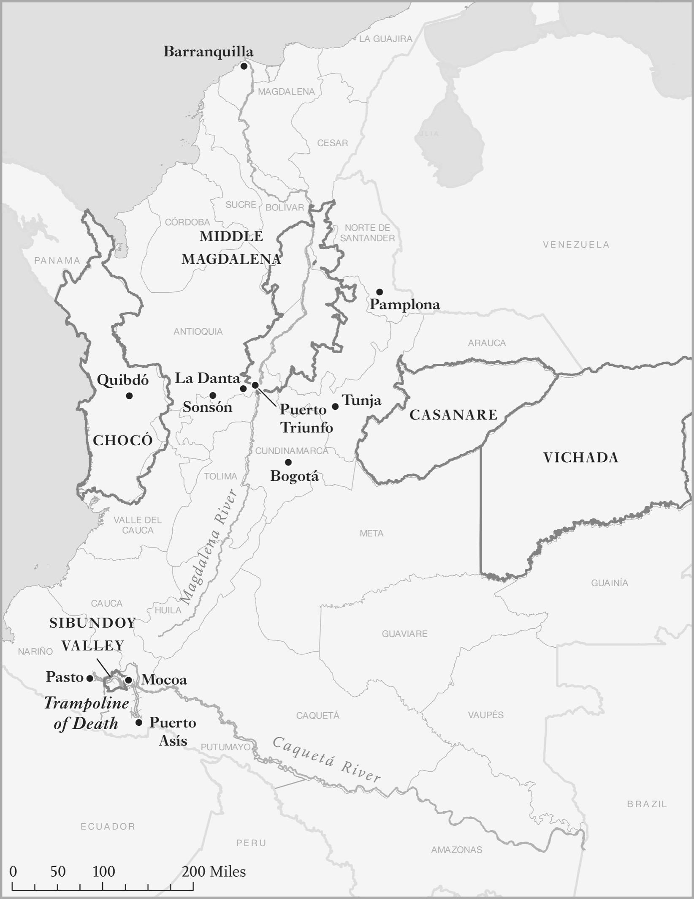
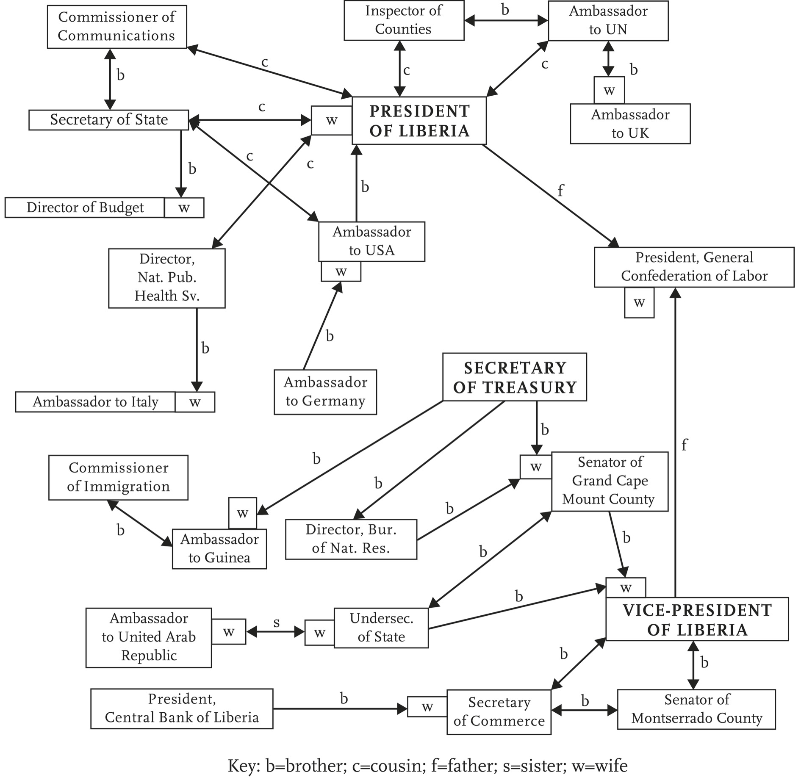
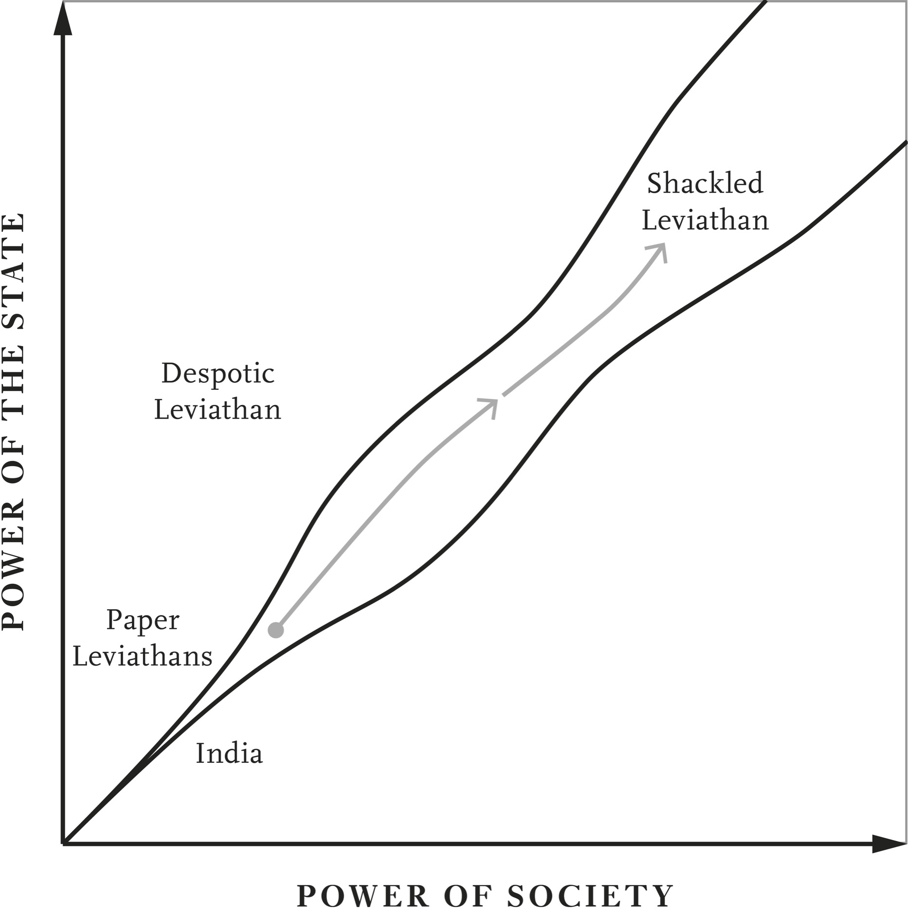

# The Paper Leviathan · 第11章　纸糊国家巨灵

## Patients of the State · 国家的病人

It’s a spring day in September 2008 in Buenos Aires, the capital of Argentina. Summer is on the way, but it’s chilly. Paula is trying to register for a welfare program called Nuestras Familias (Our Families) to receive the welfare payments that poor Argentines are entitled to. “This has been the longest wait,” she told the sociologist Javier Auyero. “I’ve been in this since March. They asked me to come many times; there was always something (a document, a paper) missing.” But “you have to be calm, to be patient. Here you have to have patience. This is an aid that the government gives you, so you have to be patient.”

> 二○○八年九月，南半球国家阿根廷首都布宜诺斯艾利斯正是晚春时节，夏天即将来临，天气却仍然春寒料峭。宝拉（Paula）正在设法登录「我们的家庭」（Nuestras Familias）这项福利计划中，以便得到阿根廷穷人有资格领取的福利给付。她告诉社会学家贾维亚．奥耶罗（Javier Auyero）：「这是最长的等待时间。我从三月就来这里，他们要求我来很多次，每次总是少了证明啦、文件啦等东西。」但是，「你必须保持冷静，必须有耐心，你在这里必须有耐心，这是政府给你的救济，因此你必须有耐心」。

Patience is a prime virtue for those hoping to access public services in Argentina. Leticia, another aspirant for Nuestras Familias, “is by herself, standing alone in the back of the waiting room.” She has come to the office three times in the last two weeks. “I’m used to waiting, I have to wait everywhere. But the worst thing is that they make you go here and then there . . . I came two weeks ago; they told me to come back in three days. I came back and the office was closed. I returned the next day, and they told me there were no funds in the program.”

> 耐心是阿根廷人希望得到公共服务时的主要美德。雷蒂西雅（Leticia）是另一位希望登录「我们的家庭」计划的阿根廷人，「她独自一个人，孤伶伶地站在等待室的后方」。过去两个星期以来，她来这间办事处三次。「我已经习惯等待，我去的每个地方都得等，但是最糟糕的事情是，他们要你东奔西跑……我两星期前来时，他们叫我三天后再来；三天后我来时，办公室却没有开门。隔天我再来，他们却告诉我，这个计划已经没有钱了。」

She concludes, “You have to wait, because that’s how things are here. You have to come many times because if you don’t show up, you don’t get anything.” Another of Auyero’s testimonies brilliantly characterized the nature of the interaction between the Argentine state and its citizens. María: They delay attending to you. They don’t listen to you, they are there but they don’t listen to you. Interviewer: They don’t pay attention to you?

> 她的结论是：「你必须等待，这里的情形就是这样，你必须来很多次。因为如果你不现身，你就什么东西都得不到。」奥耶罗用另一段文字，清楚点出阿根廷国家机器和公民之间互动的性质。玛丽亚：他们迟迟不理你，不注意你，不听你的话。他们在这里，却不听你的话。访问者：他们不理你吗？

M: I don’t know if they are eating breakfast, until 10 they eat breakfast, drink mate, [eat] cookies; they talk a lot among themselves. I: And how do you get their attention? M: No, I wait for them to assist me. I: You just wait for them to pay attention to you? M: It’s that you just have to wait.

> 玛丽亚：我不知道他们是不是在吃早餐。他们到了十点，还在吃早餐，喝马黛茶，吃饼干，彼此一直在聊天。访问者：你要怎么样才能引起他们的注意？玛丽亚：我不这样做，我等着他们帮助我。访问者：你只是等着他们注意到你吗？玛丽亚：你就是只能这样等着。

I: Of all the times that you have gone, do you remember if there was any time a commotion was made there? M: One time yes . . . a patient fought shouting . . . I: What patient, some kind of health patient? M: No, a patient here, a woman who waited.

> 访问者：你记不记得过去什么时候发生过骚动？玛丽亚：不错，有过一次……有一位病人大喊大叫……访问者：什么病人？某种健康有问题的病人吗？玛丽亚：不是，是这里的病人，是一位在这里等待的妇女。

Argentines are not citizens with rights, they are patients of the state who may or may not be tended to. Milagros, another “patient,” talks about how you are given the “runaround.” “You feel despondent here, because [the welfare agents] tell you to come on day X . . . They tell you to come on Monday, and then Wednesday, and then Friday . . . and those are working days.” The previous time she came to the office she “left with nothing” feeling “impotent,” but she emphasizes, “Here I didn’t say anything.”

> 阿根廷人不是拥有权利的公民，而是国家的病人，是不一定能够得到国家照看的病人。另一位叫做米拉格罗（Milagro）的「病人」，谈到怎么遭到「敷衍推搪」的情形：「你在这里觉得挫折感很重，因为〔福利人员〕告诉你某一天来……告诉你星期一来，然后说星期三来，然后是星期五再来……这些日子都是上班日。」她上次来这间办事处时「一无所获」地离开，觉得「无能为力」，却强调说：「我在这里什么话都没说。」

The state is arbitrary, creating uncertainty and frustration, manipulating and disempowering people who are reduced to waiting and begging. There is an absence of routine, there are endless exceptions; when does the office open? What are the procedures? What documents do I need? Nobody is ever really sure. Many Argentines say “they kick us around like balls.”

> 国家机器随心所欲，造成不确定和挫折感，操纵和摧残人民，让人民沦落到只能等待和乞求。这里没有定规，有的只是无止尽的例外。办公室什么时候上班？有什么程序要办？我需要什么文件？没有人真正确实了解，很多阿根廷人说：「他们把我们当球一样踢来踢去。」

Auyero wrote in his fieldnotes: September 11. A woman from Paraguay obtains her appointment even when she doesn’t have the birth certificate with the apostille (official seal of approval). Today I meet Vicky. She is here for a second time because the first time she came they denied her an appointment because her birth certificate was missing the apostille. Auyero’s research took him not just into the waiting rooms of Nuestras Familias, but also to the office where you apply for a national identity card, a DNI (Documento Nacional de Identidad).

> 奥耶罗在他的田野调查笔记中写道：九月十一日 一位从巴拉圭来的女性虽然没有盖过关防（官方核准大印）的出生证明，却仍然获得约定会面时间。今天我和维琪见面，她第二次来这里。她第一次来时，他们拒绝替她约定时间，因为她的出生证明上没有盖关防。奥耶罗的研究不只带他进入「我们的家庭」计划的等待室，也带他进入申请国民身分证的办公室。

In principle the office opens at 6 a.m. and starts giving appointments until 10 a.m., when it closes. It reopens from 6 p.m. to 10 p.m. People start queueing the night before. But the rules and the opening times change all the time. “October 26: I come back . . . after the morning observations expecting a big line outside. It’s 2:50 p.m. And it’s empty! There’s nobody outside. No people, no vendors, nobody! A cop tells me that: “People from the office came out and said they’d close for the day.”

> 原则上，办公室在早上六点开门，开始安排约定的时间，到早上十点结束，关门休息，下午六点到晚上十点重开。大家在夜里开始排队，但规则和开放时间随时变来变去。「十月二十六日，我根据早上的观察，预期外面会大排长龙后……再度回来这里，时间是下午二时五十分，这里却空荡荡的，没有人在外面，没有人排队，没有小贩，什么人都没有！一位警察告诉我：『大家从办公室里走出来，说今天办公室整天关门。』

Alternatively the doors may open and admit people at any time. Or not. “October 24: There’s no more waiting outside . . . People wait inside the building in a big waiting room. November 7: People make a line outside the building. They are told that it is forbidden to wait in line outside and that they should come back at 6 p.m. Officials try, unsuccessfully, to dissolve the line. November 9: Officials now let people form a line outside—and they also allow a line in the exterior hall.” Auyero continues:

> 不然的话，办公室的门随时可能打开，让大家随时进去，或是不让大家进去。十月二十四日那天，外面没有人在等待……大家在建筑物里的一间大等待厅里等候。十一月七日，大家在建筑物外面排队，得到通知，说禁止他们在外面排队，要大家下午六点再来。官员试图要队伍解散，却没有成功。十一月九日，官员现在让大家在外面排队，也让大家在外面的大厅等待。」奥耶罗继续写道：

October 2, 2008: A woman asks me if I think Monday will be a holiday. They told her to come back on Monday (October 12 is a holiday in Argentina). I tell her that if they instructed her to come back on Monday it is because it will not be a holiday. I assume that they don’t give appointments for impossible days. The woman corrects me and tells me that the last time they gave her a Sunday appointment.

> 二○○八年十月二日 一位女士问我，我认为星期一会不会是假日，他们告诉她星期一再来（十月十二日是阿根廷的假日）。我告诉她，如果他们叫她星期一来，是因为星期一应该不是假日。我假设他们不会跟大家约定不可能面谈的日子。这位女士纠正我，告诉我说，上次他们跟她约定星期天来。

As it turned out, Monday was a holiday. So far we have focused on three sorts of Leviathans: Absent, Despotic, and Shackled. The Argentine state doesn’t seem to be any of these. It is not absent; it exists, it has elaborate laws, a large army, a bureaucracy (even if its bureaucrats don’t seem to be interested in doing their jobs), and it appears to function to some degree, especially in the capital city, Buenos Aires (though much less in other areas).

> 结果星期一确实是假日。到目前为止，我们主要关注的是三种国家，分别是巨灵并不存在的国家、专制国家和巨灵受到制约的国家。阿根廷的国家机器似乎不属于其中任何一种。阿根廷的国家机器并没有不存在，它确实存在。阿根廷有详尽的法律，有一支规模庞大的军队，有一个官僚体系（不过，这个官僚体系似乎对工作不感兴趣）──官僚体系似乎多少还在运作，首都布宜诺斯艾利斯的官僚体系尤其如此（其他地区却差得多）。

It’s not a Despotic Leviathan either. Certainly, the Argentine bureaucrats we’ve just encountered seem unaccountable and unresponsive to society (the hallmark of a despotic state) and are quite capable of displaying cruelty toward people. As Argentines witnessed during the “dirty war” of the military dictatorship between 1974 and 1983, when as many as 30,000 people “disappeared” (secretly murdered by the junta), its officers and policemen can turn to murderous violence.

> 阿根廷也不是专制巨灵的国家，我们刚才看到的阿根廷官僚对社会确实不负责也不回应（这是专制国家的特征），而且相当善于对人民展现残酷的一面。正如阿根廷人在一九七四年至一九八三年间看到军人独裁政权的「肮脏战争」一样，多达三万个人在这段期间里「被失踪」（遭到军事执政团杀害），阿根廷的官员和警察可能变成十分凶残。

But the despotism of the Argentine state is disorganized and erratic. It is far from the sort of authority that the Chinese state uses to control its people. When the civil servants wanted to stop people queueing outside, they were ignored. They are often incapable of regulating the economy or enforcing laws throughout the country. This is obviously not a Shackled Leviathan either; it lacks both the sort of state capacity we have associated with the Shackled Leviathan and society’s ability to influence and control the state. What sort of state is the Argentine state?

> 但是，阿根廷的国家专制紊乱而不稳定，和中国用来控制人民的权威相去甚远。阿根廷公务员希望阻止人民在外面排队时，人民相应不理，阿根廷公务员经常没有能力管制经济，没有能力在全国的范围内执法。这种情形显然也不是受到制约的国家，缺少跟受制约国家有关的国家能力，社会也没有能力影响和控制国家机器。这么说来，阿根廷的国家机器是哪一种国家机器呢？

We’ll see in this chapter that it is a sort of state that is common in Latin America, Africa, and other parts of the world. In fact, it has a lot in common with the state in India in being founded on and supported by the weakness and disorganization of society. It combines some of the defining characteristics of the Despotic Leviathan, in being unaccountable to and unchecked by society, with the weaknesses of the Absent Leviathan. It cannot resolve conflicts, enforce laws, or provide public services. It is repressive but not powerful. It is weak itself and it weakens society.

> 我们在本章里会发现，这种国家机器在拉丁美洲、非洲和世界其他地方很常见。事实上，这种国家和印度的国家机器有很多共通的地方，是靠着柔弱、失序的社会建立和支持的国家机器。这种国家结合了专制国家不对社会负责、也不受社会约束的若干明确特征，以及国家机器并不存在国家的柔弱无力。这种国家不能解决冲突、不能执法或提供公共服务。这种国家具有压迫性，却不强大，本身柔弱无力，也削弱了社会的力量。

## Gnocchi in the Iron Cage · 铁笼中的义大利面疙瘩

Auyero’s study was about bureaucracy. Bureaucracy is vital to state capacity. As we mentioned in Chapter 1, its great theorist was the German sociologist Max Weber. In Weber’s theory what distinguished the modern world from the past was “rationalization.” This was manifest in modern firms that calculated costs, revenues, profits, and losses. It was there too in governments, rationalizing policy making and imposing impersonal administrative structures.

> 奥耶罗的研究主题是官僚体系，官僚体系攸关国家的能力。我们在第一章里提过，官僚体系的伟大理论家是德国社会学家韦伯。在韦伯的理论中，现代世界和过去不同的地方，在于「理性化」：表现在现代企业中的理性化包括计算成本、营收、利润和亏损；理性化也表现在政府中，形式包括理性决策、建构中立客观的行政结构。

Weber called this “rational-legal authority” and saw bureaucracy as its epitome. He wrote: The purest type of exercise of legal authority is that which employs a bureaucratic administrative staff . . . that consists . . . of individual officials who are appointed and function according to the following criteria: (1) They are personally free and subject to authority only with respect to their impersonal official obligations.

> 韦伯把这种情形叫做「合乎理性与法律的权威」，认为官僚体系是这种权威的缩影。他写道：法律权威最纯粹的行使方式是雇用行政官僚职员……官僚由个别官员组成……根据下列标准任命与运作：（一）他们是自由人，只在履行中立的官方义务时，受制于官方权威。

(2) They are organized in a clearly defined hierarchy of offices. (3) Each office has a clearly defined sphere of competence in the legal sense. . . . (5) Candidates are selected on the basis of technical qualifications . . . They are appointed, not elected . . . (7) The office is treated as the sole, or at least the primary, occupation of the incumbent . . . (9) The official works entirely separated from ownership of the means of administration and without appropriation of his position. (10)

> （二）他们依据明确定义的职务阶级，安排组织架构。（三）每个职务在法律上都有明确的权限范围……（五）候任官员系根据技术性资格筛选，官职由政府任命，而非透过选举……（七）官职视为任职者唯一的职业或主要职业……（九）官员的工作和行政工具的所有权完全分开，且不涉及其职位的拨调。

He is subject to strict and systematic discipline and control in the conduct of the office. So the bureaucracy was run on impersonal lines; bureaucrats were professionals, beholden to nobody except their official obligations; they were selected and promoted on merit; and they would be disciplined if they stepped out of line. In Weber’s view the power of bureaucracy could not be resisted. In a section titled “The Technical Superiority of Bureaucratic Organization,” he wrote:

> （十）官员执行职务时，须受严格而有系统的纪律约束与控制。因此，官僚体系的运作必须中立、客观。官僚是专业人士，除了对其官方职务负有义务外，不对任何人负责；官员是依据才能挑选和晋升，跨越本分时，必须接受惩戒。韦伯认为，官僚的权力无可抗拒，他在〈官僚组织的技术性优势〉一文中写道：

The decisive reason for the advance of bureaucratic organization has always been its purely technical superiority over any other form of organization. The fully developed bureaucratic apparatus compares with other organizations exactly as does the machine with the non-mechanical modes of production. Precision, speed, unambiguity, knowledge of the files, continuity . . . reduction of friction and of material and personal costs—these are raised to the optimum point in the strictly bureaucratic administration.

> 官僚组织拥有纯粹的技术性优势，始终都是发展胜过任何其他组织形式的技术性原因。充分发展的官僚机构和其他组织相比，正像机器生产和非机械生产模式相比那样，拥有精确、速度、明确、档案知识、连续性……摩擦减少，人力和物力成本降低的优势──在严格管理的官僚政府中，这些因素都会提高到最适当的水准。

For Weber the triumph of rational-legal authority was inevitable. But he also recognized that it could be dehumanizing. He argued that while in the past people may have labored because they chose to, now “we are forced to do so.” In the modern world there is an order “bound to the technical and economic conditions of machine production which to-day determine the lives of all the individuals who are born into this mechanism, not only those directly concerned with economic acquisition, with irresistible force.”

> 韦伯认为，理性法律权威的胜利是不可避免的结果，但他也承认这种权威可能变成失去人性。他认为，过去人类可能因为抉择的缘故，自愿劳动，现在却变成「我们被迫劳动」。在现代世界里，有一种「跟机器生产息息相关的技术性与经济状况，今天以无法抗拒的力量，决定了生在这种机制中所有个人的生活，而不只是决定了跟获取经济要素直接有关个人的生活」。

To capture how insidious this force could be, Weber coined the metaphor of the “iron cage” in which we were trapped by this spread of rational-legal authority. Precision, speed, unambiguity, knowledge of the files . . . It doesn’t sound like what Auyero observed in Buenos Aires. The bureaucracy he witnessed was slow, ambiguous, and uncertain, and there was copious ignorance about the files. Where was Argentina’s iron cage?

> 韦伯为了掌握这种力量极度阴险的特质，创造了「铁牢笼」的比喻，比喻我们困在这种理性法律权威的笼罩下。精确、速度、明确、档案知识……等等说法，似乎都不适用在奥耶罗观察到的布宜诺斯艾利斯，他看到的官僚体系行动缓慢、含糊、不确定，还严重忽视档案。阿根廷的铁牢笼在哪里？

Auyero’s evidence shows that the Argentine state was greatly personalized: if you didn’t get involved personally, there was no chance of getting services; that was the point of being a “patient”—you had to build a personal relationship with a bureaucrat in order to expect anything. His evidence does not directly speak to other aspects of Weber’s ideal notion. Perhaps the bureaucrats that María or Leticia interacted with were recruited on merit as Weber foresaw? Unlikely, since recruitment into the Argentine bureaucracy is dominated by “gnocchi.”

> 奥耶罗的证据显示，阿根廷的国家机器十分个人化，如果你不亲自介入，你就没有机会得到服务，这一点正是身为「病人」的意义──你必须跟官僚建立个人关系，才能得到任何东西。他的证据没有直接谈到韦伯理想观念的其他部分。玛丽亚或雷蒂西亚接触的官僚可能像韦伯所预测的那样，是因才录用的吗？不大可能，因为阿根廷官僚体系用所谓的「义大利面疙瘩」方式，录用人员。

Gnocchi are an Italian gastronomic speciality, delicious dumplings that were brought to Argentina by Italian immigrants. In Argentina they are traditionally served on the twenty-ninth of each month. But the word has a double meaning in Argentina; it also means government “ghost workers,” people who don’t actually ever show up for work but who collect their paychecks.

> 义大利面疙瘩是义大利的特色美食，是义大利移民带到阿根廷的美味面食。依据阿根廷的传统，每个月的二十九日，都要吃义大利面疙瘩。但是，在阿根廷，这个字词具有双重意义，也指政府中的「幽灵官员」，指实际上从不上班，却坐领公家薪水的公务员。

There are a lot of gnocchi in Argentina. When Mauricio Macri became the new president of Argentina in 2015, he fired 20,000 gnocchi who he claimed had been appointed by the previous government of President Cristina Fernández de Kirchner of the Peronist Party (named after its founder, Juan Domingo Perón). However the 20,000 gnocchi got hired, they were certainly not “selected on the basis of technical qualifications.” It’s also clear that working for the government was not the “sole, or at least the primary, occupation of the incumbent.” One might also doubt that they were “subject to strict and systematic discipline and control in the conduct of office.”

> 阿根廷有很多幽灵官员，二○一五年，毛里西奥．马克里（Mauricio Macri）出任阿根廷总统时，开除了两万名幽灵官员；他指称，这些幽灵官员是前任总统克里斯汀娜．费南德兹（Cristina Fernández de Kirchner）政府所任命，费南德兹同时也是裴隆党（Peronist Party，党名来自创党人裴隆）主席。然而，新总统大举开除幽灵官员之际，同时雇用了两万名幽灵官员，这些官员一定不是「根据技术性资格筛选的」，为政府工作不是「任职者唯一的职业或主要职业」。你也可以怀疑他们「执行职务时」，是否「须受严格而有系统的纪律约束与控制」。

They were typically party workers and supporters of the Peronist Party who got their “jobs” because of their political connections. That insulated them from any disciplinary actions that might have been a threat if they did not do their job, whatever that was supposed to be. The presence of gnocchi probably played a big role in what Auyero observed. Having 20,000 people like this running around in the bureaucracy can have seriously negative impacts on state capacity, even beyond the fact that they are totally useless. These impacts were all too easy to see during the presidency of Cristina Fernández de Kirchner.

> 他们通常是裴隆党的党工和支持者，因为他们的政治关系，而得到工作，因此，他们没有做到理当做到的善尽职责时，可以免于任何惩戒。幽灵官员的存在，在奥耶罗观察到的情况中，很可能扮演重要的角色，官僚体系中有两万名这样的官员，对国家能力可能造成严重的不利影响，甚至超越了他们完全是废人的影响。费南德兹担任总统时，这种影响实在太容易看出来了。

As we discussed in Chapter 2, a central function of the government is to collect information on its citizens both to understand society’s needs and to control it. You’d think that Hobbes’s Leviathan would pay quite a bit of attention to collecting information on its citizens. Yet we also saw that that’s not quite how things work in Lebanon, and it’s not how they work in Argentina either. In 2011 Argentina was the first country ever censured by the International Monetary Fund for failing to provide accurate price level and national income data. The Economist magazine stopped reporting data from Argentina because it deemed the data totally untrustworthy. That’s one of the downsides of filling the iron cage with gnocchi.

> 就像我们在第二章里所讨论的那样，政府的核心功能之一是搜集公民的资讯，以便了解社会的需要和控制社会，你一定会以为霍布斯的国家巨灵会相当注意公民资讯的搜集，但我们也看到，黎巴嫩的情形不是这样，阿根廷的情形也不是这样。二○一一年时，阿根廷成为第一个受到国际货币基金谴责的国家，因为阿根廷没有提供精确的物价水准和国民所得资料。《经济学人》杂志不再报导阿根廷的资料，因为该杂志认为，阿根廷的资料完全不值得信任，这点是用幽灵官员填满铁牢笼的缺点之一。

But we are still left with a puzzle. Weber thought that the iron cage was inevitable and the rationalization of society was unstoppable. He claimed, “The needs of mass administration make it today completely indispensable. The choice is only that between bureaucracy and dilettantism in the field of administration.” How do we explain Argentina? Dilettantism?

> 但是，我们还有一个谜团没有解决。韦伯认为，铁牢笼是无法避免的东西，社会的理性化是无可阻挡的趋势，他宣称：「大众管理的需要使政府变成今天不可或缺的东西，在行政领域中，只有官僚体系和业余主义可以选择。」我们要怎么解释阿根廷？怎么解释业余主义？

## Failing the Duck Test · 未能通过鸭子测试

Argentina in the 2000s had a modern-looking state, with a bureaucracy, judiciary, ministers, economic and social programs, representatives in all the international bodies such as the United Nations, and a president, Cristina Fernández de Kirchner at the time of Auyero’s research, who got the red carpet treatment from other heads of states. The Argentine state had all the trappings of the modern state and looked like a Leviathan. To adapt the “duck test” to our context, if it looks like a state, swims like a state, quacks like a state, then it probably is a state. But is it?

> 二十一世纪的阿根廷具有现代国家的外貌：拥有官僚体系、司法、部会首长、经济与社会计划，在联合国等所有国际组织派有代表；奥耶罗进行研究时，其他国家元首会用红地毯接待费南德兹总统。阿根廷具有现代国家的所有门面装饰，看来像是国家巨灵。我们把「鸭子测试」套用在阿根廷这个国家的话，如果阿根廷看起来像国家，游泳起来像国家，呱呱叫时像国家，那么阿根廷就是一个国家啰，但真的是这样吗？

Not really, not in the way we’ve been describing states so far. Both Despotic and Shackled Leviathans have quite a bit of capacity to get things done. Not so with the Argentine state. The Chinese dictator Mao Zedong used to call the United States a “paper tiger” to imply that its power was illusory. We’ll call states such as those in Argentina, Colombia, and several other Latin American and African countries that fail the duck test and, despite appearances, lack anything beyond the most rudimentary state capacity Paper Leviathans.

> 不见得是真正的国家，至少不是我们到目前为止所描述的那种国家。专制国家和巨灵受到制约的国家都有相当多的能力，可以完成任务；阿根廷的国家机器却并非如此。中国的独裁者毛泽东曾经把美国叫做「纸老虎」，意思是美国的力量只是幻象：我们要把阿根廷、哥伦比亚、拉丁美洲和非洲好几个不能通过鸭子测试叫做「纸糊国家」，形容外貌类似国家，却缺少最基本国家能力的国家。

Paper Leviathans have the appearance of a state and are able to exercise some power in some limited domains and in some major cities. But that power is hollow; it is incoherent and disorganized in most domains, and it is almost completely absent when you go to outlying areas of the country they are supposed to be ruling over. Why is it that Paper Leviathans do not accumulate more power? After all, wouldn’t the political elites controlling the state and the state bureaucrats themselves want to have more capacity to get things done? To dominate society? To enrich themselves more, steal more if possible?

> 纸糊国家具有国家的外貌，能够在有限的领域和若干大城市中，发挥若干力量，但那种力量却空空洞洞，在大部分疆域中并不连贯，又很紊乱。到了那种力量理当发挥统治功能的国内偏远地区时，那种力量几乎完全消失无踪。为什么纸糊国家无法蓄积更多的力量？难道控制国家机器的政治菁英和国家官僚本身不希望拥有更多的能力，以便达成任务吗？不希望宰割社会吗？如果可能，他们不希望替自己积聚更多财富、偷窃更多资产吗？

What happened to the “will to power” that spurred powerful state-building efforts? The answers to these questions tell us a lot about the nature of many states around the world. It’s not that there is no will to power in societies that have come to house the Paper Leviathan, but that the dangers to political leaders and elites of pursuing that will to power are too overwhelming. There are two fundamental reasons for this.

> 刺激强大建国力量的「权力意志」出了什么问题？这些问题的答案会告诉我们，和全世界很多国家本质有关的很多事情。不是社会上缺少整顿纸糊国家的权力意志，而是追求这种权力意志的政治领袖和菁英面对的危险，大到他们无法承受。这种情形有两个根本原因。

The first, paradoxically, relates to the Red Queen effect, which we have seen as powering the simultaneous development of state and society in the corridor. The Red Queen effect originates in society’s desire to better control and better protect itself against a more capable state and more assertive political elites. The same impulses are present outside the corridor too; if the state gets more despotic, you’d better find a way of protecting yourself against that. But unless state builders are sure that they can quash any unwanted reaction from society and cling to power against rivals, these impulses would also spell trouble.

> 矛盾的是，第一个根本原因和红皇后效应有关。对于处在自由窄廊中的国家来说，要同时发展国家和社会的能力时，红皇后效应可以发挥绝大的力量。红皇后效应起源于社会希望更能控制自己、保护自己，对抗能力比较高强的国家机器和信心比较坚强的政治菁英。走廊之外也有同样的冲动，如果国家机器变成比较专制，你最好保护自己，以免受害；但是，除非建国者们确定自己能够平息社会的任何不必要反应，把持权力，对抗竞争对手，否则这种冲动也会带来麻烦。

We are going to refer to these perceived dangers of state building as the “mobilization effect”—in their attempt to build capacity, political leaders may end up mobilizing opposition against them. This is not unrelated to the slippery slope that creating a political hierarchy would set in motion. In the same way that some societies that were powerful enough to severely curtail political inequality were nonetheless afraid of the slippery slope, political elites who are ostensibly unrestrained by society may be concerned about reactions and competition that deepening state capacity would usher in.

> 我们要把建国过程中发现的这些危险，称为「动员效应」──政治菁英在尝试建立国家能力时，最后可能动员了对他们不利的反对力量，这一点和创造政治阶级时会引发的滑坡，并非完全无关。然而，表面上不受社会约束的政治菁英，会像力量强大到足以严重削弱政治不平等的若干社会那样，仍然害怕这种滑坡，可能担心国家能力强化后，会带来反应和竞争。

The mobilization effect was present in some of the iconic examples of state building such as the creation of the Islamic state pioneered by Muhammad or state building in China. But in these cases state builders were either powerful enough to be less worried about such mobilization, for example, because they had an “edge” (as we saw in Chapter 3), or they had no choice given outside threats or competition that they were locked into (the Qin state and Lord Shang had other, more existential things to worry about in the Warring States period, as we discussed in Chapter 7). Yet we’ll see that, in other circumstances, the mobilization effect can be a paralyzing force against the building of state capacity.

> 动员效应表现在若干经典的建国范例中，如穆罕默德建立伊斯兰国，或是中国国家机器的建立。但是，在这些案例中，建国者们都拥有强大力量，足以比较不担心这种动员，原因包括他们拥有「优势」（例如第三章中的例子），或是深陷在外在威胁或竞争下别无选择（像第七章中所讨论的战国时代，秦国和商鞅要担心跟生存比较有关的其他事情）。但是，我们会发现，在其他情况下，动员效应可能成为瘫痪建立国家能力的力量。

The second reason why Paper Leviathans are quite common and unwilling to rise up from their slumber is that lack of state capacity is sometimes a powerful tool in the hands of unscrupulous leaders. To start with, exercising political control is much more about persuading others to follow your orders than naked repression. Tools to reward compliance are very useful in this endeavor, and handing out positions in the bureaucracy to friends and supporters, or those you want to turn into supporters, is a very powerful tool indeed.

> 纸糊国家相当常见，又不愿意从沉睡中醒来的第二个原因，是对不道德的领袖来说，缺少国家能力偶尔是有力的工具。首先，运用政治控制跟说服别人听从你的命令之间，关系更加深厚，跟赤裸裸地镇压关系小得多；这样做时，奖励听命行事者的工具非常有用，分配官位给朋友和支持者，或是分配给你希望变成支持者的人，确实是非常有力的工具。

But imagine that you start building state capacity by institutionalizing a meritocratic recruitment and promotion system in the bureaucracy, in the way that Max Weber envisaged. That would mean no more gnocchi, no more opportunities to use these positions as rewards (how would the Peronist Party survive in that case?). This creates a powerful political logic for abandoning meritocracy and the building of state capacity.

> 但是，想像一下，如果你像韦伯所设想的那样，开始采用根据菁英才能征募人才和擢升的制度，就表示不再有幽灵官员，不再有机会利用这些官位当奖励（这一来，裴隆党要怎么活下去？）这样就创造了放弃拔擢菁英、放弃建立国家能力的有力政治逻辑。

It’s not all high politics, of course. There are other, more mundane benefits from being able to use the judiciary and bureaucracy at your discretion. Soon after President Macri fired the gnocchi, he had to ban members of the government from hiring their own family members. The labor minister’s wife and two of his sisters were out of jobs, as were the interior minister’s mother and father.

> 当然，并非一切都和高层政治有关。能够随心所欲，利用司法和官僚体系，会有其他比较平凡的好处。马克里开除幽灵官员后，必须禁止政府成员雇用自己的家人，劳工部长的太太和他的两个姐妹都失业，内政部长的父母也一样失业。

This is a much more general pattern. Impersonal rules in the judiciary and bureaucracy, which come with state capacity, limit the ability of rulers and politicians to use laws in the way the former Brazilian president Getúlio Vargas purportedly expressed it: “For my friends, everything; for my enemies, the law.” Such legal discretion, very different from the way the law evolved in the corridor in Europe, allows the political elite to use state institutions, such as they are, to suppress their opponents while enriching themselves, grabbing land from others, granting monopolies to friends, and directly looting the state. Like the mobilization effect, the ability to benefit from the discretionary use of the law encourages state incapacity and disorganization, not just in Argentina, but in many other Paper Leviathans.

> 这是一种比较常见的情形，司法和官僚体系的中立规则伴随着国家能力而来，限制统治者和政客利用法律，做出据称是由巴西前总统热图利奥．瓦尔加斯（Getúlio Vargas）所说「是我朋友的话，一切便宜行事，是我敌人的话，一切依法从事」那样的事情。这种法律上的自由裁量权，和西欧在自由窄廊中演变出来的法律大不相同，让政治菁英可以利用现有的制度，压制反对者，同时让自己致富，夺取别人的土地，把独占权送给朋友，还直接掠夺国家。从随意利用法律、从中获利的能力，像动员效应一样，会鼓励国家机器变得无能、组织也会瓦解，不仅阿根廷如此，许多纸糊国家也一样如此。

That Paper Leviathans fail to build state capacity is a two-edged sword for their citizens. A less capable state is a state less capable of repressing its citizens. Could this be the basis of some liberty? Alas, this isn’t typically the case. Rather, citizens of Paper Leviathans have the worst of both worlds. These states are still pretty despotic—they get very little input from the people and continue to be unresponsive to them, and then don’t have many scruples about repressing or murdering them.

> 纸糊国家无法建立国家能力，对公民而言可说是利害参半的事情。比较无能的国家机器会比较没有能力打压公民，这种情形可能成为某种自由的基础吗？唉，情形通常不是这样，纸糊国家的公民反而会承受两面最不利的后果：这些国家仍然相当专制──几乎不接收人民发出的讯息，对公民继续无动于衷，因此在镇压或杀害公民上，都没有很多顾忌。

At the same time, citizens miss out on the role of the state as resolver of disputes, enforcer of laws, and provider of public services. Paper Leviathans make no attempt to create liberty or relax norms inimical to liberty. In fact, as we’ll see, Paper Leviathans often tighten the cage of norms rather than relaxing it.

> 同时公民看不到国家负起解决纷争、执行法律和提供公共服务的责任。纸糊国家无意创造自由或松绑对自由有害的规范。事实上，我们会看到，纸糊国家经常紧缩规范牢笼，而不是放宽规范牢笼。

## No Place for Roads · 无路可走

What could trigger the mobilization effect in practice? The historian Eugen Weber, in his study of the making of the French state and society, Peasants into Frenchmen, proposed several “agencies of change”—factors that he thought had been crucial in the development of modern French society. He led with a chapter called “Roads, Roads, and Still More Roads.” In his view basic infrastructure, by creating a national community, can mobilize society, change their demands, and transform the political agenda. In short, it can generate what we’ve called the mobilization effect.

> 实际上，有什么东西可以引发动员效应？历史学家尤金．韦伯（Eugene Weber）在大作《从农民到法国人》（Peasants into Frenchmen ）中，研究法国国家机器和社会的塑造，提出好几个促进变革的因素，认为这些因素在现代法国社会的发展上极为重要。他开宗明义，就把一章的题目订为〈路、路、路，更多的路〉。他认为，基本基础建设借着创造全国性的社区，可以动员社会、改变社会的需求、改造政治议程，简单地说，基础建设可以创造我们所说的动员效应。

The Colombian state, another perfect specimen of a Paper Leviathan, has never been interested in building roads. Today quite a few departmental capitals are not connected to the rest of the country except by air, or maybe river. Can you imagine Augusta, Maine, not being connected by road to the rest of the United States? An interesting example is from the department of Putumayo in southern Colombia, whose capital is Mocoa (see Map 14). In 1582, Fray Jerónimo de Escobar noted:

> 哥伦比亚是纸糊国家的另一个完美典范。哥伦比亚对修桥铺路从来都不感兴趣，今天还有相当多的省会所在地，跟哥伦比亚其他地方并不相通，只能靠空中交通联络，或许也可以靠河流相通。你能够想像美国的缅因州首府奥古斯塔（Augusta），跟美国其他地方不能靠陆路相通吗？哥伦比亚南部普图马约省（Putumayo）省会所在地莫科阿（Mocoa）是个有趣的例子（参见地图十四）。一五八二年，福瑞．艾斯科瓦尔（Fray Jerónimo de Escobar）指出：

This town is next to the mountains, far away from the road, so that it is a great travail to enter. Said town of Agreda [Mocoa], is not growing . . . it scares people away. There is no way to communicate [with] . . . everyone having a miserable life. Things hadn’t gotten much better by 1850 when a prefect of the then Territorio de Caquetá, just to the north of Putumayo, noted that “the journey from Pasto [capital of the neighboring department of Nariño] to this city [Mocoa] is gruelling, often bumping into horrifying places. Those of thin build travel on the back [of] Indians in a ridiculous, extravagant, and painful position: fastened with bale-rope and tied like pigs.”

> 这个城镇贴近山脉，远离道路，因此，要进去非常辛苦。上述阿格雷达镇（Agreda，即莫科阿）没有成长……这样会把人吓走，这里没有办法（跟）……通讯，每个人的生活都很艰辛。到了一八五○年，情况还是没有好多少，当时普图马约省正北方卡克塔地区（Territorio de Caquetá）的一位县长指出：「从邻省纳里尼奥省（Nariño）首府帕斯托（Pasto），来到莫科阿这个城市的旅程令人筋疲力尽，经常会碰到让人心惊胆跳的地方，身材瘦小的人被揹在印第安人背上，姿势可笑、放肆、又痛苦：用包装绳子像猪一样绑在背上。」

Putumayo was a scary place for people from the capital, Bogotá. Future president Rafael Reyes wrote in his autobiography of his days prospecting in the region: Those virgin and unknown forests, those immense spaces, fascinated and attracted me to explore them, to traverse them and . . . to open roads for the progress and welfare of my country; those forests were absolutely unknown to the inhabitants of the cordillera, and the idea to penetrate them terrified me since the popular imagination populated them with wild beasts and monsters, besides the numerous savage cannibals found there.

> 对于首都波哥大的人来说，普图马约是很吓人的地方，未来的总统拉斐尔．雷耶斯（Rafael Reyes）在自传中，写出他在这个区域测量的情形：这些不为人知的原始森林、这些广阔的大地迷住了我，吸引我去探索、去穿越……去开路，追求我国的进步和福祉。山上的居民对这些森林绝对一无所知，穿越森林的想法让我十分惊恐，因为人们认为，其中充满野兽和怪物，还发现过很多野蛮的食人族。

Reyes had a solution to this isolation; in 1875 he proposed the construction of a road from Pasto, the capital of the neighboring department of Nariño, to Mocoa (which is also shown in Map 14). By 1906, Reyes was president and he authorized a study of potential routes. An engineer, Miguel Triana, was given the contract with the expectation that he would lay out the road. He did the survey, but the road was not started.

> 雷耶斯打算打破这种与世隔绝状况，一八七五年，他提议铺筑一条路，从邻省纳里尼奥省省会帕斯托，通到莫科阿（这条路请参见地图十四中）。到一九○六年，雷耶斯已经出任总统，于是授权研究这条路的可行路线。政府和工程师米盖尔．屠里亚纳（Miguel Triana）签约，期望他能修筑这条路，他完成了测量，却没有开始开路工程。

Another contract was given to a Victor Triana, but by 1908 the new project was abandoned for lack of funds. In 1909 the national government decided to put the Capuchin friars of the Sibundoy Valley in charge of construction, with the governor of Nariño in charge of the money. With the aid of coerced indigenous labor, the Capuchins managed to finish the 120 kilometer road from Pasto to Mocoa in 1912, but only after an attack by Peruvian soldiers on a Colombian military garrison at La Pedrera on the Caquetá River induced the national government to provide 36,000 pesos.

> 政府再和工程师维克特．屠里亚纳（Victor Triana）签约，但是到了一九○八年，新计划因为缺乏经费而搁置。一九○九年，中央政府决定要求锡本多伊山谷（Sibundoy Valley）方济嘉布遣会（Capuchin）的修士，负责修路，纳里尼奥省省长负责资金。方济嘉布遣会在受到胁迫的原住民劳工协助下，在一九一二年，设法完成了从帕斯托通到莫科阿长一百二十公里的路，却在秘鲁士兵攻击卡克塔河（Caquetá River）畔拉佩德雷拉（La Pedrera）的一处哥伦比亚驻军陆地后，中央政府才提供三万六千披索的经费。

By the end of 1912, however, the road was in a bad state. A local administrator wrote to the minister of government that “regarding to state of the road from Pasto to this place [Mocoa] . . . most of the road has suffered grave damages due to collapsing of slopes and platforms and destruction of palisades in the flat and swampy areas, to the point that the traffic, even for pedestrian travellers, is now extremely difficult.” An engineer reported that there were serious problems with the road design and construction; the bridges were “poorly built” and the road width was “inadequate for traffic needs.”

> 然而，到了一九一二年底，这条路的路况已经恶化。一位地方行政长官行文告诉政府主管部会：「就帕斯托通到莫科阿此地的道路状况而言……大部分道路都出现严重损害，原因出于边坡和平台坍塌，以及平坦和沼泽地区的栅栏损毁，现在损害程度到了交通、甚至连徒步行走都极为困难的地步。」一位工程师报告说，道路的设计和铺筑有严重问题，桥梁的「建造不良」，道路宽度「不符交通需要」。

The great Irish writer Samuel Beckett had a motto: “Try again, fail again, fail better.” It might have been written for Paper Leviathans. In 1915 the national government put out a public tender to repair the road and finish the part to Puerto Asís on the banks of the Putumayo River. In December 1917 the government canceled the contract because the contractor had not met his obligations. The government put it back in the hands of the Capuchins. A telegram to the Ministry of Public Works from Mocoa in June 1919 read “National road totally abandoned. From here to San Francisco thirty landslides; from here to Umbría, all bridges destroyed.”

> 爱尔兰大作家萨姆尔．贝克特（Samuel Beckett）有一句座右铭：「再试一次，再失败一次，失败会比较不严重。」这句话可是为纸糊国家写的。一九一五年，哥伦比亚中央政府推出公开招标，希望修复这条路，同时完成通到普图马约河畔阿西斯港（Puerto Asís）的道路。一九一七年十二月，政府因为包商没有履行义务，取消合约，把工程交还给方济嘉布遣会。一九一九年六月，从莫科阿发给公共工程部的电报写道：「国家级道路彻底废弃，从这里到圣法兰西斯有三十处坍方，从这里到恩布里亚的桥梁全部毁损。」

In 1924 the road was taken away from the Capuchins again due to “unsatisfactory execution of works” and a contract given to an engineer in Pasto. A 1925 a law decreed the upgrading of the first 25 kilometers of the road out of Pasto to a motor road. But in 1928 the government removed the funding with 5 kilometers built. In 1931 Law 88 incorporated the road into the national road network, which meant that the portion up to Puerto Asís would have to become a motor road.

> 一九二四年，道路工程再次从方济嘉布遣会手中收回，原因是「工程执行令人不满意」，道路合约转给帕斯托的一位工程师。一九二五年的一项法律规定：从帕斯托开出去的头二十五公里路，要提升为行车公路，但是修筑好五公里后，政府取消修路经费。一九三一年的八十八号法律把这条路，纳入国道网络，表示通往阿西斯港的道路都会变成通行汽车的公路。

In Chapter 9 we discussed Charles Tilly’s maxim “War made the state, and the state made war.” If it did, in 1932 the Colombians might’ve caught a break. In that year, a border conflict started with Peru, and the Colombian government labeled the road a “national defense road” and allocated 120,000 pesos to maintain and expand it. An engineer’s evaluation concluded that the road was “little less than an eyesore.”

> 我们在第九章里，谈过堤利的名言：「战争会建立国家，国家会制造战争。」如果确实如此，那么一九三二年时，哥伦比亚可以说是交了好运。这一年里，哥伦比亚和秘鲁发生边界冲突，哥伦比亚政府把这条路订为「国防道路」，拨发十二万披索，维护和拓宽这条道路。一位工程师的评估报告结论是，这条路「比烫手山芋还糟糕」。

The gravel road reached Puerto Asís in November 1957, twenty-five years after Peru had won the war and annexed a large slice of Colombian territory. No roads and not much state in the Colombian case, wars or no wars. Though a road of sorts was open to Puerto Asís, it soon acquired a sinister but descriptive nickname: the Trampoline of Death. In 1991 the national newspaper El Tiempo reported: “The entire road to the Putumayo is horrifying. The drivers that cross it daily call it the road of death . . . [and] travelers are constantly threatened by the guerrilla.”

> 到一九五七年，秘鲁赢得这场战争、兼并一大块哥伦比亚的领土二十五后，通到阿西斯港的碎石路才终于完成。不论有没有爆发战争，哥伦比亚都不会修桥铺路，也不会表现多少国家机器的能力。这条差劲的道路开通到阿西斯港之后不久，就赢得凶险而名副其实的绰号──「蹦蹦死亡之路」。一九九一年，全国性报纸《时代报》（El Tiempo ）报导：「通往普图马约的整条路都让人胆颤心惊，每天穿越这条路的司机称之为『死亡之路』……〔而且〕旅客随时会遭到游击队的威胁。」

In 2005, President Álvaro Uribe promoted the Integration of the Regional Infrastructure of South America plan. By 2016 some 15 kilometers of the road had been built, and then the work was suspended because of lack of funds. What sort of society does the absence of roads in Colombia create? One dispersed into isolated pockets. In 1946 in an address to the Society of Agriculturalists, Alberto Lleras Camargo, who was to become the Colombian president in 1958, observed:

> 二○○五年，总统阿尔瓦罗．乌里韦（Álvaro Uribe）提倡「南美区域基础建设整合计划」（Integration of the Regional Infrastructure of South America plan），到了二○一六年，这条路大约才铺筑了十五公里，随后就因为缺乏经费而停工。道路不足在哥伦比亚创造了什么样的社会？答案是散布在各个孤立口袋中的社会。一九五八年出任哥伦比亚总统的阿尔韦托．卡马戈（Alberto Lleras Camargo），曾经在一九四六年的农业专家协会中发表演说指出：

When we refer to campaigns of rural health, credit or education that are going to save the campesino, don’t we know that most of these programs reach [only] the villages [aldeas] and the upper echelon of Colombian society? . . . Among the 71 percent of our [rural dwelling] fellow citizens and the rest of society, there is no direct communication, there is no contact, there are no roads, there are no channels of direct interchange. Fifteen minutes from Bogotá there are campesinos who belong to another age, to another social class and culture, separated from us by centuries.

> 我们谈到要解救农民的农村健康、信用或教育运动时，难道不知道这些计划大都〔只〕触及村庄和哥伦比亚社会的上层阶级吗？……居住在乡村里的公民和社会其他部分的公民，占到我们人口的百分之七十一，他们之间没有直接通讯，没有接触，没有道路，没有直接互相交换的任何管道。离波哥大十五分钟路程的地方，就是属于另一个时代、另一种社会阶级和文化的农民，跟我们隔离了好几个世纪。

But that’s the way a Paper Leviathan likes it; a very fragmented society focused on parochial issues. In the British case, we saw in Chapter 6 that parochial issues disappeared as society was further mobilized in response to state building. Not so in Colombia. In 2013, the country was convulsed by a series of strikes and protests. In July of that year striking miners overwhelmed Quibdó, the capital of the department of Chocó (also shown in Map 14).

> 但是，纸糊国家就是喜欢这样，喜欢这种异常支离破碎、注重褊狭问题的社会。以英国为例，我们在第六章里，看到随着社会进一步动员，因应国家机器的建立时，褊狭的问题消失。然而，哥伦比亚的情况并非如此。二○一三年时，哥伦比亚受到一系列罢工和抗议冲击；这一年七月，矿工罢工震动了乔科省省会基布多（参见地图十四）。

The miners insisted that informal miners be recognized, and they wanted “subsidies and preferential credit for miners, as well as technical assistance.” In addition they asked the government “to cease the selling of land to multinational mining companies” and “to subsidize fuel for mining purposes.” There were no demands in the list other than the immediate ones of the miners. Tellingly, there is no road from Quibdó to the rest of the country. The same was true of the many other strikes that took place in different parts of the country.

> 矿工坚称非正式矿工必须得到承认，希望「矿工得到补贴、优惠贷款和技术协助」。此外，他们要求政府「停止出售土地给多国矿业公司」、「补贴矿业用燃料」。要求事项清单中，没有跟矿工无关的其他要求，其中透露的真相是从基布多没有路可以通到哥伦比亚的其他地方。哥伦比亚不同地方发生的许多罢工一样如此。

The Dignidad Cafetera (literally “coffee dignity”), in the coffee-growing region of Colombia, wanted the government to give them price subsidies for coffee; they demanded the democratization of the National Federation of Coffee Growers, and insisted that mining in coffee-growing areas be regulated more stringently. The Dignidad Papera, Lechera y Cebollera (“potato, milk and onion dignity”) was an organization that claimed to represent the producers of potatoes, milk, and onions. They also asked for price subsidies, but this time for their crops. They advocated that the rehydration of powdered milk should be banned, and that they should be compensated for the importation of powdered milk and frozen or precooked potatoes.

> 在哥伦比亚咖啡种植区发动「咖啡尊严」罢工的农民，希望政府发给他们咖啡价格补贴，要求全国咖啡农民联盟民主化，并坚持加强管制在咖啡种植地区的采矿业务。宣称代表马铃薯、洋葱农民和酪农的「马铃薯、牛奶与洋葱尊严」组织，也要求价格补贴，但这次是要求补贴他们的作物。他们主张禁止制造还原乳，并且应该为奶粉和冷冻或预煮马铃薯的进口，补偿他们的损失。

The Dignidad Panelera (“raw sugar dignity”), organized by the producers of raw sugar, wanted the government to introduce higher tariffs on imported substitutes for sugar, and they demanded that the government purchase 3,500 tons of panela (the raw cane sugar that they produced). This is a society with little prospect of mobilization, and that’s very convenient for Colombian elites and very easy for the Colombian government to manage. A few subsidies here, and a few purchases of panela there, and the genie is back in the bottle.

> 「粗砂糖尊严」罢工由粗砂生产者推动，他们的诉求是希望提高砂糖进口关税，政府采购三千五百吨他们产制的粗制砂糖。这个社会是几乎没有动员希望的社会，这一点让哥伦比亚政府非常方便管理，这里发一些补贴，那里买一点粗制砂糖，精灵就会回到瓶子里去了。

## The Orangutan in a Tuxedo · 穿燕尾服的猩猩

It’s not just the absence of infrastructure. Like Argentina, Colombia doesn’t do bureaucracy, and for similar reasons. In 2013 in some national ministries 60 percent of the employees were “provisional staff,” recruited outside the meritocratic rules and hired most likely through patronage. Colombians are less fond of gnocchi than are Argentines, but they still manage to house a fair number of them in the civil service.

> 哥伦比亚不仅没有基础建设，哥伦比亚也像阿根廷那样，出于类似的原因而没有建立官僚体系。二○一三年内，哥伦比亚中央部会中，大约有百分之六十的员工，是在菁英考选规则之外招募，而且非常可能是透过浮滥任用的方式雇用的「临时人员」。和阿根廷人相比，哥伦比亚人比较不喜欢幽灵官员，但幽灵官员仍然设法在公务员体系中，占了相当多的位置。

The consequences of the lack of rules and bureaucratic procedures were dramatically illustrated by the tenure of Samuel Moreno, elected mayor of the capital city of Bogotá in 2008. Once he was in power, Moreno created a “shadow government” for Bogotá, which he delegated to his brother Iván. Iván constructed what Colombians now call the “contract carousel,” which was in charge of allocating all of the contracts for the city. The brothers used this as a way to extract bribes, which were often 50 percent of a contract.

> 缺少规则和官僚程序的后果，在首都波哥大市长萨姆尔．莫雷诺（Samuel Moren）的任期间，戏剧化地表现出来。二○○八年，莫雷诺当选波哥大市长，上任不久，就创建了波哥大的「影子政府」，授权弟弟伊凡；伊凡建立了哥伦比亚人现在叫做「合约转盘」的东西，负责分配首都的所有合约。两兄弟把这种转盘当成收红包的工具，贿赂金额经常达到合约金额的百分之五十。

To hide all the illegal activities, they frequently met in Miami, traveling by private plane. The brothers developed a slang: their cut in a contract was called a bite—una mordida—the same slang we saw in Guatemala in Chapter 9. The jewel in the crown of bites was the contract to run the city’s integrated public transport system, which carries millions of people per day. The Morenos’ cut was eight pesos per passenger. The brothers did not stop there. They looted everything.

> 为了掩饰所有不法活动，他们经常坐着私人飞机，到迈阿密会面。两兄弟把他们收的红包叫做「咬一口」，跟我们在第九章中看到的瓜地马拉俚语一模一样。最大的红包是经营首都综合公共运输系统的合约，这种系统每天输运人次达到数百万人，莫雷诺兄弟从每位乘客身上，要咬八披索下来。两兄弟的恶行劣迹不仅于此，他们还洗劫一切。

Existing hospitals were very lucrative, but building new ones created even better opportunities for stealing, and between 25 and 30 percent of the outlays went to the Morenos. They decided who got the ambulance contract, and then the brothers and their cronies took half of what was allocated. If you didn’t pay the bite, you didn’t get the contract and were told by the brothers that you were “too cheap.” So 45,000 million pesos (US$15 million) were set aside to build a bridge linking Carrera 9 to Calle 94 to address the traffic jams in part of Bogotá. The construction work was never begun and the money vanished.

> 现存的医院让他们财源广进，但盖新医院会创造更好的掠夺良机，于是百分之二十五至三十的经费流入莫雷诺兄弟手里，他们决定谁可以拿到救护车合约，然后和亲信分配到合约金额的一半。如果你不送红包，你就拿不到合约，然后两兄弟会告诉你：「你太便宜了。」因此，为了建造连接卡雷拉（Carrera）九号道路和卡勒（Calle）九十四号道路的桥梁，解决波哥大部分地区的交通壅塞，政府拨出四百五十亿披索（一千五百万美元）的经费，结果建桥工程根本没有开工，所有经费却消失无踪。

Nobody really knows how much the brothers bit off; one conjecture is that it could be as high as US$500 million. Samuel Moreno was not an outsider to Colombian politics. His grandfather Gustavo Rojas Pinilla was a military dictator in the 1950s who tried to reinvent himself as a democrat in the 1960s. Like Moreno, Colombian political elites have a habit of looting the state budget. When they have the opportunity, they are happy to loot the land as well.

> 没有人真的知道两兄弟贪了多少钱，有一项猜测是他们的贪污金额高达五亿美元。萨姆尔．莫雷诺不是哥伦比亚政治的局外人，他的祖父罗哈斯．皮尼利亚（Gustavo Rojas Pinilla）是一九五○年代哥伦比亚的军事独裁者，还曾经在一九六○年代内，试图变身为民主派人士。哥伦比亚的政治菁英像莫雷诺一样，惯于洗劫国家预算，要是有机会的话，他们也乐于掠夺土地。

An extensive amount of rural Colombia is classified legally as baldío (wasteland) and owned by the government. Since the nineteenth century the Colombian government has promulgated many laws that have shaped the distribution of this land and the issuing of titles. Law 160, passed in 1994, specified that people who had been settled on baldío for five years or more could petition the agrarian reform institute INCORA (Instituto Colombiano de Reforma Agraria) for the title to the land they occupied.

> 哥伦比亚大量农村土地在法律上，划为荒地，由政府拥有。从十九世纪开始，哥伦比亚政府公布很多法律，塑造这种土地的分配和权状的发给。一九九四年通过的一六○号法律规定，定居在荒地五年以上的人民，可以向哥伦比亚农业改革局（INCORA），申请自己所占有土地的权状。

This type of concession applied only to citizens who were landless. Supposedly poor or displaced people got priority, and the amount of land a person could claim was limited to an “Unidad Agrícola Familiar” (Agricultural Family Unit), an amount of land judged by the INCORA to allow a family “to live with dignity.” But it turned out that this system could be easily gamed by well-connected elites, especially when they had the help of sophisticated Bogotano law firms, well versed in the art of bending the law.

> 这种让与只适用于没有土地……的公民，穷人或流离失所的人民理当拥有优先权，个人可以申请的土地面积限于一单位的农业家庭单位（Unidad Agrícola Familiar）。一单位的面积是由该局判断，大小足以让一家人「过着有尊严的日子」。但结果这种制度变成关系良好的菁英容易操控的制度，在善于曲解法律的精明波哥大法律事务所协助下，尤其如此。

A notorious case involves Riopaila Castilla, a sugar company in Valle del Cauca. The company gamed the system by creating twenty-seven Anonymous Simple Societies in 2010 with the aid of the law firm Brigard Urrutia. They bought 42 parcels of baldío in the eastern department of Vichada (see Map 14), equivalent to 35,000 hectares, all intended for the poor and the displaced but instead destined for Riopaila. Similar strategies allowed Luis Carlos Sarmiento, the wealthiest person in Colombia, to acquire 16,000 hectares of baldío land for himself. When asked by a journalist how a respectable law firm could facilitate such blatant violations of the law, a lawyer from Brigard Urrutia stated:

> 有一个声名狼籍的案例涉及考卡山谷省（Valle del Cauca）的里欧派拉卡斯提尔糖业公司（Riopaila Castilla），该公司操控这种制度的方式是在二○一○年，在布里嘉德乌鲁提亚法律事务所（Brigard Urrutia）的协助下，设立二十七家匿名简易协会，买下哥伦比亚东部比查达省（Vichada，参见地图十四）的四十二块荒地，土地面积达到三万五千公顷，这些土地原本是要让穷人和流离失所的人民利用，如今却流入里欧派拉公司手中。类似的策略让哥伦比亚首富卡洛斯．沙勉托（Luis Carlos Sarmiento）买下一万六千公顷的荒地。一位新闻记者质问布里嘉德乌鲁提亚法律事务所：贵事务所备受尊敬，怎么可以促成这么明显违法的交易行为？该所一位律师表示：

The law is there to be interpreted. Here they are not white or black. The fragmented, ineffective nature of the Paper Leviathan has major consequences for liberty, in particular, for the control of violence. Max Weber defined the state as “a human community that (successfully) claims the monopoly of the legitimate use of physical force within a given territory.” Because of the way they use power, Paper Leviathans cannot have such a monopoly of physical force, legitimate or otherwise. Colombia also illustrates the devastating consequences of the lack of monopoly of violence by the state.

> 法律就是由人解释的，其中没有黑白。纸糊国家支离破碎又没有效率的性质，对自由会有重大影响，尤其是会严重影响暴力的控制。韦伯把国家定义为：「在一定领土上，宣称〔成功〕独占合法使用武力权利的人类社群。」纸糊国家因为运用权力的关系，不能合法或不合法的独占武力的权力。哥伦比亚也清楚说明了国家无法独占暴力的毁灭性后果。

In his research in Colombia, James Robinson, and his collaborators Maria Angélica Bautista, Juan Diego Restrepo, and Juan Sebastián Galan, documented how in 1977 Ramón Isaza, a former soldier and farmer, started a group he named the Shotgunners. Isaza had a farm in the municipality of Puerto Triunfo in the east of the department of Antioquia (see Map 14). Court documents recorded how in the mid-1970s the Marxist guerrilla group the FARC (Revolutionary Armed Forces of Colombia) had created a new front in the area and initiated a policy of “taxing” local farmers and expropriating their livestock. In 1977, Isaza purchased ten shotguns, an act that christened the group.

> 詹姆斯．罗宾森（James Robinson）研究哥伦比亚时，和同事玛丽亚．包蒂斯塔（Maria Angélica Bautista）、胡安．雷斯崔普（Juan Diego Restrepo）和胡安．贾伦（Juan Sebastián Galan）合作，记述了当过军人的农场场主拉蒙．伊萨萨（Ramón Isaza），如何在一九七七年，创立一个称为「猎枪护卫队」（Shotgunners）的团体。伊萨萨原本在哥伦比亚安蒂奥基亚省（Antioquia）东部（参见地图十四）的特里温福港（Puerto Triunfo）经营农场，法院纪录显示，一九七○年代中期，马克思主义游击队哥伦比亚革命军在这个地区创立了一个新战线，推动对当地农民「课税」和征收农民牲口的政策。一九七七年，伊萨萨购买了十支猎枪，这件事也成为他所创设团体名称的由来。

They ambushed the FARC, killed them, and stole their guns. By the year 2000 the Shotgunners had changed their name to the Peasant Self-Defense Forces of the Middle Magdalena, received support from landowners, and expanded to six fronts. One front was led by Isaza’s son-in-law Luis Eduardo Zuluaga (nicknamed MacGyver, after the U.S. television character). MacGyver commanded the José Luis Zuluaga Front (FJLZ), named after his brother, who had been killed by the guerrillas.

> 他们狙击哥伦比亚革命军，加以杀害，并且偷走他们枪枝。到二○○○年，猎枪护卫队已经改名「中马格达莱纳省（Magdalena）农民自卫队」，得到地主的支持，而且扩大为六个战线。其中一个战线由伊萨萨的女婿爱德瓦多．祖鲁亚加（Luis Eduardo Zuluaga）领导〔他的绰号叫马盖先（MacGyver），根据美国一部电视剧主角的名字而来〕，马盖先领导「约瑟路易祖鲁亚加战线」（FJLZ）；这个战线取这种名字，意在纪念遭到游击队杀害的马盖先兄长。

The FJLZ controlled an extensive territory whose core covered around 5,000 square kilometers. The front had a written legal system of estatutos (statutes), which was 32 pages long, and they tried to enforce it equally even to the extent of applying it to both their members and civilians. The FJLZ also had a bureaucracy and was separated into a military wing made up of about 250 uniformed fighters, a civilian wing of “tax collectors,” and a “social team” focused on their political project of combatting the Marxist guerrillas.

> 约瑟路易祖鲁亚加战线控制了广大的领土，核心地区应当有五千平方公里。这个战线制定了长达三十二页，由多项法令规章构成的法律制度，并且努力把法律平等地适用在组织成员和平民身上。约瑟路易祖鲁亚加战线也分官设职，还把军力分为大约由二百五十个制服战士构成的军事梯队，加上一支由「税务员」组成的平民梯队，和一个把重点放在对抗马克思主义游击队政治计划的「社会团队」。

They regulated trade and social life; they had a mission statement, an ideology, a hymn, a prayer, and a radio station called Integration in Stereo. The front even awarded medals, including the Order of Francisco de Paula Santander and the Grand Cross of Gold. How did they pay their bureaucrats and soldiers? They taxed landowners and businessmen in the area they controlled and also attempted to tax production, specifically of milk and potatoes.

> 他们管制贸易和社会生活；他们还有任务声明、意识形态、圣歌、祈祷文，以及一个叫做「立体身历声团结在一起」（Integration in Stereo）的广播电台。这个战线甚至分发勋章，包括法兰西斯科．德保拉．桑坦德（Francisco de Paula Santander）勋章和金十字大勋章。他们要怎么发薪水给官员和士兵呢？他们对所控制地区的地主和商人课税，也试图特别对牛奶和马铃薯的生产课税。

The front built tens of kilometers of roads, extended the electric grid, and constructed schools. In La Danta, where they were based, the front built a health clinic, reconstructed an old-people’s home, built houses that they allocated by lot to poor people, started an artisan center, and constructed a bullring, though MacGyver claimed, “I don’t approve of bullfighting, it is cruel to the animals.” The area was controlled not by the Colombian state but by Isaza and MacGyver. In a statement to the magistrate following the group’s demobilization in 2006, Ramón Isaza explained their role in elections in the following way:

> 这个战线铺筑了几十公里的道路，拓展供电网，兴建学校，还在他们根据地所在的拉丹塔（La Danta），兴建了一处诊疗院所，重建了一处老人院，也兴建住宅，用抽签的方式，分配给很多穷人。他们辟建一座技工中心，兴建了一座斗牛场。不过，马盖先宣称：「我不赞成斗牛，这样对牛太残忍了。」这个地区不是由哥伦比亚政府控制，而是由伊萨萨和马盖先控制。二○○六年，这个团体解散复员后，伊萨萨在发给地方行政长官的声明中，解释他们在选举中要扮演的角色：

What we did do was in the veredas, such as La Danta, also in San Miguel or Cocorná which didn’t have police, that were little towns removed from the main roads and there was no military or police force. There we protected these regions but we didn’t tell anybody to vote for a particular person. Rather we looked after—what did we look after? —that maybe elections wouldn’t be spoiled, that maybe fights or quarrels occurred. This we did in this and all the regions where these towns were; we provided security for the elections.

> 我们过去所做的事就是在拉丹塔这样的小径里，还有在圣米盖尔（San Miguel）或科科尔纳（Cocorná）这种没有警察，位在主要道路之外、没有军警力量的小乡镇，我们保护这种区域，但我们没有告诉任何人投票给特定人士，而是追求──我们追求什么？──即使可能发生打斗或争吵，选举还是可能不会遭到破坏。这是我们在这里和这些乡镇所在区域里做的事情，我们为选举提供安全保障。

Colombians often excuse their Paper Leviathan by pointing out that the country has high mountains and jungles. In fact, Isaza and his fronts were placed on the main road between the two largest cities, Bogotá and Medellín, right under the nose and in full view of the Colombian state. As another powerful Colombian paramilitary boss, Ernesto Báez, ironically put it to a different judge: “How could a small independent state work inside a lawful state such as ours?” The answer is: quite easily in a Paper Leviathan. The Colombian state doesn’t just neglect and ignore its citizens, it actively victimizes them. One illustration comes from the so-called false-positives scandal.

> 哥伦比亚人经常以国内有高山和丛林为借口，原谅自己好像纸糊的国家机器。事实上，伊萨萨和他的诸多战线，都位在波哥大和麦德林（Medellín）这两个最大都会之间的主要道路上，就在国家机器眼前清楚可见的地方。如同哥伦比亚另一位准军事强人埃内斯托．拜兹（Ernesto Báez）所言：「在我们这种合法的国家内部，怎么可能会有一个小小的独立国这种运作？」答案是在纸糊国家里，这样做其实相当容易。哥伦比亚政府不只忽视和忽略本国公民，还主动侵害公民，所谓的「假阳性丑闻」就是证据。

When Álvaro Uribe was elected president in 2002, his mandate was to intensify the fight against left-wing guerrillas. He introduced a series of powerful incentives for the military, such as financial bonuses and holidays, if they produced dead guerrillas. A consequence was that members of the army murdered as many as 3,000 innocent civilians and dressed them up as guerrillas. One Colombian judicial prosecutor even referred to a military unit, the Batallón Pedro Nel Ospina, as a “group of assassins dedicated to creating victims which they then pretended were killed in combat.” If the guerrillas and paramilitaries don’t get you, the army might.

> 二○○二年乌里韦当选总统后，负有一项使命，就是加强剿灭左派游击队：他推出一系列鼓励军方的强力措施，包括军方如果拿出游击队的尸体，就可以获颁奖金和放假。结果造成军人谋杀多达三千个无辜平民，还把他们装扮成游击队员。哥伦比亚一位检察官甚至提到军方一个叫做佩德罗．奥斯皮纳营的单位，是「杀手组成的部队，专门致力制造受害者，再假装他们是在战斗中死亡」。就算你没有成为游击队和准军事部队的受害者，你也可能遭到自家军队杀害。

Another consequence of the Colombian Paper Leviathan was noted almost two hundred years ago by Simón Bolívar, Latin America’s “liberator,” who led its revolution against Spanish colonial rule, when he stated: These Gentlemen think that Colombia is full of simple men they’ve seen gathered around fireplaces in Bogotá, Tunja, and Pamplona. They’ve never laid eyes on the Caribs of the Orinoco, the plainsmen of the Apure, the fishermen of Maracaibo, the boatmen of the Magdalena, the bandits of Patia, the ungovernable Pastusos, the Guajibos of Casanare and all the other savage hordes of Africans and Americans that roam like deer throughout the wilderness of Colombia.

> 将近两百年前，西蒙．玻利瓦（Simón Bolívar）就谈过哥伦比亚纸糊国家的另一个影响。玻利瓦是领导拉丁美洲革命，反对西班牙殖民统治的「解放英雄」。他曾经表示：这些绅士认为，哥伦比亚到处都是他们在波哥大、通哈（Tunja）和潘普洛纳所见过围着炉火的愚蠢男性，他们从来没有正眼看过奥利诺科（Orinoco）的加勒比人、阿普雷（Apure）的平原居民、马拉开坡（Maracaibo）的渔民、马格达莱纳的船民、巴提亚（Patia）的盗匪、桀骜不驯的巴斯突索人（Pastuso）、卡萨纳雷（Casanare）的瓜吉波人（Guajibo），以及像鹿群一样，在整个哥伦比亚荒野中漫游的其他野蛮非洲人和美洲人族群。

Bolívar is claiming that Colombians elites don’t really know or understand the country they claim to be governing (and are looting). Indeed, the famous nineteenth-century Colombian president Miguel Antonio Caro, the mastermind of the 1886 Constitution that was in force until 1991, never left Bogotá his entire life (nor for that matter did one of the subsequent presidents, José Manuel Marroquín). Who was he writing the constitution for? The gentlemen of “Bogotá, Tunja, and Pamplona,” of course.

> 玻利瓦是在宣称：哥伦比亚菁英其实不知道或不了解他们自称在统治（和掠夺）的国家。事实上，十九世纪著名的哥伦比亚总统米盖尔．卡洛（Miguel Antonio Caro）一辈子都没有离开过波哥大，却仍然能够在一八八六年，主导制定一直实施到一九九一年的宪法〔就这点而言，后来的曼纽尔．马洛金（Manuel Marroquín）总统也是这样〕。卡洛为谁制宪？当然是替「波哥大、通哈和潘普洛纳的绅士」制宪。

The periphery of the country was run from Bogotá and received few resources or public services. Of 18,500 kilometers of roads in 1945, only 613 kilometers (none paved) were in the peripheral territories that made up three quarters of Colombia’s land area. Political elites in Bogotá made sure that the periphery stayed peripheral. But before you conclude that this implies that things were all right in Bogotá, at least when Samuel Moreno wasn’t in power, next time you are there try posting a letter. What would Tocqueville have said?

> 哥伦比亚的周边疆土都远离波哥大，得到的资源或公共服务很少。一九四五年，哥伦比亚一万八千五百公里的道路中，只有六百十三公里（没有铺柏油）的道路，铺筑在占哥伦比亚领土四分之三的外围国土中。波哥大的政治菁英希望确保周边疆土继续维持边缘状态。但是，你在断定这表示「至少在莫雷诺不掌权时，波哥大的一切都很正常」之前，可以先去波哥大寄一封信看看，不知道托克维尔会说出什么评语？

The Colombian politician Dario Echandía once quipped that Colombian democracy was like “an orangutan in a tuxedo.” It’s a remark that captures the nature of the Paper Leviathan. The tuxedo is its outward appearance of an orderly state with a functioning bureaucracy, even if it is sometimes used for looting the country and is often disorganized. The orangutan is all the things the Paper Leviathan cannot and doesn’t wish to control.

> 哥伦比亚政客达利欧．艾谦迪亚（Dario Echandia）曾经开玩笑说，哥伦比亚的民主制度像「穿着燕尾服的猩猩」。这句话抓住了纸糊国家的本质，即使国家机器偶尔被人用来掠夺这个国家，而且国家机器还经常杂乱无章，燕尾服仍然是官僚体系正常运作、井然有序国家的外貌，猩猩则代表纸糊国家不能、也不希望控制的一切。

## Plowing the Sea · 在海洋上耕田

None of this was created overnight. To understand how the Colombian state evolved, let’s turn to Bolívar again, now lying ill with tuberculosis in the port city of Barranquilla. On November 9, 1830, he wrote to his old friend General Juan José Flores. By 1830 continental Latin America was free from Spanish colonialism and Spain retained only the islands of Cuba, parts of Hispaniola, and Puerto Rico. Yet Bolívar was disillusioned. He wrote:

> 这一切都不是一夕之间造成的，要了解哥伦比亚国家机器的演变，我们必须回头再谈谈玻利瓦。玻利瓦得了肺结核，躺在巴兰吉拉港（Barranquilla）的病床上；一八三○年十一月九日，他写信给老友胡安．弗洛雷斯（Juan José Flores）将军。一八三○年时，拉丁美洲大陆已经从西班牙的殖民统治中解放出来，西班牙只保留了古巴群岛、伊斯帕尼奥拉岛（Hispaniola）的一部分和波多黎各，但玻利瓦觉得希望幻灭。他写道：

I have ruled for twenty years, and I have derived from these only a few sure conclusions: (1) America is ungovernable, for us; (2) Those who serve the revolution plow the sea; (3) The only thing one can do in America is emigrate; (4) This country will fall inevitably into the hands of the unrestrained multitudes and then into the hands of tyrants so insignificant they will almost be imperceptible, of all colors and races; (5) Once we’ve been eaten alive by every crime and extinguished by ferocity, the Europeans won’t even bother to conquer us; (6) If it were possible for any part of the world to revert to primitive chaos, it would be America in her last hour. Why was he so pessimistic?

> 我统治了二十年，从中只得出几点确定的结论：（一）对我们来说，美洲是无法治理的地方；（二）立志革命的人是在海洋上耕田；（三）美洲人唯一可以做的就是移民；（四）这个国家不可避免地会落入不受约束的群众手中，再落入极为无足轻重的暴君手中，以至于几乎所有肤色和种族的人都无法察觉；（五）一旦我们遭到每一种犯罪活活吞噬，遭到暴力扑灭，欧洲人甚至不会再费心来征服我们；（六）如果世界任何一个地方可能恢复原始的混乱，那一定是处在最后时刻的美洲。他为什么这么悲观？

Why did he think that trying to govern “America,” by which he meant Latin America, was like “plowing the sea,” an impossible task? There were several reasons. Perhaps the most important was that Latin American society had been created on a premise of political hierarchy and inequality. Colonial society was an institutionalized hierarchy with white Spaniards on top and indigenous people and, in many areas black slaves, at the bottom.

> 为什么认为试图治理他所指的拉丁美洲，就像「在海洋上耕田」一样，是不可能的任务？原因有好几个，最重要的原因可能是拉丁美洲社会是以政治阶级和不平等的前提下，创造出来的。殖民社会是一种制度化的阶级，西班牙白人高高在上，原住民和很多地方的黑奴压在最底层。

Over time, the Spanish elites became native to Latin America and were known as Creoles (Bolívar was one of them), and as miscegenation took place, an elaborate system of caste (casta in Spanish) was created to identify who was superior to whom. The castas were memorialized in a famous series of paintings in colonial Mexico, one of which we reproduce in the photography section. Caste mattered, since laws and taxes applied differently to people depending on their social station, and if you were sufficiently powerful, the laws didn’t apply to you at all.

> 久而久之，西班牙菁英变成拉丁美洲国民，以克里奥尔人（Creole）为人所知（玻利瓦是其中一位）。随着通婚出现，复杂的种姓制度跟着创造出来，以便分辨谁比谁优越。殖民时期的墨西哥有一系列著名的画作，纪念这种种姓制度，本书相片插页中刊出其中一幅画。种姓很重要，因为法律和租税要根据人民的社会地位，适用在不同的种姓上；如果你的权力够强大，法律就完全不能适用在你身上。

Without any equality before the law, the law itself was illegitimate in the eyes of most Latin Americans, making them adopt the famous motto of the colonial era, Obedezco pero no cumplo (I obey but I do not comply); I recognize your right to issue laws and orders but I maintain my right to ignore them. Even more important, it meant a great degree of hierarchy, dominance, and inequality, as indigenous people and black slaves were systematically exploited. Hierarchy, dominance, and inequality are still on display today.

> 既然没有法律之前人人平等的观念，在大多数拉丁美洲人眼里，法律本身就是非法的东西，促使他们的态度变成跟殖民时期著名的座右铭相同──「我服从却不守法」。也就是说，我承认你有权发布法律和命令，但是我保有不理会的权利。还有，更重要的事情是，在土著和黑奴遭到有系统的剥削之际，严重的阶级制度、宰割和不平等就此出现。今天，阶级、宰割和不平等仍然继续存在。

Their origins can be seen by returning to the road between Pasto and Mocoa, which ran through the Sibundoy Valley. After the conquest of the Americas the indigenous peoples of the valley had been given in a grant of encomienda, literally “entrusted,” to a Spaniard, known as the encomendero. Many indigenous people had died of the infectious diseases the Spanish brought with them from the Old World, but there were still 1,371 people left to exploit.

> 这些东西的起源可以从帕斯托通到莫科阿的道路上看出来。这条路穿越锡本多伊山谷，山谷里的美洲人和土著遭到征服后，经由委托监护制（encomienda），转送给受托人；实际上，就是「委任」给一位叫做「受托人」的西班牙人。很多原住民因为感染西班牙人从旧世界带来的疾病而死亡，但仍然有一千三百七十一位原住民可以剥削。

According to the encomienda, a lot of animals, birds, and produce of Indians had to go to the abbey and the cacique (the word imported into Latin America from the Caribbean and used to designate an indigenous chief or ruler). Also, it specified “145 Indians to work in the mines for eight months,” 10 Indians to work on the land of the encomendero, “8 Indians for the cacique’s domestic service,” and so on with the coercive labor practices.

> 根据委托监护制，印第安人的很多动物、禽类和农产品都必须送到修道院和土著领袖（cacique，这个字源自加勒比海，用来指原住民酋长或统治者）。委任制清楚规定「一百四十五位印第安人要在矿场工作八个月」，十位印第安人要在受托人的土地上工作，「八位印第安人要在土著领袖的家里，从事家事服务」等等强迫劳动服务。

This highly unequal society was ultimately held together by force, and Latin Americans knew that it could never survive under the type of democratic institutions that had emerged in the United States. By the nineteenth century there were no encomiendas left, but they had been replaced by a new exploitative system in which Indian “tribute” continued to provide the fiscal basis of the state. The extent of inequality at this point was if anything more intense than ever. The perpetuation of this system, Bolívar and others reasoned, required much stronger autocratic power than any U.S. president was going to get. But that didn’t mean it would be easy to maintain such a society. Here the second main factor leading to ungovernability becomes important.

> 这种高度不平等的社会最后是靠着武力来维持不坠。拉丁美洲人知道，在美国出现的那种民主制度中，这种社会绝不可能继续生存。到了十九世纪，受托人已经消失无踪，取而代之的是新的剥削制度──在这种制度里，印第安人的「贡品」继续提供国家机器的财政基础，这时，不平等的程度比过去还严重。玻利瓦和其他人认为，要长久维持这种制度，需要远比美国总统所能得到的权力强大得多的独裁权力。但是，这样不表示维持这样的社会很容易，这时导致无法治理的第二个主要因素就变得很重要。

Like many colonies, Spanish America had some state institutions imposed by the colonists (most notably sufficient force to repress the indigenous people), but it was governed “indirectly” by Spain. The encomienda of the Sibundoy Valley gave a lot of the produce, birds, and pigs to the cacique because he was the indirect representative of the Spanish. The Spanish created no bureaucracy and no state administration to run the encomienda; they manipulated the indigenous political hierarchy to do this.

> 西班牙辖下的美洲和很多殖民地一样，都有殖民主义者公布的一些国家制度（最明显的是要有足够的武力镇压原住民），但美洲却是由西班牙「间接」治理。锡本多伊山谷的委任制规定，很多农产品、禽类和猪只要送给土著领袖，因为他是西班牙的间接代表。西班牙人没有创设官僚体系和国家行政机构，推行委任制度，而是操纵他们的土著政治阶级制度来统治。

At the time of the revolt against the Spanish, leaving aside the military, there were just 800 people working for the Spanish state in the whole of Colombia. These two factors left a society with enormous inequality and hierarchy, but without an effective state. That meant no state institutions or legal apparatus to control the “Caribs of the Orinoco, the plainsmen of the Apure, the fishermen of Maracaibo, the boatmen of the Magdalena, the bandits of Patia, the ungovernable Pastusos, the Guajibos of Casanare.”

> 对抗西班牙人的叛乱发动时，如果不把军人算在内，整个哥伦比亚只有八百个人是为西班牙的国家机器服务，这两个因素造成极度不平等和阶级化的社会，有效的国家机器却不存在。这表示没有国家机构或法律机制来控制「奥利诺科的加勒比人、阿普雷的平原居民、马拉开坡的渔民、马格达莱纳的船民、巴提亚的盗匪、桀骜不驯的巴斯突索人和卡萨纳雷的瓜吉波人」。

Creole elites stuck with what they knew. They tried to create an autocratic, centralized society to the extent they could, but just to be sure they backed it up with many of the same strategies that the Spanish had used to rule over their colonial empire. There was no room for a Weberian state. Rather, the government was a tool for controlling power and the law an instrument for stabilizing this unequal status quo.

> 克里奥尔人菁英坚持自己所知道的东西，试图就自己所能，建立一个专制的中央集权社会，却只确保自己用西班牙人用来统治殖民帝国的很多相同策略，来支撑这种社会。其中没有韦伯式社会生存的空间，政府反而变成掌握权力的工具，法律变成稳定这种不平等现状的利器。

The difference between Latin American and U.S. concepts of limits on presidential power is perhaps best illustrated by the speech Bolívar gave in 1826 in Lima, Peru, after he had personally written a constitution for the new country of Bolivia, now liberated from the Spanish. It’s worth pointing out that the name Bolivia came from Bolívar himself. How many people have countries named after them?

> 一八二六年，玻利瓦在秘鲁利马发表的一篇演说，大概最能清楚说明拉丁美洲和美国有关限制总统权力观念的差异；这时他已经把玻利维亚从西班牙人手中解放出来，还亲自为这个新国家制定了宪法。值得指出的一件事是，玻利维亚的国名出自玻利瓦的姓氏。试问有多少人的姓名会变成国名？

One is Christopher Columbus, who had his name given to the country of Colombia. The Saud family have Saudi Arabia named after them, and the Luxembourg family, one of the surviving remnants of the Holy Roman Empire, also have a country named for them. The great entrepreneur of British colonialism in Africa, Cecil Rhodes, had one named after him, Rhodesia, until 1980, when the name was changed to Zimbabwe. It’s a small and exclusive club, and you typically don’t become a member if you are running a country democratically. Introducing his constitution for Bolivia, Bolívar focused on the role of the president:

> 其中一位是哥伦布，他的姓氏后来变成哥伦比亚的国名；沙乌地阿拉伯的国名出自邵德（Saud）家族；卢森堡的国名出自神圣罗马帝国幸存一环的卢森堡家族；英国殖民非洲时期的伟大企业家赛西尔．罗德（Cecil Rhodes）也有一个国家以他的姓氏为名，就是一九八○年前的「罗德西亚」，后来改名辛巴威。这个俱乐部规模很小，还很排外；如果你以民主方式统治国家，通常你不会成为这个俱乐部的成员。玻利瓦为玻利维亚制定宪法时，把重点放在总统的角色上：

Under our constitution, the president of the republic is like the Sun, immovable at the center of the universe, radiating life. This supreme authority should be permanent . . . a fixed point around which magistrates and citizens and men and events revolve . . . Give me a fixed point, said an ancient, and I will move the earth. For Bolivia, this point is a president for life.

> 依据我们的宪法，共和国总统好比太阳，在宇宙中心雄踞不动，辐射众生。这种至高无上的权威应该恒久不变……成为地方行政长官、公民和人事时地物绕着运转的定点……古人说过，给我一个支点，我可以举起整个地球。对玻利瓦而言，这个支点就是终身总统。

The Bolivian constitution specified a president for life and made him “the Sun.” Initially that person would be chosen by “legislators.” Subsequent presidents would be chosen by the existing president for life. The notion of a president choosing who would follow him turned out to have a long half-life in Latin America. As recently as 1988, Mexican presidents were chosen by the dedazo. Google Translate hasn’t managed to figure out how to translate that word into English yet, but the root of the expression is the Spanish word dedo, “finger.” A dedazo is when you tap someone on the back with your finger, meaning “your turn now.”

> 玻利维亚宪法规定了一位终身总统，而且把总统定为「太阳」。这个人起初要由「立法委员」选举，后来的总统要由现有的终身总统选择。结果拉丁美洲总统选择继承人的想法，变成具有很长半衰期的观念。近在一九八八年，墨西哥总统还是靠着「指点」（dedazo）选择。到目前为止，谷歌翻译软体还想不出怎么把这个字词翻译成英文。但是，这种说法的字源出自西班牙文的「dedo」；「指点」的意思是你用手指点一点别人的背后，表示「轮到你了」。

It’s hard to translate, but Bolívar knew what it meant; it was a surefire guarantee that the presidency would stay in safe, elite hands. After all, it seemed highly likely that he was going to be chosen as the first president, and indeed he was. On paper, the Bolivian Constitution had some separation of powers and checks and balances, but it also allowed the president for life to personally appoint all military officers and command the army. Mix that with a bit of Obedezco pero no cumplo and the rest, as they say, is history.

> 这个字很难翻译，但玻利瓦知道其中的意义，表示这样会确保总统的职位，会安全地掌握在菁英手中。毕竟当时玻利瓦非常可能被选为第一任总统，事实上也的确是这样。表面上，玻利维亚宪法未曾有某种形式的分权和制衡，却也容许终身总统亲自任命所有的军官和统率军队，把这件事和一点「我服从却不守法」的观念揉合在一起，合并参详、参详，其他的一切就像人们说的那样，就都变成历史了。

It’s true that just as the U.S. War of Independence against Britain unleashed all sorts of radical energy and movements, so did the Latin American wars of independence. But again and again, Latin American elites were able to construct political institutions to control this energy even if Bolívar himself never managed to really implement his plans. We find that even when Latin American constitutions allowed for the types of checks and balances and even rights for citizens that the U.S. Constitution enshrined, these were always trumped either by strong formal presidential powers or a disregard for the law. Ramón Castilla, the authoritarian president of Peru, clearly explained this logic in 1849:

> 就像美国对抗英国的独立战争，把所有类型的激进动能和运动都释放出来那样，拉丁美洲的独立战争也是这样。但是，就算玻利瓦本人从来没有真正努力地实施自己的计划，拉丁美洲的菁英却一而再、再而三地，能够建立政治制度，控制这种能量。我们发现，即使拉丁美洲的宪法容许美国宪法中规定的那种制衡，甚至规定了公民的权利，这些东西却总是遭到正式总统强大的权力加以否决，不然就是遭到漠视法律的心态否定。秘鲁的独裁总统拉蒙．卡斯提拉（Ramón Castilla）在一八四九年时，曾经清楚地解释了这种逻辑。

The first of my constitutional functions is the preservation of internal order; but the same constitution obliges me to respect the rights of the citizen. . . . the simultaneous fulfillment of both duties would be impossible. The former . . . could not be accomplished . . . without some measures to check the enemies of that order in a manner more stringent than was provided for by the laws. Ought I to have sacrificed the internal peace of the country for the constitutional rights of a few individuals? If constitutional rights got in the way, then so much the worse for constitutional rights. The mastermind of the Chilean state, Diego Portales, articulated this view even more forcefully:

> 我的首要宪法功能是维持内部秩序，但同一部宪法却要求我尊重公民权利……我不可能同时完成两种职责，我必须采取严格程度超过法律规定、足以制止内部秩序敌人的若干措施，才能尽到第一项职责。我是否应该为了一些个人的宪法权利，牺牲国家的内部和平？如果宪法权利从中作梗，那么宪法权利就会更加不妙了。建构智利国家机器的推手狄亚哥．波塔雷斯（Diego Portales）以更有力的方式，阐释了这种观点：

With the men of the law one cannot come to an understanding; and if it’s that way, what [expletive] purpose do Constitutions . . . serve, if they are incapable of providing a remedy to an evil that is known to exist . . . In Chile, the law doesn’t serve for anything but to produce anarchy, the lack of sanctions, licentiousness, eternal law suits . . . Damned law then if it does not allow the Power to proceed freely in the opportune moment. The view that “the Power” should be able to “proceed freely in the opportune moment” is rather different from how the state is expected to behave in the corridor.

> 抱持法律人观点的人会无法了解，如果是这样，如果宪法不能为已知的邪恶，提供补救之道……宪法〔删除不雅文字〕到底有什么目的？……智利的法律不为什么目的，只是为了制造无政府状态、缺少制裁、肆无忌惮、无穷无尽的法律诉讼……如果法律不允许权力机器在适当时刻，自由采取行动，那么，该死的法律可以休矣。权力机器「应该可以」在适当时刻、自由采取行动的观点，和国家机器在自由窄廊中理当如何行动的看法截然不同。

This notion of power is again rooted in Latin America’s history. Alexis de Tocqueville identified its origins in his 1835 book, Democracy in America, when he argued that in South America the Spanish found territory “inhabited by peoples . . . who had already appropriated the soil by cultivating it. To found their new states they had to destroy or enslave many populations.” But, he went on, “North America was inhabited only by wandering tribes who did not think of using the natural riches of the soil. North America was still, properly speaking, an empty continent, a wilderness land, that awaited inhabitants.”

> 这种「权力机器」的观点又是植基于拉丁美洲的历史中。托克维尔在一八三五年的大作《民主在美国》一书中，主张西班牙人发现南美洲的领土「有人居住……他们已经以耕作的方式，占有这片土地。西班牙人为了建立新国家，必须摧残或奴役很多人口」。但是，他继续写道：「北美洲没有人定居，只住了四处流浪、不想利用土地天然富源的部落。正确地说，北美洲似乎是空旷的大陆、是等待居民的蛮荒大地。」

Tocqueville’s claim that North America was an “empty continent” is not correct, but the gist of the argument, that North America could not develop based on the exploitation of sedentary indigenous peoples, is on target. This meant that the type of highly unequal and hierarchical society that emerged in South America could not be reproduced in the North (even though the early English settlers did try). The slave society of the U.S. South looked a lot like Latin America, including low levels of public services, prosperity for the elites, and of course no liberty for the majority.

> 托克维尔宣称北美洲是「空旷大陆」的说法并不正确，但他这番论证中的主旨却正确无误，他的主旨就是要开发北美洲，不能利用剥削定居原住民的方式。这点表示，在南美洲出现的高度不平等的阶级社会，不可能在北美洲复制（不过早期的英国移民曾经尝试过）。美国南方的奴隶社会看来很像拉丁美洲，包括公共服务水准低落、菁英才能繁荣发展，当然还包括大多数人没有自由的事实。

But the U.S. South was embedded in an institutional setting partly created by the very different state-society dynamics of the North, and when it tried to fight in the Civil War to free itself from these dynamics, it lost. That wasn’t the end of the despotic and exploitative system of the U.S. South, as we saw in the previous chapter, but it did put the whole of the United States on a different path from Latin America’s. In Latin America, society remained emaciated and unable to shape politics and control the state and the elites, paving the way for the Paper Leviathan, with predictable consequences for liberty.

> 但是，美国南方的制度，某种程度上是诞生在与北方大不相同的国家社会环境中。南方为此在南北战争中奋力一搏，试图从北方强加的这套桎梏中解脱，结果却失败了。正如我们在前一章里所见，虽然南方在内战中落败，并未终止美国南方的专制和剥削制度，但这却让整个美国得以走上和拉丁美洲不同的道路。拉丁美洲的社会继续遭到削弱，无法影响政治，也无法控制国家机器和菁英，逐渐走向纸糊国家，也为自由带来可以预见的负面影响。

## Mississippi in Africa · 非洲的密西西比

Paper Leviathans are hardly restricted to Latin America. They are also the characteristic form of state in sub-Saharan Africa. In fact both mechanisms underpinning the continued weakness and disorganization of the state operate in Africa with a vengeance. Let’s take them one at a time: first, the fear of societal mobilization.

> 我们几乎可以说，不是拉丁美洲才有纸糊国家，纸糊国家也是漠南非洲国家的特征。事实上，支持国家继续疲弱和杂乱无章的两种机制还在非洲全力发挥，我们要依序处理这些现象。首先，我们要处理对社会动员的恐惧。

One of the best documented examples of this fear comes from Liberia in West Africa. In 1961 the newly created United States Agency for International Development (USAID) sent a team of scholars off to Liberia to study its development. They began with their usual ideas about why poor countries are poor. Yet they soon realized the situation was very different. As one of them, the social anthropologist George Dalton, later put it:

> 最能清楚说明这种恐惧的例子出自西非的赖比瑞亚。一九六一年，新设的美国国际开发总署派了一群学者，前往赖比瑞亚研究这个国家的发展；最开始时，他们抱持自己认定穷国为什么会贫穷的常见看法。但是，他们很快就知道情况大不相同。其中一员的社会人类学家乔治．道尔顿（George Dalton）后来写道：

The economic backwardness of Liberia is not attributable to the lack of resources or to domination by foreign financial or political interests. The underlying difficulty is rather that the traditional Americo-Liberian rulers, who fear losing political control to the tribal people, have not allowed those changes to take place which are necessary to develop the national society and economy. Who were these “Americo-Liberian rulers”? To understand this, we need to recall that the country of Liberia was started as a colony in 1822 by the American Colonization Society (ACS) as a home for freed and repatriated African slaves from the United States. The descendants of these repatriated slaves became the Americo-Liberians.

> 赖比瑞亚的经济落后不是因为缺少资源，或是受到外国金融或政治利益团体宰制。从美国回来的「美归派」赖比瑞亚人后裔的传统统治者，反而才是潜在问题所在；他们在政治上，害怕丧失对部落人民的控制，不敢推动发展全国性社会和经济所需要的变革。这些美归派赖比瑞亚人后裔统治者是什么人？要了解这一点，我们必须回忆赖比瑞亚的历史。赖比瑞亚是美国殖民协会在一八二二年创设的殖民地，用意是要安置从美国遣送回去的自由非洲奴隶，这些遣送回去的奴隶就变成美归派赖比瑞亚人。

In 1847 Liberia declared itself independent of the ACS, and in 1877 the True Whig Party (TWP) emerged and dominated politics until they were overthrown by a military coup headed by Samuel Doe in 1980. The TWP was spearheaded by Americo-Liberians, who in the 1960s made up less than 5 percent of the population. As Dalton describes it, “Like the Portuguese in Angola or the Afrikaners in South Africa, the rulers of Liberia are the descendants of an alien minority of colonial settlers. Americo-Liberian families.”

> 一八四七年，赖比瑞亚宣布独立，脱离美国殖民协会。一八七七年，真惠格党（True Whig Party）成立，主宰政局到一九八○年，才遭到萨姆尔．多伊（Samuel Doe）领导的军事政变推翻。真惠格党由美归派赖比瑞亚人后裔主导，到一九六○年代，这种赖比瑞亚人占总人口的比率还不到百分之五。如同道尔顿所言：「赖比瑞亚的统治者像安哥拉的葡萄牙人或南非的荷裔裴人（Afrikaner），是殖民时代外来移民少数民族的后裔，是美归派赖比瑞亚人后裔的家族。」

Liberia became a two-class society. Different laws, different public services, and differential access to education governed Americo-Liberians and “tribal people.” Before 1944 the hinterland had no political representation whatsoever. Dalton observed, “Ironically, it is the ethic of Mississippi that most nearly characterizes their outlook: to retain power in traditional fashion and keep the natives in their place.” Now you begin to see why the Americo-Liberians feared societal mobilization. Building an effective state might have mobilized the indigenous Liberians who made up the other 95 percent of the nation.

> 赖比瑞亚已经变成由两种阶级构成的社会，一种是美归派赖比瑞亚人后裔，一种是部落人民，两种阶级适用不同的法律、不同的公共服务、不同的教育机会。一九四四年前，内陆偏远地区没有任何政治代表权。道尔顿表示：「讽刺的是，密西西比的道德观最能说明美归派后裔的观点，就是以传统的方式保住权力，并把本国人困在原地。」你现在可以看出来，为什么美归派赖比瑞亚人后裔害怕社会动员了，因为建立有效率的国家机器后，占全国人口百分之九十五的土生土长赖比瑞亚人，可能会动员起来。

The other fundamental mechanism supporting Paper Leviathans—the usefulness of discretionary power in a nonmeritocratic, disorganized bureaucracy and judiciary—is also clearly visible in Liberia and other African countries. The Liberian state was systematically used to reward followers. For instance, Dalton found in the 1960s that “to understand Liberian politics, knowledge of kinship connections is more useful than knowledge of the Liberian constitution.” He presented elaborate data on how political elites filled bureaucratic positions with their immediate family. (Map 15, for example, shows the bewildering family connections of Liberia’s political elite in 1960 during President Tubman’s rule.)

> 支持纸糊国家的另一个基本机制──在非菁英领导、杂乱无章的官僚和司法部门滥用权力，在赖比瑞亚和其他非洲国家中也清楚可见。赖比瑞亚的国家机器遭到有系统的滥用，目的是为了酬庸追随者。例如，道尔顿发现，一九六○年代内，「要了解赖比瑞亚政情，知道亲属关系比了解赖比瑞亚宪法还有用」。他提出政治菁英中总统近亲占据极多官僚职位的详尽资料（例如，图十五显示，一九六○年塔布曼总统统治期间，赖比瑞亚政治菁英之间令人困惑的亲属关系）。

The nonmeritocratic nature of African states is also highlighted in Tony Killick’s seminal book Development Economics in Action. Killick worked for the government of Kwame Nkrumah in Ghana in the early 1960s and witnessed the disastrous economic failures of Nkrumah’s regime firsthand. Killick wanted to understand what caused them. He recorded the construction of a fruit-canning factory “for the production of mango products, for which there was recognized to be no local market, [and] which was said to exceed by some multiple the total world trade in such items.” The government’s own report on this factory is worth quoting.

> 东尼．吉里克（Tony Killick）在大作《发展经济学之实践》（Development Economics in Action ）中，也强调非洲国家由非菁英领导的特质。一九六○年代初期，吉里克在迦纳的恩克鲁玛（Kwame Nkrumah）政府中服务，亲眼看到恩克鲁玛政权可怕的经济失败，想了解其中的原因。他记录了一座水果罐头工厂的兴建，「目的是为了生产公认没有本地市场、〔而且〕据说产量比世界贸易总量多出好几倍的芒果产品」。政府为这座工厂撰写的报告值得一提。

Project: A factory is to be erected at Wenchi, Brong Ahafo, to produce 7,000 tons of mangoes and 5,300 tons of tomatoes per annum. If average yields of crops in that area will be 5 tons per acre per annum for mangoes and 5 tons per acre for tomatoes, there should be 1,400 acres of mangoes and 1,060 acres of tomatoes in the field to supply the factory.

> 计划： 要在布朗阿哈福（Brong Ahafo）地区的文奇镇（Wenchi）兴建一座工厂，每年生产七千吨芒果、五千三百吨番茄。如果这个地区芒果的平均收成为每英亩五吨，番茄的平均收成也是每英亩五吨，要供应这座工厂的原料，应该种植一千四百英亩的芒果、一千零六十英亩的番茄。

The Problem: The present supply of mangoes in the area is from a few trees scattered in the bush and tomatoes are not grown on commercial scale, and so the production of these crops will have to start from scratch. Mangoes take 5–7 years from planting to start fruiting. How to obtain sufficient planting materials and to organize production of raw materials quickly become the major problems of this project.

> 问题： 这个地区目前的芒果供应，来自散布在矮树丛中的一些芒果树，番茄没有商业规模的种植，因此这些作物的生产必须从无中生有。芒果从种植到开始结果要经过五到七年，如何快速获得足够的种植素材、推动原料的生产，会成为这个计划的重大问题。

Killick wrote, “It is difficult to imagine a more damning commentary on the efficiency of project planning.” What was going on? The factory wasn’t meant to further economic development. Rather, it created innumerable opportunities to employ political supporters in a region where President Nkrumah wanted support. It made no economic sense to build the factory there, and projects like this undermined the coherence of the civil service and the “efficiency of project planning.”

> 吉里克写道：「你很难想出更难听的评语，来批评计划的规划效能。」到底是怎么回事？设这座工厂的目的不是为了推动经济进一步发展，而是为了创造无数个就业机会，以便恩克鲁玛总统在他希望争取支持的这个地区，雇用在政治上支持他的人。从经济角度来看，在那里盖工厂毫无道理，而且这种计划会破坏公务员的连贯性，但从政治角度来看，却很有道理。

But it made good political sense. As Nkrumah told Sir Arthur Lewis, his Nobel Prize–winning economic adviser, “The advice you have given me, sound though it may be, is essentially from an economic point of view, and I have told you, on many occasions, that I cannot always follow this advice as I am a politician and must gamble on the future.” Killick additionally documented that Nkrumah’s government also lived in fear of initiating societal mobilization. Standard development economics at the time maintained that it was critical for a developing country to generate a strong “entrepreneurial class” of businesspeople who could lead the transformation toward a more industrialized economy. Yet Killick observed:

> 就像恩克鲁玛告诉他的经济顾问、诺贝尔经济学奖得主亚瑟．刘易士（Arthur Lewis）爵士的话那样：「你给我的建议虽然可能很健全，基本上却出于经济角度。我告诉过你很多次，说我不能总是听从这种建议，因为我是政客，必须为未来赌博。」吉里克在大作中，也记录了恩克鲁玛政府活在担心引发社会动员的恐惧中。当时的标准发展经济学认为，开发中国家催生强而有力的「企业家阶级」，引导国家向加强工业化经济的方向转型非常重要。但是，吉里克写道：

Even had there been the possibility [of creating an indigenous entrepreneurial class] it is doubtful that Nkrumah would have wanted to create such a class, for reasons of ideology and political power. He was very explicit about this saying “we would be hampering our advance to socialism if we were to encourage the growth of Ghanaian private capitalism in our midst.” There is evidence that he also feared the threat that a wealthy class of Ghanaian businessmen might pose to his own political power.

> 恩克鲁玛虽然可能〔创造本土企业家阶级〕，但因为意识形态和政治权力的缘故，是否愿意创造这种阶级的意愿却值得怀疑。他非常清楚地表明：「如果我们鼓励迦纳民间资本主义的成长，应该会阻碍我们向社会主义前进的行动。」证据显示，他也害怕富有的迦纳企业家会对他自己的政治权力，构成威胁。

In fact E. Ayeh-Kumi, one of Nkrumah’s main economic advisers, noted that “[Nkrumah] informed me that if he permitted African business to grow, it will grow to becoming a rival power to his and the party’s prestige, and he would do everything to stop it, which he actually did.” His solution was to limit the size of Ghanaian businesses. Killick notes, “Given Nkrumah’s desire to keep Ghanaian private businesses small, his argument that ‘Capital investment must be sought from abroad since there is no bourgeois class amongst us to carry on the necessary investment’ was disingenuous.” He goes on to add that Nkrumah “had no love of foreign capitalists but he preferred to encourage them rather than local entrepreneurs, whom he wished to restrict.” Better foreign capitalists than societal mobilization.

> 事实上，恩克鲁玛的主要经济顾问艾叶库米（E. Ayeh-Kumi）曾经指出：「〔恩克鲁玛〕告诉我，如果他让非洲本土企业成长，这种企业会成长到变成他和执政党声望竞争的力量，他会尽一切力量，阻止这种事情，实际上他也是这样做。」他的解决方法是限制迦纳企业的规模，吉里克指出：「因为恩克鲁玛希望维持民间企业的小小规模，他认为『我们没有小资产阶级从事必要的投资，因此必须寻求外国资本投资』的说法并不诚实。」吉里克又补充说，恩克鲁玛「不喜欢外国资本家，但他宁愿鼓励他们，也不愿鼓励本土企业家，而且希望限制本地企业家」。宁可给外国资本家，也不愿引发社会动员。

Another seminal book on African economics and politics, Robert Bates’s Markets and States in Tropical Africa, illustrates how the discretionary use of the law was a powerful political strategy. Bates was trying to explain the dismal economic performance of African nations after independence and particularly why the agricultural sector, which should have been the engine for growth, was performing so badly. The simple answer he gave is that urban-based governments, such as that of Nkrumah in Ghana, were taxing the agricultural sector at punitive rates. Farmers stopped investing and producing because the tax rates were so high. How could the government respond?

> 罗伯．贝兹（Robert Bates）的大作《热带非洲的市场与国家》（Markets and States in Tropical Africa ），是说明非洲经济与政治的重要著作，书中说明为什么滥用法律权力是有力的政治策略。贝兹试图解释非洲国家独立后经济表现惨不忍睹的原因，尤其是原本应该成为成长引擎的农业部门，为什么表现会这么差的原因。他提出的答案很单纯：以都会区为根据地的政府，如迦纳的恩克鲁玛政府，都对农业部门科课重税，农民因为税率极高，都不再投资和生产，政府可以怎么因应这种情形呢？

An obvious way would have been to increase prices, reduce taxes, and restore incentives. But Bates observed, “Were the governments of Africa to confer a price rise on all rural producers, the political benefits would be low; for both supporters and dissidents would secure the benefits of such a measure.” Instead, governments kept prices low and used other policy instruments, which they could target in a discretionary way. The conferral of benefits in the form of public works projects, such as state farms, on the other hand, has the political advantage of allowing the benefits to be selectively apportioned.

> 简单的方法应该是提高价格、降低税负和恢复激励措施。但是，贝兹表示：「非洲国家政府如果协商出提高所有农产品价格的措施，政治效益会很低，因为支持者和异议人士会取得这种措施的好处。」结果，政府继续压低物价，反而采用其他政策工具，以便随意调整政策方向。另一方面，以国营农场之类公共工程项目的形式，提供好处，具有政治上的优点，就是能够选择性的分配利益。

The same was true of subsidized fertilizer given to supporters and withheld from opponents. Bates asked a suffering cocoa farmer in 1978 why he did not try to organize resistance against the government policies. He went to his strongbox and produced a packet of documents: licenses for his vehicles, import permits for spare parts, titles to his real property and improvements, and the articles of incorporation that exempted him from a major portion of his income taxes. “If I tried to organize resistance to the government’s policies on farm prices,” he said while exhibiting these documents, “I would be called an enemy of the state and I would lose all these.”

> 发放有补贴的肥料给支持者、不发给反对者的做法也一样。一九七八年，贝兹问一位受害的可可农民，为什么他不设法推动反对政府政策的抵抗运动。这位农民走到保险箱前，拿出一包文件，其中包括他所有车辆的各种执照、零件的输入许可、不动产和设施改良的权状，以及豁免他一大部分所得税的公司章程，一面展示这些文件，一面说：「如果我试图针对政府的农产品价格政策，推动抵抗运动，我会变成国家的敌人，丧失所有这一切。」

“For my friends, everything; for my enemies, the law,” Ghanaian-style. Postindependence governments in Ghana did not operate in a social vacuum. Recall in Chapter 1 how we introduced the notion of the cage of norms using Robert Rattray’s research in Ghana. When the country became independent a mere thirty years after Rattray wrote, the forces he described were still powerfully present. The philosopher Kwame Anthony Appiah recalls being told by his father growing up in Kumasi in the 1960s “that one must never inquire after people’s ancestry in public.”

> 这是迦纳式的「是我朋友的话，一切便宜行事，是我敌人的话，一切依法行事」。独立后的迦纳政府并不是在真空中运作，回想我们在第一章里，曾经介绍雷崔瑞在迦纳研究过的规范牢笼观念，雷崔瑞写下研究报告后仅仅过了三十年，迦纳就变成独立国家，他所描述的力量仍然还在强力运作。哲学家克怀米．阿皮亚（Kwame Anthony Appiah）一九六○年代在迦纳库马西（Kumasi）成长的父亲，曾经告诉他「绝对不要在公开场合，询问别人的出身来历」。

Appiah’s “auntie” was the child of a family slave. As another Asante proverb puts it, “Too much revealing of origins spoils a town.” The dense web of norms, mutual obligations, and the remnants of the supporting institutions lived on. This cage of norms heavily shaped how postindependence politics worked and why Nkrumah organized the state the way he did. The networks of reciprocity and kinship and ethnic relations translated into a very non-Weberian state wherein those in power were pushed into using their influence to favor their dependents, as witnessed by the factory in Wenchi.

> 阿皮亚的「阿姨」是某个家庭奴隶的小孩。阿散蒂的另一句谚语说得好：「揭露太多出身会破坏一个城镇。」绵密的规范、共同义务和支持制度残存部分构成的网络仍然存在，这种规范牢笼严重影响独立后的政治运作，也是恩克鲁玛为什么这样组织国家机器的原因。互惠、亲属和种族关系网络，把迦纳变成和韦伯所说国家大不相同的国家，当权派被迫利用他们的影响力，把好处交给依赖他们的人，就像我们在文奇的工厂中看到的情形一样。

Similarly, the dependents were obliged to help and support their benefactors, for example in elections. The cage of norms created a social environment that perpetuated the Paper Leviathan, blocking society’s ability to act collectively while at the same time stunting the state’s capacity. The more the Paper Leviathan exploited the network of mutual dependences and ethnic ties, the more it reaffirmed the cage of norms that these created in many African societies.

> 同样地，依赖当权派的人有义务在选举等情况中，帮助和支持他们的恩人。规范牢笼创造了纸糊国家能够永远存在的社会环境，破坏社会集体行动的能力，同时阻碍了国家能力的发展。纸糊国家愈是利用互相依赖和族裔关系网络，愈可能重申这种网络在非洲很多国家里创造的规范牢笼。

## The Postcolonial World · 后殖民世界

Paper Leviathans are not restricted to Latin America and Africa; they inhabit many different parts of the world. Several of them, like the ones we discussed in this chapter, have one thing in common—they are products of European colonization. This is true even for Liberia, which wasn’t a colony so much as an outpost for later-freed slaves of a European colony, the United States of America. This is because the way that European colonial powers governed and manipulated the institutions of many of their colonies created the conditions for Paper Leviathans to emerge.

> 纸糊国家并非只在拉丁美洲和非洲出现，而是散布在世界各地，很多纸糊国家和我们在本章中所讨论的例子一样，有一个共通的地方：都是欧洲人殖民的结果。赖比瑞亚虽然不是殖民地，而是欧洲人的美国殖民地中、奴隶重获自由后的前哨基地，仍然还是这样。这种现象会出现，是因为欧洲殖民强权治理和操控很多殖民地制度的方式，为纸糊国家的出现创造好了所需的条件。

What is it about the residues of colonization that created such a state? As we have already seen in the Latin American context, two axes were particularly important. First, colonial powers introduced state institutions, but without any way for society to control them (especially since the colonizers had no interest in Africans controlling the state or its bureaucracy). Second, they tried to do all this on the cheap, propagating “indirect rule” where power was delegated to locals, such as chiefs in Africa, and this meant that no meritocratic bureaucracy or judiciary emerged.

> 殖民留下的那些残余影响创造了这种国家？我们已经在拉丁美洲的例子里，看出有两种因素特别重要：第一是殖民强权引进国家制度，却没有引进可以让社会控制国家制度的任何方法（尤其是因为殖民者无意让非洲人控制国家机器或其官僚体系）。第二，殖民者试图用便宜而便于传播的「间接统治」法，完成所有这些任务，把权力授予非洲酋长等本地人，这表示不会建立菁英领导的官僚体系或司法制度。

Remember how we explained in Chapter 2 that Lugard wanted to rule Nigeria indirectly. To achieve this, he had to establish a political body he could deal with, which in practical terms meant state-like structures. But who would be the bureaucrats, tax collectors, judges, and legislators of this state? Not the British. In 1920 there were just 265 British officials in the whole of Nigeria. There was nobody but the traditional chiefs and this meant that there was no national administrative apparatus to work with at independence.

> 请记住，我们在第二章里，解释过卢吉怎么希望间接统治奈及利亚的说明，为了达成任务，他必须建立他可以打交道的政治机构。实际上，这表示要建立类似国家机器的结构。但是，谁要担任官僚、税务人员、法官和立法议员呢？不是英国人。一九二○年时，整个奈及利亚只有二百六十五位英国官员，除了传统的酋长之外，没有别人可以承担上述职务；这点表示，奈及利亚独立时，没有全国性的行政机制可以发挥作用。

The lack of capacity and dearth of public services were constants during colonial times. But things only got worse after independence in 1960, when the British up and left Nigeria so that the Nigerians could rule themselves. But with what state? A Leviathan of sorts, but paper-thin in its ability to resolve conflicts, raise taxes, provide public services, and even maintain basic order. The political incentives we have seen in Argentina, Colombia, Liberia, and Ghana then kicked in.

> 殖民时代里，缺乏国家能力和公共服务是常态，但一九六○年奈及利亚独立、英国人离开，让奈及利亚人可以自行统治后，情势却更形恶化。奈及利亚该用那种国家机器来统治呢？可以用某种国家巨灵来统治，只是这种国家巨灵能力薄弱，无力解决冲突、课税、提供公共服务，甚至无力维持基本秩序。我们在阿根廷、哥伦比亚、赖比瑞亚和迦纳看到的政治诱因就此出现。

To the legacy of haphazardly imposed state institutions and indirect rule was added a third factor, further weakening both state and society—the arbitrary nature of postcolonial countries. One of the reasons it was so attractive for Nkrumah to use the state as a political tool was that Ghana had no coherence as a nation. There was no national language; there was no common history, no common religion or identity, and no legitimate social contract. Instead, the country had been cobbled together by the English in the late nineteenth century from various African polities with very different levels of centralization and disparate political traditions.

> 在随意设置的国家制度和间接统治之外，还要加上削弱国家和社会的第三个因素，就是后殖民国家的任意性质。对恩克鲁玛来说，把国家机器拿来当作政治工具会这么有诱惑力，原因之一是迦纳没有国家的凝聚性，迦纳没有国语，没有共同的历史，没有共同的宗教或认同，也没有合法的社会契约，反而是英国人在十九世纪末叶，把集权和分权政治传统水准大不相同的很多个非洲政体，胡乱拼凑而成的国家。

In fact Ghana ranged from one of the most highly centralized states in precolonial Africa, the Asante in the south, to completely stateless societies like the Tallensi, in the north. This incoherence meant that there was little societal mobilization, and this made it particularly attractive for leaders such as Nkrumah to make discretionary use of the state and the law to maintain power. In essence Paper Leviathans formed in the terrain left by colonial empires, which created weak states and weak societies and a situation wherein both were likely to perpetuate each other.

> 事实上，迦纳涵盖的政体范围很广，从在殖民时代前集权程度最高的南方阿散蒂国，到北方塔伦西（Tallensi）这种完全没有国家的社会都有。这种毫无凝聚力量的性质代表几乎毫无社会动员的力量，这种情形特别能够吸引恩克鲁玛之流的领袖，利用国家机器和法律来恋栈权力。基本上，在殖民帝国留下的土地上形成的纸糊国家草创之初，就是脆弱的国家和社会，也创造了两者可能互相扶持，以便长久维持下去的状况。

A final factor completed the foundations of the Paper Leviathan—the international state system. The postwar world was ostensibly based on independent states following international rules, cooperating in international bodies, and respecting one another’s borders. It worked (partly because the West imposed it).

> 完成纸糊国家立国的最后一个因素是国际性的国家制度。战后世界显然奠基在独立国家遵守国际规则、在国际组织中合作、尊重彼此国界的基础上。这种制度运作顺畅（原因之一是西方国家的强制实施）。

It is remarkable that though cobbled from different types of societies and myriad entities with no natural borders and no national unity, African states fought essentially no wars with one another over the last sixty years (even if civil wars have been commonplace in the continent and spilled across national boundaries in some notable cases such as the Great War in the eastern part of the Democratic Republic of the Congo). This system cemented the Paper Leviathans, because it conferred international legitimacy on these states, even if they completely failed the duck test. Once you have the red carpet treatment from the international community, and once you can get most of the looting you want domestically, the fact that your power is really hollow matters less.

> 值得赞叹的是，虽然非洲国家由不同社会和无数实体拼凑而成，没有天然边界和民族团结，但六十年来，非洲国家之间大致上没有爆发战争（然而，内战却很常见，还会溢流过国界，刚果民主共和国的东部大战就是著名的例子）。因为这些国家虽然完全没有通过鸭子测试，这种制度却授予他们国际合法性，巩固了这些纸糊国家。一旦你从国际社会得到了红地毯的待遇，一旦你可以得到你在国内掠夺的大部分东西，你的权力其实很空洞的事实就比较不重要了。

We can put all of these threads together using the figure we introduced in Chapter 2, which we replicate here as Figure 4. Our discussion implies that Paper Leviathans are found near the bottom left corner, on the side of the Despotic Leviathan—little societal power, little state power, but still despotic. This provides some more insights into the fear of the mobilization effect—an increase in the power of society can throw a Paper Leviathan into the orbit of the Absent Leviathan or even ultimately push it into the corridor, with detrimental effects on the ability of elites to control politics.

> 我们把第二章中刊出的图表重制为图表四，放在这里，用来把所有的线头放在一起。我们的讨论表示，纸糊国家出现在靠近左下角专制国家的地方，是力量很小的社会力量、很小的国家权力，却仍然是专制国家；这一点让我们可以更深入地洞察担心动员效应的恐惧──社会的力量提高，可能把纸糊国家推进巨灵并不存在国家的轨道，最后甚至把纸糊国家推进自由窄廊中，削弱菁英控制政治能力所产生的效果。

In this context, it is also useful to contrast the Paper Leviathan with the Indian state. We saw in Chapter 8 that the Indian state is disorganized and feeble too, and this is maintained by the fragmented nature of society, just like the Paper Leviathan. But there are notable differences too. In India, this situation was forged by the history of caste relations and the cage of norms this created, not by the history of colonial rule.

> 在这种情况下，拿纸糊国家跟印度国家机器比较也很有用，我们在第八章里，看到印度的国家机器也是杂乱无章、虚弱无力，社会支离破碎的本质使这种状况能够继续维持，就像纸糊国家一样。但是，其中也有明显的不同，印度会出现这种情况，是种姓关系的历史和因此而创造的规范牢笼合力造成，而非殖民统治的历史造成的。

This also implies that it was the society’s peculiar organization that kept the state weak. This makes India closer to a state impaired and constricted by society, more of a weak state than a despotic one. As such, in terms of our figure, India is on the other side of the line demarcating the division between the Absent and Despotic Leviathans. It isn’t the fear of the mobilization effect keeping the state weak and incapable in India; it is the unbearable weight of caste divisions.

> 这点也表示，社会的特异组织造成国家虚弱无力，这点使印度比较接近受到社会削弱和限制的国家，比较像是虚弱无力的国家机器，而比较不像专制国家。因此，从我们这张图表的角度来看，印度位在划分无巨灵国家和专制国家界线中的另一侧。印度国家机器虚弱无力和无能，不是由害怕动员效应的忧虑造成的，而是种姓分裂难以承受之重造成的。

## The Consequences of Paper Leviathans · 纸糊国家的后果

The type of state discussed in this chapter, and of many countries of the postcolonial world, is very different from the Despotic, Absent, and Shackled Leviathans we have discussed so far. This Paper Leviathan has some of the worst characteristics of both the Absent and Despotic Leviathans. To the extent that it has any powers, it is despotic, repressive, and arbitrary. It is fundamentally unchecked by society, which it continually tries to keep weak, disorganized, and discombobulated.

> 本章讨论的国家形态和后殖民世界中的很多国家，跟我们讨论到现在为止的专制国家、巨灵不存在国家和巨灵受制约国家，都大不相同。这些纸糊国家具有前两种国家最糟糕的特质。纸糊国家拥有的任何权力，都是专制、镇压、恣意妄为、基本上不受社会约束的权力，这种权力反而会继续设法让社会维持虚弱无力、杂乱无章和混乱失序状态。

It provides its citizens little protection from Warre, and doesn’t try to free them from the cage of norms (and may in fact get to use the cage for its own purposes). This is all because the Paper Leviathan doesn’t care about the welfare of its citizens and certainly not about their liberty. But it is also because it lacks the capacity to do much, except perhaps enriching the political elites in charge.

> 纸糊国家几乎不愿保护公民免于战争状态的侵害，也不打算让公民从规范牢笼中释放出来（事实上，反而可能出于私心，利用这种牢笼）。这一切全都是因为纸糊国家不关心公民福祉，更不关心公民的自由。但是，这样也是因为纸糊国家缺少多所任事的能力，只可能有能力增加主管政治菁英的财富。

We have argued that the roots of the Paper Leviathan are to be found in the political elites’ fear of societal mobilization, which would constrain their ability to benefit from their control of the state and loot society’s resources. We have also pointed out how sharp inequalities, unaccountable state structures, and the history of indirect rule left over from colonial times as well as the abrupt and haphazard transition from colonial rule to independence and the international state system prepared the ground for the Paper Leviathan.

> 我们曾经主张，纸糊国家起源于政治菁英对社会动员的恐惧，因为社会动员会使他们的能力受到限制，比较难以从控制国家、掠夺社会资源中得到好处。我们也指出，深刻的不平等、不负责任的国家结构、殖民时代留下的间接统治、突然而随意地从殖民统治转型为独立，以及国际性国家制度等因素，都为纸糊国家的出现奠定基础。

The Paper Leviathan has not only been bad for liberty. It has also been disastrous for economic prosperity. We have seen that economic opportunities and incentives need to be based on the law, security, and effective and equitable public services, and that’s why economic growth is nonexistent under the Absent Leviathan. The Despotic Leviathan can enforce laws, resolve conflicts (even if often to the advantage of the politically powerful), control looting, and, if it wishes, provide public services.

> 纸糊国家不只对自由不利，也会严重伤害经济繁荣。我们已经知道，经济机会与诱因必须植根在法律、安全、有效而平等的公共服务上，这是何以巨灵并不存在的国家，不会有经济成长的原因。专制国家可以执行法律、解决纷争（只是经常偏向有利于政治上有权有势的一方）、控制掠夺，而且专制国家如果有意愿，还会供应公共服务。

On this basis, it can unleash despotic growth, as most recently illustrated by China’s spectacular rise. Not so with the Paper Leviathan. It doesn’t have the capacity to do many of these things, and often doesn’t wish to control the looting anyway. So the toll of the Paper Leviathan in Latin America and Africa has been not only continued fear, violence, and dominance for most of its citizens, but a corruption-ridden, inefficiently organized economy exhibiting little growth. Prosperity as well as liberty will have to wait.

> 专制国家在这种基础上，可以创造专制式的成长，中国令人惊叹的崛起，就是最新的例证。纸糊国家却不是这样，这种国家没有能力做好其中的很多事情，无论如何，又经常不希望控制掠夺；因此，拉丁美洲和非洲的纸糊国家造成的伤害，不是只限于大多数公民继续处在恐惧、暴力和遭受宰割的困境中，还造成经济体系中贪腐横行、组织没有效能，而且经济几乎毫无成长。繁荣和自由必须期待未来。

The Paper Leviathan’s incapacity also sets the stage for uncontrolled conflict and civil war, as Liberia illustrates. Between 1989 and 2003 the Liberian state collapsed and the country was ravaged by two civil wars. Estimates of the total number of casualties in the two civil wars go as high as half a million and above. Though there has been some reconstruction and stability since then, the paper-thin nature of the Liberian state persists to this day, with a resulting inability and unwillingness to provide public services, even if the country has become much more popular with the international community since then.

> 纸糊国家的无能也为无法控制的冲突和内战奠定基础，赖比瑞亚就是例子。一九八九年至二○○三年间，赖比瑞亚国家机器崩溃，遭到两次内战蹂躏，据估计，两次内战的伤亡人数估计高达五十万人以上。后来虽然出现若干重建和稳定，赖比瑞亚国家机器其薄如纸的特性，延续到今天仍然不变；结果是赖比瑞亚在国际社会中，虽然比过去更加受到欢迎，却仍然没有能力和意愿提供公共服务。

In 2013 all 25,000 students who sat the University of Liberia’s entrance exam failed. Not one, apparently, was qualified to attend university, an incredible statement about the low quality of Liberian high schools. In 2018 newly printed currency to the tune of US$104 million, about 5 percent of the country’s national income, simply vanished from containers in the port of Monrovia. The country has about the same living standards as it had in the 1970s.

> 二○一三年内，参加大学入学考试的二万五千个学生中，没有一个人过关，显然没有人有资格上大学，显示赖比瑞亚中学教育的素质低得离谱。二○一八年，赖比瑞亚发行新货币，却有价值大约一亿零四百万美元、大约占赖比瑞亚国民所得百分之五的新钞，从首都蒙罗维亚港的货柜中不翼而飞。目前赖比瑞亚的生活水准大约和一九七○年代时相同。

## 本章插图

Map 14. Colombia: Elites, Paramilitaries, and the Trampoline of Death

> 地图十四 哥伦比亚：菁英、准军队与蹦蹦死亡之路（trampoline of death）。

Trampoline of Death from Humanitarian OpenStreetMap Team, https://www.hotosm.org . Middle Magdalena and Sibundoy Valley from Instituto Geográfico Agustín Codazzi, https://www.igac.gov.co .

Map 15. Kinship in Liberia: The Political Appointments of President Tubman in 1960

> 地图十五 一九六○年赖比瑞亚总统塔布曼政治任命中的亲属关系。

Clower, Dalton, Harwitz, and Walters (1966).

Figure 4. Paper Leviathans

> 图表四 纸糊国家。
