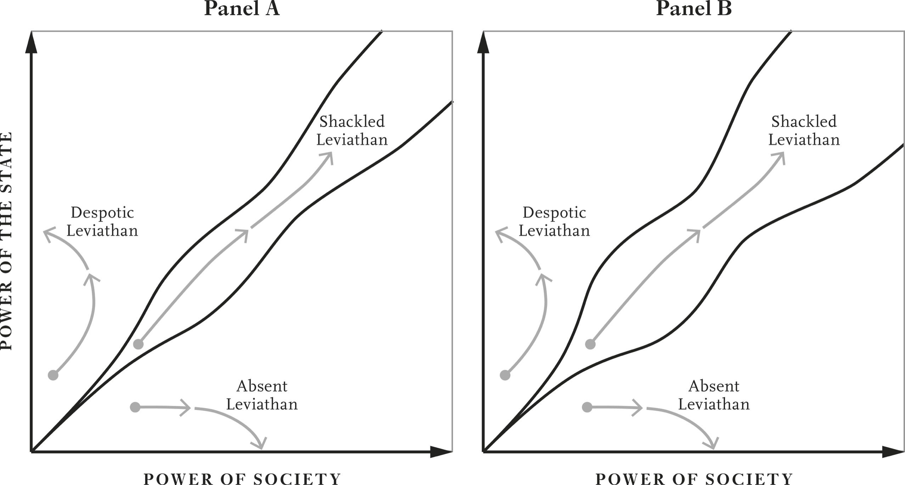

# Red Queen Out of Control · 第13章　红皇后失控

## A Revolution of Destruction · 革命性的破坏

On March 23, 1933, the German parliament convened in the Kroll Opera House in Berlin. The unusual location was necessary because the parliament building, the Reichstag, had been burned down the previous month. It was the turn of Otto Wels, the leader of the Social Democratic Party, to address parliament. Wels was the only person who spoke that day, except for the recently appointed chancellor and leader of the Nazi Party, Adolf Hitler. Wels forcefully argued against Hitler’s Enabling Act. The act, the next step in what the German politician Hermann Rauschning called “the revolution of destruction,” effectively abolished parliament and gave all power to Hitler for a period of four years.

> 一九三三年三月二十三日，德国国会在科罗尔歌剧院（Kroll Opera House）集会，在这么不寻常的地方开会确有必要，因为德国国会大厦上一个月才烧个精光。当天轮到由社会民主党领袖奥图．威尔斯（Otto Wels）对国会发表演说，除了新近获得任命的总理兼纳粹党领袖希特勒之外，威尔斯是当天唯一发表演说的人，威尔斯强烈反对希特勒的「授权法案」（Enabling Act）。这项法案是德国政客赫尔曼．劳森（Hermann Rauschning）所说「革命性破坏」的下一步，实际上会废除国会、把所有权力交给希特勒长达四年之久。

Wels didn’t think his speech was going to change anything, and fully expected to be beaten up, arrested, or worse, and had come prepared with a cyanide capsule in his pocket. From what he’d seen so far, he had decided it was better to kill himself than fall into the hands of the Nazis and their paramilitary units such as the Storm Detachment (also known as Brownshirts or the SA) and the Protection Squadron (the SS). Wels knew that the first concentration camp, at Dachau, had been opened just the day before and two hundred political prisoners had already been moved there.

> 威尔斯认为自己的演说不会改变任何事情，而且完全预期自己会遭到殴打、逮捕或更糟糕的事情，因此来开会前，已经在口袋里准备好了氰化物药丸。从他到目前所见，他认定自杀胜过落入纳粹党及其准军事组织冲锋队（Storm Detachment，也叫褐衫队）和亲卫队（Protection Squadron）手中。威尔斯知道设在达豪（Dachau）的第一座集中营，前一天才刚刚开幕，两百位政治犯才刚刚移送到那里监禁。

He knew because the Nazis had been only too happy to publicize what was going to happen to their enemies. Hitler had talked about such camps as early as 1921, and the head of the SS, Heinrich Himmler, had given a press conference on March 20 to announce the opening of Dachau. Wels spoke in an environment of intense intimidation and latent violence. The opera house was hung with Nazi flags and swastikas, and members of the SA and the SS thronged the corridors and exits.

> 他会这么清楚，是因为纳粹党徒极为乐于宣传他们敌人的下场。希特勒早在一九二一年，就谈到这种集中营，亲卫队头子海因里希．希姆莱（Heinrich Himmler）曾经在三月二十日，举行过记者会，宣布达豪集中营启用。威尔斯在充满强力威胁和潜在暴力的环境中演说，歌剧院里挂了很多纳粹党旗和纳粹卍字标志，褐衫队和亲卫队员堵满剧院走道和出口。

Wels acknowledged that the act was going to pass, but argued forcefully against it, stating: In this historic hour, we German Social Democrats solemnly profess our allegiance to the basic principles of humanity and justice, freedom and socialism. No Enabling Law can give you the power to destroy ideas which are eternal and indestructible . . . From new persecutions Social Democracy can once again gather new strength. We salute the persecuted and oppressed . . . our friends throughout the country. Their constancy and loyalty . . . the courage of their convictions, their unbroken confidence, promise a brighter future.

> 威尔斯承认这项法案会通过，但他强力反对，声称：在这个历史性时刻，我们德国社会民主党员庄严地宣誓，我们忠于人性和正义，忠于自由和社会主义的基本原则。任何授权法都不能赋予你们权力，让你们摧毁永恒和无法摧毁的理念……我们可以从新的迫害中，再度汇集新的力量。我们向全国遭到迫害和压迫……的朋友致敬，他们的坚决和忠心耿耿、他们秉持信念的勇气、他们坚定不移的信心，预示更光明的未来。

Alas, the passing of the act was a foregone conclusion. The Nazis had, by hook or crook, secured the support of all delegates that could attend except the Social Democrats. What was so unexpected was that things had come to such a critical point for Weimar democracy, with Hitler as chancellor and parliament about to disband itself. The National Socialist German Workers’ (Nazi) Party was a fringe movement that had received only 2.6 percent of the vote in the 1928 election.

> 唉，这项法案的通过已经成为定局，纳粹党已经不择手段，得到除了社会民主党员以外所有能够与会议员的支持。这么出人意料之外的事情是，威玛共和民主制度会走到这么重要的时刻，会在希特勒担任总理的情况下，自行解散国会。国家社会主义德国工人党又名「纳粹党」，本来是边缘政党，在一九二八年的选举中，只得到百分之二．六的选票。

The Great Depression, which destroyed as much as half of the German economy’s output; mounting discontent; and a string of ineffective governments had caused a huge shift of votes toward the Nazis in the first election after the beginning of the Depression in 1930, followed by a further increase in the Nazi vote share in the elections of 1932. In the last free election Germany held, in November 1932, the Nazis received about 33 percent of the vote.

> 摧毁德国经济一半产出的大萧条、日增的不满，加上一系列无效能的政府，造成选票在一九三○年大萧条开始后的第一次选举中，大量流向纳粹党。接着，纳粹党在一九三二年的选举中，得票比率进一步上升。纳粹党在一九三二年十一月德国举行的最后一次自由选举中，大约得到百分之三十三的选票。

The next election, in March 1933, following Hitler’s accession to chancellorship two months earlier, took place under a reign of terror and repression by Brownshirts and the police controlled by the Nazis. The Nazis now had almost 44 percent of the vote. Under Weimar’s proportional representation system, this translated into 288 out of the 647 deputies. To pass the Enabling Act the Nazis needed a quorum of at least two-thirds of elected members to be present and a two-thirds majority of those present to support it. They were far short, particularly if everyone showed up.

> 接下来是一九三三年三月的选举，这时希特勒出任总理已经两个月，选举在褐衫队和纳粹党控制的警察恐怖压迫的气氛中进行，纳粹党几乎得到了将近百分之四十四的选票。根据威玛共和的比例代表制，这样等于在六百四十七个国会议员席次中，得到二百八十八席。要通过授权法案，纳粹党需要至少三分之二的最低法定人数的议员出席、获得其中三分之二议员的多数支持。纳粹党得到的支持远低于此，在每一位议员都出席的情况下，更是如此。

First they barred the 81 elected Communist members of parliament from attending, and by not counting them at all, they managed to reduce the quorum from 432 to 378. Of the 120 Social Democratic members, only 94 were present; the others were in prison, ill, or simply too terrified to show up. All 94 voted against the act, but this wasn’t enough, since every other party supported it. A democratically elected legislature had voted itself out of existence.

> 所以，他们首先禁止八十一位共产党议员出席，纳粹党借着完全不计算他们席次的手段，把最低法定人数从四百三十二人，降为三百七十八人。社会民主党的一百二十位议员中，只有九十四位出席，其他议员不是关在牢里，就是生病，或是太害怕，不敢露面。出席的九十四位议员全都投票反对这项法案，但这样还不够，因为其余政党都支持这个法案，以民主方式选出的议会投票要自废武功。

That this was going to happen wasn’t a secret, even if the Nazis were certainly at times ambiguous about their aims. Their 1930 election manifesto had stated: Through its victory the National Socialist Movement will overcome the old class and estate mentality. It will allow the reconstitution of a people out of the estate madness and class nonsense. It will educate the people to iron decisiveness. It will overcome democracy and enhance the authority of the personality.

> 这种事情并非秘密，即使纳粹党对自己的目标偶尔会摇摆不定，他们一九三○年的竞选政见中已经清楚说明：国家社会主义运动要透过胜选，克服旧有的阶级与地位心态，让个人摆脱地位疯狂和阶级废话，重新建构，这样会教育人民坚决果断，克服民主制度，强化人格的权威。

But what did “overcome democracy” mean, exactly? Hitler had also talked about needing only four years, hence the initial duration of the Enambling Act (it was renewed in 1937 and then again in 1939 and eventually made permanent in 1943). In a speech on February 10, 1933, in the Berlin Sports Palace, he asserted: “Give us four years, and I swear to you, just as we, just as I have taken this office, so I shall leave it. I have done it neither for salary nor for wages; I have done it for your sake.”

> 但是，「克服民主制度」到底是什么意思？希特勒也谈到只需要四年，因此这就是授权法最初的延续年限（一九三七年续延后，到一九三九年再度续延，最后在一九四三年，变成永久有效的法律）。一九三三年二月十日，希特勒在柏林体育宫发表演说时，曾经断言：「给我们四年，我对你们发誓，只要我们、只要我接掌这个职位，我就不会管这件事，我这样做既不是为了薪水，也不是为了薪资，我这样做是为了你们。」

Yet the day after this speech, when Hitler secretly met with industrialists to raise money for the Nazis’ election campaign, Hermann Göring stated that the forthcoming election would be the last not just for four years but for one hundred. In a public address the previous year, on October 17, 1932, Hitler had already declared, “If we do one day achieve power we will hold onto it, so help us God. We will not allow them to take it away from us again.” On the day Hitler became chancellor, his future propaganda minister Joseph Goebbels announced, “Prepare the election campaign. The last.”

> 但是，希特勒演讲完隔天，就秘密会见一些工业家，为纳粹党的选战募款。赫曼．戈林（Hermann Göring）表示，即将到来的选举不只会变成未来四年的最后一次选举，也会变成未来一百年里的最后一次。希特勒在前一年的一九三二年十月十七日，在一场公开演说中，已经宣布：「有一天，如果我们掌权，我们会牢牢把持住权力，因此请上帝帮助我们，我们不会再让他们把权力从从我们手中夺走。」希特勒就任总理那一天，他未来的宣传部长约瑟夫．戈培尔（Joseph Goebbels）宣布：「为最后一次选战准备。」

How did it ever come to this? Germany’s Weimar Republic had built a vibrant democracy and had a highly educated, politically active population. Why was it succumbing to the revolution of destruction by a band of thugs? To answer these questions, we have to retrace the steps of the Weimar Republic. As Germany surrendered in October 1918, its naval admirals planned a reckless last-ditch attack on Britain and the Dutch coast. In response, their sailors mutinied.

> 事情怎么会变成这样？德国的威玛共和建立了活力十足的民主制度，又拥有教育程度很高、在政治上很活跃的人民，为什么会对一群暴徒发动的革命性毁灭屈服？要回答这些问题，我们必须追溯威玛共和所采取的步骤。一九一八年十月，德国投降之际，德国海军将领计划针对英国和荷兰海岸，发动不顾后果的最后一击，海军士兵的反应是上演叛舰喋血。

These events escalated into a full-scale revolution by November, leading to the flourishing of Soldiers and Workers Councils all over Germany and the creation of the Council of the People’s Deputies. On November 9, Kaiser Wilhelm II abdicated and went into exile, and the Weimar Republic was founded with the Social Democrat Friedrich Ebert as its first chancellor. Ebert tried to contain the revolutionary mobilization by creating, among other things, a parallel structure called the Executive Council of Workers’ and Soldiers’ Councils.

> 到了十一月，这些事件升高为全面革命，促成德国全境的士兵与工会勃然兴起，并创造出人民代表会议。到十一月九日，德皇威廉二世退位，走上流亡之路，威玛共和成立，社会民主党人弗里德里希．艾伯特（Friedrich Ebert）出任第一任总理。艾伯特试图借着创立工人与士兵执行委员会的平行结构，遏止革命动员。

By December Ebert was moving loyal troops into Berlin and disbanding the Council of the People’s Deputies. He armed nationalistic paramilitaries recruited from the ranks of former soldiers, known as the Free Corps, and when the Communist revolt broke out in January 1919 in Berlin, he went along with the murder of its leaders, Rosa Luxemburg and Karl Liebknecht. Declarations of socialist republics in Bavaria and Bremen were also met with swift repression by loyal military units and the Free Corps.

> 到了十二月，艾伯特调动忠贞部队进入柏林，解散人民代表会议，并从旧士兵中招募人员，建立「自由军团」，一个国家级准军事组织，为这些人建立武装。一九一九年一月，柏林爆发共产党叛乱时，他赞成杀害叛变领袖罗莎．卢森堡（Rosa Luxemburg）和卡尔．李卜克内西（Karl Liebknecht）。巴伐利亚和不来梅宣布建立社会主义共和国的行动，也遭到忠贞军事单位和自由军团迅速敉平。

All of this violence and instability notwithstanding, Germany appeared to be moving in the corridor and the Red Queen was in full force. Germany had a legislative house with adult male suffrage after 1848, but on the whole it was still dominated by the Prussian elite, both because of the presence of an elite-controlled upper house, and because of Prussian control of state institutions and the bureaucracy. Despite these obstacles, the Social Democratic Party had already become a major player before the war. After the kaiser’s abdication, the Weimar Constitution introduced universal adult suffrage and removed the upper house’s control over politics.

> 德国虽然出现这种暴力和不稳定，却似乎继续走在自由窄廊里，红皇后全力发挥力量。德国从一八四八年起，就设立议会，授予成年男性投票权，但整体而言，德国仍然是普鲁士菁英主宰的国家，原因之一是上议院由菁英控制，原因之二是普鲁士控制了国家制度和官僚体系。社会民主党虽然面临这种障碍，却在一次大战前，已经变成政坛上的重要角色。德皇退位后，威玛宪法引进成人普选制度，并取消了上议院对政治的控制权。

But this was only one step in the Red Queen dynamics that would play out in the aftermath of the war. The collapse of German armies intensified the discontent that many Germans felt with the country’s institutions and brought about a surge in societal mobilization. Citizens demanded more power, greater rights, and effective political representation. Unions flourished and managed to get employers to acquiesce to the eight-hour day, the subject of long and fruitless negotiation before the war.

> 但是，这样只是大战后红皇后发挥力量的一个步骤。德国军队的瓦解加深了很多德国人对国家制度的不满，也造成社会动员风起云涌。公民要求更多的权力、更大的权利和有效的政治代表权。工会蓬勃发展，设法逼使雇主默认一天工作八小时的制度，达成战前漫长谈判、却始终无法达成的目标。

A major part of this social mobilization was what some called the Vereinsmeierei (“associational mania”). Associations, clubs, and civil society organizations were flourishing in record numbers. It appeared that if three or more Germans got together, they were likely to start a club. Or write a constitution. As the historian Peter Fritzsche put it: More voluntary associations attracted more members and did so in a more active fashion . . . than ever before. Just as retailers, bakers, and commercial employees had organized into economic-interest groups, so also did gymnasts, folklorists, singers, and churchgoers gather into clubs, rally new members, schedule meetings, and plan a full assortment of conferences and tournaments.

> 社会动员的一大部分是所谓的「集会结社疯潮」，协会、俱乐部和公民社会组织数目创下空前新高纪录，似乎只要有三个以上的德国人聚集在一起，就可能创立一个俱乐部，或是撰写组织章程。就像彼得．弗里茨（Peter Fritzsche）说的一样：更多自动结合的社团吸引更多的成员，形成前所未见更活跃的风气……零售商、面包师和商业雇员组织成经济利益团体，体操选手、民俗学家、歌手和教堂聚会人士也组成俱乐部，招募新会员、安排会议，规划各式各样的所有会议和竞赛。

This was not only an era of social mobilization. The cage of norms was crumbling, too, particularly for women, who had won the right to vote under Weimar in 1919. Elsa Herrmann’s 1929 book This Is the New Woman celebrated women’s new freedom and identity. She decried traditional stereotypes of the role of women in society, noting that “the woman of yesterday lived exclusively for and geared her actions toward the future. Already as a half-grown child, she toiled and stocked her hope chest for her future dowry. In the first years of marriage she did as much of the household work as possible herself to save on expenses . . . she helped her husband in his business or professional activities.” But things were changing:

> 这不只是社会动员的时代，也是规范牢笼土崩瓦解的时代，对根据一九一九年威玛宪法赢得投票权的女性正是如此。艾尔莎．赫尔曼（Elsa Herrmann）在一九二九年的大作《这是新女性》（The is New Woman ）中，欢庆女性新近获得的自由和身分，她谴责女性在社会中传统的刻板印象角色：「过去的女性日子和生活完全为未来而活，活动以未来为依据，像成长到一半的孩子一样，辛苦工作，为未来的嫁妆积聚希望宝盒；结婚的最初几年里，女性尽量自行承担家务，希望节省支出……希望协助丈夫的事业或专业业务。」但是，情势正在改变。

The new woman has set herself the goal of proving in her work and deeds that the representatives of the female sex are not second-class persons existing only in dependence and obedience. Women’s suffrage was not the only innovation in German political institutions after the country’s defeat in the First World War. The constitution, written in the city of Weimar following elections in January 1919, made Germany a republic with an elected president rather than a hereditary monarchy. It granted equality before the law and all sorts of individual rights as well. You were now free to express your opinions, to assemble, and to participate in politics. Article 124 read:

> 新女性已经订定目标，要借着工作和行为，证明自己身为女性，不代表是只能靠着依赖和服从而活的二等人。德国在一次世界大战中战败后，女性选举权不是德国政治制度中唯一的创新，一九一九年一月的选举后，在威玛市制定的宪法把德国变成共和国，有一位人民选出的总统，而非世袭的君主。这部宪法也赋予人民在法律之前人人平等的权利，以及所有种类的个人权利，你现在拥有言论、集会结社和参与政治的自由，宪法第一百二十四条指出：

All Germans have the right to form societies or associations for purposes not prohibited by the criminal code. This right may not be limited by preventive regulations. The same provision applies to religious societies and associations. Every association has the right to incorporate according to the provisions of the civil code. Such right may not be denied to an association on the ground that its purpose is political, social, or religious.

> 所有德国人都有权根据刑法未禁止的目的，组织协会或社团，结社权得不受预防性法规限制，相同规定适用于宗教结社。每个社团有权根据民法规定成立，此种权利不得以某一结社具有政治、社会或宗教目的为由，而拒绝授予。

Together with unparalleled social mobilization during the Weimar era came a great deal of cultural change and creativity. The Bauhaus art school, founded in 1919 under the visionary directorship of Walter Gropius and Ludwig Mies van der Rohe, forged a new synthesis of art and design. The Blue Four group of painters, including Wassily Kandinsky and Paul Klee, emerged out of the earlier Blue Rider group. Both Kandinsky and Klee taught at the Bauhaus. Modernist composers like Arnold Schönberg and Paul Hindemith revolutionized orchestral music. Fritz Lang and Robert Wiene created Expressionist cinema.

> 威玛时代爆发空前热络的社会动员后，随之而来的是大量的文化演变和创意，包浩斯（Bauhaus）艺术学校在瓦尔特．格罗佩斯（Walter Gropius）和路德维希．凡德罗（Ludwig Mies van der Rohe）高瞻远瞩的领导下，于一九一九年创立，打造了艺术和设计的新结合；包括瓦西里．康丁斯基（Wassily Kandinsky）和保罗·克利（Paul Klee）在内的「蓝色四杰」画家，都出身于先前的蓝骑士团体，康丁斯基和克利都在包浩斯学校教学。现代派作曲家阿诺．荀白克（Arnold Schönberg）和保罗．亨德密特（Paul Hindemith）彻底革新了管弦乐，弗里茨．朗（Fritz Lang）和罗伯特．威恩（Robert Wiene）则创造了表现主义派的电影。

But as is typical of the unruly dynamics of the Red Queen, as society became stronger, the elite reacted. Even though the Social Democratic Party remained in power for much of the period, the elite were still heavily represented in the bureaucracy and could count on the loyalty of much of the army. When they couldn’t, they turned to the Free Corps. They repressed social mobilization and the Council of the People’s Deputies. This elite reaction deepened the polarization in interwar Germany.

> 但是，社会在常见的红皇后任性力量驱策下，变得日趋强大之际，菁英也日趋反动。虽然社会民主党在这段期间里，大致上一直掌权，菁英仍然大量散布在官僚体系中，而且可以得到大部分军队的效忠，得不到军队的效忠时，就转而求助于自由军团，镇压社会动员和人民代表会议，这些菁英的反应加深了两次大战之间德国的两极化。

The flourishing of German civil society also set in motion other responses, with important institutional consequences. Ebert had used the army to repress more radical forces in late 1918 and early 1919. But this strategy could unleash other forces at his, and Weimar’s, expense. There were also institutional peculiarities that would have important implications in the years to follow. Right from the start, the Weimar Republic was hamstrung by the fact that as many as half of the elected representatives did not believe in its institutions. Roughly a fifth on the left were Communists who favored a Russian-style revolution. To them the Weimar democratic state was “bourgeois” or even “fascist.”

> 德国公民社会的蓬勃发展也推动了其他反应，在制度上产生重要影响。艾伯特曾经在一九一八年底到一九一九年初之间，利用军队镇压比较激进的势力，但这种策略可能激发其他势力，对他和威玛共和产生损害。此外，其他制度性特点也会在未来的岁月中，产生重要影响。从一开始，威玛共和就步履蹒跚，受到多达半数不相信共和制度的民选议员羁绊：国会的左派议员中，大约有五分之一是主张俄罗斯式革命的共产党人，对他们来说，威玛民主共和国是「布尔乔亚」国家，甚至是「法西斯国家」。

About 30 percent of the representatives on the right, just like the majority of the traditional elites allied with them, wanted to return to the pre-1914 conservative-dominated status quo and restore the monarchy, and some, like the Nazis, completely rejected the legitimacy of the republic’s institutions. Nothing is perhaps more telling than the scenes in parliament after the 1930 elections when the Nazis first became a significant presence. One hundred and seven Nazis, uniformed in their brown shirts, colluded with the seventy-seven Communist members to disrupt the proceedings.

> 右派国会议员中，大约有百分之三十像跟他们结盟的大部分传统菁英一样，希望恢复一九一四年前保守派主导的状态，并恢复帝制，还有像纳粹党人的若干国会议员，完全拒斥共和制度的合法性。或许这种国会场景最清楚地表现在一九三○年的选举结束、纳粹党首次成为重要的势力之后。一百零七位身穿褐色衬衫制服的纳粹党议员，勾结七十七位共产党籍国会议员，合谋破坏国会的运作。

Both right and left shouted and obstructed parliamentary business, and abused the rules, endlessly raising points of order. Right and left had no respect for the institution to which they had been elected. Indeed, reflecting the widespread lack of trust in state institutions, it was not just the Nazis who had paramilitary groups. We have already seen the critical role that the paramilitary Free Corps played in fighting Communists in Munich and elsewhere.

> 左右两派都大喊大叫，妨碍国会事务，滥用规则，无休无止地提出秩序问题。左右两派都不尊重他们赖以当选的制度。确实如此，不只纳粹党才拥有准军事组织这件事，反映了人们对国家制度普遍的不信任。我们已经在慕尼黑和其他地方，看到准军事部队自由军团在跟共产党战斗中，所扮演的重要角色。

The Free Corps were only an arm’s-length distance from the SA, which had started out in 1920 as the Nazis’ “Gymnastics and Sports Section” and absorbed Free Corps veterans en masse, including Ernst Röhm, who became the SA’s commander. The Social Democrats had their paramilitary group too, called the Reichsbanner, and the Communists had theirs, the Red-Front Fighters’ League. Ominously, despite Prussia’s history of strong state institutions, the Weimar state never possessed a monopoly of violence.

> 自由军团跟褐衫队等的距离，只有咫尺之遥，褐衫队一九二○年草创时，本是纳粹党的「体操与体育部门」，曾经大量吸收自由军团的退伍军人，包括后来成为褐衫队司令的恩斯特．罗姆（Ernst Röhm）。社会民主党也有自己的准军事组织「帝国大旗」，共产党的准军事单位叫做「红色阵线战士联盟」。这是不祥的征兆，因为普鲁士虽然有强大的国家制度历史，威玛共和的国家机器却从来没有独占过暴力。

These uncompromising positions and the electoral system based on proportional representation made it very hard for Weimar democracy to work. By 1928 fifteen different political parties were represented in the Reichstag, including the Saxon Peasants party and the German Farmers’ Party. Another twenty-six parties had run candidates unsuccessfully, diluting the votes of the main parties. No single party ever had a majority in any Weimar election, so every government was a coalition.

> 这么多无从妥协的立场，加上采用以比例代表制为基础的选举制度，造成威玛共和的民主制度非常难以运作。一九二八年时，德国国会共有十五个政党的议员，包括萨克森农民党和德国农民党。另有二十六个政党的候选人竞选失利，稀释了主要政党的得票数。威玛共和的所有选举中，从来没有一个政党赢得过半数席次，因此，每一任政府都是联合政府。

For half of this period the government did not even have a majority in parliament, which meant that they had to build a new coalition for every piece of legislation. Between 1919 and 1933 there were twenty different cabinets, each one lasting an average of only 239 days. The resulting frustration and stasis led governments to increasingly rely on the prerogatives of the president to get things done.

> 这段期间的一半时间里，政府甚至在国会里，都没有过半数的席次，这点表示政府必须为每一项立法案，建立新的联盟。一九一九年至一九三三年间，威玛共和共经历了二十个不同的内阁，每个内阁的平均任期只有二百三十九天。因此而产生的挫折和停滞，导致历任政府愈来愈依赖总统调和鼎鼐的特权。

Extensive emergency powers granted to the president by Article 48 of the Weimar Constitution facilitated this presidential activism. Though these powers could in principle be overturned by a parliamentary vote, the president could dissolve the parliament, enabling him to use Article 48 as he wished. The first president, Friedrich Ebert, invoked Article 48 on 136 different occasions, even though it was supposed to be an emergency clause.

> 威玛宪法第四十八条赋予总统庞大的紧急权力，促成了总统这么活跃的现象。虽然这些权力原则上可以由国会投票推翻，总统却可以解散国会，让他可以随心所欲地动用宪法第四十八条。虽然人们公认宪法第四十八条是紧急条款，第一任总统艾伯特却动用了一百三十六次。

## A Rainbow Coalition of the Discontented · 不满分子的彩虹联盟

Into this highly mobilized society with its fragmented party system came the Nazis. The Nazi Party evolved out of the German Workers’ Party, which had been founded in Munich in 1919. Adolf Hitler, then still a corporal in the army, was an early recruit and he quickly distinguished himself with his compelling oratory and was made head of propaganda.

> 在这种社会高度动员、政党制度支离破碎的状况下，纳粹党就此诞生。纳粹党的前身是德国工人党，德国工人党于一九一九年，在慕尼黑创立。当时还是陆军下士的希特勒早早就入党，而且凭着令人动容的口才，迅速脱颖而出，出任宣传部首脑。

The name change in 1920 was designed to broaden the appeal of the party by adding “socialist” to the title. By 1921 Hitler’s ruthlessness and charisma had allowed him to take over the leadership of the party with complete authority over objectives and strategy. In November 1923 he made a mistake. He decided that the Nazis would be able to get local military units in Munich to support them in the so-called Beer Hall Putsch. It was a fiasco. The party was banned and Hitler was arrested.

> 隔年，德国工人党改名「国家社会党」，党名加上「社会（主义）」一词，意在扩大吸引力。到一九二一年，希特勒凭着冷酷无情和魅力，接掌党的领导，对党的目标和策略拥有全权。一九二三年十一月，他犯下大错，认定国家社会党在所谓的「啤酒馆政变」中，应该能够得到慕尼黑当地军事单位的支持，结果却一败涂地，国家社会党遭禁，希特勒被捕。

That the putsch took place in Munich was not a coincidence. The Nazi party had been banned nearly everywhere in Germany after June 1922 when Foreign Minister Walther Rathenau had been assassinated by right-wing nationalists. But in Bavaria the party was still legal and flourished under the government of the right-winger Gustav Ritter von Kahr, who had supported paramilitary groups in 1918–1919 and maintained his own independent group, known as the Denizens’ Defense Force. The position of many conservatives was that the Nazis were criminals and thugs, but useful criminals and thugs; their energy could be harnessed to restore the pre-Weimar regime. The Beer Hall Putsch was a step too far, however. Kahr repudiated the putsch and the military held firm.

> 政变在慕尼黑发生其来有自，一九二二年六月，德国外交部长瓦尔特．拉特瑙（Walther Rathenau）遭到右派民族主义分子暗杀后，纳粹党几乎在每一个地方都遭禁，在巴伐利亚却仍然是合法政党，而且在右派古斯塔夫．冯卡尔（Gustav Ritter von Kahr）政府的支持下，蓬勃发展。冯卡尔在一九一八年至一九一九年间，支持准军事组织，自己还拥有一支独立的私人武力「居民防卫部队」（Denizens’ Defense Force）。在很多保守派人士的心目中，纳粹党是一群罪犯和暴徒，却是有用的罪犯和暴徒，可以利用他们的精力，恢复威玛共和出现前的政体，但「啤酒馆政变」太过分了，冯卡尔跟政变划清界线，军方夷然不动。

Nevertheless, Hitler’s subsequent trial shows that the local authorities were sympathetic to him. They made sure the trial was held in Munich and that Georg Neithardt, an avowed nationalist, was appointed as judge. Neithardt gave Hitler a platform to address the court for hours, turning the whole thing into what one journalist at the time referred to as a “political carnival.” After Hitler’s opening remarks, one of the judges declared, “What a tremendous chap, this Hitler!”

> 不过，希特勒的后续审判却显示，地方当局同情他，确保审判在慕尼黑举行，还确保由忠贞的民族主义分子乔治．奈特哈尔（Georg Neithardt）负责主审。奈特哈尔赐给希特勒一座发言台，让他对法庭发表几小时的演说，把整件事变成当时一位记者所谓的「政治嘉年华会」。希特勒发表开场白后，有一位法官宣称：「真是个好家伙，这个希特勒！」

Hitler was sentenced to five years’ imprisonment, but was released early in December 1924, just thirteen months after his initial arrest. During his comfortable prison sojourn Hitler wrote his famous book Mein Kampf. He also learned a critical lesson—instead of the putsch, the Nazi party had to take the democratic path to power.

> 希特勒遭判五年徒刑，却提早在一九二四年十二月获释，离他当初被捕才十三个月。他在舒服系狱的日子里，写下著名的大作《我的奋斗》。他也学到一个重大教训，就是纳粹党不能靠着政变，必须利用民主之路掌握政权。

Yet as late as the 1928 election the Nazis were no more than a marginal party, polling at less than 3 percent. That all changed with the Wall Street Crash of 1929 and the start of the worldwide Great Depression. Though the full brunt of this was not to hit Germany until 1930, already 1929 saw a collapse of investment.

> 但是，直到一九二八年的选举，纳粹党顶多只是个边缘政党，得票率不到百分之三。改变一切的是一九二九年的华尔街崩盘，以及世界性的经济大萧条开始。虽然两件大事要到一九三○年，才全面影响德国，但一九二九年时投资已经开始崩溃。

In 1930 national income fell by 8 percent. By 1931 it had fallen by one-quarter, by 1932 by almost 40 percent. Many Germans saw their earnings drop precipitously, but the greatest burden fell on those losing their jobs as the unemployment rate rocketed to 44 percent, the highest rate recorded in an advanced economy. For comparison, U.S. unemployment in 1932 was 24 percent while in Britain it was 22 percent. Yet the unemployed themselves did not vote predominantly for the Nazis.

> 德国一九三○年的国民所得下降了百分之八，到一九三一年，德国的国民所得暴降四分之一，一九三二年更是惨跌将近百分之四十。很多德国人的收入陡然剧降，但遭到最大冲击的是失业的人，失业率扶摇直上百分之四十四，创下先进经济体有史以来最高的失业纪录。相形之下，美国一九三二年的失业率为百分之二十四，英国为百分之二十二，但失业人口的票主要还不是投给纳粹党。

They tended to support left-wing parties, as did those who were members of trade unions. Rather, it was the massive economic insecurity of the times that led the Protestant middle classes, shopkeepers, and farmers as well as the discontented urban youth to be attracted by the Nazis’ vague promises of national renewal. The Nazis became a catchall party for those disillusioned with the existing party system and the politics of Weimar, making the historian Richard Evans describe them as “a rainbow coalition of the discontented.”

> 他们通常都把票投给左翼政党，工会会员也是这样。纳粹党含糊的民族复兴承诺所能吸引的人，反而是受到当时严重经济不景气威胁的中产阶级新教徒、商店老板、农民以及心怀不满的都市青年。对现有政党体系和威玛共和政治失望的人来说，纳粹党变成了容纳一切的百宝箱，以至于历史学家理察．伊凡斯把这些人，形容为「不满人士的彩虹联盟」。

In March 1930 the president, Paul von Hindenburg, appointed a new government with Heinrich Brüning of the Center Party as chancellor. The Center Party was only the third-biggest party behind the Social Democrats and the conservative German National People’s Party, and had 61 out of 491 seats. The appointment of Brüning by Hindenburg heralded the waning of parliamentary rule, as it was done without consultation with the parliament, and most of the new cabinet ministers had no affiliation with any of the parties.

> 一九三○年三月，德国总统兴登堡（Paul von Hindenburg）任命中央党的海因里希．布吕宁（Heinrich Brüning）出任总理，负责组织新政府。中央党只是第三大党，在四百九十一个国会席次中，只占了六十一席，规模不如社会民主党和保守的德国国家人民党。兴登堡任命布吕宁，预示国会统治的式微，因为兴登堡没有跟国会咨商，就迳自这样做；同时，大部分新任内阁部长和任何政党都没有关系。

Brüning’s government was unable to pass a budget. In response Hindenburg dissolved the parliament. According to the constitution, new elections had to be held within sixty days. They saw the vote share of the Nazi party surge to 18.25 percent, giving them 107 seats in the new parliament. Hindenburg again named Brüning as chancellor and Brüning struggled on in the face of the mounting economic crisis until he was replaced by Franz von Papen in June 1932.

> 布吕宁的政府无法让国会通过预算，兴登堡的反应是解散国会。宪法规定，新选举必须在六十天内举行，结果纳粹党的得票率冲到百分之十八．二五，在新国会中掌控一百零七席。兴登堡再度任命布吕宁担任总理，布吕宁面对升高的经济危机，苦苦挣扎到一九三二年六月，改由法兰兹．冯．巴本取而代之。

The Communists, in cahoots with the Nazis, immediately tried to organize a no-confidence vote, but before they could manage it Hindenburg again dissolved the parliament. New elections were held after sixty days in July 1932, but in this period Hindenburg, and effectively Papen, could rule without parliamentary opposition. They took advantage of this opportunity on July 20 to issue an emergency decree, declaring Papen Reichskommissar (Reich Commissioner) for Prussia, giving him direct control over the Prussian government. This type of emergency decree would later be put to nefarious use by the Nazis, dismissing the democratically elected government of the state of Prussia and taking control of its massive security force.

> 共产党和纳粹党勾结同谋，立刻发动不信任投票，但计划还没完成，兴登堡总统再度解散国会，新选举要在六十天后的一九三二年七月举行。但是，在这段期间里，兴登堡──实际上则是巴本──可以在没有国会的反对下，遂行统治；他们利用这个机会，在七月二十日发布紧急命令，宣布巴本出任普鲁士总督（Reichskommissar），让他直接控制普鲁士政府。这种紧急命令后来会遭到纳粹党恶意利用，解散普鲁士邦的民选政府，控制普鲁士邦庞大的维安部队。

Papen himself didn’t seem to have any reservations about the overthrow of the democratically elected government in Prussia. In his memoirs he stated that his goal upon coming to power was to restore the imperial system and monarchy, and it appears that a plan to abolish elections later in 1932 was shelved only because of the threatened no-confidence vote. At this point, repeating the mistakes of other traditional elites, Papen hatched a strategy of using the popularity of the Nazis as a way to revert the political institutions to the status quo ante Weimar. This turned out to be a terrible miscalculation.

> 巴本自己对普鲁士民选政府遭到推翻的事情，似乎没有任何保留意见，他在回忆录中表示，他掌权的目的是要恢复帝制和王权，而且一九三二年下半年选举的计划会搁置，完全是因为受到不信任投票的威胁。在这一点上，巴本犯了其他传统菁英所犯的错误。他想出一种策略，希望利用纳粹党得到民心的事实，作为把政治制度恢复到威玛共和前状态的方法，结果这种策略是可怕的错误算计。

In the election of July 31, 1932, the Nazi vote share shot up to over 37 percent, giving them 230 seats in the Reichstag. After fruitless negotiations over a new government, Hindenburg again dissolved parliament and ruled unopposed through Papen. The next election in November saw the Nazis reduced to 33.1 percent of the vote with 196 seats. It was still a stalemate. Papen was replaced on December 3 by the Reich minister of defense, Kurt von Schleicher, a former general yearning to engineer a coup to set up a conservative authoritarian government with the support of the military but, crucially, without the Nazis.

> 纳粹党在一九三二年七月三十一日的选举中，得票率冲到超过百分之三十七，取得二百三十席的国会席次。兴登堡在筹组新政府的谈判徒劳无功后，再度解散国会，透过巴本在无人反对的状况下，继续统治德国。纳粹党在十一月的下次选举中，得票率降为百分之三十三．一，国会席次降为一百九十六席，政情仍然困在僵局中。到了十二月三日，德国国防部长库尔特．冯施莱谢尔（Kurt von Schleicher）取代巴本，出任总理，冯施莱谢尔曾经担任将领，渴望筹划政变，在军人的支持下，成立保守派威权政府，但其中的重点是不要有纳粹党参与。

But this scheme came to nothing. Parliament’s disintegration was clear. In 1930 parliamentarians sat for 94 days and passed 98 laws, and President Hindenburg issued only 5 emergency decrees. By 1932 they sat for a puny 13 days and managed to enact just 5 laws. Hindenburg, on the other hand, was much busier, passing 66 emergency decrees. In a vain attempt to create a government that could function, Hindenburg agreed, at Papen’s urging, to appoint Hitler as chancellor, on January 30, 1933.

> 然而，这个计划一事无成，国会解体的情况显而易见。一九三○年内，国会开会九十四天，通过九十八项法律，兴登堡总统只发布了五道紧急命令。到一九三二年，国会仅仅开了十三天的会，设法制定了五条法律。另一方面，兴登堡却忙得多，发布了六十六道紧急命令。兴登堡试图创造可以运作的政府，却徒劳无功，因此接受巴本的促请，在一九三三年一月三十日，同意任命希特勒为总理。

Hitler convinced Hindenburg to dissolve the parliament. Until new elections were held on March 5, 1933, Hitler was in charge of the state. On February 27 a Dutch Communist, Marinus van der Lubbe, possibly in collaboration with others, burned down the Reichstag. This gave Hitler the excuse he needed to declare that the act was the start of a Communist coup. He induced Hindenburg to use Article 48 to pass the Reichstag Fire Decree, which suspended most civil liberties in Germany, including habeas corpus, freedom of expression, freedom of the press, the right of free association and public assembly, and the secrecy of the post and telephone.

> 希特勒说服兴登堡解散国会，从这时至一九三三年三月五日举行新选举前，希特勒负责统治德国。二月二十七日，荷兰共产党员马里努斯．范．德．卢贝（Marinus van der Lubbe）可能在其他共犯配合下，烧毁德国国会大厦，让希特勒找到他所需要的借口，以便宣布此一行动是共产党政变的开端；他劝诱兴登堡动用宪法第四十八条的权力，通过《国会纵火令》，中止德国大部分的公民自由，包括人身保护令、言论自由、新闻自由、结社和公开集会自由，以及秘密通讯自由。

With this decree in hand, Hitler was able to use all of the paramilitary and organizational might of the Nazi Party to intimidate and cow into submission any opposition before the March election. In this he was aided by Franz von Papen’s previous takeover of the Prussian government because Hitler got Göring appointed Prussian minister of the interior, effectively putting him charge of the police in half of Germany. The next step was the Kroll Opera House, the Enabling Act, and the end of Weimar democracy.

> 希特勒拿到这道命令后，就可以在三月的国会选举前，利用纳粹党的所有准军事和有组织的力量，威逼和恐吓任何反对派屈服。他这样做时，得到巴本先前接管普鲁士邦政府的协助，因为希特勒设法让戈林获得普鲁士内政部长的任命，有效地掌控德国一半的警力。下一步就是国会在科罗尔歌剧院开会，通过授权法，为威玛民主制度带来末日。

## The Zero-Sum Red Queen · 红皇后的零和游戏

However shocking, the collapse of Weimar democracy was not just a consequence of unforeseen events and Adolf Hitler’s force of personality. The Weimar Republic had deep fault lines that made the Red Queen effect potentially unstable, more pregnant with danger, more likely to get out of control. In this chapter, we study why this was the case in Germany and clarify the circumstances under which the dynamic contest between state and society can topple a nation out of the corridor.

> 不管威玛民主制度的崩溃多么令人震惊，都不只是无法预见的事件和希特勒人格力量的后果，威玛共和中有很多条很深的断层线，可能造成红皇后效应变得不稳定、带来更多危险、更可能失控。我们在本章里，要研究德国这种变化的起因，澄清在国家和社会强力竞争的情况下，可能把一个国家踢出自由窄廊。

The first of Weimar’s fault lines relates to the nature of the competition between state and society. The Red Queen effect in ancient Athens (Chapter 2) or in the U.S. case (Chapters 2 and 10) involved each side building up their capacity to have the upper edge, but this didn’t mean the state repressing and attempting to emasculate society. Nor did it involve societal mobilization aimed at completely destroying the elites. (For instance, even when an elite was ostracized from Athens, his property was not confiscated.)

> 威玛共和的第一条断层线跟国家和社会之间的竞争性质有关。第二章中所说，红皇后效应在古代雅典可以发挥力量，在第二章与第十章中所说的美国，也可以发挥力量，这种情形和双方能够建立能力，以便掌握优势有关，但这样并不表示国家试图镇压和削弱社会，也不涉及社会动员以彻底摧毁菁英为目标（例如，雅典菁英遭到放逐时，财产不会遭到没收）。

Indeed, Solon and Cleisthenes and U.S. founding fathers such as George Washington and James Madison emerged as arbiters acceptable to both elites and non-elites; they institutionalized the power of society as they were simultaneously contributing to the expansion of state capacity. This created a political environment in which state capacity developed with better regulation, institutions for provision of public services, and the ability to resolve conflicts—an example of “positive sum” Red Queen, where both sides ultimately strengthen as a result of their competition. The situation in Germany was different, more polarized.

> 事实上，索伦、克里斯提尼和美国建国先贤如华盛顿和麦迪逊，都变成菁英和非菁英能够接受的仲裁者，他们把社会的力量制度化时，同时也促进了国家能力的扩张，这样创造的政治环境，让国家能力可以发展比较好的管制法规，推动公共服务提供的制度化，强化解决冲突的能力，因此形成「正和红皇后」的范例。双方最后都会因为竞争而强化。德国的情形不同，比较两极化。

By polarization we mean that there appeared to be little room for compromise between the elites and the segment of society most mobilized and intent on leaving its mark on German politics (in particular, the workers’ movement and its most important organization, the Social Democratic Party). Consequently, rather than supporting state-society cooperation and broad-based state building, German Red Queen dynamics turned out to be much more “zero-sum,” with each side intent on destroying the other in order to be able to survive itself.

> 我们所说两极化的意义是：菁英和动员最厉害、有意在德国政治上留下影响的社会阶层（尤其是工人运动及其最重要组织的社会民主党）之间，几乎好像没有什么妥协空间。因此，德国的红皇后效应不但没有支持国家和社会之间的合作、支持普遍的国家建设，反而有着严重倾向「零和」状态的情况，每一方都意图摧毁另一方，以便自己能够存活下来。

This zero-sum Red Queen in Germany was mostly but not entirely due to the attitudes of German elites. Elites in the army, the bureaucracy, the judiciary, academia, and the business world did not accept Weimar democracy and wanted to engineer a return to the more authoritarian, elite-controlled society of the famous nineteenth-century chancellor Otto von Bismarck. The army, dominated by the Prussian elite, associated the new democracy with the defeat in the war and the onerous terms of the Versailles peace treaty they had to accept.

> 德国会形成这种零和红皇后效应，主因出在菁英的态度上，但这一点不是全部的原因。德国军队、官僚体系、司法体系、学术界和企业界的菁英，都不愿意接受威玛共和的民主制度，都希望策画回归比较威权、由十九世纪著名宰相俾斯麦所建立的那种菁英控制的社会。由普鲁士菁英主导的军队，把新的民主制度、一次大战中的失败，和他们被迫接受凡尔赛和约中严苛的条件，联想在一起。

The business elite felt threatened by the Social Democratic Party and the mobilization generated by mass politics. These attitudes not only supported repression rather than compromise at critical points, they also created an environment conducive to the rise of various fringe, right-wing organizations, such as the Nazi Party. This is most visible in the tacit support that the Nazis received from the German elite. It wasn’t only after the failed Beer Hall Putsch that Hitler and his allies received favorable treatment from the establishment. The police and judiciary often sided with the Brownshirts who beat up, and at times killed, Communists and Social Democrats, emboldening their campaign of terror.

> 企业界菁英觉得受到社会民主党的威胁，也受到群众政治掀起的社会动员威胁。这种种态度在重要时刻，不仅支持镇压而非支持妥协，还创造了便于各种边缘右派组织、如纳粹党之类组织崛起的环境。这一点从纳粹党得到德国菁英的默默支持，可以看得最清楚，啤酒馆政变失败后，不但希特勒和同伙得到既有体制的优待，褐衫队殴打、甚至偶尔杀害共产党人和社会民主党人时，都会得到警察和司法部门的同情，从而加强了褐衫队的恐怖行动。

The statistician Emil Julius Gumbel put together data from 1919 to 1922 showing that 22 political murders committed by left-wingers led to 38 convictions and 10 executions, while the 354 political murders by right-wingers, mostly Nazis, led to only 24 convictions and no executions. German universities too were siding with the right against the left. In the words of Richard Evans, “Where political allegiance of the young to the far right was at its most obvious was in Germany’s universities, many of them famous centres of learning, with traditions going back to the Middle Ages . . . The vast majority of professors . . . were also strongly nationalist.”

> 统计学家艾弥尔．耿贝尔（Emil Julius Gumbel）汇集一九一九年至一九二二年间的资料显示，左派人士在这段期间里，犯了二十二件政治谋杀案，导致三十八人遭到定罪、十个人遭到处决；同期间，主要是纳粹党人的右派分子，犯了三百五十四件政治谋杀案，却只有二十四人遭到定罪，没有半个人遭到处决。德国大学也同情右派，反对左派；用伊凡斯的话来说：「年轻人对极右派的政治忠诚度表现最明显的地方，就是德国的大学，其中很多大学都是著名的学习中心，都拥有可以回溯到中世纪的传统……绝大部分的教授也都是强烈的民族主义分子。」

In consequence, the universities were among the first institutions to embrace the Nazi ideology in the 1920s, with a huge number of university students joining the party. As we have seen, all of this came to a head after support for the Nazis began expanding, and large parts of the bureaucracy and the army, and most ominously the president, Hindenburg, took no action to stem their surge; they preferred the Nazis, whom they thought they could control, not just to the Communists but to the Social Democrats as well.

> 因此，一九二○年代内，大学是最早拥抱纳粹意识形态的机构，数量极多的大学生。就像我们看到的那样，对纳粹党的支持开始扩大后，这一切都走到紧要关头，大部分的官僚体系和军队，其中最不祥的地方是连兴登堡总统，都没有采取任何行动，阻止他们的崛起；他们偏爱纳粹党，认为自己可以控制纳粹党，他们不只是对共产党如此，对社会民主党也是这样。

But why were German elites, officers, and bureaucrats so opposed to the Weimar experiment? Part of the reason is related to structural factors determining the nature of life in the corridor; they were mostly cut from the same cloth, rooted in the Prussian landed aristocracy. Landed interests have often viewed the strengthening of society and the beginnings of democracy in zero-sum terms, and for good reason.

> 但是，为什么德国菁英、官员和官僚这么反对威玛共和的实验呢？原因之一跟决定自由窄廊中生活性质的结构性因素有关，这些人大都拥有相同的本质，出身普鲁士的土地贵族，拥有土地利益的人经常在零和游戏中，看到社会的强化和民主制度的启动，而且这种看法具有充分的理由。

Industrialists and professionals can flourish in the corridor both economically and politically, because they have assets (in the form of their expertise, knowledge, and skills) that remain valuable even as the economy transforms, and because their urban existence gives them new opportunities to organize and remain politically relevant in the midst of the Red Queen dynamics. Not so for landowners, who fear losing their lands, which are much more easily taken away from them than the factories of industrialists and the skills of professionals.

> 工业家和从业人员走在自由窄廊中时，在经济与政治两方面都会欣欣向荣，因为即使他们碰到经济转型期间，他们拥有的资产（以专业技术、知识和技术表现出来）仍然深具价值，也因为他们住在都市地区，会有新机会，可以组织起来，在红皇后效应勃发时，仍然能够维持他们在政治上的重要性。地主却不是这样，地主害怕失去土地，因为要夺取土地，比夺占工业家的工厂和专业人员的技术容易得多。

Indeed, societal mobilization often comes with demands for loss of economic, political, and social privileges for landowners, and the situation in the Weimar Republic was no different (even if such attempts were stymied by President Hindenburg, who was himself from the Prussian landed aristocracy and sympathetic to their concerns). Landowners also feared, again rightly, becoming marginalized as the political center of gravity shifted away from them as a result of democratic politics. All of this made them skeptical of the burgeoning Shackled Leviathan.

> 事实上，社会动员经常都会伴随着要地主丧失经济、政治和社会特权的要求，威玛共和的情形没有不同（即使这种意图遭到兴登堡总统的阻拦也一样，兴登堡本人出身土地贵族，同情他们关切的问题）。地主也理由十足地害怕遭到边缘化，因为推行民主政治后，会造成政治重心从他们身上移开的结果。这一切都让他们怀疑勃然兴起但受到制约的国家巨灵。

The role of landowning elites in interwar Germany illustrates a broader point. We have so far emphasized the different nature of politics inside and outside the corridor, and in this chapter, we are seeing how the struggle between state and society may take a nation out of the narrow corridor. But clearly, the narrower the corridor, the easier it is for a society to spin out of it. Consider Figure 5, for instance. On the left panel, we see a corridor that is very narrow, while the one on the right is wider.

> 两次大战之间德国土地菁英的角色，说明了一个比较广泛的重点。到现在为止，我们强调的都是走廊内外不同的政治性质，本章要看看国家和社会之间的斗争，怎么可能引领国家走出走廊，但显然走廊愈窄，社会愈容易滚转出去；以图表五为例，左边图表甲中的窄廊非常窄，右边图表乙中的窄廊比较宽。

In the next chapter, we’ll discuss the various factors that shape the corridor and how this determines the feasibility not just of staying in it, but also of getting into it. For now, we can note that the importance of the power and wealth of landowners, as in Weimar Germany, is one of the factors that makes the corridor narrower—because landowners’ fear of losing their lands and political power makes them unwilling to compromise and coexist with a mobilized society, while their intransigence helps radicalize society. So the situation in Germany looked much more like Panel A of Figure 5 and hence more fraught with instability.

> 我们要在下一章里，讨论塑造窄廊形状的各种因素，以及这一点怎么决定国家是否能够停留在窄廊中，以及是否能够进入窄廊中。我们现在可以注意到，在诸如威玛德国的例子里，地主的权力和财富的重要性，是造成走廊变窄的因素之一──因为地主害怕失去土地和政治力量，促使他们不愿意跟已经动员的社会妥协和共存，同时他们的坚持不妥协有助于激化社会，因此德国的情况看来非常像图表五中的左图表，具有更多的动荡不安。

Even if the attitudes of the Prussian landowners and the structural difficulties that they posed for life in the corridor were not uncommon, the Prussian landed elites were better able to form a coalition to resist societal mobilization. To start with, many of the top officers, judges, and bureaucrats originated from this social class and shared their outlook. The Prussian elite had remained relatively coherent and politically dominant during the second half of the nineteenth century, even as social change was ongoing. This convinced them that they could control German politics, and if necessary dial back the clock to the days of Otto von Bismarck.

> 普鲁士地主的态度，和他们为窄廊中日子带来的结构性问题，其实并不罕见，但普鲁士土地菁英却更善于组成联盟，抗拒社会动员。首先，很多高官、法官和官僚出身这种社会阶级，和地主的看法相同，虽然十九世纪下半叶里，社会持续变化，普鲁士的菁英大致上仍然都相当团结一致，在政治上占有主导地位，这一点让他们相信他们可以控制德国政治，有必要时，可以把时钟拨回到俾斯麦的时代。

It wasn’t just the elite who showed little commitment to Weimar democracy. The votes of German workers were divided between many parties, but most importantly between the Communists and the Social Democrats. The Communists dreamed of engineering a Russian-style revolution and worked to undermine Weimar democracy and parliament, even sometimes in coalition with their mortal enemy, the Nazis. Though Social Democrats became the party most associated with the Weimar Republic, and had many pragmatic or even opportunistic leaders like Ebert, their commitment to democratic politics was also at times tenuous.

> 不只是菁英对威玛民主政体毫无信心，德国工人也分裂投票给很多政党，但最重要的是，他们在共产党人和社会民主党人之间分裂投票。共产党人梦想推动俄罗斯式的革命，努力破坏威玛民主政体和国会，为了达成目的，偶尔甚至和死敌纳粹党合作。社会民主党虽然变成跟威玛共和关系最密切的政党，出了很多务实或甚至像艾伯特一样，抱持机会主义的领袖，但是他们对民主政治的信心经常也很脆弱。

They had their roots in Marxist politics and had only recently split with the Communists, not so much because they disagreed with the ultimate objective of setting up a socialist society, but on the issue of support for the German war effort. Compared to some other social democratic parties in Europe, German Social Democrats had a stronger Marxist pedigree, making them much more threatening to business elites and contributing to polarization. The polarization that resulted from the lack of compromise and the adversarial approach of all sides was both a cause and a consequence of the nature of civil society organizations in the Weimar years.

> 他们的根基扎在马克思主义政治的土壤中，一直到最近才跟共产党人分手；分手的原因倒不是他们不同意共产党创设社会主义式社会的终极目标，而是因为在支持德国战争行动的问题上有异见。德国的社会民主党和欧洲别的社会民主党相比，马克思主义的血统反而比较纯正，因此他们对企业菁英的威胁大得多，同时还会促使情势朝多极化发展。多极化起源于缺乏信心和各方彼此之间的敌对态度，多极化既是威玛时代公民社会组织特质的原因，也是这种特质造成的后果。

Had he witnessed it, Tocqueville would have been even more impressed by the bustling associational life of interwar Germany than he was with the mid-nineteenth century United States. And yet, all of this was along sectarian lines. Even in small towns, associations were divided between those of Catholics, nationalists, Communists, and Social Democrats. A youth with nationalist sympathies would belong to nationalist clubs, attend a nationalist church, and probably socialize and marry entirely within these nationalist circles. The same was true for Catholics, Social Democrats, and Communists. This polarized societal mobilization contributed further to a zero-sum Red Queen effect, which involved each side investing to undercut the other. There were no Solons or James Madisons to address both state and society in Weimar Germany.

> 要是托克维尔能够看到这种情形，一定会对两次大战之间德国热络的集会结社状况，比看到十九世纪中叶美国的类似状况，还会更加感叹。然而，所有这些状况都是根据不同的族群路线发展，即使是在小乡镇里，集会结社时，都是根据天主教徒、民族主义分子、共产党人和社会民主党人的路线划分：同情民族主义分子的青年会加入民族主义团体，上民族主义分子上的教堂，社交和结婚对象可能完全限于民族主义分子的圈子；天主教徒、社会民主党人和共产党人的情形也那一样。这种极化的社会动员促成红皇后效应进一步向零和的方向发展，造成每一族群的成员努力削弱其他族群。威玛德国时代又没有索伦或麦迪逊这样的人，来处理国家和社会之间的问题。

All of this paved the way for the second fault line of Weimar democracy. Red Queen dynamics often increase tensions in society, so the capacity of institutions to resolve and contain these conflicts becomes particularly important to channel them in the direction of capacity-building competition rather than instability. The fact that the courts neither increased their capability to deal with myriad new disputes in Germany nor accepted the legitimacy of societal mobilization, especially from the left, meant that there were no impartial arbiters in these conflicts, and partly as a result, the conflicts intensified and society became more polarized.

> 这一切为威玛时代的德国，奠定了第二条断层线的基础。红皇后的力量经常会提高社会中的紧张，以至于制度性能力在解决和遏止这些冲突时，把冲突导向竞相建立能力的方向，而非导向制造动荡不安的方向上，会变得特别重要。法院既没有提高能力，解决德国极多的新纷争，也没有接受社会动员的合法性，尤其是不接受左派所发起社会动员的合法性，表示这种冲突中没有公正无私的仲裁者，结果之一就是导致冲突日趋严重，社会变得愈来愈极化。

The fractured, gridlocked nature of parliament further empowered extremist parties and precluded democratic compromises that could have managed these conflicts. In a sense, the institutions could not run as fast as state and society, making the Red Queen much more likely to get out of control. It isn’t only structural factors that influence how the struggle between state and society works out in practice. As we pointed out in Chapter 9, the leadership of certain groups or individuals can sometimes play a defining role, for better or for worse.

> 国会支离破碎、陷入僵局，助长了极端主义党派的力量，排除了民主妥协和管理这些冲突的可能。从某个角度来看，制度的运作速度比国家和社会的运作速度慢，以至于红皇后失控的可能性大为增加。实际运作上，结构性因素不仅止于影响国家和社会之间的斗争结果，就像我们在第九章里所指出的那样，不管结果如何，某些团体的领袖或个人偶尔也会扮演决定性的角色。

The charismatic, albeit largely deranged, single-mindedness and vitality that Adolf Hitler brought to the fringe right-wing movements of interwar Germany no doubt contributed to the swift fall of the Weimar Republic and to the character of the murderous regime that replaced it. With these fault lines and Hitler’s oratory and charismatic leadership, the ride of Weimar democracy was destined to be a bumpy one. But all of this might still have been long forgotten today had it not been for the third structural factor—the huge shock of the Great Depression, which intensified conflict and polarization in society and delegitimized the democratic institutions of the era, especially when the fractured parliament was unable to deal with the economic crisis. Weimar was now teetering on the edge of the corridor.

> 两次大战之间，像希特勒这样大致上精神错乱、意志坚决又活力十足的魅力型领袖，为德国带来的边缘右派运动，无疑促成了威玛共和的快速殒落，也强化了取代威玛共和凶残政权的特性。在这些断层线和希特勒的绝佳口才和魅力型领导激荡下，威玛民主政体注定会走在十分颠簸的路上，但如果不是因为第三个结构性因素，这一切仍然可能早已被人忘怀──这个因素就是大萧条的惊人冲击。大萧条加深了社会的冲突和两极化，造成当代民主制度的合法性丧失，在国会支离破碎、无法因应经济危机时，尤其如此。现在威玛政权站在窄廊边缘，显得摇摇欲坠。

## Despotism from Below · 由下而上的专制主义

The problem with the Red Queen is that the same energy that fuels the building of the capacity of both state and society can also get out of control and destabilize life in the corridor. Yet ultimately, what doomed the burgeoning German Shackled Leviathan wasn’t a coup by Prussian elites or the army, which is what many among the traditional elites, like Kurt von Schleicher, were hoping to organize, as we have seen. Rather, it was a bottom-up societal movement that brought this episode to an end.

> 红皇后的问题是同样的力量可以载舟，也可以覆舟，可以助成国家和社会能力的建立，却也可能失控，危害在自由窄廊的日子。但是，最后导致德国新萌芽受到制约的国家巨灵覆亡的原因，不是普鲁士菁英或军方的政变，不是冯施莱谢尔之流等传统菁英希望发动的政变推翻，反而是由一种由下而上的社会运动予以终结。

Though there were some industrialists and elite bureaucrats, judges, and university professors who supported the Nazis early on, the party was mostly a movement of discontented middle classes and youth. Until well into the 1930s, the Nazi movement was little more than its Brownshirts wreaking havoc, getting into street brawls, and beating up and sometimes murdering Communists, Social Democrats, and Jews. As late as July 1932, Joseph Goebbels would use a campaign speech to urge, “Now, people, rise up, and let the storm break loose!”

> 虽然有一些工业家和菁英官僚、法官和大学教授早早就支持纳粹党，但纳粹党大致上是属于不满中产阶级和青年的运动。一直到一九三○年代开始之后很久，纳粹运动顶多只是纳粹党的褐衫队发动破坏、参与街头打斗、殴打和偶尔杀害共产党人、社会民主党人和犹太人罢了。迟至一九三二年七月，戈培尔还要利用竞选演说敦促道：「现在，父老兄弟姐妹们，起来，让风暴大肆吹袭！」

If the Nazi party was the agent coming from the bottom of society and taking Germany out of the corridor, shouldn’t this have led to a collapse of the state’s capacity and control over society? Shouldn’t we expect the post-Nazi society to look a little bit like Tajikistan after the fall of the Soviet Union or perhaps Lebanon? Obviously, that’s not what happened. Though the Nazi movement came from below, it did not weaken the state’s despotism and dominance over society; on the contrary, it strengthened them.

> 如果纳粹党是出自社会底层、带领德国走出自由窄廊的媒介，这样岂不是应该造成国家能力瓦解、社会控制能力丧失吗？我们难道不应该期望后纳粹党的社会，看来有点像苏联崩溃后的塔吉克，或是像黎巴嫩一样吗？实际情形显然不是这样，虽然纳粹运动发自下层，却没有削弱国家的专制主义和对社会的宰割，反而强化了这种力量。

There were domains in which Nazi control did reduce state capacity, most notably in the police, the judiciary, and the bureaucracy, with the arrival of ideologically committed or opportunistic Nazis who were unqualified for the job and uninterested in impartially carrying out their duties. But in most respects, the German state got more despotic and powerful under the Nazis, with the army growing in size and responsibility, the bureaucracy organizing mass deportations and exterminating Jews, and the security forces acquiring sweeping powers, as exemplified by the Gestapo. The Nazi program was one of increasing repression, weakening independent societal mobilization and associations, and intensifying the state’s supremacy over society.

> 在纳粹党控制的若干领域中，国家的能力确实遭到削弱，警察、司法和官僚体系就是其中最明显的例子──意识形态坚贞或抱持机会主义的不合格纳粹党徒，介入这些工作后，对公正执行职责不感兴趣，但在大部分情况下，纳粹党控制的国家机器变得更专制、更强大，军方规模扩大、责任加重，官僚安排大量驱逐和消灭犹太人的任务，保安部队大权在握，盖世太保就是好例子。纳粹党推动的方案意在加强镇压、削弱独立性的社会动员和集会结社、强化国家机器优于社会的优势。

In this, the Nazis were similar to Italian fascists, who had been their role model. Hitler’s Beer Hall Putsch was inspired by Mussolini’s successful March on Rome. Mussolini captured the spirit of fascism and Nazism when he stated: For the Fascist, everything is in the State, and nothing human or spiritual exists, much less has value, outside the State. In this sense Fascism is totalitarian, and the Fascist State, the synthesis and unity of all values, interprets, develops and gives strength to the whole life of the people.

> 纳粹党在这方面，类似义大利的法西斯党，法西斯党一直是纳粹党的模范，希特勒发动啤酒馆政变，就是师法墨索里尼成功进军罗马的行动。墨索里尼所说的下面这段话，紧紧抓住了法西斯主义和纳粹主义的精髓：对法西斯主义分子来说，一切都包含在国家机器之内；国家机器之外，不存在任何人类或精神成分，遑论其价值。从这个角度来看，法西斯主义是极权主义，法西斯国家是所有价值观、所有诠释和发展的综合与统一，把完整的生命力量赋予人民。

The historian of fascism Herman Finer summed up the philosophy of the fascist state as “There are no citizens . . . There are only subjects.” This philosophy owed much to fascism’s and Nazism’s militaristic origins and their refusal of any checks on the power of their leaders or the state once they took control. It was also rooted in the way in which these movements were reactions to the socialist and Communist societal mobilization, and thus viewed reestablishing the state’s despotic control over the left as their natural objective.

> 法西斯主义历史学家赫曼．范纳（Herman Finer）把法西斯国家哲学总结为：「没有公民……只有臣民。」这种哲学大部分出自法西斯主义，以及纳粹国家社会主义的军国主义起源，也出自他们一旦取得控制后，他们的领袖或国家机器的权力、拒绝接受任何制约的观念。从某个角度来说，这种运动也起源于对社会主义分子和共产党人社会动员的反动，因此他们认为，重建国家对左派的专制控制，是他们再自然不过的目标。

But more fundamentally, even absent these ideological leanings, it would not have been feasible for a nation like Weimar Germany to evolve in the same way as Lebanon today, given its history of strong state institutions. Once these institutions—the army, the police, the judiciary, and the bureaucracy—were there for the taking, any group that gained the political upper hand would take them and use them, whether or not it came from the bottom up or advocated thuggery.

> 但是，更根本的地方是：即使没有这种意识形态上的倾向，像威玛德国等国家，因为具有国家制度强而有力的历史，因此演变方式应该和今天的黎巴嫩也不会一样。一旦这些制度──包括军队、警察、司法体系和官僚体系弃置于地，任人予取予求，在政治上取得上风的任何团体，都会拿来利用，不管这些团体是由下而上出身，还是拥护暴力的团体，结果都一样。

Thus even if the German Red Queen got out of control and passed the reins to a group originating in grassroots mobilization, once the nation was out of the corridor, the odds were always in favor of the state institutions’ being refashioned and used for the benefit of the new dominant group over others, especially after democratic and other constraints on state power were lifted. So as the Nazis destroyed the budding Shackled Leviathan and took power, they swiftly reestablished and intensified the state’s despotic dominance over society.

> 因此，如果德国的红皇后失去控制，并把控制权移交给起源于草根动员的团体，那么一旦国家跌出自由窄廊，国家制度总是比较可能遭到改造，用来造福新兴主导团体宰割别人，对国家权力的民主和其他约束遭到废弃后，情势更可能这样发展。因此，纳粹党摧毁刚刚萌芽的受制约国家巨灵、夺取权力之后，自然会迅速重建和加强国家对社会的专制宰割。

## How the Red Queen Gets out of Control · 红皇后如何失去控制

The problem with the corridor is that you can leave it. We have seen one way this happens with the Weimar Republic as well as some of the reasons why this was likely to happen in Germany. The three factors that put interwar Germany in a precarious position—polarization between state and society, making compromise unlikely and the Red Queen effect much more of a zero-sum affair; the inability of institutions to contain and resolve conflicts; and shocks destabilizing institutions and deepening the discontent—appear in one form or another in many other examples where the Red Queen gets out of control. But this doesn’t mean that there will always be a bottom-up movement undercutting the Shackled Leviathan, as in Germany.

> 自由窄廊的问题在于你可以自由离开，我们已经看到威玛共和离开窄廊的方式，也看到这种事情可能在德国发生的若干原因。有三大结构性因素，造成两次大战之间里的德国摇摇欲坠、国家和社会趋向两极化，这三大因素使妥协变成不可能出现，也使红皇后效应变成零和游戏的可能性大增；以至于制度无力遏止和解决冲突、破坏制度的危机，以及不满情绪日趋严重等现象，会在红皇后失控的很多其他例子里，以一种或另一种形式出现。但是，这样不表示情形总是会像德国一样，爆发由下而上的运动，削弱受制约国家巨灵的力量。

It could be the elites who reestablish the Despotic Leviathan as they emerge the stronger party out of the competition with society, or feel able or compelled to use whatever power they have to reassert their control, perhaps because they are themselves threatened by polarization. This, we’ll see, is what happened in Chile when Augusto Pinochet led a violent coup to overthrow democracy in 1973. Or it may be certain segments of society that put an end to life in the corridor because they become convinced they can no longer control it, which is what brought down most of the Italian communes we studied in Chapter 5, and what we can see playing out in many parts of the world today.

> 另一种可能的情况是，菁英和社会竞争时，也可能取得上风，从而重建专制国家；或是因为菁英在受到两极化威胁时，认为自己有能力或被迫运用自己所掌控的力量，重新申张自己的控制权。我们在下文中会看到，一九七三年智利强人皮诺契特（Augusto Pinochet）领导暴力政变，推翻民主政权时，就是发生这种状况。另一种可能是社会中的某些族群，逐渐相信自己不再能够控制社会，因而结束国家在自由窄廊中过活的日子。这一点正是我们在第五章中所研究大多数义大利自治城市垮台的原因，也是我们今天在世界上很多地方可以看到的戏码。

## How Much Land Does an Inquilino Need? · 佃农需要多少土地？

We have seen that Shackled Leviathans aren’t created overnight. They are the result of a long struggle between state and society. In 1958 Chile was experiencing the latest phase of such a struggle which had already led to the political emancipation of a large fraction of the rural labor force, known as inquilinos. Inquilino means “tenant,” but the connotation in rural Chile was a bit more sinister. While they were not slaves or serfs, in practice inquilinos were tied to farms, so much so that when people sold their farms, they also sold the inquilinos with them.

> 我们已经知道，受制约国家巨灵不是一夜之间创造的，而是国家和社会漫长斗争的结果。一九五八年时，智利正在经历这种斗争的最新阶段，导致大部分被称为「佃农」的农村劳动力，在政治上获得解放。佃农就是「佃户」，但是在智利农村里，佃农的意义比较不那么好。智利佃农虽然不是奴隶或农奴，实际上却和农地绑在一起，因此有人出售农场时，也会把佃农一并卖掉。

Inquilinos worked on the farms and provided other “services” too. Particularly important among these services was their contribution to the political power of the landlords, since they were forced to vote the way their landlords told them to. When an election came around, landowners bused the inquilinos to the polling station, where they were given ballots and told whom to vote for. Their votes were not secret, and the landlords could observe the whole process. Anyone going against the landlords’ wishes ran the risk of being fired and dispossessed.

> 佃农在农场里务农，却也要提供其他「服务」，其中特别重要的服务是增进地主的政治力量，因为他们会被迫根据地主的意愿投票。选举到来时，地主会用巴士，把佃农载到投票所，拿到选票，得知要把票投给谁，他们不是秘密投票，地主可以全程观察，违反地主意愿的人会有遭到解雇和赶走的风险。

How could Chile have been in the corridor in 1958 with this sort of thing going on? Remember that being in the corridor is a process. The corridor can start when both state and society have modest but balanced capacities. In this Chile was no different from other places. Secret ballots only arrived in British elections in 1872. As late as 1841, conservative politician and three-time prime minister Lord Stanley could observe, “When any man attempted to estimate the probable result of a county election in England, it was ascertained by calculating the number of the great landed proprietors in the county and weighing the number of occupiers under them.”

> 在这种情况下，一九五八年时，智利怎么可能身在自由窄廊中呢？请记住，身在这种窄廊中是一种过程，窄廊的起点可能是在国家和社会能力薄弱却能平衡的时刻。智利在这方面和其他地方没有两样。英国要到一八七二年，才开始推动秘密投票，近在一八四一年，三次担任英国首相的保守派政客史丹利爵士还可以说：「任何人想要估计英格兰郡县选举比较可能的结果时，可以借着计算这个郡大地主的人数，再估量他们名下有多少居民，就可以确知结果。」

Indeed, in rural England, big landowners controlled a sufficiently large fraction of the voting population that their control determined the outcome of an election. As in 1950s Chile, if an “occupier” went against his landlord, there was going to be trouble. The great British economist David Ricardo recognized this in 1824, writing, “It is the most cruel mockery to tell a man he may vote for A or B, when you know that he is so much under the influence of A, or the friends of A, that his voting for B would be attended with the destruction of him. It is not he who has the vote, really and substantially, but his landlord, for it is for his benefit and interest that it is exercised in the present system.”

> 事实上，大地主控制的英国乡村选民比率够高，足以决定选举结果。但是，到了一九五○年代的智利，「居民」如果违背地主的意愿，却一定会出问题。一八二四年时，英国经济学大师李嘉图就看出这一点，他写道：「如果你知道某人深受某甲或某甲友人的影响，却告诉他可以把票投给某甲或某乙，真的是最残忍的嘲笑。因为如果他把票投给某乙，等于是自取灭亡。其实他的票不是自己的，是属于他的地主。因为在现行制度下，投票权的行使是为了地主的好处和利益。」

Lord Stanley’s logic applied in Chile too. During the debate in the Senate on the introduction of the secret ballot, socialist senator Martones argued in favor of introducing the secret ballot because if that law [the old electoral law without a secret ballot] did not exist, instead of there being 9 Socialist senators there would be 18, and you [the Conservatives] would be reduced to 2 or 3 . . . [laughter] you laugh, but the truth is that there would be not 2 Conservative senators from O’Higgins and Colchagua, which corresponds exactly to the number of inquilinos in the fundos which belong to the Conservative hacendados in that region. Conservatives would have only one or perhaps none.

> 史丹利爵士的逻辑也适用于智利。智利参议院针对推动秘密投票议案辩论时，社会主义派参议员马托内斯（Martones）发言，赞成推动秘密投票，因为：如果那项法律〔没有规定秘密投票的旧选举法〕不存在，目前社会主义派参议员有九位的情况，应该会变成有十八位，你们〔保守派参议员〕应该会减少到两、三位……〔大笑声〕你们笑吧，但事实上，欧希金斯（O’Higgins）和柯尔查瓜（Colchagua）应该不会有两位保守派参议员，这个数字正好对应那个区域里保守派背景大庄园中的佃农人数，保守派应该只有一席，也可能一席都没有。」

The secret ballot, enacted in 1958, had dramatic effects on elections in Chile. For one, it transformed the political prospects of Salvador Allende. Allende had run as the presidential candidate for the Socialist Party in 1952, getting a mere 5.4 percent of the vote. In 1958 he was the candidate for a coalition the socialists had built, known as the FRAP (Popular Action Front), and did a lot better, winning 28.8 percent of the vote, just 3 percent behind the winner, Jorge Alessandri.

> 一九五八年，秘密投票法立法后，对智利的选举产生戏剧性的影响，包括改变了萨尔瓦多．阿叶德的政治前途。阿叶德是一九五二年智利总统选举中社会党的候选人，得票率只有百分之五．四。到一九五八年，他代表社会主义派联盟「人民行动阵线」（FRAP）竞选总统，表现好得多，得到百分之二十八．八的选票，只比胜选者豪尔赫．亚历山德里（Jorge Alessandri）少百分之三。

Allende was a great example of the adage “If at first you don’t succeed, try again.” He did in 1964, and lost for a third time. But it was fourth time lucky in 1970. Though he only got 36.6 percent of the vote, just 1.5 percent more than his longtime opponent Alessandri, Congress elected him president with the support of the Christian Democratic Party, which had come third in the race for president. In 1970 Allende headed a new left-wing coalition called, somewhat ironically as it turned out, Popular Unity (U.P.). He was intent on transforming Chile into a socialist country.

> 阿叶德是「一试不成，再试一次」格言的典范。一九六四年，他一试再试，第三度败选。一九七○年，他碰到第四次的幸运，虽然他只得到百分之三六．六的选票，只比长期对手亚历山德里多出百分之一．五，基督民主党屈居第三，但国会在基督民主党的支持下，选举他为总统。一九七○年时，阿叶德领导一个新的左派联盟，「人民团结联盟」（Popular Unity）。事后证明这个名字颇为讽刺。阿叶德打算把智利变成社会主义国家。

There was no consensus for this in Chilean society, but Allende had ridden a wave unleashed by the secret ballot and other political and social changes that were playing out along Red Queen lines. For example, 1958 also saw the legalization of the Communist Party, which formed part of the FRAP and then the U.P. In addition, voter registration became compulsory and failure to register could even be punished by a prison term.

> 智利社会对推动改革没有共识，阿叶德利用秘密投票，也利用根据红皇后路线推动的其他政治、社会改革浪潮，乘时而行。这些改革包括共产党在一九五八年合法化，成为人民行动阵线的一环，后来又成为人民团结党的一环。此外，选民登记变成强迫性，不登记的选民甚至可以处以徒刑，因此选民人数大增。

This led to a large increase in the electorate, from 1.25 million people in 1960 to 2.84 million in 1971, when illiterates were finally enfranchised. The Christian Democratic government of Eduardo Frei in the 1960s, brought to power in part in response to these changes, spearheaded not just a range of reforms, including land redistribution, but also a general strengthening of society. Finally, 1961 also saw the launch of President John F. Kennedy’s Alliance for Progress. On March 13 of that year Kennedy declared:

> 一九六○年时，选民人数为一百二十五万人；到一九七一年，文盲终于获得投票权后，激增为二百八十四万人。一九六○年代内，爱德华多．弗雷（Eduardo Frei）领导的政府反应种种变化上台后，不但推动了包括土地重分配在内的一系列改革，也全面强化了社会。最后，一九六一年内，美国总统甘迺迪也推出进步联盟方案，这一年的三月十三日，甘迺迪宣布：

We propose to complete the revolution of the Americas, to build a hemisphere where all men can hope for a suitable standard of living and all can live out their lives in dignity and in freedom. To achieve this goal political freedom must accompany material progress . . . Let us once again transform the American Continent into a vast crucible of revolutionary ideas and efforts, a tribute to the power of the creative energies of free men and women, an example to all the world that liberty and progress walk hand in hand. Let us once again awaken our American revolution until it guides the struggles of people everywhere.

> 我们建议完成美洲革命，建立所有人民可以对适当生活水准怀抱希望、可以过着尊严与自由生活的半球。为了达成这个目标，政治自由必须伴随着物质进步……让我们再度把美洲大陆，变成革命性理念和努力的巨大试炼场，借以向自由人民的创造力致敬，向全世界示范自由和进步可以携手并进。让我们再度唤醒我们的美洲革命，到指引世界各地起而奋斗为止。

The frequent use of the word “revolution” is ironic, because the Alliance for Progress was partly a plan to stave off socialist revolution spreading throughout the continent. It was one of the policy responses of the U.S. government to the Cuban Revolution. (Another response was launched a month after Kennedy’s speech, in the Bay of Pigs, Cuba.) The Alliance argued that land reform would transform Latin America. As Kennedy put it, the Alliance planned “to satisfy the basic needs of the American people for homes, work and land, health and schools—techo, trabajo y tierra, salud y escuela.”

> 不断应用「革命」这个字词具有讽刺性，因为进步联盟这个计划的目的之一，是防止社会主义革命传遍美洲大陆，是美国政府针对古巴革命采取的政策反应之一（另一个反应是在甘迺迪演说后一个月，对古巴猪湾发动突袭。）进步联盟认为，土地改革会改变拉丁美洲，如同甘迺迪所言，进步联盟计划「满足美洲人民居住、工作、土地、健康和学校的基本需要」。

Unsurprisingly, tierra (land) was on the minds of a lot of newly politically enfranchised inquilinos. This, plus the fact it was now promoted by the U.S., put land reform on the policy agenda in 1964. In 1967 Frei launched an agrarian reform program aimed at redistributing land and expropriating all farms that were over the equivalent of 80 hectares in the Maipo Valley. (This meant that farms could be larger in places where land was of lower quality.) In anticipation of the land reform, some 200 rural unions, which were then illegal, had organized. They were legalized by the same piece of legislation. By 1970 there were close to 500 such unions. There was a surge in labor strikes, which went from 88,000 in 1960 to 275,000 in the year 1969.

> 土地无疑是很多新近获得选举权佃农心中的大事，这一点加上美国的提倡，把土地改革推上了一九六四年的政策议程。到一九六七年，弗雷推动农业改革，意在重分配土地，征收迈坡谷（Maipo Valley）中面积超过八十公顷的农场（这点表示，在土地等则较低的其他地方，可以拥有面积比较大的农场）。农民预期土地改革即将实施，组成大约二百个当时仍属非法的农村组织，但同一项法律使这些组织合法化，到一九七○年，这种组织增加到接近五百个。罢工案例激增，从一九六○年的八万八千件，增加到一九六九年的二十七万五千件。

Illustrating once again the Red Queen in action, in response to this societal mobilization Frei didn’t just initiate land reform; he also increased the state’s capacity. In particular, Frei attempted to reduce the ability of politicians to use clientelistic policies to buy support without doing much for the population they were supposed to serve. He did this in various ways, for example, using a line-item veto to eliminate “pork barrel” expenditures from bills, and also by reducing the ability of congresspeople to influence public works projects and salaries. The jurisdiction of Congress and the Senate with respect to the budget was also curtailed.

> 弗雷的反应再度说明红皇后正在发挥力量。弗雷为了因应这种社会动员，不仅开始推动土地改革，也提高了国家的能力，特别是试图削弱政客利用侍从式政策购买支持、却没有造福所服务选民的能力。他用很多种方式推动这件事情，例如，利用逐行逐项否决的方式，取消法案中的「肉桶」支出，同时削减国会议员影响公共工程和薪资的能力，国会和参议院对预算的管辖权也遭到削减。

There were significant obstacles to Allende’s agenda. For example, he did not have a majority in Congress. Even his presidency had been due to the Christian Democrats who had only voted for him after he agreed to amend the constitution with a “statute of guarantees.” These introduced a gamut of new individual rights into the 1925 constitution. The amendments clearly show what the Christian Democrats and others were concerned about. One clause states, “It cannot be constitutive of crime or abuse to sustain and spread any political idea.”

> 阿叶德的政治议程有不少重大障碍，例如，他在国会中并未拥有多数，连他的总统职位，都是因为基督民主党在他同意修订宪法，增添「保障条例」后，才投票支持他的。这些条款在一九二五年制定的宪法中，增加了一整套个人权利，也清楚显示基督民主党和其他党派关心什么事情。其中一条条文规定：「主张或传播任何政治理念，都不得构成犯罪或滥权。」

Others deal with a fear that the education system might be taken over as a tool of propaganda, for example, stating, “The education that is imparted through the national system will be democratic and pluralistic and will not have official party orientation. Its modification will also be carried out democratically, after free discussion in the competent bodies of pluralist composition.” Other clauses indicate a concern about paramilitary groups. One asserted, “The public force is constituted solely and exclusively by the Armed Forces and the Carabineros, essentially professional, hierarchical, disciplined, obedient and non-deliberative institutions.” They were right to be concerned.

> 其他条文中，也有因应教育体系可能遭到控制，变成宣传工具的问题；例如，宪法增修条款规定：「透过国家体系传授的教育必须民主而多元化，不得具有官方政党导向，其修正亦须经多元合格团体自由讨论后，以民主方式为之。」另一些条文显示，国会担心准军事团体的问题，有一条条文宣称：「公共武力完全由武装部队和卡宾枪骑兵队（警察部队）构成，基本上是专业、阶级分明、纪律严明、服从且不具审议性质的机关。」国会的担心其来有自。

Once in power Allende started to implement his plan. This involved intensifying land reform and expropriation, and creating worker cooperatives. He also had plans to massively nationalize industry. Other aspects of his economic policy involved granting workers huge pay raises. Some of these policies, such as pay hikes for government workers, could be implemented by presidential decree. But others required the agreement of Congress. What would Allende do when this was not forthcoming? Operate outside the constitution? This is what the statute was supposed to prevent, but who was going to enforce the statute?

> 阿叶德掌权后，开始实施自己的计划，包括强化土地改革和征收、创设工人合作社，他也计划推动大规模的工业国有化。他的经济政策的其他部分包括让工人巨幅加薪，其中若干政策，包括为政府员工加薪，可以用总统命令的方式实施。但是，其他政策需要国会的同意，如果国会不同意时，阿叶德要怎么办？在宪法之外运作吗？宪法理当是防止这种做法的法律，但谁负责执行宪法呢？

In March 1971, Allende gave an interview to the French Marxist philosopher Régis Debray. At one point Debray pointed out, “You . . . have the Executive Power. But not the Legislative, the Judicial, or the repressive apparatus. The legality, the institutions, these were not made by the proletariat; the Constitution was made by the bourgeoisie for its own purposes.” Allende responded: Evidently, you’re right, but listen to me a little, we’re going to get there. What did we say in the election campaign?

> 一九七一年三月，阿叶德接受法国马克思主义哲学家雷吉斯．德布雷（Régis Debray）的专访，德布雷在某个时刻指出：「你……才拥有执行大权，立法机构、司法体系或镇压型国家机器都没有这种大权。合法性、制度这些东西都不是无产阶级制定的，宪法是由中产阶级特别为本身的目的而订定的。」阿叶德回答说：显然你的说法更正确，但姑且听我略微说明一下。我们一定会达成目标。我们在竞选时怎么说？

We said that if it was difficult to win the election and not impossible, the stage between victory and the takeover of the government was going to be very difficult and it was even harder to build, because we were making a new path, a Chilean road for Chile, the Chileans for our country. And we have said that we will take advantage of those aspects of the current Constitution to make way for the new Constitution, the People’s Constitution. Why? Because in Chile we can do it. We present a project and the Congress rejects it; we will organize a plebiscite.

> 我们说，胜选很难，却不是不可能。胜利和接管政府之间的阶段会非常难，甚至会更难以建构，因为我们要铺筑一条新路、一条为智利打造的智利之路，为我们国家创造智利人民之路。而且，我们说过，我们会利用现有宪法的那些性质，为新宪法、为人民的宪法打造坦途。为什么？因为我们在智利可以做到这件事，我们提出的方案遭到国会拒绝，我们要推动公民投票。

So Allende was advancing his belief that socialism could be implemented in Chile via constitutional means. Even though he lacked a legislative majority, he could move the project ahead via direct appeal to the people, via a plebiscite. Quite how that was going to work was not clear. After all, Allende had won only 36.6 percent of the vote. When Debray pushed him, Allende noted:

> 因此，阿叶德提出他的信念，就是可以透过宪政方式，在智利实施社会主义。虽然他在立法方面，没有掌握多数，却可以透过公民投票，直接向人民诉求，推动这个计划。至于实际上要怎么做，却不很清楚，毕竟阿叶德只赢得百分之三六．六的选票而已。德布雷逼问时，阿叶德指出：

We win within their rules of the game. Our tactic was correct, theirs was wrong. But I told the people: Between September 3 and November 4, Chile is going to shake more than a soccer ball kicked by Pele. While Allende may have believed that he could move Chile to socialism via constitutional means, many in his own coalition didn’t, and Allende couldn’t control them. Groups of workers occupied farms and factories, ignoring the legal processes, and the government moved in to ratify the occupations.

> 我们根据他们的游戏规则胜选，我们的战术正确，他们的战术错误。但是，我告诉人民，九月三日至十一月四日之间，智利的震动会比比利踢出的足球还厉害。阿叶德虽然可能认为，他可以透过宪政手段，在智利推行社会主义，他的很多盟友却不相信，但阿叶德却无法控制他们。工人团体无视法律程序，占据农场和工厂，政府却介入，批准这种方式的占领。

Land reform and nationalization became chaotic. As the newspaper El Mercurio pointed out in an editorial in 1972, “Neither the President of the Republic, Salvador Allende, nor the parties of the U.P. . . . believe, even remotely, that repressive measures can be taken against groups of workers, farmers, and students who violate the law.” Such groups understood this and took advantage of it. These actions were increasingly justified by the notion that the political institutions were creations of U.P.’s opponents and therefore were designed to defend the status quo—a status quo that the U.P. was dedicated to uprooting.

> 土地改革和国有化变得杂乱无章。就像《信使报》一九七二年的某一篇社论所指出的那样：「总统阿叶德或人民团结党都不大相信可以采取镇压措施，对付违法的工人、农民和学生团体。」这些团体清楚得很，也利用这一点。这些行动逐渐合理化为：政治制度都是反对人民团结党的人创造出来的东西，目的是要保护人民团结党致力要铲除的现状。

This was again a zero-sum Red Queen effect, very different from what we witnessed in ancient Greece or the United States. As it played out, Chilean politics became even more polarized. The auditor general decried the polarization of politics, arguing at a news conference that an institution such as his was neither “revolutionary or reactionary.” Compromise was necessary, but there was an unwillingness to compromise. Senator Carlos Altamirano of the Socialist Party argued:

> 这种情形再度变成零和游戏的红皇后效应，和我们在古希腊或美国看到的情形大不相同。结果智利的政治变得更两极化，审计长在某次记者会上，谴责政治的两极化，力辩他所遵循的制度既没有「革命性，也没有反动性」。智利需要妥协，但各方却不愿妥协，社会党参议员卡洛斯．阿尔塔米拉诺（Carlos Altamirano）辩称：

There are those who pretend to urge “democratic dialogues” with Christian Democracy. As Socialists we say that a dialogue is possible with all those forces who clearly define themselves as against exploiters and against imperialism. We foster and will develop dialogue at the level of the masses, with all the workers, whether they are our militants or not, but we reject dialogues with reactionary and counter-revolutionary leaderships and parties. When members of the Christian Democrats reached a tentative compromise with the government, it was sunk by their own conservative faction, who warned of the “communist threat.” The die was cast. Violence erupted on all sides.

> 有人假装敦促我们，跟基督民主党进行「民主对话」。我们社会党人说，我们会和明确声明反对剥削与帝国主义的所有势力对话，我们会在大众的层面上，促进和发展跟所有工人的对话，不论他们是不是我们的激进派，都是这样，但我们拒绝跟反动又反革命的领袖与党派对话。基督民主党和政府达成暂时性的妥协时，却遭到执政党中的保守派否决，还警告大家小心「共党威胁」，于是木已成舟，暴力全面爆发。

When questioned by Debray on how he would deal with opposition violence, Allende had said, “We are going to contain it, first, with the force of its own law. In addition, to the reactionary violence we are going to answer with revolutionary violence, because we know that they are going to break the rules of the game.” Allende was right that the other side would break the rules of the game, but quite wrong on how he could counter it with revolutionary violence.

> 德布雷质问阿叶德，打算怎么因应反对派的暴力时，阿叶德说：「我们首先要用他们自己的法律力量，遏阻他们的暴力。此外，我们要以革命暴力回应反动派暴力，因为我们知道他们会打破游戏规则。」阿叶德说对了，另一方确实打破了游戏规则，但他说可以用革命暴力对付的话却错得离谱。

He was brought down by a coup on September 11, 1973. There had been a failed attempt earlier in the year, and Allende’s opponents were pushing the army to try again. El Mercurio published an article in June that stated, “In order to accomplish this task of political salvation, we have to renounce all political parties, the masquerade of elections, the poisoned and deceitful propaganda, and turn over to a few select military men the task of putting an end to political anarchy.”

> 阿叶德在一九七三年九月十一日的政变中下台；这一年年初的政变企图以失败告终，反对阿叶德的人催促军方再试一次。《信使报》六月的一篇文章表示：「为了完成这种政治救赎任务，我们必须抛弃所有政党、选举的伪装，抛弃有毒的宣传欺骗，把终结政治上无政府状态的任务，交给少数经过选择的军人。」

The process of social mobilization and the strengthening of society that took place in Chile in the 1960s was matched by the strengthening of the state, but this only led to more radical demands after 1970. These radical demands stoked fear among the Chilean elites who worried about mass expropriation of land and businesses. The elite’s reaction threw Chile out of the corridor. This fire was being fueled by the U.S. government’s policy even as Kennedy was heralding a “revolution” of political freedom for Latin America. The CIA was pouring money and effort into Chile to destabilize Allende’s government.

> 一九六○年代智利的社会动员和强化，得到国家机器的强化配合，但这样只是造成一九七○年后更激进的要求，这些要求助长了智利菁英的恐惧，担心土地和企业会遭到大规模的征收，这些菁英的反应把智利推出了自由窄廊。即使甘迺迪宣告拉丁美洲出现政治自由「革命」，智利这把火还是在美国政府的助长下点燃起来。美国中央情报局在智利投下巨资，努力颠覆阿叶德政府。

The Senate Select Committee on Intelligence Activities report on “Covert Actions in Chile, 1963–1973,” declassified in 2010, observes that the CIA tried to intervene in all areas of Chilean life to alter the political realities. It gave over $2 million to the Christian Democratic Party to help fund its 1964 election campaign. Another $4 million was provided to anti-Allende parties after 1970. It poured $1.5 million into El Mercurio, which was judged to be the most influential anti-Allende newspaper. It financed “democratic trade unions” against the Communist-led union confederation.

> 二○一○年，美国参议院情报活动特别委员会的《一九六三年至一九七三年智利秘密活动》报告解密，报告中指出，中情局试图介入智利的所有领域，以便改变智利的政治现实。中情局交给基督民主党二百万美元，资助该党一九六四年的竞选活动；一九七○年后，又提供四百万美元，给反对阿叶德的党派。中情局还提供一百五十万美元，给该局认定最有影响力的反阿叶德报纸《信使报》，另外还资助「民主工会」，反对共产党领导的工会联盟。

President Nixon directly ordered that the CIA try to stop Allende taking power after his election. The Senate report notes: After Allende finished first in the election . . . President Nixon met with Richard Helms, the Director of Central Intelligence, Henry Kissinger and John Mitchell. Helms was directed to prevent Allende from taking power . . . It quickly became apparent that a military coup was the only way to prevent Allende’s accession to power. The CIA established contact with several groups of military plotters and eventually passed weapons to one group.

> 尼克森总统在阿叶德当选后，直接下令中情局，设法阻止阿叶德上台。参院的报告指出：阿叶德在总统大选中夺得第一后，尼克森总统召集中情局长理察．赫姆斯、亨利．季辛吉和约翰．米契尔开会，命令赫姆斯阻止阿叶德上台……情势迅速显示，军事政变是阻止阿叶德上台唯一的方法，中情局跟好几组军方阴谋分子建立关系，最后把武器递交给其中一组。

The coup was supposed to start with the kidnapping of the head of the military, General René Schneider. Schneider was shot and killed and the coup collapsed in a fiasco. The extent to which the CIA helped precipitate the 1973 coup is controversial, with some relevant U.S. documents still classified. The Senate report concludes that while “there is no hard evidence of direct U.S. assistance to the coup,” nevertheless “the United States—by its previous actions, its existing posture and the nature of its contacts with the Chilean military—conveyed the signal that it would not look with disfavor on a military coup.”

> 政变本来应该从绑架军方首脑林内．许奈德（René Schneider）将军开始，许奈德遭到射杀，政变彻底失败。因为美国若干相关文件尚未解密，中情局协助促成一九七三年政变的程度还有争议。参院报告断定，虽然「没有确凿证据显示美国直接协助政变」，但「根据美国先前的行动、现有的态势和跟智利军方接触的性质来看，美国传达了不会以不赞成眼光，看待军事政变的信号」。

The coup, on which the U.S. did not “look with disfavor,” unleashed a torrent of violence and murder on the Chilean people. Around 3,500 people were killed for their political beliefs and activities; tens of thousands were imprisoned, beaten, and tortured. Tens of thousands were fired from their jobs because of their political affiliation. Unions were banned, collective action became impossible, and Congress was duly closed. What had started with the usual race between state and society in the corridor and an intensification of society’s mobilization in the 1960s got out of control and ended up with Chile spinning out of the corridor and into a seventeen-year period of despotism.

> 美国「不会不赞成」的政变引发了暴力和杀害智利人的洪流。大约三千五百人因为政治信念和行动遭到杀害，数以万计的人遭到监禁、殴打和刑求，数以万计的人因为政治关系，遭到解雇。工会遭到禁止，集体行动变成不可能，国会正式关闭。国家和社会之间在进入自由窄廊中后常见的竞争，以及一九六○年代社会动员的加强，都失去控制，造成智利离开这条窄廊，进入十七年的专制时代。

So in the Chilean case, we are again seeing the zero-sum Red Queen, leading to polarization and attempts by the two sides to undercut each other rather than finding a middle ground or compromise. The structural factors that made the corridor particularly narrow and the Red Queen fraught with danger for the Weimar Republic had many parallels in the Chilean case. It started with the landed elites, terrified of land reform and the eclipse of their political power, which fueled a broader unwillingness by the elite to accept societal mobilization and redistribution. Mounting polarization, resulting from the intransigence of the elite and from the radical Marxist ideology of Allende’s government, was a defining factor as well. So was the inability of Chilean institutions, including Congress and the courts, to mediate the conflict.

> 因此，我们在智利这个国家里，再度看到零和红皇后效应导向两极化，双方彼此互相削弱对方，而非寻找中庸之道或妥协。造成威玛共和的自由窄廊特别狭窄、红皇后效应中充满危险的结构性因素，在智利的例子里，有很多相似的地方：首先是土地菁英害怕土地改革，深恐自己的政治力量式微，这种恐惧助长菁英普遍不愿接受社会动员和重分配。菁英拒不妥协，阿叶德政府拥抱激进的马克思主义意识形态，造成两极化日益严重，也是一个明确的因素；包括国会和法院在内的智利制度，无力调停冲突，是另一个明确的因素。

Both groups thus came to the conclusion that the conflicts would be resolved by force. There was no external shock like the Great Depression destabilizing Chile, underscoring that a country can easily leave the corridor without an external rupture. All the same, Allende’s policies and the elites’ uncompromising opposition created a severe recession of their own making, adding to the turmoil. Chile, like Germany, left the corridor. In this case, it wasn’t the Brownshirts, but an elite-supported military coup that ended the prospects of the Chilean Shackled Leviathan (at least for a while).

> 双方因此认定冲突必须以武力解决。智利没有碰到像大萧条那样削弱国家的外在冲击，突显智利容易在没有外在不和的情况下，就可能轻易逸出这条窄廊。然而，阿叶德的政策和菁英的坚决反对，仍然造成了他们自己制造的严重衰退，乱局因此加深。智利和德国一样离开了这条窄廊，结束智利受制约国家巨灵前途（至少是暂时结束）的不是褐衫队，而是菁英支持的军事政变。

## For Whom the Bells Toll · 《丧钟为谁而敲》

In 1264 a solemn meeting took place in the city of Ferrara in northern Italy. It was chaired by the Podestà, who, as we saw in Chapter 5, was an external executive brought in to run the government of the republican Italian communes. The record of the meeting states: We Pierconte of Carrara, podestà of Ferrara, in a full assembly of all the people of the city of Ferrara in the piazza of the city, gathered in the usual way by the tolling of bells, by the wish, consent and order of the whole commune and population gathered in this assembly . . . have decreed as follows . . . The magnificent and illustrious Lord Obizzo, grandson and heir of the late magnificent Lord Azzo of happy memory . . . is to be Governor and Ruler and General and permanent Lord of the City of Ferrara and its districts at his own will. He is to possess jurisdiction, power and rule in the City and outside it and to have the right to increase, do, order, provide and dispose as he shall wish and as shall seem useful to him.

> 一二六四年，北义大利的菲拉拉市举行一场庄严肃穆的会议，会议由首席执政官主持，他像我们在第五章中所看到的那样，是外聘来经营义大利共和制自治市政府的首席执政官。会议纪录指出：菲拉拉首席执政官卡拉拉（Carrara）地方出身的皮尔孔特（Pierconte）利用平常的敲钟方式，在菲拉拉市政广场召开的全体市民大会中，透过整个自治市人口的愿望、同意和命令……做出如下规定……伟大、杰出的欧必佐（Obizzo）大人、已故令人永远乐于怀念的伟大阿佐（Azzo）大人令孙兼继承人……自愿出任菲拉拉市及其辖下各地区总督、统治者、暨永久常任总领主，掌控本市内外司法权、政权与统治权，有权依据其愿望与认为有用的方式，遂行增加、执行、命令、提供与处置之权。

And in general he is to have powers and rights as permanent Lord of the City of Ferrara and its district to do and arrange all things in accordance with his wishes and orders. Perhaps we need to run that by you again. The “whole commune and population,” gathered in an assembly, had created a “permanent Lord.” Things then got even weirder because this wasn’t just about Lord Obizzo, since the statement continued, “We wish all the above to apply in perpetutity not only to the Lord Obizzo . . . but after his death we wish his heir to be Governor and Ruler and general Lord of the City.”

> 整体而言，他以菲拉拉市内外常任领主之身分，有权力，也有权利，根据自己的愿望与命令，处理与安排所有事务。或许我们必须再说一遍，「整个自治市人口」开了一场市民大会，创造了一位「常任领主」。接着，事情甚至变得更为奇怪，因为这件事不仅跟欧必佐大人有关。声明接着说：「我们希望上述事项不仅永久适用欧必佐大人，也希望在他去世后，他的继承人继续担任本市总督、统治者暨总领主。」

It wasn’t just a permanent personal lordship, it was hereditary; it was the creation of dynastic rule consummated by the “whole commune and population” meeting “in a full assembly of all the people.” The republican commune had voted itself out of existence. To understand what happened in Ferrara, and in much of the rest of communal Italy, we need to back up a little. We have already seen how the communes emerged in the early Middle Ages from the roots of Lombard and Carolingian participatory political institutions, and how they created elaborate systems of republican government supporting Shackled Leviathans.

> 这样不单是个人的永久统治，还是世袭的统治，是由「整个自治市人口，在全体市民大会中」创造出来的朝代统治。共和制的自治市居然投票消灭自己。要了解菲拉拉和义大利大部分其他自治市发生的事情，我们必须略微回顾一下，我们已经看到，自治市如何在中世纪初期，从伦巴底加洛林的参与式政治制度衍生出来，如何创造复杂的共和政府制度，支持受到制约国家巨灵。

The communes were also helped by the legacy of Rome, where elites were urban and consequently easier to control by society, which was also organized in urban areas. But the elites did not disappear after the communes took over power. They often maintained landed estates and feudal ties in the countryside, which enabled them to preserve their wealth and political influence. Communes tried to fight against this, and passed laws attempting to restrict feudal relations, stating things like “No man is to become the vassal of any other or swear fealty to him.”

> 自治市也得到罗马遗泽的协助，罗马的菁英都是城市居民，因此比较容易受到也在城市中组织的社会控制。但是，自治市接管政权后，这些菁英并没有消失，还经常在乡下维持着土地庄园和封建关系，让他们能够保有自己的财富和政治影响力。自治市设法对抗这种状况，通过法律，试图限制封建关系，声明「任何人都不得变成任何其他人的附庸，或对他们宣誓效忠」。

In the commune of Perugia this was taken to the extreme, and anyone involved in an oath of vassalage, including any notary who recorded it, could be subject to capital punishment. One of the concerns was that vassals could be easily armed and threaten to destabilize the communes, and they were. In line with the logic of the Red Queen, and to paraphrase William Shakespeare, “the course of true competition never did run smooth.”

> 佩鲁贾（Perugia）更是极端，凡是涉及附庸誓言，包括登记誓言的公证人，都可以处以极刑。附庸引发的忧虑之一是可以轻易地武装起来，威胁和扰乱自治市。实际上也是如此。依据红皇后的逻辑，借用莎士比亚的话来说：「真正竞争的道路从来都不会顺利。」

This was certainly true for competition between elites and the communes. Elites didn’t take the creation of the communes lying down. They began to organize. Indeed, while the communes emerged, elites started to form a type of association, called a consortium (consorzeria). These were alliances whereby elites agreed to come to each other’s aid, especially in their struggle against the communes. A consortium agreement of 1196 records: “We swear to help each other without fraud and in good faith . . . with our tower and common house and swear that none of us will act against the others directly or through a third party.”

> 就菁英和自治市的竞争来说，这点确实更正确，菁英对自治市的创建从来都没有逆来顺受，还开始组织起来。事实上，自治市出现之际，菁英就开始形成一种联盟，叫做「共同体」，签订盟约，同意互助，特别是规定在和自治市斗争时，要互相帮忙。一一九六年签署的一份共同体协约表示：「我们发誓毫无诈欺地真诚互助……我们凭着我们的塔楼和住屋发誓，我们没有人会直接或透过第三者互相对抗。」

The reference to a tower is significant. Throughout Italy, elites began to build towers. Communes were soon promulgating laws limiting the height of these towers, which still dot the skyline in modern Bologna and Pavia. (A photo of some of the remaining towers of Bologna is included in the photography section.) In effect these towers were fortifications. The traveler Benjamin of Tudela observed in the 1160s that in Genoa “each householder has a tower to his house and at times of strife they fight each other from the tops of the towers.”

> 提到「塔楼」意义重大。菁英开始在义大利全境兴建塔楼，自治市很快就颁布限制塔楼高度的法律。现在波隆那和帕维亚的天际线上，仍然点缀着不少这种塔楼（本书相片插图集中，刊出一张波隆那若干残存塔楼的照片）。这些塔楼其实是碉堡，旅行家图德拉的班杰明一一六○年代时曾经指出，热那亚「每一位住户的住屋都有一座塔楼，发生冲突时，他们就在塔楼顶端对干」。

He noted something similar in Pisa. In 1194 a Genoese citizen recorded fighting in the city of Pistoia between two groups, called the Blacks and the Whites. The Blacks had fortified the tower of messer Iacopo’s sons and from there they did much harm to messer Ranieri’s sons. And the Whites had fortified messer de Lazzari’s house . . . That house did much harm to the Blacks with crossbow fire and stones, so that they could not fight from the street.

> 他也指出，比萨也有类似的情形。一一九四年时，热那亚一位公民记录了皮斯托亚（Pistoia）两个团体的交战状况，这两个团体分别叫做「黑人团」和「白人团」。黑人团为贾可布先生儿子的塔楼加强防御工事，从中造成雷理尼先生儿子们的重大伤害。白人团则为拉萨里先生的屋子加强防御工事，从中发射十字弓火箭和石头，对黑人团造成重大伤害，让黑人团无法在街上从事巷战。

When the Blacks saw that they were being opposed by servants inside the house, Vanne Fucci and some of his companions went up to it, attacked it frontally with crossbow fire and then won it by setting fire to one side of the house and entering it by the other side. Those who were inside began to run away and they pursued them, wounding and killing and plundering the house.

> 黑人团看到他们开始遭到屋内仆人的反对时，凡内．傅奇和一些同伴攻上去，用十字弓火箭，从正面发动攻击，再在房子的一侧纵火，从房子的另一侧进屋，打赢这场战役。屋里的人开始逃跑，他们追着他们，伤害和杀人，还抢掠屋子。

Something was clearly going wrong with conflict resolution in many of the communes. The Blacks and the Whites were competing elite consortia, and they were feuding incessantly. This type of feuding between elite Italian families was enshrined in literature by William Shakespeare’s Capulets and Montagues in his play Romeo and Juliet. In Reggio an actual feud, between the Da Sesso and Da Fogliano families, went on for fifty years and claimed possibly 2,000 lives. At one point the Da Fogliano family laid siege to the Da Sessos, who, rather than surrender, reportedly discussed drawing lots to eat one another. Apparently a less bad end than capture!

> 很多自治市解决冲突的机制显然出了问题，黑人团和白人团都是互相竞争的菁英共同体，彼此一直争斗不休。义大利菁英家庭之间的这种械斗，因为莎士比亚在著名悲剧《罗密欧与茱莉叶》中，刻画卡帕莱特（Capulet）和蒙特鸠（Montague）两大家族的世仇，而名垂后世。在义大利的瑞吉欧（Reggio）地方，塞索（Da Sesso）佛格里安诺（Da Fogliano）两大家族间的宿仇延续了五十年，可能夺走了二千条人命。有一阵子里，佛格里安诺家族曾经围困塞索家族。据报导，塞索家族不愿投降，曾经开会讨论抽签决定由谁把谁吃掉，显然这种结局比被俘还好！

Members of the elite didn’t just fight one another, they also threatened the whole edifice of republican rule. Many communes had been unable to remove all elite privileges and feudal relations. As late as 1300 in many places, including Milan, Genoa, Pisa, Mantua, Modena, and Ravenna, elites still controlled various customs, taxes, and the right to issue coins and determine weights and measures. Some, like the Visconti family in Milan, actively exercised these rights. Properties of citizens in several communes were restricted by various types of fiefs, and contracts were signed on the basis of feudal laws and customs.

> 菁英成员不但互相战斗，也威胁共和统治的整个架构。很多自治市都无法取消菁英的所有特权和封建关系。近在一三○○年，在包括米兰、热那亚、比萨、曼托瓦（Mantua）、摩德纳（Modena）和拉文纳（Ravenna）的很多地方，菁英仍然控制各种海关、税赋和发行钱币、决定度量衡的权力。像米兰维斯康提（Visconti）之流的家族还积极行使这些权力，多个自治市公民的财产受到各种形态封地的限制，契约的签订必须根据封建法律和习俗。

In opposition to this elite activity and continued privilege, the citizens mobilized in the guise of the Popolo, the people. In Chapter 5 we briefly mentioned an executive office called the Capitano del Popolo, which was in charge of organizing the people. The Popolo was a countermobilization against the elite. In Bergamo every member of the Popolo had to swear the oath: I shall do the best that is in my power to see that the council . . . and all the offices and honours of the commune of Bergamo should be chosen in the interest of the community and not by reason of any party or parties. . . .

> 公民为了反对菁英的这种活动和特权的延续，打着人民的名号动员起来。我们在第五章里，曾经简短提到人称「人民首长」（民政长官）官署、负责组织人民的执政长官官署，人民首长是对抗菁英的反动员，在柏加摩市，每一位人民官署的成员都必须宣誓：我会尽力根据自治市的利益，而非根据任何一方或多方的利益……注意柏加摩自治市的议会……以及所有官职和荣衔之选择。

If any party or alliance in the city of Bergamo or any gathering takes up arms or begins to fight and if they intend to act against the honour and good estate of the podestà . . . or against the commune or this corporation (the Popolo) . . . I shall defend and aid and maintain the . . . podestà . . . and the commune in every way of which I am capable. The existence of the Popolo is in itself an indication that all wasn’t well in the communes. Society needed to organize to defend the communes from the elites. But couldn’t the commune and its legal institutions have dealt with fighting elites?

> 如果柏加摩市任何一方或联盟或集会拿起武器，或开始战斗，如果他们意在采取不利首席执政官名誉或良好地位，或意在不利本自治市或本单位（民政局）之行动……本人必然会竭尽一切方法，捍卫、协助与维护首席执政官与本自治市。民政局存在代表自治市中并非一切安然无恙，社会需要组织起来保卫自治市，对抗菁英。但是，自治市及其司法制度能否应付互相战斗的菁英呢？

Why did the people have to take things into their own hands? The Popolo justified itself in Bologna by arguing that it was needed so that “rapacious wolves and meek lambs should be able to walk with equal steps.” The rapacious wolves were the elites, the ordinary people the lambs. The roots of the Popolo differed in different cities. Some came from guilds, some from area associations, and many had military elements. They modeled themselves on the communes, hence the key role of the Capitano, the first of whom seems to have appeared in Parma in 1244. They stipulated fixed representation for their members on the boards of the commune.

> 人民为什么必须把事情掌握在自己手里？波隆那民政局的申论指出，本身确有存在的道理，原因是民政局可以让「贪婪的豺狼和柔弱的羔羊能够平起平坐」。贪婪的豺狼指的是菁英，平民老百姓是羔羊。不同城市的民政局起源不同，有的民政局从商会衍生出来，有的民政局起源于地区社团，很多民政局都有军事成分。民政局根据自治市的模式建构，因此民政长官的角色很重要。自治市会规定民政局成员在自治市各个局处部门中，占有固定比率的代表。第一位民政长官似乎是一二四四年时，在帕玛市（Parma）出现。

In Vicenza, as early as 1222, half of the positions in the commune were allocated to the Popolo. At the same time, they demanded that elites should have only limited representation in such offices. They even demanded greater legal rights than the elites. In Parma “the oath of any member of the Popolo is to be full proof against any magnate or powerful man,” while the same wasn’t true in reverse. By the 1280s in Florence and Bologna the Popolo was drawing up lists of elite families and demanding that they make payments as guarantees for their future good behavior.

> 维辰札市（Vicenza）的民政长官早在一二二二年，就把自治市的一半官职，分配给民政局，同时，民政长官要求菁英在这种职位中的代表应该受到限制，他们甚至要求拥有比菁英还大的司法权。帕玛市「民政局任何成员的誓词得作为对抗商业大亨或有力人士的完整证据」，反之则不然。到一二八○年代，佛罗伦斯和波隆那的民政局已经列出菁英家族的名单，要求他们付款，以便保证他们的未来行为端谨。

To make things worse, the cleavage between elites and the Popolo was not the only division that rocked Italy. The communes, you will recall, were nominally part of the Holy Roman Empire, the successor state to the eastern part of Charlemagne’s Carolingian Empire, which he had divided between his sons. Though the communes had gained their de facto independence, there were still those who supported the empire, and those who opposed it. The former became known as Ghibellines, a name supposedly derived from the castle of Waiblingen, a property of the Hohenstaufens, the ruling dynasty of the empire for most of the twelfth century and the family of its most dominant ruler, Frederick Barbarossa.

> 更糟糕的是，菁英和民政局之间的裂痕并非唯一动摇义大利的分歧。你应该还记得，自治市名义上都是神圣罗马帝国的一分子，神圣罗马帝国是查理曼大帝把自己的加洛林帝国分给儿子后，继承加洛林帝国东境的国家。虽然自治市已经得到实质独立的地位，却分成两个阵营，分为支持和反对神圣罗马帝国的两派。支持者叫「吉伯林派」（Ghibellines），名称大概出自霍亨斯陶芬王朝（Hohenstaufens）拥有的魏布林根（Waiblingen）城堡，这座城堡属于十二世纪大部分期间统治神圣罗马帝国的霍亨斯陶芬王朝及其最主要君主腓特烈一世。

The latter were called the Guelfs, derived from the German Welf, the family name of one of Frederick Barbarossa’s main challengers, Otto IV. The conflict between the Ghibellines and the Guelfs was just as acrimonious as that between elites and the Popolo. When the Guelfs took control of the government of Florence in 1268, they immediately drew up a list of the Ghibellines, 1,050 people in all, 400 of whom were sent into exile.

> 反对者叫「归尔甫派」（Guelfs），名称出自德文的韦尔甫（Welf），是腓特烈一世主要挑战者奥图四世家族的姓氏。吉伯林派和归尔甫派之间的冲突，像菁英和平民之间的冲突一样激烈。一二六八年，归尔甫派控制佛罗伦斯政府后，立刻列出吉伯林派的名单，一共列出一千零五十人，其中四百人遭到流放。

By now we have some sense of what went on in Ferrara. The creation of the communes had induced a reaction from feudal elites. This is turn led to a reaction by the citizens in the form of the Popolo. The Popolo started tilting the legal system in its favor, banning elites from representation in the commune and fixing its own representation in undemocratic ways. Elites in turn tried not just to subvert the system but also to overthrow it.

> 到现在为止，我们对菲拉拉的情势已经略有所知，自治市的创建引发封建菁英的反弹，从而导致公民以民政局的形式做出反应，民政局开始扭曲司法制度，使之有利于民众，并以不民主的方式，禁止菁英担任自治市代表，同时订定本身的固定代表比率。菁英从而不仅尝试颠覆这种制度，甚至试图推翻制度。

Often they did this in the name of a “party” like the Guelfs, who in Florence and Lucca named the king of Sicily, Charles of Anjou, as Podestà for a term of six years, in effect delegating to him the task of choosing who would run the cities. When Guelfs took over Florence and Bologna, all public positions, including military ones, were reserved for party members.

> 菁英经常以「党派」的形式这样做，例如归尔甫派在佛罗伦斯和卢卡两个城市，任命西西里国王查理．安茹（Charles of Anjou）为首席执政官，任期六年，实际上授权他挑选人选、治理两个城市的任务。归尔甫派接管佛罗伦斯和波隆那后，所有公职，包括军方公职，都保留给党派成员。

Often parties took the names of individual elite families and provided a vehicle for the overthrow of the commune. In Milan there were the Visconti and Della Torre parties; in Como the Rusconi and Vittani; in Bologna the Lambertazzi and Geremei; and in Orvieto the Monaldeschi and Filippeschi parties. The elites were at first successful in increasing their control over republican regimes. In Ivrea, outside Turin, the city promised loyalty and even “vassalage” to the Marquis of Montferrat, promising him half of the city’s revenues and allowing him to name the Podestà.

> 党派经常用个别菁英家族的姓氏命名，提供推翻自治市的工具：米兰有维斯康提党和德拉．托雷党（Della Torre），科摩（Como）有鲁斯康尼党（Rusconi）和维他尼党（Vittani），波隆那有蓝伯塔济党（Lambertazzi）和杰利梅党（Geremei）；奥尔维耶多（Orvieto）有蒙纳德斯奇党（Monaldeschi）和菲利普斯奇党（Filippeschi）。菁英起初在加强控制共和体制方面相当成功，杜林市外的伊夫瑞亚（Ivrea）市向孟菲拉侯爵（Marquis of Montferrat）宣示效忠，甚至承诺甘为附庸，答应进贡该市收入的半数，容许孟菲拉侯爵任命首席执政官。

In other instances, as in Venice, until then one of the most successful Italian city-states, the elites simply changed the rules to exclude others from political power. Military muscle also helped consolidate the rule of the Bonacolsi family in Mantua in 1272, the Polentas in Ravenna after 1275, the Da Caminos in Treviso in 1283, and the Malatestas in Rimini after 1295. By 1300 at least half of the cities that previously had communes were under despotic rule. The consequences were soon obvious. In Ferrara, where we began, popular participation in councils was severely restricted and guilds and confraternities were suspended. The new lords had started calling the shots.

> 在威尼斯和到当时为止最成功的义大利其他城市国家里，菁英只是改变规则，把别人从政治权力中排除出去。军事力量也有助于在一二七二年时，帮助博纳科尔西家族（Bonacolsi）巩固他们在曼托瓦的统治；在一二七五年后，帮助波伦塔家族（Polenta）巩固他们在拉文纳的统治；在一二八三年时，帮助达卡米诺家族（Da Caminos）巩固他们在特里维索的统治；在一二九五年后，帮助马拉泰斯塔家族（Malatestas）巩固他们在里米尼（Rimini）的统治。到一三○○年，有过自治市的城市中，至少一半变成由专制政府统治，其中的影响很快就显而易见，在我们最先谈到的菲拉拉，人民的议会参与受到严格限制，工商团体和协会停止运作，新君主开始发号施令。

Against this creeping elite power, the Popolo reacted, but not just by fighting against the elite. If political power was likely to completely revert to the elite, then it was better to overthrow the whole system. It started in Piacenza in 1250 when, spearheaded by the Popolo, Uberto de Iniquitate was elected as Podestà and an official of the Popolo for one year. But soon the position was extended to five years with the stipulation that if he died his son would assume the office. Such events were common.

> 菁英权力逐渐扩大之际，人民起而因应，但不仅止于和菁英对抗而已。如果政治力量可能完全归属菁英，那么推翻整个制度可能比较好。这种事情从皮亚琴察地方开始出现，一二五○年时，在民政局的带头下，忏悔之乌贝托（Uberto de Iniquitate）当选任期一年的首席执政官和民政局官员；但是，任期很快地就延长为五年，该市还规定如果他死亡，他的儿子会接任他的职位。

Buoso da Dovara initially received the position of Podestà in Cremona for ten years in 1248. By 1255 he had a lifetime Podestà-ship in Soncino. Uberto Pallavicino received lifetime positions as Podestà in Vercelli, Piacenza, Pavia, and Cremona. In Perugia the Popolo helped to catapult Ermanno Monaldeschi into power. After he left office, one of Monaldeschi’s supporters proposed that the constitution be suspended and a commission of twelve people formed to reshape the city’s institutions. The commission decided to endow Monaldeschi with almost absolute power and the title of gonfaloniere (standard-bearer) for life.

> 当时这种事情很常见，一二四八年，布欧索．达多瓦拉（Buoso da Dovara）出任克雷莫纳的首席执政官，任期十年；到一二五五年，他获得松奇诺市（Soncino）终身首席执政官的职位。乌贝托．帕拉维奇诺（Uberto Pallavicino）获得维尔切利（Vercelli）、皮亚琴察、帕维亚和克雷莫纳等地的终身首席执政官的职务。佩鲁贾的民政局协助俄玛诺．蒙纳德斯奇（Ermanno Monaldeschi）跃升到掌权的地位，蒙纳德斯奇离职后，他的一位支持者建议宪法暂时停止适用，组成十二人委员会，重新制定该市的制度，结果委员会决定授予蒙纳德斯奇几乎绝对的权力和终身市政旗手的头衔。

In effect the communes were doomed because of the conflicts they could not contain. They could not eliminate the threat of elites, which triggered the countermobilization of the people. The conflict between the two groups could not be contained by the institutions either, and indeed both groups were happy to work outside them and even overthrow them. The resulting instability led to the communes’ demise. In Ferrara, Lord Obizzo and his family looked like a safer bet than continual conflict and violence or, worse, elite takeover.

> 事实上，因为自治市无法遏止冲突，已经注定了会消失的命运。自治市无法消除菁英的威胁，这种威胁激起平民的反动员。两派之间的冲突也无法用制度来遏止，而且事实上，两派都乐于在制度之外运作，甚至乐于推翻制度，随之而来的不稳定导致自治市灭亡。在菲拉拉市，和持续冲突和暴力相比，跟甚至更糟糕的菁英接管控制权相比，欧必佐领主和他的家族看来像是比较安全的选择。

## The Allure of Autocrats · 独裁者的诱惑

The way Italian communes dismantled their participatory institutions and disbanded themselves in the process is puzzling at first. Wouldn’t society want to defend its existence in the corridor? We have argued that the answer is yes, but only if people think they can stay in the corridor despite the power and opposition of the elite.

> 乍看之下，义大利自治市废除参与式的制度，同时在过程中自行解体的事情，令人感到困惑。社会难道不希望保卫自己在自由窄廊中的生存吗？我们主张答案是肯定的，但只有在人民认为自己可以不顾菁英的权力和反对，继续留在窄廊中时，答案才是肯定的。

If they become pessimistic that the Red Queen dynamics will increasingly advantage the elite and thus lead to the elites’ despotism, then they may opt for passing the power to an unaccountable autocrat who, they hope, will be more favorable to their interests than an elite-dominated regime would. Though this is often just wishful thinking, it hasn’t stopped societies from destroying their own Shackled Leviathan to get the upper hand in their struggle with the elite.

> 如果他们变得悲观，认为红皇后的力量只对菁英日渐有利、导致菁英的专制，那么他们可能选择把权力交给一位不负责的独裁者，希望独裁者比菁英主导的政权更善待他们。虽然这经常是一厢情愿，却无法阻止社会自废武功地摧毁受制约的国家巨灵，以便在和菁英的斗争中占到上风。

A common factor in the history of the demise of Italian communes and the overthrow of the Weimar and Chilean democracies is the power and opposition of landed interests, which made the corridor narrower and led to an increasingly polarized society. The Red Queen effect, in turn, became much more of a zero-sum, existential fight rather than a race between state and society that advanced the capacities of both. This is visible in the Italian case from the fact that the elites started fighting not just to increase their standing against the communes but to destroy them, and the communes came to view coexistence with the elites as impossible, preferring autocracy to the elites’ creeping influence.

> 义大利自治市解体，以及威玛与智利民主制度覆亡的历史中，有一个共同因素，就是土地利益团体的势力和反对力量，使自由窄廊变窄，导致社会日渐两极化，进而使红皇后效应变成更加严重、攸关存亡的零和战斗，而非国家和社会之间能够增进双方能力的竞争。这一点从义大利的例子里显而易见──义大利的菁英不但开始为提高自己的相对地位，和自治市开战，也为摧毁自治市而战，自治市逐渐认为不可能跟菁英和平共存，宁可选择独裁者，也不愿见到菁英的影响力日渐增加。

Machiavelli summed this up well in The Prince when he observed that the people do not wish to be commanded or oppressed by the nobles, while the nobles do desire to command and to oppress the people. From these two opposed appetites, there arises in cities one of three effects: a principality, liberty, or licence.

> 马基维利在大作《君王论》中高明地总结这一切：贵族希望命令和压迫人民之际，人民却不希望听命于贵族，或受到贵族迫害。城市在这两种对立的意愿之间，产生了公国、自由或特许权三种效应中的一种。

A principality is brought about either by the common people or by the nobility, depending on which of the two parties has the opportunity. When the nobles see that they cannot resist the populace, they begin to support someone from among themselves, and make him prince in order to be able to satisfy their appetites under his protection. The common people as well, seeing that they cannot resist the nobility, give their support to one man so as to be defended by his authority.

> 公国是由平民或贵族推动成立的，视双方中哪一方有机会这样做而定。贵族发现自己无法抗拒平民时，会开始支持同属贵族中的某一个人，拥护这个人成为王子，以便满足自己接受他保护的意愿。平民也一样，发现自己无法抗拒贵族时，会支持一个人，以便依靠他的权威自保。

Machiavelli is in fact identifying a force propelling many modern-day movements sometimes labeled “populist.” Though the term originates with the late nineteenth-century U.S. Populist movement, exemplified by the People’s Party, its recent specimens, even if diverse, disparate, and lacking a generally agreed definition, do have some common hallmarks. They include a rhetoric that pits the “people” against a scheming elite, an emphasis on the need to overhaul the system and its institutions (because they are not working for the people), a trust in a leader who (supposedly) represents the people’s true wishes and interests, and a repudiation of all sorts of constraints and attempts to compromise because they will stand in the way of the movement and its leader.

> 实际上，马基维利看出的力量，正是推动很多现代运动、偶尔会被称为「民粹主义」的力量。虽然这个名词起源于十九世纪末叶，以美国人民党为代表的民粹运动，但在晚近的例子却显得相当多元化、截然不同，更缺乏公认的定义。但是，其中的确有一些共同的特征，包括促使人民和诡计多端菁英对立的言词、强调需要推动制度与机构改革（因为目前这些机构没有为人民服务）、信任（理当）代表人民真正愿望与利益的领袖、拒绝所有的限制与妥协企图，因为这种事情会妨碍民粹运动及其领袖。

Contemporary populist movements, including the National Front in France, the Freedom Party in the Netherlands, the Partido Socialista Unido de Venezuela (United Socialist Party of Venezuela) started by Hugo Chávez, and the Republican Party refashioned by Donald J. Trump in the United States, all have these features, as did the earlier fascist movements (though they augmented them with a stronger militarism and fanatical anticommunism). As in the case of the Italian communes, the elite may in fact be scheming and against the common people, but the claim that a populist movement and its all-powerful leader will protect the people’s interests is just a ruse.

> 当代的民粹运动全都具有这些特征，例子包括法国的民族阵线、荷兰的自由党、由查维兹（Hugo Chávez）创立的委内瑞拉联合社会党，以及由美国总统川普重新型塑的共和党，也包括过去的法西斯运动（只是他们利用比较强烈的军国主义和反对共产主义的狂热，来自我强化罢了）。事实上，菁英可能像义大利自治市所显示的那样，确实诡计多端，和平民作对，但宣称民粹运动及其至为强大领袖会保护人民利益的说法，只是一种诈术。

Our framework helps clarify what drives these populist movements and why they threaten the stability of a society in the corridor. Red Queen dynamics are never tidy and orderly. If they work within the corridor, they can increase the capacities of both state and society. But as we have seen, they can become polarized and zero-sum. Even worse, when the institutions are not up to the task of containing and resolving these conflicts and when the competition between the elite and the non-elites seems not to generate gains and real power for non-elites, trust in the very institutions that make up the corridor may fall apart.

> 我们的架构有助于厘清促成民粹运动兴起的因素，以及为什么民粹运动会威胁处在窄廊中社会的稳定。红皇后效应从来都不是井然有序的力量，红皇后的力量在窄廊中发挥作用时，可能提高国家和社会的能力。但是，就像我们所看到的那样，红皇后的力量可能走向两极化，变成零和游戏。更糟的是，在制度无法遏止和解决这些冲突时，在菁英和非菁英之间的竞争，似乎无法为非菁英带来好处和真正的权力时，人们对构成窄廊制度本身的信任就可能土崩瓦解。

This is part of what transpired during the Weimar Republic: democratic institutions became gridlocked, the judiciary and security forces could not adjudicate the conflicts in society, and the economy collapsed—with dire consequences for many Germans. The same process happened in the Italian communes as people in many cities lost hope that they would be able to contain the increasing dominance of the elites. In both cases, the people’s trust that the institutions could work for them and protect their interests collapsed, making it more attractive to turn to an authoritarian leader and a movement claiming to look after the people’s interests—if only they were brought to power and all of the constraints on their autocratic power were lifted.

> 这一点是威玛共和透露出来的一部分教训：民主制度陷入僵局、司法和安全力量无法裁决社会中的冲突，以及经济崩溃，都为很多德国人带来可怕的影响。同样的过程也在义大利自治市中出现，很多城市的人民认为自己能够遏止菁英加强宰割的希望幻灭。在这两种例子里，人民对制度可以为他们发挥作用、可以保护他们利益的信任崩溃，便转而求助威权领袖，求助宣称会照顾人民利益的运动，这些选项会变得更有吸引力──前提是能够让独裁者掌权、能够取消加在他们身上的所有限制。

From this perspective there are certain parallels between these events and what is going on around the world today. The fact that there have been very limited economic gains for many citizens of industrialized nations over the last three decades (as we discuss in greater detail in Chapter 15) even as technological change and globalization have enriched others, is all too real and is a significant source of discontent. That the political system has not been responsive to their plight is largely accurate as well.

> 从这种角度来看，这些事件和今天世界各地发生的一些事件之间，的确有一些类似的地方。过去三十年来，虽然科技改变、全球化造福其他国家，工业国家很多公民的经济利得却非常有限。这种事（我们会在第十五章中详加探讨）实在是太真实了，也是人们不满的重大原因；政治制度不能因应他们的困境的说法，大致上也确实无误。

These legitimate concerns then became more explosive as it became clear that the West’s much-cherished institutions couldn’t deal with the economic fallout from the global financial crisis of 2008 and from the reality that politically powerful financial interests came to dominate and benefit from the responses to the crisis. The scene was set for a precipitous drop in people’s trust in institutions, paving the way for the rise of populist movements. The ascendancy of populism in turn corrodes politics in the corridor. The Red Queen is more likely to get out of control when the competition between state and society (and between different segments of society) becomes more polarized, more zero-sum.

> 情势清楚显示，西方珍视的制度无法因应二○○八年全球金融海啸的后遗症，也显示当政治势力庞大的金融利益，主导了危机的因应并从中获利时，人们合法的忧虑因此变得更具爆发性，为人民对制度信心剧降、民粹运动崛起铺下坦途。民粹主义升高，进而侵蚀窄廊中的政治，国家和社会（以及社会不同阶层）之间的竞争变得更两极化、更像零和游戏时，红皇后会更可能失控。

The rhetoric of populist movements, painting everyone outside the movement as enemies and part of the scheming elites holding down the people, contributes to such polarization. As trust in institutions declines, it becomes harder for them to broker compromise. Our analysis also highlights why, even if defined by important bottom-up elements and even if claiming to represent the people, populist movements will ultimately lead to despotism when they come to power. This is exactly for the same reasons we emphasized in our discussion of the rise of the Nazi regime—the populist claim that checks on their power will help the scheming elite, and their focus on taking control of the state makes it difficult for shackles on state power to remain effective after a populist takeover.

> 民粹运动的修辞会把不同于这个运动的外人，全都描绘成敌人，说他们是压制人民诡计多端菁英的侧翼。民粹的这种特性更会助长两极化：当人们对制度的信任下降时，双方会变得更难以达成妥协。我们的分析也强调：即使民粹运动是由重要的由下而上因素界定，即使民粹运动宣称代表人民，但当民粹运动最后掌权时，也会走向专制。这点和我们讨论纳粹政权崛起时所强调的原因正好相同──民粹主义分子宣称，约束他们的力量会协助诡计多端的菁英，而且他们在接管政权后，会把重点放在控制国家机器上，这会使约束国家权力的任务难以有效达成。

Does this mean that any political movement claiming to speak for the people and opposed to an all-powerful elite is populist and likely to destabilize life in the corridor? Certainly not. Movements committed to working with the institutions of the corridor, which are today almost always democratic institutions, can contribute to the flourishing of the Red Queen, rather than turning it into a destabilizing force.

> 这是否表示凡是宣称代表人民、反对拥有至高无上权力菁英的政治运动，都是民粹运动，都可能破坏自由窄廊中的生活呢？当然不是。凡是致力和自由窄廊制度合作的运动，可以促进红皇后的欣欣向荣，不会把红皇后变成破坏稳定的力量，因为今天处在自由窄廊中的国家几乎全都采用民主制度。

They can also significantly help the more disadvantaged members of society. Recall from Chapter 10 how the American civil rights movement, though it recognized the adversarial attitudes of many elites, attempted to use the courts and federal government to further its agenda, rather than rejecting them outright. The defining characteristic of populist movements that makes them contribute to a zero-sum Red Queen is their refusal to accept constraints and compromise, and it is this feature that makes them ultimately unlikely to redress imbalances in society. They are about creating new dominances, not ending them.

> 这种力量还可以大力协助社会中的弱势；请回想第十章中美国的民权运动，虽然这个运动的确有很多针对菁英的敌对态度，却试着利用法院和联邦政府，推进自己的目标，而非完全加以拒绝。促使民粹运动人士走向零和式红皇后效应的关键特质，是他们明确拒绝接受限制和妥协，就是这种特质使他们最后不可能矫正社会的失衡。他们的目标是创造新的宰割，不是终结宰割。

## Who Likes Checks and Balances? · 谁喜欢制衡？

One telling set of examples illustrating the forces shaping modern-day populism and its implications comes from the experiences of several Latin American countries, including Peru, Venezuela, and Ecuador. Many of these countries hold regular elections and have some of the trappings of democratic institutions, even if they are far from having a Shackled Leviathan. Part of the reason why these nations were in the orbit of the Despotic Leviathan was that, elections or no elections, traditional elites, often rooted in the countryside and in large agricultural estates, managed to control politics. In the polarized environment this created, populist support often swung behind the dismantlement of checks and balances on presidents and suspension of democratic institutions for the same reasons that the people lent their support to autocrats in Italian communes.

> 好几个拉丁美洲国家的经验，清楚说明了塑造现代民粹主义的力量是什么，也清楚说明了民粹主义的影响，这些国家包括秘鲁、委内瑞拉和厄瓜多。其中很多国家定期举办选举，具有民主制度的某些虚饰，却和拥有受制约国家巨灵的情况相去甚远。不管有没有选举，这些国家都走在专制国家的轨道中，原因之一是这些国家的政治，经常受到起源于乡间和大农庄的传统菁英控制。在这样创造的两极化环境中，民粹支持经常会发挥作用，根据义大利自治市支持贵族的相同原因，撤除加在总统身上的制衡，中止民主制度的运作。

Take Peru. In 1992 President Alberto Fujimori, keen on relaxing the democratic checks on the office of the president, issued Decree 25418, unconstitutionally suspending the legislature and launching new elections. The people should have been up in arms. But Fujimori presented his power grab as a reaction to traditional elites, both from the right in the guise of the political party started by Mario Vargas Llosa, and from the left in the shape of APRA (the American Popular Revolutionary Alliance). Elite dominance in Peru was, of course, not a fabrication, even if ending it wasn’t Fujimori’s primary motivation. All the same, his propaganda worked.

> 以秘鲁为例。一九九二年，秘鲁总统藤森谦也急于放宽民主制度对总统职务的限制，发布二五四一八号命令，违反宪法，中止立法机构的运作，推动新选举。照说人民应该强烈反对才对，但藤森谦也把他抓权的做法，说成是因应出身左右两派传统菁英的行动，右派指的是马利欧．尤萨（Mario Vargas Llosa）创立的政党，左派指的是人民革命联盟党（APRA, American Popular Revolutionary Alliance，简称阿普拉党）。菁英主宰秘鲁当然是不争的事实，但是终结这种情势并非藤森的首要动机。

His supporters gained a majority in the new legislature. They proceeded to rewrite the constitution, abolishing one of the two chambers of the legislature and bolstering presidential powers. These changes were endorsed by a plebiscite. Peru was now in the grips of Fujimori’s authoritarian dictatorship. Hugo Chávez’s rise to power in Venezuela had similar roots. As soon as he came to power in 1998, Chávez organized a constitutional assembly that introduced a unicameral legislature and moved significant powers to the president. Seventy-two percent of the people who voted in a referendum supported the new constitution.

> 无论如何，他的宣传产生了功效，他的支持者在新国会中得到过半数席次，于是他们开始修宪，废除国会两院中的一院，提高总统的权力；公民投票也为这些变革背书，秘鲁变成由藤森透过威权独裁体制掌控。查维兹在委内瑞拉崛起掌权的方式同出一源。一九九八年，查维兹一上台，立刻召开制宪会议，推出一院制的国会，并把大权转移给总统；百分之七十二的民众在公民投票中，支持新宪法。

As if this weren’t enough, in 2000 Chávez was given the right to rule by decree for a year without needing to get the legislature’s agreement. This power was renewed and extended to eighteen months in 2007. It was further extended in December 2010 for another eighteen months. How did Chávez pull this off? The same way as Fujimori did—he presented himself as a revolutionary looking after the interests of the Venezuelan people against the traditional elites who had long controlled politics and the economy in Venezuela.

> 这样好像还不够似的，二○○○年，查维兹授予自己不必经过国会同意，可以依据命令统治国家一年的权力。这项大权在二○○七年更新，续延十八个月；到二○一○年十二月，再度续延十八个月。查维兹怎么办到的？跟藤森谦也一样，查维兹也以革命分子自居，说自己会照顾委内瑞拉人民利益，对抗长期控制委内瑞拉政治与经济的传统菁英。

Like Fujimori, he was right about the elites’ control and scheming, and about the playing field being heavily tilted against Venezuela’s poor and indigenous communities, but his commitment to furthering people’s power and welfare was at best weak. The Venezuelan economy collapsed under Chávez and his successor, Nicolás Maduro, and Venezuelan institutions have been decimated. The opposition and regular Venezuelans are repressed, silenced, and now, increasingly, killed by security forces loyal to the regime. The country is on the brink of civil war as we are writing.

> 他像藤森一样，正确说出委内瑞拉菁英的控制和阴谋诡计，也说对了竞争环境对贫民和原住民严重不利的事实，但他增进人民权利和福祉的决心顶多只能说是相当软弱。委内瑞拉在他和继承人尼可拉斯．马杜洛（Nicolás Maduro）的统治下，经济崩溃，制度遭到破坏，反对派和平民遭到镇压、不敢发声，现在还逐渐遭到忠于这个政权的保安部队杀害。本书写作时，这个国家已经濒临内战边缘。

The situation in Ecuador, which brought President Rafael Correa to power, is similar. In 2007, Correa articulated his populist agenda perhaps even better than Fujimori and Chávez. He argued that despite his explicit aim to dismantle checks and balances and participatory institutions in Ecuador, he was the man of the people: We said we were going to transform the fatherland in the citizen’s revolution, democratic, constitutional . . . but revolutionary, without getting entangled in the old structures, without falling into the hands of those with the traditional power, without accepting that the fatherland has particular owners. The fatherland is for everyone without lies with absolute transparency.

> 厄瓜多的情形也一样。拉菲尔．柯利亚（Rafael Correa）出任总统后，二○○七年时，柯利亚针对民粹主义议程的说明，可能比藤森谦也和查维兹还清楚，他辩称，虽然他的目标明确，就是要废除厄瓜多的制衡和参与式制度，他却仍然是属于人民的人：我们说过，我们要在公民革命中，以民主、合宪但深具革命性的方式，改变我们的祖国，不再和旧结构纠缠不清，不落入掌握传统权力的人手中，不接受祖国属于特定人的说法，祖国是每一个人的祖国，是没有谎言、绝对透明的祖国。

As Machiavelli foresaw, if desperate, “the common people . . . give their support to one man so as to be defended by his authority.” Correa was that man and on September 28, 2008, 64 percent of Ecuadorian voters ratified a new constitution with a unicameral legislature and increased the powers for president Correa. Correa no longer had to contend with an independent judiciary or central bank, and he had the power to suspend the legislature. He was also allowed to run for two more terms.

> 正如马基维利所预测的那样，如果绝望的「平民……会支持一个人，以便依靠他的权威自保」，那么这个人就是柯利亚。二○○八年九月二十八日，百分之六十四的厄瓜多选民，批准设置一院制国会的新宪法，同时提高柯利亚总统的权力。柯利亚不必再和独立的司法体系或中央银行竞争，还有权中止立法机构的职权，也获准再竞选两任总统。

## Back into the Corridor? · 能够回到窄廊中吗？

In May 1949, a short (or if you actually lived through it, a painfully long) sixteen years after the Nazis’ takeover in 1933, Germany adopted its new constitution, the Basic Law of the Federal Republic of Germany, which enshrined all sorts of checks on the powers of the state and elites and guaranteed the rights and freedoms of individuals. In August that year, the country held democratic elections for parliament, followed a month later by elections for president. Germany, or more correctly the part of it not under the Soviet yoke, was back in the corridor. It has never looked back.

> 一九四九年五月，离纳粹党上台短短十六年后（如果你实际经历这些年，这种岁月实在是漫长而痛苦）德国采用了新宪法《德意志联邦共和国基本法》，其中记载了限制国家机器和菁英权力的所有束缚，保证个人权利与自由。当年八月，德国实施国会民主选举；一个月后，又办理总统选举。德国──比较正确的说法是不在苏联奴役之下的西德──回到了自由窄廊，从此没有再回头。

Chile also quickly returned to the corridor, with a peaceful transition to democracy seventeen years after General Augusto Pinochet’s brutal coup. The landed and industrial elites’ power in Chile has not waned completely (far from it), but the country has developed a vibrant democracy and has experienced a resurgence of the power of society, which has led to a range of reforms reducing the elites’ privileges, reversing constitutional changes introduced by the military, and improving education and economic opportunities for the less well-off.

> 智利也在皮诺契特将军残酷政变十七年后，借着和平过渡为民主制度，迅速回到这条窄廊中。智利土地和工业菁英的权力并没有彻底消退（差远了），但国家却已经发展出生气勃勃的民主制度，社会力量重新奋起，带来一系列的改革，减少菁英的特权，掉转军方引进的宪法变革，改善比较不富有族群的教育与经济机会。

How was this possible? Both the Nazis and Pinochet’s dictatorship dismantled constraints on the power of the police and the army; imprisoned, exiled, or killed their adversaries; viciously repressed all societal organizations; and generally wreaked havoc. How come less than two decades later, they were back to balancing the powers of state and society? However bloody and intent on subjugating society the German and Chilean dictatorships might have been, both countries started inside the corridor. Even after they spun out of the corridor, many of the factors that had made their societies active and mobilized remained in place.

> 这一切如何可能？纳粹党和皮诺契特实施独裁体制，废除了约束警察和军队的限制，拘禁、流放或杀害他们的敌人，凶残镇压所有社会组织，造成普遍的伤害，怎么可能在不到二十年后，恢复国家和社会之间的权力均衡？不论德国和智利独裁政权征服社会的意图多么血腥，两国都已经在这条窄廊中开始前进。即使两国曾经掉出这条窄廊，造成两国社会积极活跃和动员的很多因素，仍然安然不动。

These factors included norms of societal mobilization and belief that elite and state institutions can be made accountable. They included memories of times when common people were organized and empowered, laws applied to everybody, and the Leviathan was shackled by society. They included, too, blueprints for building responsive and constrained bureaucratic institutions. Take Germany. Although elements of despotic control were important during the period of absolutism after 1648 and during Bismarck’s chancellorship, even in these periods Germany had institutional characteristics capable of shackling the Leviathan. For one, most of Germany, if not Prussia, had deep Carolingian roots. The state and representative institutions inherited from this history were never abolished completely, even in the midst of Prussian absolutism.

> 这些因素包括社会动员的规范、可以促请菁英和国家制度负起责任的信念，也包括平民可以组织起来并享有自主权、法律适用每一个人、国家巨灵受到社会控制等等的时代记忆，还包括建立反应迅速官僚体系、官僚制度却受到束缚的蓝图。以德国为例，在一六四八年后的绝对主义时期，以及铁血宰相俾斯麦主政时期，专制控制因素很重要，但即使是在这种期间，德国仍然拥有能够束缚国家巨灵的制度化特性；例如，大多数德国人都有深远的加洛林王朝的根源，从这段历史中继承而来的国家机器和代议制度，却从来没有遭到废弃，即使普鲁士并非如此，即使普鲁士曾经出现绝对主义时期亦然。

They bounced back in the nineteenth century, particularly after the 1848 revolutions. These legacies were important in allowing the Social Democrats to become the largest party in the pre–World War I Reichstag. Though the Reichstag’s powers were restricted by the Kaiser and the Prussian elite dominated the upper house, these still provided the basis for an institutional architecture inside the corridor. These historical elements were reinforced and further developed by the Weimar Republic. As a result, even after almost two decades of moving away from the corridor, Germany was still close to it.

> 这些特性在十九世纪，尤其是在一八四八年革命后重新跃起；这些遗泽很重要，重要到让社会民主党在一次大战前的德国国会中，变成第一大党。虽然德国国会的权力受到德皇和普鲁士菁英主宰的上议院限制，这些遗泽仍然提供了身处自由窄廊时制度性结构的基础。这些历史因素还经过威玛共和的强化和进一步发展，因此，德国即使是在离开这条窄廊将近二十年后，仍然很接近窄廊。

Compare this to China, which has been in the orbit of the Despotic Leviathan for so long that the corridor is not even on the horizon and the country looks very unlikely to move within range anytime soon. This perspective thus suggests that, disastrous though it is to have the Red Queen out of control, if the balance between state and society can be rebuilt before too long, moving back into the corridor is a possibility.

> 相形之下，中国停留在专制国家轨道上的时间极为悠久，以至于放眼望去，根本看不到自由窄廊；因此，短期内，中国非常不可能移到接近能看见窄廊的地方。这种观点显示，红皇后失控虽然可能是重大灾难，但如果不久之后，国家和社会之间的平衡能够重建，还是有可能重回自由窄廊。

But this doesn’t imply that getting back into the corridor is easy or automatic. Had it not been for Germany’s complete defeat in World War II and the subsequent efforts by the Americans and (some of) the European powers to build democracy in Germany, we don’t know how things might have played out (in fact, we suspect, Germany wouldn’t be the democratic, peace-loving, freedom-respecting country it is today). The transition to democracy in Chile was also partly a response to international factors, which persuaded the generals to have a soft, controlled landing rather than risk mounting pressure. Without these external influences, the military dictatorship in Chile might have lasted much longer.

> 但是，这并不表示回归窄廊很容易，或是国家可以自动回归。德国要不是在两次大战中彻底溃败，要不是美国人和欧洲强权中的某些人，后来致力在德国建立民主，我们不会知道德国的情势会怎么发展（事实上，我们猜想，德国应该不会变成今天这样爱好和平、尊重自由的民主国家）。智利的民主转型也有一部分是反应国际因素，也就是国际因素说服智利的将军，推动受到控制的软着陆，而不是甘冒压力升高的风险；如果没有这种外力影响，智利军事独裁政权可能还会延续很长一段时间。

The history of the Italian communes shows us that there is nothing automatic about moving back into the corridor. And of course, the prospects for anything like a move into the corridor for Venezuela, which is experiencing not just a zero-sum conflict but the complete meltdown of institutions, are not good. So the rebound of Germany and Chile should not be read as a tale of predestined democracy or the inevitability of the Shackled Leviathan. Rather, they should be viewed as examples of successful, even if fortuitous, reconfigurations of the balance of power between state and society before it could entirely disappear.

> 义大利自治市的历史告诉我们，回归自由窄廊绝对不是自动自发的事情。像委内瑞拉这种国家，回归这条窄廊的希望当然不高，因为委内瑞拉现在不仅经历零和冲突，制度还彻底崩溃。因此，德国和智利的重新跃起，不应该视为天注定的民主故事，或视为受制约国家巨灵不可避免的结果，而应该视为国家和社会之间权力均衡完全消失之前，沾了一点好运并重新调整成功的典范。

## Danger on the Horizon · 眼前的危险

A population failing to benefit from economic changes, feeling that the elites are getting the upper hand, and losing its trust in institutions. A struggle between different parties becoming increasingly polarized and zero-sum. Institutions failing to resolve and mediate conflicts. An economic crisis further destabilizing institutions and eviscerating trust in them. A strongman claiming to stand for the people against the elites, and asking for the institutional checks to be relaxed so that he can serve the people better. Sound familiar?

> 人民无法从经济变化中受惠，觉得菁英取得上风，对制度失去信任；各党各派间日趋多极化、日趋零和游戏倾向；制度无法解决和调停冲突；经济危机进一步扰乱制度，剥夺人们对制度的信心；强人宣称代表人民对抗菁英，要求放松制度束缚，好为人民提供更好的服务。这些话听起来很熟悉，对吧？

The problem is that this describes not just one but many countries. It could be Turkey, where the strongman is Recep Tayyip Erdoğan, pitting himself against Turkey’s secular elite and asking the conservative middle classes and rural voters to keep on supporting him as he peels away all institutional checks. It could be Hungary, where Viktor Orbán is doing the same, with an added dose of anti-immigrant rhetoric and action (even if the country is still constrained by the European Union’s institutions).

> 问题是这段话并非只是描绘某一个国家，而是描述很多国家。这个国家可能是土耳其，强人可能是土耳其总统艾尔段（Recep Tayyip Erdogan）。艾尔段打着对抗土耳其世俗菁英的大旗，要求保守的中产阶级和农村选票继续支持他，让他继续剥除所有的制度性约束。这个国家可能是匈牙利，强人可能是做同样事情的总理维克多．奥班（Viktor Orbán），只是他添加了一点反移民的言行（即使该国仍然受到欧洲联盟制度的束缚，他仍然这样做）。

It could be the Philippines, where the strongman is Rodrigo Duterte, running murder squads against real and suspected drug dealers and users as he demonizes his opponents. It could be Marine Le Pen, who came close to an upset victory in the French presidential elections of 2017 with her masterful reframing of the conflict of the twenty-first century not as between left and right but between globalists and patriots. Or it could be Donald J. Trump.

> 这个国家可能是菲律宾，强人可能是总统罗德里戈．杜特蒂（Rodrigo Duterte）。杜特蒂在妖魔化对手之际，还派出行刑队，去对付真正的药品贩子、毒虫和有嫌疑的人。强人可能是玛琳．勒朋（Marine Le Pen），她在二○一七年法国总统大选中，借着巧妙论证，把二十一世纪的冲突重新塑造，说成不是左右两派的冲突，而是全球主义者和爱国者之间的冲突，差一点就爆出冷门，赢得大选。强人也可能是美国总统川普。

But it couldn’t happen in the United States, could it? A country with a wonderful constitution that balances elite and non-elite power and creates layers of checks against overeager politicians. A political system that epitomizes the separation of powers. A society with a tradition of political mobilization and suspicion of autocrats. A cherished legal tradition, highly protective of the country’s democracy and individual freedoms.

> 但是，这种事情不可能在美国发生，对吧？这个国家有一部高明的宪法，善于平衡菁英与非菁英之间的权力，又创造了层层约束，对付热心过头的政客。这个国家的政治制度体现了三权分立，社会具有政治动员、怀疑贵族的传统，和司法备受珍视、严密保护本国民主制度和个人自由的传统。

A history of successfully overcoming previous challenges from the legacy of slavery to the domination of robber barons to the widespread discrimination against African Americans. A nation firmly lodged in the corridor that has been empowered by the Red Queen so many times. And then again, it couldn’t have happened in the Weimar Republic either, could it?

> 历史上还曾经成功地克服奴隶制度、国家遭到强盗大亨宰割、非裔美国人遭到普遍歧视等遗祸包袱的挑战。这个国家坚定地寄住在自由窄廊里，获得红皇后极多次的加持。不过话说回来，这种事情当初也被认为不可能在威玛共和发生，不是吗？

## 本章插图

Figure 5. The Shape of the Corridor

> 图表五 窄廊的形状。
