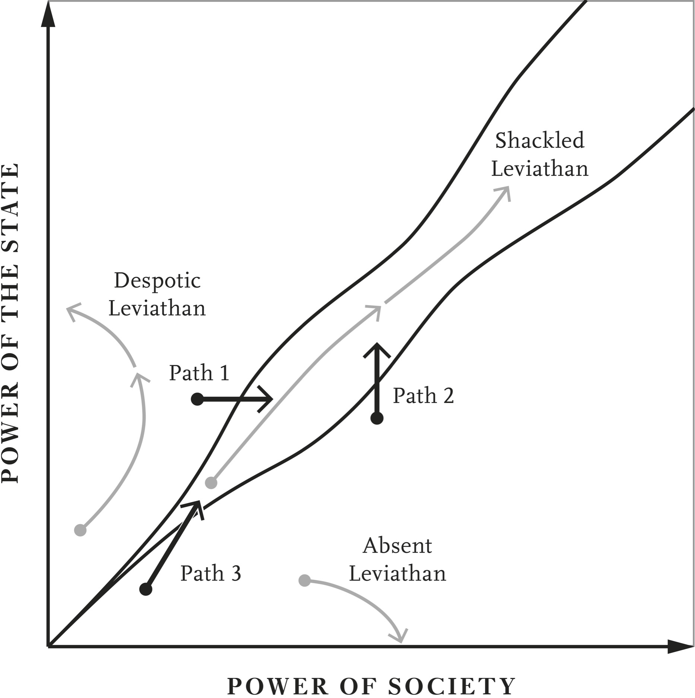

# Into the Corridor · 第14章　踏进窄廊

## Black Man’s Burden · 黑人的重担

Awakening on Friday morning, June 20, 1913, the South African Native found himself, not actually a slave, but a pariah in the land of his birth. So begins Sol Plaatje’s book Native Life in South Africa. Plaatje was a black journalist, writer, and political activist, one of the founders in 1912 of the South African Native National Congress (SANNC), a social movement that turned into the African National Congress (ANC) a decade later.

> 一九一三年六月二十日星期五，这位南非原住民早上起床时，发现自己其实不是奴隶，而是自己所诞生土地上的贱民。这段话是南非黑人索尔．普拉奇（Sol Plaatje）在大作《南非原民生活》（Native Life in South Africa ）的开场白。普拉奇身兼新闻记者、作家和政治活跃分子，是一九一二年南非原住民族议会的创立人之一。南非原住民族议会原本是一个社会运动组织，十年后，变身为非洲民族党（African National Congress, ANC）。

The SANNC formed in reaction to the 1910 Union of South Africa, which brought together the former British colonies of the Cape and Natal with the Dutch-speaking Boer (Afrikaner) Republics of the Orange Free State and Transvaal after the conclusion of the Boer Wars. In the Cape, political rights were determined on the basis of wealth or property, not race. But the Boer Republics had a white-only franchise. The Union had been precipitated by the triumph of the British Empire in the Second Boer War which lasted from 1899 to 1902.

> 南非原住民族议会的成立，意在回应一九一○年南非联邦的建国。南非联邦是两次布耳战争（Boer War）结束后，整并原属英国的开普（Cape）与纳塔尔（Natal）殖民地，以及说斐语（Afrikan，南非荷兰语）的奥伦治自由邦（Orange Free State）和特兰斯法尔（Transvaal）这两个布耳人（Afrikaner，通称斐人，又译南非荷兰人、阿非利坎人）的共和国（并改为四个省份）而成。开普殖民地的政治权利是根据财富决定，而不是取决于种族；但是在两个布耳共和国里，只有白人才有公民权。南非联邦的创建，是大英帝国在一八九九年至一九○二年的第二次布耳战争中获胜促成的。

During the war the British had criticized the Afrikaners’ harsh treatment of black Africans, creating hope that the postwar order might give black Africans more rights. So there was a window of opportunity for institutional change at war’s end. Yet the newly formed Union of South Africa ended up adopting the harshest common denominator. The more liberal franchise of the Cape was not extended elsewhere, and was gradually eroded. Representation was eventually denied to all blacks.

> 战争期间，英国人批评斐人严厉对待非洲黑人，因而带来战后秩序可能增加非洲黑人权利的希望。因此，布耳战争结束时，曾经出现制度改革的机会之窗。但是，新成立的南非联邦采用最最严厉的公约数，开普省比较自由的公民权没有扩展到另外三省，反而还逐渐受到侵蚀，最后所有黑人都没有获得代表权。

The lack of political power had dire consequences. It allowed for the passage of the Native Land Act in 1913, which paved the way for blacks, or “natives,” in Plaatje’s words, to become “pariahs” in their own country. Plaatje used another striking phrase, “black man’s burden,” when he observed: “The black man’s burden” includes the faithful performance of all the unskilled and least paying labour in South Africa, the payment of direct taxation to the various Municipalities . . . to develop and beautify the white quarters of the towns while the black quarters remain unattended . . . [and] taxes . . . for the maintenance of Government Schools from which native children are excluded.

> 没有政治权利的后果严重，原住民土地法因而能够在一九一三年通过，为黑人或普拉奇所说的「原住民」变成自己国家里的「贱民」一事，开辟了坦途。普拉奇用了另一个醒目的说法，指出这是「黑人的重担」：「黑人的重担」包括忠实扮演南非所有最低薪的非技术劳工，向市政府缴纳直接税……以便开发和美化城镇里的白人区，黑人区却遭到弃之不顾……〔以及〕缴税……维持原住民小孩不得就读的公立学校。

But that’s not how whites saw it. During the debate in the parliament of the Union of South Africa on the law, Mr. van der Werwe, member from Vredefort in the Orange Free State, noted approvingly that the “native would only be tolerated among the whites as a laborer,” while Mr. Keyter from nearby Ficksburg argued that the Free State “had always treated the coloured people with the greatest consideration and the utmost justice” and the Native Land Act was a “just law” that “told the colored people plainly that the Orange Free State was a white man’s country, and that they intended to keep it so.”

> 但是，白人的看法却截然不同。南非国会针对这项法律辩论时，奥伦治自由邦弗里德堡（Vredefort）议员范德麦威（van der Werwe）赞赏道：「原住民只能当白人的劳工才对。」同属自由邦省的附近城镇菲克斯堡（Ficksburg）议员吉特（Keyter）认为：「自由邦对待有色人种时，总是出于最好的考虑和绝对最公正的心态。」原住民土地法是「公正的法律，清楚地告诉有色人种，奥伦治自由邦是白人的国家，而且白人打算保持这个样子」。

At this point the record of the proceedings reports “hear, hear” as members voiced their support for Mr. Keyter’s interpretation of justice. To ensure the Free State remained white, the native was “not going to be able to buy land there or to hire land there, and that if he wanted to be there he must be in service.” In support of the law another member, Mr. Grobler, chimed in arguing that “it was impossible to delay the solution of the Native problem.” Plaatje remarks in a note reproduced in his book, “By a ‘solution to the Native Problem,’ ‘Free’ State farmers generally mean the re-establishment of slavery.”

> 会议纪录这时记下其他议员发出「赞成、赞成」的叫声，表示支持吉特议员对公正的解释。为了确保自由邦省继续维持白人国度的地位，法律规定原住民「不得购买或租用该省的土地，必须以提供劳务的名义，才可以在该省居留」。另一位名叫赫洛卜勒（Grobler）的议员发言支持该法，认为：「我们不可能延后解决原住民问题。」普拉奇在他大作的一则注释中指出：「自由邦农民所说的『解决原住民问题』，意思通常是表示要重建奴隶制度。」

Plaatje traveled the country witnessing the implementation of the act and how it forced black landowners and tenants off their lands in 87 percent of South Africa, the portion that made up the “white man’s country.” The experience of Kgobadi, a black farmer who had previously been making an income of 100 pounds a year, is typical. On June 30, 1913, he was given a letter ordering him to “betake himself from the farm of the undersigned by sunset of the same day, failing which his stock would be seized and impounded, and himself handed over the authorities for trespassing on the farm.”

> 普拉奇游历南非，目睹了这项法律的实施，亲眼看到黑人地主和佃农，如何被迫离开属于他们的土地。这些土地占全南非的百分之八十七[〔注1〕](#note-1) ，就此变成了「白人的国家」。葛巴迪（Kgobadi）的遭遇是黑人农民典型的经验：葛巴迪以前每年可以赚一百英镑，一九一三年六月三十日，他收到一封信，命令他「在当天日落前，离开本函签署人的农场，否则他的牲口会遭到没收与扣押，他本人会被以擅闯农场的名义，送交主管机关」。

He was offered a position paying 30 shillings a month to avoid eviction. So the white farmer could use “the services of himself, his wife and his oxen” at a fraction of what he had earned. Kgobadi refused and was evicted, left to wander the roads with his family and dying stock, nowhere to go except to take another desultory offer or somehow find a way to one of the designated black “homelands,” the areas to which the white government had confined Africans to live.

> 发函者提供一个月薪一英镑半的工作给葛巴迪，以免他遭到驱离，并让白人农民可以用所得不到原先五分之一的代价，利用「他本人、妻子和他所有牛只的劳务」。葛巴迪拒绝后遭到驱离，跟家人和垂死的牲口一同流落在街道上，无处可去。他只能接受另一份杂工的工作，或是设法前往为黑人而设的「黑人家园」，那里是白人政府圈禁黑人居住的地方。

Why did the majority of whites want to disposses black Africans? Taking their land and stock was one reason. But they also wanted to secure an abundant supply of cheap black labor for white-operated farms and mines, if necessary by coercion, and preventing them from earning a living in agriculture was an essential step in this process. The Holloway Commission of 1932 acknowledged the situation at the beginning of the century, describing it thus:

> 为什么大部分白人希望剥夺非洲黑人？夺取土地和牲口是原因之一，但白人也希望确保白人经营的农场和矿场中众多廉价黑人劳工的供应无虞匮乏。必要时，即使采用胁迫手段也在所不惜──防止黑人靠着农业为生，正是这种过程中必不可少的步骤。一九三二年的贺乐威委员会承认二十世纪初的这种状况，用下列文字描述道：

In the past difficulty was experienced in obtaining a sufficient supply of labour for the industries of the country . . . Not accustomed to anything more than his simple wants of tribal life [the black native] had really no incentive for work for more. The European Governments, wanting labour for their industries, decided to bring pressure to bear on the Native to force him to come out to work, and did this by imposing taxation.

> 本国产业过去碰到难以充分供应劳工的问题……〔黑人原住民〕不习惯自己部落生活单纯需要以外的东西，确实没有从事额外工作的诱因。欧洲人的政府为了替自己的产业找工人，决定对原住民施加压力，迫使他们外出工作，方法是对他们课税。

Convened in 1909, just before the founding of the Union of South Africa, the Select Committee of Native Affairs of the Cape Colony underscored this intention in its deliberations, which include the following passage: A. H. B. Stanford, Chief Magistrate of Transkei: [Population pressure and competition for land are acute] and we are getting to the end of our tether in some parts . . . W. P. Schreiner, member of Select Committee: Of course, the natural economic result would be . . . that the surplus population would turn to handiwork and labor throughout South Africa; they would go abroad, so to speak?

> 一九○九年，南非联邦创立前不久，开普殖民地原住民事务特别委员会审议有关事务时，就强调过这种意图，他们的评估中包括下列这段文字：川斯凯黑人家园首席行政长官史丹福：〔人口压力和土地的争夺非常严重〕，我们在某些地区已经无计可施了……特别委员会委员施来纳：当然，这是经济的自然结果……南非全境的过剩人口应该移转到手工业和体力劳动去。可以说他们应该到国外吗？

Stanford: They will have to develop other avocations besides agriculture. Schreiner: And make their living by honest toil somewhere? Stanford: That seems to me to be the only solution. Schreiner: And a very good solution too, is it not?

> 史丹福：他们必须发展农业以外的其他职业。施来纳：靠着在什么地方诚实劳动为生吗？史丹福：我认为这样似乎是唯一的解决方法。施来纳：这样也是很好的解决之道，不是吗？

But this “very good solution” could only be implemented if the majority of the population were completely disenfranchised so that they could not object. That’s what the Union of South Africa proceeded to do. The political disenfranchisement was followed by various legislations, like the Native Land Act, that forcefully created a low-wage labor force for white-owned businesses. Other measures included the “color bar” banning black South Africans from pretty much all skilled and professional occupations.

> 但是，这种「很好的解决之道」只能在剥夺大多数人口的选举权，让他们无法反对后，才能实施。南非联邦接着就是这样做。剥夺黑人参政权后，接着推动原住民土地法等各种立法，为白人拥有的企业，强迫创造低工资的劳动力。其他措施包括设下「肤色障碍」，几乎禁止南非黑人从事所有技术性和专业性的职业。

Almost all educational expenditure was directed to whites as well, while, as Plaatje noted, blacks had to pay the taxes. Practically landless, stuck on the homelands, without education and without an opportunity to work in anything other than agriculture or mining, black labor was going to be abundant, easy to coerce, and cheap for white farmers and mine owners. The repression and overt discrimination against blacks only deepened as the National Party, dominated by Afrikaner interests, gained power and from 1948 onward institutionalized and extended what came to be known as apartheid.

> 普拉奇指出，几乎所有教育经费也都完全用在白人身上，黑人却必须纳税。黑人劳工几乎无法拥有土地、无法受教育，困在黑人家园里，没有农业和矿业之外的工作机会，自然沦为供应充沛、容易受到白人农民和矿主胁迫的廉价劳工。随着代表斐人利益的南非国民党执政，对黑人的压迫和公开歧视日益严重。一九四八年起更变得更加制度化，并且扩大实施，变成世人所知的「种族隔离」。

South Africa was outside the corridor with the type of extractive institutions common to Despotic Leviathans. How can such a society move into the corridor? A serious challenge or an existential crisis is typically necessary for a change in the path of such a nation. But even such circumstances are not sufficient for a transition into the corridor. In this chapter we highlight three critical factors affecting whether and how a nation can make such a transition. These are the ability to form coalitions that support such a transition; the location of the current balance of power between state and society relative to the corridor; and the shape of the corridor, which affects how these two factors play out.

> 南非是落在自由窄廊之外、具备专制形态的国家，这种社会怎么可能走进自由窄廊？通常，这种国家得要碰到严重挑战或生存危机，才会既有改变路线。但是，这往往也不足以促使国家成功过渡到自由窄廊。我们在这一章里强调，共有三大因素会影响一个国家能不能、如何能过渡到自由窄廊：一是形成联盟、形成支持这种过渡的能力，二是目前国家和社会跟这条窄廊之间的权力均衡位在什么地方，三是会影响这两个因素如何发挥作用的窄廊形状。

## The Rainbow Coalition · 彩虹联盟

In 1994 the apartheid regime collapsed and South Africa peacefully transitioned to democracy and moved into the corridor. This historic change was spearheaded by a massive mobilization of black South Africans, undeterred by systemic repression and led by the ANC. It was also founded on a new coalition, between the ANC, the black middle classes, and the white industrialists.

> 一九九四年，南非种族隔离政权垮台，和平过渡到民主制度，走进自由窄廊。带动这种历史性变化的，是无惧有系统镇压的南非黑人。他们在非洲民族党的领导下，组成了非洲民族党、黑人中产阶级和白人工业家的新联盟，发动了大规模动员。

Agricultural and mining elites were the main beneficiaries of the political and economic arrangements keeping black wages low. White workers also benefited handsomely because arrangements such as the color bar and the desolate conditions of the educational system for blacks meant that whites could receive high wages in skilled and semiskilled occupations, anywhere between 5.5 and 11 times as much as blacks, who were practically barred from competing against them. The apartheid regime was never as good a deal for industrialists, however. While the color bar benefited white farmers, mine owners, and workers, it increased labor costs for industrialists, who could not employ the very cheap black labor in anything other than the most menial, unskilled occupations.

> 南非的白人农业和矿业菁英，从压低黑人工资的政治与经济安排中获利最多；白人劳工也获利丰硕。因为肤色障碍和黑人教育体系的惨状，表示白人在禁止黑人参与竞争的技术性和半技术性职业中，可以得到比黑人高出五倍半至十一倍的高薪。然而，对白人工业家来说，种族隔离却绝非好事。虽然肤色障碍造福白人农民、矿主和劳工，却也提高了工业家的成本，使他们除了最低下的非技术职业，雇用不到便宜的黑人劳工。

Industrialists were also less worried than mine owners and farmers about their assets’ being expropriated if the black majority gained political power, because taking over and operating a modern factory is much harder than grabbing farms or mines. There were social differences between elites of Afrikaner and British descent too. Apartheid as a social philosophy was a creation of Afrikaners, while industrialists were often English-speaking and less wedded to apartheid. Hence, they were the weak link in the apartheid coalition and a good target for a new coalition that could bring down the regime.

> 此外，工业家也比较不像矿主和农民那样，担心如果占多数的黑人取得政权后，资产会有遭到没收的风险，因为要接管和经营现代工厂，比夺取农场或矿场困难得多。斐人和英国人后裔之间也有社会差异，支持社会采行种族隔离的往往都是斐人，说英语的工业家族群则跟种族隔离的关系较小，因而是种族隔离的白人联盟中较为脆弱的环节，成了意欲推翻种族隔离政权的新联盟良好的拉拢目标。

Coalitions seldom form by themselves. They need to be cemented by relationships, guarantees, and trust. It was no different for the coalition underpinning the transition to democracy in South Africa. A key instrument in forging a relationship between industrialists and ANC leaders (and black middle classes) was the program of Black Economic Empowerment (BEE). Although the notion was formulated in the government’s 1994 Reconstruction and Development Programme, it was in fact the private sector that initiated the first wave of BEE projects.

> 自行组成的联盟很少，联盟需要靠关系、保证和信任来凝固，支撑南非民主转型的联盟也一样。工业家、非洲民族党领袖（和黑人中产阶级）之间能够建立关系，有一个关键因素，就是黑人经济振兴方案（BEE）。这个观念虽然是在政府的一九九四年重建发展计划中形成，其实推动第一波黑人经济振兴方案的却是民间部门。

These involved the transfer of equity from a white company to a black person or black-run company. As early as 1993 the financial services company Sanlam sold 10 percent of its stake in Metropolitan Life to a black-owned consortium led by Nthato Motlana, a former secretary of the ANC’s Youth League and onetime doctor to the ANC’s leader and future president Nelson Mandela and Archbishop Desmond Tutu. After 1994 the number of such BEE deals began to grow rapidly, reaching 281 by 1998.

> 这些方案包括把白人公司的股权，移转给黑人个人或黑人经营的公司。早在一九九三年，南非金融服务业者三兰公司（Sanlam）就把本身在大都会人寿保险公司（Metropolitan Life）百分之十的股权，卖给纳塔诺．莫兰纳（Nthato Motlana）领导的黑人资本集团。莫兰纳是非洲民族党青年部秘书，曾经担任过非洲民族党领袖、未来南非总统曼德拉的医师，也当过圣公会开普敦大主教戴斯蒙．屠图（Desond Tutu）的医师。一九九四年后，这种黑人经济振兴方案的交易开始快速成长，到一九九八年已经达到二百八十一件。

By this time some estimates suggest that as much as 10 percent of the Johannesburg Stock Exchange (JSE) was owned by black businesses. The problem was that the black people who wanted to buy shares often could not afford to. Solution: the companies lent them the money to buy their own shares at massive discounts, usually 15 to 40 percent below market value. In 1997 the ANC government appointed a BEE commission headed by Cyril Ramaphosa (who later became post-apartheid South Africa’s fourth president).

> 这时，有人估计，约翰尼斯堡证券交易所中高达百分之十的上市公司股权，是由黑人企业拥有。问题是想买股票的黑人通常都买不起，解决之道是由公司借钱给他们，以巨幅折价，购买他们公司的股票，折价幅度通常低于市价的百分之十五至百分之四十。一九九七年，非洲民族党政府任命西里尔．兰玛佛沙（Cyril Ramaphosa）领导黑人经济振兴委员会（他后来出任种族隔离结束后的第四任南非总统）。

Beginning with the report of the BEE commission in 2001, the government moved to institutionalize asset transfers and also to greatly broaden the nature of BEE to encompass “elements of human resource development, employment equity, enterprise development, preferential procurement, as well as investment, ownership and control of enterprises and economic assets.” The commission included a series of specific objectives that the South African economy should achieve within ten years. Among the most important goals were transferring at least 30 percent of productive land to blacks and collective organizations, increasing the black equity participation in the economy to 25 percent, and achieving 25 percent black ownership of JSE-listed shares.

> 南非政府从黑人经济振兴委员会二○○一年的报告起，推动制度化的资产转移，也大幅扩张黑人经济振兴方案，涵盖「人力资源发展因素、雇用平等、企业发展、优惠采购、投资、企业与经济资产的所有权与控制」。该委员会列出预期南非在十年内，应该达成的一系列特定经济目标，其中最重要目标是至少把百分之三十的生产性土地，移转给黑人和集体组织，把黑人在南非经济的股权参与率提高到百分之二十五，达成黑人持有约翰尼斯堡证券交易所百分之二十五上市股票的目标。

In addition, the commission specified a target of 40 percent of black nonexecutive and executive directors in JSE-listed companies, 50 percent of government procurements directed to black-owned companies, 30 percent of private sector procurements for black-owned companies, and 40 percent of black executives in the private sector. Guidelines also specified that 50 percent of the borrowers from public financial institutions should be black-owned companies, 30 percent of contracts and concessions made by the government should involve black companies, and 40 percent of government incentives to the private sector should go to black-owned companies.

> 此外，该委员会也订出其他目标，包括约翰尼斯堡证券交易所上市公司黑人非执行与执行董事达到百分之四十，政府向黑资公司采购的金额达到百分之五十，民间部门向黑资公司采购的金额达到百分之三十，民间部门的黑人高阶经理人达到百分之四十。报告的准则也规定，向公营金融机构贷款的企业中，应该有百分之五十是黑人公司、政府的合约和让利中，应该有百分之三十授予黑资公司，政府发出的激励措施中，应该有百分之四十发给黑资公司。

The wake of the BEE commission’s report also brought a series of industry charters in anticipation of forthcoming legislation. The first of these, the mining charter issued at the start of 2002, caused a huge stir. When a draft version of the charter committing the industry to 51 percent black ownership within ten years was leaked to the press, share prices on the JSE plummeted. The next six months saw a capital outflow of 1.5 billion rand (about US$250 million). The subsequent negotiations led to a charter wherein companies in the sector would be 15 percent black-owned in five years and 26 percent black-owned in ten years. The mining industry also agreed to raise 100 billion rand to finance these transfers.

> 黑人经济振兴委员会的报告发表后，各界预期即将出现的立法中，会纳入一系列的章程。第一份章程是矿业章程，这份章程在二○○二年初发布后，掀起轩然大波：章程草案中，有一条规定要求在十年内，把百分之五十一的产业所有权移转给黑人。消息泄露给媒体后，约翰尼斯堡证券交易所股价暴跌，随后的半年里，资本外流金额达到十五亿兰德（也可以译为南非元，大约二亿五千万美元）。后续的谈判导致章程改为：五年内，黑人公司比率达到百分之十五；十年内，黑人公司占有率达到百分之二十六；矿业也同意筹资一千亿兰德，融通这种移转所需要的资金。

The culmination of the BEE process was the Broad-Based Black Economic Empowerment Act, signed into law by President Mbeki in January 2004. The act empowered the minister of trade and industry to issue codes of good practice with respect to BEE and enforce them. In essence, if a company wants to bid for a government contract or renew a license, it has to prove that it is BEE compliant. This gives the government huge leverage in some sectors, such as mining.

> 黑人经济振兴过程的高峰是制定全面提高黑人经济实力法，这项法律于二○○四年一月，由总统塔波．姆贝基（Thabo Mbeki）签署生效，并授权商工部长，发布与实施和黑人经济振兴方案有关的良好实务守则。基本上，如果企业希望竞标政府合约，或希望续延执照效期，必须证明自己遵守黑人经济振兴方案；这样就让政府在矿业等部门中，获得绝大的影响力。

The South African social scientist Moeletsi Mbeki, brother of President Thabo Mbeki, described BEE as an unholy alliance: The South African political elite is being encouraged to pursue BEE by elements of the super rich who seek political favors from the state in order to (1) Externalize their assets by moving the primary listing of their corporations from the Johannesburg Stock Exchange to the London Stock Exchange, (2) get the first bite of government contracts, and (3) buy seats at the high table of economic policy decisionmaking.

> 南非社会学家、姆贝基总统之弟莫莱济．姆贝基（Moeletsi Mbeki）形容黑人经济振兴方案是邪恶的联盟：南非政治菁英鼓励希望在政治上获得国家支持的超级富豪，追求黑人经济振兴方案的实施，让他们可以：（一）把他们的公司主要挂牌地点，从约翰尼斯堡证券交易所，转移到伦敦证券交易所，以便把资产移到外国；（二）优先争取政府合约；（三）在经济政策决策高层，购买一些席次。

Unholy or not, this alliance was essential to secure South Africa’s move into the corridor. It not only initiated close relationships between industrialists and segments of society previously left out of political power, it also provided guarantees to businesses that ANC leadership and the black middle classes, who now had a stake in the economy, would be much less interested in expropriating white-owned assets and wealth.

> 不管邪不邪恶，基本上，这个联盟确保南非移入自由窄廊。联盟不但为工业家和先前在政治力量中遭到遗弃的社会各阶层之间，缔结了密切的关系，也为企业提供保证，知道现在在经济中占有一席之地的非洲民族党领导阶层，以及黑人中产阶级，对没收白人所拥有资产和财富的兴趣，会大大地降低。

The interim constitution adopted in 1993 reassured white South Africans by enshrining a bill of rights as well as various other checks that made it harder for the ANC to repress the white minority. Also important was the Truth and Reconciliation Commission, set up in 1995, which granted a broad amnesty to those guilty of crimes, including human rights abuses, in return for truthful testimonies and evidence that the acts were politically motivated. This was a signal that the re-empowered black majority under the ANC’s leadership would not seek revenge against whites.

> 一九九三年采用的临时宪法把权利法案和多种制约措施纳入宪法，使非洲民族党更难以压迫身为少数民族的白人。一九九五年设立的真相与和解委员会也很重要，这个委员会给予犯过多种罪行，包括侵害人权罪行者，广泛的赦免，换取真实的证词和证据，证明这些行为是出于政治动机。这样做发出的信号是：重新掌权的黑人大多数在非洲民族党的领导下，不会对白人寻求报复。

But relationships and guarantees are not enough unless there is trust between the partners in the coalition, and here symbolic gestures of compromise matter greatly. This is where Nelson Mandela’s inspiring leadership played a critical role. One episode epitomizing Mandela’s efforts took place on June 24, 1995, on the day of the first Rugby World Cup final in South Africa. The country’s national team, the Springboks, was allowed to compete for the first time, after the end of the international boycott against the apartheid regime, and was facing the odds-on favorite, the New Zealand All Blacks. The Springbok rugby team was closely identified with apartheid, and its jersey was an Afrikaner symbol, much hated by the black population.

> 但是，关系和保证仍然不够，除非联盟伙伴之间互相信任。因此，这时象征妥协的姿态十分重要。曼德拉在这件事情上启发人心的领导，扮演举足轻重的角色。一九九五年六月二十四日，发生了一件事，象征曼德拉努力地这样做：当天，世界杯橄榄球冠军赛第一次在南非举行，南非国家队羚羊队（Springboks）在种族隔离政权结束、国际杯葛取消后，第一次获准参赛和争夺冠军，对手是胜券在握的纽西兰黑衫队（All Blacks）。大家公认羚羊队和种族隔离关系密切，其球衣是斐人的象征，深为南非黑人所痛恨。

How would the president of the new, post-apartheid South Africa perform his duties as head of state on this day? Brilliantly, as it turned out. Nelson Mandela added to his year-long efforts to remove the bitterness and distrust between the black majority and the white minority by turning up wearing the Springbok jersey with the number 6 of the captain, François Pienaar. The 63,000-strong audience, about 62,000 of them white, and mostly Afrikaners, were stunned. The Springboks, perhaps galvanized by Mandela’s magnanimous gesture, beat the All Blacks against all odds with a drop goal in extra time.

> 种族隔离结束后的南非新总统在这一天里，要怎么扮演他身为国家元首的职责？结果太完美了！曼德拉在长年致力消除黑人多数与白人少数之间的仇怨和不信任之外，再度增添功德。他穿着羚羊队队长法兰沙．皮纳尔（François Pienaar）的六号球衣，出现在球场上，六万三千多的观众大感震动──其中大约有六万二千人是白人，而且大多数是荷裔白人的斐人。羚羊队可能是受到曼德拉宽宏大量姿态的鼓舞，居然在极为不利的情况下，在延长赛中，以一记抛踢得分，击败纽西兰黑衫队。

Pienaar, when asked what it felt like to have the strong support of 63,000 people, replied, “We didn’t have the support of 63,000 South Africans today. We had the support of 42 million.” When handing the cup to Pienaar (as shown in the photography section), Mandela told him: Thank you very much for what you have done for our country. Pienaar replied, without missing a beat, Mr. President, it’s nothing compared to what you have done for our country.

> 皮纳尔受访时，记者问道，得到六万三千南非人强力支持的感觉如何，皮纳尔回答说：「我们今天不是得到六万三千位南非人支持，是得到四千二百万人支持。」曼德拉颁发奖杯给皮纳尔时（参见本书插图集中所刊照片），告诉他：非常感谢你们为我们国家所做的一切。皮纳尔不假思索地回答：总统先生，和你为我们国家所做的事功相比，这件事微不足道。

## Doorways into the Corridor · 进入窄廊的入口

We have seen the role of the ANC-backed coalition in South Africa’s transition into the corridor. The second critical factor is the position of a country relative to the corridor. The only way of achieving durable liberty is to move into the corridor and forge the balance necessary for building a Shackled Leviathan. True liberty can flourish neither without a state nor under the yoke of a Despotic Leviathan.

> 我们已经看到在南非过渡到自由窄廊中时，非洲民族党支持的联盟所扮演的角色，第二个重要因素是国家和这条窄廊的相对位置。达成永久和平的唯一方法，是移入这条窄廊，形成建立受制约国家机器所需要的平衡。在没有国家机器或人民受到专制国家的奴役下，真正的自由无法蓬勃发展。

But there is no universal way of building a Shackled Leviathan, and no single doorway into the corridor. Every country’s prospects are molded by its unique history, the types of coalitions and compromises that are possible, and the exact balance of power between state and society. For instance, feasible paths into the corridor are very different starting with an Absent, Despotic, or Paper Leviathan. Figure 6 illustrates this point.

> 但是，要建立受制约国家机器，却没有放诸四海而皆准的方法，要踏进自由窄廊，也没有单一的门径。每一个国家的展望都受到自己独一无二的历史、联盟形态、可能达成的妥协，以及国家和社会之间确实的权力所均衡影响。例如，无巨灵国家、专制国家或纸糊国家进入这条窄廊的道路起点，可能截然不同，图表六中清楚地说明了这一点。

Nations with a Despotic Leviathan can most easily enter the corridor by strengthening their societies (or fostering new ways of checking and weakening the power of their states), as the arrow labeled Path 1 in the figure indicates. This was the situation in South Africa, dominated by a powerful white economic elite and one of the most effective state institutions on the continent. So the problem in South Africa was one of mobilizing society and its ability to contest power, which the ANC and the black labor movement achieved.

> 如图表中标示为路径一的箭头所示，专制国家借着强化自己的社会（或增加新的制约、削弱国家权力的方法），最容易进入这条窄廊。南非就是这种情形。南非由强大的白人经济菁英主导，拥有非洲最有效率的国家制度，因此南非的问题是动员社会及其能力，争取权力，非洲民族党和黑人劳工运动最后达成了目标。

This is not the problem confronting a society starting with an Absent Leviathan; strengthening society further and weakening the state would backfire. Instead, Path 2 in the figure traces one possible way of entering the corridor in this case, with an increase in the state’s power. Finally, countries and peoples near the very bottom left, which include many Paper Leviathans and those like the Tiv that have very limited state capacity and no institutionalized ways for society to exercise power, face an even taller order.

> 无巨灵国家社会不是面对这种问题，进一步强化社会和削弱国家机器会引起反弹，因此图表中的路径二为这种状况，划出一条借着以提高国家权力、进入这条窄廊的可能路线。最后，在图表中左下方的国家和人民，包括很多纸糊国家和蒂夫族之类能力非常有限、社会又没有制度化方法发挥权力的国家，面对的挑战更严峻。

They cannot enter the corridor by increasing the power of either the state or society separately, since there is no corridor nearby. To enter the corridor they must simultaneously increase the capacity of their states and societies as in Path 3. One way to do this, as we’ll discuss below, is by exploiting the mobilization effect introduced in Chapter 11—by allowing society to get stronger in response to growing state capacity, and vice versa. We now discuss how these different paths work, what types of coalitions and compromises are necessary to support a move into the corridor, and how doorways to the corridor close when such coalitions cannot be formed.

> 他们不能借着分别提高国家或社会能力的方法，进入这条窄廊，因为附近根本没有窄廊存在；要进入窄廊，他们必须像路径三所示，同时提高国家和社会的能力。如下文中的讨论所示，方法之一是利用第十一章介绍过的动员效应，让社会在因应国家能力成长之际，加强社会本身的能力；反之亦然。我们现在要讨论不同路径怎么运作，需要什么形态的联盟和妥协，才能支撑移入窄廊的行动，以及当这种联盟无法形成时，通往窄廊的门径会怎么被关上。

## Building on the Iron Cage · 建造钢铁牢笼

South Africa is an example of Path 1, where the main conflict was between society, represented by the black majority of the country, and the white elite controlling state institutions. The composition of the elite and the nature of their power can be very different in other Despotic Leviathans, with major implications for the type of coalition that needs to be constructed along Path 1. In early-twentieth-century Japan, as in many other societies, the most powerful elements in the elite were high-level bureaucrats and military officers, even if big business was a willing fellow traveler.

> 南非是路径一的典范。南非的主要冲突是社会冲突，是黑人大多数和控制国家制度的白人菁英之间的冲突。其他专制国家菁英的结构和权力的本质可能截然不同，对沿着路径一建立的联盟形态会有重大影响。二十世纪初的日本像很多其他国家那样，菁英中最有势力的人是高阶官僚和军官，大企业则乐于追随他们。

Japan had taken a turn toward greater despotism, building its own version of the “iron cage” during the early twentieth century, based on the growing clout of the military, whose upper echelons were staunchly opposed to any move away from elite-dominated politics. The control of the military, together with the emperor and the bureaucratic cadres around him, over politics centering on the philosophy of kokutai, the “Japanese national essence,” elevated these groups over society. This dominance deepened during the war years following the Japanese invasion of Manchuria.

> 日本已经转向更专制的体制，在二十世纪初，已经根据军方日渐强大的影响力，建立日本式的铁牢笼；高阶军官坚决反对脱离菁英主宰的政治路线，军方、天皇和天皇身边高官对政治的控制，放在「国体」哲学上，借此把自己拉擡到高于社会之上。在日本侵入中国东北的战争岁月后，这种宰制受到加强。

But things had to change after Japan’s decisive defeat in World War II, after the United States dropped the atom bombs on Hiroshima and Nagasaki in 1945. Would there be a Japanese doorway into the corridor with the military-bureaucratic complex relinquishing its dominance? There was a lot of uncertainty about this as General Douglas MacArthur, the supreme commander for the Allied powers, landed at the Atsugi Naval Air Base on August 30, 1945. MacArthur was optimistic that he could somehow transform Japan into a pro-U.S. democracy.

> 但是，一九四五年美国在广岛和长崎投掷原子弹，造成日本惨败后，一切都必须改变。军方和官僚体系交出控制权后，日本是否有踏进自由窄廊的门路？一九四五年八月三十日，麦克阿瑟以盟军最高统帅身分，踏上日本厚木海空军基地之际，这一点其实还有很多不确定的地方。麦克阿瑟乐观地认为，他可以利用某些方法，把日本变成亲美的民主政体。

By the time he arrived, MacArthur and his advisers had formed a vision of how to reform Japanese institutions and politics. In 1944 MacArthur’s right-hand man and military secretary, Brigadier General Bonner F. Fellers, had written a document titled “Answer to Japan,” which anticipated that only through complete military disaster and the resultant chaos can the Japanese people be disillusioned from their fanatical indoctrination that they are the superior people, destined to be the overlords of Asia. . . .

> 在他抵达前，他和顾问已经形成如何改革日本制度和政治的看法。一九四四年，麦克阿瑟的得力助手兼军事秘书波纳．费勒斯（Bonner F. Fellers）准将已经写好题为〈对日本负责〉的文件，预期：只有透过彻底的军事惨剧和随之而来的混乱，才能让日本人从自己是优越的民族，注定要统治亚洲……的狂热思想中醒来。

To the masses will come the realization that the gangster militarists have betrayed their sacred Emperor. They have led the Son of Heaven, Divine Ruler of the Empire, to the very precipice of destruction. Those who deceive the Emperor cannot exist in Japan. When this moment of realization arrives, the conservative, tolerant element of Japan which has long been driven underground possibly may come into its own. An independent Japanese army responsible only to the Emperor is a permanent menace to peace.

> 群众会了解军国主义分子背叛了他们神圣的天皇，引导神圣英明的天皇走向毁灭边缘，日本不能容许这些欺骗天皇的人继续存在。这种觉悟的时刻来临时，长久以来遭到驱赶，藏身地下的日本保守、宽容分子可能得到充分的承认。只对天皇负责的独立日本军队，是对和平的永久威胁。

So there was a need not just for Japan’s complete defeat but also its total demilitarization. This is what the United States proceeded to implement. MacArthur personally convened a team of Americans to draft a constitution for Japan. Its Article 9 disbanded the Japanese military, declaring: War, as a sovereign right of the nation, and threat of use of force, is forever renounced as a means of settling disputes with other nations. The maintenance of land, sea, and air forces, as well as other war potential, will never be authorized. The right of belligerency of the state will not be recognized.

> 因此，盟国不仅要彻底击败日本，也必须推动日本彻底的非军事化，美国就是打算在日本执行这些任务。麦克阿瑟亲自召集一群美国人，为日本起草宪法，宪法的第九条解散了日本军队，宣称：日本永远放弃象征国家主权的战争与武力威胁，不以之作为解决国际争端的手段。日本不保持陆海空军和其他作战力量，不承认国家的交战权。

The next target was kokutai, viewed as the fountainhead of Japan’s international aggression. But MacArthur and Fellers had decided that the Japanese could not govern themselves and needed an emperor. So they refrained from accusing Emperor Hirohito of war crimes. Nor did they attempt to dethrone him, instead simply demanding that the emperor renounce his claims to divinity. The emperor accepted. In his New Year’s statement, issued on January 1, 1946, he included the following passage:

> 下一个目标是人们视为日本国际侵略源头的国体。但是，麦克阿瑟和费勒斯已经认定，日本人不能统治自己，需要天皇的存在。因此，他们避免指控裕仁天皇犯了战争罪，也不打算推翻他，而是直接要求天皇放弃他自称的神性。天皇接受要求后，在一九四六年元旦发布的新年贺词中，纳入下列文字：

The ties between me and my people have always been formed by mutual trust and affection. They do not depend upon mere legends or myths. Nor are they predicated on the false conception that the Emperor is divine, and that the Japanese are superior to other races and destined to rule the world. Again rooted in the belief articulated in Fellers’s “Answer to Japan” that the Japanese needed strong leaders, the United States was willing to work with high-ranking members of the military and the bureaucracy, including those who had leading roles in the Japanese war cabinet.

> 我和人民之间的关系总是靠着互信和爱心形成，而不仅仅是依靠传说或神话维系，也不是基于天皇神圣、日本人优于其他种族，注定要统治世界的错误观念而来。美国也根据费勒斯〈对日本负责〉文件中所说：日本人需要强而有力领导的信念，乐于和日本军方与官僚体系中的高官、包括和日本战争内阁中的领袖合作。

The career of Nobusuke Kishi, who more than anybody else was the architect of the postwar Japanese political system, is telling. Kishi rose as a bright bureaucrat with strong political views in the interwar years; he praised top-down economic management, including Taylorist methods of worker control, and maintained that the political and economic policies of Nazi Germany were the best path for Japan. He later allied himself even more strongly with high-ranking members of the military, calling for a “total war” to increase Japan’s dominance in the region.

> 日本战后政治体系最重要的缔造者是岸信介，他的事业生涯充分说明了上述状况。岸信介在两次大战之间的岁月中，凭着聪明过人和坚强的政治见解，在官僚体系中崛起，他称赞由上而下、包括泰勒式控制工人方法的经济管理，认为纳粹德国的政治与经济政策，对日本是最好的路线。后来，他强化自己和军方的关系，呼吁日本在东亚地区，进行「全面战争」，提高日本在这个地区的宰割能力。

Kishi’s rise to prominence came with the Japanese invasion of Manchuria and the installation of the puppet regime of Manchukuo. The Manchukuo regime intended to ruthlessly exploit Manchuria’s resources and jump-start a military-led industrialization there, and Kishi became its architect. He was involved in expropriating from private shareholders of the largest corporation in Asia at the time, the South Manchuria Railway, transferring their shares to the military occupying the area. In 1935, he was appointed deputy minister of industrial development of Manchukuo and organized its state-led economy, which heavily relied on the systematic coercion and exploitation of Chinese labor.

> 日本侵略中国东北、扶植伪满洲国傀儡政权之际，岸信介的地位扶摇直上。伪满洲国政权意在无情剥削中国东北的资源，开创由军方领导的工业化，岸信介变成这种任务的缔造者，参与没收当时亚洲最大企业南满铁路民间股东财产，再把该公司股权转移给占领中国东北的日本军方。一九三五年，他出任伪满洲国工业发展部副部长，主导严重依赖有系统恐吓与剥削中国劳工、由国家领导的经济。

His star rose even higher in 1940 when he was appointed a minister in the Japanese government and allied himself with General, later Prime Minister, Hideki Tojo. He supported the war against Britain and the United States, and was one of the architects of the slave labor program to man Japanese factories and mines with Korean and Chinese workers during the war. After the Japanese defeat, he was arrested as a Class A war criminal, and spent three years in prison, but unlike Tojo and other fellow leaders of the Japanese war effort, he was not tried in the war crimes tribunal. (Tojo and several others were tried, convicted, and hanged.)

> 到了一九四○年，他的官运更亨通，获得日本政府部长的任命，跟后来出任日本总理的东条英机大将结盟，支持日本对英国和美国开战；他在战争期间，建构奴工计划，利用韩国和中国工人，让他们在日本人的工厂和矿场工作。日本战败后，他以甲级战犯的罪名遭到逮捕，在监狱里关了三年，却跟东条和日本其他战争领袖不同，没有在战犯法庭中遭到审判（东条和另外好几位遭到审判、定罪和处以绞刑）。

Kishi was released on Christmas Eve 1948 and jumped back into politics right away. He repeatedly undermined from the right the postwar prime minister of Japan, Shigeru Yoshida, himself no liberal. In part to get the upper hand over Yoshida, he formed the Liberal Democratic Party in 1955, which has since dominated Japanese politics. Kishi himself served as prime minister twice between 1957 and 1960.

> 岸信介在一九四八年圣诞夜获释，并立即跃回政坛；他本人不是自由派，曾经一再从右翼的角度削弱战后的日本总理吉田茂。为了胜过吉田茂，岸信介在一九五五年组成自民党，此后自民党成为一直掌控日本政坛的政党。岸信介本人在一九五七年至一九六○年间，两度担任日本总理。

Many of his handpicked protégés, including Hayato Ikeda, played leading roles in Japanese politics and the economy, in particular in the industrial policies of Japan formulated in the Ministry of International Trade and Industry. Ikeda, for example, became the key architect of postwar Japanese industrialization and prime minister after Kishi. Kishi’s influence on Japanese politics is felt not just through the continued dominance of the Liberal Democratic Party. His grandson Shinzo Abe is Japan’s current prime minister.

> 他亲手挑选的很多门徒，包括池田勇人在内，都在日本政坛和经济上担任过领导角色，在制定日本通产省（今经济产业省）工业政策上尤其卓有贡献；例如，池田是战后日本工业化的主要推手，并在岸信介之后出任日本总理。岸信介对日本政坛的影响，不仅止于让自民党持续主宰政坛，他的孙子安倍晋三也是日本现任总理。

Kishi, sometimes called “America’s favorite war criminal,” epitomizes the strategy that MacArthur and Fellers came up with to influence the path of Japanese institutions: co-opt the old bureaucratic elite. It worked. They firmed up a coalition consisting of the more liberal-minded parts of Japanese society and many of the captains of the older despotic Japanese state that acquiesced to a greater role for society and democratic politics (and to a more limited role for the military-bureaucratic complex). At times, this coalition undercut the power of trade unions and left-wing parties, but it did manage to move Japan into the corridor and keep it there for the next seventy years.

> 岸信介偶尔号称「美国钟爱的战犯」，却象征麦克阿瑟和费勒斯所提吸收旧官僚菁英的策略，产生了影响日本制度路线的效果，使日本社会中比较自由派的分子，结合旧式日本专制国家领袖的联盟得以强化；同时，这些旧时代领袖默认社会和民主政治应该扮演比较大的角色（军事与官僚综合体的角色则受到较多的限制）。这种联盟偶尔会削弱工会和左派政党的力量，却设法把日本推进自由窄廊中，使日本在随后的七十年里，一直停留在这条窄廊中。

In the Japanese experience we see another path to a coalition, this time built on the same iron cage that supported the previous despotic regime, which nonetheless allows for greater societal mobilization in politics and makes a move into the corridor possible. Though in many cases morally ambiguous, this process helps create a balance and keeps the transition process sufficiently gradual to prevent it from spinning out of control. But of course it’s neither easy to ensure (could it have happened in Japan without its complete defeat in the war?) nor a guarantee that a Shackled Leviathan will emerge, as we discuss next.

> 我们在日本的经验中，看到了另一条结盟之路；这一次，这条路线的基础是支持先前专制政权、却容许政治上出现较大社会动员力量的相同钢铁牢笼。虽然在很多案例中，这种过程在道德上有点模棱两可，却有助于创造平衡，使转型过程变得够平稳，足以防止转型过程失控。但是，这样当然不能确保或保证将来受制约国家机器一定会出现（要是日本没有彻底战败，这种事情有可能在日本发生吗？）下面就要讨论这一点。

## Black Turk, White Turk · 黑土耳其人、白土耳其人

In the early 2000s, Turkey had its own window of opportunity for moving into the corridor. It too started with a Despotic Leviathan dominated by the military and the bureaucracy. Turkey benefited from both the economy’s strong rebound from its financial crisis in 2000–2001 following a series of major economic reforms and the impetus for political reform from the European Union (EU) accession process. For a while it looked like Turkey might be moving into the corridor. But the coalitions and compromises necessary for such a transition did not materialize.

> 二十一世纪之初，土耳其碰到走进自由窄廊的机会。土耳其也是从军方和官僚主导的专制国家开始起步，先推动一系列重大的经济改革，然后从二○○○年至二○○一年的金融危机中强劲反弹，土耳其经济从中大为获益，加入欧盟过程中所做的政治改革，也让土耳其大为获益。有一阵子里，看来土耳其可能会踏进自由窄廊，但推动这种转型所需要的联盟和妥协却没有出现。

The Republic of Turkey, though founded by repudiating much of the institutional inheritance of the Ottoman Empire, shows a lot of continuities from the earlier era. The roots of the Republic are in the reform efforts that began in the nineteenth century, first with sweeping fiscal and political reforms promulgated in the Rose Garden Edict of 1839 and later by the “Young Turks” and the powerful organization of (mostly) junior military officers, the Committee of Union and Progress (CUP). These reform movements, especially CUP, did not intend to fundamentally change the direction of the despotic Ottoman Leviathan. Their aim was to build up the capacity of the state in order to stop its decline.

> 土耳其共和国的立国，虽然是以抛弃奥图曼帝国的大部分制度遗产为基础，却仍然呈现很多从早期延续下来的特性。这个共和国的根基源自十九世纪开始的改革，首先是一八三九年《玫瑰园敕令》中颁布的全面财政与政治改革，然后是「青年土耳其党人」和（大致上由）低阶军官组成的强大组织──团结进步委员会（Committee of Union and Progress）推动的改革。这些改革运动，尤其是团结进步委员会的改革，无意彻底改变奥图曼专制帝国的方向，而是把目标放在建立国家能力，以便阻止帝国衰微上。

The reforms and the modernization that they brought were distinctly top-down. For example, when CUP officers catapulted to power in 1908 at the head of a parliament, now sharing power with the Ottoman monarch Sultan Abdülhamit II, they combined their modernization drive with robust repression against protesters, trade unions, and the nascent civil society that had emerged after 1839. Six years later CUP engineered the Ottoman Empire’s entry into World War I via a secret treaty with Germany that two of their leaders negotiated the day after Russia’s declaration of war against Germany.

> 他们带来的显然是由上而下的改革和现代化，例如，一九○八年，团结进步委员会官员突然窜升，夺得国会首脑的位置，和奥图曼帝国君主阿布督哈密德二世（Abdülhamit II）分享权力后，就把自己的现代化运动，和强力镇压抗议人士、同业公会和一八三九年后出现的新生公民社会结合起来。六年后，该党两位领袖在俄国对德国宣战当天，借着和德国谈判和签订密约，策动奥图曼帝国参加第一次世界大战。

The Turkish Republic, founded in 1923 after the victory of the forces led by Mustafa Kemal, later named Atatürk, “Father of Turks,” followed CUP’s playbook in many ways (and its leaders, including Atatürk, were former CUP members). The path was open for efforts to further reforms and state building, but always of the despotic sort, led by members of the military and the bureaucracy (business owners and others were only added as peripheral elements to the coalition). The seat of power was now Atatürk’s Republican People’s Party, known by its Turkish abbreviation, CHP. The CHP modernized the economy and society, but also built unchecked power and economic riches for its leaders and their allies.

> 一九二三年，穆斯塔法．凯末尔领导的部队战胜后，建立土耳其共和国，凯末尔后来获得「土耳其之父」（Atatürk）的尊称，却在很多方面，遵循团结进步委员会（以及包括该党前党员凯末尔在内的党内领袖）的剧本。进一步改革和建立国家能力的路径虽然大开，却总是带有专制性质，由军方和官僚体系成员负责引导（企业主和其他人只是以联盟附从人员的身分，加在成员名单上）。凯末尔的共和人民党（CHP）现在是权力中心。共和人民党完成了经济与社会的现代化，却也建立了不受约束的权力、同时为该党领袖和盟友积攒了经济财富。

Even though some reforms it implemented, such as liberating and empowering women, modernizing the bureaucracy, and encouraging industrialization, were crucial steps in both building state capacity and introducing a modicum of liberty for many segments of society that had enjoyed none before, they were not meant to move Turkey into the corridor. Many of the reforms, including the Latin alphabet, the Western dress code, and the restructuring of religious institutions, were imposed forcefully on society without any consultation, and those resisting the reforms, for example insisting on wearing the fez rather than Western-style hats, were prosecuted and in some cases executed.

> 虽然共和人民党实施的若干改革，如解放女性和授予妇女权利，推动官僚体系现代化、鼓励工业化等等措施，在建立国家能力、为社会很多部门引进前所未有的少量自由方面，都是至为重要的步骤，共和人民党却无意把土耳其推进自由窄廊中。包括采用拉丁字母、推行西式服装规范、改组宗教制度等很多改革，都是以没有经过协商，就强加在社会上的方式推动，抗拒改革的人，例如坚持戴土耳其毡帽而不戴西式帽子的人都会遭到起诉，有些人甚至遭到处决。

Although in the decades that followed, the CHP’s monopoly of power, initially institutionalized by Atatürk in the one-party system, collapsed, the military and the bureaucracy remained disproportionately powerful. When the military perceived its grip loosening or society mobilizing, it intervened via coups in 1960, 1971, 1980, and 1997. The military and civilian governments, though often secular, were quite willing to use religion for societal control too, and did move in and out of coalitions with religious groups.

> 随后的几十年里，最初由凯末尔领导独占政权的共和人民党一党专政制度崩溃，军方和官僚体系仍然掌控不成比例的大权。军方认为自己的控制权松动或社会开始动员时，就分别在一九六○年、一九七一年和一九九七年发动政变，横加干预。军方和经常属于世俗化的文人政府也相当乐于利用宗教，遂行社会控制，也确实频繁和宗教团体结盟和分手。

In the aftermath of the 1980 military coup, the military junta and the subsequent center-right governments strengthened the role of religion in daily life and in schools as a counterweight to left-wing forces. Emboldened by these social changes, the more conservative, religious, and poorer segments living in provincial cities or in less-well-off neighborhoods of major cities such as Istanbul started to feel disempowered and demanded greater recognition from the military and bureaucratic elites, whom they viewed as westernized and unrepresentative of their concerns. This situation formed the background for the rise of the Justice and Development Party, known by its Turkish abbreviation, AKP, led by Recep Tayyip Erdoğan. The AKP was next in a string of religious, conservative parties gaining popularity. It came to power in the elections of 2002 with a plurality (though far from a majority) of the vote.

> 一九八○年的军事政变后，军事执政团和后来的中间偏右政府，强化了宗教在日常生活和学校中的角色，以便对抗左派的力量。住在省级城市比较保守、虔信宗教又比较贫穷的阶层，以及住在伊斯坦堡等大城较不富裕社区的人民，在社会变化的鼓舞下，深感自己对现状无能为力，开始要求军方和和他们认为已经西化、不能体会人民忧患的官僚菁英，加强对他们的认同，形成了正义发展党崛起的背景，随后，由雷杰普．艾尔段（Recep Tayyip Erdogan）领导的正义发展党，列入一系列得到人民拥戴、具有宗教和保守性质的多个政党，并在二○○二年的选举中，赢得多数票后（但离过半数还很远）夺得执政权。

At the time of the party’s victory at the polls, Erdoğan was barred from taking part in politics because, while mayor of Istanbul, he had recited a religious poem. He captured, and to some degree exploited, the mood among the party’s base by stating in a rally: In this country there is a segregation of Black Turks and White Turks. Your brother Tayyip belongs to the Black Turks.

> 但是，艾尔段在该党选举获胜时，却遭到禁止参政的处置，因为他在担任伊斯坦堡市长时，曾经朗诵一篇宗教诗文。他掌握和大致利用该党的人气基础，在一场群众聚会中宣称：在这个国家里，有着黑土耳其人和白土耳其人的分别，你们的兄弟艾尔段属于黑土耳其人。

The “white Turks” were the Turkish elite, representing the military and bureaucratic cadres and the westernized big business allied with them, pitted against society. Though exaggerated and more than a little self-serving, this quote captured the perceived competition between bureaucratic and military elites and a significant portion of society. The rise of the AKP could thus have been an opportunity for power to shift away from the military and the bureaucracy, as it did in Japan after World War II, toward less represented, poorer segments of society.

> 白土耳其人指的是土耳其菁英，代表和社会对抗的军方、官僚干部，以及跟他们结盟的西化大企业。这番话虽然夸大，又带了不少私心，却抓住官僚与军方菁英和一大部分社会之间、众目睽睽之下的竞争。因此，正义发展党的崛起可能像二次大战后的日本一样，是权力从军方和官僚手中流失，流向比较没有代表权、比较贫穷的社会阶层手中的机会。

In the first few years of the 2000s, a move into the corridor looked possible as civil society flourished and Turkish democracy deepened with a series of political and economic reforms. Then it all capsized. Several things that needed to go right for such a move into the corridor all went wrong. In Japan, U.S. tutelage and the repudiation of the old militarist regime made it easier for members of the powerful political elite to willingly join the new coalition and support a move into the corridor.

> 二十一世纪的头几年里，土耳其的公民社会蓬勃发展，一系列的政治和经济改革深化了民主制度，促使土耳其踏进自由窄廊的可能性出现。然后一切全都翻盘，踏进这条窄廊时必须做对的几件事情全都出错。在日本的例子里，美国的监护和否定旧军国主义政权的做法，使强有力的政治菁英比较容易、也比较乐意加入新的联盟，支持踏进窄廊的行动。

Not so in Turkey. Though some of the liberal and leftist intelligentsia initially supported the AKP and its reforms, the military and bureaucratic establishment was hostile, so much so that in April 2007 the military threatened a coup against the AKP with a memorandum on its website, and the powerful Constitutional Court filed papers to close the party (the trigger was that the wife of the AKP’s candidate for president wore a headscarf!). This almost exactly paralleled what happened to the previous religious party in power in 1997, when it was forced to resign by a military memorandum and then closed by the Constitutional Court.

> 土耳其的情况并非如此，虽然自由派和左派若干知识分子起初支持正义发展党及其改革，军方和建制派既有官僚体系却抱持敌视态度，以至于到了二○○七年四月，军方在自己的网站上，发布备忘录，发出要对正义发展党发动政变的威胁，强而有力的宪法法院也提出文件，表示要关闭正义发展党（事由是正义发展党总统候选人的妻子戴着头巾！）这种情形和一九九七年前一个宗教政党执政时的遭遇完全相同──先是在军方备忘录的威胁下被迫辞职，然后遭到宪法法院关闭。

Though the AKP survived, this event was a watershed in the increasingly polarized, zero-sum relations between the party and the military-bureaucratic establishment. Another important factor was the ambition of the AKP itself. In Japan, society was badly organized and far from mobilized in the years following World War II. The main threat that the business community and conservative elites feared was from the left of the political spectrum, but this was easily controlled by consolidating the right under the auspices of the Liberal Democratic Party.

> 虽然正义发展党存活下来，这次事件却是分水岭，从此以后，正义发展党和军方与官僚既有体制之间的关系，变得日渐两极化、日趋零和状态。另一个重要因素是正义发展党本身的野心。二次大战结束后的日本社会组织凋敝，根本难以动员，企业界和保守派菁英害怕的主要威胁，来自政治光谱中的左派，但是透过日本自民党主持的巩固右派行动，就可以轻松地控制这种威胁。

In Turkey, the AKP was already powerful enough to win the election in 2002 and kept getting stronger. The collapse of two other center-right parties, implicated in the mismanagement and endemic corruption of the 1990s, suddenly made the AKP dominant at the polls, granting it much greater political power than even its founders could have dreamed of. So the cards swiftly became stacked against a balance of power in Turkey.

> 正义发展党在土耳其的势力已经够大，足以赢得二○○二年的选举，而且势力还愈来愈强大。另两个中间偏右政党因为涉及不当管理，又涉及一九九○年代特有的贪腐问题，因而垮台，让正义发展党突然间主导各种选举，得到远超过创党人不敢梦想的绝大政治力量，因此局面迅速变成对土耳其权力均衡不利的状况。

The shepherding role that General MacArthur and American forces played in Japan was at first partially filled by the EU accession process, motivating reforms to improve human and civil rights, including Kurdish rights, and constitutional reforms to rein in the overweening power of the military in civilian affairs. Initially, the prodding of the EU was greatly welcomed by the AKP leadership because it was pushing for reduced military tutelage in politics and was arguably one of the reasons why the 2007 military memorandum failed to bring down the government. But the EU accession process soon slowed down and then totally collapsed, removing a powerful anchor tying the AKP to the process of institutional reform.

> 麦克阿瑟将军和美军在日本扮演的监护角色，起初有一部分由加入欧盟的程序予以填补，这种程序激发了人权和民权改革，库德族人权也因此获得改善；同时，这种程序也促发宪政改革，因此限缩了军方在民政事务上过大的权力。欧盟的刺激起初备受正义发展党领导阶层所欢迎，因为该党正在努力压低军方在政治上的监护权，而且二○○七年军方备忘录未能推倒政府，欧盟的刺激可说是原因之一。但是，加入欧盟的脚步很快就放慢下来，然后就迅速瓦解，消除了把正义发展党和制度改革绑在一起的有力支柱。

Turkey went from one phase of despotic state control to another. After 2007, the AKP hardened its stance and began to take complete control of different levers of power in the country. Critical in this process was the alliance between the AKP leadership and the clandestine organization of the Muslim cleric Fethullah Gülen, which had taken root in Turkey’s security forces, bureaucracy, judiciary, and educational system. Early on, the AKP, suspicious of bureaucrats with secularist sympathies, wanted to appoint people more in line with its own conservative preferences and priorities, but did not have access to cadres with enough expertise. It turned to the Gülen movement, which, thanks to its organization in many high schools and universities, had more qualified members.

> 土耳其经历的状况是从专制国家控制的某一阶段，进入另一阶段。二○○七年后，正义发展党强化自己的立场，开始完全控制土耳其的各种权力杠杆。这种过程中有一个十分重要的因素，就是正义发展党领导阶层和穆斯林教士法图拉．居伦（Fethullah Gülen）的秘密组织结盟。这个组织扎根在土耳其的维安部队、官僚体系、司法体系和教育体系中，先前正义发展党怀疑同情世俗派人士的官僚，希望任命比较符合该党保守和优先路线的官僚时，却无法找到具有足够专长的干部，因而求助于居伦运动。居伦运动因为在很多中学和大学里，设有组织，拥有比较多的合格人才。

With the Gülen movement thus empowered, its covert expansion in state institutions intensified. After 2007, the AKP and Gülenists started a systematic purge of people they viewed as hostile to the party, employing sham trials based on manufactured evidence. During this time, the government started cracking down on various critical media outlets and independent societal organizations that had began to flourish thanks to the greater freedoms of the 2000s.

> 正义发展党得到居伦运动加持后，加强自己在国家制度中的秘密扩张。二○○七年后，正义发展党和居伦运动分子联手，开始根据捏造的证据，利用虚假的审判，有系统地整肃他们认为敌视该党的人。在这段期间里，政府开始镇压各种喜欢批判的媒体管道，以及因为二○○○年代自由度大增而蓬勃发展的独立社会组织。

By 2011, Turkey topped the list of countries locking up journalists. In May 2013, protests erupted in Gezi Park, near Istanbul’s Taksim Square, first in reaction to plans to build a new shopping mall in one of the few remaining green areas of the metropolis. Soon the protests came to focus on issues of freedom of belief, expression, and the media, the erosion of secularism in Turkish society, and corruption. They quickly spread to all major cities. The government’s response was to crack down on protesters.

> 到二○一一年，土耳其在监禁新闻记者国家名单中，高居第一。二○一三年五月，伊斯坦堡塔克辛姆广场（Taksim Square）附近的盖齐公园（Gezi Park）爆发抗议活动；民众起初是抗议政府打算在这个大都会仅存的少数绿地上，兴建新购物中心的计划，重点却很快地转移到信仰、言论、媒体自由，以及土耳其社会世俗主义遭到侵蚀和贪腐的问题上。抗议迅速蔓延到所有主要城市，政府的反应是镇压抗议活动。

The peace process that the AKP had initiated with Kurdish insurgents in the southeast of the country was reversed and freedoms were further curbed. In the meantime, Erdoğan and Gülen, erstwhile allies when sidelining secularists and leftists, turned against each other, probably as part of a power struggle. This process culminated in an unsuccessful coup attempt in July 2016 that appears to have been masterminded by officers in the military secretly aligned with Gülen.

> 正义发展党和土耳其东南部库德族叛乱分子发起的和平进程遭到逆转，自由遭到进一步的限制。同时，艾尔段和居伦先前排除世俗主义派和左派的结盟，变成互相对立，这种情形很可能是权力斗争中的一环。整个过程在二○一六年七月，在一场似乎是由军方官员和居伦秘密结盟、联手策画的失败政变企图中，升到高峰。

After this failed coup attempt, Erdoğan and his allies declared martial law and started purging Gülenists from the security forces, judiciary, and bureaucracy. More than 130,000 people have been fired from the public sector and more than 50,000 have been arrested, in many cases with only circumstantial evidence. In several cases, campaigners for Kurdish rights, critics of the government, and leftists, including some who spent their careers exposing the Gülen movement’s machinations, have been arrested as Gülenists. Limits on the media and free speech hardened during this process.

> 政变企图失败后，艾尔段及其盟友宣布戒严，开始整肃安全部队、司法和官僚体系中的居伦运动分子，超过十三万名公务员遭到开除，五万多人遭到逮捕，其中很多案例里只有间接证据；有些案子牵连争取库德族权利运动人士、批判政府人士和左派分子，包括若干终其职业生涯都在揭发居伦运动阴谋的人，都以居伦运动分子的罪名，遭到逮捕。在这段过程中，媒体和言论自由都遭到进一步的箝制。

Erdoğan proceeded to introduce an executive presidency with few checks. This narrowly became law through a 2017 referendum under martial law while no mainstream media outlets could campaign against the constitutional change. Turkey still tops the list of countries jailing the highest number of journalists, but now also holds in jail several elected politicians, including the co-heads of the pro-Kurdish party in parliament. Turkey missed its opportunity to move into the corridor.

> 艾尔段还迳行推行不受什么约束的总统扩权行动，相关立法在二○一七年实施戒严法期间的一次公民投票中，以些微多数通过。这段期间里，没有半个主流媒体，能够发动反对宪法改革的运动。土耳其仍然高居监禁最多新闻记者的国家名单中，但现在也监禁多位民选官员，包括国会中亲库德族政党的共同领导人。土耳其错过了踏进这条窄廊的机会。

Turkey’s missed opportunity is telling about what we should expect from China, another celebrated example of despotic state control led by a bureaucratic elite in the form of its Communist Party. Our discussion of Japan underscores the importance of forming a coalition including elements of this bureaucratic elite in order to secure a move into the corridor. In the Chinese case, the strong imbalance between state and society is not the only factor making such a transition very difficult; the absence of any group within the Chinese Communist elite willing to join a coalition moving away from the Despotic Leviathan further stacks the cards against it.

> 错过机会的土耳其清楚告诉我们，对以共产党形式的官僚菁英、遂行控制闻名的专制国家典范的中国，应该有什么期望。我们在讨论日本时，强调形成联盟，纳入这种官僚菁英因素，确保国家能够走进这条窄廊的重要性。在中国的例子里，国家和社会之间严重失衡，不是使这种转型非常困难的唯一原因。中国共产党菁英中，没有任何团体愿意加入摆脱专制国家联盟的阵营，进一步增添了对中国不利的态势。

In fact, the unity of the Communist Party makes it unlikely for individuals who join such a coalition to remain powerful, as Zhao Ziyang, the general secretary of the Communist Party in 1989, discovered when he lent his support to the Tiananmen Square protests. He was swiftly stripped of power and put under house arrest, where he remained until his death, and witnessed his entire public record being expunged. Starting under the yoke of a Despotic Leviathan, coalitions to move into the corridor are not easy to build.

> 事实上，共产党的团结使加入这种联盟的人不可能保住权力；一九八九年，中共总书记赵紫阳支持天安门广场的抗议时就发现，自己很快地就被剥夺权力，终身软禁在自己家里直到过世为止，还看到自己的所有公共纪录消失无踪。在受到命运束缚的起点上，要建立踏进自由窄廊的联盟并不容易。

The situation is different under Absent and Paper Leviathans. Because the state is weak, it cannot completely clamp down on society’s developing new organizations and capabilities, even if this is no simple matter under a weak state doing its best to avoid the mobilization effect. Conversely, the mobilization effect also creates room for such Leviathans to gain capacity, even as society is getting stronger and more assertive. So the path to the corridor is not completely closed.

> 巨灵并不存在的国家和纸糊国家的情况不同，因为国家机器脆弱无力，不能完全箝制社会发展新组织和能力，即使在柔弱无力的国家机器全力避免动员效应的情况下，这件事也不是简单的事情。反之，即使社会日趋强大、信心日增，动员效应也会为这种国家巨灵创造获取能力的空间。因此，通往这条窄廊的道路并没有完全封闭。

What’s more, society and various civil organizations, including local governments, can sometimes build both state capacity and societal mobilization at the local level. This is potentially transformative for citizens because many of the public services and law enforcement functions under the auspices of an Absent or Paper Leviathan are dependent on what’s being done at the local level (since not much is provided by the national government). Local societal engagement may also be less threatening to national political elites, and might create a window of opportunity for an improvised balance of power between state and society.

> 此外，社会和包括地方政府在内的各种公民组织，偶尔可以在地方层级，建立国家能力和社会动员。对公民来说，这种状况可能具有转型效果，因为在无巨灵国家或纸糊国家主持下提供的很多公共服务和执法，都要仰仗地方层级的努力（因为中央政府没有提供太多的这种服务）。对国家政治菁英来说，地方性社会参与可能比较没有威胁性，也可能为改善国家和社会之间的权力均衡，开创新机会。

In addition, there may be room for local experimentation, meaning the possibility of trying different approaches to increasing state capacity and improving the quality of public services. But even more important than this type of experimentation that is sometimes emphasized in public discussions may be political experimentation, which would involve attempts to build new coalitions in support of expanding state capacity while at the same time involving society at the local level. Successful local political experiments may even provide blueprints for subsequent national changes. We next illustrate these dynamics with two successful episodes of local state building, one approximating Path 2 and the other Path 3 in Figure 6.

> 此外，还有推动地方性实验的空间，也就是可能尝试采用各种不同的方法，以便提高国家能力和改善公共服务品质。但是，比这种实验更重要的是，公共讨论中偶尔可能会强调政治上的实验，这种实验涉及建立建立新联盟，以便支持扩大国家能力的意图，同时涉及地方社会。地方政治实验成功后，甚至可以为后续的国家变革提供蓝图。接下来，我们要举两件从地方层级建国成功的故事为例，说明这种力量：第一个事例类似图表六中的路径二，另一个事例类似路径三。

## A Viagra Spring · 威而钢之春

We saw in Chapter 1 how Robert Kaplan epitomized his bleak predictions for the coming anarchy around the world with the complete breakdown of law and order in Lagos. Wole Soyinka’s journey in 1994 seemed to confirm Kaplan’s worst fears. But a mere twenty years later Lagos looks completely different. It took Path 2 toward the corridor, even if it still has a long way to go. How?

> 我们在第一章里，看过柯普兰根据拉哥斯法律与秩序的彻底崩溃，大致预测世界各地将来会出现悲惨的无政府状态。索因卡一九九四年的拉哥斯之旅，似乎证实了柯普兰最糟糕的恐惧。但是，仅仅二十年后，拉哥斯看来已经完全不同：拉哥斯选择路径二，走向自由窄廊，只是前面还有漫漫长路。拉哥斯是怎么做到的？

The 1990s were a tough time for autocrats in Africa. With the Cold War over, to hang on to power you had to reinvent yourself as a democrat (or at least as a faux democrat), hold elections, wear a suit, and not be quite so obvious about repressing your opponents. Nigerian military dictator General Sani Abacha, whom we encountered in Chapter 1, died on June 7, 1998, possibly of an overdose of Viagra consumed in anticipation of a sexual liaison with two Indian prostitutes.

> 对非洲的独裁者来说，一九九○年代的日子很难过。冷战已经结束，你要保住权力，就必须把自己变身为民主派（或至少假冒为民主派），举办选举，穿着西装，不能这么公然地镇压反对派。我们在第一章里提到的奈及利亚军事独裁者阿巴查将军，于一九九八年六月七日死亡，可能是因为准备和两位印度妓女发生性关系，服用过量威而钢致死。

Soon his wife was attempting to flee the country. When stopped at Kano International Airport, she was found to have slightly exceeded her baggage allowance; she had checked in thirty-eight suitcases, all of which turned out to be packed with cash. The Nigerian military decided they didn’t have it in them anymore. In 1999 they gave up power and Olusegun Obasanjo was democratically elected president. It was a Viagra spring.

> 他太太很快就打算逃出国，却在卡诺（Kano）国际机场里，发现自己托运的行李略微超限。她一共托运三十八个手提箱，结果里面全都装满现金。奈及利亚军方认定时不我与，就在一九九九年放弃权力，奥卢塞贡．奥巴桑乔（Olusegun Obasanjo）在民主选举中当选总统，揭开了威而钢之春的戏码。

Back in Lagos there was an election too, and a man called Bola Ahmed Tinubu was elected governor of Lagos state. On assuming office, he did something unexpected: instead of appointing political allies to important positions, he gave the jobs to qualified people. A respected law professor became the attorney general, while a Citibank executive was given the job of commissioner for economic planning and budget. Lagos faced a lot of problems, not just the mounting piles of trash. For one thing it was broke, and its meager share of resources from the national oil money were unreliably distributed by the federal government.

> 拉哥斯也办理了选举，波拉．丁努布（Bola Ahmed Tinubu）当选拉哥斯州州长，他上任后，做了一些出人意料的事情──他没有任命政治盟友担任重要职务，而是起用合格的人才：一位备受尊敬的法学教授出任总检察长，一位花旗银行高阶经理人出任经济计划暨预算局长。拉哥斯百废待举，堆积如山的垃圾堆问题仅为其一。另一个问题是拉哥斯已经破产，从奈及利亚石油收入分配到的财源比率极低，联邦政府的分配又不可靠。

Tinubu inherited a tax authority with 1,400 personnel, but only thirteen who were professional accountants and six who were chartered tax practitioners. Most of the others were political appointees. Even if Nigerians prefer cassava or yam to gnocchi, the hiring process was similar to how “gnocchi” swarmed into Argentina’s bureaucracy. In 1976, during a previous military government in Nigeria, a new constitution had to be drafted. The drafting committee had to grapple with how to define “power.” In the end it decided that power was

> 丁努布继承了一个拥有一千四百位员工的税务机关，但其中只有十三位是专业会计师，六位是有照的税务从业人员，其他人大都是政治任命的员工。虽然奈及利亚人比较喜欢树薯或山药，比较不喜欢阿根廷人称为「义大利面疙瘩」的幽灵官员，奈及利亚税务人员的雇用程序，却类似「义大利面疙瘩」涌进阿根廷官僚体系的方式。一九七六年，前任奈及利亚军政府当政时，必须起草新宪法，起草委员会必须解决如何定义「权力」的问题，最后，这个委员会决定把权力定义为：

the opportunity to acquire riches and prestige, to be in a position to hand out benefits in the form of jobs, contracts, gifts of money etc. to relations and political allies. In other words, even the drafting committee of the Nigerian Constitution attested that power is all about the ability to create gnocchi! Tinubu had a different idea of what to do in Lagos. He wanted to deal with the trash and many of the other problems of the city, but he faced a classic catch-22.

> 获取财富和特权的机会，所担任的职位能够以工作、合约、礼金等方式，发放好处给亲戚和政治盟友。换句话说，连奈及利亚宪法起草委员会都证实：权力完全就是创造幽灵官员的能力。丁努布对于该在拉哥斯怎么施政别有想法，他希望处理该市的垃圾和很多其他问题，却面临典型的进退两难困境。

He couldn’t do anything without tax revenues, and the nature of the state he had inherited made it impossible to collect taxes. His solution was to introduce electronic tax payment. People had to pay taxes electronically rather than in cash to tax collectors. He thought this would reduce the scope for corruption. Then he put a private company in charge of the tax payment system.

> 没有税收的话，他什么事情都不能做。他所接掌的拉哥斯州特性使他不可能收税，他的解决之道是推出电子纳税方案：纳税人必须以电子方式，向税务人员缴税，而非缴纳现金。他认为，这样会减少贪腐的范围。然后，他委托一家民间公司负责纳税系统。

In exchange for developing a database of potential taxpayers and collecting the taxes, they got to keep a share. This outsourcing strategy was used in other fields too. In 2001 the state hired private auditors to audit companies in exchange for a commission on liabilities. It also encouraged citizens to pay their taxes (as shown by the banner depicted in the photography section).

> 民间公司发展出潜在纳税人的资料库和收税后，可以保留一定比率的税款。这种委外策略也用在其他领域中。到了二○○一年，拉哥斯州聘请民间稽核人员，稽核企业，换取一定比率的佣金作为报酬。拉哥斯州也鼓励公民纳税（如本书相片插图集中的标语照片所示）。

The result was an increase in much-needed tax revenues. With these in hand, Tinubu and his chief of staff, Babatunde Raji Fashola, who became governor after him, began to rebuild the bureaucracy. In 2003 they started a semiautonomous revenue agency, Lagos State Internal Revenue Service (LIRS), that hired competent, well-trained people. State tax revenues, mostly from personal income taxes, rocketed from around US$190 million in 1999, raised from just 500,000 taxpayers, to US$1.2 billion in 2011, levied on nearly 4 million taxpayers.

> 结果，迫切需要的税收增加。有了财源后，丁努布和继他之后出任州长的幕僚长巴巴顿德．法休拉（Babatunde Raji Fashola）开始重建官僚体系，在二○○三年创立了半自主的税务机关拉哥斯州国税局，聘请训练有素、能力高强的税务人员。以个人所得税为主的州税收入，从一九九九年向仅仅五十万个纳税人课征的一亿九千万美元，增加到二○一一年的十二亿美元，纳税人基础增加到将近四百万人。

The expansion of the fiscal resource base began to fund all sorts of things, one of which was an effort to register all residents through the Lagos State Residents Registration Agency. Another was a sustained attack on the trash, with thousands of new trash collectors. The number of refuse transport vehicles went from 63 in 2005 to 763 in 2009 and then to over 1,000 in 2012. Lagos became a clean city. It also became a lot safer, especially under Fashola when the area boys, who had been terrorizing and robbing the city’s inhabitants, were largely eliminated.

> 财源基础扩大后，开始融通一切政务所需要的资金，其中之一是利用拉哥斯州居民登记局，登记所有州民的居民身分。另一件施政是依靠新增的几千位清洁队员，持续处理垃圾问题：垃圾车的数量从二○○五年的六十三辆，增为二○○九年的七百六十三辆；到二○一二年，更增至一千辆以上，拉哥斯变成了干净的城市，也变得更加安全──尤其是在法休拉担任州长期间，过去恐吓和抢劫城市居民的「地区男孩」帮派，大致上已经清除殆尽。

Every aspect of society became better regulated. Motorcycle taxis, which were involved in almost half of all traffic accidents, were banned from large parts of the city and Lagos state. In 1999 there were 529 fatal motor traffic accidents and 1,543 serious ones. By 2012, despite a significant increase in the number of vehicles in the city, these had fallen to 116 and 240, respectively. New infrastructure sprang up everywhere, including a light railway to ease commuting. In 1999 there were no new streetlights installed. Maybe there wasn’t much point when there was no electricity to operate them. By 2012 the city had electricity and 1,217 new lights.

> 社会的每一个层面都得到比较好的管理，过去闯下将近半数交通事故的计程摩托车，现在在拉哥斯市和拉哥斯州大部分地区遭到禁止。一九九九年内，拉哥斯发生五百二十九件死亡车祸、一千五百四十三件严重车祸；到二○一二年，虽然拉哥斯市车辆数目大增，上述两种车祸的件数，却已经分别降为一百十六件和二百四十件。新基础建设处处出现，包括一条可以舒缓通勤的轻轨铁路。一九九九年内，拉哥斯没有新装半盏路灯，或许当时没有电力可用，装设路灯没有多少意义；到了二○一二年，拉哥斯市有了电力，也有一千二百十七盏新路灯。

Improved public services and lower crime had dramatic effects on economic livelihoods. Between 2004 and 2010, the fraction of the population in poverty fell from 57 percent to 23 percent (at the same time poverty levels increased in almost half of Nigeria’s 36 states). So Tinubu transformed Lagos by expanding the capacity of the local state. But this would not have been possible without society’s cooperation. Tinubu’s mother was the head of the Lagos market traders’ association. After she died in 2013, she was replaced by Tinubu’s daughter.

> 公共服务改善和犯罪率降低，对经济生活产生戏剧化的影响。二○○四年至二○一○年间，贫穷人口比率从百分之五十七，降为百分之二十三（同期内，奈及利亚的三十六州里，将近半数的州贫穷水准升高）。因此，丁努布借着扩大地方州级政府的能力，让拉哥斯改头换面。但是，如果没有社会的合作，他应该做不到这一点。丁努布的妈妈是拉哥斯市场商贩协会的首脑，她在二○一三年去世后，这个职位由丁努布的女儿取而代之。

Since Lagos had a massive informal sector, the market traders association was a valuable political resource. It was also a huge political constraint because its opposition could have sunk the entire project. Cooperation and contestation with the association is evident in tax policy. The traders were one of the key potential revenue bases, but they were very hard to monitor. Lagos state negotiated tax rates with the association, which then took on the job of providing information on which traders used which markets and recording who had paid.

> 因为拉哥斯的地下经济比率很高，市场商贩协会是很宝贵的政治资源，也是很庞大的政治约束，因为这个协会的反对可以打坏整个计划。和这个协会的合作和竞争，清楚表现在租税政策上。商贩是潜在的重要税收来源，却很难监控，拉哥斯和该协会谈判税率，然后，该协会接下任务，负责提供哪些商贩在哪个市场、向什么人收钱的资讯。

In exchange the state promised public services and security for the markets. Organizations of informal bus drivers, artisans, and others entered into similar agreements. The formal sector has also been active in making demands within the institutional structure. In 2000 the Manufacturers Association and the Eko Hotel sued the Tinubu government over the introduction of a sales tax, and in 2003 the government had to cut the rate of property taxes due to opposition.

> 为了换取州政府承诺的公共服务和市场安全，非正式的巴士司机、工匠和其他行业的组织，也纷纷跟政府达成类似的协议。正式的地上经济部门也在制度性结构内，积极提出各种要求。二○○○年时，制造业协会和艾可旅馆（Eko Hotel）以政府推出销售税的名义，控告丁努布政府；二○○三年时，政府因为遭到反对的缘故，被迫降低不动产税税率。

More broadly, the contestation of power by society meant that Tinubu and Fashola had to refashion a social contract based on the notion that if people paid taxes and obeyed the rules and regulations, they could expect the state to perform. This contract was cemented by many channels of information, complaints, and accountability. Fashola even gave out his personal telephone number, encouraging people to send him SMS messages. Lagos solved the Gilgamesh problem and enabled greater state capacity, not via some complex institutional architecture, but through an active society monitoring the state.

> 从更大的范围来看，社会推动的权力竞争表示，丁努布和法休拉必须根据人民是否纳税、是否遵守法规、是否可以期望州政府有所表现的观念，修改社会契约，这种契约要靠很多资讯、诉愿和究责管道来强化。法休拉甚至公开自己的私人电话号码，鼓励人民发送简讯给他。拉哥斯解决了吉尔迦美什难题，提高了国家能力，却不是靠着某些复杂的制度性架构，而是靠社会积极监测国家机器。

Lagos shows why Robert Kaplan’s prediction of coming anarchy isn’t right everywhere. Obviously it is not heading toward a digital dictatorship. History hasn’t ended in Lagos either. All the same, the city shows that even starting from desperate situations a move toward the corridor is possible. The Roman soldier and scholar Pliny the Elder remarked, “There is always something new out of Africa.” He was right. Today there is much local experimentation out of Africa, for people are finding a way to improve their crumbling state capacity and liberty.

> 拉哥斯的成就显示，柯普兰对未来无政府状态的预测，并非处处正确。拉哥斯显然没有走向数位独裁政权，历史也没有在拉哥斯走到尽头。无论如何，拉哥斯市证明了即使从悲惨的状态起步，仍然可能走向自由窄廊。古罗马军人兼学者老蒲林尼说过：「非洲总是有新事物出现。」他说得很对，今天非洲正在进行很多地方性的实验，因为人民正在努力设法改善正在瓦解的国家能力和自由。

A huge mass of people still live in poverty in Lagos, and compared to those of us residing in the United States, their lives are short. However, they are a lot less short than they were in 1999 and there are far fewer poor people. Life for most of them is also quite a bit less brutish and nasty than it was in 1999. Governors Tinubu and Fashola started to build a Lagos-style local Shackled Leviathan, with many of the benefits we would expect.

> 拉哥斯的穷人还是多得惊人，和美国居民相比，他们的寿命相当短，却比一九九九年时长得得多，穷人也更少，大部分人的日子也远不如一九九九年时那么凄惨艰辛。丁努布和法休拉两位州长开始建立拉哥斯式受到制约的地方性国家机器，我们预期这样会带来很多好处。

## Taking the Orangutan out of the Tuxedo · 脱下猩猩穿的燕尾服

Lagos had a hard time in the 1980s and 1990s, and so did Bogotá, the capital of Colombia. We already saw the interlocking mechanisms that sustain the Colombian Paper Leviathan in Chapter 11. Virgilio Barco, who was mayor of Bogotá in the 1960s and became Colombia’s president in 1986, bemoaned that “of that booming city that I governed, today all that is left is an urbanized anarchy, tremendous chaos, immense disorder, a colossal mess.” Barco had become mayor during Colombia’s “National Front” agreement, which divided power for sixteen years between the Liberal and Conservative parties. There were elections, but the results were decided in advance. Parties even took turns at the presidency.

> 一九八○年代和一九九○年代时，拉哥斯的情势很艰困，哥伦比亚首都波哥大也一样。我们已经在第十一章里，看到哥伦比亚在环环相扣的机能限制下，一直维持纸糊国家的样子。一九六○年担任波哥大市长、一九八六年出任哥伦比亚总统的比尔希略．巴尔科（Virgilio Barco）曾经感叹说：「在我治理过的那个蓬勃发展的城市里，今天只见到都市化的无政府状态、无比的混乱、惊人地失序，乱得一塌糊涂。」巴尔科是在哥伦比亚的「民族阵线」协议期间担任市长，这项协议把政权划分给自由和保守党派达十六年之久，政府照样办理选举，但结果已经预先决定，各个政党甚至轮流担任总统。

In many ways Barco epitomized the “organutan in the tuxedo.” In the words of another former president, Alberto Lleras, “In Bogotá he was a technocrat, but in Cúcuta he was a manzanillo.” Manzanillo is another word Google doesn’t translate. An apt translation would be a person who hands out wine at the bullfight. Free wine wins votes, all part of what the orangutan does. Barco had studied at MIT and knew how to wear a tuxedo. But out in the provinces, in Cúcuta, he knew how to be a manzanillo.

> 巴尔科在很多方面，好比「穿着燕尾服的猩猩」的缩影，用另一位前总统阿尔韦托．耶拉斯（Alberto Lleras）的话来说：「在波哥大，他是技术官僚；但是到了库库塔（Cúcuta），他是一位曼萨尼约（manzanillo）。」「曼萨尼约」不好翻译，适当的翻译应该是在斗牛场送葡萄酒的人。免费的葡萄酒可以赢得选票，正是猩猩所做的事情。巴尔科上过麻省理工学院，知道怎么穿燕尾服，但到了外地省份，到了库库塔，他知道怎么发送免费的葡萄酒。

In the 1980s, as Marxist guerrillas and drug cartels flourished, Colombia gained a reputation as the world’s kidnapping and homicide capital. Political elites became a little edgy and society mobilized and got involved in politics. A little democracy came out of this process, and in 1988 mayors were popularly elected for the first time. Bogotanos chose Andrés Pastrana, a traditional politician from the Conservative Party, later Colombia’s president. But the elections didn’t immediately solve Bogotá’s mess, because all the vested interests benefiting from the mess remained powerful.

> 一九八○年代内，哥伦比亚因为马克思主义游击队大肆发展、毒品卡特尔大发利市，赢得世界绑架和杀人之都的恶名，政治菁英有点惴惴不安，社会开始动员、开始参与政治，小小的民主制度从这种过程中出现。到了一九八八年，波哥大市长首次民选，市民选择了安德烈斯．帕斯特拉纳（Andrés Pastrana）。帕斯特拉纳是出身保守党的传统政治人物，后来出任哥伦比亚总统。但是，选举不能立刻解决波哥大的乱局，因为能够从乱局中获利的所有既得利益仍然大权在握。

The abuse of state employment and contracts was particularly common in Bogotá’s legislative council. The council had joint executive authority with the mayor, so councillors could directly hand out contracts to their friends and supporters. Councillors even sat on the boards of publicly owned companies, which meant more gnocchi and more corruption. The deplorable state of the bureaucracy and its attitude toward the public wasn’t much different from the one in Argentina. In Bogotá, the main administrative building was known colloquially as “the humiliator.”

> 政府浮滥用人和发包的现象在波哥大市议会里特别常见。市议会和市长一样，拥有共同执行权，因此市议员可以直接把合约，交给朋友和支持者。市议员甚至直接担任公开上市公司董事，这表示会有更多的幽灵官员和贪腐情事。哥伦比亚官僚体系的状况惨不忍睹，对待民众的态度又差，跟阿根廷的官僚体系没有太大的差别，从波哥大主要行政中心俗称「欺人太甚大楼」（humiliator），就可以看出一二。

In 1989 and 1990 things in Colombia got even worse. Three presidential candidates were assassinated. The incoming president, César Gaviria, under pressure to do something, backed a far more radical reconfiguration of Colombian institutions by promoting a constitutional convention. Almost a third of the convention was made up of members of the demobilized guerrilla group M-19. The new constitution, which was adopted in 1991, had several innovations, but one was particularly important for Bogotá. One of the delegates, Jaime Castro, persuaded the convention to include a clause that required the next mayor of Bogotá, soon to be Castro himself, to draft a law restructuring the city’s administration.

> 到了一九八九和一九九○年间，哥伦比亚的情势更形恶化，有三位总统候选人遭到暗杀，即将上任的总统塞萨尔．加维里亚（César Gaviria）承受压力，必须采取行动，就提倡召开制宪会议，借以支持激烈程度远远超乎寻常的制度改革。制宪会议代表中，将近三分之一是已经复员的游击组织M—19的成员。新宪有几项创新，从一九九一年开始施行，其中有一项创新对波哥大特别重要。制宪会议代表海梅．卡斯特罗（Jaime Castro）说服大会，在新宪中纳入一条条款，要求下任波哥大市长──卡斯特罗本人旋即出任此职，提出整顿波哥大市政府的法律。

Critically, once written, the law could be implemented by presidential decree, without the city legislature having a veto over it. Castro was elected in 1992 and the new law turned the mayor into the supreme executive officer of the city. Councillors couldn’t hand out jobs and contracts anymore, and they couldn’t sit on the boards of public companies. They were weakened by a decentralization of the city’s administration to twenty “localities” with elected “local mayors.” Castro thus managed to circumvent the traditional political machines. The law also closed tax loopholes. The immediate effect was to turn Bogotá’s finances around. Tax revenues increased by 77 percent between 1993 and 1994.

> 重要的是，这项法律一旦制定，就可以利用总统命令发布实施，市议会无权否决。卡斯特罗一九九二年当选市长，新法把市长变成波哥大市的最高行政长官，市议员不能再发送工作职位和合约，也不能再担任公开上市公司董事。市政府又采取分权做法，把波哥大分为二十个区，选任二十位「区长」，削弱市议员的权力，卡斯特罗因此回避了传统的政治机器。这项法律也堵塞了税务漏洞，产生立即扭转波哥大财政的效果，一九九三年至一九九四年间，税收增加百分之七十七。

Castro worked from the top, but his reforms generated the mobilization effect and a version of Path 3 in Figure 6 as society reacted and organized. A complete political outsider, Antanas Mockus, was elected mayor in 1994. Mockus was a mathematics and philosophy professor from the National University of Colombia. He reached the critical realization that it was possible to simultaneously build state capacity and get society involved in politics—the mobilization effect again! This meant changing how people thought about the rules, the law, and the state so that they could get involved and push for greater state capacity and its deployment in a way that would be useful for them. Liliana Caballero, his chief of staff, described their philosophy as

> 卡斯特罗从上往下使力，但他的改革引发社会的反应和组织后，却产生了动员效应，形成图表六所示的路径三。一九九四年，彻底的政治素人、国立哥伦比亚大学数学兼哲学教授安塔纳斯．莫茨库斯（Antanas Mockus）当选市长后，顿悟建立国家能力和推动社会参与政治两件事可以齐头并进──这样又激发了动员效应！这点表示改变人民对规律、法律和国家机器的看法，以便人民可以参与，敦促国家以对人民有用的方式，扩大能力和布局。他的幕僚长莉莉安娜．卡巴雷洛（Liliana Caballero）描述他们的哲学是：

to not have the citizens go around the state asking for a favor, asking for their rights, but rather the administration going around the citizen that should be at the center. Mockus’s focus on changing people’s attitude led to many creative measures. He wore a superman outfit and called himself “Supercitizen” (as we show in the photography section). He pinned a toad made of fabric on his lapel to encourage people to be sapos, or toads.

> 不要让公民追着国家跑，要求国家施惠、要求他们的权利，政府反而应该追着公民跑，公民才是核心。莫茨库斯注重改变人民态度的做法，促成很多创意十足的措施。他穿起超人服装，自称「超级公民」（参见书中相片插页）。又在领口别着一只布做的癞蛤蟆，鼓励人们要当癞蛤蟆。

A common expression in Colombia is No sea sapo, don’t be a toad. This powerful norm means “Mind your own business, if you see something wrong happening, stay out of it.” Mockus instead said it was people’s duty as citizens to be sapos. He hired first 20 and then an additional 400 mime artists to walk the streets of Bogotá and make fun of people who crossed the street on a red light, threw litter on the floor, or broke the rules.

> 哥伦比亚有一句「别当癞蛤蟆」的俗话，这句话是一种有力的规范，意思是「别多管闲事，如果你看到不对的事情，离远一点」。莫茨库斯反而说，人民身为公民的责任就是要当癞虾蟆。他起先请了二十位模仿艺人──后来又额外请了四百位──在波哥大街头走动，取笑红灯穿越马路、在地上丢垃圾和违反规则的人。

He handed out 350,000 thumbs-up and thumbs-down cards for people to approve or disapprove others’ behavior on the street. Traffic fatalities fell from 1,300 to 600 a year during his time in office. He used all sorts of strategies to help people recover public spaces. One of his initiatives was “Night for Women,” in which he asked men to stay home for four hours so that only women were on the street, watched over by 1,500 women police officers. It was a huge success in empowering women.

> 他发出三十五万张竖着大拇指和倒竖大拇指的卡片，让人民在街上赞扬或批判别人的行为，结果在他任职期间，每年交通事故死亡人数从一千三百人，降为六百人。他用各式各样的所有方法，协助人民收回公共空间。他的创举之一是「妇女之夜」，做法是要求男性留在家里四小时，街上保留给妇女，让妇女在女警的照看下活动，这个办法在女性赋权上获得极大成功。

In all of this, Mockus’s idea was to harness the mobilization effect—mobilize society to make the state work better, deliver more, deliver right. The average time required to pay a bill declined from an hour and a half to five minutes. The “humiliator” was no more. When there were too many gnocchi to deal with, Mockus privatized public companies. However, when he privatized the electricity company, he kept 49 percent of the shares for the city.

> 莫茨库斯做所有这些事情时，抱持的构想都是要利用动员效应，动员社会，以便改善国家机器的运作，满足更多人民真正的需要。缴费付帐所需要的时间从一小时半，降为五分钟，「欺人太甚大楼」再也不存在。碰到有太多幽灵官员要处理时，莫茨库斯的做法是推动公营事业民营化；但是，他推动电力公司民营化时，仍然保留市政府持有的百分之四十九股权。

When a private company returned it to profitability, the city started acquiring resources to spend on public services. Tax revenues tripled during his administration. Between 1993 and 2003 the fraction of households with piped drinking water rose from 79 to 100 percent. The proportion with access to sewage went from 71 to 95 percent. Not surprisingly, Bogotanos were most worried about violence. That also fell. People started reclaiming the streets, and the homicide rate went down from 80 per 100,000 to 22 per 100,000 by the time Mockus’s tenure was over.

> 民营公司转亏为盈时，波哥大市开始获得资源，可以用在公共服务上。他担任市长期间，税收增加三倍；一九九三年至二○○三年期间，家庭接通自来水的比率从百分之七十九，上升到百分之百，接通下水道的比率从百分之七十一，升高到百分之九十五。不足为奇的是，波哥大人最担心的暴力问题也减轻了，人民开始收复街道。莫茨库斯任期结束时，凶杀死亡人数从每十万人有八十人遇害，降为每十万人有二十二人遇害。

Mockus still had to fight against the councillors who wanted jobs and contracts, but he had a strategy. He later recalled that if someone started asking for special favors, he would look at the person “as if he had vomited . . . I used just body language [as if] I was wondering how to collect back his vomit from the carpet.” When a senator wrote to him on his personal letterhead asking for favors, Mockus penned a reply: “Senator, someone has been using your personal letterhead.”

> 莫茨库斯仍然必须应付索求就业机会和合约的市议员，但他自有对策。他后来回忆说，如果有人开始要求特殊待遇，他会装出好像「看到这个人呕吐的样子……我只是用肢体语言〔表示〕自己正在想，应该怎么收拾他吐在地毯上的东西」。某一位参议员用个人专用信纸发信给他，要求优遇时，他会回信说：「参议员，有人冒用你的个人专用信纸。」

There is still a long way to go in Bogotá; as we saw in Chapter 11, all the benefits that Castro and Mockus created didn’t stop Samuel Moreno from looting the city (in part because society’s mobilization in Bogotá was only partial and because Moreno was able to exploit the trust in local institutions that Mockus had built). But Mockus experimented with something new and managed to forge a coalition directly with the citizens, ushering in a potent mobilization effect. He called this Cultura Ciudadana, “civic culture,” a strategy for prying the orangutan out of the tuxedo. As in Lagos it started at the local level.

> 就像我们在第十一章里所看到的那样，波哥大未来还有漫漫长路，卡斯特罗和莫茨库斯创造的所有效益，都无法阻止莫雷诺掠夺这个城市，（原因之一是波哥大的社会只有部分动员，原因之二是莫雷诺善于利用莫茨库斯为地方制度所建立的信任度）。但是，莫茨库斯推行新的实验，并设法直接和公民结盟，带来强大的动员效应；他把这一点称之为「公民文化」，是让猩猩脱下燕尾服的策略。和拉哥斯一样，波哥大也是从地方层级开始做起。

We have now seen how the different doorways into the corridor depend on the initial balance of power between state and society. Starting with a Despotic Leviathan, we need an increase in society’s power (and loosening of the grip of the economic elite or the military-bureaucratic complex). Starting with the Absent Leviathan, we need the capacity of the state to increase. Starting with a Paper Leviathan or a situation where the corridor is absent, we need the state and society to simultaneously increase their powers.

> 我们已经看到，进入自由窄廊的门径有无不同，要取决于国家和社会最初的权力均衡状态。如果是从专制国家的状态起步，我们需要提高社会的力量（经济菁英或军方官僚综合体还要放松控制）；如果一开始时是巨灵并不存在的国家，我们需要提高国家能力；如果起步时是纸糊国家，或是看不到自由窄廊，我们需要国家和社会同时提高能力。

We have stressed that regardless of where doorways are located, it is not easy to move into the corridor. It requires a broad coalition, often a new coalition, to support such a move, and it necessitates a balance of power within that coalition, lest one group sideline the others to establish its own despotic control. It depends on compromise so that the contests for power do not become completely polarized and zero-sum. It depends too on the shape of the corridor, in particular, on how wide or narrow it is. We next discuss factors affecting the shape of the corridor and what these imply for the future of Shackled Leviathans and democracy.

> 我们强调过，不论窄廊的入口位在什么地方，要踏进窄廊都不容易，需要有一个广泛、而且经常是新成立的联盟，来支持这种行动，也需要联盟内部保持权力均衡──否则一个团体会不顾其他团体，自行建立专制控制，另外还需要妥协，以免权力的竞争变得完全两极化，变成零和游戏。此外，还要取决于窄廊的形状，尤其是窄廊有多宽或多窄。接下来，我们要讨论影响窄廊形状的因素，以及这些因素对受制约国家巨灵和民主制度前途的隐涵义义。

## The Shape of the Corridor · 窄廊的形状

In South Africa, just as important as Nelson Mandela’s charismatic and farsighted leadership was the fact that economic conditions and thus the shape of the corridor were very different in the 1990s from how they were at the beginning of the century. In the previous chapter, we saw how the width of the corridor affects the likelihood that a country in the corridor will stay there. It’s no different for a country trying to move into the corridor.

> 对南非来说，跟曼德拉魅力十足和高瞻远瞩领导一样重要的事情，是一九九○年代的经济状况与窄廊形状，都和二十世纪初期大不相同。我们在前一章里已经看到，窄廊的宽度会影响窄廊中国家留在里面的可能性，这一点对试图踏进窄廊的国家没有什么不同。

Comparing the two panels of Figure 5 from the previous chapter underscores how the same increase in society’s power (say, because the ANC has improved the organization of the black majority) may fall short of moving a country into the corridor when the corridor is narrow (in Panel A), but take it right into the corridor when it is wider (in Panel B). South Africa’s corridor was wider in the 1990s, improving its prospects for a transition into it.

> 前一章中图表五的两个小图表在比较之余，会突显社会力量同样的增加（例如，因为非洲民族党已经改善多数派黑人的组织），在（图表甲中）窄廊狭窄的状况中时，可能不足以把一个国家推进窄廊里，却可以在（图表乙中）窄廊比较宽的情况下，把国家立刻推进窄廊中。一九九○年代时，南非的窄廊比较宽，提高了南非转型进入窄廊的希望。

Many factors impact the shape of the corridor. One that is related to our discussion of powerful landed interests in the previous chapter is labor coercion. Coercive labor relations impact the width of the corridor because they affect how the political power of the state and elites can be used; because they alter the benefits of this type of despotic power; and also because they influence how society is organized.

> 影响窄廊形状的因素很多，其中跟我们在前一章里讨论过的强大土地利益有关的因素是强制劳动。强制性劳动关系会左右窄廊的宽度，因为这种关系会影响国家和菁英利用政治权力的可能方式，因为这样会改变这种专制权力的福祉，也因为这样会影响社会的组织方式。

Let us take each one of these three interrelated effects in turn. First, labor coercion, whether it takes the form of slavery or serfdom or economic coercion via redistribution of land, regulations, or employer threats as in South Africa, creates a deeper hierarchy in society where the elites doing the coercing are significantly empowered at the expense of the coerced. This hierarchy means that, for any given configuration of the powers of state and society, securing an enduring balance between them is harder. As a result, the same combination of the powers of state and society that is safely in the corridor without labor coercion may be outside when labor is coerced and the might of the state is targeted at repressing and forcing the majority into low-wage economic activities. The consequence is a narrower corridor.

> 下面我们要轮流讨论这三种息息相关的影响。首先，不管是奴隶制度、农奴、土地重分配、管制或透过南非那种就业威胁的经济强制手段，强制性劳动都会在社会上产生比较深层的阶级。

Second, economic activities that rely on labor coercion encourage the elites to act in unison and use the power of the state to defend and cement the existing economic system at all cost. If their dominance over society can be increased, this will allow them to intensify labor coercion as they did in South Africa after 1910. This too corresponds to a narrower corridor in our framework—starting from the same configuration of power of state and society, the presence of labor coercion weighs the scales in favor of the despotic dominance of the state and the elites, and thus makes it harder to support a Shackled Leviathan. While these two mechanisms strengthen the reach of despotism, a third channel alters how society organizes and contests power. Labor coercion erodes society’s ability to organize and solve its collective action problems. Coercion erodes both because it prevents collective action and because it blocks organizations such as trade unions from formulating effective political and economic demands. With a poorly organized society, despotism becomes harder to resist and the corridor narrows on the other, Absent Leviathan, side as well.

> 在这种社会里，从事强制的菁英权力会大幅提高，却牺牲了受强制的阶级。这种阶级表示，不论国家和社会的权力怎么分配，要确保两者之间的持久平衡都会比较困难。

Recall that entry into the corridor starting with a weak or absent state crucially depends on society’s ability to institutionalize its power so that it can organize and continue to exert control over the state and elites after the process of state building begins. But under the yoke of labor coercion, such institutionalization becomes harder because different segments of society are not able to organize and act collectively. As a result, just as in our discussion of the Tiv in Chapter 1, the slippery slope is more acutely felt, and it becomes harder to get the process of state building off the ground and the corridor becomes narrower on both sides, making it harder for polities to move into it and stay in it once they are there.

> 因此，国家和社会之间维持相同权力平衡关系，安全地留在窄廊中。没有强制性劳动的国家，在劳工遭到强制，国家力量被人用来镇压和强迫多数族群，迫使他们从事低薪经济活动时，可能会有逸出窄廊的风险。

We see all of these factors in South Africa’s early and recent history. The coercion of black labor was particularly widespread in South African agriculture and mining, which had become vitally important after the discovery of gold in Transvaal in 1886. The desire of white farmers and mine owners to have access to, and coercively employ, cheap black labor was a critical factor in their embrace of institutional changes completely disenfranchising blacks, expropriating their lands, and establishing the repressive apartheid regime.

> 我们在南非早年和近年的历史中，可以看到所有这些因素。强制性黑人劳工在南非农业和矿业中特别普遍，而且在一八八六年特兰斯法尔省发现黄金后，变得极为重要，白人农场场主和矿主希望能够强制雇用廉价黑人劳工的意愿，在白人拥抱制度性变化、彻底剥夺黑人参政权、没收黑人土地、建立压迫性种族隔离政权上，是至为重要的因素。

Any attempt during the early history of the Union of South Africa to expand the land allocated to blacks or ease the color bar was strenuously resisted by white farmers and mine owners intent on benefiting from cheap black labor, whatever the social consequences and human toll. In part as a result of coercive employment relations in agriculture and mining, blacks lacked the organization to resist these despotic institutional changes, even if uprisings erupted from time to time.

> 南非联邦早年历史中，扩大分配土地给黑人，或放宽肤色限制的意图，都会遭到白人农民和矿主的坚决反对，因为这样他们就无法不顾社会所受影响和人员伤亡，继续从廉价黑人劳工中受益。强制性雇用关系主要出现在农业和矿业中，黑人因此缺乏抗拒这种专制制度变化的组织，即使偶尔爆发黑人起义，还是无济于事。

The situation in the 1980s and 1990s was rather different. By the 1990s, though gold and diamonds still played an important role, South Africa had an industrial economy. Many industrialists were happy to see the end of the color bar, and they also believed that their assets would be secure under a more representative, democratic regime, especially if they could bring powerful black leaders to their side (which Black Economic Empowerment managed to do). South Africa in the 1990s was very different from the country that labor coercion had created during the early history of the Union.

> 一九八○年代和一九九○年代的情形大不相同。到了一九九○年代，虽然黄金和钻石在南非经济中仍然很重要，但南非已经建立工业经济体系，很多工业家乐于见到肤色限制取消，也认为自己的资产在比较具有代表性、比较民主的政权中，应该会得到保障，尤其是要是他们能够拉拢有力的黑人政治领袖的话（黑人经济振兴政策努力在做的事情），更是应该如此。一九九○年代内，南非和早年强制性劳动创造出来的南非联邦截然不同。

And of course, the toll that international sanctions imposed on the apartheid regime was an additional inducement to South African business to shed its overtly repressive and discriminatory institutions. Industrialists were now ready to splinter from the apartheid coalition, which is what the ANC managed to achieve. Equally important for the widening of the South African corridor were the more assertive and organized demands of its black citizens, many of whom were now employed in manufacturing and had organized into trade unions. Even before black unions were formally recognized, they played a vital role in conjunction with the ANC in organizing black workers and formulating economic and political demands.

> 施加在种族隔离政权的国际制裁造成的损害，当然也是南非企业摆脱公开镇压和歧视制度的额外诱因，工业家现在已经准备好要脱离种族隔离联盟，这一点正是非洲民族党努力要达成的目标。就南非自由窄廊加宽这件事来说，同样重要的是黑人公民变得更有自信、提出的要求更有条理，其中很多人现在在制造业工作，已经组成工会。黑人工会甚至早在得到正式承认前，就和非洲民族党联手，在组织黑人劳工、提出经济与政治要求方面，扮演重要的角色。

After the Soweto uprising in 1976, which was a response to the imposition of Afrikaans language education in schools, black trade unions were formally recognized and began exerting pressure on the apartheid regime. The impact of labor coercion on the shape of the corridor helps us understand not just the South African experience, but also the divergent trajectories of Costa Rica and Guatemala discussed in Chapter 9. The absence of coercion in smallholder coffee production in Costa Rica, compared to the heavy labor coercion in large coffee fincas in Guatemala, likely widened Costa Rica’s corridor and facilitated the subsequent evolution of its Shackled Leviathan, while making it even less likely for Guatemala to later move to its narrowed corridor.

> 一九七六年，抗议中小学实施斐语教育的索威托（Soweto）起义后，黑人工会正式获得承认，开始对种族隔离政权施加压力。强制性劳工在塑造自由窄廊时的影响，不但有助于我们了解南非的经验，也有助于了解第九章中所谈哥斯大黎加和瓜地马拉的不同轨迹：哥斯大黎加的小农咖啡生产中，没有强制性劳动的痕迹；相形之下，瓜地马拉的大型咖啡园却十分倚赖强制性劳动。这种差异可能扩大了哥斯大黎加的窄廊，促进哥斯大黎加后来演变成巨灵受到制约的国家，却使瓜地马拉的走廊变得更难以进入原先就较为狭窄的走廊中。

Labor coercion and its implications for the shape of the corridor also explain the different trajectories of South Africa and Zimbabwe, formerly Rhodesia, another exploitative white-minority regime. There are many parallels between Rhodesia and South Africa, not least the massive misallocation of land for the benefit of the white minority and how blacks were forced to supply their unskilled labor to white-owned farms and mines for a pittance. Both countries had powerful armed organizations trying to undermine their repressive regimes and hard-liners on the regime side unwilling to compromise.

> 强制性劳工及其对窄廊形状的影响，也说明了南非和辛巴威轨迹不同的原因。辛巴威原名罗德西亚，是另一个白人少数族群剥削黑人多数族群的政权，和南非有很多相似的地方，不只是土地分配严重失衡、造福白人少数，而且黑人被迫对白人拥有的农庄和矿山，供应非技术工人，换取微薄的薪资。两国都有强大的武装组织，试图破坏本国的高压政权，政权中也都有不愿妥协的死硬派。

But South Africa had the industrialists as well as the mine owners and farmers, whereas Rhodesia for the most part had only mines and farms. There were few cracks in Rhodesia’s white minority, and the end of the regime came only after a protracted and violent struggle. When the regime finally collapsed, there was little to sustain the balance of power necessary to create a movement into the corridor.

> 但是，南非在矿主和农场主人之外，还有工业家，罗德西亚大致上只有矿场和农场。罗德西亚的白人少数少有裂痕，白人政权会覆亡，是禁受不住冗长的暴力斗争；白人政权最后崩溃时，没有什么东西可以维持权力均衡，以便创造移入自由窄廊的运动。

The Rhodesian regime headed by one of the leaders of the independence struggle, Robert Mugabe, and his cronies in the Zimbabwe African National Union-Patriotic Front (ZANU PF) became despotic, unchecked, and unbalanced. The consequences, predictably, were disastrous for the people and economy of the newly formed country of Zimbabwe. In Zimbabwe, there was no Mandela and no BEE to cement the coalition that enabled what Archbishop Desmond Tutu dubbed the “rainbow nation.” This was partly because Zimbabwe, with its narrower corridor, did not possess the economic foundations of the rainbow nation.

> 新政权由独立斗争领袖之一的罗伯．穆加比（Robert Mugabe）领导，他和他在辛巴威非洲民族联盟爱国阵线（ZANU PF）的亲信变得专制、不受约束、无人制衡，结果可以预见，就是为新成立的辛巴威人民和经济带来悲惨的后果。辛巴威没有曼德拉，也没有黑人经济振兴方案，无法凝聚成屠图大主教称之为「彩虹之国」的联盟，原因之一是辛巴威的窄廊较窄，没有彩虹之国所需要的经济基础。

Shackled Leviathans are just much harder to create in some conditions. When the conditions for their emergence are ripe, then the type of coalition forged by Mandela’s leadership and of the BEE becomes critical. This was clearly recognized by South African industrialists. The executive director of the South African Petroleum Association, a white business group, pointed out: To avoid following Zimbabwe down the slippery slope to economic ruin, all South Africans and business people in particular, must take black economic empowerment seriously. And so they did.

> 在某些情况下，受制约国家巨灵同样难以创造，这种国家出现的条件成熟时，曼德拉领导所凝聚的联盟和黑人经济振兴方案的形状如何，会变成极为重要，南非工业家清楚认识这一点。白人企业团体南非石油协会执行董事指出：为了避免跟辛巴威一样沦落到经济崩溃的困境，所有南非人，尤其是企业界人士，必须郑重看待黑人经济振兴。南非人和企业界人士确实做到了这一点。

## A Different World? · 不同的世界？

Although the end of history is not near and all nations will not converge to the same type of state-society relations, the last four decades have witnessed some notable changes in political institutions around the world. Take one reasonably well-measured aspect of institutions, whether a country has an electoral democracy where candidates are free to compete and campaign and citizens are free to vote. By one measure, the number of countries that are electoral democracies has increased from a handful at the end of the nineteenth century, to 40 in the 1970s, to 120 in 2010 (even if the 2010s have not been a good decade for democracy).

> 虽然历史还没有接近结束的时刻，所有国家也不会殊途同归到相同的国家与社会关系形态中，过去四十年里，世界各国的政治制度却出现一些明显的变化。以制度中受到良好评估的标准来看，可以看看一个国家是否采行选举民主制度，候选人是否可以自由竞争和竞选，公民是否可以自由投票，就这个标准来看，实施选举民主制度国家的数目，已经从十九世纪结束时的少数几国，增加到一九七○年代时的四十国，到二○一○年，更是增加到一百二十国（不过对民主制度来说，二○一○年代却不是很好的年代）。

Although electoral democracies are not necessarily in the corridor (as our discussion of India and Latin America underscores) and many nations that historically entered the corridor, such as many in Europe during the Middle Ages, were far from being democratic, there is an elective affinity between democratic regimes and Shackled Leviathans. So this trend signals the presence of many more countries entering or attempting to enter the corridor. Why?

> 虽然实施选举民主制度的国家不见得都在自由窄廊里（跟印度和拉丁美洲国家有关的讨论突显了这一点），却有很多在历史上已经进入这条窄廊的国家，如中世纪时的很多欧洲国家，根本不民主。民主政权和受制约国家跟选举之间，有着密切的关系。因此，这种趋势显示，有很多国家正在进入或打算进入这条窄廊。为什么？

Our framework suggests that changes in the shape of the corridor are a major factor. In commenting on Stanley Engerman and Robert Fogel’s influential book Time on the Cross, about American slavery, often called by nineteenth-century American historians the “peculiar institution,” the famous historian of the ancient world Moses Finley quipped: In the context of universal history, free labor, wage labor is the peculiar institution.

> 我们的架构显示，窄廊形状的变化是重要因素。著名的古代世界史大师摩西斯．芬利（Moses Finley）在评论史丹利．伊格曼（Stanley Engerman）和罗伯．福格（Robert Fogel）深具影响力的大作《苦难时代》（Time on the Cross ，这本书的主题跟美国的奴隶制度有关，十九世纪美国史学家把这种制度称为「特殊制度」）时，打趣说：在宇宙史的架构下，免费劳工、领取薪资的劳工都是特殊制度。

From the massive slave economies of ancient Egypt to serfdom in Europe, to modern slavery in the New World and various types of forced labor in other colonies, including those in Africa, labor coercion has played a fundamental role in most civilizations. Coercive practices directed at workers were not uncommon in the early stages of industrialization, and disappeared in Britain only after the 1889 repeal of various Masters and Servants Acts. But large-scale labor coercion has gradually withered away in most economies over the last half century except in a few dystopian corners of the world, such as North Korea and, until recently, Uzbekistan and Nepal.

> 从古埃及的大规模奴隶经济到欧洲的农奴，再到新世界的奴隶制度，以及包括非洲在内其他殖民地的各种形态强迫劳工，强制性劳动在大多数的文明中，都扮演重要的角色。在工业化初期，针对工人实施的强迫做法没有什么不寻常；例如，英国要到一八八九年废除多项《主人与仆人法》后，强制性劳动才消失。但是，过去五十年里，除了北韩，以及不久之前的乌兹别克与尼泊尔之类反乌托邦的角落外，大规模的强制性劳动已经逐渐没落。

A major driver of this trend, as in South Africa, has been the expansion of industry, where labor coercion has always been less widespread than in agriculture and mining. This is largely because, as we have already emphasized, manufacturing makes coercion less profitable and feasible, both because the more complex production structure reduces the returns from relying on coercion and because the greater opportunities for workers to organize collectively in factories make coercion more costly to maintain.

> 导致这种趋势的因素像南非一样，出自工业的扩张，工业中的强制性劳动总是没有农业和矿业普遍。我们强调过，其中的主因是制造业会造成强制性劳动的利润下降，变成比较不可行，原因之一是制造业的生产结构比较复杂，依赖强制性劳工会降低报酬率，原因之二是工人在工厂里，比较有机会形成集体组织，使维持强制性劳动的成本升高（第三个原因是一旦社会踏进自由窄廊，红皇后效应会发挥作用，造成强制性劳动减少。

(Another cause of the decline of labor coercion is the Red Queen effect, once society enters the corridor; we saw, for example, in Chapter 6 that coercive feudal labor relations disappeared, albeit slowly, as several European nations moved along in the corridor.) The result is a wider corridor, creating greater room for transitions into the corridor, democracy, and liberty. The decline of labor coercion is not the only factor transforming the corridor. Another important economic trend, but with more complex, multifaceted implications for liberty, is globalization.

> 我们在第六章里，看到好多个欧洲国家沿着这条窄廊前进时，强制性封建劳动关系缓慢消失，就是例子）。结果窄廊会变宽，为过渡进入这条窄廊和建立民主自由，创造更大的空间。强制性劳动减少不是改变自由窄廊的唯一因素，另一个重要的经济趋势，是对自由有着更复杂、更多元影响的全球化。

## The Corridor Globalization Makes · 全球化创造自由窄廊

The economic logic of globalization leads to specialization. As international connections deepen, some countries will increase their manufacturing output and exports, while others will specialize in agriculture and mining. What does that imply about the shape of the corridor? For countries specializing in agriculture, the corridor may get narrower. Even if landowners in the twenty-first century are not overtly repressive, agriculture will be less favorable toward societal mobilization for the reasons we have already discussed. Workers will be less well organized and thus less capable of contesting power in a heavily agricultural economy.

> 全球化的经济逻辑会带来专业化，随着国际间的连结深化，有些国家会增加制造业产品的生产和出口，另一些国家会加强农业与矿业专业化。这种情形对窄廊的形状会有什么影响呢？以推动农业专业化的国家来说，这条窄廊可能会变窄。即使二十一世纪的地主不再公开镇压，农业也会因为我们讨论过的原因，变得比较不利于社会动员，农工的组织会没有那么妥善，以至于在严重依赖农业的经济体系里，比较不擅于争取权力。

Collective action may be harder to organize in agriculture for other reasons too. For example, coordinating civil society organizations, protests, and even political parties is easier in urban areas. Conversely, specialization in manufacturing, as well as services and high-tech activities, will make the corridor wider and improve the prospects for a Shackled Leviathan. One case that illustrates this possibility is South Korea.

> 其他原因也可能造成农业界比较难以推动集体行动，例如，在都会区里，协调公民社会组织和抗议行动会比较容易，甚至组织政党也比较容易。相反地，制造业、服务业和高科技活动会使窄廊变宽 ，改善受制约国家机器的展望。南韩是可以说明这种可能性的例子。

The country started as a market-friendly but increasingly autocratic regime under the presidency of Syngman Rhee after its separation from North Korea along the 38th parallel in 1948. The existential threat from the Communist North and U.S. support led to a series of reforms, particularly radical land redistribution, and subsequently to a powerful drive toward industrialization. The focus on industrialization intensified after General Park Chung-hee came to power, initially in a coup in 1961 and subsequently in elections until 1972, when he declared martial law.

> 一九四八年，三十八度停战线把南北韩划分为两个国家后，南韩在李承晚总统的统治下，从对市场友善、却日渐专制的政权开始起步。来自共产北韩的生存威胁和美国的支持带来一系列改革，尤其是激烈的土地重分配和后续的大力工业化。一九六一年，朴正熙将军在军事政变和后续的选举中上台掌权后，把重点放在加强工业化，一直到一九七二年他宣布戒严为止。

International trade and manufacturing exports played a pivotal role in South Korea’s economic development during this period. Growth was driven mainly by government planning in cooperation with large industrial conglomerates called chaebol, which include some famous names like Samsung and Hyundai, and there were also significant investments in education, partly to meet the demands of Korean industry. But this development took place in a context where, in spite of systematic repression, the civil society that had flourished in the 1950s was still active and trade unions had already become organized in the course of the industrialization process.

> 这段期间里，国际贸易和制造品出口在南韩的经济发展中，扮演重要的角色，成长主要是靠着政府和三星、现代等知名工业大财阀合作，联手推动经济计划的结果；南韩在教育上也有颇多投资，目的之一是要满足南韩产业的需要。但是，在这种发展背后，陪衬着一九五○年代开始勃兴的公民社会，以及在工业化过程中建立起来的有组织工会，公民社会无视于政府的有系统镇压，到这时仍然相当活跃的。

These changes prepared the grounds for mass protests against the military regime in the 1970s. Opposition culminated in the withdrawal of the military regime, and democratic elections in 1987. The loss of support that the military government suffered both at home and abroad when it violently cracked down on student protesters and trade unions was critical for this transition. The whole process was encouraged because repression is much more disruptive and costly in an industrializing economy than one relying on agriculture or natural resources. Thus, in the South Korean case, specialization in manufacturing, brought about by economic globalization, made the corridor wider and drove the country into it.

> 这些变化为一九七○年代的反军事政权民众抗议，奠定了基础，反对活动在军事政权撤退、到一九八七年的民主选举中，达到高峰，军政府在暴力镇压学生和工会的抗议活动后，失去国内外的支持，是这种转型中的关键因素。整个过程能够获得鼓励，是因为镇压在工业化经济体中造成的破坏和代价，远比在依赖农业或天然资源的经济体中高得多，因此在南韩的例子里，经济全球化带来的制造业专业化，使自由窄廊变宽，也把南韩推进这条窄廊中。

Critically, however, the effects of economic specialization depend on the existing balance between state and society. This is evident when we compare South Korea to China, which has experienced even more rapid industrialization fueled by globalization. Nevertheless, given its much weaker society and more despotic government, these changes have not generated any durable movement toward the corridor. Even if the corridor becomes wider, countries too far from it will not easily move into it.

> 不过，重要的是，经济专业化的效果要取决于既有的国家和社会平衡；拿南韩和中国比较，就可以清楚看出这一点。中国在全球化的驱动下，经历了更快速的工业化，但因为中国的社会柔弱得多，政府又更为专制，这些变化没有促使中国产生向窄廊持续走去地移动，即使窄廊变宽，远离窄廊的国家还是不容易踏进去。

So we see that economic globalization is a mixed bag. Some countries will tend to specialize in natural resources or agricultural products where various coercive practices are still feasible and social mobilization is harder; this will tend to make the corridor narrower. Counteracting this, globalization will also induce other countries to specialize in manufacturing, in services, and even in some cases in high-tech activities, which can facilitate a movement into the corridor. Globalization and the economic and social changes it brings can also facilitate the exchange of ideas, sometimes fueling further social mobilization and new aspirations. When it comes to the effects of economic globalization, the devil is in the details too.

> 因此，我们可以看出来，经济全球化是祸福兼具的事情。某些国家倾向专门生产天然资源或农产品，在这样的经济体中，各种强制性做法仍然可行，社会动员比较困难，这样通常会使窄廊变窄。为了对抗这种情形，全球化也会促使其他国家进行制造业、劳务业、甚至高科技活动的专业化，这种专业化会让国家便于移进这条窄廊；全球化和全球化带来的经济与社会变化，也会促进观念的交换，这样偶尔会助长进一步的社会动员和新的志向。谈到经济全球化的效果时，魔鬼一样是藏在细节里。

Economic globalization is not the only factor changing the patterns of specialization. Most countries move people out of agriculture into manufacturing and services once they manage to achieve some degree of economic growth (partly because demand for manufacturing and services expands more rapidly than demand for agricultural produce as consumers become richer). In addition, new and more efficient technologies introduced in more-developed economies spread to the rest of the world and generate another boost to manufacturing.

> 经济全球化不是改变专业化形态的唯一因素，大部分国家在设法创造某种程度的经济成长后，会把人民从农业生产中移出，投入制造业和服务业（原因之一是消费者变得比较富有后，制造品和服务需求的扩张速度，高于农产品的需求）。此外，比较先进的经济体会推出比较有效能的新科技，传到世界各国并产生助长制造业的效果。

These secular trends, even if slow and uneven across countries, tend to shift the balance away from agricultural production and natural resources and help widen the corridor, with or without globalization. The shape of the corridor doesn’t just depend on economic factors. International relations also impact the corridor and the prospects for liberty. But like globalization, they have mixed effects, on the one hand pushing toward a wider corridor, and on the other, helping despots. We end this chapter with a discussion of these international factors.

> 即使这些长期趋势在国家之间的传播缓慢又不平衡，但不论有无全球化，力量通常也会从农产品和天然资源的生产中移出，协助拓宽窄廊。窄廊的形状不仅取决于经济因素，国际关系也会影响窄廊和自由的展望；但是，国际关系和全球化一样，具有祸福兼具的效果，一方面会推动国家走向比较宽阔的窄廊，另一方面也会帮助专制暴君。我们要在本章结束之际，探讨这些国际因素。

## We Are All Hobbesians Now · 我们现在都是霍布斯的信徒

King Leopold II of Belgium emerged as the real winner from the Berlin Conference of 1884, where the African continent was partitioned among European powers. Leopold convinced the participants in the conference, and other heads of state including U.S. president Chester Arthur, that he was going to control the huge area of the Congo basin under the auspices of the independent “Congo Free State” for humanitarian and philanthropic work.

> 在一八八四年欧洲强权瓜分非洲的柏林会议上，比利时国王李奥波德二世是真正的赢家。李奥波德说服与会各国和其他国家元首，如美国总统切斯特．阿瑟，相信他会在独立「刚果自由邦」的支持下，推动人道和慈善工作，控制刚果盆地的广大领土。

In reality this state was anything but free, and certainly had nothing to do with humanitarian objectives. Leopold ran the state as his personal property and ruthlessly exploited its resources, mainly natural rubber, which was in great demand before synthetic rubber started replacing it in the 1930s. Leopold’s private army, the Force Publique, imposed demanding rubber quotas on coerced native workers, and enforced these quotas with savage violence, including whippings, burning of villages, mutilation of the arms of workers who failed to realize their quotas, and mass killings. Estimates put the loss of population during Leopold’s rule as high as 10 million out of a base population of 20 million.

> 事实上，这个邦国一点也不自由，而且绝对跟人道目标无关，李奥波德把这个国家当成私产一样统治，残酷无情地剥削这个国家以天然橡胶为主的资源。当时天然橡胶的需求很大，一直到一九三○年代，开始遭到合成橡胶取代为止。李奥波德的私人军队「公共武力」在遭到强制工作的原住民工人头上，强加上苛刻的橡胶配额，还用野蛮的暴力手段，包括鞭打、焚烧村落、肢解没有达成配额工人的手臂和大规模杀戮，强制执行这种配额。据估计，李奥波德统治期间，当地二千万的人口中，有高达一千万人丧生。

Out of this huge human tragedy came the beginnings of the international human rights movement, which built on the abolitionist movement’s earlier campaign to end slavery. In the early 1890s an American journalist traveling in the Congo, George Washington Williams, was the first to expose the extreme ill treatment of the population in the Congo, even if the international response to these revelations was tepid. In 1899 Joseph Conrad’s Heart of Darkness, based on his experience as a captain on a steamer on the river Congo, was published and began to draw international attention to the atrocities in the colony.

> 这场惊人的人道悲剧开启了国际人权运动，这个运动是以先前宣扬废除奴隶制度的废奴运动为基础。一八九○年代初期，美国记者乔治．威廉斯（George Washington Williams）游历刚果后，成为第一位揭发刚果人民遭到极端恶劣待遇的人，但国际间对他揭发的事情反应冷淡。一八九九年，约瑟夫．康拉德（Joseph Conrad）根据他在刚果河上担任轮船船长的经验，写成小说《黑暗之心》出版后，开始吸引国际间注意到这个殖民地所发生的暴行。

Two other pioneers of the international human rights movement, Edmund Morel and Roger Casement, adopted the plight of the Congo Free State’s population as their cause, founding the Congo Reform Association with the explicit aim of ending Leopold’s control over the Congo. Morel came to understand the depth of human tragedy and exploitation wrought by King Leopold’s regime while working as a clerk at the Liverpool shipping firm Elder Dempster, shipping goods to and from the Congo Free State.

> 另两位国际人权运动先驱艾德蒙．莫瑞尔（Edmund Morel）和罗杰．凯斯曼（Roger Casement）把刚果自由邦人民的困苦当成自己的志业，创设了刚果改革协会，明白地把终结李奥波德对刚果的控制作为目标。莫瑞尔在艾尔德邓普斯特航运公司（Elder Dempster）任职，处理利物浦往返刚果自由邦货运业务时，开始了解李奥波德国王所造成的人道悲剧和剥削罪孽深重。

His revelations on the abuses in the Congo led to a resolution in the British House of Commons to investigate these allegations, which was carried out by the then British consul, Irishman Roger Casement (who was later executed by the British authorities because of his involvement in the Irish struggle for independence). Casement discovered much of what we know about the situation in the colony. His diary gives a sense of the atrocities he observed. The entries between June 5 and September 9 read:

> 他揭发刚果所发生的侵害人身事件后，英国下议院决议指派爱尔兰裔的英国领事罗杰．凯斯曼（后来凯斯曼因为涉入爱尔兰独立奋斗，遭到英国当局处决），负责调查这种指控。凯斯曼发现了我们对这个殖民地所知的大部分惨状，他的日记让人知晓他所观察到的暴行。他六月五日至九月九日的日记记载了下述情事：

June 5: The country a desert, no natives left. July 25: I walked into villages and saw the nearest one—population dreadfully decreased—only 93 people left out of many hundreds. July 26: Poor frail folk . . . —dust to dust ashes to ashes—where then are the kindly heart, the pitiful thought—together vanished. August 6: Took copious notes from natives . . . They are cruelly flogged for being late with their baskets.

> 六月五日：这个国家已成荒漠，原住民无一留存。七月二十五日：我走进很多个村子里，看到最近的一个村子里人口急剧减少，几百个人只剩下九十三人。七月二十六日：可怜而孱弱的人……──尘归尘、土归土──仁慈的心、悲悯的思想哪里去了──完全都消失了。八月六日：听了很多原住民的心声……他们因为提篮子来迟到，遭到狠狠鞭打。

August 13: A. came to say 5 people from Bikoro side with hands cut off had come as far as Myanga intending to show me. August 22: Bolongo quite dead. I remember it well in 1887, Nov, full of people then; now 14 adults all told. I should say people wretched, complained bitterly of rubber tax . . . 6:30 passed deserted side of Bokuta . . . Mouzede says the people were all taken away by force to Mampoko. Poor unhappy souls.

> 八月十三日：某甲来说，必科洛那里有五个手被砍断的人并排排在一起，还从迈安加这么远的地方来，特意要告诉我。八月二十二日：波隆戈这个地方相当死寂，我记得很清楚，一八八七年十一月时，那里还人潮滚滚，现在总共只剩下十四个大人──或者我应该说，只剩下情状悲惨、凄声抱怨橡胶税的人……六点半经过波库塔地方荒废的一侧……穆瑟德说，大家都被武力带到满坡克去了，可怜又不快乐的灵魂。

August 29: Bongandanga . . . saw rubber “Market,” nothing but guns—about 20 armed men . . . The popln 242 men with rubber all guarded like convicts. To call this “trade” is the height of lying. August 30: 16 men women and children tied up from a village Mboye close to the town. Infamous. The men were put in the prison, children let go at my intervention. Infamous. Infamous, shameful system.

> 八月二十九日：在邦干旦加……看到橡胶「市场」，什么东西都没有，只有枪枝──大约有二十个武装人员……人口中二百四十二个拿着橡胶的男性，全都像罪犯一样遭到看管，把这种情形叫做交易，是天大的谎言。八月三十日：十六个男人、女人和小孩在接近小镇的姆波耶村绑着过来。可恶之至。男人关到牢里，小孩在我的干预下放走。可恶之至，可恶之至，可耻的制度。

September 2: Saw 16 women seized by Peeters’s sentries and taken off to Prison. September 9: 11:10 passed Bolongo again. The poor people put off in canoe to implore my help. The Casement Report was published in 1904 and vividly documented the staggering abuses in the Congo based on eyewitness accounts. It was particularly detailed on the mutilations Leopold’s men exacted on natives for missing their rubber quotas. For example:

> 九月二日：看到十六位妇女被彼得斯的哨兵抓到，送到监狱里。九月九日：十一点十分，再度路过波隆戈，被人放在独木舟上赶走的可怜虫向我求救。一九○四年，凯斯曼公布报告，根据目击者的叙述，生动记录刚果人遭到惊人之至的侵害，记录特别清楚的是当地人没有达成橡胶配额，遭到李奥波德手下戕害身体的情形，例如：

Two cases (of mutilation) came to my actual notice while I was in the Lake District. One, a young man, both of whose hands had been beaten off with the butt ends of rifles against a tree; the other a young lad of 11 or 12 years of age, whose right hand was cut off at the wrist . . . In both these cases the Government soldiers had been accompanied by white officers whose names were given to me. Of six natives (one a girl, three little boys, one youth, and one old woman) who had been mutilated in this way during the rubber régime, all except one were dead at the date of my visit.

> 两件〔残害肢体〕的案例是我在湖区时实际看到的：一位是年轻人，双手被人抵在树上，用步枪枪托打到脱落；另一位是十一、二岁的小男生，右手被人齐腕砍断……政府士兵干这两件案子时，都有白人官员在场陪伴，官员的名字都有人告诉了我。橡胶政权统治期间，有六个本地人（一个小女孩、三个小男孩和一位年轻人）手脚遭到这样砍断，我到场察看那天，只有一位还活着，其他人全都已经死亡。

The overall verdict of the report was damning: By the mid-1890s the Congo Basin and its products became a source of great wealth to Leopold who used his riches to beautify his Belgian capital Brussels while using his agents in Africa to establish a brutal exploitative regime for the extraction of rubber in the interior forest regions of the Free State. The report transformed international public opinion, and thanks to it, the Congo Reform Association’s cause started receiving support from celebrities on both sides of the Atlantic, including Sir Arthur Conan Doyle, Mark Twain, Booker T. Washington, and Bertrand Russell as well as Joseph Conrad. It eventually led to the end of Leopold’s rule over the colony.

> 通篇报告的评断呈现极度的愤慨：到一八九○年代中期，刚果盆地及其生产，变成李奥波德极大的财源；李奥波德用他的财富，美化比利时首都布鲁塞尔，同时利用他在非洲的代理人，建立残酷无情的剥削政权，采集自由邦内陆森林地区的橡胶。这篇报告改变了国际舆论，因为这篇报告的关系，刚果改革协会的志业开始得到大西洋两岸名人的支持，包括柯南道尔爵士、马克．吐温、布克．华盛顿、伯特兰．罗素和康拉德，最后导致李奥波德对这个殖民地的统治寿终正寝。

The international human rights movement matured and gained greater international influence after World War II. The Universal Declaration of Human Rights of 1948, which we’ll discuss in the next chapter, was pivotal. An equally important step was the United Nations’ Convention on the Prevention and Punishment of the Crime of Genocide in 1948, and not just because it took on the notorious genocides of the first half of the century. In contrast to earlier treatments and declarations such as the Hague Conventions of 1899 and 1907 and the Geneva Convention dating back to 1864, which recognized states as sovereigns and sought to regulate their interrelations and the treatment of combatants and civilians during wartime, this convention enshrined the notion that states were not free to treat their citizens however they wanted. The convention stated:

> 国际人权运动在二次大战结束后成熟，获得更大的国际影响力，下一章要讨论的一九四八年《世界人权宣言》至为重要；同样重要的是同一年里，联合国制定的《防止及惩治灭绝种族罪公约》，这项公约很重要的原因，不仅在于要因应二十世纪上半叶的种族灭绝事件，它还标举出国家不能随心所欲对待本国公民的观念。先前一八九九年和一九○七年的《海牙公约》，以及回溯到一八六四年的《日内瓦公约》，都承认国家主权，设法规范他们战时的相互关系，以及对战斗人员和平民的处理。相形之下，新的公约声明：

Persons committing genocide or any of the other acts enumerated in article III shall be punished, whether they are constitutionally responsible rulers, public officials or private individuals. The message was clear. Leviathan or no Leviathan, atrocities against people would not be allowed. At first this was just a statement of intent, without real teeth. But the international pressure and scrutiny on sovereign states intensified with the activities of several organizations such as Amnesty International and Human Rights Watch, which are working to expose and prevent violations of human and civil rights within countries, and the International Criminal Court, founded in 2002, which has jurisdiction to prosecute individuals and even heads of state for genocide, crimes against humanity, and war crimes.

> 凡犯灭绝种族罪或有第三条所列其他行为之一者，无论其为依宪法负责的统治者、公务员或私人，均应惩治之。讯息很清楚，不论是不是国家，都不允许对人民施暴。这一点起初只是意愿声明，没有实际力量。但是，国际特赦组织和人权观察组织等机构努力活动，致力揭发和防止各国国内违反人权与民权的行为，国际间对主权国家的压力和监督逐渐加强。二○○二年设立的国际刑事法院，甚至有权管辖和起诉干犯种族灭绝、危害人类和战争罪行的个人以至国家元首。

Of course, the effects of these conventions and organizations shouldn’t be exaggerated, and there are scores of instances in the post–World War II era of human rights abuses and even genocides, including in Cambodia in the 1970s, Rwanda in 1994, and Sudan in the 2000s. Nevertheless, the international human rights movement has had two fundamental effects on state-society relations around the world. It has made extreme oppression much more visible, increasing the cost to states and elites of repressing society; and it has provided a common set of criteria and common language for societal organizations to rally around in countering despotism.

> 这些公约和机构的效用当然不应该被夸大，而且二次大战结束后的期间里，爆发很多侵害人权、甚至推动种族灭绝的案例，包括一九七○年在柬埔寨、一九九四年在卢安达，和二○○○年代在苏丹发生的案例。然而，国际人权运动对全世界的国家／社会关系有两种根本影响：一是使极端的压迫变成非常容易曝光，从而提高国家和菁英镇压社会的成本；其次是提供了一套通用的标准和共同语言，以便团结起来，对抗专制主义。

The roles of both of these influences can be seen in many of the “color revolutions,” where mobilization was partly triggered by the clear documentation of systematic human and civil rights abuses by dictatorial regimes. In terms of our framework, this international reaction makes the corridor wider at the expense of the Despotic Leviathan—the same power of the state that would have otherwise led to despotic dynamics can now be contained with the help of international human rights groups and the societal mobilization that they help generate.

> 这两种影响的角色在很多「颜色革命」中都可以看出来：激发众人动员的原因中，有一项是独裁政权有系统侵害人权和民权行为的清楚纪录。从本书架构的角度来看，这种国际关系是以专制国家巨灵为代价，使窄廊变宽──使原本会导向专制动能的相同力量，现在在国际人权团体的协助下，遭到遏阻，同时协助激发社会动员。

The international human rights movement also expands the corridor on the other side, in particular by encouraging state capacity to be organized and used against discrimination and abuses directed toward disadvantaged subgroups. One example comes from the role that Amnesty International has played in campaigns against domestic violence and female genital mutilation. In 2012 the United Nations finally passed a resolution against female genital mutilation, and Amnesty International’s campaign was crucial in this process. The resulting expansion of the use of state capacity to protect the discriminated against corresponds to the widening of the corridor on the side of the Absent Leviathan.

> 国际人权运动也从另一侧拓宽了窄廊，尤其是鼓励国家能力组织起来，对抗针对弱势团体遭到的歧视和侵害。国际特赦组织在反对家暴和女阴残割运动上所扮演的角色，便是其中的一个例子。二○一二年，联合国终于通过反对女阴残割的决议，国际特赦组织的努力对此一进展至关紧要。随之而来利用扩大的国家能力，保护受歧视者的行动，等于是从无巨灵国家一侧来拓宽了窄廊。

With these forces in play, one might think that international relations have become a powerful force toward a wider corridor, facilitating the rise of Shackled Leviathans. The reality, however, is more nuanced. A more pervasive facet of international relations renders the corridor narrower and bolsters Despotic and Paper Leviathans. In October 2017, the World Health Organization (WHO) appointed Zimbabwe’s then president Robert Mugabe its “goodwill ambassador” for noncommunicable diseases, declaring that he could use this position “to influence his peers in his region.” (President Mugabe is depicted addressing the UN in our photography section.) What influence?

> 我们看到这些力量发挥作用之余，可能认为国际关系可能已经变成强大的力量，可以扩大窄廊，促进受制约国家巨灵的崛起。然而，事实真相微妙得多。国际关系反而更常使窄廊变窄，强化专制国家和纸糊国家。二○一七年十月，世界卫生组织任命辛巴威当时的总统穆加比，担任非传染性疾病的「亲善大使」，宣称他可以利用这个职位，「影响他所在区域的同侪。」（参见相片插页中穆加比总统在联合国演讲的照片）。有什么影响呢？

This goodwill ambassador is the same Robert Mugabe who repressed his population, massacred thousands of civilians in Matabeleland, expropriated and redistributed land to himself, his family, and his party supporters, oversaw a huge collapse of an otherwise productive economy, and regularly stole elections. But perhaps Zimbabwe has done well in terms of health and healthcare? Not so. The general health of Zimbabweans has been declining together with the country’s economic fortunes. As much as 8 percent of the population might be infected by HIV, and life expectancy has fallen, perhaps to as low as fifty-nine years at birth for men.

> 这位亲善大使正是那位镇压自己人民、屠杀马他贝勒兰（Matabeleland）数以千计平民，把土地没收和重分配给自己、家人和党内支持者、看着原本很有生产力的辛巴威经济极度崩溃，又经常盗用选举结果的那位穆加比。不过，辛巴威或许在卫生和医疗保健方面做得不错吧？不尽然如此。辛巴威人的整体健康，一路随着辛巴威的经济命运一同滑落，高达百分之八的人口可能感染了人类免疫不全病毒（又称爱滋病），平均寿命大概已经降到五十九岁那么低。

The shattering of the country’s healthcare system contributed to a massive cholera epidemic in 2008–2009, with estimates of the consequences of the disease running up to 4,000 deaths from 100,000 cases. The best testament to the state of Zimbabwe’s healthcare system is that before being deposed, Mugabe kept flying to Singapore for medical care rather than trusting his health to Zimbabwe’s doctors. The cost of his health tourism in 2016 was estimated at $53 million, one-sixth of the country’s entire healthcare budget.

> 该国的医疗保健制度摇摇欲坠，造成二○○八年至二○○九年期间，辛巴威爆发大规模的霍乱流行，估计因此而病死的人高达四千至十万人。辛巴威医疗保健制度是好是坏，最好的证明是穆加比遭到罢黜下台前，不断飞往新加坡，寻求医疗，却不把自己的健康付托给本国医师；估计他二○一六年医疗之旅的成本，达到五千三百万美元，等于辛巴威全年医疗保健预算的六分之一。

The appointment doesn’t make sense until you look at the broader international state system. International organizations, including the United Nations, which at times has played an important role in the international human rights movement, exist to work with heads of state of sovereign nations. Their charter is to be Hobbesian—if a state exists, it represents its country and deserves international respectability. This implies recognizing presidents, prime ministers, military dictators, and kings even as they are engaged in robust repression against their populations, including human and civil rights abuses. It’s not only international respectability but financial resources that flow to whoever represents the state in a given territory.

> 除非你从广泛的国际国家体系来看，否则这项「亲善大使」任命不会有道理。包括联合国在内的国际组织在国际人权运动上，经常扮演重要的角色；然而，其存在却是以和主权国家元首合作为依归；他们的宪章都是采择霍布斯主义，就是如果国家机器存在，就代表其国家值得国际尊敬。这暗示了即使国家的总统、总理军事独裁者和国王大力镇压人民，包括侵害人权和民权，仍然会获得承认；而且不仅是获得国际承认，财务资源也会流向在特定领土上代表国家的人。

These financial resources can amount to as much as 40 percent of the government’s budget for some African countries, such as Somalia. There are good reasons for this international state system. Not recognizing states as legitimate partners would make international cooperation much harder and potentially destabilize regimes. In one sense, the international state system has worked well. It has, for example, prevented wars in Africa and Latin America, despite ripe conditions for border disputes and conflicts.

> 以索马利亚这样的非洲国家来说，这种财务资源偶尔可能多达预算的百分之四十。奉行这样的国际国家体系有很好的理由，因为若不承认国家是合法伙伴的话，会使国际团队合作的难度大增，可能危害不少政权。从某个角度来看，国际国家体系运作得还算顺畅，例如虽然在非洲和拉丁美洲上，不少边界纠纷和冲突已濒临爆发，国际国家体系却仍然能够防止多场战争。

But from the vantage point of our conceptual framework, an unintended consequence of this international system that enshrines the most suspect part of Hobbes’s theory—that the sovereign is always legitimate and might does make right—is to narrow the corridor. International legitimacy translates into domestic legitimacy, and provides a cover for repressing and suppressing dissent at home. It provides access to resources and cements hierarchy with the current elites on top. This tilting of the balance in favor of the state has pernicious effects for state-society relations. For one, it makes it much harder for society to counteract the despotic power of the state. It also makes it harder for society to institutionalize its power.

> 但是，若从我们的观念架构来看，这种会不经意地把霍布斯理论最值得怀疑之处奉为圭臬的国际体系，这种总是视主权为合法、认定主权可能会实行公理的想法，将会窄化自由的窄廊。国际的合法性会被转化为国内的合法性，掩盖了压迫和镇压国内异议人士的行径，也巩固了当前的当权菁英阶级，提供他们获取资源的管道。这种有利国家机器的国际偏好，会危害国家和社会的关系；例如，可能会导致社会更难以抗衡国家的专制权力。

We already saw these effects in Chapter 11—the international state system props up Paper Leviathans. Even though Paper Leviathans’ roots can be seen in colonial rule, their continued existence relies on the international state system that treats them as true, respectable Leviathans. But Paper Leviathans are too concerned with the mobilization effect and the reaction of society to be able to build any type of state capacity, and in the process they undermine any prospect for institutionalizing society’s power. The consequence is a potent force pushing in the opposite direction to the international human rights movement and making the corridor narrower.

> 我们已在第十一章看过这种影响，看过国际国家体系如何支撑纸糊国家。即便纸糊国家的根源可以追溯到被殖民统治的历史，但像这样的国家能够继续生存，依靠的正是国际国家体系把它们当作值得尊敬的真正国家看待。而纸糊国家又太担心社会动员会引发的效应，以至于无法建立任何类型的国家能力，从而破坏将社会力量制度化的一切希望。其结果，就是形成一股反对国际人权运动的强大力量，窄化自由的窄廊。

So with all of these forces, and many others we haven’t discussed, at play, should we expect the corridor to become wider and prospects for liberty to improve in the coming decades? The answer is unclear, but we are optimists and even in the current juncture, when support for autocrats is soaring in many countries and some in the corridor are looking shakier than ever, we see grounds for thinking that the corridor is getting a little wider for most.

> 在所有这些力量和我们未及讨论到的其他力量运作下，我们应该预期这条窄廊会在未来几十年内变宽、改善自由的展望吗？答案仍很难讲，但我们是乐观主义派。即使当下很多国家的独裁者支持度飞跃上升，若干窄廊中的国家看来摇摇欲坠，我们仍然有理由认定：对大多数国家而言，窄廊的宽度正在略微加宽。

But the main message from Chapter 1 remains—there is no natural tendency for all nations to move toward a uniform set of state institutions and state-society relations. Despotic, Paper, and Absent Leviathans are no less robust than the Shackled kind. Another message from this chapter is no less important. Regardless of the shape of the corridor, countries failing to form new, broad coalitions and support compromise will fail to get a toehold in the corridor.

> 但是，第一章最重要的中心思想仍然不变：所有国家并不会自动趋向某一套统一的制度或国家／社会关系。专制国家、纸糊国家和巨灵不存在的国家，其强健程度并不低于巨灵受到制约的国家。本章另一个同样重要的讯息是：不管这条窄廊的形状如何，那些没法形成具有包容性新联盟、支持互相妥协的国家，将无法在这条自由的窄廊里立足。

## 本章插图

Figure 6. Doorways into the Corridor

> 图表六 进入自由窄廊的路径。

## 译注与编注

〔注1〕【译注】一百零六万平方公里，大小约等于四十一个台湾。
