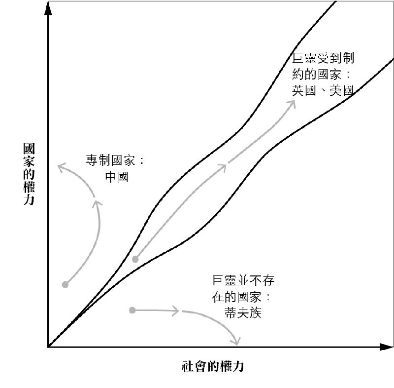
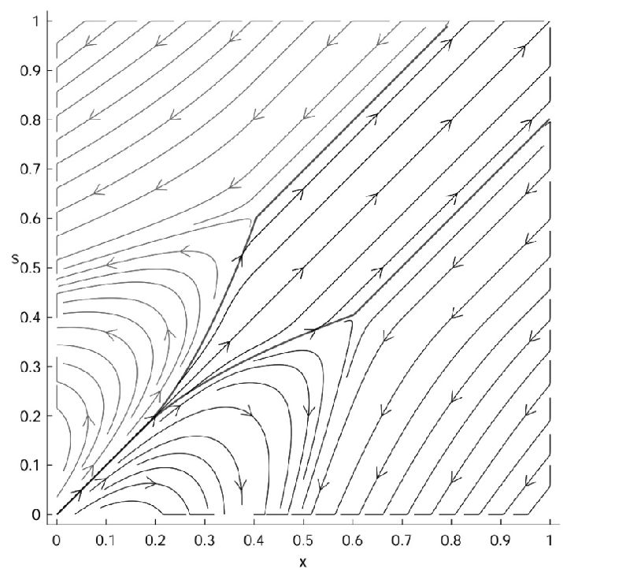

# 中文版导读 · 林明仁

## 自由之路为何如履薄冰？ 笨蛋，关键在社会！

林明仁／台湾大学经济学系特聘教授

（二○一八年十二月，作者之一的罗宾森教授于台大经济系孙震讲座中就《自由的窄廊》一书未完成书稿发表演说，本导读有多处取材自当天讲座内容，特此说明。）

政治与经济的自由，是人类意识形态史上面貌最多变、也最复杂一种发明。对自由，人们的情感总是爱恨交织。在历史上的任何时间点，我们总是能找到一群自由的死忠支持者，愿意为它抛头颅洒热血。但同时也一定有同等的「黑暗力量」，喜爱秩序远胜于人们的自由选择。即便到了现代，这两股力量的较劲也时有胜负：一九九二年法兰西斯．福山在他的大作《历史之终结与最后一人》中，霸气宣称自由民主与市场经济，是人类意识形态演化的最终胜利者。当时的乐观氛围，即便在三十年后仍令人记忆犹新。不过后续的发展却与他的预期大相迳庭：民粹主义、宗教与种族冲突、被利益团体把持的民主政治、金融危机的发生、不平等的增加、民主政治的无效率，以及中国的崛起等，都削弱了人们对民主制度的信心。即便是福山自己，也在其后续的《政治秩序的起源》和《政治秩序与政治衰败》中，提出了国家能力、法治与民主问责制三要素间的平衡，才是自由能否持续的重中之重。

诚然，自由的成功并不容易。有些社会没有可运作的国家机器来维持法律与秩序；有些社会虽然有强大国家机器确保秩序，但却是以夺走人民自由作为代价。而这类社会对人们思想自由与经济自由的限制，并不下于无政府的社会。在政治哲学的讨论中，政治与问责制度的设计、法治的强化，都是重点。但社会在此中扮演什么角色？却是较少被提及的。正是在这样的智识氛围下，艾塞默鲁（Daron Acemoglu）与罗宾森（James A. Robinson）两位作者挺身而出，从社会与国家的互动和平衡出发，试图为自由的支持者指出一条明路。这个观点，也与他们的前一本巨著《国家为么会失败》相呼应：当提到广纳性的政治体制时，决定什么该被包容，要包容到什么程度，就也必定牵涉到社会的角色及其如何与国家权力互动的过程。

## 自由为何重要？

本书先从爱尔兰政治哲学家菲利浦．佩蒂特（Philip Pettit）的想法出发：一个人要活得有尊严，要有免于被支配、恐惧、不安全、不安定的自由。但问题来了：人要如何取得自由？最有名的观点便是霍布斯的「国家巨灵」（Leviathan）说，是巨灵使得人们拥有免于「孤独、贫困、难受、残酷、匮乏」的自由。但这样的说法，马上就衍生出下一个问题：国家虽然可以协助人们取得自由，但国家也可能剥夺人们的自由，乃至支配其人民。书中的一个例子是《墓碑》里的张福洪，完美示范了国家是如何剥夺人民的自由。《墓碑》是中国知名记者杨继绳调查中国一九五八至一九六二年大饥荒的作品，杨是新华社高级记者，在一九九二年开始享受中国国务院特殊津贴。《墓碑》这本书的贡献在于，即便在中国的政治环境里，他仍然由中共内部明确指出，中国大饥荒明明白白是由国家所造成的人祸，而非单纯由天灾造成。书中所提的张福洪，是河南省光山县的县委书记处书记。一九五九年为了解决饥荒蔓延的问题，光山县的县委书记马龙山，曾派张福洪搞「包产到户」。但在一九五九年七月的庐山会议，当中国国防部长兼国务院副总理彭怀德向毛泽东批评「大跃进」有浮报等问题时，毛泽东却反过来发动了对彭怀德的批判，最终以彭为首的一群人遭到批斗，其结果就是全国性的「反右倾运动」。「包产到户」被评为「右倾」，而马龙山为了自保，便率先批评张福洪，将他给斗死了。简单来说，整个大饥荒是国家（独裁者毛泽东）不受控，反过来剥夺人民生命与自由的结果。而这样的下场，即便你是执行原来独裁者命令的公务人员，也无法幸免。

## 只有制衡不够：吉尔迦美什难题

那要如何控制巨灵？一个通论便是英国哲学家约翰．洛克与美国先贤詹姆斯．麦迪逊的解方：权力制衡（Checks and balances）。但本书最大的贡献之一，便是指出光有制衡并不够。换句话说，制衡是政治稳定的必要但非充要条件。没有制衡不行，但只有制衡也远远不够。

本书用了吉尔迦美什（Gilgamesh）的史诗来说明这个论点。《吉尔迦美什史诗》是人类是上最早的文学作品，据信成于公元前二七○○年左右。据其所载，吉尔迦美什是美索不达米亚地区「乌鲁克」（Uruk）的国王，该城在西元前三○○○年有高达五万到八万的居民，应为当时世上最大的城市，且甚为富裕。这位国王虽然相貌堂堂且力大无穷（可说是史上第一高富帅，在时下动漫电玩文化中也常以此一特质现身），却甚为暴虐，不但强抢人妻少女，也奴役人民（颇类似中国历史上的商纣王）。使用历史上第一篇文字记载作为政府的原型描述，是一个相当聪明的写作手法：运用吉尔迦美什虽然打败怪兽却也强占民女的故事，来隐喻政府会做好事，也会做坏事。这让人民对政府的感觉陷入爱恨两难。

乌鲁克市民对这件事的解方为何？他们选择向苏美神明中最大尾的众神之父阿努（Anu）求救，阿努便想出了世上第一套的权力制衡：他复制了一个吉尔迦美什，唤名恩其都（Enkidu），让他们互相牵制。起初恩其都的确达成任务，但是两人在大战一场后，却英雄惜英雄成为好友，他们「互相拥吻，像兄弟一样手牵着手，并肩走在一起，变成真正的朋友。」权力制衡反而导致两个英雄合作。虽说史诗后来提到吉尔迦美什在恩其都死亡后，开始思考永生与救赎等议题，但这个故事对政治制度设计者的含义是很清楚的：找一个力量相当的人来制衡，这个机制并无法避免勾结。其实亚当．斯密在《国富论》中也有类似的观察：「同行人士很少碰面。但他们一但碰面，要嘛就是串通起来对付公众，要不就是巧立名目来涨价。」

## 天助自助者：社会力量的必要

乌鲁克（Uruk）这座城市少了什么？两位作者认为这座城市少了「社会」。如前所述，乌鲁克市民在面临如何控制政府时，选择的方案是向天神求助、找来打手，而非动员自己的社会力量，与政府直球对决。历史上「社会」在欧洲的国家建构跟形成自由的过程中，扮演不可或缺的角色；但在目前政治经济学跟政治哲学上，却较少被探讨，这也是本书的另一个贡献。

举例来说，塔西佗（Tacitus）在西元九八年时观察到了日耳曼蛮族有「大会」（Assembly）的传统，即是原始的民主选举（共议）制度，另外如英国的大宪章或北欧的制度，也有类似的功能。而透过查尔斯．堤利（Charles Tilly）的作品，两位作者也提到了英国的发展过程中，国家跟社会是互相挣扎的，国家贯穿社会，社会限制国家，在矛盾中不断的竞争与互助的结果，则是人民的福祉的提升。

亚洲读者或者会问：为什么社会的重要性会被提出来讨论？这或许与欧洲的历史有关。在千余年的历史中，欧洲国家经常处于与他国从事直接军事、经济、与技术竞争的状态。君主就跟现代公司的CEO一样，时时刻刻都在接受考验，能力不足立刻被干掉或架空的领导者也不少。尤有甚者，不同的政治体制如城邦国家，或国家内的诸侯、行会（Guild）、商会组织再加上教会，都对资源分配有相当程度的影响。在任何一个时间点，国内与国际间都有相当数目的政治玩家（political players），因此很多时候，国家并不是一切，君主也必须经常与社会其他力量竞争或妥协，而人民的确也看到了这些竞争的好处（或坏处？），而更愿意参与不同的社会力量动员，这也形成了社会参与的正式与非正式性的制度基础。

但亚洲社会经历的似乎是不那么一样的过程。举例来说，福山在追溯世界政治制度起源时，就强调作为一个拥有官僚体制及科举制度的中央极权政体，中国的「现代国家」的特质，比欧洲早出现了一千八百年，使中国人一直都很倾向国家主义。有人认为这与中国特殊的河道泛滥频繁情况，导致在早期就需要就强而有力的政府有关。而这样的路径依赖（path dependence），也使中国人倾向强调国家与秩序的重要性，而非社会的自主动员。这当然是一个程度的问题，不过亚洲读者在阅读本书时，或许因此会需要比较多的智识想像也不一定。

## 受制约的巨灵与持续的竞争红皇后效应

行文至此，读者应该可以猜到，本书的重点即在国家与社会的竞合关系。简而言之，欧洲的巨灵的发展，就是国家跟社会互相竞争的结果，作者将此一动态过程称之为红皇后效应：巨灵想要压制社会，社会也会反过来想办法约束巨灵。理想的情况是，在彼此势均力敌的情况下，双方都变强了，但是并不是所有的发展都是朝这方向进行的。现实世界中，国家压制社会，或社会太强导致国家无法形成，这两种反例都经常发生。

「国强民弱」的中国，是书中国家压制社会的「专制巨灵」（Despotic Leviathan）代表。早期如荀子便提到「水能载舟、亦能覆舟」的模式，但是赢政却透过商鞅得到了新模式「国强民弱」的理论基础。商鞅在《商君书．弱民篇》的开头便提到：民弱国强，民强国弱，故有道之国，务在弱民。朴则强，淫则弱；弱则轨，淫则越志；弱则有用，越志则强。故曰：「以强去强者弱，以弱去强者强。」这便是贯穿《商君书》的想法。在法家作品里，弱民是商鞅特别突出的一环，在〈画策篇〉便提到：「昔之能制天下者，必先制其民者也；能胜强敌者，必先胜其民者也。」因为在商鞅的眼光里，国家机器的终极目标是：「圣王者，不贵义而贵法；法必明，令必行，则已矣。」讽刺的是，毛泽东在给郭沫若的诗也曾经提到「百代犹行秦法政」，而作者也认为这套弱民思想依然普及在中国，并在书中举了中国这套「社会信用制度」来阐明中国式的专制巨灵，对其有诸多批判。

与中国相反的，是受制于「社会规范牢笼」（Cage of Norm）〔注1〕 而没有办法建立国家的蒂夫族（Tiv）。分布在奈及利亚的蒂夫族是很特别的族群，因为在二十世纪之前，他们并未产生酋长制度。原因是他们的社会习俗将「有权力」跟「邪恶巫术」两件事绑在一起，所以对于任何一点国家机器都有很大的恐惧。在这样的社会里，无法发展出国家，也没有办法受益于巨灵带来的秩序跟好处。受制规范牢笼的社会将会是一个四分五裂的社会，缺少巨灵提供公共财维持秩序（书中举了一个黎巴嫩政府连垃圾都没法收的例子），社会福祉自然无法提升。之所以产生这个结果，是因为许多社会害怕「滑波问题」（slippery slope problem），也就是一旦创造了巨灵，巨灵就会如滚雪球般的愈来愈失控，所以不如一开始就不要创造他。

## 一图以蔽之

一言以蔽之，只有社会跟国家互相激励、竞争的国家，才有办法达到足够高的国家实力跟社会实力，而国家／社会不平衡的时候，反而会有发展上愈来愈退化的倾向。但是要维持国家与社会平衡的增长并不容易，一但一方实力超越另一方太多，发展就会失衡，这也是作者将这块狭长区域称作「窄廊」的原因。这个概念可以以以下两个图来说明，虽然有点抽象，但其结果是有数理基础支持的。

图一出自本书，图二则来自两位作者在二○一七年美国全国经济研究所（NBER）的研究论文底稿〈脆弱国家、专制国家与广纳国家的形成〉（The Emergence of Weak, Despotic and Inclusive States），此一相态图可说是图一的模拟结果。作者在这篇文章推导了一个总体模型，使用《荷马史诗》等例子作为佐证，也做了很多动态模拟（simulation of dynamics），而这些动态模拟的结果，就累积成了这本书主要论述的内容。以下说明这个总体模型的模拟结果。

图一

假设国家（或是菁英）跟社会（或是非菁英的民众）互相投资自己的势力（也就是国家持续投资国家实力，而社会提升社会实力），当有一方的投资结果胜过另一方的时候，则该方获胜。所以这个模型本质是两股势力的总体投资竞赛，这是一个相当简单的总体经济理论基本模型。此模型的一个重要意涵是，只有在国家跟社会的参数都保持在一定的范围内，而且彼此没有远远压制对方的时候，动态均衡才会是「受制约的巨灵」（Shackled Leviathan）。此时在动态上，两个数值（国家实力跟社会实力）才会内生自动成长到高点。如果有一方远胜另一方，则此一动态过程到最后，国家实力跟社会实力都无法突破一定的门槛，甚至还会退化。

图二是该篇论文展示数值分析的结果。图中X轴是社会实力，S轴（Y轴）是国家实力，从动态模拟的箭头的方向可知：只有「国强又民强」的巨灵，才能一口气冲向右上角（X＝○．九，S＝○．九，如现在英美等国的情况）。举例来说，如果是如大清帝国这种国强而民弱的例子，S＝○．四，X＝○．二，此时顺着箭头方向的动态结果，不但能到达的S不会太高（可能是小于○．五），更糟的是这是以X变小作为代价。换句话说，专制国家以为可以以压制社会作为代价让国家变强，但最后的结果不但是社会变弱，国家实力也无法提升。要达到像英美等国国家与社会皆强的总体实力，除了政府强外，社会也不能太弱，才有办法透过红皇后效应让国家跟社会互相激励，在中间的窄廊地带往前进，成为真正的强国。这也是罗宾森在二○一八年在台大孙震讲座中特别强调的：「商鞅是错的，民弱则国无法强。」

图二

## 我们可以怎么做？

北欧经验经常在讨论理想的治理形态中出现。向丹麦学习（Getting to Demark）这个比喻指的就是一个国家转大人，迈向繁荣、稳定、法治的过程，北欧诸国国家治理的能力与社会参与的能量的确也经常让人感到惊艳。某种程度上来说，这些国家可能是作者心中在窄廊优雅前进最好的例子。

但是要如何做到？简单的答案是：「很难。」复杂一点的答案，就是贯穿整本书的重要概念：「国家跟社会的平衡。」然而，这个平衡跟国家的文化、制度、经济机会、甚至运气都有很大的关系。国家不必然会走向受制约的巨灵，已经朝向这个方向的，也不能保证不会走回头路。举例来说，许多东欧国家在一九九○年代开始民主化，但现在看起来这条路走得相当颠簸，俄国就更不用说了。即便在民主已经发展相当长一段时间的国家，有掠夺倾向的菁英也无不虎视眈眈想要掌握国家权力，进而让巨灵为己所用。作者们也以目前美国民主的进程，包括川普主义以及资本主义对自由的影响来论证这些说法。换句话说，渴望权力的菁英，仍旧是「受制约巨灵」的最大威胁。

历史经验告诉我们，虽然人们通常会因为渴望秩序、害怕社会混乱而支持专制，但专制的巨灵一但崩溃，就会有很大的机会进入无政府状态，伊朗或大跃进时代的中国，都是很好的例子。此时社会发展大幅倒退，之前累积的国家与社会实力毁于一旦。若该国原来就有非常大规范牢笼的情况（如印度），民主的影响也不见得能发挥。最后，现在幸运落在窄廊的国家，也没有任何理论基础支持它们会一直留在窄廊里。

有人认为历史的偶然，在是否留在窄廊这过程中扮演重要角色。但是两位作者拒绝接受这这个倾向历史决定论的说法。「历史会有影响」不代表「历史就是命定」。只要公民社会愿意积极参与，动员自己挺身而出，负起制约巨灵的角色，就能让政府回应社会的意志，增加该国留在窄廊的机会。最后，也容我做点概念上的补充修正：在书中，国家与社会是似乎是两个不同的群体。但如果国家机器中除了权力菁英之外，的所有公仆，在认知层次上都是先认同自己是公民社会的一分子，再来才是代表国家机器执行公权力的公仆，那领导菁英要把持巨灵或国家机器，困难度就会大上很多。

台湾可以从本书得到什么启示呢？许多人可能会觉得台湾吵吵闹闹，没有秩序，比不过对岸中国有强大的国家让经济发展，但我的看法却是完全不同：从美丽岛到野百合，从国会全面改选到总统直选，从红衫军到太阳花，再到韩流崛起，台湾在过去三十年内经历了许多次的大型社会运动。在这些运动中，各方的冲突并不算小，而过程也对当时参与的各方人马，留下了不可磨灭的历史印记。但是就在同一个时期，我们也经历过了七次总统直选、九次国会改选、三次政党轮替，更遑论大大小小不知多少次的地方政府轮替。但我们若仔细想想，这些运动，是否都在后来为我们带来了更多的制度改变？不论是让政府官员与民代更具代表性与正当性，让权力集中所带来的贪污腐败问题更被突显，甚或是对少数族群带来巨大影响政策的正当性等。而这些矛盾，也都在政府做出某些程度的反应或让步，与后续的各个层级公职人员选举的结果（某种程度上也就是对这些冲突的公民复决）中，获得某种程度的缓解，让我们更往广纳型制度的方向前进。

如果读者认为一个台湾人提出这样的观点没有说服力，那我们可以来听听大师本人怎么说。罗宾森在二○一八年底应台大经济系之邀来首次来台访问，并发表了四场公开演说。他在接受《今周刊》的专访中就强调，他到过全世界一百多个国家访问讲学，「在广纳型制度的配方中特别重要的积极投资教育、鼓励创新、具活力的经济环境、可接受的贫富差距、特别是民主制度，台湾完成的事情，真的很不容易！」他也以太阳花运动为例，认为它「不但没有演变成无法收拾的动乱」，反而让各个社会与政治势力达成了某种程度的共识。我认为台湾其他的社会冲突，也都有这样的结果。罗宾森强调，从《国家为什么会失败》这本书的理论架构来看，台湾绝对不会是一个失败的国家。我想若从《自由的窄廊》这本书的思路来说，他应该也会同意台湾是世界上还在窄廊中挣扎的少数国家之一吧！

整体来说，本书在这个架构之下，提供了非常多涵盖不同国家与时间的历史资料作为佐证。如果要说有什么缺点，可能就是提供了太多的历史细节，如果不是已经相当博学且阅读细心的读者，可能不大容易完全掌握。另外有些评论也认为作者的国家／社会竞合模型，要解释所有的历史事实还是有点太过包罗万象，有太多例外会需要解释。而社会如何与政府互动的理论建构与解释，也还有可以再补充的地方。但平心而论，作者们不应该因为他们没有达到无人能及的高标准而受到批评。毕竟《自由的窄廊》与《国家为什么会失败》这两本书，在自由民主正处于过去五十年来遭受最多质疑的年代，仍然是鼓励我们思考如何对抗极权、捍卫自由最有力的两本经典之一。就让我以罗宾森在讨论此议题时，最爱引用的美国开国元勋富兰克林的名言，作为此一导读的结语：「我们若不团结，必然各无死所。」（We must, indeed, all hang together, or most assuredly, we shall all hang separately.）

〔注1〕此名词灵感应该是来自于马克思．韦伯的「铁牢笼」（Iron Cage）概念。
